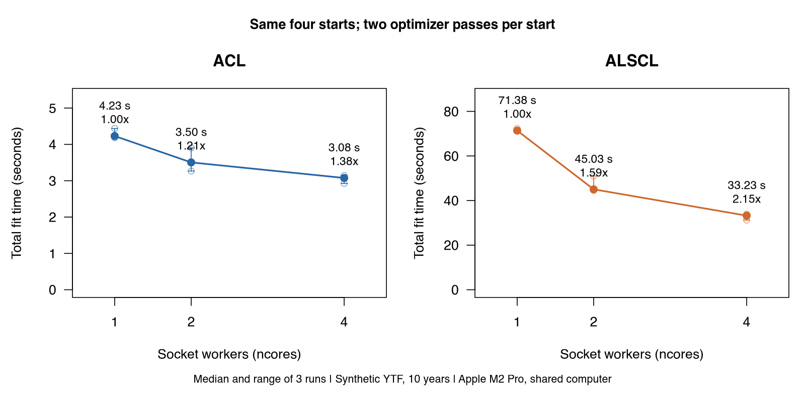

# 复现与故障处理 / Reproducibility and troubleshooting

<!-- Generated by scripts/build_manual.py from website/content/{en,zh}/articles/. Edit the article pair, not this file. -->

[使用指南 / User guide](USER_GUIDE.md) · [首页 / Home](../README.md)

## 复现结果与排除故障 / Reproduce results and fix problems

读完[理解第一次拟合](USER_GUIDE.md#builtin)之后，你已经有了输入列表 `x` 和拟合好的 ACL 模型 `a`。本页教你记录拟合依赖的内容、在以后的会话中重建拟合、并行运行拟合、在会话之间保留编译好的模型，以及查找常见错误。

After [Understand your first fit](USER_GUIDE.md#builtin) you have the input bundle `x` and the fitted ACL model `a`. On this page you record what the fit depends on, rebuild it in a later session, run fits in parallel, keep the compiled models between sessions, and look up the common errors.

<a id="reproducibility-record"></a>

### 1. 记录拟合依赖的内容 / Record what a fit depends on

```r
save_assessment(a, "ytf_acl.rds", overwrite = TRUE)
packageVersion("ALSCL")
a$recipe$versions
a$recipe$implementation$source$revision
writeLines(capture.output(sessionInfo()), "sessionInfo.txt")
```

`save_assessment()` 保存拟合结果，不含当前会话的 TMB 对象 `a$obj`，并附上记录拟合全部依赖内容的配方：

`save_assessment()` writes the fit without the live TMB object `a$obj` and with a recipe that records everything the fit depends on:

| 内容 / Item | 在保存的拟合结果中的位置 / Where in the saved fit |
|---|---|
| 数据表、设置、参数初值、边界、`map`、`nstarts` 和调用的其他参数 / Tables, settings, starting values, bounds, `map`, `nstarts` and the other arguments of the call | `recipe$args` |
| ALSCL、TMB 和 R 的版本 / ALSCL, TMB and R versions | `recipe$versions` |
| 模型源文件的 MD5 值、已知时的 Git 修订号、平台、BLAS、LAPACK、Matrix 和 RcppEigen / MD5 hashes of the model source, Git revision when known, platform, BLAS, LAPACK, Matrix and RcppEigen | `recipe$implementation` |
| 速度设置，`framework` 和 `sd_cores` / Speed settings, `framework` and `sd_cores` | `recipe$settings` |

`sessionInfo()` 补充操作系统、BLAS 和 LAPACK 库以及已加载的软件包；把它的输出和保存的文件放在一起。拟合模型模拟还依赖随机种子，`simulate_fit()` 会把它记录在 `metadata$seed` 中。

`sessionInfo()` adds the operating system, the BLAS and LAPACK libraries and the loaded packages; keep its output next to the saved file. A fitted-model simulation also depends on its seed, which `simulate_fit()` records in `metadata$seed`.

当文件已存在（请设置 `overwrite = TRUE`）、文件夹不存在，或拟合结果没有配方时，`save_assessment()` 会报错停止；此时把输入列表作为 `x` 传入，配方会由它重建。

`save_assessment()` stops when the file exists (set `overwrite = TRUE`), when its folder is missing, or when a fit has no recipe; then pass the bundle as `x` and the recipe is rebuilt from it.

<a id="reproducibility-reproduce"></a>

### 2. 在以后重现拟合 / Reproduce a fit later

```r
saved <- read_assessment("ytf_acl.rds")
plot_compare_selectivity(a, saved, model1_name = "Original", model2_name = "Saved")
refit <- refit_model(saved)
max(abs(refit$opt$par - saved$opt$par))
all.equal(refit$report$SSB, saved$report$SSB)
```

`read_assessment()` 返回保存的拟合结果，所有绘图和提取函数都能使用它；它没有可执行的 TMB 对象，因为 `a$obj` 保存的是指向拟合时所在会话中编译模型的指针。`plot_compare_selectivity()` 从保存的输入恢复固定调查可捕性，原结果与保存结果的曲线重合，无须重新拟合。`refit_model()` 重新拟合配方，返回带有可执行对象的拟合结果；命名参数会覆盖配方，`map` 这类列表会整体替换保存的列表。

`read_assessment()` returns the saved fit, which every plot and extraction function accepts; it has no live TMB object, because `a$obj` holds pointers into the compiled model of the session that made the fit. `plot_compare_selectivity()` recovers fixed survey catchability from the saved inputs, so the original and saved curves coincide without refitting. `refit_model()` fits the recipe again and returns a fit with a live object; named arguments override the recipe, and a list such as `map` replaces the stored list.

在同一台电脑上使用相同版本的 ALSCL、TMB 和 R 时，标量参数逐位相同，`all.equal()` 返回 `TRUE`。不同机器或不同软件包版本之间末位数字的差异来自浮点运算和优化器的停止规则；大到足以改变结论的差异，说明数据、设置或软件包版本不同。

On the same computer with the same versions of ALSCL, TMB and R, the scalar parameters agree to the last digit and `all.equal()` returns `TRUE`. Differences in the last digits between machines or package versions come from floating-point arithmetic and the optimizer's stopping rule; a difference large enough to change a conclusion means the data, settings or package version differ.

`refit_model()` 发现 ALSCL、TMB、Matrix 或 RcppEigen 的版本或模型源文件与配方不同时会给出警告；要逐位复现，请安装 `saved$recipe$versions` 中的版本。`A complete fit recipe is required` 表示拟合结果没有配方；按第 1 步用 `x` 重新保存。

`refit_model()` warns when the ALSCL, TMB, Matrix or RcppEigen version or the model source differs from the recipe; to reproduce exactly, install the versions in `saved$recipe$versions`. `A complete fit recipe is required` means the fit has no recipe; save it again with `x` as in step 1.

<a id="reproducibility-parallel"></a>

### 3. 并行运行拟合 / Run fits in parallel

```r
a4 <- run_acl(x, nstarts = 4, ncores = 2, silent = TRUE)
a4$start_diagnostics
a4$workers
```

`ncores` 决定一个函数启动多少个 socket 进程，即新的 R 进程。每个进程运行完整的初值或完整的拟合，因此结果与顺序运行相同。

`ncores` sets how many socket workers, new R processes, a function starts. Each worker runs whole starts or whole fits, so the results equal a sequential run.

| 函数 / Function | 分配给进程的工作 / What runs on the workers | 每次拟合的初值个数 / Starts in each fit |
|---|---|---|
| `run_acl()`、`run_alscl()` / `run_acl()`, `run_alscl()` | 各个初值，最多 `min(ncores, nstarts)` 个进程 / The starts, on at most `min(ncores, nstarts)` workers | `nstarts`，默认等于 `ncores` / `nstarts`, default `ncores` |
| `retro_model()`、`retro_acl()`、`retro_alscl()` / `retro_model()`, `retro_acl()`, `retro_alscl()` | 回溯分析的各轮 / The peels of the retrospective analysis | 输入列表或调用中明确给出的 `nstarts`，否则为一个，依次运行 / The explicit `nstarts` of the bundle or call, otherwise one, in sequence |
| `fit_scenarios()`、`hindcast_model()` / `fit_scenarios()`, `hindcast_model()` | 各项任务：每个情景或每个训练折 / The tasks: one scenario or training fold each | 同上 / The same rule |
| `sim_model()`、`sim_acl()`、`sim_alscl()` / `sim_model()`, `sim_acl()`, `sim_alscl()` | 各个重复 / The replicates | `nstarts`，默认为一个 / `nstarts`, default one |

由于 `nstarts` 默认等于 `ncores`，比较耗时时请同时设置两者。后续初值加上固定的扰动，最后选出目标函数最小的初值，因此无论 `ncores` 为多少，结果都相同；`a4$start_diagnostics` 记录每个初值。其他函数不使用输入列表中的 `ncores`，每次拟合只用一个进程并顺序计算标准误。

Because `nstarts` defaults to `ncores`, set both when you compare timings. Later starts add fixed perturbations and the lowest objective is selected, so the result is the same for any `ncores`; `a4$start_diagnostics` records each start. The other functions ignore the `ncores` of a bundle and give each fit one worker and sequential standard errors.

一次拟合内部计算标准误所用的核数是另一项设置，`alscl_speed(sd_cores = ...)`，结果与顺序计算完全相同；[速度设置](SPEED_GUIDE.md)有说明。

The cores used for the standard errors inside one fit are a separate setting, `alscl_speed(sd_cores = ...)`, with results identical to the sequential calculation; [Speed settings](SPEED_GUIDE.md) explains it.

2026 年 10 月 7 日的基准测试（Apple M2 Pro，R 4.6.0，TMB 1.9.21）用 `YTF_example` 的前 10 年拟合两个模型，每次使用相同的四个初值，每种进程数重复三次；不计编译，计入进程启动。

In a benchmark on 7 October 2026 (Apple M2 Pro, R 4.6.0, TMB 1.9.21), both models were fitted to the first 10 years of `YTF_example` with the same four starts, three times per number of workers; compilation was excluded and worker start-up included.

| 模型 / Model | 进程数 / Workers | 中位数（秒） / Median (s) | 范围（秒） / Range (s) | 加速比 / Speed-up |
|---|---:|---:|---:|---:|
| ACL | 1 | 4.23 | 4.18-4.44 | 1.00x |
| ACL | 2 | 3.50 | 3.27-3.90 | 1.21x |
| ACL | 4 | 3.08 | 2.93-3.14 | 1.38x |
| ALSCL | 1 | 71.4 | 71.3-72.4 | 1.00x |
| ALSCL | 2 | 45.0 | 44.6-51.0 | 1.59x |
| ALSCL | 4 | 33.2 | 31.2-34.0 | 2.15x |



圆点是三次测量，折线是中位数，误差线是范围。测试时电脑与其他分析共用，结果只在该负载和该机器的条件下成立。参见[基准测试报告](PARALLEL_BENCHMARK.md)、[原始耗时](results/parallel/runs.csv)和[基准测试脚本](https://github.com/FanZhang-LAB-SHOU/ALSCL/blob/main/scripts/benchmark_parallel.R)。

The points are the three measurements, the lines the medians and the bars the ranges. The computer was shared with other analyses, so the results are conditional on that workload and machine. See the [benchmark report](PARALLEL_BENCHMARK.md), the [raw timings](results/parallel/runs.csv) and the [benchmark script](https://github.com/FanZhang-LAB-SHOU/ALSCL/blob/main/scripts/benchmark_parallel.R).

<a id="reproducibility-compile"></a>

### 4. 编译与缓存 / Compilation and the cache

```r
options(ALSCL.tmb.cache = tools::R_user_dir("ALSCL", "cache"))
a <- run_acl(x, silent = TRUE)
list.files(getOption("ALSCL.tmb.cache"))
```

每个模型的第一次拟合把它的 C++ 模板编译到缓存的一个文件夹中，文件夹名是一个键，由模型源文件和头文件的 MD5 值、R、TMB 和 RcppEigen 版本、OpenMP 标志以及 `framework` 计算得到；键相同的拟合直接加载库，不再编译。默认缓存位于 `tempdir()` 之下，R 在会话结束时删除它。在第一次拟合之前设置 `ALSCL.tmb.cache`，例如写在 `.Rprofile` 中，编译好的模型就能在会话之间保留；socket 进程加载会话编译好的库。

The first fit of each model compiles its C++ template into a cache folder named by a key computed from the MD5 hashes of the model source and header, the R, TMB and RcppEigen versions, the OpenMP flag and the `framework`; a fit with the same key loads the library without compiling. The default cache lies under `tempdir()`, which R removes at the end of the session. Set `ALSCL.tmb.cache` before the first fit, for example in `.Rprofile`, to keep the compiled models between sessions; socket workers load the library compiled by the session.

编译需要 C++ 编译器：

Compiling needs a C++ compiler:

| 系统 / System | 编译器 / Compiler |
|---|---|
| Windows | 与 R 版本对应的 Rtools / Rtools for your R version |
| macOS | Xcode Command Line Tools（`xcode-select --install`） / The Xcode Command Line Tools (`xcode-select --install`) |
| Linux | C++ 编译器和 `make`，例如 `build-essential` / A C++ compiler and `make`, for example `build-essential` |

[安装 ALSCL 并完成第一次拟合](USER_GUIDE.md#getting-started-compiler)说明安装方法；编译错误中会出现 `TMB::compile`、`make` 或编译器的名字。

[Install ALSCL and run a first fit](USER_GUIDE.md#getting-started-compiler) explains the installation; compilation errors name `TMB::compile`, `make` or the compiler.

<a id="reproducibility-troubleshoot"></a>

### 5. 故障排除 / Troubleshooting

错误信息按软件包打印的原文引用。

Error messages are quoted as the package prints them.

| 现象 / Symptom | 常见原因 / Likely cause | 处理方法 / What to do |
|---|---|---|
| `YTF$data.CatL` 是 `NULL` / `YTF$data.CatL` is `NULL` | `YTF` 存放参数，不是数据表 / `YTF` holds parameters, not tables | 使用 `YTF_example` / Use `YTF_example` |
| 年份标签读成 `X2000`，或 `must match data.CatL length labels and time columns` / Year labels read as `X2000`, or `must match data.CatL length labels and time columns` | `read.csv()` 给列名加上 `X`，各表不一致 / `read.csv()` adds `X`; the tables differ | 用 `check.names = FALSE` 读取全部表 / Read all tables with `check.names = FALSE` |
| `Length intervals must have positive widths and be contiguous` | 体长组标签重叠或有空隙 / Bin labels overlap or leave gaps | 改正标签，或提供 `len_mid` 和 `len_border` / Correct the labels or supply `len_mid` and `len_border` |
| `Time columns must have increasing numeric labels` 或 `Time column spacing must equal growth_step` / `Time columns must have increasing numeric labels` or `Time column spacing must equal growth_step` | 缺少时间步，或 `growth_step` 不对 / A missing time step or a wrong `growth_step` | 缺失的时间步保留为 NA 列，并设置 `growth_step` / Keep the step as an NA column and set `growth_step` |
| 调查表中有零 / Zeros in the survey table | 零按缺失处理（`zero_action = "missing"`） / Zeros count as missing (`zero_action = "missing"`) | 拟合前判断零是否真实 / Decide whether a zero is real before fitting |
| 体重表或成熟比例表有空白单元格 / Blank cells in the weight or maturity table | 两张表必须完整 / Both tables must be complete | 补全并记录来源 / Fill them and record the source |
| 收敛码不是 0、梯度大或 Hessian 不正定 / Convergence code not 0, large gradient or Hessian not positive definite | 优化器提前停止，或某个参数得不到信息 / The optimizer stopped early or a parameter is not informed | 见[理解第一次拟合](USER_GUIDE.md#first-model-checks) / See [Understand your first fit](USER_GUIDE.md#first-model-checks) |
| 季度 F 看起来偏小 / Quarterly F looks small | F 在所有输出中都按时间步计 / Every output gives F per time step | 按时间步报告 F / Report F per time step |
| 对 ACL 拟合调用 `plot_fishing_mortality(a, type = "length")` 给出警告 / `plot_fishing_mortality(a, type = "length")` warns on an ACL fit | ACL 没有按体长的 F；`"length"` 等同 `"age"` / ACL has no F by length; `"length"` means `"age"` | 用 `type = "age"`，或拟合 ALSCL / Use `type = "age"` or fit ALSCL |
| `plot_VB()` 只画出一条线，没有区间 / `plot_VB()` draws a line without an interval | 生长参数被固定 / The growth parameters are fixed | 属于预期；用 `map` 释放 / Expected; release them with `map` |
| 第一次拟合报错，信息中出现 `TMB::compile`、`make`、`g++` 或 `clang` / The first fit names `TMB::compile`, `make`, `g++` or `clang` | 没有编译器，或 Rtools 对应另一个 R 版本 / No compiler, or Rtools for another R version | 安装编译器（第 4 步），重启 R / Install the compiler (step 4), restart R |
| `Install RcppEigen to compile model templates` 或 `Model sources are missing` / `Install RcppEigen to compile model templates` or `Model sources are missing` | 缺少 RcppEigen，或安装损坏 / RcppEigen absent, or a damaged installation | 安装 RcppEigen 或重新安装 ALSCL / Install RcppEigen or reinstall ALSCL |
| `Socket worker loaded a different ALSCL installation` | 进程先找到了另一个库中的副本 / A worker found another copy in a different library | 只保留一个安装，或用 `ncores = 1` / Keep one installation, or use `ncores = 1` |
| Windows 或 RStudio 中 socket 进程失败，或 `Parallel standard errors failed` / Socket workers fail on Windows or in RStudio, or `Parallel standard errors failed` | 新的 R 进程无法启动 / The new R processes could not start | 用 `ncores = 1` 或 `alscl_speed(sd_cores = 1)` / Use `ncores = 1` or `alscl_speed(sd_cores = 1)` |
| 回溯分析后 `rho_text$Rho` 是 `NA` / `rho_text$Rho` is `NA` after a retrospective analysis | 某次拟合未通过数值检查 / A fit failed the numerical checks | 查看 `fit_diagnostics` 和 `rho_by_peel`，修正该拟合 / Read `fit_diagnostics` and `rho_by_peel`, fix that fit |
| `The current implementation differs from the saved assessment` | 保存之后软件包、TMB 或模型源文件变了 / Package, TMB or model source changed since the save | 预期末位有差异，或安装记录的版本 / Expect last-digit differences, or install the recorded versions |
| `A complete fit recipe is required` | 拟合没有配方 / The fit has no recipe | 重新拟合，或带 `x = x` 保存 / Refit, or save with `x = x` |

<a id="reproducibility-next"></a>

### 下一步 / What next

| 想做什么 / What you want to do | 阅读 / Read |
|---|---|
| 检验估计值对固定值的敏感性 / Test the sensitivity of the estimates to the fixed values | [判断拟合是否可用](USER_GUIDE.md#diagnostics-sensitivity) / [Judge whether a fit can be used](USER_GUIDE.md#diagnostics-sensitivity) |
| 选择速度设置并检查本会话的实际情况 / Choose the speed settings and check what your session does | [速度设置](SPEED_GUIDE.md) / [Speed settings](SPEED_GUIDE.md) |
| 运行回溯分析并解读 Mohn's rho / Run a retrospective analysis and read Mohn's rho | [回溯分析](USER_GUIDE.md#retrospective) / [Retrospectives](USER_GUIDE.md#retrospective) |
| 从拟合模型模拟，或检验对留出时间步的预测 / Simulate from the fit or test predictions of withheld time steps | [模型验证](MODEL_VALIDATION.md) / [Model validation](MODEL_VALIDATION.md) |
| 比较情景、做参数剖面和投影 / Compare scenarios, profile a parameter, project forward | [评估工作流](ASSESSMENT_WORKFLOWS.md) / [Assessment workflows](ASSESSMENT_WORKFLOWS.md) |
