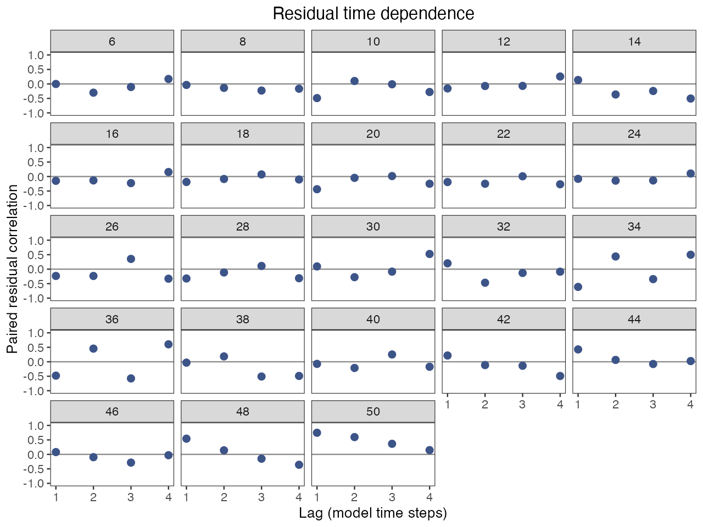
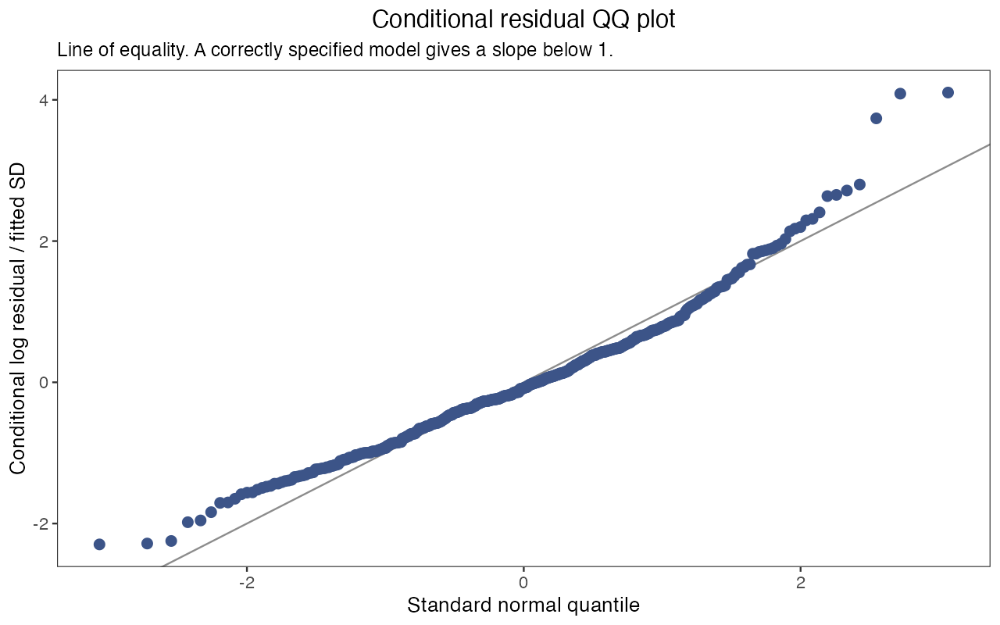

# 评估工作流 / Assessment workflows

<!-- Generated by scripts/build_manual.py from website/content/{en,zh}/articles/. Edit the article pair, not this file. -->

[使用指南 / User guide](USER_GUIDE.md) · [首页 / Home](../README.md)

## 评估工作流：从输入列表到保存结果 / Assessment workflows: from bundle to saved results

本页带你把一个拟合好的模型走完评估报告包含的各项分析：保存估计值、检查残差、检验对固定输入的敏感性、对一个被估计的参数做剖面、投影未来情景、拟合模拟重复，最后得到一份保存的拟合结果和一个结果表文件夹。你需要已安装软件包（[安装并完成第一次拟合](USER_GUIDE.md#start)）；使用自己的数据时，按[准备调查数据](USER_GUIDE.md#excel)建立输入列表 `x`。第 4 到 7 步每步都要多次重新拟合模型；按需要选做，顺序不限，都从第 1 步的对象开始。

On this page you take one fitted model through the analyses an assessment reports, from saving the estimates to checking residuals, testing sensitivity to fixed inputs, profiling an estimated parameter, projecting future scenarios and fitting simulation replicates, and you end with a saved fit and a folder of result tables. You need the package installed ([Install and run a first fit](USER_GUIDE.md#start)); with your own data, build the input bundle `x` as in [Prepare your survey data](USER_GUIDE.md#excel). Steps 4 to 7 refit the model several times each; run the ones you need, in any order, from the objects of step 1.

<a id="assessment-workflows-fit-teaching-models"></a>

### 1. 拟合一次，保留对象 / Fit once and keep the objects

```r
library(ALSCL)
library(ggplot2)
data("YTF_example")
x <- YTF_example
a <- run_acl(x, silent = TRUE)
b <- run_alscl(x, silent = TRUE)
summary(a)
summary(b)
```

ACL 拟合 `a` 用于情景和剖面，因为一次 ACL 重新拟合约二十秒；ALSCL 拟合 `b` 用于结果提取、残差和投影。`summary()` 打印模型、时间步、F 结构、一行数值检查（`numerical_ok` 应为 `TRUE`，`issues` 应为空）和自然尺度上的标量参数。先读数值检查：后面的每个函数都会记录它，`project_model()` 会拒绝未通过检查的拟合。若 `numerical_ok` 为 `FALSE`，按[判断拟合是否可用](USER_GUIDE.md#diagnostics)改一项设置并重新拟合。

The ACL fit `a` serves the scenarios and profiles, because an ACL refit takes about twenty seconds; the ALSCL fit `b` serves results, residuals and projections. `summary()` prints the model, the time steps, the F structure, the numerical checks in one row (`numerical_ok` should be `TRUE`, `issues` empty) and the scalar parameters on the natural scale. Read the checks first: every later function records them, and `project_model()` refuses a fit that failed them. If `numerical_ok` is `FALSE`, change one setting as described in [Judge whether a fit can be used](USER_GUIDE.md#diagnostics) and refit.

<a id="assessment-workflows-section-4"></a>

### 2. 提取结果，保存拟合结果 / Extract results and keep a saved fit

```r
parameter_estimates <- extract_parameters(b)
parameter_estimates
estimates <- extract_estimates(b, quantities = c("SSB", "Rec", "F"))
head(estimates)
write.csv(estimates, "ytf_alscl_estimates.csv", row.names = FALSE)
save_assessment(b, "ytf_alscl.rds")
saved <- read_assessment("ytf_alscl.rds")
summary(saved)
saved$recipe$versions
plot_SSB(saved, se = TRUE)
b_again <- refit_model(saved, silent = TRUE)
```

`extract_parameters()` 每个标量参数返回一行：`status`（`estimated`、`fixed` 或 `inactive`）、自然尺度上的估计值、标准误和 95% 区间（固定参数为 `NA`）；`exp(mean_log_F)` 是 F 过程的基准水平，各年的 F 由它乘以指数化的偏差得到。`extract_estimates()` 返回种群量的长表，带 `year`、`age` 或 `length` 和每个值的区间；ALSCL 的 `F` 按体长组给出（`report_name` 为 `FL`），ACL 按年龄给出，不取平均。

`extract_parameters()` returns one row per scalar parameter: `status` (`estimated`, `fixed` or `inactive`), the estimate on the natural scale, its standard error and a 95% interval (`NA` for fixed parameters); `exp(mean_log_F)` is the baseline of the F process, which the exponentiated yearly deviations scale. `extract_estimates()` returns a long table of population quantities with `year`, `age` or `length` and an interval for each value; `F` comes by length bin for ALSCL (`report_name` is `FL`) and by age for ACL, without averaging.

`save_assessment()` 写出保存的拟合结果：`b` 中除 TMB 对象 `b$obj` 以外的全部内容，以及重新拟合所需的信息（三张表、设置、`map`、边界、初值、软件包版本和模型源码的哈希值）。`summary()`、提取函数和绘图函数都能直接用于 `read_assessment()` 读回的对象，同事无需重新拟合就能读你的结果；需要可执行模型时，`refit_model()` 使用保存的输入和设置重新拟合，例如用 `refit_model(saved, M = 0.25)` 改变一项假设，并在软件包、TMB 或模型源码与保存时不同时发出警告。文件已存在时 `save_assessment()` 会停止（传入 `overwrite = TRUE`），拟合结果缺少原始输入和设置时也会停止（把它的输入列表作为 `x` 传入）。

`save_assessment()` writes the saved fit: everything in `b` except the live TMB object `b$obj`, plus the recipe (the three tables, settings, `map`, bounds, starting values, package versions and hashes of the model source). `summary()`, the extraction and plot functions work on what `read_assessment()` returns, so a colleague reads your results without refitting; `refit_model()` reruns the recipe when you need a live model, for example `refit_model(saved, M = 0.25)` to change one assumption, and warns when the package, TMB or the model source differ from the saved ones. `save_assessment()` stops when the file exists (pass `overwrite = TRUE`) or when a fit has no recipe (pass its input bundle as `x`).

并行保存时，请给每个拟合指定不同文件名。若两个会话用默认的 `overwrite = FALSE` 写入同一新路径，只有一个能成功。如果会话意外中断后仍提示锁错误，请先确认写入进程已停止，再删除报错中列出的锁目录。

Give independent fits distinct filenames when saving in parallel. If two sessions use the same new path with the default `overwrite = FALSE`, only one can save there. If a session was interrupted and a lock error persists, confirm that its writer has stopped before removing the lock directory shown in the error.

<a id="assessment-workflows-section-5"></a>

### 3. 按模型时间轴检查残差 / Check residuals on the model time grid

```r
checks <- check_fit(b, max_lag = 4)
head(residuals(b, type = "standardized"))
checks$lag_correlations
checks$plots$heatmap
checks$plots$lag
checks$plots$qq
```






`check_fit()` 把对数残差标准化（观测减拟合的对数指数，再除以拟合的观测 SD），并画三种图。热图按体长组和时间步排列（被排除的零值和空白为灰色），同色成块表示相邻体长组或时间步的残差方向一致。滞后图对每个体长组画出相隔一到 `max_lag` 个时间步的残差相关系数；没有调查的时间步仍是空缺，`checks$lag_correlations` 给出每个点背后的配对数。QQ 图把合并后的残差与标准正态分布 N(0,1) 比较。即使模型设定正确，标准化条件残差的标准差也略小于 1（模拟检验中约为 0.91 到 0.96），所以两端的点略微落在参考线内侧属于预期。教学拟合中，16 cm 体长组几乎每年都是正残差，最大体长组从 2013 年起为正且滞后一步的相关系数接近 0.8，QQ 图正尾偏重：虽然数值检查通过，这些规律仍值得查看。残差以拟合的过程偏差为条件，所以把这些图当作提示而不是检验；[判断拟合是否可用](USER_GUIDE.md#diagnostics)说明某种规律通常指向哪项设置。

`check_fit()` standardizes the log residuals (observed minus fitted log index, divided by the fitted observation SD) and draws three views. In the heatmap by length bin and time step (excluded zeros and blanks in grey), a block of one colour shows where residuals have the same sign over neighbouring lengths or time steps. The lag plot shows, per length bin, the correlation between residuals one to `max_lag` time steps apart; an unobserved time step stays a gap, and `checks$lag_correlations` gives the pairs behind each point. The QQ plot compares the pooled residuals with the standard normal distribution, N(0,1). Standardized conditional residuals have a standard deviation slightly below 1 even when the model is correct (about 0.91 to 0.96 in simulation checks), so points just inside the line at both tails are expected. In the teaching fit the 16 cm bin is positive in nearly every year, the largest bin is positive from 2013 on with a lag-one correlation near 0.8, and the QQ plot has a heavier positive tail: worth a look although the numerical checks pass. The residuals are conditional on the fitted process deviations, so treat the views as pointers, not tests; [Judge whether a fit can be used](USER_GUIDE.md#diagnostics) says which setting a pattern usually points to.

<a id="assessment-workflows-section-6"></a>

### 4. 敏感性情景与参数剖面 / Sensitivity scenarios versus parameter profiles

`fit_scenarios()` 在具名的改动下重新拟合同一观测，改动的是模型视为给定的输入（自然死亡率、调查可捕性、F 结构、某项 `map`），显示假设改变时结果移动多少。`profile_model()` 把一个被估计的标量参数依次固定在网格的每个值上并重新估计其余参数，显示该参数在当前模型及固定值下受到的约束。示例检验教学拟合的两项假设：

`fit_scenarios()` refits the same observations under named changes of the inputs the model takes as given (natural mortality, survey catchability, the F structure, a `map` entry) and shows how much the result moves when an assumption changes. `profile_model()` fixes one estimated scalar parameter at each value of a grid, refits the rest, and shows the constraint on that parameter under the current model and fixed values. The example tests two assumptions of the teaching fit:

| 情景 / Scenario | 相对参考情景的改动 / Change from the reference | 检验什么 / What it tests |
|---|---|---|
| `reference` | 无：每时间步 `M` = 0.20，`F_structure = "group_year"` / None: `M` = 0.20 per time step, `F_structure = "group_year"` | 第 1 步的设置 / The settings of step 1 |
| `low_M` | `M = 0.15` | 自然死亡率是固定值，生物量的尺度依赖于它 / Natural mortality is fixed, and the biomass scale depends on it |
| `shared_F` | `F_structure = "year"`：每个时间步一个 F，各年龄共用 / `F_structure = "year"`: one F per time step shared by all ages | 是否需要年龄别的 F / Whether age-specific F is needed |

```r
scenarios <- fit_scenarios(x, list(
  reference = list(),
  low_M = list(M = 0.15),
  shared_F = list(F_structure = "year")
), model = "acl", ncores = 2, F_summary = "mean", silent = TRUE)
scenarios$status
head(scenarios$estimates)
scenario_ssb <- subset(scenarios$estimates, quantity == "SSB")
ggplot(scenario_ssb, aes(year, estimate, color = scenario)) +
  geom_line() + labs(x = "Year", y = "SSB") +
  theme_bw() + theme(panel.grid = element_blank())
```


每个情景是一个具名的参数列表，用来替换 `x` 中的设置；空列表就是参考情景，`map` 这类列表会整体替换保存的列表，三张表保持不变。先看 `scenarios$status` 再看曲线：它每个情景一行，记录耗时、错误、警告和数值检查。未通过检查的情景仍留在 `scenarios$estimates` 中且 `numerical_ok = FALSE`；因错误停止的情景没有估计值。估计值表按情景和年份给出产卵生物量、补充量和 F，其中 F 由 `F_summary = "mean"` 在每个时间步内对各年龄（或体长组）取平均，或由 `"apical"` 取最大值。`ncores` 把各情景放在不同的工作进程上运行，每个情景使用 `x` 中保存的初值个数，否则一个初值。这里三条曲线几乎重合：较低的 M 和共用的 F 使产卵生物量至多变动百分之几；换成自己的数据，曲线之间的差距就是要报告的敏感性。

Each scenario is a named list of arguments that replace the settings of `x`; an empty list is the reference, a list such as `map` replaces the stored list completely, and the three tables stay the same. Read `scenarios$status` before the curves: one row per scenario with the time taken, errors, warnings and the numerical checks. A scenario that failed the checks stays in `scenarios$estimates` with `numerical_ok = FALSE`; one that stopped with an error has no estimates. The estimates table holds spawning biomass, recruitment and F by scenario and year, with F averaged over ages (or length bins) within each time step by `F_summary = "mean"` or taken as the maximum by `"apical"`. `ncores` runs scenarios on separate workers, each with the starts stored in `x` or one start. Here the three curves nearly coincide: the lower M and the shared F move spawning biomass by a few percent at most; with your own data, the spread between the curves is the sensitivity to report.

<a id="assessment-workflows-section-7"></a>

#### 对被估计的参数做剖面 / Profile a parameter that was estimated

```r
profile_values <- exp(a$opt$par[["mean_log_F"]]) * c(0.9, 1, 1.1)
profile_F <- profile_model(a, "mean_log_F", profile_values,
                           scale = "natural", ncores = 1)
profile_F$grid
ggplot(profile_F$grid, aes(value, delta_nll)) +
  geom_line() + geom_point() +
  labs(x = "F process baseline", y = "Change in negative log likelihood") +
  theme_bw() + theme(panel.grid = element_blank())
```


`profile_model()` 接受 `names(a$opt$par)` 中的一个名称，即拟合估计的标量参数；`YTF_example` 固定了 `log_Linf`，对它做剖面会以「parameter must name one free scalar」停止。`scale = "natural"` 时网格按自然尺度给出，且必须落在优化器边界内。`profile_F$grid` 列出每个值的目标函数值、`delta_nll`（相对原拟合的负对数似然增量）和该次重新拟合的数值检查。两侧陡升表示该参数在当前模型及固定参数设置下受到较强约束；这里基准 F 变动 10% 使负对数似然上升 0.8 到 0.9。`delta_nll` 小于 `-1e-6` 时会警告，表示某个网格拟合得到更低的目标函数值。解读剖面前，应检查该次拟合的数值状态，并用更多初值重新拟合原模型；很小的负差值可能来自舍入误差。用于报告的剖面需要更密的网格，并且每个点的拟合都通过检查。

`profile_model()` takes one name from `names(a$opt$par)`, the scalar parameters the fit estimated; `YTF_example` fixes `log_Linf`, so asking for it stops with "parameter must name one free scalar". With `scale = "natural"` the grid is given on the natural scale and must lie within the optimizer bounds. `profile_F$grid` lists each value with its objective, `delta_nll` (the rise in negative log likelihood relative to the original fit) and the numerical checks of that refit. A steep rise on both sides indicates stronger constraint under the current model and fixed-parameter settings; here a 10% change of the baseline F costs 0.8 to 0.9 units. A `delta_nll` below `-1e-6` triggers a warning that a grid refit reached a lower objective. Check that refit's numerical status and rerun the original with more starts before interpreting the profile; tiny negative differences can reflect roundoff. A profile for a report needs a denser grid and refits that all pass the checks.

<a id="assessment-workflows-section-8"></a>

### 5. 投影未来情景 / Project future scenarios

```r
h <- 4L
w <- as.matrix(x$data.wgt[-1L])
mat <- as.matrix(x$data.mat[-1L])
future_w <- matrix(w[, ncol(w)], nrow(w), h)
future_mat <- matrix(mat[, ncol(mat)], nrow(mat), h)
future_rec <- rep(tail(b$report$Rec, 1), h)
low_F <- project_model(b, F = rep(0.10, h), recruitment = future_rec,
                       weight = future_w, maturity = future_mat)
higher_F <- project_model(b, F = rep(0.25, h), recruitment = future_rec,
                          weight = future_w, maturity = future_mat)
low_F$summary
low_F$assumptions
projection_ssb <- rbind(
  transform(low_F$summary, scenario = "F = 0.10"),
  transform(higher_F$summary, scenario = "F = 0.25"))
ggplot(projection_ssb, aes(year, SSB, color = scenario)) +
  geom_line() + geom_point() + labs(x = "Year", y = "Start-of-period SSB") +
  theme_bw() + theme(panel.grid = element_blank())
```


`project_model()` 用你提供的值把最后一个拟合的种群向未来时间步推进：`F`（每步一个值、各组共用，或组乘时间步的矩阵）、`recruitment`（它的长度决定投影期数），以及完整的 `weight` 和 `maturity` 矩阵，每个未来时间步一列。函数不替你延续任何值；代码重复最后一列观测的体重和成熟比例以及最后一个拟合的补充量，这是需要在报告中说明的选择。`M` 保持拟合时的值，除非另外传入。`low_F$summary` 对每个未来时间步列出丰度、生物量、产卵生物量、补充量、尾数和重量计的渔获以及 F 的平均值和最大值；`low_F$assumptions` 记录每项选择。

`project_model()` advances the last fitted population through future time steps under values you supply: `F` (one value per step shared by all groups, or a group by step matrix), `recruitment` (its length sets the horizon) and complete `weight` and `maturity` matrices with one column per future step. Nothing is carried forward for you; the code repeats the last observed weight and maturity columns and the last fitted recruitment, a choice to state in the report. `M` stays at the fitted value unless you pass another. `low_F$summary` lists, per future step, abundance, biomass, spawning biomass, recruitment, catch in numbers and in weight, and the mean and maximum F; `low_F$assumptions` records every choice.

每一行描述一个时间步的期初：第一个未来状态是最后一个拟合种群经最后一个拟合的 F 和 M 存活后加上第一个提供的补充量，未来的 `F[t]` 决定第 `t` 步的渔获和进入第 `t + 1` 步的存活。因此第一个提供的 F 不会改变第一个未来产卵生物量；两条曲线从第二步起才分开。投影是确定性的，并以拟合为条件，没有区间、亲体补充关系或参考点。来源拟合未通过数值检查时 `project_model()` 会停止，除非 `allow_failed_fit = TRUE`，这时覆盖会记录在 `assumptions` 中；出现「weight must be a finite nonnegative 23-by-4 matrix」这类信息，说明某个矩阵的行数（体长组）或列数（未来时间步）不对。

Each row describes the start of a time step: the first future state is the last fitted population survived through the last fitted F and M plus the first supplied recruitment, and a future `F[t]` sets the catch of step `t` and the survival into step `t + 1`. The first supplied F therefore does not change the first future spawning biomass; the curves separate from the second step on. The projection is deterministic and conditional on the fit, without intervals, stock-recruitment relationship or reference points. `project_model()` stops when the source fit failed the numerical checks unless `allow_failed_fit = TRUE`, which records the override in `assumptions`; a message such as "weight must be a finite nonnegative 23-by-4 matrix" means a matrix has the wrong number of rows (length bins) or columns (future steps).

<a id="assessment-workflows-section-9"></a>

### 6. 拟合模拟重复，报告失败率 / Fit simulation replicates and report failure rates

```r
pa <- x$parameters
bio <- sim_cal(pa)
iterations <- 1:2
simulation_dir <- tempfile("assessment-sim-")
sm <- sim_data(bio, pa, iter_range = iterations,
               return_iter = iterations[1], output_dir = simulation_dir)
cfg <- x$fit_config$alscl
simulation_fits <- sim_model(iterations, simulation_dir,
  file.path(simulation_dir, "fits_alscl"), model = "alscl", ncores = 1,
  parameters = cfg$parameters, parameters.L = cfg$parameters.L,
  parameters.U = cfg$parameters.U, map = cfg$map, M = pa$M)
simulation_truth <- setNames(lapply(iterations, function(i) {
  e <- new.env(parent = emptyenv())
  load(file.path(simulation_dir, paste0("sim_rep", i)), envir = e)
  s <- e$sim.data
  list(year = s$years, SSB = as.numeric(s$SSB), Rec = as.numeric(s$Rec))
}), paste0("result_rep_", iterations))
stopifnot(identical(names(simulation_fits), names(simulation_truth)))
performance <- summarize_simulations(simulation_fits, simulation_truth,
                                     quantities = c("SSB", "Rec"))
performance$replicates
performance$summary
```

这一步问的是模型能否找回一个已知的种群。`x$parameters` 保存生成 `YTF_example` 的模拟器设置；`sim_cal()` 由它推导生物学量，`sim_data()` 为每个重复写一个文件 `sim_rep<i>`，其中的列表 `sim.data` 含调查表以及逐年的真实 `SSB` 和 `Rec`。`sim_model()` 用所选模型及该模型的初值和 `map`（这里是 `x` 中保存的 ALSCL 配置）拟合每个文件，把每个结果保存为 `result_rep_<i>` 并以命名列表返回，因错误停止的重复连同错误信息一起保留。真值列表必须与拟合使用相同的名称和年份，所以代码逐个读取模拟文件；否则 `summarize_simulations()` 会以「identical unique replicate names」或「time coordinates differ」停止。

This step asks whether the model recovers a known population. `x$parameters` holds the settings of the simulator that generated `YTF_example`; `sim_cal()` derives the biology, and `sim_data()` writes one file `sim_rep<i>` per replicate holding a list `sim.data` with the survey tables and the true `SSB` and `Rec` by year. `sim_model()` fits every file with the chosen model and that model's starts and `map` (here the ALSCL configuration stored in `x`), saves each result as `result_rep_<i>` and returns them as a named list, keeping a replicate that stopped with an error together with its message. The truth list must use the same names and years as the fits, which is why the code reads each simulation file; otherwise `summarize_simulations()` stops with "identical unique replicate names" or "time coordinates differ".

读 `performance$summary` 的统计量时同时读它的分母：`n_replicates` 是尝试的拟合数，`n_valid_fits` 是通过数值检查的拟合数（`failure_rate` 是未通过的比例），`n_valid_pairs` 是 `bias`、`relative_bias` 和 `rmse` 所用的估计值与真值配对数，`n_intervals` 是 `coverage` 所用的、标准误有限的区间数，`coverage` 是其中包含真值的比例。缺少标准误的区间不计入覆盖率；`relative_bias` 跳过真值为零的年份。`performance$replicates` 列出每个重复的检查和耗时，`performance$estimates` 列出每个重复的每一年，包括失败的重复。两个重复只演示用法；正式研究需要足够多的重复，失败率和覆盖率才有意义。

Read the denominators of `performance$summary` with its statistics: `n_replicates` fits attempted, `n_valid_fits` fits that passed the numerical checks (`failure_rate` is the share that failed), `n_valid_pairs` the estimate and truth pairs behind `bias`, `relative_bias` and `rmse`, and `n_intervals` the intervals with a finite standard error behind `coverage`, the share of them containing the truth. A missing standard error leaves its interval out of coverage, and `relative_bias` skips years with a true value of zero. `performance$replicates` lists every replicate with its checks and time, `performance$estimates` every year of every replicate, failures included. Two replicates only show the mechanics; a study needs enough replicates for the failure rate and the coverage to mean something.

<a id="assessment-workflows-section-11"></a>

### 7. 模拟拟合模型并验证预测 / Simulate the fitted model and validate predictions

```r
simulated <- simulate_fit(b, nsim = 2, seed = 42, process = "conditional")
names(simulated$simulations[[1]])
validation <- hindcast_model(x, model = "acl", horizon = 1, nfolds = 3, ncores = 2)
validation$diagnostics
validation$scores
```

另外两项检查从拟合本身出发。`simulate_fit()` 从拟合模型生成新的调查观测。可以固定拟合的种群状态（`"conditional"`）或先抽取新的过程偏差（`"resample"`），并为每个重复返回一个 `run_alscl()` 可接受的输入列表 `x`，供你重新拟合并与保存的 `truth` 比较；该列表保留 `b` 的拟合配置，但不含 `output`、`ncores` 和 `silent`。`hindcast_model()` 是预测检验：它只用较早的时间步拟合，从最近的 `nfolds` 个预测起点各预测随后 `horizon` 个时间步的调查指数，并把预测与留出的观测对照评分，同时给出朴素预测的分数。[模型能重现并预测调查观测吗？](MODEL_VALIDATION.md)完整演示这两项检查。

Two further checks start from the fit itself. `simulate_fit()` is the fitted-model simulation: it draws new survey observations from the fitted model, around the fitted population (`"conditional"`) or after drawing new process deviations (`"resample"`), and returns per replicate an input bundle `x` that `run_alscl()` accepts, so you can refit it and compare with the stored `truth`; the bundle keeps the fitting configuration of `b` except `output`, `ncores` and `silent`. `hindcast_model()` is the hindcast validation: it fits on the earlier time steps only, predicts the next `horizon` steps of the survey index from each of the `nfolds` most recent forecast origins, and scores the predictions against the withheld observations next to a naive forecast. [Can the model reproduce and predict survey observations?](MODEL_VALIDATION.md) works through both checks.

<a id="assessment-workflows-save-workflow"></a>

#### 保存完成的工作流 / Save the completed workflow

```r
record_dir <- "assessment-record"
dir.create(record_dir)
write.csv(scenarios$status, file.path(record_dir, "scenario_status.csv"), row.names = FALSE)
write.csv(profile_F$grid, file.path(record_dir, "profile_F.csv"), row.names = FALSE)
write.csv(performance$summary, file.path(record_dir, "simulation_summary.csv"), row.names = FALSE)
saveRDS(list(input = x, scenarios = scenarios, profile = profile_F,
  projections = list(low_F = low_F, higher_F = higher_F),
  simulation_truth = simulation_truth, performance = performance,
  validation = validation), file.path(record_dir, "workflow_record.rds"))
writeLines(capture.output(sessionInfo()), file.path(record_dir, "session.txt"))
```

做完所用的步骤后运行这段代码，或只保存已有的对象。第 2 步保存的拟合结果就是评估本身；记录另外加入情景和剖面的拟合（不含 TMB 对象的列表）、带假设的投影、模拟真值与表现、验证分数和会话信息，连同输入列表，评估就可以复现。

Run this after the steps you used, or save the objects you have. The saved fit of step 2 is the assessment; the record adds the scenario and profile fits (lists without a live TMB object), the projections with their assumptions, the simulation truth and performance, the validation scores and the session information, which together with the input bundle make the assessment reproducible.

<a id="assessment-workflows-next"></a>

### 下一步 / What next

| 想做什么 / What you want to do | 阅读 / Read |
|---|---|
| 找出残差规律指向的设置 / Find the setting a residual pattern points to | [判断拟合是否可用](USER_GUIDE.md#diagnostics) / [Judge whether a fit can be used](USER_GUIDE.md#diagnostics) |
| 查看去掉近期时间步后估计值的变化 / See how estimates change when recent time steps are removed | [运行回溯分析](USER_GUIDE.md#retrospective) / [Run a retrospective analysis](USER_GUIDE.md#retrospective) |
| 带图完整演练模拟与预测检验 / Work through simulation and hindcast validation with figures | [模型能重现并预测调查观测吗？](MODEL_VALIDATION.md) / [Can the model reproduce and predict survey observations?](MODEL_VALIDATION.md) |
| 针对自己的种群提出敏感性或投影问题 / Ask a sensitivity or projection question about your own stock | [评估对假设有多敏感，未来 F 会怎样改变结果？](CASES.md#case-sensitivity-projection) / [How sensitive is the assessment, and what happens under future F?](CASES.md#case-sensitivity-projection) |
| 复现结果或排除故障 / Reproduce a result or fix a failure | [复现结果与排除故障](ADVANCED_WORKFLOWS.md) / [Reproduce results and fix problems](ADVANCED_WORKFLOWS.md) |
