# ALSCL 完整使用手册 · Complete user manual

<!-- Generated by scripts/build_wiki.py. Edit the sources named at the top of each docs/wiki chapter, then rebuild; do not edit this file. -->


**调查体长数据的种群评估 · Survey catch-at-length stock assessment**

**ALSCL 2.4.3.9000 · 简体中文与英文 · 18 章 / chapters**

本手册按主题整理模型原理、数据、拟合、诊断、绘图、模拟与预测验证。第一次使用可按下面的路线完成操作，再查阅需要的技术细节。本手册对应 ALSCL 2.4.3.9000。

This manual groups model principles, data, fitting, diagnostics, plotting, simulation and prediction checks by task. Follow a reading path below, then consult the technical sections you need. The manual describes ALSCL 2.4.3.9000.

[开始使用 · Getting started](https://github.com/FanZhang-LAB-SHOU/ALSCL/wiki/01-Start) · [仓库主页 · Repository](https://github.com/FanZhang-LAB-SHOU/ALSCL/tree/main) · [单页书稿 · Single-page book](https://github.com/FanZhang-LAB-SHOU/ALSCL/blob/main/docs/BOOK.md) · [Excel 示例 · Workbook](https://github.com/FanZhang-LAB-SHOU/ALSCL/blob/main/docs/data/ALSCL_Data_Entry_Example.xlsx)

## 选择阅读路线 · Choose a reading path

| 你的任务 / Your task | 建议顺序 / Suggested order |
|---|---|
| 第一次使用 / First run | [安装 / Install](https://github.com/FanZhang-LAB-SHOU/ALSCL/wiki/01-Start) → [内置拟合 / First fit](https://github.com/FanZhang-LAB-SHOU/ALSCL/wiki/04-Built-in-YTF) → [诊断 / Diagnostics](https://github.com/FanZhang-LAB-SHOU/ALSCL/wiki/07-Diagnostics) |
| 拟合自己的数据 / Your own data | [准备数据 / Prepare data](https://github.com/FanZhang-LAB-SHOU/ALSCL/wiki/03-Data-and-Excel) → [参数与 map / Parameters and maps](https://github.com/FanZhang-LAB-SHOU/ALSCL/wiki/06-Fitting) → [诊断 / Diagnostics](https://github.com/FanZhang-LAB-SHOU/ALSCL/wiki/07-Diagnostics) |
| 整理和评估拟合结果 / Work with fitted results | [结果、敏感性与情景 / Results, sensitivity and scenarios](https://github.com/FanZhang-LAB-SHOU/ALSCL/wiki/16-Assessment-Workflows) |
| 模拟或检验未来预测 / Simulation or prediction checks | [模型验证完整案例 / Model-validation case](https://github.com/FanZhang-LAB-SHOU/ALSCL/wiki/17-Model-Validation) |
| 选择图形与导出 / Plot and export | [种群图 / Population plots](https://github.com/FanZhang-LAB-SHOU/ALSCL/wiki/08-Population-Plots) → [配色和导出 / Style and export](https://github.com/FanZhang-LAB-SHOU/ALSCL/wiki/13-Colors-and-Export) |

这些是按任务选择的入口，不必按章节编号从头读起。需要逐项查参数时使用第 14 章；想用单一语言连续阅读时，访问 [English website](https://fanzhang-lab-shou.github.io/ALSCL/) 或 [简体中文网站](https://fanzhang-lab-shou.github.io/ALSCL/zh/)。

Use these task-based entry points without reading every chapter in numerical order. Chapter 14 is an argument reference. The website provides continuous reading in either language.


## 全书目录 · Book contents

- [01 安装与第一次拟合 · Install and run a first fit](#chapter-01)
- [02 模型原理与时间尺度 · Model principles](#chapter-02)
- [03 准备调查数据 · Prepare your survey data](#chapter-03)
- [04 理解第一次拟合 · Understand your first fit](#chapter-04)
- [05 模拟与批量实验 · Simulation](#chapter-05)
- [06 选择拟合设置 · Choose the fitting settings](#chapter-06)
- [07 判断拟合是否可用 · Judge whether a fit can be used](#chapter-07)
- [08 调查与种群图 · Survey and population plots](#chapter-08)
- [09 生长、死亡与残差图 · Growth, mortality and residuals](#chapter-09)
- [10 模型比较与真值 · Model comparisons](#chapter-10)
- [11 回溯分析 · Retrospectives](#chapter-11)
- [12 年度与季度案例 · Annual and quarterly cases](#chapter-12)
- [13 ggsci 配色与导出 · Colors and export](#chapter-13)
- [14 全部函数与参数 · Complete function reference](#chapter-14)
- [15 复现与故障处理 · Reproducibility and troubleshooting](#chapter-15)
- [16 评估工作流 · Assessment workflows](#chapter-16)
- [17 模型模拟与预测验证 · Model simulation and prediction checks](#chapter-17)
- [18 应用案例 · Worked cases](#chapter-18)

<a id="chapter-01"></a>
## 01 安装与第一次拟合 · Install and run a first fit

本页带你安装软件包、确认它能加载，并用内置示例拟合一个模型。你需要 R 4.1 或更高版本和网络连接；示例数据随包附带。整个过程约十五分钟，其中大部分是第 4 步只需一次的模型编译。

On this page you install the package, confirm that it loads, and fit one model to the bundled example. You need R 4.1 or later and an internet connection; the example data are included. Allow about fifteen minutes, most of it for the one-time compilation in step 4.

| 步骤 / Step | 完成后得到什么 / What you will have afterwards |
|---|---|
| 1. 安装编译器 / 1. Install the compiler | 在本机构建两个模型所需的工具 / The tools that build the two models on your computer |
| 2. 安装软件包 / 2. Install the package | 从 GitHub 安装的 ALSCL 及其依赖包 / ALSCL and its dependencies installed from GitHub |
| 3. 加载并检查 / 3. Load and check | 已加载的软件包和示例数据 / The package and the example data loaded in your session |
| 4. 拟合示例 / 4. Fit the example | 一个拟合好的 ACL 模型及其数值检查 / A fitted ACL model and its numerical checks |

<a id="getting-started-compiler"></a>

### 1. 安装编译器 / Install the compiler

两个模型用 C++ 编写，由 Template Model Builder（TMB）调用。第一次拟合时会在你的电脑上编译模型，之后的拟合直接使用编译结果。第一次拟合前，先按系统安装编译器。

The two models are written in C++ for Template Model Builder (TMB). The first fit compiles them on your computer; later fits reuse the compiled files. Install the compiler for your system before the first fit.

| 系统 / System | 需要安装 / What to install |
|---|---|
| Windows | 与 R 版本对应的 [Rtools](https://cran.r-project.org/bin/windows/Rtools/) / [Rtools](https://cran.r-project.org/bin/windows/Rtools/) for your R version |
| macOS | Xcode Command Line Tools（在终端运行 `xcode-select --install`） / The Xcode Command Line Tools (`xcode-select --install` in Terminal) |
| Linux | C++ 编译器和 `make`，例如 Debian、Ubuntu 上的 `build-essential` / A C++ compiler and `make`, for example `build-essential` on Debian and Ubuntu |

如果没有编译器，第 4 步的第一次拟合会报错，错误信息中会出现编译器或 `TMB::compile` 字样。安装工具后重启 R，再运行一次拟合。

If the compiler is missing, the first fit in step 4 stops with an error that mentions the compiler or `TMB::compile`. Install the tools, restart R and run the fit again.

<a id="getting-started-install"></a>

### 2. 安装软件包 / Install the package

```r
install.packages("remotes")
remotes::install_github("FanZhang-LAB-SHOU/ALSCL")
```

ALSCL 发布在 GitHub 而不是 CRAN，因此用 `remotes` 安装，它会一并安装依赖包（TMB、ggplot2 等）。有新版本时重新运行这两行即可；[更新日志](https://github.com/FanZhang-LAB-SHOU/ALSCL/blob/main/NEWS.md)列出每个版本的变化。

ALSCL is published on GitHub, not on CRAN, so `remotes` installs it together with the packages it depends on (TMB, ggplot2 and others). Run the same two lines again when a new release appears; the [changelog](https://github.com/FanZhang-LAB-SHOU/ALSCL/blob/main/NEWS.md) lists what changed.

如果安装在某个依赖包上停止，用 `install.packages()` 安装该包，再运行第二行。如果错误信息提到编译器，回到第 1 步。

If the installation stops on a dependency, install that package with `install.packages()` and run the second line again. If it stops with a compiler message, go back to step 1.

<a id="getting-started-load"></a>

### 3. 加载软件包和示例数据 / Load the package and the example data

```r
library(ALSCL)
packageVersion("ALSCL")
data("YTF_example")
str(YTF_example[c("data.CatL", "data.wgt", "data.mat")])
```

每个会话都从 `library(ALSCL)` 开始。`YTF_example` 是采用 `YTF` 中 yellowtail flounder（*Limanda ferruginea*）生物学设置生成的模拟教学数据。它包含调查指数表 `data.CatL`、体重表 `data.wgt` 和成熟比例表 `data.mat`，每张表有 23 个体长组为行、20 个年份为列。第一列是体长组标签，其余各列是年份。[物种资料](https://www.fisheries.noaa.gov/species/yellowtail-flounder)。

Start every session with `library(ALSCL)`. `YTF_example` is a simulated teaching dataset generated using the yellowtail flounder (*Limanda ferruginea*) biological settings in `YTF`. It contains a survey-index table `data.CatL`, a weight table `data.wgt` and a maturity table `data.mat`, each with 23 length-bin rows and 20 year columns. The first column contains length-bin labels; the remaining columns contain years. [Species identity](https://www.fisheries.noaa.gov/species/yellowtail-flounder).

你应看到 2.4.0 或更高的版本号，以及三张大小相同的数据框。这一步不编译任何东西，只确认安装可用。

You should see version 2.4.0 or later and three data frames of the same size. Nothing is compiled yet; this step only confirms that the installation works.

<a id="getting-started-first-fit"></a>

### 4. 拟合示例 / Fit the example

```r
x <- YTF_example
a <- run_acl(x, silent = TRUE)
diagnose_model(x$data.CatL, a)
```

`run_acl()` 用 `x` 中保存的生物学设置和初值，把年龄结构模型 ACL 拟合到三张表。第一次调用会编译模型，需要一到三分钟；拟合本身约二十秒。`silent = TRUE` 不显示进度信息。

`run_acl()` fits the age-structured model, ACL, to the three tables using the biological settings and starting values stored in `x`. The first call compiles the model, which takes one to three minutes; the fit itself takes about twenty seconds. `silent = TRUE` hides the progress messages.

`diagnose_model()` 打印优化器原始收敛码、最大绝对梯度、Hessian 状态及参数边界检查。`Numerical checks: TRUE` 保存在 `a$diagnostics$numerical_ok` 中，表示梯度、Hessian、协方差和边界准则通过，并且没有实际上已到极限的参数。优化器原始收敛码和强参数相关须另行检查。即使该筛查通过，也要阅读 `a$diagnostics$issues`；[理解第一次拟合](https://github.com/FanZhang-LAB-SHOU/ALSCL/blob/main/docs/USER_GUIDE.md#builtin)解释各项检查及提示问题的处理方法。

`diagnose_model()` prints the raw optimizer code, maximum absolute gradient, Hessian status and parameter-boundary checks. `Numerical checks: TRUE`, stored as `a$diagnostics$numerical_ok`, means the gradient, Hessian, covariance and boundary criteria passed and no parameter is at its limit in practice. The raw optimizer code and strong parameter correlations require separate review. Read `a$diagnostics$issues` even when this screen passes; [Understand your first fit](https://github.com/FanZhang-LAB-SHOU/ALSCL/blob/main/docs/USER_GUIDE.md#builtin) explains the checks and how to investigate a flagged result.

本网站的内容都可以在安装好的软件包中直接运行。只有调用 `source("scripts/...")` 或读取 `docs/data/...` 路径的示例，才需要下载[仓库](https://github.com/FanZhang-LAB-SHOU/ALSCL)，并把仓库根目录设为 R 工作目录。

Everything on this website works from an installed package. Only examples that call `source("scripts/...")` or read a `docs/data/...` path need a downloaded copy of the [repository](https://github.com/FanZhang-LAB-SHOU/ALSCL), opened as the R working directory.

<a id="getting-started-next"></a>

### 下一步 / What next

| 想做什么 / What you want to do | 阅读 / Read |
|---|---|
| 了解拟合结果包含什么、如何判断它可用 / See what the fitted object contains and how to judge it | [理解第一次拟合](https://github.com/FanZhang-LAB-SHOU/ALSCL/blob/main/docs/USER_GUIDE.md#builtin) / [Understand your first fit](https://github.com/FanZhang-LAB-SHOU/ALSCL/blob/main/docs/USER_GUIDE.md#builtin) |
| 拟合自己的调查数据 / Fit your own survey tables | [准备调查数据](https://github.com/FanZhang-LAB-SHOU/ALSCL/blob/main/docs/USER_GUIDE.md#excel) / [Prepare your survey data](https://github.com/FanZhang-LAB-SHOU/ALSCL/blob/main/docs/USER_GUIDE.md#excel) |
| 解决安装或编译问题 / Fix an installation or compilation problem | [复现与故障处理](https://github.com/FanZhang-LAB-SHOU/ALSCL/blob/main/docs/ADVANCED_WORKFLOWS.md) / [Reproducibility and troubleshooting](https://github.com/FanZhang-LAB-SHOU/ALSCL/blob/main/docs/ADVANCED_WORKFLOWS.md) |

<a id="chapter-02"></a>
## 02 模型原理与时间尺度 · Model principles

本页带你阅读 ACL 和 ALSCL 背后的方程（采用本包的时间单位和随机效应参数化）、检查一次拟合中的两种概率矩阵，并把年率换算到模型时间步。第 1 步需要[理解第一次拟合](https://github.com/FanZhang-LAB-SHOU/ALSCL/blob/main/docs/USER_GUIDE.md#builtin)中的 ALSCL 拟合 `b`；方程采用 [Zhang & Cadigan (2022)](https://doi.org/10.1111/faf.12673) 的模型框架。

On this page you read the equations behind ACL and ALSCL in the package's time units and parameterization, check the two probability matrices of a fit, and convert annual rates to the model time step. Step 1 needs the ALSCL fit `b` from [Understand your first fit](https://github.com/FanZhang-LAB-SHOU/ALSCL/blob/main/docs/USER_GUIDE.md#builtin); the equations follow [Zhang & Cadigan (2022)](https://doi.org/10.1111/faf.12673).

<a id="model-theory-equations"></a>

### 方程 / The equations

<a id="model-theory-dynamics"></a>

#### 种群动态 / Population dynamics

令 $`i=1,\ldots,A`$ 为年龄组索引，$`a_i=a_{rec}+(i-1)\Delta t`$ 为实际年龄，$`t`$ 为时间步。ACL 将补充量计入最小年龄组，并将存活个体推进至下一年龄组。最高年龄组（plus group）包括达到或超过该组起始年龄的个体。

Let $`i=1,\ldots,A`$ index age classes, with actual age $`a_i=a_{rec}+(i-1)\Delta t`$, and let $`t`$ index time steps. ACL advances survivors by age, introduces recruitment in the first class, and retains survivors in the oldest plus group:

```math
N_{1,t}=R_t,\qquad Z_{i,t}=M+F_{i,t},
```

```math
N_{i+1,t+1}=N_{i,t}\exp(-Z_{i,t}),\qquad i=1,\ldots,A-2,
```

```math
N_{A,t+1}=N_{A-1,t}\exp(-Z_{A-1,t})+N_{A,t}\exp(-Z_{A,t}).
```

M 和 F 是每个时间步的瞬时死亡率；季度模型的 `growth_step=0.25`，M 和 F 也须使用季度率。生长参数 $`k`$ 按年定义。

M and F are instantaneous rates per time step. A quarterly model uses `growth_step=0.25` and quarterly mortality rates; the growth parameter $`k`$ is annual.

自然死亡率也可以按年龄组和时间步给出：一个矩阵，每个年龄组一行，每个时间步一列，或者只有一列并用于所有时间步。这时用 $`M_{i,t}`$ 代替 $`M`$：

The natural mortality rate can also be supplied by age class and time step, as a matrix with one row per age class and one column per time step, or one column that is used for every time step. $`M_{i,t}`$ then replaces $`M`$:

```math
Z_{i,t}=M_{i,t}+F_{i,t}.
```

存活方程和末组方程的形式不变，所以在末组中，从 $`A-1`$ 年龄组进入的个体和原来就在末组的个体各自按本年龄组的死亡率死亡。ACL 不接受按体长给出的 M。它只跟踪各年龄的尾数，每个时间步都按年龄别体长分布重新分配体长，个体并不保留自己的体长，所以无法对它们施加按体长的死亡率。

The survival and plus-group equations keep their form, so in the plus group the fish that enter from age class $`A-1`$ and the fish already in it each die at the rate of their own age class. ACL does not accept M by length. It follows numbers at age only and assigns lengths from the length-at-age distribution in every time step, so fish do not keep their length and a rate by length cannot be applied to them.

<a id="model-theory-fishing"></a>

#### 捕捞死亡率 / Fishing mortality

ACL 按年龄估计 F，ALSCL 按体长估计 F。以 $`s`$ 表示相应的年龄或体长组，两个模型均使用可分离的 AR(1) × AR(1) 对数 F 偏差：

ACL estimates F by age, whereas ALSCL estimates F by length. With $`s`$ denoting the age or length class, both use separable AR(1) × AR(1) deviations in log F:

```math
F_{s,t}=\exp(\mu_F+d_{s,t}),\qquad
\mathrm{Cov}(d_{s,t},d_{s-h,t-j})=\sigma_F^2\phi_S^{|h|}\phi_T^{|j|}.
```

这里 $`\sigma_F`$ 是 TMB 可分离 AR(1) 密度经缩放后的边际标准差；相关参数描述组间和时间上的相关性。该式已经包含边际方差，无需再除以 $`1-\phi^2`$ 因子，那是创新方差参数化的写法。模型不估计自然死亡率 M。它作为输入给出：一个数，一个按年龄组和时间步的矩阵，或者（仅 ALSCL）一个按体长组的向量（[准备调查数据](https://github.com/FanZhang-LAB-SHOU/ALSCL/blob/main/docs/USER_GUIDE.md#data-preparation-bundle)）。

Here $`\sigma_F`$ is the marginal SD in TMB's scaled, separable AR(1) density, and the correlation parameters describe dependence across groups and time. The expression already contains the marginal variance, so it needs no further division by $`1-\phi^2`$ factors, which belong to innovation-variance parameterizations. The natural mortality rate M is not estimated. It is supplied as a single number, as a matrix by age class and time step or, for ALSCL, as a vector by length bin ([Prepare your survey data](https://github.com/FanZhang-LAB-SHOU/ALSCL/blob/main/docs/USER_GUIDE.md#data-preparation-bundle)).

<a id="model-theory-recruitment"></a>

#### 补充量 / Recruitment

拟合模型用 AR(1) 对数偏差描述补充量。与边际标准差 $`\sigma_R`$ 一致的平稳形式为：

The fitted models use AR(1) log recruitment deviations. The stationary representation with marginal SD $`\sigma_R`$ is:

```math
R_t=\exp(\mu_R+r_t),\qquad
r_1\sim N(0,\sigma_R^2),\qquad
r_{t+1}=\phi_R r_t+\eta_t,\quad
\eta_t\sim N\!\left(0,\sigma_R^2(1-\phi_R^2)\right).
```

$`\exp(\mu_R)`$ 是补充量的中位数；算术均值还包含 $`r_t`$ 的方差。完整模拟器 `sim_data()` 使用 Beverton-Holt 亲体补充关系及随机偏差，是另一套补充过程。

$`\exp(\mu_R)`$ is the median recruitment; the arithmetic mean also includes the variance of $`r_t`$. The full `sim_data()` operating model uses Beverton-Holt stock-recruitment with random deviations, a recruitment process of its own.

<a id="model-theory-initial"></a>

#### 初始条件 / Initial conditions

第一期最小年龄组由 $`R_1`$ 给定，其余年龄组按初始死亡率与逐组扰动递推：

Initial recruitment defines the youngest class; the other classes follow a recursive decline with an initial mortality rate and class-to-class deviations:

```math
\log N_{1,1}=\log R_1,\qquad
\log N_{i,1}=\log N_{i-1,1}-Z_{init}+u_{i-1},\quad
u_{i-1}\sim N(0,\sigma_{N0}^2).
```

因此 $`\log N_{i,1}=\log R_1-(i-1)Z_{init}+\sum_{j=1}^{i-1}u_j`$：扰动沿年龄组累积，相邻年龄组的总扰动相互相关。ALSCL 再用初始年龄-体长概率分配这些个体。在这一原始结构（本包最初发布时的结构）中，第一个时间步的末组（plus group）只含一个世代。`structure` 参数提供平衡状态的末组，对 ALSCL 还提供由生长转移推算的初始年龄别体长分布（[选择拟合设置](https://github.com/FanZhang-LAB-SHOU/ALSCL/blob/main/docs/USER_GUIDE.md#fitting-controls-structure)）。

The initial log abundance of a class therefore contains the cumulative sum of the deviations of the younger classes, so the total deviations of neighbouring classes are correlated. ALSCL allocates these initial numbers across length using age-length probabilities. In this original structure, that of the package as first released, the plus group of the first time step holds one cohort. The `structure` argument offers an equilibrium plus group and, for ALSCL, initial lengths at age built from the growth transition ([Choose the fitting settings](https://github.com/FanZhang-LAB-SHOU/ALSCL/blob/main/docs/USER_GUIDE.md#fitting-controls-structure)).

<a id="model-theory-pla"></a>

#### 年龄-体长转换（ACL） / Age-to-length conversion (ACL)

给定年龄的长度服从均值由 von Bertalanffy 曲线决定的正态分布：

Length conditional on age follows a normal distribution whose mean is defined by the von Bertalanffy curve:

```math
\mu_i=L_\infty\left[1-e^{-k(a_i-t_0)}\right],\qquad
\sigma_i=CV_L\mu_i,
```

```math
p_{l|i}=\Phi\!\left(\frac{UB_l-\mu_i}{\sigma_i}\right)
       -\Phi\!\left(\frac{LB_l-\mu_i}{\sigma_i}\right),\qquad
N_{l,t}=\sum_i p_{l|i}N_{i,t}.
```

`pla` 表示这个年龄-体长概率矩阵，`plot_pla()` 用热图展示。实现使用支持自动微分的正态 CDF 差，并通过右尾对称计算和归一化处理数值稳定性，以此代替论文 Appendix S1 的固定阶 Taylor 近似；长度边界必须与调查分组一致。

`pla` is the age-length probability matrix shown by `plot_pla()`. The implementation uses differentiable normal CDF differences with symmetric right-tail calculations and normalization, in place of the fixed-order Taylor approximation of Appendix S1; boundaries must match the survey bins.

<a id="model-theory-growth"></a>

#### 生长转移矩阵（ALSCL） / Growth transition matrix (ALSCL)

ALSCL 保留 $`N_{l,i,t}`$ 的体长、年龄、时间三个维度。$`G_{j,l}`$ 表示从源体长组 $`l`$ 转入目的体长组 $`j`$ 的概率。普通年龄组的存活与增长为：

ALSCL retains length, age and time in $`N_{l,i,t}`$. Entry $`G_{j,l}`$ is the probability of moving from source length bin $`l`$ to destination bin $`j`$. Survival and growth for ordinary age classes follow:

```math
N_{j,i+1,t+1}=\sum_l G_{j,l}N_{l,i,t}\exp[-(M+F_{l,t})].
```

最高年龄组同时接收前一年龄组新进入的存活个体和本组继续存活的个体，两者均按生长矩阵在体长组间转移。补充个体按最小年龄的体长分布进入第一年龄组。G 的各列和为 1，不允许缩短，最大体长组吸收右尾概率。

The plus group combines survivors and growth from the preceding and oldest age classes. Recruitment enters the youngest class with its length distribution. Columns of G sum to one, shrinkage is excluded, and the largest bin absorbs the right-tail probability.

M 按年龄组和时间步或按体长组给出时，用体长组 $`l`$、年龄组 $`i`$、时间步 $`t`$ 的死亡率 $`M_{l,i,t}`$ 代替 $`M`$。按年龄和时间步的矩阵对同一年龄组的所有体长给同一个值，按体长的向量对同一体长组的所有年龄组和时间步给同一个值。普通年龄组和末组的方程变为：

With M by age class and time step or by length bin, the rate $`M_{l,i,t}`$ of length bin $`l`$, age class $`i`$ and time step $`t`$ replaces $`M`$. A matrix by age and time step gives one rate to all lengths of an age class, and a vector by length gives one rate to all age classes and time steps of a length bin. The ordinary age classes and the plus group then follow:

```math
N_{j,i+1,t+1}=\sum_l G_{j,l}N_{l,i,t}\exp[-(M_{l,i,t}+F_{l,t})],\qquad i=1,\ldots,A-2,
```

```math
N_{j,A,t+1}=\sum_l G_{j,l}\left\{N_{l,A-1,t}\exp[-(M_{l,A-1,t}+F_{l,t})]+N_{l,A,t}\exp[-(M_{l,A,t}+F_{l,t})]\right\}.
```

生长增量使用下面的平滑下降函数，标准差为 $`CV_G\mu_{\Delta L}`$：

Growth increments use the following smooth decreasing mean, with SD $`CV_G\mu_{\Delta L}`$:

```math
\mu_{\Delta L}(L)=\frac{\Delta t(1-e^{-k})L_\infty}
{1+\exp\!\left(-\log(19)\frac{L-0.5L_\infty}{0.05L_\infty-0.5L_\infty}\right)}.
```

Zhang 和 Cadigan (2022) 定义了这个 logistic 函数；体长 $`0.5L_\infty`$ 和 $`0.05L_\infty`$ 以及因子 $`\Delta t`$ 是代码中的取法，论文没有给出。此函数与精确的任意时间步 VB 增量 $`(L_\infty-L)(1-e^{-k\Delta t})`$ 不同，并且体长组内所有个体都从组中点开始生长。使用 `structure = "von_bertalanffy"` 时，ALSCL 采用 VB 增量，起始体长在组内均匀分布，第一个时间步的两项设置也随之配套（[选择拟合设置](https://github.com/FanZhang-LAB-SHOU/ALSCL/blob/main/docs/USER_GUIDE.md#fitting-controls-structure)）。`pla` 是给定年龄的长度分布，G 是给定源长度的一步转移概率，各模型使用各自的矩阵。`FL` 是长度别 F，`FA` 则由同一世代在相应时间步的存活比例推导。报告中的 `FA` 和对应的年龄别总死亡率 `ZA` 包含末组之前的年龄和最后一个时间步之前的各时间步。`extract_estimates(fit, "FA")` 返回每个年龄（包括末组）和每个时间步的年龄别 F：其余单元格按同一公式由报告的体长—年龄别尾数（`NLA`）和体长别总死亡率（`ZL`）算出。这些单元格在拟合之后计算，因为在模型模板内计算会使拟合值在舍入水平上改变。

Zhang and Cadigan (2022) define this logistic function; the lengths $`0.5L_\infty`$ and $`0.05L_\infty`$ and the factor $`\Delta t`$ are those of the code and are not given in the paper. This curve differs from the exact von Bertalanffy increment $`(L_\infty-L)(1-e^{-k\Delta t})`$, and every fish in a length bin grows from the bin midpoint. With `structure = "von_bertalanffy"`, ALSCL uses the von Bertalanffy increment and starting lengths that are uniform within the bin, together with the two matching settings of the first time step ([Choose the fitting settings](https://github.com/FanZhang-LAB-SHOU/ALSCL/blob/main/docs/USER_GUIDE.md#fitting-controls-structure)). `pla` describes length given age, while G describes a one-step transition given source length; each model uses its own. `FL` is length-specific F; `FA` is derived from the survival proportion of the same cohort over the model time step. The report holds `FA` and the matching total mortality at age `ZA` for the ages before the plus group and the time steps before the last. `extract_estimates(fit, "FA")` returns F at age for every age, including the plus group, and every time step: it computes the other cells from the reported numbers at length and age (`NLA`) and total mortality at length (`ZL`) with the same formula. These cells are computed after fitting, because computing them in the model template changed fitted values at rounding level.

M 随年龄或体长变化时，年龄别 F 和体长别总死亡率需要另行定义，因为同一年龄的个体体长不同，同一体长的个体年龄也不同。年龄别总死亡率（`ZA`）是该年龄组的尾数在一个时间步内的下降率，年龄别 F（`FA`）等于它减去 M 在各体长上的平均值，以该年龄组的体长别尾数为权重：

When M varies with age or length, F at age and total mortality at length need a definition, because fish of one age have different lengths and fish of one length have different ages. Total mortality at age (`ZA`) is the decline of the numbers of an age class over the time step, and F at age (`FA`) is that rate minus the mean of M over lengths, weighted by the numbers at length of that age class:

```math
Z^{A}_{i,t}=\log\sum_l N_{l,i,t}-\log\sum_l N_{l,i,t}\exp[-(M_{l,i,t}+F_{l,t})],\qquad
F^{A}_{i,t}=Z^{A}_{i,t}-\frac{\sum_l N_{l,i,t}M_{l,i,t}}{\sum_l N_{l,i,t}}.
```

体长别总死亡率（`ZL`）等于体长别 F 加上 M 在各年龄组上的平均值，以该体长组的年龄别尾数为权重：

Total mortality at length (`ZL`) is F at length plus the mean of M over age classes, weighted by the numbers at age of that length bin:

```math
Z^{L}_{l,t}=F_{l,t}+\frac{\sum_i N_{l,i,t}M_{l,i,t}}{\sum_i N_{l,i,t}}.
```

这时 `ZL` 是一个汇总量，没有哪个年龄组恰好按这个死亡率死亡。M 为单一数值时，两个定义就是 `FA = ZA - M` 和 `ZL = FL + M`。报告中的 `M_LAY` 保存实际使用的死亡率，是按体长组、年龄组和时间步排列的数组。

`ZL` is then a summary, and no single age class dies at this rate. With a single M the two definitions are `FA = ZA - M` and `ZL = FL + M`. The report holds the rates used as `M_LAY`, an array by length bin, age class and time step.

<a id="model-theory-derived"></a>

#### 派生量 / Derived quantities

输入的平均个体重量 $`w_{l,t}`$ 和成熟比例 $`m_{l,t}`$ 用于计算体长别生物量、成熟生物量及总量：

Mean individual weight $`w_{l,t}`$ and maturity proportion $`m_{l,t}`$ convert abundance into length-specific biomass, spawning biomass and totals:

```math
b_{l,t}=N_{l,t}w_{l,t},\qquad sb_{l,t}=b_{l,t}m_{l,t},\qquad
B_t=\sum_l b_{l,t},\qquad SSB_t=\sum_l sb_{l,t}.
```

`CN`、`CB` 是模型推算的渔业捕获尾数与重量，区别于输入的调查数量指数。生物量单位由个体重量单位和丰度尺度共同决定。丰度尺度等于调查指数的尺度除以拟合所用的调查可捕性。使用默认的 logistic 曲线时，可捕性的最大值固定为 1（见下一节），丰度尺度就是完全可捕体长处指数的尺度。只有当指数是绝对丰度估计时，丰度、生物量、产卵生物量、补充量、`CN` 和 `CB` 才是绝对量；使用相对指数时，它们是相对值。

`CN` and `CB` are derived fishery catch numbers and biomass, distinct from the input survey number index. Biomass units depend on the weight units and the abundance scale. The abundance scale is the scale of the survey index divided by the survey catchability used in the fit. With the default logistic curve, catchability has a fixed maximum of 1 (next section), and the scale is that of the index for fully caught lengths. Abundance, biomass, spawning biomass, recruitment, `CN` and `CB` are absolute only when the index is an absolute abundance estimate; with a relative index they are relative values.

渔获量由 Baranov 渔获方程算出，用到估计的 F、估计的丰度和给定的 M。似然中没有渔获数据。ACL 按年龄组计算渔获量，ALSCL 按体长组和年龄组计算：

Catch follows from the Baranov catch equation with the estimated F, the estimated abundance and the supplied M. No catch data enter the likelihood. Catch is calculated by age class in ACL and by length bin and age class in ALSCL:

```math
C_{i,t}=N_{i,t}\frac{F_{i,t}}{Z_{i,t}}\left(1-e^{-Z_{i,t}}\right),\qquad
C_{l,i,t}=N_{l,i,t}\frac{F_{l,t}}{F_{l,t}+M_{l,i,t}}\left(1-e^{-(F_{l,t}+M_{l,i,t})}\right).
```

`CN` 是一个时间步内各组渔获量之和，ALSCL 拟合的 `CB` 是体长别渔获量乘以体长别体重之和。F 和渔获量的水平取决于给定的 M 和调查可捕性（[调查观测](#model-theory-survey)）。有三个函数返回可与年龄鉴定资料和该种群的其他评估相比较的量。`length_at_age()` 返回每个年龄组和时间步的平均体长及其标准差。`ssb_at_age()` 按年龄别成熟比例计算产卵生物量。`relative_catch()` 返回渔获量除以其在各时间步上的均值。用法见[评估工作流](https://github.com/FanZhang-LAB-SHOU/ALSCL/blob/main/docs/ASSESSMENT_WORKFLOWS.md#assessment-workflows-outputs)。

`CN` is the sum of catch over the groups of a time step, and `CB` of an ALSCL fit is the sum of catch at length multiplied by weight at length. The level of F and of catch depends on the supplied M and survey catchability ([Survey observations](#model-theory-survey)). Three functions return quantities for comparison with age readings and with other assessments of the stock. `length_at_age()` returns the mean and standard deviation of length for each age class and time step. `ssb_at_age()` returns spawning biomass from a maturity ogive by age. `relative_catch()` returns catch divided by its mean over the time steps. [Assessment workflows](https://github.com/FanZhang-LAB-SHOU/ALSCL/blob/main/docs/ASSESSMENT_WORKFLOWS.md#assessment-workflows-outputs) shows how to use them.

<a id="model-theory-survey"></a>

#### 调查观测 / Survey observations

令 $`I_{l,t}`$ 为调查数量指数，$`N_{l,t}`$ 为种群尾数。调查观测使用对数正态模型：

Let $`I_{l,t}`$ denote the survey number index and $`N_{l,t}`$ population abundance. Survey observations follow a lognormal model:

```math
\log I_{l,t}=\log q_l+\log N_{l,t}+\epsilon_{l,t},\qquad
\epsilon_{l,t}\sim N(0,\sigma_I^2),
```

```math
q_l=\left[1+\exp\!\left(-\log(19)\frac{L_l-L_{50}}{L_{95}-L_{50}}\right)\right]^{-1}.
```

`sel_L50`、`sel_L95` 固定调查可捕性 q，在两个指定体长处分别取 0.5 和 0.95，对大个体 q 趋近于 1；它们描述的是调查，渔业选择性是另一个量。模型不估计可捕性的比例系数：把指数乘以一个常数，丰度、生物量、补充量和捕获量的估计也乘以同一常数，捕捞死亡率不变。`exp(report$Elog_index)` 给出原尺度的中位数，算术均值还需乘以 $`\exp(\sigma_I^2/2)`$。

`sel_L50` and `sel_L95` fix survey catchability at 0.5 and 0.95 at the specified lengths, and catchability approaches 1 for large fish; they describe the survey, and fishery selectivity is a separate quantity. No catchability scale is estimated: multiplying the index by a constant multiplies the abundance, biomass, recruitment and catch estimates by the same constant and leaves fishing mortality unchanged. `exp(report$Elog_index)` is the original-scale median; the arithmetic mean also includes $`\exp(\sigma_I^2/2)`$.

调查可捕性也可以直接给出。`survey_q` 给出体长别可捕性：一个向量，或者一个按体长组和时间步的矩阵，例如用于调查网具更换之后。`survey_q_age` 给出按年龄组的系数。以 $`N_{l,i,t}`$ 表示按体长组、年龄组和时间步的尾数（在 ACL 中为 $`p_{l|i}N_{i,t}`$），指数期望值的一般形式为：

Survey catchability can also be supplied directly. `survey_q` gives catchability at length as a vector, or by length bin and time step as a matrix, for example after a change of survey gear. `survey_q_age` gives a multiplier by age class. With $`N_{l,i,t}`$ the numbers by length bin, age class and time step ($`p_{l|i}N_{i,t}`$ in ACL), the expected index has the general form:

```math
\log I_{l,t}=\log q_{l,t}+\log\sum_i q^{A}_i N_{l,i,t}+\epsilon_{l,t}.
```

默认情况下 $`q_{l,t}=q_l`$（logistic 曲线），$`q^{A}_i=1`$。这些值都是固定输入。Zhang 和 Cadigan (2022) 给出了理由：只用调查数据时，体长别可捕性和种群数量的尺度都估计不出来，所以他们把可捕性的最大值固定为 1，形状用 logistic 函数或专家知识给定。本包按原样使用给定的值，不重新缩放；要沿用这一约定，请给出最大值为 1 的曲线，`survey_catchability()` 返回的就是这样的曲线。

The defaults are $`q_{l,t}=q_l`$ from the logistic curve and $`q^{A}_i=1`$. All of these values are fixed inputs. Zhang and Cadigan (2022) give the reason: with survey data alone, catchability at length and the scale of stock numbers cannot be estimated, so they fix the maximum of catchability at 1 and set its shape from the logistic function or from expert knowledge. Supplied values are used as given and are not rescaled, so supply a curve with a maximum of 1 to keep that convention; `survey_catchability()` returns such curves.

调查指数提供的是总死亡率的信息，不能区分它的组成部分。对按年龄的系数，由上式可得：同一世代的对数指数在相邻两个年龄之间的下降量，等于总死亡率减去这两个年龄可捕性之比的对数。因此，可捕性随年龄或体长下降而输入中没有给出时，拟合会把它当作更高的总死亡率，而 F 等于总死亡率减去给定的 M。在只拟合调查数据的模型中，渔业选择性、M 和调查可捕性可能相互混淆，要得到唯一解，必须对其中一项或几项作出假定（[Cook 2013](https://doi.org/10.1016/j.fishres.2013.01.003)）。

The index informs the total mortality rate and not its parts. For a multiplier by age, the equation above gives a decline of the log index of a cohort between two successive ages equal to the total mortality rate minus the log ratio of the catchabilities at the two ages. A catchability that declines with age or length and is not supplied is therefore fitted as a higher total mortality rate, and F is the total mortality rate minus the supplied M. In a model fitted to survey data alone, fishery selectivity, M and survey catchability can be confounded, and a unique solution needs an assumption about one or more of them ([Cook 2013](https://doi.org/10.1016/j.fishres.2013.01.003)).

Zhang 和 Cadigan (2022) 把 F 表述为捕捞死亡率绝对水平的估计，而种群数量和渔获量只估计趋势；论文的案例还把 F 的水平与该种群现行评估的结果作了比较。论文的讨论部分又指出，只用调查数据时能估计的只有总死亡率，F 和 M 要靠对 M 的假定才能分开。论文没有考察调查可捕性的形状设错时 F 怎样变化。本包对北海国际底拖网调查第一季度指数的拟合显示了这种依赖关系。对挪威长臀鳕，ALSCL 的 F 与国际海洋考察理事会（ICES）评估的 F 之间的秩相关系数，在 M 取常数时为 0.24，改用该评估按年龄和年份的 M 后为 0.64。因此本文档建议：与其他评估比较时，比较趋势（相对产卵生物量、补充量和渔获量）和总死亡率；报告 F 的水平时，同时说明所假定的 M 和调查可捕性，以及结果对它们的敏感性（[判断拟合是否可用](https://github.com/FanZhang-LAB-SHOU/ALSCL/blob/main/docs/USER_GUIDE.md#diagnostics-sensitivity)）。

Zhang and Cadigan (2022) present F as an estimate of the absolute fishing mortality rate, while stock size and catch are estimated as trends, and their case study compares the level of F with that of the current assessment of the stock. Their Discussion states that survey data alone allow only total mortality to be estimated and that F and M are separated by the assumed M. The paper does not examine how an error in the shape of survey catchability changes F. Fits of the package to the first-quarter index of the North Sea International Bottom Trawl Survey showed this dependence. For Norway pout, the rank correlation between F from ALSCL and F from the assessment of the International Council for the Exploration of the Sea (ICES) was 0.24 with a constant M and 0.64 with the M by age and year of that assessment. This documentation therefore recommends comparing trends (relative spawning biomass, recruitment and catch) and the total mortality rate with other assessments, and reporting the level of F only together with the assumed M and survey catchability and the sensitivity to them ([Judge whether a fit can be used](https://github.com/FanZhang-LAB-SHOU/ALSCL/blob/main/docs/USER_GUIDE.md#diagnostics-sensitivity)).

<a id="model-theory-estimation"></a>

#### 估计与区间 / Estimation and uncertainty

TMB 用自动微分计算目标函数及导数，对随机效应采用 Laplace 近似；R 的 `nlminb()` 优化固定效应。`sdreport()` 使用局部曲率及 delta 方法给出近似标准误。绘图中的 95% 区间是逐点区间，只有被估计的参数对它有贡献：`YTF_example` 固定了生长和部分过程参数，因此生长区间退化为一条线，其余区间以这些固定值为条件。生长区间描述平均曲线的不确定性，单尾鱼按 $`CV_L`$ 散布在曲线周围。解读任何区间之前，先读 Hessian、边界和梯度检查。

TMB uses automatic differentiation and a Laplace approximation for the random effects; R's `nlminb()` optimizes the fixed effects. `sdreport()` obtains approximate standard errors from local curvature and the delta method. Plotted 95% intervals are pointwise, and only the estimated parameters contribute to them: `YTF_example` fixes growth and some process parameters, so its growth interval collapses to a line and the other intervals are conditional on the fixed values. Growth intervals describe the uncertainty of the mean curve; individual fish scatter around it with $`CV_L`$. Read the Hessian, bound and gradient checks before interpreting any interval.

<a id="model-theory-paper-differences"></a>

### 包与论文的差别 / Differences between the package and the paper

本包实现的是 [Zhang 和 Cadigan (2022)](https://doi.org/10.1111/faf.12673) 的模型。本节说明包与论文文字不同、并且影响估计值解读的五处。这些差别是把论文正文与包的模型模板逐项对照得到的。论文的补充材料和作者的代码没有读到，所以作者的实现采用哪种形式并不清楚。论文没有给出规定的地方（例如参数的边界、零观测和负的生长增量），包的做法见本页其他各节。这五处在包里都保持不变，这样早期版本的拟合结果可以重现。下面各小节依次说明差别是什么、包为什么保留现有形式，以及使用时该怎么做。

The package implements the model of [Zhang and Cadigan (2022)](https://doi.org/10.1111/faf.12673). This section describes five points on which the package differs from the text of the paper and which change how estimates are read. They were found by comparing the main text of the paper with the model templates of the package. The supporting information of the paper and the code of its authors were not available, so the form used in the authors' implementation is not known. Where the paper gives no rule, for example for parameter bounds, zero observations and negative growth increments, the package follows the other sections of this page. All five points are kept in the package, so that fits made with earlier versions are reproduced. Each subsection states the difference, why the package form is kept and what to do about it.

<a id="model-theory-difference-sd"></a>

#### F 过程和补充量过程的标准差 / Standard deviations of the F and recruitment processes

在包里，$`\sigma_F`$ 和 $`\sigma_R`$ 是边际标准差，即单个对数 F 偏差和单个对数补充量偏差的标准差（[捕捞死亡率](#model-theory-fishing)、[补充量](#model-theory-recruitment)）。论文的式 7 用两个 AR(1) 过程的创新方差写出对数 F 的协方差，式 8 之后的文字以同样的形式给出补充量偏差的平稳方差。以下标 p 表示论文的参数，两种形式的关系为：

In the package, $`\sigma_F`$ and $`\sigma_R`$ are marginal standard deviations: the standard deviation of one log F deviation and of one log recruitment deviation ([Fishing mortality](#model-theory-fishing), [Recruitment](#model-theory-recruitment)). Equation 7 of the paper writes the covariance of log F with the innovation variance of the two AR(1) processes, and the text after Equation 8 gives the stationary variance of the recruitment deviations in the same form. With a subscript p for the parameters of the paper, the two forms are related by:

```math
\sigma_F^2=\frac{\sigma_{F,p}^2}{(1-\phi_S^2)(1-\phi_T^2)},\qquad
\sigma_R^2=\frac{\sigma_{R,p}^2}{1-\phi_R^2}.
```

$`\phi_S`$ 是 F 在年龄组之间（ACL）或体长组之间（ALSCL）的相关系数，$`\phi_T`$ 是 F 在时间上的相关系数，$`\phi_R`$ 是补充量在时间上的相关系数。`F_structure = "year"` 时 F 过程只有时间一个维度，含 $`\phi_S`$ 的因子不出现。标准差和相关系数全部估计时，两种形式描述的是同一个模型，似然相同，种群估计也相同。包保留边际形式，是因为模板使用的 TMB 密度采用这一尺度，现有输入列表和已保存拟合中的初值、边界和固定值也都在这一尺度上。

$`\phi_S`$ is the correlation of F across age classes (ACL) or length bins (ALSCL), $`\phi_T`$ the correlation of F over time and $`\phi_R`$ the correlation of recruitment over time. With `F_structure = "year"` the F process has the time dimension only, and the factor with $`\phi_S`$ is absent. When the standard deviation and the correlations are all estimated, the two forms describe the same model and give the same likelihood and the same population estimates. The package keeps the marginal form because it is the scale of the TMB density that the templates use, and the starting values, bounds and fixed values of existing bundles and saved fits are on this scale.

把标准差与论文中的数值比较之前要先换算：包的估计值乘以 $`\sqrt{(1-\phi_S^2)(1-\phi_T^2)}`$（F）或 $`\sqrt{1-\phi_R^2}`$（补充量）；论文中的数值要用作初值或固定值时，先除以同一因子。模拟器 `sim_data()` 的输入是创新标准差（`F_sd`、`std_logR`）。它的 F 过程只有时间维度，所以 `F_sd = 0.2`、`F_ar = 0.75` 对应的边际标准差是 0.2 / sqrt(1 - 0.75^2) = 0.302，也就是 `YTF_example` 中固定的值。

Convert a standard deviation before comparing it with a value in the paper: multiply an estimate of the package by $`\sqrt{(1-\phi_S^2)(1-\phi_T^2)}`$ for F, or by $`\sqrt{1-\phi_R^2}`$ for recruitment, and divide a value from the paper by the same factor before using it as a starting value or a fixed value. The simulator `sim_data()` takes innovation standard deviations (`F_sd`, `std_logR`). Its F process has the time dimension only, so `F_sd = 0.2` with `F_ar = 0.75` is a marginal standard deviation of 0.2 / sqrt(1 - 0.75^2) = 0.302, the value that `YTF_example` fixes.

<a id="model-theory-difference-sd-fixed"></a>

#### F 过程的标准差默认固定 / The standard deviation of the F process is fixed by default

论文把对数 F 的均值、F 过程的方差和两个相关系数都列为待估参数。包的默认 `map` 把 F 过程的标准差固定在初值上：ALSCL 中是 `log_sigma_log_F`，ACL 中是 `log_std_log_F`。论文的 ACL 写在补充材料里，所以这项比较只针对 ALSCL。初值在 `create_parameters()` 中设定：不选物种预设时 ALSCL 为 1、ACL 为 0.8，`"flatfish"` 预设为 0.8，`"tuna"` 为 0.5，`"krill"` 为 1。它们都是边际标准差（见上一小节）。`YTF_example` 在自己的配置里存的是 0.302。

The paper lists the mean of log F, the variance of the F process and its two correlations as parameters to estimate. The default `map` of the package fixes the standard deviation of the F process at its starting value: `log_sigma_log_F` in ALSCL and `log_std_log_F` in ACL. The ACL of the paper is described in its supporting information, so this comparison applies to ALSCL. The starting values are set in `create_parameters()`: 1 for ALSCL and 0.8 for ACL without a species preset, 0.8 with the `"flatfish"` preset, 0.5 with `"tuna"` and 1 with `"krill"`. They are marginal standard deviations (previous subsection). `YTF_example` stores 0.302 in its own configuration.

包保留默认固定有两个原因。一是用默认设置得到的拟合结果保持不变。二是状态空间评估模型中的过程方差本身难以估计：估计值可能很不精确，而试图估计过多的随机效应过程时，常常得到某个方差被估计为零的解（[Stock 和 Miller 2021](https://doi.org/10.1016/j.fishres.2021.105967)；[Punt 2023](https://doi.org/10.1016/j.fishres.2023.106642)）。本包对北海若干种群的拟合中，多数种群在放开后可以估计出这个标准差，派生量变化很小，有一个种群放开后拟合不收敛。

The package keeps the fix for two reasons. Fits made with the default settings stay the same. Process variances are also difficult to estimate in state-space assessment models: the estimates can be imprecise, and attempts to estimate too many random-effects processes often give solutions in which a variance is estimated at zero ([Stock and Miller 2021](https://doi.org/10.1016/j.fishres.2021.105967); [Punt 2023](https://doi.org/10.1016/j.fishres.2023.106642)). In fits of the package to North Sea stocks, the standard deviation could be estimated for most stocks with little change in the derived quantities, and one fit did not converge when it was released.

固定值是一项假定，所以应当把标准差放开重新拟合一次作为检查。在 `map` 中用具名 `NULL` 放开：ALSCL 用 `map = list(log_sigma_log_F = NULL)`，ACL 用 `map = list(log_std_log_F = NULL)`；然后比较两次拟合的目标函数、数值检查和种群估计（代码见[选择拟合设置](https://github.com/FanZhang-LAB-SHOU/ALSCL/blob/main/docs/USER_GUIDE.md#fitting-controls-f-sd)）。估计结果有差别时，两次拟合都要报告。放开后的拟合通不过数值检查时，保留固定值，并说明数据不足以确定这个参数。

A fixed value is an assumption, so refit with the standard deviation estimated as a check. Release it with a named `NULL` in `map`, `map = list(log_sigma_log_F = NULL)` for ALSCL or `map = list(log_std_log_F = NULL)` for ACL, and compare the objective, the numerical checks and the population estimates of the two fits ([Choose the fitting settings](https://github.com/FanZhang-LAB-SHOU/ALSCL/blob/main/docs/USER_GUIDE.md#fitting-controls-f-sd) shows the code). Report both fits when the estimates differ. When the refit fails the numerical checks, keep the fixed value and report that the data did not determine this parameter.

<a id="model-theory-difference-increment"></a>

#### logistic 生长增量的两个体长 / Lengths of the logistic growth increment

论文的式 6 把平均生长增量定义为体长的递减 logistic 函数，其中有两个体长 $`l_{50}`$ 和 $`l_{95}`$，分别是增量等于最大增量 50% 和 95% 时的体长。论文没有给出它们的取值。包把它们取在 $`0.5L_\infty`$ 和 $`0.05L_\infty`$（[生长转移矩阵](#model-theory-growth)）。按这两个取值，时间步为一年时，logistic 增量在体长为 0.05、0.5 和 0.95 $`L_\infty`$ 处等于 von Bertalanffy 增量 $`(L_\infty-L)(1-e^{-k})`$。在 0.05 和 0.5 $`L_\infty`$ 之间它大于 von Bertalanffy 增量（在 0.25 $`L_\infty`$ 处为最大增量的 84%，后者为 75%），在 0.5 和 0.95 $`L_\infty`$ 之间小于后者（在 0.75 $`L_\infty`$ 处为 16%，后者为 25%）。超过 0.95 $`L_\infty`$ 后它又大于后者，并且始终为正：在 $`L_\infty`$ 处仍有最大增量的 3.7%，而 von Bertalanffy 增量为零。因此个体会长到 $`L_\infty`$ 以上，$`L_\infty`$ 不是各年龄平均体长的渐近值。

Equation 6 of the paper defines the mean growth increment as a decreasing logistic function of length with two lengths, $`l_{50}`$ and $`l_{95}`$, at which the increment is 50% and 95% of its maximum. The paper gives no values for them. The package places them at $`0.5L_\infty`$ and $`0.05L_\infty`$ ([Growth transition matrix](#model-theory-growth)). With these values and an annual time step, the logistic increment equals the von Bertalanffy increment $`(L_\infty-L)(1-e^{-k})`$ at lengths of 0.05, 0.5 and 0.95 $`L_\infty`$. It is larger than the von Bertalanffy increment between 0.05 and 0.5 $`L_\infty`$ (84% against 75% of the maximum increment at 0.25 $`L_\infty`$) and smaller between 0.5 and 0.95 $`L_\infty`$ (16% against 25% at 0.75 $`L_\infty`$). Above 0.95 $`L_\infty`$ it is larger again and stays positive: at $`L_\infty`$ it is still 3.7% of its maximum, where the von Bertalanffy increment is zero. Fish therefore grow beyond $`L_\infty`$, and $`L_\infty`$ is not the asymptote of mean length at age.

论文选用 logistic 形式，是因为体长组高于 $`L_\infty`$ 时 von Bertalanffy 增量为负。包把这两个体长作为原始结构的一部分保留。对采用原始结构的 ALSCL 拟合，不要把 $`L_\infty`$ 和 $`k`$ 当作各年龄平均体长的 von Bertalanffy 曲线参数，也不要把它们与用年龄鉴定资料拟合的曲线或 ACL 拟合的参数相比较。应比较 `length_at_age()` 给出的各年龄平均体长（[评估工作流](https://github.com/FanZhang-LAB-SHOU/ALSCL/blob/main/docs/ASSESSMENT_WORKFLOWS.md#assessment-workflows-outputs)）。`structure = "von_bertalanffy"` 采用 von Bertalanffy 增量（[选择拟合设置](https://github.com/FanZhang-LAB-SHOU/ALSCL/blob/main/docs/USER_GUIDE.md#fitting-controls-structure)）。

The paper chose the logistic form because the von Bertalanffy increment is negative for length bins above $`L_\infty`$. The package keeps the two lengths as part of the original structure. In an ALSCL fit with this structure, do not read $`L_\infty`$ and $`k`$ as the parameters of a von Bertalanffy curve of mean length at age, and do not compare them with a curve fitted to age readings or with an ACL fit. Compare mean length at age from `length_at_age()` ([Assessment workflows](https://github.com/FanZhang-LAB-SHOU/ALSCL/blob/main/docs/ASSESSMENT_WORKFLOWS.md#assessment-workflows-outputs)). `structure = "von_bertalanffy"` uses the von Bertalanffy increment ([Choose the fitting settings](https://github.com/FanZhang-LAB-SHOU/ALSCL/blob/main/docs/USER_GUIDE.md#fitting-controls-structure)).

<a id="model-theory-difference-step"></a>

#### 增量乘以时间步长 / Multiplication of the increment by the time step

论文中的 $`k`$ 按年给出，没有把增量换算到短于一年的时间步的公式。包把年增量乘以时间步长 $`\Delta t`$（`growth_step`）。时间步为一年时这没有任何影响。时间步短于一年时，一个时间步的增量带有因子 $`\Delta t(1-e^{-k})`$，而 $`k`$ 相同的 von Bertalanffy 曲线在一个时间步内走完到 $`L_\infty`$ 剩余距离的 $`1-e^{-k\Delta t}`$。$`k`$ 为每年 0.38、时间步为季度时，这两个值是 0.079 和 0.091，所以在两种年增量相等的体长上，包在一个季度内的增量小 13%。以 $`L_\infty`$ = 152 cm、体长 76 cm 的个体为例，在这个体长上两种年增量相等。一年之后，von Bertalanffy 曲线给出 100.0 cm。按包的增量走四个季度得到 95.9 cm（计算中不含增量的变异，也不分体长组）。后一个数更小，是因为每个季度的增量都按已经达到的体长计算。

The paper gives $`k`$ per year and has no equation that converts the increment to a time step shorter than one year. The package multiplies the annual increment by the time step $`\Delta t`$ (`growth_step`). With annual time steps this changes nothing. With shorter time steps, the increment of one step carries the factor $`\Delta t(1-e^{-k})`$, whereas a von Bertalanffy curve with the same $`k`$ closes the fraction $`1-e^{-k\Delta t}`$ of the distance to $`L_\infty`$ in one step. For $`k`$ = 0.38 per year and quarterly time steps the two values are 0.079 and 0.091, so at a length where the two annual increments are equal, the increment of the package in one quarter is 13% smaller. Take a fish of 76 cm with $`L_\infty`$ = 152 cm, a length at which the two annual increments are equal. After one year the von Bertalanffy curve gives 100.0 cm. Four quarterly steps of the package increment give 95.9 cm, in a calculation without variation of the increment and without length bins. The second figure is lower because each quarterly increment is calculated from the length already reached.

所以时间步短于一年时，原始结构的 $`k`$ 不是按年的 von Bertalanffy 生长率，不同时间步长的拟合得到的 $`k`$ 也不能相互比较。包把这一乘法作为原始结构的一部分保留。`structure = "von_bertalanffy"` 采用精确换算 $`1-e^{-k\Delta t}`$。

With time steps shorter than one year, $`k`$ of the original structure is therefore not the annual von Bertalanffy growth rate, and values of $`k`$ from fits with different time steps are not comparable. The package keeps the multiplication as part of the original structure. `structure = "von_bertalanffy"` uses the exact conversion $`1-e^{-k\Delta t}`$.

<a id="model-theory-difference-initial"></a>

#### 初始年龄别尾数的偏差 / Deviations of the initial numbers at age

论文的式 11 把第一个时间步 $`a`$ 龄的尾数写成补充量乘以 $`\exp[-Z_{init}(a-1)]`$，再乘以各年龄之间相互独立的对数正态偏差。在包里，每个年龄组的对数尾数等于前一年龄组的对数尾数减去 `init_Z` 再加一个偏差，所以偏差沿年龄累积（[初始条件](#model-theory-initial)）。模拟器 `sim_data()` 采用同样的形式。相互独立的偏差表示各世代的补充量不同，但随年龄的下降相同。累积的偏差表示较老年龄组共有的死亡历史：相邻两个年龄组之间的一个偏差会改变所有更老年龄组的尾数，对数尾数的方差随年龄增大。

Equation 11 of the paper gives the numbers at age $`a`$ in the first time step as recruitment multiplied by $`\exp[-Z_{init}(a-1)]`$ and by a lognormal deviation that is independent among ages. In the package, the log numbers of each age class equal those of the previous age class minus `init_Z` plus a deviation, so the deviations accumulate over ages ([Initial conditions](#model-theory-initial)). The simulator `sim_data()` uses the same form. Independent deviations represent cohorts that differ in their recruitment and share one decline with age. Accumulated deviations represent a mortality history that the older age classes share: a deviation between two age classes changes the numbers of all older age classes, and the variance of the log numbers increases with age.

这两种形式还没有在模拟或实际数据上比较过。包保留累积形式，估计模型和模拟器用的都是它。包的 `init_Z` 和初始偏差的标准差，与式 11 中的 $`Z_{init}`$ 和标准差不是同一个量，取用论文中的数值时要注意这一点。

The two forms have not been compared in simulations or on data. The package keeps the accumulated form, which its estimation models and its simulator share. `init_Z` and the standard deviation of the initial deviations of the package are not the same quantities as $`Z_{init}`$ and the standard deviation in Equation 11, so do not take values for them from the paper without this in mind.

<a id="model-theory-matrices"></a>

### 2. 检查两种概率矩阵 / Check the two probability matrices

```r
# b 为 ALSCL 拟合对象 / b is an ALSCL fit
G <- b$report$G
range(colSums(G))
stopifnot(all(G >= 0), max(abs(colSums(G) - 1)) < 1e-8)
```

| 矩阵 / Matrix | 含义 / Meaning | 检查 / Check |
|---|---|---|
| `pla` | 给定年龄的长度分布；模拟器中的方向随模型而异 / Length given age; simulator orientation varies | 先检查方向 / Check orientation |
| `G` | 给定源长度列的目的长度行 / Destination row conditional on source column | 非负、列和为 1、不缩短 / Nonnegative, normalized, no shrinkage |

`range(colSums(G))` 应打印两个在舍入误差内等于 1 的值，`stopifnot()` 静默返回。若它停止，说明保存的矩阵不满足这些性质；使用 `b` 之前先读它的数值检查。`plot_pla()` 画的是年龄-体长概率。下面是 tuna 条件 ALSCL 拟合的生长转移矩阵，显示留在原组和进入较大组的概率：

`range(colSums(G))` should print two values equal to 1 within rounding, and `stopifnot()` returns silently. A stop means the stored matrix fails these properties; read the numerical checks of `b` before using it. `plot_pla()` shows the age-length probabilities. The tuna ALSCL growth matrix below shows the probabilities of staying in a bin or advancing to larger bins:


生长可以留在同一组内：鱼长大了，而分组是离散的。最后一组承接右尾概率。改变体长组边界会改变两个矩阵和状态的含义。

Growth can remain within the same bin: the fish grew, and the bins are discrete. The largest bin absorbs the right tail. Changing the bin boundaries changes both matrices and the meaning of the states.

<a id="model-theory-units"></a>

### 2. 把年率换算到模型时间步 / Convert annual rates to the model time step

```r
rec.age <- .25; nage <- 20; growth_step <- .25
ages <- rec.age + (seq_len(nage) - 1) * growth_step
range(ages) # 年 / years
M_quarter <- .8 * growth_step
# 四个季度的累计瞬时率 / Sum four quarterly instantaneous rates
F_quarter <- c(.1, .15, .2, .15)
F_annual <- sum(F_quarter)
```

年龄按设定的步长排列。生长参数 k 按年；M 和 F 是每个时间步的瞬时率，所以年 M = 0.8 对应季度 M = 0.2，一个时间步内的存活概率是 $`\exp[-(M+F)]`$。`range(ages)` 打印 0.25 和 5。`plot_compare_F_ts()` 不会把季度值年化；`method = "apical"` 是每个时间步的组间最大值，`"mean"` 是非加权平均，两个模型的原生 F 维度不同。

Ages use the stated step. Growth k is annual; M and F are instantaneous rates per time step, so an annual M of 0.8 becomes a quarterly M of 0.2, and survival over a step is $`\exp[-(M+F)]`$. `range(ages)` prints 0.25 and 5. `plot_compare_F_ts()` does not annualize quarterly values; `method = "apical"` is the within-step group maximum and `"mean"` the unweighted mean, and the native F dimensions differ between the models.

<a id="model-theory-next"></a>

### 下一步 / What next

| 想做什么 / What you want to do | 阅读 / Read |
|---|---|
| 查看各模型估计哪些参数及其变换 / See which parameters each model estimates and their transformations | [估计参数清单](https://github.com/FanZhang-LAB-SHOU/ALSCL/blob/main/docs/USER_GUIDE.md#fitting) / [Estimation parameter lists](https://github.com/FanZhang-LAB-SHOU/ALSCL/blob/main/docs/USER_GUIDE.md#fitting) |
| 固定或释放参数，选择 F 结构 / Fix or release parameters, choose the F structure | [选择拟合设置](https://github.com/FanZhang-LAB-SHOU/ALSCL/blob/main/docs/USER_GUIDE.md#fitting) / [Choose the fitting settings](https://github.com/FanZhang-LAB-SHOU/ALSCL/blob/main/docs/USER_GUIDE.md#fitting) |
| 拟合季度调查 / Fit a quarterly survey | [年度与季度时间步](https://github.com/FanZhang-LAB-SHOU/ALSCL/blob/main/docs/CASE_STUDIES.md) / [Annual and quarterly time steps](https://github.com/FanZhang-LAB-SHOU/ALSCL/blob/main/docs/CASE_STUDIES.md) |

<a id="chapter-03"></a>
## 03 准备调查数据 · Prepare your survey data

本页把你的调查观测整理成 `run_acl(x)` 和 `run_alscl(x)` 可以接受的输入列表 `x`，并在第一次拟合前检查它。你需要已安装的软件包（[安装 ALSCL](https://github.com/FanZhang-LAB-SHOU/ALSCL/blob/main/docs/USER_GUIDE.md#start)）、按年或按季度的体长别调查尾数、体长别平均体重和成熟比例，以及第 4 步列出的本种群生物学数值。

On this page you turn your survey observations into an input bundle `x` that `run_acl(x)` and `run_alscl(x)` accept, and you check it before the first fit. You need the package installed ([Install ALSCL](https://github.com/FanZhang-LAB-SHOU/ALSCL/blob/main/docs/USER_GUIDE.md#start)), your survey numbers at length by year or quarter, mean weight and maturity at length, and the biological values of your stock listed in step 4.

| 步骤 / Step | 完成后得到什么 / What you will have afterwards |
|---|---|
| 1. 排好三张表 / 1. Lay out three tables | 行列完全一致的工作簿或三个 CSV 文件 / A workbook or three CSV files with identical rows and columns |
| 2. 确定时间步 / 2. Choose the time step | 没有隐藏缺口的时间网格，以及零值的处理决定 / A time grid without hidden gaps and a decision about zeros |
| 3. 读入文件 / 3. Read the files | R 中已检查对齐的三张表列表 / The three tables as a list in R, already checked for alignment |
| 4. 加入生物学设置 / 4. Add the biology | 带有本种群设置的输入列表 `x` / The input bundle `x` with your stock's settings |
| 5. 检查输入列表 / 5. Check the bundle | 确认 `x` 可以拟合，并得到将被估计的参数清单 / A confirmation that `x` can be fitted, and the list of parameters that will be estimated |

<a id="data-preparation-table-layout"></a>

### 1. 排好三张匹配的表 / Lay out three matching tables

两个模型读取布局相同的三张表：调查指数表 `data.CatL`（每个体长组、每个时间步调查捕到的尾数）、体重表 `data.wgt`（每个体长组、每个时间步一尾鱼的平均体重）和成熟比例表 `data.mat`（成熟个体比例）。行是体长组，列是时间步，三张表顺序相同。下载[示例工作簿](https://github.com/FanZhang-LAB-SHOU/ALSCL/blob/main/docs/data/ALSCL_Data_Entry_Example.xlsx)，留一份副本，再把其中的数值换成你的数据。

Both models read three tables with the same layout: the survey index table `data.CatL` (numbers of fish caught by the survey in each length bin and time step), the weight table `data.wgt` (mean weight of one fish in each bin and time step) and the maturity table `data.mat` (proportion mature). The rows are the length bins and the columns are the time steps, in the same order in all three tables. Download the [example workbook](https://github.com/FanZhang-LAB-SHOU/ALSCL/blob/main/docs/data/ALSCL_Data_Entry_Example.xlsx), keep a copy, and replace its values with yours.

| 位置 / Location | 规则 / Rule |
|---|---|
| 工作表名 / Sheet names | 必须是 `data.CatL`、`data.wgt` 和 `data.mat`（或三个同名的 CSV 文件） / Exactly `data.CatL`, `data.wgt` and `data.mat` (or three CSV files with these names) |
| A1 单元格 / Cell A1 | `LengthBin`；表头上方不要有标题行 / `LengthBin`; no title rows above the header |
| A 列 / Column A | 每行一个体长组；示例用中点 6、8、...、50 cm / One length bin per row; the example uses the midpoints 6, 8, ..., 50 cm |
| 第 1 行 / Row 1 | 递增的数值时间标签：年度为 2000、2001、...；季度为 2000、2000.25、2000.5、... / Increasing numeric time labels: 2000, 2001, ... for years; 2000, 2000.25, 2000.5, ... for quarters |
| 其他单元格 / Other cells | 每个体长组和时间步一个数字；表格内不放其他内容 / One number per bin and time step; nothing else inside the grid |
| 三张表 / All three tables | 体长组、时间标签和顺序完全相同 / Identical bins, time labels and order |

<a id="data-preparation-survey-table"></a>

#### 调查指数表 data.CatL / Survey index table data.CatL

填入体长别调查尾数，或经一致标准化的指数（例如每网次尾数），可以有小数。模型输出的尺度就是这个指数的尺度。使用默认的 logistic 曲线时，调查可捕性对大个体上升到固定的最大值 1，模型不估计可捕性的比例系数。因此，只有当指数本身是体长别绝对丰度估计（例如按扫海面积扩展到种群分布区的尾数）时，丰度、生物量、产卵生物量、补充量和捕获量才是绝对估计。使用每网次尾数这类相对指数时，这些量是以指数单位表示的相对值，坐标轴也应这样标注。捕捞死亡率不受指数尺度影响。某个体长组在某个时间步没有观测时，单元格留空或写 `NA`；不要用 0、短横线或 `<1` 表示未知。0 表示调查在该体长组确实没有捕到。

Enter the survey numbers at length, or a consistently standardized index of them (for example numbers per tow). Decimals are fine. The model outputs are on the scale of this index. With the default logistic curve, survey catchability rises to a fixed maximum of 1 for large fish, and no catchability scale is estimated. Abundance, biomass, spawning biomass, recruitment and catch are therefore absolute estimates only when the index is an absolute abundance estimate at length, such as swept-area numbers expanded to the stock area. With a relative index such as numbers per tow, read them as relative values in the units of the index and label the axes accordingly. Fishing mortality rates do not depend on the scale of the index. Leave a cell blank, or write `NA`, when that bin was not observed in that time step; do not write 0, a dash or `<1` for an unknown value. A 0 means the survey observed nothing in that bin.


<a id="data-preparation-weight-table"></a>

#### 体重表 data.wgt / Weight table data.wgt

填入每个体长组、每个时间步一尾鱼的平均体重，全表使用同一单位（示例为 kg）。每个单元格都要有值，因为模型用尾数乘体重得到生物量。如果只有体长-体重关系而没有逐年测量值，就用关系式的结果填满所有时间步，并在报告评估时说明。

Enter the mean weight of one fish in each bin and time step, in one unit throughout (the example uses kg). Every cell needs a value, because the model multiplies numbers by weight to obtain biomass. If you have a length-weight relationship instead of yearly measurements, fill all time steps with its values and say so when you report the assessment.


<a id="data-preparation-maturity-table"></a>

#### 成熟比例表 data.mat / Maturity table data.mat

填入 0 到 1 之间的成熟比例（60% 写 0.6）。每个单元格都要有值，0 和 1 都可以。产卵生物量等于尾数乘体重乘成熟比例，这张表决定哪些体长组算作亲体。

Enter the proportion mature as a number between 0 and 1 (0.6 for 60%). Every cell needs a value; 0 and 1 are valid. Spawning biomass is numbers times weight times maturity, so this table decides which bins count as spawners.


<a id="data-preparation-time-and-bins"></a>

### 2. 确定时间步并处理缺口 / Choose the time step and handle gaps

模型逐个时间步推进种群，`growth_step` 是一个时间步的长度（年）：年度调查为 1，季度调查为 0.25。相邻列标签之差必须恰好等于 `growth_step`，模型才知道两列之间过了多长时间。没有调查的时间步仍要保留为一列，调查单元格留空，体重和成熟比例照常填写；模型会把这一步当作未观测。

The models advance the population one time step at a time, and `growth_step` is the length of that step in years: 1 for annual surveys, 0.25 for quarterly surveys. Consecutive column labels must differ by exactly `growth_step`, so the models know how much time passed between two columns. A time step without a survey stays in the table as a column of blank survey cells with its weight and maturity filled in; the models then treat that step as unobserved.

| 情况 / Situation | 如何填写 / What to enter |
|---|---|
| 年度调查，2002 年没有调查 / Annual survey, no survey in 2002 | 保留 2002 列；调查单元格留空；填写体重和成熟比例 / Keep a 2002 column; leave its survey cells blank; fill weight and maturity |
| 季度调查 / Quarterly survey | 标签 2000、2000.25、2000.5、2000.75、...；第 4 步设 `growth_step = 0.25` / Labels 2000, 2000.25, 2000.5, 2000.75, ...; `growth_step = 0.25` in step 4 |
| 某个体长组在某个时间步没有观测 / One bin not observed in one time step | 该调查单元格留空 / Leave that survey cell blank |
| 记录到的零值 / A recorded zero | 保留 0；在第 4 步决定零值按缺失处理（默认 `zero_action = "missing"`）还是终止拟合（`"error"`） / Keep the 0; decide in step 4 whether zeros are treated as missing (`zero_action = "missing"`, the default) or stop the fit (`"error"`) |

提供体长组中点（`len_mid`，每行一个）和组间内部边界（`len_border`，比行数少一个）。计算年龄–体长概率时，首组和末组分别吸收正态分布的下尾和上尾，数学边界为负无穷和正无穷。该分布不在零处截断；这是分配概率的约定，不表示观测到负体长。等宽组的中点可用行标签，内部边界位于相邻中点之间；不等宽组则填写调查设计使用的边界：行标签是间距不等的单个数值而又没有提供 `len_border` 时，拟合把边界设在相邻标签的中点并给出警告。

Supply length-bin midpoints (`len_mid`, one per row) and internal boundaries (`len_border`, one fewer than the rows). In the age-length probability calculation, the first and last bins absorb the normal distribution's lower and upper tails, with mathematical bounds of negative and positive infinity. The distribution is not truncated at zero; this is a probability-allocation convention, not a negative observed length. For equal-width bins, midpoints are the row labels and internal boundaries are halfway between them. Otherwise supply the boundaries used in your survey design: when the labels are single numbers with unequal spacing and `len_border` is missing, the fit sets the boundaries halfway between adjacent labels and gives a warning.

<a id="data-preparation-import"></a>

### 3. 把文件读入 R / Read the files into R

两个读取函数任选其一。两者都返回包含三张表的列表，把数字文本转换为数值，并在表格不一致时停止并给出提示。

Use one of the two readers. Both return a list with the three tables, convert numeric text to numbers, and stop with a message when the tables differ.

其他时间列含数字文本或因子时，原有数值列仍保留精度。直接向 `run_acl()` 或 `run_alscl()` 传入表格也遵循此规则，诊断使用相同数值。单元格不能包含复数。

Native numeric columns retain their precision when other time columns contain numeric text or factors. This also applies when you pass tables directly to `run_acl()` or `run_alscl()`; diagnostics read the same values. Complex-valued cells are invalid.

```r
library(ALSCL)
install.packages("readxl") # 只需一次；仅读取 Excel 文件时需要 / once; only needed for Excel files
tables <- read_survey_excel("my_survey.xlsx")
str(tables)
```

```r
# 同一文件夹中的三个文件 data.CatL.csv、data.wgt.csv 和 data.mat.csv / Three files data.CatL.csv, data.wgt.csv and data.mat.csv in one folder
tables <- read_survey_csv("my_data")
str(tables)
```

`str(tables)` 应显示三张行列数相同的数据框，每张表第一列是体长标签。提示“nonnumeric cell in time column 2003”说明表格里有文本；“must match data.CatL length labels and time columns”说明某张表的行或列与其他表不同。单元格含 `#DIV/0!` 或 `#N/A` 这样的 Excel 错误值时，`read_survey_excel()` 也会停止，并指出工作表和单元格；只有空单元格和 `NA` 表示缺失。修改文件后重新读取。

`str(tables)` should show three data frames with the same number of rows and columns, the first column of each being the length labels. A message such as "nonnumeric cell in time column 2003" points to a text entry in the grid; "must match data.CatL length labels and time columns" means the rows or columns of one table differ from the others. `read_survey_excel()` also stops when a cell holds an Excel error value such as `#DIV/0!` or `#N/A`, and names the sheet and the cells; only blank cells and `NA` denote missing values. Fix the file and read it again.

<a id="data-preparation-bundle"></a>

### 4. 加入生物学设置，组成输入列表 / Add the biology and build the input bundle

`prepare_alscl_data()` 把三张表和两个模型共用的设置 `fit_args` 组合成输入列表 `x`。这些设置描述你的种群和调查，模型把它们当作已知值。

`prepare_alscl_data()` combines the three tables with the settings both models share, `fit_args`, into the input bundle `x`. The settings describe your stock and your survey; the models take them as given.

| 设置 / Setting | 含义 / Meaning | 数值来源 / Where the value comes from |
|---|---|---|
| `rec.age` | 模型中最小年龄组的年龄（年） / Age of the youngest age class in the model, in years | 鱼首次出现在调查中的年龄 / Age at which fish first appear in the survey |
| `nage` | 年龄组数，最后一组包括达到或超过该组起始年龄的个体 / Number of age classes, including the oldest (plus) group | 在年龄网格上选定末组起始年龄 A（年），取 `nage = 1 + (A - rec.age) / growth_step` / Choose the starting age A of the plus group on the age grid, in years. Set `nage = 1 + (A - rec.age) / growth_step` |
| `M` | 每个时间步的自然死亡率：一个数，或下一小节中的其他形式 / Natural mortality rate per time step: a single number, or one of the forms of the next subsection | 该种群已有公认的评估时，取评估所用的值。否则按最大年龄估计：年死亡率等于 5.4 除以最大年龄（年）（[Hamel 和 Cope 2022](https://doi.org/10.1016/j.fishres.2022.106477)）。季度时间步时把年值除以 4 / The value of an accepted assessment of the stock where there is one. Otherwise an estimate from maximum age: an annual rate of 5.4 divided by the maximum age in years ([Hamel and Cope 2022](https://doi.org/10.1016/j.fishres.2022.106477)). Divide an annual value by 4 for quarterly steps |
| `sel_L50`、`sel_L95` / `sel_L50`, `sel_L95` | 调查可捕性达到其最大值的 50% 和 95% 时的体长；最大值固定为 1。给出 `survey_q` 时两者都不要给 / Lengths at which survey catchability reaches 50% and 95% of its maximum, which is fixed at 1. Leave both out when `survey_q` is supplied | 调查渔具的校准资料或对比捕捞试验。借用外部曲线时，说明假设并检验结果对该曲线的敏感性。 / Calibration or comparative fishing trials for the survey gear. If borrowing a curve, document the assumption and test sensitivity to it. |
| `survey_q`、`survey_q_age` / `survey_q`, `survey_q_age` | 可选。直接给出的体长别调查可捕性，以及按年龄组的调查可捕性系数 / Optional. Survey catchability at length supplied directly, and a survey catchability multiplier by age class | 见下一小节 / Next subsection |
| `growth_step` | 每个时间步的年数 / Years per time step | 第 2 步 / Step 2 |
| `len_mid`、`len_border` / `len_mid`, `len_border` | 体长组中点和内部边界 / Bin midpoints and internal boundaries | 第 2 步 / Step 2 |
| `zero_action` | 调查表中 0 的处理方式 / How a 0 in the survey table is treated | `"missing"`（默认）或 `"error"` / `"missing"` (default) or `"error"` |

```r
x <- prepare_alscl_data(tables, fit_args = list(
  rec.age = 1, nage = 15, M = 0.2, sel_L50 = 15, sel_L95 = 20,
  growth_step = 1, len_mid = seq(6, 50, 2), len_border = seq(7, 49, 2)))
saveRDS(x, "my_bundle.rds")
```

上面的数值是模拟示例的设置，请换成你的种群的值。`x` 是普通列表，用 `saveRDS()` 保存后可在以后的会话中用 `readRDS()` 读回。各模型的初值和 `map` 可以之后以 `fit_config` 的形式加入；没有时模型使用默认初值，并固定[拟合设置](https://github.com/FanZhang-LAB-SHOU/ALSCL/blob/main/docs/USER_GUIDE.md#fitting)中列出的参数。

The numbers above are the settings of the synthetic example; replace them with the values for your stock. `x` is a plain list, so `saveRDS()` keeps it for later sessions and `readRDS()` brings it back. Starting values and a `map` for each model can be added later as `fit_config`; without them the models use their default starting values and fix the parameters listed in [Fitting controls](https://github.com/FanZhang-LAB-SHOU/ALSCL/blob/main/docs/USER_GUIDE.md#fitting).

<a id="data-preparation-mortality-catchability"></a>

#### 自然死亡率和调查可捕性的其他形式 / Natural mortality and survey catchability in other forms

```r
mid <- seq(6, 50, 2)
# 按年龄组的 M，各时间步相同：只有一列的矩阵 / M by age class, the same in every time step: a matrix with one column
M_age <- matrix(c(0.4, 0.3, rep(0.2, 13)), ncol = 1)
# 按体长组的 M（仅 ALSCL）：与体长成反比，40 cm 处为 0.2 / M by length bin (ALSCL only): inversely proportional to length, 0.2 at 40 cm
M_length <- lorenzen_M(mid, M_ref = 0.2, L_ref = 40)
round(M_length, 2)
# 用穹顶形调查可捕性代替 sel_L50 和 sel_L95 / A dome-shaped survey catchability in place of sel_L50 and sel_L95
q_dome <- survey_catchability(mid, "dome", L50 = 15, L95 = 20,
                              L50_desc = 42, L95_desc = 34, minimum = 0.2)
round(q_dome, 2)
x_dome <- prepare_alscl_data(tables, fit_args = list(
  rec.age = 1, nage = 15, M = M_age, survey_q = q_dome,
  growth_step = 1, len_mid = mid, len_border = seq(7, 49, 2)))
check_alscl_data(x_dome, "acl")$valid
```

`M` 有三种形式，由它的 `dim` 属性区分。一个数表示所有年龄、体长和时间步共用一个死亡率。每个年龄组一行的矩阵是按年龄的 M：每个时间步一列，或者只有一列并用于所有时间步，所以不随时间变化的年龄别 M 写作 `matrix(M_at_age, ncol = 1)`。没有维度的数值向量，每个体长组一个值，是按体长的 M。`run_alscl()` 接受这种形式，`run_acl()` 不接受，因为 ACL 只跟踪各年龄的尾数。所有数值都是每个时间步的死亡率。代码中的数字只用来演示这些形式。

`M` has three forms, and its `dim` attribute tells them apart. A single number is one rate for all ages, lengths and time steps. A matrix with one row per age class is M by age: it has one column per time step, or one column that is used for every time step, so M by age that is constant over time is `matrix(M_at_age, ncol = 1)`. A numeric vector without dimensions, with one value per length bin, is M by length. `run_alscl()` accepts it and `run_acl()` rejects it, because ACL follows numbers at age only. All values are rates per time step. The numbers in the block only show the forms.

`lorenzen_M()` 按 `M_ref * (length / L_ref)^exponent` 返回按体长的 M。默认指数 -1 使 M 与体长成反比，这是 [Lorenzen 等 (2022)](https://doi.org/10.1016/j.fishres.2022.106327) 得到的种群内部 M 随体长的变化；[Lorenzen (2022)](https://doi.org/10.1016/j.fishres.2022.106454) 指出，体长小于渐近体长的约 20% 时会偏离这一关系。`M_ref` 是体长为 `L_ref` 时的死亡率，而文献中的单一 M 通常代表成鱼，所以 `L_ref` 应取成鱼的体长，数值来自年龄鉴定资料或文献。不要用模型估计的 `Linf`，否则所假定的 M 会依赖于使用它的那次拟合。`round(M_length, 2)` 对 6 cm 组给出 1.33，对 50 cm 组给出 0.16，所以拟合前要检查最小几个体长组的死亡率。

`lorenzen_M()` returns M by length as `M_ref * (length / L_ref)^exponent`. The default exponent of -1 makes M inversely proportional to length, which is the change of M with length within populations that [Lorenzen et al. (2022)](https://doi.org/10.1016/j.fishres.2022.106327) found; [Lorenzen (2022)](https://doi.org/10.1016/j.fishres.2022.106454) describes departures from it below about 20% of the asymptotic length. `M_ref` is the rate at `L_ref`, and a single M from the literature usually stands for adult fish, so take `L_ref` as a length of adult fish from age readings or the literature. Do not use the `Linf` estimated by the model, because the assumed M would then depend on the fit that uses it. `round(M_length, 2)` prints 1.33 for the 6 cm bin and 0.16 for the 50 cm bin, so check the rates of the smallest bins before fitting.

`survey_q` 代替 `sel_L50` 和 `sel_L95`。它是每个体长组一个正值的向量；可捕性随时间变化时（例如调查网具更换之后），是每个体长组一行、每个时间步一列的矩阵。`survey_catchability()` 计算最大值为 1 的 logistic 曲线或穹顶形曲线。对穹顶形曲线，`L50_desc` 和 `L95_desc` 是下降段取 0.5 和 0.95 时的体长，`minimum` 是下降段对最大个体趋近的值。`survey_q_age` 是按年龄组的系数，每个年龄组一个正值，例如按年龄的评估对同一调查估计出的各年龄相对可捕性。同时给出 `survey_q` 和 `sel_L50` 或 `sel_L95` 会报错。对新的输入列表，`check_alscl_data()` 应返回 `TRUE`。

`survey_q` replaces `sel_L50` and `sel_L95`. It is a vector with one positive value per length bin, or a matrix with one row per length bin and one column per time step when catchability changed over time, for example after a change of survey gear. `survey_catchability()` computes a logistic curve or a dome-shaped curve with a maximum of 1. For the dome, `L50_desc` and `L95_desc` are the lengths at which the descending part is at 0.5 and 0.95, and `minimum` is the value that it approaches for the largest fish. `survey_q_age` is a multiplier by age class, with one positive value per age class, for example the relative catchability at age that an age-based assessment estimated for the same survey. Supplying `survey_q` together with `sel_L50` or `sel_L95` is an error. `check_alscl_data()` should return `TRUE` for the new bundle.

这些输入都是假定，拟合本身无法检验它们。调查指数提供的是总死亡率的信息，不能把它分成捕捞死亡率和自然死亡率；可捕性随体长或年龄下降而输入中没有给出时，拟合会把它当作更高的死亡率（[模型原理与时间尺度](https://github.com/FanZhang-LAB-SHOU/ALSCL/blob/main/docs/USER_GUIDE.md#model-theory-survey)）。按年龄和时间步的 M 应来自独立的估计（例如多鱼种模型），可捕性的形状应来自对调查网具的研究或年龄资料。不要按拟合的目标函数来选择它们。记录每项输入的来源，并报告结果随它们的变化（[判断拟合是否可用](https://github.com/FanZhang-LAB-SHOU/ALSCL/blob/main/docs/USER_GUIDE.md#diagnostics-sensitivity)）。

These inputs are assumptions, and the fit cannot check them. The survey index informs the total mortality rate and not its split into fishing and natural mortality, and a catchability that declines with length or age is fitted as higher mortality when it is not supplied ([Model principles](https://github.com/FanZhang-LAB-SHOU/ALSCL/blob/main/docs/USER_GUIDE.md#model-theory-survey)). Take M by age and time step from independent estimates, for example a multispecies model, and the shape of catchability from studies of the survey gear or from age data. Do not choose them by the objective of the fit. Record the source of each input and report how the results change with it ([Judge whether a fit can be used](https://github.com/FanZhang-LAB-SHOU/ALSCL/blob/main/docs/USER_GUIDE.md#diagnostics-sensitivity)).

<a id="data-preparation-check"></a>

### 5. 拟合前检查输入列表 / Check the bundle before fitting

```r
check <- check_alscl_data(x, "acl")
check$valid
check$errors
check$warnings
check$summary
plan <- inspect_parameters(x, "acl")
plan[, c("parameter", "status", "natural_start", "n_free")]
```

`check_alscl_data()` 按拟合时的方式准备数据，但不编译任何东西，然后报告输入列表能否拟合。`check$summary` 统计体长组数、时间步数、正观测数、零值数、空白数、没有任何观测的时间步和体长组，以及将被估计的标量参数（`free_fixed`）和随机效应（`free_random`）数量。`inspect_parameters()` 列出每个参数在自然尺度上的初值及其状态：`free`（估计）、`fixed`（固定）或 `tied`（共享）。打算拟合 ALSCL 时，用 `"alscl"` 再运行一遍这两个函数。

`check_alscl_data()` prepares the data exactly as a fit would, without compiling anything, and reports whether the bundle can be fitted. `check$summary` counts the bins, time steps, positive observations, zeros, blanks, time steps and bins without any observation, and the numbers of scalar (`free_fixed`) and random-effect (`free_random`) parameters that will be estimated. `inspect_parameters()` lists every parameter with its starting value on the natural scale and its status: `free` (estimated), `fixed` or `tied`. Run both again with `"alscl"` when you intend to fit that model.

若 `check$valid` 为 `FALSE`，`check$errors` 中的信息会指出要修改的表、列或设置；警告提示值得查看的情况，例如零值很多或某个时间步没有观测。检查通过后，用 `run_acl(x)` 或 `run_alscl(x)` 拟合，并按[理解第一次拟合](https://github.com/FanZhang-LAB-SHOU/ALSCL/blob/main/docs/USER_GUIDE.md#builtin)继续。

If `check$valid` is `FALSE`, the messages in `check$errors` name the table, column or setting to correct; warnings point to things worth a look, such as many zeros or an unobserved time step. When the check passes, fit with `run_acl(x)` or `run_alscl(x)` and continue as in [Understand your first fit](https://github.com/FanZhang-LAB-SHOU/ALSCL/blob/main/docs/USER_GUIDE.md#builtin).

<a id="data-preparation-legacy"></a>

### 仓库脚本和兼容数据 / Repository script and compatibility data

调用仓库中 `scripts/real_data_workflow.R` 的 `validate_survey_tables()` 或 `fit_survey_tables()` 的脚本仍可使用，该脚本的读取函数直接调用上面的包函数。软件包还附带 `example_data`，是三张 ALSCL 数据表（9 个体长组，2001-2021），物种、单位和体长组边界都没有记录；只用它试运行函数。

Scripts that call `validate_survey_tables()` or `fit_survey_tables()` from `scripts/real_data_workflow.R` in the repository still work; the script's readers call the package functions above. The package also ships `example_data`, three ALSCL tables with 9 bins and the years 2001-2021 whose species, units and bin boundaries are undocumented; use it only to try the functions.

<a id="data-preparation-next"></a>

### 下一步 / What next

| 想做什么 / What you want to do | 阅读 / Read |
|---|---|
| 拟合输入列表并判断结果 / Fit the bundle and judge the result | [理解第一次拟合](https://github.com/FanZhang-LAB-SHOU/ALSCL/blob/main/docs/USER_GUIDE.md#builtin) / [Understand your first fit](https://github.com/FanZhang-LAB-SHOU/ALSCL/blob/main/docs/USER_GUIDE.md#builtin) |
| 决定哪些参数固定、哪些估计，选择 F 结构 / Decide which parameters to fix or estimate, choose the F structure | [拟合设置](https://github.com/FanZhang-LAB-SHOU/ALSCL/blob/main/docs/USER_GUIDE.md#fitting) / [Fitting controls](https://github.com/FanZhang-LAB-SHOU/ALSCL/blob/main/docs/USER_GUIDE.md#fitting) |
| 跟着完整的实测数据示例从 CSV 做到保存结果 / Follow a complete own-data example from CSV to saved results | [如何拟合自己的调查数据？](https://github.com/FanZhang-LAB-SHOU/ALSCL/blob/main/docs/CASES.md) / [How do I fit my own survey data?](https://github.com/FanZhang-LAB-SHOU/ALSCL/blob/main/docs/CASES.md) |
| 检查季度调查的时间网格 / Check the time grid of a quarterly survey | [年度与季度时间步](https://github.com/FanZhang-LAB-SHOU/ALSCL/blob/main/docs/CASE_STUDIES.md) / [Annual and quarterly time steps](https://github.com/FanZhang-LAB-SHOU/ALSCL/blob/main/docs/CASE_STUDIES.md) |

<a id="chapter-04"></a>
## 04 理解第一次拟合 · Understand your first fit

[安装软件包](https://github.com/FanZhang-LAB-SHOU/ALSCL/blob/main/docs/USER_GUIDE.md#start)之后，你已经有了输入列表 `x` 和拟合好的 ACL 模型 `a`。本页说明拟合结果包含什么、怎样判断它可用、怎样读估计值，以及第二个模型 ALSCL 与它有何不同。请在同一个 R 会话中按步骤运行；后面的页面会继续使用 `x`、`a` 和 `b`。

After [installing the package](https://github.com/FanZhang-LAB-SHOU/ALSCL/blob/main/docs/USER_GUIDE.md#start) you have the input bundle `x` and a fitted ACL model `a`. On this page you learn what a fitted object contains, how to judge whether a fit can be used, how to read its estimates, and how the second model, ALSCL, compares with it. Run the steps in one R session; later pages reuse `x`, `a` and `b`.

`YTF_example` 是模拟数据：23 个体长组、20 个年份，由一个已知的种群生成。它保存的设置固定了生长参数和部分过程参数，因此你看到的不确定性区间是在这些固定值之下得到的。先用它熟悉流程，再为自己的种群选择假设。

`YTF_example` is synthetic: 23 length bins and 20 years generated from a known population. Its stored settings fix growth and some process parameters, so the uncertainty intervals you will see are conditional on those fixed values. Learn the workflow on it before choosing assumptions for your own stock.

<a id="first-model-fit"></a>

### 1. 拟合两个模型 / Fit the two models

```r
library(ALSCL)
data("YTF_example")
x <- YTF_example
a <- run_acl(x, silent = TRUE)
b <- run_alscl(x, silent = TRUE)
```

ALSCL 为同一套调查数据提供两个模型。ACL（`run_acl()`）追踪每个年龄的尾数，用年龄-体长概率矩阵把年龄换算成体长。ALSCL（`run_alscl()`）追踪每个体长和年龄的尾数，用生长转移矩阵把存活个体在体长组之间推进，适合难以鉴定年龄的种群。本例 ACL 拟合约二十秒，ALSCL 约两分钟，不含每个模型只做一次的编译。不设 `silent = TRUE` 时，每次拟合会打印进度，并提示只用了一个初值；什么时候该用更多初值，见[选择拟合设置](https://github.com/FanZhang-LAB-SHOU/ALSCL/blob/main/docs/USER_GUIDE.md#fitting-controls-optimizer)。

ALSCL offers two models of the same data. ACL (`run_acl()`) follows the number of fish at each age and converts ages to lengths with an age-length probability matrix. ALSCL (`run_alscl()`) follows the number of fish at each length and age and moves survivors between length bins with a growth transition matrix, which suits stocks that are hard to age. The ACL fit takes about twenty seconds for this example and the ALSCL fit about two minutes, after the one-time compilation of each model. Without `silent = TRUE`, each fit prints its progress and a message that one start was used; [Choose the fitting settings](https://github.com/FanZhang-LAB-SHOU/ALSCL/blob/main/docs/USER_GUIDE.md#fitting-controls-optimizer) explains when to use more starts.

两次调用读取同一个 `x`：三张表、`x$fit_args` 中两个模型共用的生物学设置（补充年龄、年龄组数、自然死亡率 `M`、调查可捕性 `sel_L50` 和 `sel_L95`、体长组和时间步），以及 `x$fit_config$acl` 或 `x$fit_config$alscl` 中各模型自己的初值和 `map`。[输入列表一节](#first-model-bundle)详细说明 `x`。

Both calls read the same `x`: the three tables, the shared biology in `x$fit_args` (recruitment age, number of ages, natural mortality `M`, survey catchability `sel_L50` and `sel_L95`, length bins and time step) and the model's own starting values and `map` in `x$fit_config$acl` or `x$fit_config$alscl`. The [bundle section](#first-model-bundle) explains `x` in detail.

<a id="first-model-checks"></a>

### 2. 读数值检查 / Read the numerical checks

```r
diagnose_model(x$data.CatL, a)
a$diagnostics$numerical_ok
a$diagnostics$issues
a$diagnostics$advice
a$diagnostics$plausibility$note
```

解释估计值之前先读数值检查。`diagnose_model()` 打印优化器原始收敛码（0 表示正常结束）、最大绝对梯度、Hessian 和协方差状态，以及参数边界检查。`Numerical checks` 与 `a$diagnostics$numerical_ok` 相同，要求梯度小于 0.001、Hessian 和协方差矩阵正定，没有标记出的参数边界问题，也没有实际上已到极限的参数。该筛查不包括优化器原始收敛码和强参数相关；须在 `a$diagnostics$issues` 中另行检查。通过筛查后仍需评估拟合，不能据此确认唯一解或全局最优解。

Read the numerical checks before interpreting estimates. `diagnose_model()` prints the raw optimizer convergence code (0 means normal termination), the maximum absolute gradient, Hessian and covariance status, and parameter-boundary checks. `Numerical checks`, also stored as `a$diagnostics$numerical_ok`, requires a gradient below 0.001, a positive-definite Hessian and covariance matrix, no flagged parameter boundaries and no parameter at its limit in practice. This numerical screen does not include the raw optimizer code or strong parameter correlations; inspect those separately in `a$diagnostics$issues`. Passing the screen supports further examination of the fit but does not establish a unique or global optimum.

参数“实际上已到极限”，是指它在优化器尺度上走得很远，自然尺度上的值已等于极限值，但并没有碰到优化器的边界：方差被估计为零，相关系数落在取值范围的端点，或者 ALSCL 的生长参数 `t0` 等于下限 `t0_lower`。这时 `a$diagnostics$advice` 给出处理建议，其中也会指出 ACL 可以放宽的边界。`a$diagnostics$plausibility$note` 存放合理性提示：估计值通过了数值检查但数值不合理，例如估计的初始总死亡率低于自然死亡率。这些提示不改变检查结论。本例两者都为空，`diagnose_model()` 以 `Parameters at their limit in practice` 和 `Plausibility notes` 两行打印它们的个数。每项检查的说明见[判断拟合是否可用](https://github.com/FanZhang-LAB-SHOU/ALSCL/blob/main/docs/USER_GUIDE.md#diagnostics-numerical)。

A parameter is at its limit in practice when it has run so far on the optimizer scale that its natural value equals a limit, although no optimizer bound was reached: a variance estimated at zero, a correlation at the end of its range, or the ALSCL growth parameter `t0` at its lower limit `t0_lower`. `a$diagnostics$advice` then says what to do, and it also names the bounds of ACL that can be widened. `a$diagnostics$plausibility$note` holds notes on estimates that pass the numerical checks but have implausible values, such as an estimated initial total mortality rate below the natural mortality rate. The notes do not change the verdict. Both are empty for this fit, and `diagnose_model()` prints the two counts as `Parameters at their limit in practice` and `Plausibility notes`. [Judge whether a fit can be used](https://github.com/FanZhang-LAB-SHOU/ALSCL/blob/main/docs/USER_GUIDE.md#diagnostics-numerical) describes every check.

| 未通过的检查 / Failed check | 可能原因 / Possible causes | 可以尝试 / What to try |
|---|---|---|
| 收敛码不是 0，或梯度很大 / Convergence code is not 0, or the gradient is large | 优化器提前停止，或目标函数面很平 / The optimizer stopped early or the surface is flat | 多用几个初值，`run_acl(x, nstarts = 4, ncores = 2)`，在 `a$start_diagnostics` 中比较各初值的目标函数值 / Run more starts, `run_acl(x, nstarts = 4, ncores = 2)`, and compare their objectives in `a$start_diagnostics` |
| Hessian 不正定 / Hessian not positive definite | 拟合尚未到达极小值、参数尺度造成数值困难，或部分参数识别较弱 / The fit is away from a minimum, parameter scales cause numerical difficulty, or some parameters are weakly identified | 先检查梯度、尺度和其他初值；结合剖面或敏感性分析，再决定固定参数或简化 F（[拟合设置](https://github.com/FanZhang-LAB-SHOU/ALSCL/blob/main/docs/USER_GUIDE.md#fitting)） / Check gradients, scales and additional starts; use profiles or sensitivity analyses before fixing parameters or simplifying F ([Fitting controls](https://github.com/FanZhang-LAB-SHOU/ALSCL/blob/main/docs/USER_GUIDE.md#fitting)) |
| 参数落在边界上 / Parameter on a bound | 约束下的最优点位于边界，或拟合尚未达到稳定解 / The constrained optimum is at a bound, or the fit has not reached a stable solution | 检查边界及其生物学依据，尝试其他初值，并结合剖面判断是否调整 / Inspect the bound and its biological basis, try other starts, and examine a profile before changing it |
| 自然尺度边界 / Natural-scale boundary | 标准差接近 0，或相关系数接近 0 或 1（`correlation_range = "symmetric"` 时为接近 -1 或 1） / A standard deviation near 0, or a correlation near 0 or 1 (near -1 or 1 with `correlation_range = "symmetric"`) | 检查梯度、边界、其他初值和剖面；相关系数接近 0 时，改用 -1 到 1 之间的相关系数重新拟合（[拟合设置](https://github.com/FanZhang-LAB-SHOU/ALSCL/blob/main/docs/USER_GUIDE.md#fitting-controls-correlation-range)）；结合生物学依据，再决定固定取值或简化 F / Check gradients, bounds, alternative starts and profiles; for a correlation near 0, refit with correlations between -1 and 1 ([Fitting controls](https://github.com/FanZhang-LAB-SHOU/ALSCL/blob/main/docs/USER_GUIDE.md#fitting-controls-correlation-range)); assess biological support before fixing a value or simplifying F |
| 参数实际上已到极限 / Parameter at its limit in practice | 数据不足以确定该参数，或模型缺少该参数所描述的过程 / The data do not determine the parameter, or the model lacks the process that the parameter describes | 按 `a$diagnostics$advice` 处理：用 `map` 把该参数固定在有依据的值上并重新拟合；相关系数为零时，允许负相关（[拟合设置](https://github.com/FanZhang-LAB-SHOU/ALSCL/blob/main/docs/USER_GUIDE.md#fitting-controls-correlation-range)）；`t0` 到下限时，用 `t0_lower` 允许更小的值 / Follow `a$diagnostics$advice`: fix the parameter with `map` at a value you can justify and refit; for a correlation at zero, allow negative correlations ([Fitting controls](https://github.com/FanZhang-LAB-SHOU/ALSCL/blob/main/docs/USER_GUIDE.md#fitting-controls-correlation-range)); for `t0`, allow a smaller value with `t0_lower` |
| ACL 的参数停在默认上界 / An ACL parameter on a default upper bound | ACL 有五个参数的默认上界低于 ALSCL / The default upper bounds of ACL for five parameters are lower than those of ALSCL | 用 `run_acl(x, bounds = "wide")` 重新拟合（[拟合设置](https://github.com/FanZhang-LAB-SHOU/ALSCL/blob/main/docs/USER_GUIDE.md#fitting-controls-starts)） / Refit with `run_acl(x, bounds = "wide")` ([Fitting controls](https://github.com/FanZhang-LAB-SHOU/ALSCL/blob/main/docs/USER_GUIDE.md#fitting-controls-starts)) |
| 合理性提示 / Plausibility note | `rec.age`、`M` 或调查可捕性等输入与数据不相称，或生长难以确定 / An input such as `rec.age`, `M` or survey catchability does not suit the data, or growth is poorly determined | 检查提示中指出的输入；拟合仍通过数值检查 / Check the inputs that the note names; the fit still passes the numerical checks |
| 检查通过但残差有规律 / Checks pass but residuals show patterns | 模型漏掉了数据中的某种特征 / The model misses a feature of the data | 继续阅读[诊断](https://github.com/FanZhang-LAB-SHOU/ALSCL/blob/main/docs/USER_GUIDE.md#diagnostics) / Continue with [Diagnostics](https://github.com/FanZhang-LAB-SHOU/ALSCL/blob/main/docs/USER_GUIDE.md#diagnostics) |

<a id="first-model-estimates"></a>

### 3. 读估计值 / Read the estimates

```r
estimates <- extract_estimates(a)
head(estimates)
subset(estimates, quantity == "SSB")
extract_parameters(a)
plot_SSB(a, se = TRUE)
```

`extract_estimates()` 把种群量整理成一张表：产卵生物量 `SSB`、补充量 `Rec`、总生物量 `B`、丰度 `N`、捕获尾数 `CN` 和捕捞死亡率 `F`，每行有年份、该量所在的年龄或体长（如有）、估计值、标准误和 95% 区间。最后一列 `extrapolated` 在最后一个时间步的捕捞死亡率和渔获量上为 `TRUE`：没有观测为它们提供信息，它们是由 F 过程得到的预测。最后几个时间步没有正的调查观测时，从最后一个有观测的时间步起的各行也会被标记。`extract_parameters()` 列出标量参数的状态（`estimated`、`fixed` 或 `inactive`）和自然尺度上的估计值。`plot_SSB()` 画出产卵生物量及其区间，其他绘图函数用法相同。

`extract_estimates()` returns one table for the population quantities: spawning biomass `SSB`, recruitment `Rec`, total biomass `B`, abundance `N`, catch numbers `CN` and fishing mortality `F`, with the year, the age or length where the quantity has one, the estimate, its standard error and a 95% interval. The last column, `extrapolated`, is `TRUE` for the fishing mortality and catch of the last time step: no observation informs them, so they are predictions from the F process. When the last time steps have no positive survey observation, the rows from the last time step with an observation onwards are marked as well. `extract_parameters()` lists the scalar parameters with their status (`estimated`, `fixed` or `inactive`) and estimates on the natural scale. `plot_SSB()` draws spawning biomass with its interval; the other plot functions follow the same pattern.

区间只来自被估计参数的标准误；`x$fit_config` 中固定的值不贡献不确定性。表格背后的原始数组在 `a$report` 中（例如 `a$report$SSB`），`a$sd_info` 记录标准误的计算方式。

The intervals come from the standard errors of the estimated parameters only; the fixed values in `x$fit_config` contribute no uncertainty. The raw arrays behind the table are in `a$report` (for example `a$report$SSB`), and `a$sd_info` records how the standard errors were computed.

拟合只用到调查指数，所以 `F` 和 `CN` 的水平取决于你给定的自然死亡率和调查可捕性：指数提供的是总死亡率的信息，F 等于总死亡率减去 `M`。与其他评估比较时，比较趋势和总死亡率；报告 F 的水平时，同时说明这些输入（[模型原理与时间尺度](https://github.com/FanZhang-LAB-SHOU/ALSCL/blob/main/docs/USER_GUIDE.md#model-theory-survey)）。

The fit uses a survey index alone, so the level of `F` and `CN` depends on the natural mortality rate and the survey catchability that you supplied: the index informs the total mortality rate, and F is that rate minus `M`. Compare trends and the total mortality rate with other assessments, and report the level of F together with these inputs ([Model principles](https://github.com/FanZhang-LAB-SHOU/ALSCL/blob/main/docs/USER_GUIDE.md#model-theory-survey)).

<a id="first-model-fit-to-data"></a>

### 4. 检查对观测的拟合 / Check the fit to the observations

```r
plot_CatL(a, facet_by = "year", facet_ncol = 5)
plot_residuals(a, facet_by = "year", facet_ncol = 5)
```

`plot_CatL()` 按年份分面显示各体长组的观测与拟合调查指数。`plot_residuals()` 显示相应面板中对数尺度的观测值减去拟合值。检查残差是否以零附近为中心，以及是否沿体长或时间持续同号。这些规律可提示检查生长、世代动态或调查可捕性，但不能唯一确定原因；[诊断](https://github.com/FanZhang-LAB-SHOU/ALSCL/blob/main/docs/USER_GUIDE.md#diagnostics)说明如何进一步检查。

`plot_CatL()` shows the observed and fitted survey indices across length bins, one panel per year. `plot_residuals()` shows observed minus fitted values on the log scale for those panels. Look for residuals centred near zero and for persistent signs across lengths or time. Such patterns can motivate checks of growth, cohort dynamics or survey catchability, but do not identify a unique cause; [Diagnostics](https://github.com/FanZhang-LAB-SHOU/ALSCL/blob/main/docs/USER_GUIDE.md#diagnostics) explains how to investigate them.

<a id="first-model-compare"></a>

### 5. 比较 ACL 与 ALSCL / Compare ACL and ALSCL

```r
plot_compare_ts(a, b, quantities = c("B", "SSB", "Rec"), se = TRUE)
comparison <- compare_models(a, b, x$data.CatL)
comparison$comparison
comparison$fit_diagnostics
comparison$length_at_age
comparison$growth
comparison$correlation
```


图中是两个模型的总生物量、产卵生物量和补充量及其区间。轨迹相似说明两种种群结构对趋势的判断一致；若估计尺度持续不同，应进一步比较两种结构的生长、死亡率和年龄–体长转换假设。

The figure shows both models' total biomass, spawning biomass and recruitment with intervals. Similar trajectories mean the two population structures agree on the trend; a persistent difference in scale calls for closer comparison of growth, mortality and age-length conversion assumptions.

`compare_models()` 先核对两次拟合使用的观测相同，再打印 AIC、BIC 和拟合统计量。`comparison$comparison` 记录 `data_verified`、`eligible`（两次拟合都通过数值检查）、`preferred`（AIC 较低的模型，仅在两者都合格且 AIC 相差至少 2 时给出）和 `issues`。AIC 在似然拟合与参数数量之间作权衡；对同一观测和相容似然，AIC 较低表示该准则更支持该候选模型。它的假设是否适合这个种群，是另一个需要用生物学知识回答的问题。

`compare_models()` first verifies that both fits used the same observations, then prints AIC, BIC and fit statistics. `comparison$comparison` records `data_verified`, `eligible` (both fits passed the numerical checks), `preferred` (the model with the lower AIC, given only when both are eligible and the AIC values differ by at least 2) and any `issues`. AIC balances likelihood fit against parameter count; among compatible fits to the same observations, a lower value supports that candidate under this criterion. Whether its assumptions suit the stock is a separate, biological decision.

另有三张表比较估计结果。`comparison$length_at_age` 给出两次拟合各年龄的平均体长（对各时间步取平均），生长的比较看这张表。`comparison$growth` 把每个模型的生长参数各列成一组行，并注明含义：在 ACL 中，`Linf`、`k` 和 `t0` 是各年龄平均体长的 von Bertalanffy 曲线参数；在 ALSCL 中，它们决定体长别生长增量和补充个体的平均体长，所以两组参数不是同一种量（[模型原理与时间尺度](https://github.com/FanZhang-LAB-SHOU/ALSCL/blob/main/docs/USER_GUIDE.md#model-theory-difference-increment)）。`comparison$correlation` 给出两次拟合各序列之间的相关系数和均值之比。渔获量的两行标为 `CN (relative)` 和 `CB (relative)`，不给比值，因为只拟合调查指数时渔获量的水平无法确定。本例两次拟合固定的生长参数相同，但从 2 龄起各年龄平均体长就有差别，10 龄时相差最大，为 2.3 cm。

Three further tables compare the estimates. `comparison$length_at_age` gives the mean length at age of both fits, averaged over the time steps, and is the comparison of growth. `comparison$growth` lists the growth parameters in a separate block of rows for each model, with their meaning: in ACL, `Linf`, `k` and `t0` are the parameters of a von Bertalanffy curve of mean length at age, whereas in ALSCL they set the growth increment at length and the mean length of recruits, so the two sets are different quantities ([Model principles](https://github.com/FanZhang-LAB-SHOU/ALSCL/blob/main/docs/USER_GUIDE.md#model-theory-difference-increment)). `comparison$correlation` gives the correlation between the series of the two fits and the ratio of their means. The catch rows are labelled `CN (relative)` and `CB (relative)` and have no ratio, because a fit to a survey index does not determine the level of catch. Here both fits use the same fixed growth parameters, yet mean length at age differs from age 2 on, by up to 2.3 cm at age 10.

<a id="first-model-save"></a>

### 6. 保存拟合结果 / Save the fit

```r
save_assessment(a, "ytf_acl.rds")
saved <- read_assessment("ytf_acl.rds")
plot_SSB(saved, se = TRUE)
```

`save_assessment()` 保存拟合结果中除 `a$obj` 以外的全部内容（`a$obj` 是只在当前会话有效的 TMB 对象指针），并保存重新拟合所需的信息（数据表、设置和软件包版本），以后可用 `refit_model(saved)` 重建可执行对象。绘图和提取函数都能直接使用保存的拟合结果。文件已存在时调用会停止；传入 `overwrite = TRUE` 即可覆盖。

`save_assessment()` writes everything in the fit except the live TMB object `a$obj`, a pointer valid only in the current session, and stores the recipe (the tables, settings and package version) so that `refit_model(saved)` can rebuild the live object later. Plots and extraction functions work directly on the saved fit. The call stops when the file exists; pass `overwrite = TRUE` to replace it.

<a id="first-model-bundle"></a>

### run_acl(x) 如何读取输入列表 / How run_acl(x) reads the input bundle

输入列表 `x` 是一个命名列表。三张表 `data.CatL`、`data.wgt` 和 `data.mat` 存放观测。`x$fit_args` 存放两个模型共用的设置：`rec.age`、`nage`、`M`、`sel_L50` 和 `sel_L95`（或 `survey_q`）、`len_mid`、`len_border` 和 `growth_step`。`x$fit_config$acl` 和 `x$fit_config$alscl` 存放各模型的初值（`parameters`）和 `map`。其他元素，例如 `YTF_example` 中的模拟真值 `truth` 和来源 `provenance`，拟合函数不会读取。

The input bundle `x` is a named list. Its three tables `data.CatL`, `data.wgt` and `data.mat` hold the observations. `x$fit_args` holds the settings both models share: `rec.age`, `nage`, `M`, `sel_L50` and `sel_L95` (or `survey_q`), `len_mid`, `len_border` and `growth_step`. `x$fit_config$acl` and `x$fit_config$alscl` hold the starting values (`parameters`) and the `map` of each model. The fitting functions ignore other elements, such as the simulation `truth` and `provenance` of `YTF_example`.

设置按这个顺序读取：数据表，然后 `fit_args`，然后所选模型的 `fit_config`，最后是调用时给出的参数。因此调用中的参数会覆盖保存的值，而 `map` 这类列表参数会整体替换保存的列表。

Settings are read in this order: the tables, then `fit_args`, then the `fit_config` entry of the chosen model, then the arguments of the call. An argument in the call therefore overrides the stored value, and a list argument such as `map` replaces the stored list completely.

```r
# 两个工作进程运行四个初值；保存的 M 仅在本次调用中换成 0.25 / Four starts on two workers; the stored M is replaced by 0.25 for this call only
a4 <- run_acl(x, nstarts = 4, ncores = 2, M = 0.25)
# 给定的调查可捕性代替保存的 logistic 曲线 / A supplied survey catchability replaces the stored logistic curve
q_dome <- survey_catchability(x$fit_args$len_mid, "dome", L50 = 15, L95 = 20,
                              L50_desc = 42, L95_desc = 34, minimum = 0.2)
a_dome <- run_acl(x, survey_q = q_dome, sel_L50 = NULL, sel_L95 = NULL, silent = TRUE)
a_dome
```

也可以把每张表和每项设置作为单独参数传入，如 `do.call(run_acl, args)`；两种写法使用同一套拟合代码。只包含三张表和 `rec.age`、`nage`、`M`、`sel_L50`、`sel_L95` 的扁平命名列表同样可以作为输入列表。

Every table and setting can also be passed as a separate argument, as in `do.call(run_acl, args)`; both forms use the same fitting code. A flat named list with the three tables, `rec.age`, `nage`, `M`, `sel_L50` and `sel_L95` is accepted as a bundle too.

`survey_q` 代替 logistic 曲线，与 `sel_L50` 或 `sel_L95` 同时给出会报错。输入列表里存有这两项，所以第二个调用把它们都设为 `NULL`。打印拟合结果时，数值检查下方有一行 `Fixed inputs: survey catchability at length supplied as survey_q`。凡是用了按年龄或按体长的自然死亡率、`survey_q` 或 `survey_q_age` 的拟合，`print()` 和 `summary()` 都显示这一行，读输出的人由此知道估计结果依赖哪些假定。这里的穹顶形曲线只用来演示参数的用法：示例数据是按 logistic 曲线生成的。这些输入的说明见[准备调查数据](https://github.com/FanZhang-LAB-SHOU/ALSCL/blob/main/docs/USER_GUIDE.md#data-preparation-mortality-catchability)。

`survey_q` replaces the logistic curve, and supplying it together with `sel_L50` or `sel_L95` is an error. The bundle stores these two, so the second call sets both to `NULL`. Printing the fit shows the line `Fixed inputs: survey catchability at length supplied as survey_q` below the numerical checks. `print()` and `summary()` show this line for every fit that uses a natural mortality rate by age or length, `survey_q` or `survey_q_age`, so a reader of the output sees which assumptions the estimates depend on. The dome only shows the argument: the example data were generated with the logistic curve. [Prepare your survey data](https://github.com/FanZhang-LAB-SHOU/ALSCL/blob/main/docs/USER_GUIDE.md#data-preparation-mortality-catchability) describes these inputs.

<a id="first-model-data-provenance"></a>

### 内置数据说明 / About the bundled data

| 对象 / Object | 内容 / Contents |
|---|---|
| `YTF_example` | 三张表（23 个体长组、20 个年份）、`fit_args`、`fit_config`、生成真值 `truth` 和来源 `provenance` / The three tables (23 bins by 20 years), `fit_args`, `fit_config`, the generating `truth` and `provenance` |
| `YTF` | 原有的 26 项生物参数列表，不含调查表 / The original list of 26 biological parameters, without survey tables |
| `example_data` | 三张 ALSCL 数据表（9 个体长组，2001-2021），来源未核实，只用于试运行函数 / Three ALSCL tables (9 bins, 2001-2021) of unverified origin, for trying the functions only |

`YTF_example` 由 ALSCL 2.0.0 的模拟器生成（种子 4，预热 80 年，保留 20 年，调查对数 SD 0.1），不是论文的实测数据。它的 `fit_config` 把两个模型对数 F 偏差的标准差都固定在 0.302。这是生成数据的 AR(1) 过程的边际标准差 `F_sd / sqrt(1 - F_ar^2)`，其中 `F_sd` = 0.2，`F_ar` = 0.75；2.4.3 及之前的版本保存的是 0.2，所以示例的拟合结果与这些版本不同。数据表没有变化。[生成脚本](https://github.com/FanZhang-LAB-SHOU/ALSCL/blob/main/data-raw/YTF_example.R)会用当前安装的模拟器运行同一组设置，并记录版本。复现本说明书中的数值时，请读取包内随附的数据。

`YTF_example` was generated with ALSCL 2.0.0 (seed 4, 80 burn-in years, 20 retained years, survey log SD 0.1) and is not the empirical dataset of the paper. Its `fit_config` fixes the standard deviation of the log F deviations at 0.302 for both models. This is the marginal SD of the generating AR(1) process, `F_sd / sqrt(1 - F_ar^2)` with `F_sd` = 0.2 and `F_ar` = 0.75; releases up to 2.4.3 stored 0.2, so fits of the example differ from those releases. The data tables are unchanged. The [generation script](https://github.com/FanZhang-LAB-SHOU/ALSCL/blob/main/data-raw/YTF_example.R) runs the same settings with the installed simulator and records its version. Load the bundled dataset to reproduce the values used in this guide.

<a id="first-model-next"></a>

### 下一步 / What next

| 想做什么 / What you want to do | 阅读 / Read |
|---|---|
| 把示例换成自己的数据表 / Replace the example with your own tables | [准备调查数据](https://github.com/FanZhang-LAB-SHOU/ALSCL/blob/main/docs/USER_GUIDE.md#excel) / [Prepare your survey data](https://github.com/FanZhang-LAB-SHOU/ALSCL/blob/main/docs/USER_GUIDE.md#excel) |
| 决定哪些参数固定、哪些估计 / Decide which parameters to fix or estimate | [拟合设置](https://github.com/FanZhang-LAB-SHOU/ALSCL/blob/main/docs/USER_GUIDE.md#fitting) / [Fitting controls](https://github.com/FanZhang-LAB-SHOU/ALSCL/blob/main/docs/USER_GUIDE.md#fitting) |
| 检查残差、比较不同设置 / Examine residuals and compare configurations | [诊断](https://github.com/FanZhang-LAB-SHOU/ALSCL/blob/main/docs/USER_GUIDE.md#diagnostics) / [Diagnostics](https://github.com/FanZhang-LAB-SHOU/ALSCL/blob/main/docs/USER_GUIDE.md#diagnostics) |
| 绘制某个种群量 / Plot a particular quantity | [调查与种群图](https://github.com/FanZhang-LAB-SHOU/ALSCL/blob/main/docs/PLOT_GALLERY.md) / [Survey and population plots](https://github.com/FanZhang-LAB-SHOU/ALSCL/blob/main/docs/PLOT_GALLERY.md) |
| 做敏感性分析、参数剖面和投影 / Test sensitivity, profile a parameter, project forward | [评估工作流](https://github.com/FanZhang-LAB-SHOU/ALSCL/blob/main/docs/ASSESSMENT_WORKFLOWS.md) / [Assessment workflows](https://github.com/FanZhang-LAB-SHOU/ALSCL/blob/main/docs/ASSESSMENT_WORKFLOWS.md) |
| 从拟合模型模拟调查数据，或检验对未来年份的预测 / Simulate from the fit or test predictions of future years | [模型验证](https://github.com/FanZhang-LAB-SHOU/ALSCL/blob/main/docs/MODEL_VALIDATION.md) / [Model validation](https://github.com/FanZhang-LAB-SHOU/ALSCL/blob/main/docs/MODEL_VALIDATION.md) |

<a id="chapter-05"></a>
## 05 模拟与批量实验 · Simulation

读完本页，你会得到拟合函数可以直接使用的模拟调查表、重复文件（每个文件是一套模拟数据集，连同生成它的种群一起保存），以及对这些重复的拟合结果的偏差、RMSE 和区间覆盖率表。你需要已安装的软件包；每一步都使用软件包中的函数。

At the end of this page you have simulated survey tables that the fitting functions accept, replicate files (one simulated dataset each, saved with its generating population) and a table of bias, RMSE and interval coverage for fits to those replicates. You need the package installed; every step uses package functions.

<a id="simulation-choose"></a>

### 1. 选择模拟器 / Choose a simulator

```r
library(ALSCL)
quick <- simulate_example_data(
  years = 2000:2019, seed = 42, bin_breaks = seq(5, 51, 2),
  Linf = 60, vbk = 0.2, t0 = 1/60, M = 0.2, nage = 15,
  L50_sel = 15, L95_sel = 20, L50_mat = 35, L95_mat = 40,
  wgt_a = exp(-12), wgt_b = 3, mean_F = 0.3,
  cv_catch = 0.2, rec_sigma = 0.3,
  save_csv = TRUE, output_dir = "my_simulation")
str(quick, max.level = 1)
initialize_params(species = "?")
```

`simulate_example_data()` 是快速模拟器，用于测试导入、拟合和绘图：一次调用返回调查指数表 `data.CatL`、体重表 `data.wgt` 和成熟比例表 `data.mat`，生成时使用的真值放在 `true_params` 中，`save_csv = TRUE` 还会把它们写成 CSV 文件保存到 `output_dir`。它对所有年龄使用同一个捕捞死亡率，体长 CV 固定为 0.1。`years` 必须是连续的日历年；把列名改成季度并不会产生季度动态。

`simulate_example_data()` is the quick simulator for testing import, fitting and plotting: one call returns the survey index table `data.CatL`, the weight table `data.wgt` and the maturity table `data.mat` with the generating values in `true_params`, and `save_csv = TRUE` writes them as CSV files to `output_dir`. It applies one fishing mortality to all ages and fixes the length CV at 0.1. `years` must be consecutive calendar years; relabeling columns as quarters does not create quarterly dynamics.

完整操作模型用于对照已知种群的实验，需要三次调用：`initialize_params()` 由预设生成参数列表，`sim_cal()` 据此推导生物学数组，`sim_data()` 让种群经过预热期（最初被丢弃的年份）向前演进，并为每次重复写一个文件；补充量服从 Beverton-Holt 曲线，补充量和捕捞死亡率都带有 AR(1) 过程偏差。下表比较两个预设；[`initialize_params()` 的函数参考](https://github.com/FanZhang-LAB-SHOU/ALSCL/blob/main/docs/FUNCTION_REFERENCE.md#initialize_params)列出全部设置。

The full operating model, for experiments against a known population, takes three calls: `initialize_params()` builds the parameter list from a preset, `sim_cal()` derives the biological arrays, and `sim_data()` runs the population through a burn-in (discarded first years) and writes one file per replicate, with Beverton-Holt recruitment and AR(1) process deviations in recruitment and fishing mortality. The table compares the two presets; the [reference of `initialize_params()`](https://github.com/FanZhang-LAB-SHOU/ALSCL/blob/main/docs/FUNCTION_REFERENCE.md#initialize_params) lists every setting.

| 设置 / Setting | flatfish | tuna |
|---|---|---|
| 操作模型 / Operating model | 年龄结构 / Age-based | 年龄与体长联合 / Joint age-length |
| `growth_step` | 1 年 / 1 year | 0.25 年 / 0.25 year |
| `nyear`、`burn_in` / `nyear`, `burn_in` | 100、80 年 / 100, 80 years | 100、95 年 / 100, 95 years |
| 保留的观测 / Retained observations | 20 个年度时间步 / 20 annual steps | 20 个季度时间步 / 20 quarterly steps |
| `nage`、`rec.age` / `nage`, `rec.age` | 15 个年龄组、1 年 / 15 classes, 1 year | 20 个年龄组、0.25 年 / 20 classes, 0.25 year |
| `Linf`、`vbk` / `Linf`, `vbk` | 60、每年 0.2 / 60, 0.2 per year | 152、每年 0.38 / 152, 0.38 per year |
| `M`、`F_mean` / `M`, `F_mean` | 0.2、0.3（每个年度时间步） / 0.2, 0.3 per annual step | 0.2、0.2（每个季度时间步） / 0.2, 0.2 per quarterly step |

`str()` 显示三张表和 `true_params`；`initialize_params(species = "?")` 列出各预设。无效输入，例如 `L95_sel` 小于 `L50_sel`，会在写任何文件之前停止调用。

`str()` shows the three tables and `true_params`; `initialize_params(species = "?")` lists the presets. Invalid inputs, such as `L95_sel` below `L50_sel`, stop the call before any file is written.

<a id="simulation-generate"></a>

### 2. 生成重复并转换成输入表 / Generate replicates and convert them to input tables

```r
pa <- initialize_params(species = "flatfish", first.year = 2000,
                        observation_error = "independent")
bio <- sim_cal(pa)
sm <- sim_data(bio, pa, iter_range = 4:5, return_iter = 4,
               output_dir = "simulation_examples/flatfish")
inputs <- simulation_to_tables(sm, pa)
tuna_pa <- initialize_params(species = "tuna", first.year = 2000)
tuna <- sim_data(sim_cal(tuna_pa), tuna_pa, iter_range = 4:5,
                 return_iter = 4, output_dir = "simulation_examples/tuna")
tuna_inputs <- simulation_to_tables(tuna, tuna_pa)
sm$years
tuna$years
str(inputs)
```

`iter_range` 给出互不重复的非负整数编号，同时也是随机种子；`sim_data()`、`sim_model()`、`sim_acl()` 和 `sim_alscl()` 均接受编号 0；`sim_data()` 用 `save()` 把每次重复保存为 `output_dir` 中的 `sim_rep<id>` 文件，读取时用 `load()`，`return_iter` 选择返回到内存的那一次。每次重复自行设定种子和随机数发生器，并连同软件包版本记录在 `provenance` 中，因此同一编号在任何会话中给出相同数据，调用结束后你会话中的随机数流保持不变。默认情况下，一次重复的所有过程从同一个随机数流中抽取，所以改变某个过程的设置（例如补充量的相关系数 `R_ar`）也会改变其他过程的抽样。使用 `initialize_params(random_numbers = "by_process")` 时，补充量、F、初始尾数和调查误差各有自己的随机数流，抽取次数固定，因此只在一个过程上不同的情景在其他过程上使用相同的随机数。两种设置对同一编号给出不同的数据，每次重复把所用设置记录在 `provenance$random_numbers` 中。在 `sm` 中，`SN_at_len` 是按时间乘体长排列的调查尾数矩阵，`weight` 和 `mat` 按体长乘时间排列，`years` 是保留时间步的日历，`nyear` 是它们的个数，`SSB`、`Rec`、`TB` 和 `N_at_age` 是生成真值。

`iter_range` gives distinct nonnegative integer replicate IDs, which are also the seeds; ID 0 is accepted by `sim_data()`, `sim_model()`, `sim_acl()` and `sim_alscl()`; `sim_data()` saves each replicate as `sim_rep<id>` in `output_dir` with `save()`, read back with `load()`, and `return_iter` selects the one returned in memory. Each replicate sets its own seed and random-number generator and records them with the package version in `provenance`, so an ID gives the same data in any session and the random-number stream of your session is unchanged after the call. By default all processes of a replicate draw from one stream, so a change in one process, for example in the recruitment correlation `R_ar`, also changes the draws of the other processes. With `initialize_params(random_numbers = "by_process")`, recruitment, F, the initial numbers and the survey errors each have their own stream with a fixed number of draws, so scenarios that differ in one process share the random numbers of the others. The two settings give different data for the same ID, and each replicate records its setting in `provenance$random_numbers`. In `sm`, `SN_at_len` is a time by length matrix of survey numbers, `weight` and `mat` are length by time, `years` is the calendar of retained time steps and `nyear` their count, and `SSB`, `Rec`, `TB` and `N_at_age` are the generating truth.

`simulation_to_tables(sm, pa)` 转置 `SN_at_len`，用体长中点作为行标签、用 `sm$years` 作为列名，并把三张表作为一个列表返回；[模拟调查数据案例](https://github.com/FanZhang-LAB-SHOU/ALSCL/blob/main/docs/CASES.md#case-simulate-survey)从 `pa` 加入生物学设置并拟合一次重复。在仓库副本中，`scripts/simulation_workflow.R` 的 `run_simulation_examples(out = "simulation_examples")` 为两个预设完成本步骤，把表写成 CSV 文件并在旁边保存 `truth.rds`；两个预设的第 4 次重复已保存在仓库中，见[下载和读取说明](https://github.com/FanZhang-LAB-SHOU/ALSCL/blob/main/docs/data/cases/README.md)。

`simulation_to_tables(sm, pa)` transposes `SN_at_len`, labels rows with the length midpoints and columns with `sm$years`, and returns the three tables as a list; the [simulate survey case](https://github.com/FanZhang-LAB-SHOU/ALSCL/blob/main/docs/CASES.md#case-simulate-survey) adds the biology from `pa` and fits one replicate. In a copy of the repository, `run_simulation_examples(out = "simulation_examples")` from `scripts/simulation_workflow.R` runs this step for both presets and writes CSV tables with `truth.rds` beside them; the seed-4 replicate of both presets is in the repository with [download and reading instructions](https://github.com/FanZhang-LAB-SHOU/ALSCL/blob/main/docs/data/cases/README.md).

如果 `simulation_to_tables()` 因参数列表中的 `len_mid` 与重复文件记录的坐标不同而停止，请传入生成该文件的参数列表。把 `sim_rep` 文件、参数列表和软件包版本与实验一起保存。

If `simulation_to_tables()` stops because `len_mid` differs from the coordinates recorded in the replicate, pass the parameter list that generated the file. Keep the `sim_rep` files, the parameter list and the package version with an experiment.

`sim_data()` 在抽样或写文件前核对生物学数组及其来源参数是否与 `pa` 一致。修改生长、年龄、时间步、体长组、重量、成熟、调查可捕性或选择性后，应重新运行 `bio <- sim_cal(pa)`，不要手动修改数组。只修改死亡率、补充量、误差、时长或日期，无须重算生物学数组。要用可选的模型结构模拟，在 `sim_cal(pa)` 之前把拟合函数 `structure` 参数接受的同一取值赋给 `pa$structure`，例如 `pa$structure <- "von_bertalanffy"`（[选择拟合设置](https://github.com/FanZhang-LAB-SHOU/ALSCL/blob/main/docs/USER_GUIDE.md#fitting-controls-structure)）。没有来源记录但内容一致的旧对象仍可使用。拟合已保存重复时，调查可捕性与元数据不一致会生成错误记录，应使用一致的输入重新生成模拟。

`sim_data()` checks that the biological arrays and their recorded inputs match `pa` before drawing data or writing files. After changing growth, ages, the time step, length bins, weight, maturity, catchability or selectivity, run `bio <- sim_cal(pa)` again; do not edit the arrays by hand. Changes only to mortality, recruitment, error, duration or dates do not require rebuilding biology. To simulate with an optional model structure, set the same value that the fitting functions take as `structure`, for example `pa$structure <- "von_bertalanffy"`, before `sim_cal(pa)` ([Choose the fitting settings](https://github.com/FanZhang-LAB-SHOU/ALSCL/blob/main/docs/USER_GUIDE.md#fitting-controls-structure)). Matching older objects without recorded inputs still work. When fitting saved replicates, inconsistent survey-catchability metadata produces an error record: regenerate the simulation with matching inputs.

年龄别体长分布的尾部体长组仍可具有很小的正概率，这些组的模拟调查指数会保留相应的正值。自定义穹顶形渔业选择性时，将 `pa$sel_type` 设为 `"dome"` 并提供上升段和下降段的参数。年龄结构模拟用各年龄的体长分布对体长别选择性加权，得到年龄别选择性。体长结构模拟直接使用体长别曲线。

Length bins in the tails of the length-at-age distribution can have very small positive probabilities. The simulator carries those probabilities into the survey observations. For custom dome-shaped fishery selectivity, set `pa$sel_type` to `"dome"` and supply both logistic limbs. In an age-based simulation, selectivity at each age is the length-specific curve averaged over the distribution of length at that age. The length-based simulation uses the curve directly.

<a id="simulation-rates"></a>

### 3. 设置死亡率、变异和时间单位 / Set rates, variation and time units

```r
mean(quick$true_params$F_trend)
pa$F_sd / sqrt(1 - pa$F_ar^2)
short_pa <- initialize_params(species = "flatfish", nyear = 5, burn_in = 2,
                              first.year = 2024)
short <- sim_data(sim_cal(short_pa), short_pa, iter_range = 4:5,
                  return_iter = 4, output_dir = "simulation_examples/short")
short$years
short$nyear
```

快速模拟器的 `mean_F` 是生成的年度 F 的算术平均值。完整模拟器的 `F_mean` 是 `F[t] = F_mean * exp(d[t])` 中的基准水平，其中 `d[t]` 是均值为零的 AR(1) 过程，系数为 `F_ar`，创新标准差为 `F_sd`，所以生成的 F 的平均值与 `F_mean` 不同；与拟合所得对数 F 标准差比较时，应使用边际标准差 `F_sd / sqrt(1 - F_ar^2)`，而不是 `F_sd`。`std_logR` 和 `R_ar` 对补充量起同样作用，`std_SN` 是对数调查误差的标准差，`M` 和 `F_mean` 是每个时间步的速率，因此 tuna 的取值按季度计。

In the quick simulator `mean_F` is the arithmetic mean of the generated annual F. In the full simulator `F_mean` is the baseline of `F[t] = F_mean * exp(d[t])`, where `d[t]` is a zero-mean AR(1) process with coefficient `F_ar` and innovation SD `F_sd`, so the mean of the generated F differs from `F_mean`; compare the marginal SD `F_sd / sqrt(1 - F_ar^2)`, not `F_sd`, with a fitted log-F SD. `std_logR` and `R_ar` do the same for recruitment, `std_SN` is the SD of the log survey error, and `M` and `F_mean` are rates per time step, so the tuna values are per quarter.

`nyear` 和 `burn_in` 都是以年为单位的时长；`growth_step` 必须能整除一年，`burn_in` 必须是 `growth_step` 的整数倍且小于 `nyear`，并且至少要保留两个时间步才能拟合。`first.year` 标记第一个保留的时间步，`sm$nyear` 是保留的时间步数。如果调用因 `burn_in` 不是 `growth_step` 的整数倍而停止，年度时间步请用整年，季度时间步请用整季度。

`nyear` and `burn_in` are durations in years; `growth_step` must divide one year, `burn_in` must be an exact multiple of `growth_step` and smaller than `nyear`, and at least two time steps must be retained for fitting. `first.year` labels the first retained step, and `sm$nyear` counts retained steps. If the call stops because `burn_in` is not an exact multiple of `growth_step`, use whole years for annual steps and quarter years for quarterly steps.

<a id="simulation-fit"></a>

### 4. 拟合重复并汇总 / Fit the replicates and summarize

```r
data("YTF_example")
cfg <- YTF_example$fit_config$acl
cfg$parameters$log_std_log_F <- log(pa$F_sd / sqrt(1 - pa$F_ar^2))
fits <- sim_acl(iter_range = 4:5, sim_data_path = "simulation_examples/flatfish",
                output_dir = "simulation_examples/fits_acl",
                parameters = cfg$parameters, map = cfg$map,
                nstarts = 2, ncores = 2)
truth <- setNames(lapply(4:5, function(i) {
  e <- new.env(parent = emptyenv())
  load(file.path("simulation_examples/flatfish", paste0("sim_rep", i)), envir = e)
  s <- e$sim.data
  list(year = s$years, SSB = as.numeric(s$SSB), Rec = as.numeric(s$Rec))
}), paste0("result_rep_", 4:5))
performance <- summarize_simulations(fits, truth, quantities = c("SSB", "Rec"))
performance$replicates
performance$summary
performance$summary_converged
performance$failures
```

`sim_acl()` 读取 `sim_data_path` 中的每个 `sim_rep<id>` 文件，从文件构造三张表和生物学设置，再用你传入的初值和 `map` 以及文件中记录的自然死亡率拟合 ACL；`sim_alscl()` 用 ALSCL 的参数名做同样的事。早期版本以 `sim_rep1e+05` 这类名称写出的文件也能读取。给定的 `M` 必须等于记录值。要研究自然死亡率设定有误的情形，传入 `M` 并设 `allow_M_mismatch = TRUE`。`initialize_params()`、`sim_data()`、`simulate_example_data()` 以及 `sim_model()` 和它的两个便捷入口只使用单一的自然死亡率。给出按年龄和时间步的矩阵或按体长的向量时，它们会报错并说明原因；这些形式只有 `run_acl()` 和 `run_alscl()` 接受。

`sim_acl()` reads each `sim_rep<id>` in `sim_data_path`, builds the tables and the biology from the file and fits ACL with the starting values and `map` you pass and with the natural mortality rate recorded in the file; `sim_alscl()` does the same with ALSCL parameter names. Files that earlier versions wrote under names such as `sim_rep1e+05` are read as well. A supplied `M` must equal the recorded rate. To study a misspecified natural mortality, pass `M` with `allow_M_mismatch = TRUE`. `initialize_params()`, `sim_data()`, `simulate_example_data()` and `sim_model()` with its two wrappers use a single natural mortality rate. A matrix by age and time step or a vector by length stops them with an error that says so; these forms are accepted by `run_acl()` and `run_alscl()` only.

本例使用 `YTF_example` 中的鲽鱼生长设置，将对数 F 的边际标准差固定为根据 `pa` 换算的 0.3023716。`YTF_example` 保存的配置中也是这个值，因为随包数据就是用这一预设生成的；修改 `pa` 中的 `F_sd` 或 `F_ar` 时，设置 `log_std_log_F` 的那一行使拟合的标准差与操作模型保持一致。操作模型用共用时间序列和选择性生成 F，ACL 拟合采用年龄与时间可分离的 F 过程。两者都在对数尺度上加入独立扰动，逐龄递推初始尾数。要调整拟合假设，见[选择拟合设置](https://github.com/FanZhang-LAB-SHOU/ALSCL/blob/main/docs/USER_GUIDE.md#fitting)。

This example uses the flatfish growth settings in `YTF_example` and fixes the marginal SD of log F at 0.3023716, calculated from `pa`. The configuration stored in `YTF_example` holds the same value, because the bundled data were generated with this preset; the line that sets `log_std_log_F` keeps the fitted SD equal to that of the operating model when you change `F_sd` or `F_ar` in `pa`. The operating model generates F from one shared time series and selectivity. The ACL fit uses a separable age-by-time F process. Both models initialize numbers at age recursively with independent increments on the log scale. To change the fitting assumptions, see [Choose the fitting settings](https://github.com/FanZhang-LAB-SHOU/ALSCL/blob/main/docs/USER_GUIDE.md#fitting).

每次重复在一个工作进程中拟合，它的 `nstarts` 个初值依次运行；`ncores` 决定同时运行多少次重复。每次重复的结果，包括带有 `converge = "FAILED"` 和 `error` 信息的失败，都会返回并保存为 `output_dir` 下的 `result_rep_<id>`。结果不含 TMB 对象 `obj`；需要时对结果调用 `refit_model()`。

Each replicate is fitted on one worker with its `nstarts` starts run one after the other, and `ncores` sets how many replicates run at the same time. Every result, including a failure with `converge = "FAILED"` and an `error` message, is returned and saved as `result_rep_<id>` in `output_dir`. The results do not hold the TMB object `obj`; call `refit_model()` on a result when you need one.

`summarize_simulations()` 需要真值列表与拟合列表同名，每个元素包含 `year` 和每个量的一个向量，这里从重复文件读取，使时间坐标一致。`performance$replicates` 给出每次重复的数值检查和错误信息；`performance$summary` 按量给出失败率、偏差、相对偏差、RMSE 和区间覆盖率，以及各自的计数。偏差和 RMSE 只使用通过数值检查的拟合，覆盖率还需要有限的标准误，所以报告统计量时要一并报告 `failure_rate`。`performance$summary_converged` 对全部收敛的拟合给出同样的统计量，不论是否通过数值检查；`performance$failures` 按原因统计失败的重复。比较这两张汇总表，看被数值检查排除的拟合是否改变偏差、RMSE 或覆盖率。如果调用停止并提示“identical unique replicate names”或“time coordinates differ”，说明真值不是从拟合所用的同一批文件读取的。

`summarize_simulations()` needs the truth as a list with the same names as the fits, each with `year` and one vector per quantity, read here from the replicate files so that the time coordinates match. `performance$replicates` gives the numerical checks and error of each replicate; `performance$summary` gives, per quantity, failure rate, bias, relative bias, RMSE and interval coverage with their counts. Bias and RMSE use fits that passed the numerical checks and coverage also needs finite standard errors, so report `failure_rate` with the statistics. `performance$summary_converged` repeats the statistics for all converged fits, whether or not they passed the numerical checks, and `performance$failures` counts the failed replicates by reason. Compare the two summaries to see whether the fits excluded by the numerical checks change bias, RMSE or coverage. If the call stops with "identical unique replicate names" or "time coordinates differ", the truth was not read from the same files as the fits.

时间坐标和每个量必须是一维实数数值向量。矩阵和数组即使总长度与时间步数相同也会被拒绝。先将年龄别或体长别数量按所需定义汇总为时间序列，不要把分组数据直接展平当作时间。

Both the time coordinates and each quantity must be one-dimensional real numeric vectors. Matrices and arrays are rejected even when their total length matches the number of periods. Aggregate age- or length-specific quantities to the intended time series before calling; do not flatten grouped values into time.

<a id="simulation-fitted"></a>

### 5. 从拟合模型模拟调查数据 / Simulate from a fitted model

```r
fit <- run_acl(YTF_example, silent = TRUE)
simulated <- simulate_fit(fit, nsim = 3, seed = 42, process = "resample")
names(simulated$simulations[[1]])
simulated$simulations[[1]]$truth$SSB
```

`simulate_fit()` 从拟合好的 ACL 或 ALSCL 模型模拟新的调查数据。`process = "conditional"` 保留拟合的种群，只重新抽取观测误差；`process = "resample"` 还在拟合的标量参数值下重新抽取补充量、捕捞死亡率和初始丰度的过程偏差。`simulated$simulations` 的每个元素包含 `x`（`run_acl(x)` 可用的输入列表）、`observations` 和 `truth`，所以可以用 `lapply(simulated$simulations, function(s) s$truth)` 作为真值，对再拟合结果运行 `summarize_simulations()`。未通过数值检查的拟合会被拒绝，除非设置 `allow_failed_fit = TRUE`；[模型验证案例](https://github.com/FanZhang-LAB-SHOU/ALSCL/blob/main/docs/MODEL_VALIDATION.md)再拟合这些重复，并继续做预测检验。

`simulate_fit()` generates datasets from a fitted ACL or ALSCL model: fitted-model simulation. `process = "conditional"` keeps the fitted population and redraws only the observation error; `process = "resample"` also draws new recruitment, fishing mortality and initial-abundance process deviations at the fitted scalar parameter values. Each element of `simulated$simulations` has `x`, an input bundle for `run_acl(x)`, `observations` and `truth`, so `summarize_simulations()` applies to the refits with `lapply(simulated$simulations, function(s) s$truth)` as the truth. A fit that failed the numerical checks is rejected unless `allow_failed_fit = TRUE`; the [model validation case](https://github.com/FanZhang-LAB-SHOU/ALSCL/blob/main/docs/MODEL_VALIDATION.md) refits the replicates and continues with hindcast validation.

<a id="simulation-next"></a>

### 下一步 / What next

| 想做什么 / What you want to do | 阅读 / Read |
|---|---|
| 绘制一次重复，用两个模型拟合并与真值比较 / Plot one replicate, fit both models and compare with the truth | [如何模拟调查数据？](https://github.com/FanZhang-LAB-SHOU/ALSCL/blob/main/docs/CASES.md#case-simulate-survey) / [How do I simulate survey data?](https://github.com/FanZhang-LAB-SHOU/ALSCL/blob/main/docs/CASES.md#case-simulate-survey) |
| 用模拟调查数据重新拟合，并预测留出的年份 / Refit fitted-model simulations and predict withheld years | [模型验证](https://github.com/FanZhang-LAB-SHOU/ALSCL/blob/main/docs/MODEL_VALIDATION.md) / [Model validation](https://github.com/FanZhang-LAB-SHOU/ALSCL/blob/main/docs/MODEL_VALIDATION.md) |
| 用更少的时间运行更多重复 / Run more replicates in less time | [速度设置](https://github.com/FanZhang-LAB-SHOU/ALSCL/blob/main/docs/SPEED_GUIDE.md) / [Speed settings](https://github.com/FanZhang-LAB-SHOU/ALSCL/blob/main/docs/SPEED_GUIDE.md) |
| 保存种子、设置和版本以便重复实验 / Keep seeds, settings and versions for a repeatable experiment | [复现结果](https://github.com/FanZhang-LAB-SHOU/ALSCL/blob/main/docs/ADVANCED_WORKFLOWS.md) / [Reproducibility](https://github.com/FanZhang-LAB-SHOU/ALSCL/blob/main/docs/ADVANCED_WORKFLOWS.md) |
| 比较年度和季度设置 / Compare annual and quarterly settings | [年度与季度时间步](https://github.com/FanZhang-LAB-SHOU/ALSCL/blob/main/docs/CASE_STUDIES.md) / [Annual and quarterly time steps](https://github.com/FanZhang-LAB-SHOU/ALSCL/blob/main/docs/CASE_STUDIES.md) |
| 拟合自己的表 / Fit your own tables | [准备调查数据](https://github.com/FanZhang-LAB-SHOU/ALSCL/blob/main/docs/USER_GUIDE.md#excel) / [Prepare your survey data](https://github.com/FanZhang-LAB-SHOU/ALSCL/blob/main/docs/USER_GUIDE.md#excel) |

<a id="chapter-06"></a>
## 06 选择拟合设置 · Choose the fitting settings

本页帮你决定模型估计哪些参数、固定哪些参数、捕捞死亡率采用什么结构，以及优化器如何运行。你需要一个输入列表 `x`（[准备调查数据](https://github.com/FanZhang-LAB-SHOU/ALSCL/blob/main/docs/USER_GUIDE.md#excel)），并且最好已读过[理解第一次拟合](https://github.com/FanZhang-LAB-SHOU/ALSCL/blob/main/docs/USER_GUIDE.md#builtin)，其中的检查会告诉你哪项设置需要调整。

On this page you decide which parameters the models estimate, which are fixed, how fishing mortality is structured, and how the optimizer runs. You need an input bundle `x` ([Prepare your survey data](https://github.com/FanZhang-LAB-SHOU/ALSCL/blob/main/docs/USER_GUIDE.md#excel)) and you should have read [Understand your first fit](https://github.com/FanZhang-LAB-SHOU/ALSCL/blob/main/docs/USER_GUIDE.md#builtin), whose checks tell you whether a setting needs changing.

设置分三组：`x$fit_args` 中的生物学和数据设置，见[准备调查数据](https://github.com/FanZhang-LAB-SHOU/ALSCL/blob/main/docs/USER_GUIDE.md#excel)；模型配置（初值、边界、`map`、F 结构和可选的模型结构），ACL 和 ALSCL 分别设置；优化器设置（初值个数、工作进程、优化轮数），它们改变求解方式，模型本身保持不变。

The settings fall into three groups: the biology and data settings in `x$fit_args`, which [Prepare your survey data](https://github.com/FanZhang-LAB-SHOU/ALSCL/blob/main/docs/USER_GUIDE.md#excel) explains; the model configuration (starting values, bounds, `map`, F structure and optional model structures), chosen separately for ACL and ALSCL; and the optimizer settings (starts, workers, passes), which change how the answer is found and leave the model unchanged.

<a id="fitting-controls-settings"></a>

### 1. 了解各项设置及其位置 / Know the settings and where they live

| 设置 / Setting | 含义 / Meaning | 放在哪里 / Where to put it |
|---|---|---|
| `rec.age`、`nage`、`M`、`sel_L50` 和 `sel_L95` 或 `survey_q`、`survey_q_age`、`growth_step`、`len_mid`、`len_border` / `rec.age`, `nage`, `M`, `sel_L50` and `sel_L95` or `survey_q`, `survey_q_age`, `growth_step`, `len_mid`, `len_border` | 生物学、调查可捕性和时间步。`M` 是一个数、一个按年龄组和时间步的矩阵，或者（仅 ALSCL）一个按体长组的向量。`survey_q` 直接给出体长别调查可捕性，`survey_q_age` 是按年龄组的系数（[准备调查数据](https://github.com/FanZhang-LAB-SHOU/ALSCL/blob/main/docs/USER_GUIDE.md#data-preparation-mortality-catchability)） / Biology, survey catchability and time step. `M` is a single number, a matrix by age class and time step or, for ALSCL, a vector by length bin. `survey_q` supplies survey catchability at length directly, and `survey_q_age` is a multiplier by age class ([Prepare your survey data](https://github.com/FanZhang-LAB-SHOU/ALSCL/blob/main/docs/USER_GUIDE.md#data-preparation-mortality-catchability)) | `x$fit_args`，两个模型共用 / `x$fit_args`, shared by both models |
| `zero_action` | 调查零值按缺失处理（默认 `"missing"`）或终止拟合（`"error"`） / Treat survey zeros as missing (`"missing"`, default) or stop (`"error"`) | `x$fit_args` |
| `parameters`、`parameters.L`、`parameters.U` / `parameters`, `parameters.L`, `parameters.U` | 标量参数在优化器尺度上的初值和边界 / Starting values and bounds of the scalar parameters, on the optimizer scale | `x$fit_config$acl` 或 `x$fit_config$alscl` / `x$fit_config$acl` or `x$fit_config$alscl` |
| `map` | 哪些参数固定在初值、哪些默认固定的参数被释放 / Which parameters are fixed at their starting value and which default fixes are released | `x$fit_config$acl` 或 `x$fit_config$alscl` / `x$fit_config$acl` or `x$fit_config$alscl` |
| `F_structure` | `"group_year"`（默认）：F 随年龄或体长及时间步变化；`"year"`：每个时间步一个 F / `"group_year"` (default): F varies by age or length and by time step; `"year"`: one F per time step | `x$fit_args` 或调用 / `x$fit_args` or the call |
| `structure` | 可选的模型结构，包括 AR(1) 相关系数的取值范围；默认是原始结构，即本包最初发布时的结构 / Optional model structures, including the range of the AR(1) correlations; the default is the original structure, that of the package as first released | `x$fit_config$acl` 或 `x$fit_config$alscl`，或调用 / `x$fit_config$acl` or `x$fit_config$alscl`, or the call |
| `t0_lower` | ALSCL 生长参数 `t0` 的下限，单位为年（默认 0）；取负值时允许 `t0` 为负 / Lower limit of the ALSCL growth parameter `t0` in years (default 0); a negative value allows a negative `t0` | `x$fit_config$alscl`，或 `run_alscl()` 的调用 / `x$fit_config$alscl` or the call to `run_alscl()` |
| `bounds` | `"default"`，或 `"wide"`：让 ACL 的五个参数采用 ALSCL 的边界（第 4 步） / `"default"`, or `"wide"` to give ACL the bounds of ALSCL for five parameters (step 4) | `x$fit_config$acl`，或 `run_acl()` 的调用 / `x$fit_config$acl` or the call to `run_acl()` |
| `nstarts`、`ncores` / `nstarts`, `ncores` | 独立初值的个数和运行它们的工作进程数 / Number of independent optimizer starts and of worker processes running them | 调用 / The call |
| `start_spread` | 第二个及之后的初值围绕第一个初值的离散程度（默认 0.15） / Spread of the second and later starts around the first (default 0.15) | 调用 / The call |
| `train_times` | 每个初值连续优化的轮数（默认 1） / Successive optimizer passes from each start (default 1) | 调用 / The call |
| `polish` | 对最佳初值做带检查的 Newton 收尾（默认 `TRUE`） / Finish the best start with checked Newton steps (default `TRUE`) | 调用 / The call |
| `control` | `nlminb()` 的控制参数，如 `iter.max` / `nlminb()` controls such as `iter.max` | 调用 / The call |
| `silent`、`output` / `silent`, `output` | 不显示进度信息；把诊断和图写入 `output/` / Hide progress messages; write diagnostics and plots to `output/` | 调用 / The call |

调用中给出的值只在本次调用中覆盖保存的值。希望之后的每项分析（回溯分析、情景、预测检验）都使用某个选择时，把它存入 `x`，做法见第 8 步。

Values in the call override the stored ones for that call only. Store a choice in `x` when every later analysis (retrospectives, scenarios, hindcast validation) should use it; step 8 shows how.

<a id="fitting-controls-parameters"></a>

### 2. 查看哪些参数会被估计 / See which parameters are estimated

```r
plan <- inspect_parameters(x, "acl")
plan[, c("parameter", "kind", "status", "map_source", "natural_start")]
inspect_parameters(x, "alscl")[, c("parameter", "status", "natural_start")]
```

`inspect_parameters()` 列出所选模型的标量参数和过程偏差块、初值及状态，例如 `free`（估计）、`fixed`（固定）或 `tied`（共享）。`map_source` 说明固定状态来自模型默认还是你的 `map`。下面每做一次修改都可以再运行它；它只读取输入列表，既不编译也不拟合。

`inspect_parameters()` lists the scalar parameters and process-deviation blocks of the chosen model, with their starting values and status, including `free` (estimated), `fixed` or `tied`. `map_source` tells whether a fixed status comes from the model default or from your `map`. Run it after every change below; it compiles and fits nothing.

| 含义 / Meaning | ACL 参数 / ACL parameter | ALSCL 参数 / ALSCL parameter |
|---|---|---|
| 生长（von Bertalanffy） / Growth (von Bertalanffy) | `log_Linf`、`log_vbk`、`t0` / `log_Linf`, `log_vbk`, `t0` | `log_Linf`、`log_vbk`、`log_t0` / `log_Linf`, `log_vbk`, `log_t0` |
| 年龄别体长的离散程度；生长增量 CV / Spread of length at age; growth increment CV | `log_cv_len` | `log_cv_len`、`log_cv_grow` / `log_cv_len`, `log_cv_grow` |
| 平均补充量和平均 F（对数尺度） / Mean recruitment and mean F (log scale) | `mean_log_R`、`mean_log_F` / `mean_log_R`, `mean_log_F` | `mean_log_R`、`mean_log_F` / `mean_log_R`, `mean_log_F` |
| 过程偏差的标准差 / Standard deviations of the process deviations | `log_std_log_R`、`log_std_log_F`、`log_std_log_N0` / `log_std_log_R`, `log_std_log_F`, `log_std_log_N0` | `log_sigma_log_R`、`log_sigma_log_F`、`log_sigma_log_N0` / `log_sigma_log_R`, `log_sigma_log_F`, `log_sigma_log_N0` |
| F 在时间上的相关；在年龄或体长上的相关 / Correlation of F across time; across ages or lengths | `logit_log_F_y`、`logit_log_F_a` / `logit_log_F_y`, `logit_log_F_a` | `logit_log_F_y`、`logit_log_F_l` / `logit_log_F_y`, `logit_log_F_l` |
| 补充量在时间上的相关 / Correlation of recruitment across time | `logit_log_R` | `logit_log_R` |
| 初始总死亡率；调查观测 SD / Initial total mortality; survey observation SD | `log_init_Z`、`log_std_index` / `log_init_Z`, `log_std_index` | `log_init_Z`、`log_sigma_index` / `log_init_Z`, `log_sigma_index` |

默认情况下，ACL 固定 `log_std_log_F`、`logit_log_F_y`、`logit_log_F_a` 和 `t0`，ALSCL 固定 `log_sigma_log_F` 和 `log_t0`，其余都估计。`YTF_example` 固定得更多，因为它的教学配置以运行快为目标：生长参数（`log_Linf`、`log_vbk`、`t0` 或 `log_t0`、`log_cv_len`，ALSCL 还有 `log_cv_grow`）、F 偏差的标准差（0.302，即生成数据的 AR(1) 过程的边际标准差 `F_sd / sqrt(1 - F_ar^2)`）、初始丰度偏差的标准差，以及全部 AR(1) 相关系数（`logit_log_R`、`logit_log_F_y`，以及 `logit_log_F_a` 或 `logit_log_F_l`）。于是每个模型只估计五个标量参数：`log_init_Z`、`mean_log_R`、`mean_log_F`、补充量偏差的标准差和调查观测标准差。示例的区间以所有这些固定值为条件。你自己的输入列表从默认设置开始。过程偏差 `dev_log_R`、`dev_log_F` 和 `dev_log_N0` 按数据维度生成，作为随机效应估计；第 3 步说明为什么它们的 `map` 应保持默认。`n_free`、`n_fixed` 和 `n_tied` 列给出每个块中被估计的偏差数量。

By default ACL fixes `log_std_log_F`, `logit_log_F_y`, `logit_log_F_a` and `t0`, and ALSCL fixes `log_sigma_log_F` and `log_t0`; everything else is estimated. `YTF_example` fixes more so that its teaching configuration runs quickly: the growth parameters (`log_Linf`, `log_vbk`, `t0` or `log_t0`, `log_cv_len` and, for ALSCL, `log_cv_grow`), the standard deviation of the F deviations (0.302, the marginal SD `F_sd / sqrt(1 - F_ar^2)` of the AR(1) process that generated the data), the standard deviation of the initial-numbers deviations, and every AR(1) correlation (`logit_log_R`, `logit_log_F_y`, and `logit_log_F_a` or `logit_log_F_l`). Each model then estimates five scalar parameters: `log_init_Z`, `mean_log_R`, `mean_log_F`, the recruitment SD and the survey observation SD. The intervals of the example are conditional on all of these fixed values. Your own bundle starts from the defaults. The process deviations `dev_log_R`, `dev_log_F` and `dev_log_N0` are created from the data dimensions and estimated as random effects; step 3 explains why their `map` entries should stay at the default. The `n_free`, `n_fixed` and `n_tied` columns show how many entries of each block are estimated.

<a id="fitting-controls-map"></a>

### 3. 用 map 固定或释放参数 / Fix or release parameters with map

```r
# 把生长参数固定在初值，并估计 F 在时间上的相关 / Fix growth at the starting values and estimate the F correlation across time
my_map <- list(log_Linf = factor(NA), log_vbk = factor(NA), logit_log_F_y = NULL)
a_map <- run_acl(x, map = my_map, silent = TRUE)
extract_parameters(a_map)
# 把选择存入输入列表，供之后的分析使用 / Keep the choice in the bundle for later analyses
x$fit_config$acl$map <- my_map
```

`factor(NA)` 把参数固定在初值；具名 `NULL` 释放一个模型默认固定的参数。调用中或 `x$fit_config` 中给出的 `map` 会整体替换保存的 map，所以每次都要列出全部想固定的项。Hessian 不正定或相关系数接近边界时，先检查梯度、参数尺度、边界、其他初值和剖面。在这些检查支持固定参数，且外部估计或生物学假设能提供合理取值时，再固定该参数；每个固定值的依据都要随评估一起记录。`generate_map()` 把列表与 ACL 默认设置合并，但会丢掉 `NULL` 项，所以释放参数的列表要直接作为 `map` 传入。输入列表没有保存的配置时，这次赋值会建立 `x$fit_config$acl`。`x$fit_config` 中没有条目的模型使用共用的 `x$fit_args` 和模型默认设置，所以只为 ACL 保存了配置的输入列表仍然可以用 ALSCL 拟合。

`factor(NA)` fixes a parameter at its starting value; a named `NULL` releases a parameter that the model fixes by default. A `map` given in the call or stored in `x$fit_config` replaces the stored map completely, so list every fix you want each time. Investigate a non-positive-definite Hessian or a correlation near a boundary by checking gradients, parameter scales, bounds, additional starts and profiles. Fix a parameter when these checks support doing so and an external estimate or biological assumption provides a defensible value; record that basis with the assessment. `generate_map()` merges a list with the ACL defaults but drops `NULL` entries, so pass release lists directly as `map`. The assignment creates `x$fit_config$acl` when the bundle has no stored configuration. A model without an entry in `x$fit_config` uses the shared `x$fit_args` and the model defaults, so a bundle that stores a configuration for ACL only can still be fitted with ALSCL.

不要把过程偏差块 `dev_log_R`、`dev_log_F` 和 `dev_log_N0` 写进 `map`。模型对每个块的全部偏差计算过程似然。因此，用 `NA` 固定其中一些偏差，或让多个偏差使用同一个因子水平，得到的并不是偏差更少的模型的似然。除非该过程的标准差和 AR(1) 相关系数也都固定，否则这样的 map 会被拒绝，因为这些参数的估计会有偏。即使固定了，目标函数也不能与对这些偏差使用其他 map 的拟合比较，不要用 AIC 比较；拟合结果在 `restricted_random` 中列出涉及的偏差块。要让所有年龄组或体长组在每个时间步共用一个捕捞死亡率，使用 `F_structure = "year"`（第 5 步），它有自己的一维 AR(1) 似然。`simulate_fit(process = "resample")` 要求过程偏差不受限制，`hindcast_model()` 要求 `dev_log_R` 和 `dev_log_F` 不受限制。见[模拟调查数据并检验预测](https://github.com/FanZhang-LAB-SHOU/ALSCL/blob/main/docs/MODEL_VALIDATION.md)。

Leave the process-deviation blocks `dev_log_R`, `dev_log_F` and `dev_log_N0` out of `map`. The models evaluate the process likelihood for every entry of a block. Fixing entries with `NA`, or giving several entries the same factor level, therefore does not give the likelihood of a model with fewer deviations. Such a map is rejected unless the standard deviation and the AR(1) correlations of that process are fixed as well, because their estimates would otherwise be biased. Even then the objective is not comparable with that of fits that use another map for these deviations, so do not compare it by AIC; the fit lists the blocks concerned in `restricted_random`. To let all ages or lengths share one fishing mortality rate in each time step, use `F_structure = "year"` (step 5), which has its own one-dimensional AR(1) likelihood. `simulate_fit(process = "resample")` requires unrestricted process deviations, and `hindcast_model()` requires unrestricted `dev_log_R` and `dev_log_F`. See [Simulate and validate a fitted model](https://github.com/FanZhang-LAB-SHOU/ALSCL/blob/main/docs/MODEL_VALIDATION.md).

用具名 `NULL` 释放参数时，从 `inspect_parameters(x, model)` 复制该模型的参数名。名称有误会报错。截取映射因子的子集后，程序会去掉未使用的水平，其余单元保持原来的固定或估计状态。

For a named `NULL` release, copy the exact parameter name from `inspect_parameters(x, model)`. An unknown name stops the fit. When you subset a map factor, unused levels are discarded and the remaining entries keep their fixed or estimated status.

<a id="fitting-controls-f-sd"></a>

#### 估计 F 过程的标准差 / Estimate the standard deviation of the F process

```r
a_fixed <- run_acl(YTF_example, silent = TRUE)
cfg <- YTF_example$fit_config$acl
cfg$map["log_std_log_F"] <- list(NULL)  # 具名 NULL 解除默认固定 / a named NULL releases the default fix
a_free <- run_acl(YTF_example, map = cfg$map, silent = TRUE)
subset(extract_parameters(a_free), parameter == "log_std_log_F")
c(fixed = a_fixed$opt$objective, estimated = a_free$opt$objective)
range(a_free$report$SSB / a_fixed$report$SSB)
```

两个模型默认都把 F 过程的标准差固定在初值上：ACL 中是 `log_std_log_F`，ALSCL 中是 `log_sigma_log_F`。提出 ALSCL 的论文是估计这个参数的（[模型原理与时间尺度](https://github.com/FanZhang-LAB-SHOU/ALSCL/blob/main/docs/USER_GUIDE.md#model-theory-difference-sd-fixed)），所以每次评估都应把标准差放开重新拟合一次作为检查。`map` 中的具名 `NULL` 解除默认固定。请像代码块那样用单方括号赋值，因为 `cfg$map$log_std_log_F <- NULL` 会删除这一项，默认固定随即重新生效。这个值是边际标准差（[模型原理与时间尺度](https://github.com/FanZhang-LAB-SHOU/ALSCL/blob/main/docs/USER_GUIDE.md#model-theory-difference-sd)）。

Both models fix the standard deviation of the F process at its starting value by default: `log_std_log_F` in ACL and `log_sigma_log_F` in ALSCL. The paper that introduced ALSCL estimates this parameter ([Model principles](https://github.com/FanZhang-LAB-SHOU/ALSCL/blob/main/docs/USER_GUIDE.md#model-theory-difference-sd-fixed)), so refit with the standard deviation estimated as a check of every assessment. A named `NULL` in `map` releases a default fix. Write it with single brackets as in the block, because `cfg$map$log_std_log_F <- NULL` deletes the entry and the default fix then applies again. The value is a marginal standard deviation ([Model principles](https://github.com/FanZhang-LAB-SHOU/ALSCL/blob/main/docs/USER_GUIDE.md#model-theory-difference-sd)).

本例的估计值为 0.24，标准误 0.04，而固定值是 0.302。目标函数下降 1.0，各年的产卵生物量变化都不到 1%。两次拟合的差别比这更大时，两者都要报告。放开后的拟合通不过数值检查时（例如标准差被估计为零），保留固定值，并说明数据不足以确定它。

In this example the estimate is 0.24 with a standard error of 0.04, against the fixed value of 0.302. The objective falls by 1.0, and spawning biomass changes by less than 1% in every year. Report both fits when they differ more than this. When the refit fails the numerical checks, for example because the standard deviation is estimated at zero, keep the fixed value and report that the data did not determine it.

<a id="fitting-controls-starts"></a>

### 4. 设置初值和边界 / Set starting values and bounds

```r
p <- create_parameters(model_type = "acl", species = "flatfish")
p$parameters$log_Linf <- log(65)
p$parameters.U$log_Linf <- log(90)
x$fit_config$acl$parameters <- p$parameters
x$fit_config$acl$parameters.U <- p$parameters.U
inspect_parameters(x, "acl")[, c("parameter", "natural_start", "lower", "upper")]
# bounds = "wide" 时 ACL 的上界（自然尺度） / Upper bounds of ACL with bounds = "wide", on the natural scale
wide <- create_parameters(model_type = "acl", bounds = "wide")
exp(unlist(wide$parameters.U[c("log_init_Z", "mean_log_F", "log_std_log_N0",
                               "log_std_log_R", "log_vbk")]))
```

初值和边界在优化器尺度上填写：渐近体长 65 cm 写 `log_Linf = log(65)`，相关系数 0.5 写 `logit_log_R = qlogis(0.5)`（相关系数取默认范围时；取值在 -1 和 1 之间时的写法见第 6 步）。`create_parameters()` 按物种预设（`"flatfish"`、`"tuna"`、`"krill"` 或不指定）返回完整的初值（`parameters`）、下界（`parameters.L`）和上界（`parameters.U`）列表；有信息的项目改掉即可。这些预设是取自模拟操作模型的初始配置，不是针对某个种群验证过的设置。例如 `"tuna"` 预设对应模拟研究中的类金枪鱼操作模型 M6：20 个季度年龄组，末组从 5 龄起，渐近体长 152 cm，自然死亡率恒定。ACL 直接使用 `t0`，ALSCL 使用 `log_t0`，`t0 = t0_lower + exp(log_t0)`，因此默认 `t0_lower = 0` 时 ALSCL 的 `t0` 必须在 0 和 `rec.age` 之间；允许 `t0` 为负的做法见第 6 步。超出边界的初值会在拟合前移到最近的边界：你给定的初值给出警告，默认初值给出提示，拟合结果在 `clamped_starts` 中列出这些初值。ACL 中 `Linf` 的默认值（初值 60，边界 10 到 100）采用黄尾鲽示例的体长单位。默认值不适合你的体长组时（例如以 cm 计的金枪鱼体长），`run_acl()` 按数据设置你没有给定的初值和边界。初值是这样一个体长的 1.1 倍：调查指数合计值的 99% 位于该体长以下。上界为最大体长组中点的 2 倍。下界取默认值（10）与该 99% 体长的一半两者中较小的一个，因此体长组延伸到最大个体以上时，真实的 `Linf` 不会被排除在外。`run_alscl()` 对你没有给定的值总是按数据设置：初值为最大体长组中点的 1.1 倍，边界为该中点的 0.7 倍和 2 倍，所以体长组远超最大个体时请给出 `parameters.L$log_Linf`。[估计参数清单](https://github.com/FanZhang-LAB-SHOU/ALSCL/blob/main/docs/USER_GUIDE.md#fitting)给出完整列表和变换方式。

Starting values and bounds are entered on the optimizer scale: `log_Linf = log(65)` for an asymptotic length of 65 cm, `logit_log_R = qlogis(0.5)` for a correlation of 0.5 (with the default range of the correlations; step 6 gives the value for correlations between -1 and 1). `create_parameters()` returns complete lists of starts (`parameters`), lower bounds (`parameters.L`) and upper bounds (`parameters.U`) for a species preset (`"flatfish"`, `"tuna"`, `"krill"` or none); change the entries you have information about. The presets are starting configurations taken from simulation operating models, not validated settings for a stock. The `"tuna"` preset, for example, is the tuna-like operating model M6 of the simulation study: 20 quarterly age classes with a plus group at 5 years, an asymptotic length of 152 cm and constant natural mortality. ACL uses `t0` directly, while ALSCL uses `log_t0` with `t0 = t0_lower + exp(log_t0)`, so with the default `t0_lower = 0` an ALSCL `t0` must lie between 0 and `rec.age`; step 6 shows how to allow a negative `t0`. A starting value outside its bounds is moved to the nearest bound before fitting, with a warning when you supplied the start and with a message for a default start; the fit lists these values in `clamped_starts`. The ACL defaults for `Linf` (start 60, bounds 10 to 100) are in the length units of the yellowtail flounder example. When they do not suit your length bins, for example tuna lengths in cm, `run_acl()` sets the start and bounds that you did not supply from the data. The start is 1.1 times the length below which 99 percent of the summed survey index lies. The upper bound is 2 times the largest length-bin midpoint. The lower bound is the smaller of the default (10) and half of that 99 percent length, so that length bins extending beyond the largest fish do not exclude the true `Linf`. `run_alscl()` always sets the values you did not supply from the data: the start is 1.1 times the largest length-bin midpoint and the bounds are 0.7 and 2 times that midpoint, so supply `parameters.L$log_Linf` when the bins extend well beyond the largest fish. [Estimation parameter lists](https://github.com/FanZhang-LAB-SHOU/ALSCL/blob/main/docs/USER_GUIDE.md#fitting) gives the full list with transformations.

不选物种预设时，ACL 有五个参数的默认上界低于 ALSCL：初始总死亡率（每个时间步 1，ALSCL 为 10）、平均捕捞死亡率（每个时间步 1，ALSCL 为 2）、初始年龄别尾数和补充量在对数尺度上的标准差（1，ALSCL 为 10），以及生长率 `k`（每年 0.1 到 1，ALSCL 为 0.05 到 2）。ACL 的这些取值适合黄尾鲽示例，用 ACL 拟合其他种群时常常停在这些边界上。`run_acl(x, bounds = "wide")` 让 ACL 的这五个参数采用 ALSCL 的边界；代码块最后几行打印放宽后的上界：10、2、10、10 和 2。默认边界不变，所以以前的拟合可以重现。停在边界上的拟合通不过数值检查；如果边界属于这五个参数，`diagnostics$advice` 和拟合的提示信息会指出这个参数。`parameters.L` 和 `parameters.U` 中给出的项会替换两种选择下的边界。使用物种预设时，ACL 和 ALSCL 对这些参数的边界相同，`bounds` 不起作用。`run_alscl()` 没有这个参数。

Without a species preset, the default upper bounds of ACL are lower than those of ALSCL for five parameters: the initial total mortality rate (1 against 10 per time step), the mean fishing mortality rate (1 against 2 per time step), the standard deviations of the initial numbers at age and of recruitment on the log scale (1 against 10), and the growth rate `k` (0.1 to 1 against 0.05 to 2 per year). The ACL values suit the yellowtail flounder example, and ACL fits to other stocks often stop at them. `run_acl(x, bounds = "wide")` gives ACL the ALSCL bounds of these five parameters; the last lines of the block print the wide upper bounds, 10, 2, 10, 10 and 2. The default bounds are unchanged, so earlier fits are reproduced. A fit that stops at a bound fails the numerical checks, and when the bound is one of these five, `diagnostics$advice` and the message of the fit name this argument. Entries of `parameters.L` and `parameters.U` replace the bounds of either choice. With a species preset, ACL and ALSCL have the same bounds for these parameters and `bounds` changes nothing. `run_alscl()` has no such argument.

<a id="fitting-controls-f-structure"></a>

### 5. 选择 F 结构 / Choose the F structure

默认 `F_structure = "group_year"` 时，捕捞死亡率在每个时间步对每个年龄（ACL）或体长组（ALSCL）各有一个值，偏差在时间上以及年龄或体长之间相关。`F_structure = "year"` 时，每个时间步所有年龄或体长共用一个 F，季度数据就是每季度一个值。各组 F 相同具有合理依据，或诊断提示数据对组间变化提供的信息较少时，可考虑 `"year"`。组间相关接近 1 或 Hessian 不正定都需要调查，但不能单凭其中一项选择 F 结构。应比较两种结构的拟合、残差和敏感性。

With the default `F_structure = "group_year"`, fishing mortality has one value for every age (ACL) or length bin (ALSCL) in every time step, with deviations correlated across time and across ages or lengths. With `F_structure = "year"`, all ages or lengths share one F in each time step: one value per quarter for quarterly data. Consider `"year"` when equal F across groups is a defensible assumption or diagnostics suggest that the data provide little information about group-specific variation. A group correlation near 1 or a non-positive-definite Hessian warrants investigation, but neither alone selects the F structure. Compare the fits, residuals and sensitivity under both structures.

```r
a_year <- run_acl(x, F_structure = "year", silent = TRUE)
diagnose_model(x$data.CatL, a_year)
plot_fishing_mortality(a_year, se = TRUE)
plot_deviance(a_year, type = "F", se = TRUE)
```

选 `"year"` 后，组间相关参数（`logit_log_F_a` 或 `logit_log_F_l`）被排除在拟合之外；`report$dev_log_F` 只有一行，`report$F` 保持年龄（或体长）乘时间的形状，各行相同。同一输入列表之后的每项分析（包括回溯）都要用同一种结构。

With `"year"` the correlation across groups (`logit_log_F_a` or `logit_log_F_l`) is unused and left out of the fit, `report$dev_log_F` has one row, and `report$F` keeps its age (or length) by time shape with identical rows. Use the same structure in every later analysis of the same bundle, including retrospectives.

<a id="fitting-controls-structure"></a>

### 6. 选择可选的模型结构 / Choose an optional model structure

```r
b_structure <- run_alscl(x, structure = "von_bertalanffy", silent = TRUE)
b_structure$structure
b_structure$growth_check$stalled
a_structure <- run_acl(x, structure = list(initial_plus_group = "equilibrium"),
                       silent = TRUE)
a_structure$structure
```

`structure` 参数选择可选的模型结构。默认值（空列表）是原始结构，即本包最初发布时的结构，它实现了 Zhang 和 Cadigan (2022) 的模型。所以不带 `structure` 的调用拟合的模型与以前相同。原始结构的生长增量有两处细节只在代码里，论文没有给出。论文定义了下表中的 logistic 函数，但没有给出增量等于最大值 50% 和 95% 时的体长（代码取 0.5 `Linf` 和 0.05 `Linf`），也没有说明增量怎样换算到短于一年的时间步（代码把它乘以 `growth_step`）。`structure = "von_bertalanffy"` 同时选用表中前四项设置，使第一个时间步和生长转移遵循同一个生长模型；`structure = "original"` 即默认结构。命名列表可以选择单项设置，也可以先指定一组设置再追加，例如 `list(set = "von_bertalanffy", correlation_range = "symmetric")`。`"published"` 和 `"consistent"` 是 `"original"` 和 `"von_bertalanffy"` 以前的名称，仍然可以使用。ACL 有表中的第一项和最后一项设置，ALSCL 五项都有。

The `structure` argument selects optional model structures. The default, an empty list, is the original structure: the structure of the package as first released, which implements the model of Zhang and Cadigan (2022). A call without `structure` therefore fits the same model as before. Two details of the original growth increment are in the code and not in the paper. The paper defines the logistic function of the table below but gives neither the lengths at which the increment is 50% and 95% of its maximum (the code uses 0.5 `Linf` and 0.05 `Linf`) nor the conversion of the increment to a time step shorter than one year (the code multiplies it by `growth_step`). `structure = "von_bertalanffy"` selects the first four settings of the table together, so that the first time step and the growth transition follow one growth model; `structure = "original"` is the default structure. A named list selects single settings, and a list can name a set and add settings to it, for example `list(set = "von_bertalanffy", correlation_range = "symmetric")`. `"published"` and `"consistent"` are accepted as the earlier names of `"original"` and `"von_bertalanffy"`. ACL has the first and the last setting of the table; ALSCL has all five.

| 设置 / Setting | 原始结构（默认） / Original structure (default) | 可选的结构 / Optional structure |
|---|---|---|
| `initial_plus_group`（ACL 和 ALSCL） / `initial_plus_group` (ACL and ALSCL) | `"single_cohort"`：第一个时间步的末组（plus group）只含一个世代 / `"single_cohort"`: the plus group of the first time step holds one cohort | `"equilibrium"`：末组等于在初始总死亡率 `init_Z` 下所有更老世代之和 / `"equilibrium"`: it holds the sum of all older cohorts at the initial total mortality rate `init_Z` |
| `initial_length`（ALSCL） / `initial_length` (ALSCL) | `"length_at_age"`：第一个时间步每个年龄都采用变异系数为 `cv_len` 的年龄别体长分布 / `"length_at_age"`: in the first time step every age has the length-at-age distribution with coefficient of variation `cv_len` | `"growth"`：第一个年龄采用该分布，其后每个年龄由前一年龄按 `init_Z` 存活并生长一步得到，与之后各时间步相同 / `"growth"`: the first age has that distribution, and each older age is the previous age after survival at `init_Z` and one growth step, as in all later time steps |
| `growth_increment`（ALSCL） / `growth_increment` (ALSCL) | `"logistic"`：期望生长增量是体长的递减 logistic 函数，再乘以 `growth_step` / `"logistic"`: the expected growth increment is a decreasing logistic function of length, multiplied by `growth_step` | `"von_bertalanffy"`：体长 `L` 低于 `Linf` 时，一个时间步的期望增量为 `(Linf - L) * (1 - exp(-vbk * growth_step))`，高于 `Linf` 时平滑降到零，因此 `Linf` 和 `vbk` 的含义与年龄别体长曲线中相同。这时个体长到 `Linf` 附近就停止生长，`Linf` 在第一个时间步之后相当于体长的上限：数据中有许多个体大于平均渐近体长时拟合较差，`Linf` 的标准误可能非常小。logistic 增量在 `Linf` 以上仍为正 / `"von_bertalanffy"`: the expected increment over one time step is `(Linf - L) * (1 - exp(-vbk * growth_step))` for a length `L` below `Linf` and declines smoothly to zero above `Linf`, so `Linf` and `vbk` have the same meaning as in the length-at-age curve. Fish then stop growing at about `Linf`, so `Linf` acts as an upper limit of length after the first time step: data with many fish larger than the mean asymptotic length fit poorly, and the standard error of `Linf` can be very small. The logistic increment stays positive above `Linf` |
| `growth_transition`（ALSCL） / `growth_transition` (ALSCL) | `"midpoint"`：体长组内所有个体都从组中点开始生长 / `"midpoint"`: every fish in a length bin grows from the bin midpoint | `"bin"`：起始体长在组内均匀分布，转移概率在整个体长组上积分，因此每个时间步的生长增量相对组宽较小时，个体仍会进入下一个体长组 / `"bin"`: starting lengths are uniform within the bin and the transition is integrated over the bin, so fish keep moving to the next bin when the growth increment per time step is small relative to the bin width |
| `correlation_range`（ACL 和 ALSCL） / `correlation_range` (ACL and ALSCL) | `"positive"`：补充量和 F 的 AR(1) 相关系数在 0 和 1 之间，是 `logit_*` 参数的 logistic 变换 / `"positive"`: the AR(1) correlations of recruitment and of F lie between 0 and 1, as the logistic transform of the `logit_*` parameters | `"symmetric"`：相关系数在 -1 和 1 之间，等于 logistic 变换的 2 倍减 1，因此相关系数为零不在边界上，也可以估计负相关 / `"symmetric"`: they lie between -1 and 1, as 2 times the logistic transform minus 1, so a correlation of zero is an interior value and a negative correlation can be estimated |

有两对设置具有原始结构所没有的性质。`initial_length = "growth"` 与 `initial_plus_group = "equilibrium"` 同时使用时，补充量恒定、没有捕捞且 `init_Z` 等于 `M` 的种群保持不变。`growth_increment = "von_bertalanffy"` 与 `growth_transition = "bin"` 同时使用时，组宽为每个时间步生长增量的几倍时，世代的平均体长与 von Bertalanffy 曲线接近。组宽大得多时仍是近似，因为每个时间步之后个体都在所在体长组内均匀分布。在原始结构下，每个时间步的增量相对组宽较小时（例如季度时间步配较宽的体长组），平均体长明显低于该曲线。举一个例子：一个世代从最接近 40 cm 的体长组开始，时间步为季度，`Linf` 为 152 cm，`vbk` 为每年 0.38，生长增量的变异系数为 0.3。10 年后 von Bertalanffy 曲线给出 149.5 cm。使用 `"von_bertalanffy"` 和 `"bin"` 时，组宽 1 cm 的平均体长为 149.6 cm，组宽 5 cm 为 148.3 cm，组宽 10 cm 为 146.6 cm。在原始结构下，组宽 1 cm 为 143.0 cm，组宽 5 cm 为 121.7 cm，组宽 10 cm 为 105.3 cm。

Two pairs of settings give a property that the original structure does not have. With `initial_length = "growth"` and `initial_plus_group = "equilibrium"`, a population with constant recruitment, no fishing and `init_Z` equal to `M` stays constant over time. With `growth_increment = "von_bertalanffy"` and `growth_transition = "bin"`, the mean length of a cohort follows the von Bertalanffy curve closely when the length bins are a few times wider than the growth increment per time step. With much wider bins it remains approximate, because fish are spread evenly over their bin after every time step. Under the original structure the mean length falls well below the curve when the increment per time step is small relative to the bin width, as with quarterly time steps and wide length bins. As an example, take a cohort that starts in the length bin nearest 40 cm, with quarterly time steps, `Linf` of 152 cm, `vbk` of 0.38 per year and a coefficient of variation of the growth increment of 0.3. After 10 years the von Bertalanffy curve gives 149.5 cm. With `"von_bertalanffy"` and `"bin"` the mean length is 149.6 cm with 1-cm bins, 148.3 cm with 5-cm bins and 146.6 cm with 10-cm bins. With the original structure it is 143.0 cm with 1-cm bins, 121.7 cm with 5-cm bins and 105.3 cm with 10-cm bins.

`"von_bertalanffy"` 的四项设置要一起使用。`growth_transition = "midpoint"` 时，在每个时间步的生长增量远小于半个组宽的体长处，个体不再生长，与 `Linf` 的取值无关。在季度时间步、组宽 5 cm 的模拟检验中（`Linf` 为 152 cm），原始结构下的生长在 113 到 120 cm 之间停止。这时只用两项初始状态设置或只用两项生长设置的拟合，要么不能通过数值检查，要么对捕捞死亡率的估计有很大偏差，因为第一个时间步与之后各时间步遵循不同的生长模型。`"von_bertalanffy"` 既是这组设置的名称，也是单项设置 `growth_increment` 的一个取值：`structure = list(growth_increment = "von_bertalanffy")` 只改一项，`structure = "von_bertalanffy"` 四项都改。ALSCL 拟合的 `structure` 列表只改了四项中的一项、两项或三项时，拟合会给出一条提示，列出仍为原始取值的设置（`silent = TRUE` 时不显示；`fit_scenarios()`、`hindcast_model()` 和 `retro_model()` 每次调用只提示一次）。先指定这组设置再替换其中一项的列表，例如 `list(set = "von_bertalanffy", growth_transition = "midpoint")`，视为有意的选择，不给提示。拟合得到的转移矩阵中，如果有中点低于 `Linf` 估计值 90% 的体长组，且个体每个时间步留在该组的概率不低于 0.99，`run_alscl()` 会给出提示（`silent = TRUE` 时不显示），`summary()` 会显示这条提示，拟合结果中的 `growth_check` 保存这项检查的结果。原始结构与 `"von_bertalanffy"` 这组设置的参数个数相同，可以两种各拟合一次并比较目标函数值。

Use the four settings of `"von_bertalanffy"` together. With `growth_transition = "midpoint"`, growth stops at the length where the growth increment in one time step falls well below half the bin width, whatever the value of `Linf`. In simulation tests with quarterly time steps and 5-cm length bins (`Linf` of 152 cm), growth under the original structure stopped between 113 and 120 cm. Fits with only the two initial-state settings or only the two growth settings then failed the numerical checks or gave strongly biased estimates of the fishing mortality rate, because the first time step and the later time steps followed different growth models. `"von_bertalanffy"` is the name of the set and also a value of the single setting `growth_increment`. `structure = list(growth_increment = "von_bertalanffy")` changes one setting, and `structure = "von_bertalanffy"` changes all four. When the `structure` list of an ALSCL fit changes one, two or three of the four settings, the fit gives a message that names the settings left at their original values (unless `silent = TRUE`; `fit_scenarios()`, `hindcast_model()` and `retro_model()` give it once per call). A list that names the set and replaces one of its settings, for example `list(set = "von_bertalanffy", growth_transition = "midpoint")`, is taken as a deliberate choice and gives no message. When the fitted transition has a length bin, with a midpoint below 90% of the estimated `Linf`, in which fish stay with a probability of at least 0.99 per time step, `run_alscl()` reports it in a message (unless `silent = TRUE`), `summary()` prints it, and `growth_check` in the fit stores the result. The original structure and the `"von_bertalanffy"` set have the same number of parameters, so fit both and compare their objective values.

`b_structure$structure` 和 `a_structure$structure` 列出每项设置实际采用的取值，保存的拟合结果也保留它们。采用可选结构的拟合是另一个模型，选用之前先把它的数值检查、残差和估计值与默认拟合比较（[诊断](https://github.com/FanZhang-LAB-SHOU/ALSCL/blob/main/docs/USER_GUIDE.md#diagnostics)）。如果 `run_acl()` 因某项设置“applies to ALSCL only”而停止，请从 ACL 的调用中去掉生长和初始体长的设置：ACL 没有生长转移矩阵。把选择存在所属模型之下，例如 `x$fit_config$alscl$structure`，这样该输入列表之后的拟合（包括回溯分析的每一轮）都会使用它。要用同样的结构模拟数据，见[模拟调查数据](https://github.com/FanZhang-LAB-SHOU/ALSCL/blob/main/docs/USER_GUIDE.md#simulation-generate)。

`b_structure$structure` and `a_structure$structure` list the value used for every setting, and a saved fit keeps them. A fit with an optional structure is a different model, so compare its numerical checks, residuals and estimates with those of the default fit before you choose it ([Diagnostics](https://github.com/FanZhang-LAB-SHOU/ALSCL/blob/main/docs/USER_GUIDE.md#diagnostics)). If `run_acl()` stops because a setting "applies to ALSCL only", remove the growth and initial-length settings from the ACL call: ACL has no growth transition matrix. Store the choice under the model it belongs to, for example in `x$fit_config$alscl$structure`, so that later fits of the bundle, including the retrospective peels, use it. To simulate data with the same structure, see [Simulate survey data](https://github.com/FanZhang-LAB-SHOU/ALSCL/blob/main/docs/USER_GUIDE.md#simulation-generate).

<a id="fitting-controls-correlation-range"></a>

#### 允许 AR(1) 相关系数为负 / Allow negative AR(1) correlations

```r
# 从 YTF_example 保存的配置开始 / Start from the stored configuration of YTF_example
cfg <- YTF_example$fit_config$acl
cfg$parameters$logit_log_R <- qlogis((0.1 + 1) / 2)  # 相关系数 0.1 / a correlation of 0.1
cfg$map$logit_log_R <- NULL                          # 估计补充量的相关系数 / estimate the recruitment correlation
a_sym <- run_acl(YTF_example, parameters = cfg$parameters, map = cfg$map,
                 structure = list(correlation_range = "symmetric"), silent = TRUE)
a_sym$structure$correlation_range
subset(extract_parameters(a_sym), parameter == "logit_log_R")
```

默认 `correlation_range = "positive"` 时，每个 AR(1) 相关系数（补充量在时间上的相关；F 在时间上以及在年龄或体长之间的相关）都在 0 和 1 之间，因为相关系数是对应 `logit_*` 参数的 logistic 变换。如果某个种群的补充量偏差没有自相关或呈负自相关，估计值会落到下限，拟合报告自然尺度边界，无法通过数值检查。`correlation_range = "symmetric"` 时，相关系数在 -1 和 1 之间。此时相关系数为零对应 `logit_*` 等于 0，不在边界上；负相关可以估计；数值检查只在相关系数接近 -1 或 1 时给出标记。上面的代码估计示例数据的补充量相关系数：估计值为 0.18，标准误为 0.23，95% 区间为 -0.27 到 0.57，包含零和负值。

With the default `correlation_range = "positive"`, every AR(1) correlation (recruitment over time; F over time and over ages or lengths) lies between 0 and 1, because the correlation is the logistic transform of its `logit_*` parameter. When the recruitment deviations of a stock have no autocorrelation or a negative one, the estimate then runs to the lower limit, the fit reports a natural-scale boundary and it fails the numerical checks. With `correlation_range = "symmetric"` the correlations lie between -1 and 1. A correlation of zero is then an interior value, at a `logit_*` value of 0, a negative correlation can be estimated, and the numerical checks flag a correlation only when it is close to -1 or 1. The block estimates the recruitment correlation of the example: the estimate is 0.18 with a standard error of 0.23, and the 95% interval from -0.27 to 0.57 includes zero and negative values.

`logit_*` 的初值或固定值在两种设置下含义不同：相关系数 `rho` 在 `"positive"` 下写 `qlogis(rho)`，在 `"symmetric"` 下写 `qlogis((rho + 1) / 2)`。你自己给出的每个 `logit_*` 值都要换算，如代码中设置 `logit_log_R` 的那一行所示。没有给出的初值在两种设置下保持原来的自然尺度取值；本例中 F 的两个相关系数仍固定在 0.75。`inspect_parameters()`、`extract_parameters()`、`profile_model()` 和 `simulate_fit()` 使用输入列表或拟合结果的变换，因此它们在自然尺度上显示或接受的值在两种设置下都是相关系数。把这项选择和换算后的值一起保存，例如存入 `x$fit_config$acl$structure` 和 `x$fit_config$acl$parameters`，这样该输入列表之后的拟合会同时使用两者。

A `logit_*` starting value or fixed value has a different meaning under the two settings: a correlation `rho` is `qlogis(rho)` under `"positive"` and `qlogis((rho + 1) / 2)` under `"symmetric"`. Convert every `logit_*` value that you supply, as the line of the block that sets `logit_log_R` does. Starting values that you do not supply keep their natural value under either setting; the two F correlations of this fit stay fixed at 0.75. `inspect_parameters()`, `extract_parameters()`, `profile_model()` and `simulate_fit()` use the transform of the bundle or fit, so the values they show or take on the natural scale are correlations under both settings. Store the choice with the converted values, for example in `x$fit_config$acl$structure` and `x$fit_config$acl$parameters`, so that later fits of the bundle use both.

<a id="fitting-controls-t0-lower"></a>

#### 在 ALSCL 中允许 t0 为负 / Allow a negative t0 in ALSCL

```r
x_t0 <- YTF_example
x_t0$fit_config$alscl$t0_lower <- -1
x_t0$fit_config$alscl$parameters$log_t0 <- log(-0.2 + 1)  # t0 = -0.2 年 / t0 = -0.2 years
plan_t0 <- inspect_parameters(x_t0, "alscl")
plan_t0[plan_t0$parameter == "log_t0", c("parameter", "natural_start", "transform", "status")]
b_t0 <- run_alscl(x_t0, silent = TRUE)
subset(extract_parameters(b_t0), parameter == "log_t0")
b_t0$t0_lower
```

ALSCL 在对数尺度上保存 von Bertalanffy 参数 `t0`：`t0 = t0_lower + exp(log_t0)`。默认 `t0_lower = 0` 是原始的参数化，此时 `t0` 为正。种群的 `t0` 为负时，把 `t0_lower` 设为低于你所考虑的最小 `t0` 的值，例如 -1，并把 `t0` 写成 `log_t0 = log(t0 - t0_lower)`：上面的代码用 `log(-0.2 + 1)` 把 `t0` 固定在 -0.2 年。`t0_lower` 必须小于补充年龄，`t0` 本身也始终小于补充年龄。`inspect_parameters()` 显示自然尺度上的初值 -0.2 和变换 `t0_lower+exp`。`extract_parameters()`、`plot_VB()`、`profile_model()` 和 `b_t0$report$t0` 给出或接受的 `t0` 都以年为单位，拟合结果把下限保存在 `b_t0$t0_lower` 中。要估计 `t0` 而不是固定它，在 `map` 中用具名 `NULL` 释放（第 3 步）。

ALSCL holds the von Bertalanffy parameter `t0` on the log scale, as `t0 = t0_lower + exp(log_t0)`. The default `t0_lower = 0` is the original parameterization, in which `t0` is positive. For a stock with a negative `t0`, set `t0_lower` to a value below the smallest `t0` you consider, for example -1, and supply `t0` as `log_t0 = log(t0 - t0_lower)`: the block fixes `t0` at -0.2 years with `log(-0.2 + 1)`. `t0_lower` must be below the recruitment age, and `t0` itself stays below the recruitment age. `inspect_parameters()` shows the natural starting value -0.2 with the transform `t0_lower+exp`. `extract_parameters()`, `plot_VB()`, `profile_model()` and `b_t0$report$t0` give or take `t0` in years, and the fit keeps the limit in `b_t0$t0_lower`. To estimate `t0` in place of fixing it, release it with a named `NULL` in `map` (step 3).

-0.2 这个值只用来说明参数的用法。`YTF_example` 是用 1/60 年的 `t0` 生成的，所以这次拟合的目标函数值高于默认拟合。ACL 不需要这个参数：它的 `t0` 在自然尺度上，可以为负，`run_acl()` 不接受 `t0_lower`。请按上面的代码把 `t0_lower` 存在 `x$fit_config$alscl` 之下，不要存入两个模型都读取的 `x$fit_args`；这样该输入列表之后的 ALSCL 拟合（包括回溯分析的每一轮）都会使用它。`retro_alscl()` 和 `retro_model()` 也可以在调用中给出 `t0_lower`。

The value -0.2 only shows how the argument works. `YTF_example` was generated with a `t0` of 1/60 years, so this fit has a higher objective than the default fit. ACL needs no such argument: its parameter `t0` is on the natural scale and can be negative, and `run_acl()` does not accept `t0_lower`. Store `t0_lower` under `x$fit_config$alscl`, as in the block, and not in `x$fit_args`, which both models read; later ALSCL fits of the bundle, including the retrospective peels, then use it. `retro_alscl()` and `retro_model()` also take `t0_lower` in the call.

<a id="fitting-controls-optimizer"></a>

### 7. 控制优化器 / Control the optimizer

```r
a4 <- run_acl(x, nstarts = 4, ncores = 2, silent = TRUE)
a4$start_diagnostics
a4$start_summary
a4$refinement$status
# 用于报告的结果：增加初值个数，并加大初值的离散程度 / For results that will be reported: more starts, spread more widely
a5 <- run_acl(x, nstarts = 5, start_spread = 0.5, ncores = 2, silent = TRUE)
a5$start_summary
```

`nstarts` 运行多个独立初值：第一个使用给定的初值，之后的初值由确定性扰动得到，最终保留目标函数值最低的拟合。扰动是优化器尺度上标准差为 `start_spread`（默认 0.15）的正态偏差。`start_diagnostics` 列出每个初值的目标函数值和收敛码，`start_summary` 给出收敛的初值个数、它们目标函数值的范围以及与最优值一致的个数；范围超过 2 时写入 `diagnostics$issues`。如果各次优化的目标函数终值不同，先检查收敛情况，比较终点梯度和参数估计，再判断是否存在多个局部极小值。`ncores` 设定同时运行初值的工作进程数（`nstarts` 默认等于 `ncores`，比较耗时时两者都要设定）。`train_times` 从每个初值的终点再次运行优化器；`polish = TRUE` 对最佳初值做最多五步 Newton 收尾，只在梯度减小且 Hessian 保持正定时接受，`a4$refinement` 记录结果。`control = list(iter.max = 3000)` 把限制传给 `nlminb()`。

`nstarts` runs independent starts: the first from the supplied starting values, the later ones from deterministic perturbations of them, and the lowest objective is kept. The perturbations are normal deviates with standard deviation `start_spread` (default 0.15) on the optimizer scale. `start_diagnostics` lists every start with its objective and convergence code, and `start_summary` gives the number of converged starts, the range of their objectives and the number that agree with the best one; a range above 2 is added to `diagnostics$issues`. If the final objectives differ, check convergence and compare the final gradients and parameter estimates before interpreting the difference as evidence for multiple local minima. `ncores` sets how many worker processes run the starts at the same time (`nstarts` defaults to `ncores`, so set both when you compare timings). `train_times` repeats the optimizer from each start's end point; `polish = TRUE` finishes the best start with up to five Newton steps that are accepted only when the gradient decreases and the Hessian stays positive definite, and `a4$refinement` records what happened. `control = list(iter.max = 3000)` passes limits to `nlminb()`.

单个初值可能停在通过全部数值检查的局部最优，ALSCL 的生长参数尤其如此。数值检查只针对所得到的解，不能说明是否存在更好的解。因此，只用一个初值（默认）的拟合会给出提示，除非设了 `silent = TRUE`；`retro_model()`、`fit_scenarios()` 这类一次运行多个拟合的函数，每次调用只提示一次。用于报告的结果请至少使用三个初值和更大的 `start_spread`（例如 0.5），并比较 `start_diagnostics` 中的目标函数值；代码块最后两行用了五个初值。彼此靠得很近的初值可能都到达同一个局部最优，所以在增加个数的同时也要加大离散程度。多个初值并不能保证找到最优解（[Subbey 2018](https://doi.org/10.1093/icesjms/fsy044)）。

A single start can stop at a local optimum that passes every numerical check, particularly for the growth parameters of ALSCL. The numerical checks are local: they describe the solution that was found and do not show whether a better one exists. A fit with one start, the default, therefore gives a message unless `silent = TRUE`; a function that runs several fits, such as `retro_model()` or `fit_scenarios()`, gives it once per call. For results that will be reported, use at least three starts with a wider `start_spread` (for example 0.5) and compare the objectives in `start_diagnostics`; the last two lines of the block use five starts. Starts that lie close together can all reach the same local optimum, so widen the spread as well as raising the number. Several starts do not guarantee that the best solution is found ([Subbey 2018](https://doi.org/10.1093/icesjms/fsy044)).

如果目标函数值之差不超过 `1e-8`，且每个参数之差不超过 `1e-6 * max(1, abs(p1), abs(p2))`，失败重启不会覆盖实际返回成功的轮次。这些容差只用于识别数值上等价的重复轮次；目标函数有实质改善或参数向量相距较远时，仍选择较低的目标函数值。全部原始退出码和消息保留在 `optimizer_history`，`raw_opt$selected_pass` 指出所保留轮次。最终梯度、Hessian 和边界检查仍独立于优化器退出码。

A failed restart does not replace an actual successful pass when the objective values differ by at most `1e-8` and every parameter differs by at most `1e-6 * max(1, abs(p1), abs(p2))`. These tolerances identify numerically equivalent repeated passes; meaningful objective improvements or separated parameter vectors still compete by the lower objective. All raw codes and messages remain in `optimizer_history`, and `raw_opt$selected_pass` identifies the retained pass. The final gradient, Hessian and boundary checks remain separate from the optimizer code.

`nlminb()` 的每个控制项只按名称提供一次，例如 `control = list(iter.max = 3000L)`。预检和拟合都会在优化前校验名称和值。

Supply each `nlminb()` option once by name, for example `control = list(iter.max = 3000L)`. Both preflight and fitting check the names and values before optimization.

<a id="fitting-controls-record"></a>

### 8. 记录你的选择 / Record your choices

```r
x$fit_args$F_structure <- "year"
x$fit_config$acl$map <- my_map
saveRDS(x, "my_bundle.rds")
a <- run_acl(x, silent = TRUE)
save_assessment(a, "my_acl.rds")
```

所有工作流函数都读取输入列表，因此存入 `x` 的选择会被 `retro_acl(x)`、`fit_scenarios(x, ...)`、`hindcast_model(x)` 和模拟函数一致地使用。`save_assessment()` 同时保存拟合结果及重新拟合所需的输入和设置，读者可以看到哪些值被固定，并用 `refit_model()` 重新拟合。

Every workflow function reads the bundle, so a choice stored in `x` is applied consistently by `retro_acl(x)`, `fit_scenarios(x, ...)`, `hindcast_model(x)` and the simulation functions. `save_assessment()` keeps the complete recipe with the fit, so a reader can see which values were fixed and refit the model with `refit_model()`.

<a id="fitting-controls-next"></a>

### 下一步 / What next

| 想做什么 / What you want to do | 阅读 / Read |
|---|---|
| 判断拟合并寻找残差规律 / Judge the fit and look for residual patterns | [诊断](https://github.com/FanZhang-LAB-SHOU/ALSCL/blob/main/docs/USER_GUIDE.md#diagnostics) / [Diagnostics](https://github.com/FanZhang-LAB-SHOU/ALSCL/blob/main/docs/USER_GUIDE.md#diagnostics) |
| 查看参数和变换的完整列表 / See the full list of parameters and transformations | [估计参数清单](https://github.com/FanZhang-LAB-SHOU/ALSCL/blob/main/docs/USER_GUIDE.md#fitting) / [Estimation parameter lists](https://github.com/FanZhang-LAB-SHOU/ALSCL/blob/main/docs/USER_GUIDE.md#fitting) |
| 检验固定值对结果的影响 / Test how fixed values change the answer | [评估工作流](https://github.com/FanZhang-LAB-SHOU/ALSCL/blob/main/docs/ASSESSMENT_WORKFLOWS.md) / [Assessment workflows](https://github.com/FanZhang-LAB-SHOU/ALSCL/blob/main/docs/ASSESSMENT_WORKFLOWS.md) |
| 让拟合更快 / Make fits faster | [速度设置](https://github.com/FanZhang-LAB-SHOU/ALSCL/blob/main/docs/SPEED_GUIDE.md) / [Speed settings](https://github.com/FanZhang-LAB-SHOU/ALSCL/blob/main/docs/SPEED_GUIDE.md) |

<a id="estimation-parameters"></a>
### 估计参数列表 / Estimation parameter lists

本页列出两个模型的全部标量参数、它们到自然尺度的变换，以及一个预设的初值和边界。表中的键名就是 `parameters`、`parameters.L` 和 `parameters.U` 的条目名，都在优化尺度上填写。

On this page you see every scalar parameter of both models, its transformation to the natural scale, and the starts and bounds of a preset. The keys are the entries of `parameters`, `parameters.L` and `parameters.U`, on the optimizer scale.

| ACL 键名 / ACL key | ALSCL 键名 / ALSCL key | 变换 / Transform to natural scale | 含义 / Meaning |
|---|---|---|---|
| `log_init_Z` | `log_init_Z` | exp | 用于构造初始年龄结构的总死亡率参数 / Total mortality parameter used to construct the initial age structure |
| `log_std_log_N0` | `log_sigma_log_N0` | exp | 初始年龄结构中逐龄独立对数增量的标准差 / SD of independent log-number increments between initial age classes |
| `mean_log_R` | `mean_log_R` | exp | 对数补充量过程的均值；exp 后为自然尺度的中位数 / Log recruitment process mean; exp gives its natural-scale median |
| `log_std_log_R` | `log_sigma_log_R` | exp | 对数补充量偏差的边际标准差 / Marginal SD of log recruitment deviations |
| `logit_log_R` | `logit_log_R` | plogis；`correlation_range = "symmetric"` 时为 2 * plogis - 1 / plogis; 2 * plogis - 1 with `correlation_range = "symmetric"` | 补充 AR(1) 相关，默认在 0 和 1 之间，对称范围下在 -1 和 1 之间 / Recruitment correlation, between 0 and 1 by default and between -1 and 1 with the symmetric range |
| `mean_log_F` | `mean_log_F` | exp | 对数 F 过程的均值；exp 后为自然尺度的中位数 / Log F process mean; exp gives its natural-scale median |
| `log_std_log_F` | `log_sigma_log_F` | exp | 对数 F 偏差的边际标准差 / Marginal SD of log F deviations |
| `logit_log_F_y` | `logit_log_F_y` | 同 `logit_log_R` / As `logit_log_R` | F 的时间相关 / Temporal F correlation |
| `logit_log_F_a` | `logit_log_F_l` | 同 `logit_log_R` / As `logit_log_R` | F 的年龄/体长相关 / Age/length F correlation |
| `log_vbk` | `log_vbk` | exp | VB k，单位为每年 / Annual VB k |
| `log_Linf` | `log_Linf` | exp | 渐近体长 / Asymptotic length |
| `t0` | `log_t0` | ACL 原值；ALSCL 为 `t0_lower` + exp / Identity (ACL); `t0_lower` + exp (ALSCL) | VB t0；ALSCL 中它大于 `t0_lower`（默认 0），因此除非把 `t0_lower` 设为负值，否则为正 / VB t0; in ALSCL it lies above `t0_lower`, which is 0 by default, so it is positive unless you set a negative `t0_lower` |
| `log_cv_len` | `log_cv_len` | exp | 同龄个体体长的变异系数 / Coefficient of variation of length among fish of the same age |
| 无 / none | `log_cv_grow` | exp | 生长增量的变异系数 / Coefficient of variation of growth increments |
| `log_std_index` | `log_sigma_index` | exp | 对数调查观测 SD / Log survey observation SD |

<a id="estimation-parameters-inspect"></a>

#### 1. 查看一个预设 / Inspect a preset

```r
p <- create_parameters(model_type = "alscl", species = "flatfish")
keys <- names(p$parameters)
parameter_table <- data.frame(
  Parameter = keys,
  Start = unlist(p$parameters[keys]),
  Lower = unlist(p$parameters.L[keys]),
  Upper = unlist(p$parameters.U[keys]))
parameter_table
p$parameters$log_sigma_index <- log(0.15)
p$parameters.U$log_sigma_index <- log(0.5)
fixed_index <- list(log_sigma_index = factor(NA))
```

`create_parameters()` 返回所选模型和预设的三个列表。改初值或边界后参数仍然自由；只有 `fixed_index` 这样的 `map` 条目才会固定它。随机效应 `dev_log_R`、`dev_log_F` 和 `dev_log_N0` 在上表中没有键名。`correlation_range` 和 `t0_lower` 的说明见[选择拟合设置](https://github.com/FanZhang-LAB-SHOU/ALSCL/blob/main/docs/USER_GUIDE.md#fitting-controls-correlation-range)。`create_parameters(model_type = "acl", bounds = "wide")` 返回的 ACL 列表中，有五个参数采用 ALSCL 的边界（[选择拟合设置](https://github.com/FanZhang-LAB-SHOU/ALSCL/blob/main/docs/USER_GUIDE.md#fitting-controls-starts)）。在采用原始结构的 ALSCL 中，`Linf` 和 `k` 决定体长别生长增量；两个模型中 F 过程和补充量过程的标准差都是边际标准差。这两点的说明见[模型原理与时间尺度](https://github.com/FanZhang-LAB-SHOU/ALSCL/blob/main/docs/USER_GUIDE.md#model-theory-paper-differences)。

`create_parameters()` returns the three lists for the model and preset. A changed start or bound leaves the parameter free; only a `map` entry such as `fixed_index` fixes it. The random effects `dev_log_R`, `dev_log_F` and `dev_log_N0` have no key above. [Choose the fitting settings](https://github.com/FanZhang-LAB-SHOU/ALSCL/blob/main/docs/USER_GUIDE.md#fitting-controls-correlation-range) explains `correlation_range` and `t0_lower`. `create_parameters(model_type = "acl", bounds = "wide")` returns the ACL lists with the ALSCL bounds of five parameters ([Choose the fitting settings](https://github.com/FanZhang-LAB-SHOU/ALSCL/blob/main/docs/USER_GUIDE.md#fitting-controls-starts)). In ALSCL with the original structure, `Linf` and `k` set the growth increment at length, and the standard deviations of the F and recruitment processes are marginal standard deviations in both models; [Model principles](https://github.com/FanZhang-LAB-SHOU/ALSCL/blob/main/docs/USER_GUIDE.md#model-theory-paper-differences) explains both.

<a id="estimation-parameters-next"></a>

#### 下一步 / What next

| 想做什么 / What you want to do | 阅读 / Read |
|---|---|
| 在输入列表中固定或释放参数 / Fix or release parameters in the bundle | [选择拟合设置](https://github.com/FanZhang-LAB-SHOU/ALSCL/blob/main/docs/USER_GUIDE.md#fitting) / [Choose the fitting settings](https://github.com/FanZhang-LAB-SHOU/ALSCL/blob/main/docs/USER_GUIDE.md#fitting) |
| 在完整脚本中查看默认固定项和解除方法 / See the default fixes and releases in a complete script | [如何拟合自己的调查数据？](https://github.com/FanZhang-LAB-SHOU/ALSCL/blob/main/docs/CASES.md) / [How do I fit my own survey data?](https://github.com/FanZhang-LAB-SHOU/ALSCL/blob/main/docs/CASES.md) |

<a id="chapter-07"></a>
## 07 判断拟合是否可用 · Judge whether a fit can be used

本页从四个方面检查一次拟合：优化器的数值检查、残差规律、与其他设置的比较，以及对固定值的敏感性。你需要[理解第一次拟合](https://github.com/FanZhang-LAB-SHOU/ALSCL/blob/main/docs/USER_GUIDE.md#builtin)中的对象：输入列表 `x`、ACL 拟合 `a` 和 ALSCL 拟合 `b`。代码以 `b` 为例，对 `a` 用法相同。

On this page you check a fit from four sides: the numerical checks of the optimizer, the residual patterns, the comparison with other configurations, and the sensitivity to the fixed values. You need the objects of [Understand your first fit](https://github.com/FanZhang-LAB-SHOU/ALSCL/blob/main/docs/USER_GUIDE.md#builtin): the bundle `x`, the ACL fit `a` and the ALSCL fit `b`. The code uses `b`; it works the same for `a`.

<a id="diagnostics-numerical"></a>

### 1. 数值检查 / Numerical checks

```r
diagnose_model(x$data.CatL, b)
b$diagnostics$issues
b$diagnostics$high_correlations
b$refinement$status
b$start_diagnostics
```

`diagnose_model()` 打印优化器原始收敛码、最大绝对梯度、Hessian 和协方差状态，以及参数边界检查。数值筛查使用 0.001 的梯度阈值、Hessian 和协方差矩阵的正定性、边界检查，以及对实际上已到极限的参数的检查（见下一小节）；优化器原始收敛码另行报告。`b$diagnostics$issues` 列出全部诊断提示。`high_correlations` 列出估计相关系数绝对值至少为 0.95 的参数对，包括负相关；应结合剖面、其他初值或敏感性分析检查这些参数的可辨识性。`b$refinement` 记录收尾的 Newton 步（满足梯度准则时 `status = "gradient_tolerance"`），`b$start_diagnostics` 记录每个初值的目标函数值。

`diagnose_model()` prints the raw optimizer code, maximum absolute gradient, Hessian and covariance status, and parameter-boundary checks. The numerical screen uses a gradient threshold of 0.001, positive-definite Hessian and covariance matrices, the boundary checks and the check for parameters at their limit in practice (next subsection); the raw optimizer code is reported separately. `b$diagnostics$issues` lists all diagnostic flags. `high_correlations` lists parameter pairs with an absolute estimated correlation of at least 0.95, including negative correlations. These pairs warrant checking parameter identifiability with profiles, additional starts or sensitivity analyses. `b$refinement` records the finishing Newton steps (`status = "gradient_tolerance"` when that criterion was met), and `b$start_diagnostics` records the objective for each start.

检查未通过时，每次只改一处：增加初值（`nstarts = 4`），检查参数尺度和边界，并用剖面调查难以确定的参数。有依据时再固定某个参数，或让各组共用 F（`F_structure = "year"`），方法见[拟合设置](https://github.com/FanZhang-LAB-SHOU/ALSCL/blob/main/docs/USER_GUIDE.md#fitting)。在第 3 步比较修改后的拟合与原拟合。通过数值筛查不能确认唯一解、全局最优解、参数可辨识性或模型适用性。单个初值可能停在通过全部检查的局部最优，所以用于报告的结果请运行多个初值并加大 `start_spread`，再读 `b$start_summary`（[选择拟合设置](https://github.com/FanZhang-LAB-SHOU/ALSCL/blob/main/docs/USER_GUIDE.md#fitting-controls-optimizer)）。[Carvalho 等（2021）第 2.1 节](https://repository.library.noaa.gov/view/noaa/32687/noaa_32687_DS1.pdf)解释了为何需要结合多项诊断。

When a check fails, change one thing at a time: run more starts (`nstarts = 4`), inspect parameter scales and bounds, and use profiles to investigate poorly determined parameters. If the evidence supports it, fix a parameter or share F across groups (`F_structure = "year"`), as described in [Fitting controls](https://github.com/FanZhang-LAB-SHOU/ALSCL/blob/main/docs/USER_GUIDE.md#fitting). Compare the revised fit with the original in step 3. Passing the numerical screen does not establish a unique or global optimum, parameter identifiability or an adequate model. A single start can stop at a local optimum that passes every check, so for results that will be reported run several starts with a wider `start_spread` and read `b$start_summary` ([Choose the fitting settings](https://github.com/FanZhang-LAB-SHOU/ALSCL/blob/main/docs/USER_GUIDE.md#fitting-controls-optimizer)). [Carvalho et al. (2021), section 2.1](https://repository.library.noaa.gov/view/noaa/32687/noaa_32687_DS1.pdf) explains why several diagnostics are needed.

<a id="diagnostics-limits"></a>

#### 已到极限的参数、处理建议和合理性提示 / Parameters at their limit, advice and plausibility notes

```r
# 未通过检查的拟合：放开 F 在年龄间的相关系数，它的估计值走到 1 / A fit that fails: the correlation of F across ages is released and runs to 1
cfg <- x$fit_config$acl
cfg$map["logit_log_F_a"] <- list(NULL)
a_limit <- run_acl(x, map = cfg$map, silent = TRUE)
a_limit$diagnostics$numerical_ok
a_limit$diagnostics$limit_parameters[, c("parameter", "estimate", "natural")]
a_limit$diagnostics$advice
# 通过检查但带有提示的拟合：M 设得高于初始总死亡率 / A fit that passes with a note: M is set above the initial total mortality rate
a_note <- run_acl(x, M = 0.5, silent = TRUE)
a_note$diagnostics$numerical_ok
a_note$diagnostics$plausibility[, c("check", "parameter", "value", "threshold")]
a_note$diagnostics$plausibility$note
a_note$diagnostics$check_thresholds
```

参数可以在没有碰到优化器边界的情况下到达极限：它在优化器尺度上走得很远，自然尺度上的值已等于极限值。数值筛查判这样的拟合不通过，与停在边界上的拟合一样。检查三种情形。`log_t0` 低于 -10（ALSCL）表示 `t0` 等于下限 `t0_lower`。标准差的对数低于 -9 表示方差被估计为零。logit 相关系数的绝对值大于 15 表示相关系数落在取值范围的端点。`diagnostics$limit_parameters` 列出这些参数的估计值和自然尺度上的值，`diagnostics$issues` 中也会点名。代码块的第一次拟合中，F 在年龄间的相关系数在 logit 尺度上估计为 19.1，即相关系数为 1，`numerical_ok` 为 `FALSE`。R 还会警告产生了 NaN，因为这次拟合的协方差矩阵不正定。

A parameter can be at its limit without reaching an optimizer bound: it runs so far on the optimizer scale that its natural value equals the limit. The numerical screen fails such a fit, as it fails a fit that stopped at a bound. Three cases are checked. `log_t0` below -10 (ALSCL) means that `t0` equals its lower limit `t0_lower`. The logarithm of a standard deviation below -9 means a variance estimated at zero. A logit correlation with an absolute value above 15 means a correlation at the end of its range. `diagnostics$limit_parameters` lists these parameters with their estimates and natural values, and `diagnostics$issues` names them. In the first fit of the block the correlation of F across ages is estimated at 19.1 on the logit scale, a correlation of 1, and `numerical_ok` is `FALSE`. R also warns that NaNs were produced, because the covariance matrix of this fit is not positive definite.

`diagnostics$advice` 给出处理建议，拟合的提示信息、`print()` 和 `summary()` 都会显示它。参数估计在边界上，说明数据或模型结构可能有问题；检查收敛时，第一步就是找出这样的参数（[Carvalho 等 2021](https://doi.org/10.1016/j.fishres.2021.105959)）。实际上已到极限的参数属于同一种情形，只是没有碰到边界。方差被估计为零不应解释为该过程没有变异；通常的做法是固定或去掉这个参数。所以建议是：用 `map` 把该参数固定在有依据的值上，然后重新拟合。有两种情形另有办法：相关系数为零时，`structure = list(correlation_range = "symmetric")` 使零成为取值范围内部的值（[选择拟合设置](https://github.com/FanZhang-LAB-SHOU/ALSCL/blob/main/docs/USER_GUIDE.md#fitting-controls-correlation-range)）；`t0` 等于 `t0_lower` 时，调低 `t0_lower` 可以允许更小的 `t0`。建议还涉及两类上界。ACL 有五个参数的默认上界低于 ALSCL，拟合停在其中之一时，建议用 `bounds = "wide"` 重新拟合（[选择拟合设置](https://github.com/FanZhang-LAB-SHOU/ALSCL/blob/main/docs/USER_GUIDE.md#fitting-controls-starts)）；`t0` 停在上界时，建议会说明这个上界的含义。

`diagnostics$advice` says what to do, and the messages of the fit, `print()` and `summary()` show it. A parameter estimated at a bound indicates a possible problem with the data or the model structure, and looking for such parameters is the first step of a convergence check ([Carvalho et al. 2021](https://doi.org/10.1016/j.fishres.2021.105959)). A parameter at its limit in practice is the same case without a bound. A variance estimated at zero should not be read as absence of variation; the usual practice is to fix or remove the parameter. The advice is therefore to fix the parameter with `map` at a value you can justify and to refit. Two cases have a further option: for a correlation at zero, `structure = list(correlation_range = "symmetric")` makes zero an interior value ([Choose the fitting settings](https://github.com/FanZhang-LAB-SHOU/ALSCL/blob/main/docs/USER_GUIDE.md#fitting-controls-correlation-range)), and for `t0` at `t0_lower`, a lower `t0_lower` allows a smaller `t0`. The advice also covers two upper bounds. An ACL fit that stops at one of the five default upper bounds that are below those of ALSCL is told to refit with `bounds = "wide"` ([Choose the fitting settings](https://github.com/FanZhang-LAB-SHOU/ALSCL/blob/main/docs/USER_GUIDE.md#fitting-controls-starts)), and a fit in which `t0` stops at its upper bound is told what that bound means.

合理性提示针对的是通过了数值检查、但数值提示需要核查输入的估计值。它们不改变 `numerical_ok`。四项检查见下表。除补充个体的平均体长外，这些检查只针对被估计的参数，因为用 `map` 固定的值是假定，不是拟合的结果。代码块的第二次拟合中，`M = 0.5` 高于估计的初始总死亡率（每个时间步 0.49），所以拟合通过检查并带有一条提示。

Plausibility notes concern estimates that pass the numerical checks but have values that call for a check of the inputs. They do not change `numerical_ok`. The four checks are in the table. Except for the mean length of recruits, they apply to estimated parameters only, because a value fixed with `map` is an assumption and not a result of the fit. In the second fit of the block, `M = 0.5` is above the estimated initial total mortality rate of 0.49 per time step, so the fit passes and carries one note.

| 检查 / Check | 何时给出提示 / A note is given when | 应核查什么 / What to examine |
|---|---|---|
| `recruit_length` | 由 `Linf`、`k`、`t0` 和 `rec.age` 算出的补充个体平均体长，比第二个体长组的下界低两个体长组宽度以上 / The mean length of recruits, calculated from `Linf`, `k`, `t0` and `rec.age`, lies more than two length-bin widths below the lower border of the second length bin | `rec.age` 是否为调查指数中最小个体的年龄，以及生长参数 / Whether `rec.age` is the age of the smallest fish in the survey index, and the growth parameters |
| `observation_sd` | 对数尺度上观测误差标准差的估计值大于 0.9 / The estimated standard deviation of the observation error on the log scale is above 0.9 | 残差，以及生长和调查可捕性的设置 / The residuals, and the settings for growth and survey catchability |
| `growth_cv` | 年龄别体长的变异系数（`cv_len`）或生长增量的变异系数（`cv_grow`，ALSCL）的估计值大于 0.3。Stock Synthesis 手册中 `cv_len` 的示例范围是 0.10 到 0.25；`cv_grow` 没有已发表的范围 / An estimated coefficient of variation of length at age (`cv_len`) or of the growth increment (`cv_grow`, ALSCL) is above 0.3. The example range of `cv_len` in the Stock Synthesis manual is 0.10 to 0.25; no published range is known for `cv_grow` | 用年龄资料核对拟合的各年龄体长（[评估工作流](https://github.com/FanZhang-LAB-SHOU/ALSCL/blob/main/docs/ASSESSMENT_WORKFLOWS.md#assessment-workflows-outputs)），或把该参数固定在由年龄资料得到的值上 / Fitted length at age against age data ([Assessment workflows](https://github.com/FanZhang-LAB-SHOU/ALSCL/blob/main/docs/ASSESSMENT_WORKFLOWS.md#assessment-workflows-outputs)), or fix the parameter at a value from age data |
| `initial_Z` | 估计的初始总死亡率低于最小的自然死亡率 / The estimated initial total mortality rate is below the smallest natural mortality rate | `M`、调查可捕性，以及第一个时间步之前补充量是否在增加 / `M`, the survey catchability, and whether recruitment increased before the first time step |

阈值保存在 `diagnostics$check_thresholds` 中。它们是本包选定的筛查值，并非取自文献。`diagnose_model()` 报告已到极限的参数个数和提示条数，`summarize_simulations()` 把参数到达极限计入失败原因。早期版本保存的拟合保留其原有的检查结论。

The thresholds are stored in `diagnostics$check_thresholds`. They are screening values chosen for this package and are not taken from the literature. `diagnose_model()` reports the number of parameters at their limit and the number of notes, and `summarize_simulations()` counts a parameter at its limit among the reasons for failure. A fit saved by an earlier version keeps its stored verdict.

<a id="diagnostics-residuals"></a>

### 2. 残差规律 / Residual patterns

```r
plot_residuals(b, facet_by = "year", facet_ncol = 5)
plot_residuals(b, facet_by = "length", facet_ncol = 4)
checks <- check_fit(b, max_lag = 4)
checks$plots$heatmap
checks$plots$lag
checks$plots$qq
checks$lag_correlations
```

残差是观测的对数调查指数减去拟合值。`facet_by = "year"` 按年份分面画残差随体长的变化；`facet_by = "length"` 按体长组分面画残差随时间的变化。`check_fit()` 用标准化残差绘制三种视图：时间乘体长的热图，用于寻找持续同号或有规律的偏差；滞后 1 到 `max_lag` 个模型时间步的相关系数，用于检查时间依赖；QQ 图，用于将残差分布与正态参照分布比较。QQ 图的参考线是标准正态分布 N(0,1)。即使模型设定正确，标准化条件残差的标准差也小于 1，因为拟合的过程偏差吸收了一部分观测误差。在模型设定正确的模拟检验中，这一标准差约为 0.91 到 0.96。因此两端的点会略微落在参考线内侧，不要把这一斜率解读为误差分布尾部偏轻或离散不足。偏斜或单侧重尾仍值得检查。

The residual is the observed log survey index minus the fitted one. `facet_by = "year"` plots residuals against length within each year; `facet_by = "length"` plots them against time within each length bin. `check_fit()` uses standardized residuals in three views: a time-by-length heatmap to locate persistent signs or patterns, correlations at lags from one to `max_lag` model time steps to examine temporal dependence, and a QQ plot to compare the residual distribution with a normal reference. The reference line of the QQ plot is the standard normal distribution, N(0,1). Standardized conditional residuals have a standard deviation below 1 even when the model is correct, because the fitted process deviations absorb part of the observation error. In simulation checks with correctly specified models this standard deviation was about 0.91 to 0.96. Expect the points to lie slightly inside the line at both tails, and do not read that slope as evidence of a light-tailed or under-dispersed error distribution. Skewness or a single heavy tail remains worth examining.

根据这些规律选择需要检验的假设。最小体长组中的规律可提示检查调查可捕性（`sel_L50`、`sel_L95`）的敏感性；斜向规律可提示检查生长与世代动态。两种图形都不能唯一确定原因，短滞后相关本身也不能证明缺少年份效应。残差以拟合的过程偏差为条件，这些图没有校准的显著性阈值。解释生物学原因前，应比较不同假设。

Use these patterns to choose hypotheses to examine. A pattern in the smallest bins may motivate a sensitivity analysis of survey catchability (`sel_L50`, `sel_L95`); a diagonal pattern may motivate checks of growth and cohort dynamics. Neither pattern identifies a unique cause, and short-lag correlation alone does not identify a missing year effect. The residuals condition on fitted process deviations, so these plots have no calibrated significance threshold. Compare alternative assumptions before assigning a biological explanation.

<a id="diagnostics-compare"></a>

### 3. 比较设置和模型 / Compare configurations and models

```r
comparison <- compare_models(a, b, x$data.CatL)
comparison$comparison
comparison$fit_metrics
comparison$length_at_age
comparison$growth
comparison$correlation
plot_compare_residuals(a, b, x$data.CatL)
plot_compare_ts(a, b, quantities = c("SSB", "Rec"), se = TRUE)
```

`compare_models()` 适用于同一观测的任意两次拟合：ACL 对 ALSCL，或同一模型的两种设置，例如某个参数固定与释放。它先核对两次拟合使用了同一张调查表（`data_verified`），再比较 AIC、BIC 和 `fit_metrics` 中的拟合统计量。`preferred` 只在两次拟合都通过数值检查（`eligible`）且两个 AIC 相差至少 2 时给出 AIC 较低的模型。某次拟合未通过检查时，`preferred` 留空，`issues` 说明原因。两次拟合都合格但 AIC 之差小于 2 时，`preferred` 同样留空，而 `issues` 为空：函数会打印 AIC 差别很小的提示，差值见 `comparison$summary` 的 `Delta AIC` 行。`comparison$comparison` 还记录 `delta_aic`（第二个模型的 AIC 减去第一个模型的 AIC）、`aic_threshold`（2）和 `reason`，后者说明没有给出优选的原因。差值小于 2 并不说明两个模型等价。用比较结果在统计上可比的设置之间做选择；AIC 较低并不能让固定值或结构不适合该种群的模型变得可用。

`compare_models()` works for any two fits of the same observations: ACL against ALSCL, or two configurations of one model, such as a parameter fixed and released. It first verifies that both fits used the same survey table (`data_verified`), then compares AIC, BIC and the fit statistics in `fit_metrics`. The `preferred` entry names the model with the lower AIC only when both fits passed the numerical checks (`eligible`) and the two AIC values differ by at least 2. When a fit failed a check, `preferred` stays empty and `issues` says why. When the fits are eligible but the AIC difference is below 2, `preferred` also stays empty and `issues` is empty: the function prints that the AIC values show little separation, and the `Delta AIC` row of `comparison$summary` gives the difference. `comparison$comparison` also records `delta_aic` (the AIC of the second model minus that of the first), `aic_threshold` (2) and `reason`, which states why no preference was given. A difference below 2 does not show that the models are equivalent. Use the comparison to choose between statistically comparable configurations; a lower AIC does not make a model with unsuitable fixed values or structure usable.

有三张表比较两次拟合的估计结果。`comparison$length_at_age` 给出两次拟合各年龄的平均体长（对各时间步取平均），每个模型一列。两次拟合的调查可捕性都可用时，`Basis` 为 `"survey"`（体长别尾数乘以体长别调查可捕性），否则为 `"population"`。生长的比较看这张表。`comparison$growth` 把参数 `Linf`、`k`、`t0`、`cv_len`、`cv_grow`（ALSCL）和观测误差的标准差按模型各列成一组行，列名为 `Model`、`Parameter`、`Estimate` 和 `Meaning`。参数不并排放置，因为在 ACL 中 `Linf`、`k` 和 `t0` 是各年龄平均体长的 von Bertalanffy 曲线参数，在 ALSCL 中它们决定体长别生长增量和补充个体的平均体长（[模型原理与时间尺度](https://github.com/FanZhang-LAB-SHOU/ALSCL/blob/main/docs/USER_GUIDE.md#model-theory-difference-increment)）。`comparison$correlation` 对产卵生物量、补充量、生物量和丰度给出两条序列之间的相关系数，以及 `Ratio_Mean`，即第二次拟合的均值除以第一次拟合的均值。尾数和重量计的渔获量按相对渔获量比较，见 `CN (relative)` 和 `CB (relative)` 两行：只给出相关系数，因为只拟合调查指数时渔获量的水平无法确定。

Three tables compare the estimates of the two fits. `comparison$length_at_age` holds the mean length at age of both fits, averaged over the time steps, with one column per model. `Basis` is `"survey"` (numbers at length multiplied by survey catchability at length) when the survey catchability of both fits is available, and `"population"` otherwise. This table is the comparison of growth. `comparison$growth` lists the parameters `Linf`, `k`, `t0`, `cv_len`, `cv_grow` (ALSCL) and the standard deviation of the observation error in a separate block of rows for each model, with the columns `Model`, `Parameter`, `Estimate` and `Meaning`. The parameters are not placed side by side, because `Linf`, `k` and `t0` are the parameters of a von Bertalanffy curve of mean length at age in ACL and set the growth increment at length and the mean length of recruits in ALSCL ([Model principles](https://github.com/FanZhang-LAB-SHOU/ALSCL/blob/main/docs/USER_GUIDE.md#model-theory-difference-increment)). `comparison$correlation` gives, for spawning biomass, recruitment, biomass and abundance, the correlation between the two series and `Ratio_Mean`, the mean of the second fit divided by that of the first. Catch in numbers and in weight are compared as relative catch, in the rows `CN (relative)` and `CB (relative)`: only the correlation is given, because a fit to a survey index does not determine the level of catch.

比较时请提供两次拟合共同使用的调查表。程序逐格按该正观测自身的大小核对，相对容差为 `1e-12`。例如，把 `1e-13` 改成 `1e-20` 会使对数观测相差约 16，程序会在选择模型前报错。

Use the original survey table for both fits. Each positive index is checked at its own scale, with a relative tolerance of `1e-12`. For example, replacing `1e-13` with `1e-20` changes the log observation by about 16 units. The comparison stops before calculating a preference.

<a id="diagnostics-sensitivity"></a>

### 4. 对固定值的敏感性 / Sensitivity to the fixed values

```r
scenarios <- fit_scenarios(x, list(reference = list(), low_M = list(M = 0.15), high_M = list(M = 0.25)),
                           model = "acl", ncores = 2)
scenarios$status
subset(scenarios$estimates, quantity == "SSB" & year == max(year))
# 输入的其他形式：按年龄组的 M 和穹顶形调查可捕性 / Other forms of the inputs: M by age class and a dome-shaped survey catchability
q_dome <- survey_catchability(x$fit_args$len_mid, "dome", L50 = 15, L95 = 20,
                              L50_desc = 42, L95_desc = 34, minimum = 0.2)
inputs <- fit_scenarios(x, list(
  reference = list(),
  M_by_age = list(M = matrix(c(0.4, 0.3, rep(0.2, 13)), ncol = 1)),
  dome = list(survey_q = q_dome, sel_L50 = NULL, sel_L95 = NULL)),
  model = "acl", ncores = 2, F_summary = "mean", silent = TRUE)
inputs$status[, c("scenario", "numerical_ok")]
mean_F <- subset(inputs$estimates, quantity == "F")
tapply(mean_F$estimate, mean_F$scenario, mean)
ssb <- subset(inputs$estimates, quantity == "SSB")
tapply(ssb$estimate, ssb$scenario, mean)
tapply(ssb$estimate, ssb$scenario, function(v) v[length(v)] / mean(v))
```

固定输入（自然死亡率 `M`、调查可捕性、固定的生长参数）决定估计值的尺度。`fit_scenarios()` 在具名的改动下重新拟合同一观测，返回每次拟合的状态和按情景整理的估计值表，可以看出 `M` 在有依据的范围内变化时，最后一年的产卵生物量变动多少。先看 `status`：未通过数值检查的情景保留在表中并加以标记。[评估工作流](https://github.com/FanZhang-LAB-SHOU/ALSCL/blob/main/docs/ASSESSMENT_WORKFLOWS.md)继续介绍似然剖面和投影。

The fixed inputs (natural mortality `M`, survey catchability, fixed growth parameters) set the scale of the estimates. `fit_scenarios()` refits the same observations under named changes and returns every fit's status and a table of estimates by scenario, so you can see how much the spawning biomass in the last year moves when `M` varies over its supported range. Read `status` first: a scenario that failed the numerical checks stays in the table, flagged. [Assessment workflows](https://github.com/FanZhang-LAB-SHOU/ALSCL/blob/main/docs/ASSESSMENT_WORKFLOWS.md) continues with likelihood profiles and projections.

情景可以把 `M` 换成它的任何一种形式，也可以用 `survey_q` 代替 logistic 调查可捕性；因为输入列表里存有 `sel_L50` 和 `sel_L95`，这样的情景要把它们设为 `NULL`。每项输入的变动范围应根据它的来源确定。按最大年龄估计的 M，估计式的一个标准差（对数尺度上 0.31）相当于把 M 乘以 0.73 和 1.36（[Hamel 和 Cope 2022](https://doi.org/10.1016/j.fishres.2022.106477)）。穹顶形调查可捕性会压低估计的死亡率，并与 M 相互混淆，所以每次都要同时运行 logistic 曲线的情景。

A scenario can change `M` to any of its forms and can replace the logistic survey catchability with `survey_q`; the scenario then sets `sel_L50` and `sel_L95` to `NULL`, because the bundle stores them. Choose the range of each input from its source. For an M from maximum age, one standard deviation of the estimator (0.31 on the log scale) corresponds to M multiplied by 0.73 and by 1.36 ([Hamel and Cope 2022](https://doi.org/10.1016/j.fishres.2022.106477)). A dome-shaped survey catchability lowers the estimated mortality and is confounded with M, so always run the logistic curve next to it.

与趋势相比，F 和种群数量的水平更依赖这些输入。在代码块的第二部分，F 对各年龄和各年份的均值在参考拟合中为 0.32，最小两个年龄组的 M 调高后为 0.28，使用穹顶形曲线后为 0.12；产卵生物量的均值分别为 57、57 和 141。最后一年的产卵生物量与其多年均值之比分别为 1.33、1.34 和 1.19。调查指数提供的是总死亡率和相对数量的信息，不能确定总死亡率在 F 和 M 之间的划分，也不能确定可捕性的水平（[模型原理与时间尺度](https://github.com/FanZhang-LAB-SHOU/ALSCL/blob/main/docs/USER_GUIDE.md#model-theory-survey)）。报告趋势和总死亡率时给出它们在各情景下的范围；给出 F 的水平时，同时说明它所依赖的 M 和调查可捕性。

The level of F and of stock size depends on these inputs more than the trends do. In the second part of the block, the mean F over ages and years is 0.32 in the reference fit, 0.28 with a higher M for the two youngest age classes and 0.12 with the dome, and mean spawning biomass is 57, 57 and 141. Spawning biomass in the last year relative to its mean over the years is 1.33, 1.34 and 1.19. The survey index informs the total mortality rate and relative numbers; it does not inform the split of mortality into F and M or the level of catchability ([Model principles](https://github.com/FanZhang-LAB-SHOU/ALSCL/blob/main/docs/USER_GUIDE.md#model-theory-survey)). Report trends and the total mortality rate with their range over the scenarios, and give a level of F only together with the M and survey catchability that it depends on.

<a id="diagnostics-stability"></a>

### 5. 随时间的稳定性 / Stability over time

另外两项检查针对时间维度。回溯分析依次去掉最后 1、2、3 个时间步后重新拟合，报告末端估计值的变化幅度（Mohn's rho），见[回溯分析](https://github.com/FanZhang-LAB-SHOU/ALSCL/blob/main/docs/USER_GUIDE.md#retrospective)。预测检验用较早的时间步拟合，再用留出的观测给之后时间步的预测评分，见[模型验证](https://github.com/FanZhang-LAB-SHOU/ALSCL/blob/main/docs/MODEL_VALIDATION.md)。

Two further checks look at the time dimension. A retrospective analysis refits the model after removing the last one, two and three time steps and reports how much the terminal estimates change (Mohn's rho); see [Retrospectives](https://github.com/FanZhang-LAB-SHOU/ALSCL/blob/main/docs/USER_GUIDE.md#retrospective). Hindcast validation fits on the earlier time steps and scores the predictions of later ones against the withheld observations; see [Model validation](https://github.com/FanZhang-LAB-SHOU/ALSCL/blob/main/docs/MODEL_VALIDATION.md).

<a id="diagnostics-next"></a>

### 下一步 / What next

| 想做什么 / What you want to do | 阅读 / Read |
|---|---|
| 修改检查指出的设置 / Change a setting that a check pointed to | [拟合设置](https://github.com/FanZhang-LAB-SHOU/ALSCL/blob/main/docs/USER_GUIDE.md#fitting) / [Fitting controls](https://github.com/FanZhang-LAB-SHOU/ALSCL/blob/main/docs/USER_GUIDE.md#fitting) |
| 运行回溯分析 / Run retrospectives | [回溯分析](https://github.com/FanZhang-LAB-SHOU/ALSCL/blob/main/docs/USER_GUIDE.md#retrospective) / [Retrospectives](https://github.com/FanZhang-LAB-SHOU/ALSCL/blob/main/docs/USER_GUIDE.md#retrospective) |
| 做参数剖面或向前投影 / Profile a parameter or project the stock forward | [评估工作流](https://github.com/FanZhang-LAB-SHOU/ALSCL/blob/main/docs/ASSESSMENT_WORKFLOWS.md) / [Assessment workflows](https://github.com/FanZhang-LAB-SHOU/ALSCL/blob/main/docs/ASSESSMENT_WORKFLOWS.md) |
| 检验对未来时间步的预测 / Check predictions of future time steps | [模型验证](https://github.com/FanZhang-LAB-SHOU/ALSCL/blob/main/docs/MODEL_VALIDATION.md) / [Model validation](https://github.com/FanZhang-LAB-SHOU/ALSCL/blob/main/docs/MODEL_VALIDATION.md) |
| 绘制其他比较图 / Draw other comparison figures | [模型比较图](https://github.com/FanZhang-LAB-SHOU/ALSCL/blob/main/docs/PLOT_GALLERY.md) / [Model comparison plots](https://github.com/FanZhang-LAB-SHOU/ALSCL/blob/main/docs/PLOT_GALLERY.md) |

<a id="chapter-08"></a>
## 08 调查与种群图 · Survey and population plots

先完成第 04 章的 YTF 拟合，得到输入列表 `x` 和拟合结果 `a`、`b`，并设置 `dat <- x$data.CatL`。加载 ggplot2 和 patchwork。第 11 章建立回溯对象 `ra` 和 `rb`。
First complete chapter 04 to create the input bundle `x` and the fits `a` and `b`. Define `dat <- x$data.CatL`, and load ggplot2 and patchwork. Chapter 11 creates the retrospective objects `ra` and `rb`.

```r
library(ggplot2)
library(patchwork)
acl_theme_set(palette="npg", base_theme="theme_bw")
```

## 1. 各体长组的调查指数（对数尺度） / Survey index by length bin (log scale)

```r
# 绘制本图 / Draw this figure
plot_CatL(b, facet_by = "length", exp_transform = FALSE, facet_ncol = 4,
  point_size = 1, line_size = 0.6,
  x_breaks = c(2000, 2010, 2015),
  ylab = "Log survey index")
```

[](https://github.com/FanZhang-LAB-SHOU/ALSCL/blob/main/docs/figures/ytf/CatL_length_FALSE.png?raw=true&v=e6b8dbe36a50)

每个体长组一个面板，横轴为时间，纵轴为对数调查指数：朱红色点为观测的对数指数，深蓝色曲线为拟合的 `Elog_index`。用它逐组检查拟合；点连续偏在曲线一侧（如本例的 16 组和 50 组）说明该组被系统低估或高估，对数尺度让大小体长组的偏离同样可读。

One panel per length bin, time on the horizontal axis and the log survey index on the vertical axis: vermilion points are the observed log index and the navy curve is the fitted `Elog_index`. Use it to judge the fit bin by bin; a run of points on one side of the curve, as in bins 16 and 50 here, marks a bin the model under- or over-predicts, and the log scale shows this equally well in small and large bins.

[参数及默认值 / Arguments and defaults](https://github.com/FanZhang-LAB-SHOU/ALSCL/blob/main/docs/FUNCTION_REFERENCE.md#plot_CatL)


## 2. 各体长组的调查指数（原尺度） / Survey index by length bin (original scale)

```r
# 绘制本图 / Draw this figure
plot_CatL(b, facet_by = "length", exp_transform = TRUE, facet_ncol = 4,
  point_size = 1, line_size = 0.6,
  x_breaks = c(2000, 2010, 2015),
  ylab = "Survey index")
```

[](https://github.com/FanZhang-LAB-SHOU/ALSCL/blob/main/docs/figures/ytf/CatL_length_TRUE.png?raw=true&v=53481c619f4b)

同样的面板改为原尺度：深蓝色曲线为 `exp(Elog_index)`，即拟合对数正态分布的中位数，朱红色点为观测指数。用它按指数单位读取偏差；误差是乘性的，高值处看似很大的差距与低值处的小差距可能是相同的相对偏差。

The same panels on the original scale: the navy curve is `exp(Elog_index)`, the median of the fitted lognormal distribution, and the vermilion points are the observed index. Use it to read the misfit in index units; the error is multiplicative, so a gap that looks large at high values can be the same relative misfit as a small gap at low values.

[参数及默认值 / Arguments and defaults](https://github.com/FanZhang-LAB-SHOU/ALSCL/blob/main/docs/FUNCTION_REFERENCE.md#plot_CatL)


## 3. 各时间步的调查指数（对数尺度） / Survey index by time step (log scale)

```r
# 绘制本图 / Draw this figure
plot_CatL(b, facet_by = "year", exp_transform = FALSE, facet_ncol = 4,
  line_size1 = 0.6, line_size2 = 0.4,
  x_breaks = c(10, 30, 50),
  ylab = "Log survey index")
```

[](https://github.com/FanZhang-LAB-SHOU/ALSCL/blob/main/docs/figures/ytf/CatL_year_FALSE.png?raw=true&v=0f142752eea3)

按年份分面时，`line_size1` 设置拟合线宽，`line_size2` 设置观测线宽。遇到缺测会断开观测线，孤立的观测以点显示，大小由 `point_size` 控制。 / In year facets, `line_size1` sets the fitted line width and `line_size2` the observed line width. Gaps split the observed line. An isolated observation appears as a point sized by `point_size`.

每个时间步一个面板，横轴为体长，纵轴为对数调查指数：细朱红线为观测对数指数随体长的变化，粗深蓝线为拟合的 `Elog_index`。用它检查同一时间步内的拟合形状；深蓝线没有跟上的突起（如本例后几年最大体长组处）就是拟合未能解释的体长结构。

One panel per time step, length on the horizontal axis and the log survey index on the vertical axis: the thin vermilion curve is the observed log index across lengths and the thick navy curve is the fitted `Elog_index`. Use it to check the shape of the fit within a time step; a bump the navy curve misses, as at the largest bin in the later years here, is length structure the fit leaves unexplained.

[参数及默认值 / Arguments and defaults](https://github.com/FanZhang-LAB-SHOU/ALSCL/blob/main/docs/FUNCTION_REFERENCE.md#plot_CatL)


## 4. 各时间步的调查指数（原尺度） / Survey index by time step (original scale)

```r
# 绘制本图 / Draw this figure
plot_CatL(b, facet_by = "year", exp_transform = TRUE, facet_ncol = 4,
  line_size1 = 0.6, line_size2 = 0.4,
  x_breaks = c(10, 30, 50),
  ylab = "Survey index")
```

[](https://github.com/FanZhang-LAB-SHOU/ALSCL/blob/main/docs/figures/ytf/CatL_year_TRUE.png?raw=true&v=172c264ce2ac)

按年份分面时，`line_size1` 设置拟合线宽，`line_size2` 设置观测线宽。遇到缺测会断开观测线，孤立的观测以点显示，大小由 `point_size` 控制。 / In year facets, `line_size1` sets the fitted line width and `line_size2` the observed line width. Gaps split the observed line. An isolated observation appears as a point sized by `point_size`.

曲线表示调查指数在原尺度上的拟合中位数 `exp(Elog_index)`，观测值按体长组显示。比较观测指数和拟合指数峰值所在的体长组，再查看这些体长组的残差。

The curves show fitted survey-index medians on the original scale, `exp(Elog_index)`, with the observed index in each length bin. Compare the lengths at which the observed and fitted indices peak, then examine the residuals for those bins.

[参数及默认值 / Arguments and defaults](https://github.com/FanZhang-LAB-SHOU/ALSCL/blob/main/docs/FUNCTION_REFERENCE.md#plot_CatL)


## 5. 丰度 N / Abundance N

面板或模型组只有一个估计值时显示为点。设置 `se = TRUE` 后，以误差棒显示 95% 区间（默认为对数正态区间，见 `interval` 参数），因为只有一个点的带状区间没有可见宽度。该规则适用于种群与捕捞死亡率图，也分别适用于 `plot_compare_ts()` 中的每个模型。点大小继承 `point_size`；单模型图的点继承 `line_color`，区间继承 `se_color`。所有面板仍不显示网格线。

A panel or model group containing only one estimate is shown as a point. With `se = TRUE`, an error bar shows the 95% interval (lognormal by default; see the `interval` argument) because a one-point ribbon has no visible width. This applies to population and fishing-mortality plots and to each model separately in `plot_compare_ts()`. Point size follows `point_size`; single-model points retain `line_color` and intervals retain `se_color`. Panels remain free of gridlines.

```r
# 绘制本图 / Draw this figure
plot_abundance(b, type = "N", se = TRUE, facet_ncol = 3,
  line_size = 0.6)
```

[](https://github.com/FanZhang-LAB-SHOU/ALSCL/blob/main/docs/figures/ytf/plot_abundance_N.png?raw=true&v=64c2a350a0c9)

总丰度是每个时间步各组估计尾数之和。阴影为近似 95% 区间，默认是对数正态区间 `exp(log(estimate) +/- 1.96 * SE / estimate)`，其中 SE 是估计值的标准误。该区间不会低于零；`interval = "wald"` 绘制早期版本使用的对称区间 `estimate +/- 1.96 * SE`。本例总丰度在 2012 年上升，同年估计补充量达到峰值。

Total abundance sums the estimated numbers across all groups in each time step. Shading shows the approximate 95% interval, which is lognormal by default: `exp(log(estimate) +/- 1.96 * SE / estimate)`, where SE is the standard error of the estimate. This interval cannot fall below zero; `interval = "wald"` draws the symmetric interval `estimate +/- 1.96 * SE` used by earlier versions. The rise in abundance in 2012 coincides with a peak in estimated recruitment.

[参数及默认值 / Arguments and defaults](https://github.com/FanZhang-LAB-SHOU/ALSCL/blob/main/docs/FUNCTION_REFERENCE.md#plot_abundance)


## 6. 丰度 NA / Abundance NA

```r
# 绘制本图 / Draw this figure
plot_abundance(b, type = "NA", se = TRUE, facet_ncol = 3,
  line_size = 0.6)
```

[](https://github.com/FanZhang-LAB-SHOU/ALSCL/blob/main/docs/figures/ytf/plot_abundance_NA.png?raw=true&v=04e2fa6130fd)

每个面板显示一个年龄组的估计尾数和近似 95% 区间。面板用拟合年龄标注，最大的年龄组是末组（plus group），用加号标出（“Age 15+”）。追踪同一世代时，将某期该年龄组的尾数与下一期相邻较高年龄组的尾数对照。各面板使用各自的纵轴尺度。

Each panel shows numbers at one age with an approximate 95% interval. Panels are labelled with the fitted ages, and the oldest age class, a plus group, is marked with a plus sign ("Age 15+"). To follow a cohort, compare its abundance in one age class with abundance one time step later in the next age class. Read the vertical scales separately.

[参数及默认值 / Arguments and defaults](https://github.com/FanZhang-LAB-SHOU/ALSCL/blob/main/docs/FUNCTION_REFERENCE.md#plot_abundance)


## 7. 丰度 NL / Abundance NL

```r
# 绘制本图 / Draw this figure
plot_abundance(b, type = "NL", se = TRUE, facet_ncol = 3,
  line_size = 0.6)
```

[](https://github.com/FanZhang-LAB-SHOU/ALSCL/blob/main/docs/figures/ytf/plot_abundance_NL.png?raw=true&v=f5f4dbc0aa72)

每个面板显示一个体长组的估计尾数和近似 95% 区间。本例中，小体长组在 2012 年前后先出现峰值，大体长组的峰值出现得较晚。一个体长组可包含多个年龄组的个体。

Each panel shows estimated numbers in one length bin with an approximate 95% interval. In this example the peak in smaller bins around 2012 precedes the peaks in larger bins. Several age classes can contribute to a length bin.

[参数及默认值 / Arguments and defaults](https://github.com/FanZhang-LAB-SHOU/ALSCL/blob/main/docs/FUNCTION_REFERENCE.md#plot_abundance)

### 模型、输出与区间支持范围

`se = TRUE` 绘制逐点近似 95% 区间，默认为对数正态区间（见 `interval` 参数）；下表列出每个模型哪些量带标准误。数量或标准误不可用时报错，只需要估计线时用 `se = FALSE`；解读区间前先通过数值检查。

| 函数 | 类型 | ACL | ALSCL |
|---|---|---|---|
| `plot_biomass()` | `B` | 估计 + 区间 | 估计 + 区间 |
| `plot_biomass()` | `BL` | 仅估计 | 估计 + 区间 |
| `plot_biomass()` | `BA` | 不可用 | 估计 + 区间 |
| `plot_SSB()` | `SSB` | 估计 + 区间 | 估计 + 区间 |
| `plot_SSB()` | `SBL` | 仅估计 | 估计 + 区间 |
| `plot_SSB()` | `SBA` | 不可用 | 估计 + 区间 |
| `plot_catch()` | `CN` | 估计 + 区间 | 估计 + 区间 |
| `plot_catch()` | `CNA` | 仅估计 | 估计 + 区间 |
| `plot_catch()` | `CNL` | 不可用 | 估计 + 区间 |

```r
plot_biomass(b, type = "BL", se = TRUE)
plot_SSB(b, type = "SBL", se = TRUE)
plot_catch(a, type = "CNA", se = FALSE)
```

### Model, output and interval support

`se = TRUE` draws pointwise approximate 95% intervals, lognormal by default (see the `interval` argument); the table lists which quantities each model reports with standard errors. An unavailable quantity or standard error is an error, and `se = FALSE` draws the estimate alone; pass the numerical checks before reading an interval.

| Function | Type | ACL | ALSCL |
|---|---|---|---|
| `plot_biomass()` | `B` | Estimate + interval | Estimate + interval |
| `plot_biomass()` | `BL` | Estimate only | Estimate + interval |
| `plot_biomass()` | `BA` | Unavailable | Estimate + interval |
| `plot_SSB()` | `SSB` | Estimate + interval | Estimate + interval |
| `plot_SSB()` | `SBL` | Estimate only | Estimate + interval |
| `plot_SSB()` | `SBA` | Unavailable | Estimate + interval |
| `plot_catch()` | `CN` | Estimate + interval | Estimate + interval |
| `plot_catch()` | `CNA` | Estimate only | Estimate + interval |
| `plot_catch()` | `CNL` | Unavailable | Estimate + interval |

```r
plot_biomass(b, type = "BL", se = TRUE)
plot_SSB(b, type = "SBL", se = TRUE)
plot_catch(a, type = "CNA", se = FALSE)
```


## 8. 生物量 B / Biomass B

```r
# 绘制本图 / Draw this figure
plot_biomass(b, type = "B", se = TRUE, facet_ncol = 3,
  line_size = 0.6)
```

[](https://github.com/FanZhang-LAB-SHOU/ALSCL/blob/main/docs/figures/ytf/plot_biomass_B.png?raw=true&v=7a81d55f8558)

总生物量随时间步变化，带近似 95% 区间。与总丰度对照，可看出平均个体体重如何影响生物量估计。补充个体从进入模型的第一个时间步就贡献生物量，其贡献可随生长增加。生物量不一定比丰度更平滑。

Total biomass by time step with an approximate 95% interval. Compare it with total abundance to see how mean individual weight affects the estimated biomass. Recruits contribute biomass from their first modelled time step; their contribution can increase as they grow. Biomass need not be smoother than abundance.

[参数及默认值 / Arguments and defaults](https://github.com/FanZhang-LAB-SHOU/ALSCL/blob/main/docs/FUNCTION_REFERENCE.md#plot_biomass)


## 9. 生物量 BA / Biomass BA

```r
# 绘制本图 / Draw this figure
plot_biomass(b, type = "BA", se = TRUE, facet_ncol = 3,
  line_size = 0.6)
```

[](https://github.com/FanZhang-LAB-SHOU/ALSCL/blob/main/docs/figures/ytf/plot_biomass_BA.png?raw=true&v=93dab9e34b49)

年龄别生物量，每个年龄组一个面板，纵轴各自取值，带 95% 区间。用它看生物量集中在哪些年龄；注意各面板的纵轴刻度，自由刻度会让数量很小的老龄组看起来和大的年轻组一样多变。

Biomass at age, one panel per age class with free vertical scales and the 95% band. Use it to see which ages hold the biomass; read the axis of each panel, because the free scales make a small old class look as variable as a large young one.

[参数及默认值 / Arguments and defaults](https://github.com/FanZhang-LAB-SHOU/ALSCL/blob/main/docs/FUNCTION_REFERENCE.md#plot_biomass)


## 10. 生物量 BL / Biomass BL

```r
# 绘制本图 / Draw this figure
plot_biomass(b, type = "BL", se = TRUE, facet_ncol = 3,
  line_size = 0.6)
```

[](https://github.com/FanZhang-LAB-SHOU/ALSCL/blob/main/docs/figures/ytf/plot_biomass_BL.png?raw=true&v=4ea7eb353987)

每个面板显示一个体长组的生物量和近似 95% 区间。按各面板纵轴的数值比较体长组对总生物量的贡献。本例中，多个较大体长组的生物量在 2013 年后上升。

Each panel shows biomass in one length bin and its approximate 95% interval. Compare axis values across panels to identify the bins contributing most biomass. Several of the larger bins show an increase after 2013.

[参数及默认值 / Arguments and defaults](https://github.com/FanZhang-LAB-SHOU/ALSCL/blob/main/docs/FUNCTION_REFERENCE.md#plot_biomass)


## 11. 产卵生物量 SSB / Spawning biomass SSB

```r
# 绘制本图 / Draw this figure
plot_SSB(b, type = "SSB", se = TRUE, facet_ncol = 3,
  line_size = 0.6)
```

[](https://github.com/FanZhang-LAB-SHOU/ALSCL/blob/main/docs/figures/ytf/plot_SSB_SSB.png?raw=true&v=099551937add)

产卵群体生物量（SSB）由各组尾数乘以平均体重和成熟比例后求和得到，阴影为近似 95% 区间。本次拟合的 SSB 在 2010 年达到低点，随后回升。用 SSB 判断资源状态时，还需说明所采用的参考点。SSB 的水平取决于拟合时给定的调查可捕性。要与使用年龄别成熟比例的评估比较趋势，请用 `ssb_at_age()` 按年龄别成熟比例计算产卵生物量。

Spawning stock biomass (SSB) sums numbers multiplied by mean weight and the proportion mature across groups. The shading gives an approximate 95% interval. In this fit, SSB reached a low in 2010 and subsequently increased. Assessing stock status also requires a stated reference point. The level of SSB depends on the survey catchability supplied to the fit. To compare the trend with an assessment that uses maturity at age, compute spawning biomass from a maturity ogive by age with `ssb_at_age()`.

`plot_SSB(b, maturity_at_age = ogive)` 把按年龄别成熟比例算出的 SSB（`ssb_at_age()`）加画为虚线，与模型按体长别成熟比例算出的 SSB 并列；`ogive` 给出每个年龄组的成熟比例（[评估工作流](https://github.com/FanZhang-LAB-SHOU/ALSCL/blob/main/docs/ASSESSMENT_WORKFLOWS.md#assessment-workflows-outputs)）。不给这个参数时图形不变。

`plot_SSB(b, maturity_at_age = ogive)` adds the SSB calculated from a maturity ogive by age (`ssb_at_age()`) as a dashed line next to the SSB of the model, which uses maturity at length; `ogive` holds one proportion mature per age class ([Assessment workflows](https://github.com/FanZhang-LAB-SHOU/ALSCL/blob/main/docs/ASSESSMENT_WORKFLOWS.md#assessment-workflows-outputs)). Without this argument the figure is unchanged.

[参数及默认值 / Arguments and defaults](https://github.com/FanZhang-LAB-SHOU/ALSCL/blob/main/docs/FUNCTION_REFERENCE.md#plot_SSB)


### 显示一个已保存的估计值 / Displaying a single saved estimate

此列表仅用于显示 `b` 最后一期的产卵群体生物量及其标准误，不表示只用一个观测拟合了模型，也不能作为模拟或预测的输入。点与近似 95% 区间均保持可见，不改变原估计值。

This display-only list contains the final spawning-biomass estimate from `b` and its standard error. It is not a model fitted to one observation and is not an input for simulation or forecasting. The point and approximate 95% interval remain visible without changing the estimate.

```r
# Display one saved estimate without refitting.
ssb_rows <- which(rownames(b$est_std) == "SSB")
one_period <- list(
  model_type = b$model_type,
  year = tail(b$year, 1L),
  report = list(SSB = tail(b$report$SSB, 1L)),
  est_std = b$est_std[tail(ssb_rows, 1L), , drop = FALSE]
)
plot_SSB(one_period, se = TRUE, x_breaks = one_period$year) +
  ggplot2::coord_cartesian(xlim = one_period$year + c(-0.5, 0.5))
```

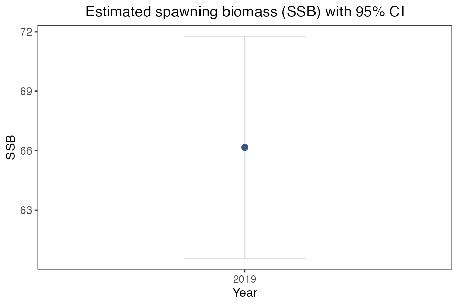


## 12. 产卵生物量 SBA / Spawning biomass SBA

```r
# 绘制本图 / Draw this figure
plot_SSB(b, type = "SBA", se = TRUE, facet_ncol = 3,
  line_size = 0.6)
```

[](https://github.com/FanZhang-LAB-SHOU/ALSCL/blob/main/docs/figures/ytf/plot_SSB_SBA.png?raw=true&v=3eeb8e281278)

年龄别产卵生物量，每个年龄组一个面板，带 95% 区间。用它看产卵来自哪些年龄；最小的几个年龄组接近零，因为成熟比例表几乎不给它们成熟个体，比较面板时看纵轴数值而不是曲线形状。

Spawning biomass at age, one panel per age class with the 95% band. Use it to see which ages spawn; the youngest classes sit near zero because the maturity table gives them almost no mature fish, so compare panels by their axis values rather than by the shape of the curves.

[参数及默认值 / Arguments and defaults](https://github.com/FanZhang-LAB-SHOU/ALSCL/blob/main/docs/FUNCTION_REFERENCE.md#plot_SSB)


## 13. 产卵生物量 SBL / Spawning biomass SBL

```r
# 绘制本图 / Draw this figure
plot_SSB(b, type = "SBL", se = TRUE, facet_ncol = 3,
  line_size = 0.6)
```

[](https://github.com/FanZhang-LAB-SHOU/ALSCL/blob/main/docs/figures/ytf/plot_SSB_SBL.png?raw=true&v=b706a47c1e3c)

体长别产卵生物量，每个体长组一个面板，带 95% 区间。用它看产卵来自哪些体长；小体长组同样接近零，30 以上的成熟组走势与总产卵生物量一致。

Spawning biomass at length, one panel per length bin with the 95% band. Use it to see which lengths spawn; the small bins sit near zero for the same reason, and the mature bins above 30 follow the total spawning biomass.

[参数及默认值 / Arguments and defaults](https://github.com/FanZhang-LAB-SHOU/ALSCL/blob/main/docs/FUNCTION_REFERENCE.md#plot_SSB)


## 14. 捕获尾数 CN / Catch numbers CN

```r
# 绘制本图 / Draw this figure
plot_catch(b, type = "CN", se = TRUE, facet_ncol = 3,
  line_size = 0.6)
```

[](https://github.com/FanZhang-LAB-SHOU/ALSCL/blob/main/docs/figures/ytf/plot_catch_CN.png?raw=true&v=b14892161d94)

模型推导的捕捞尾数（`CN`）随时间步变化，带近似 95% 区间。它根据丰度和捕捞死亡率计算；YTF 教学数据不含实测渔获量。与独立渔获资料比较前，须统一数量定义、单位、丰度尺度、时期和区域。登陆量可能不包括弃捕，还需核对其涵盖的捕捞移除量（[FAO 定义](https://www.fao.org/4/x8923e/X8923E03.htm)）。区间较宽表示给定拟合假设下不确定性较大；仅凭宽度不能确定其原因。只拟合调查指数时渔获量的水平无法确定，它取决于给定的自然死亡率和调查可捕性。`relative_catch()` 返回渔获量除以其在各时间步上的均值，用于与上报渔获量比较趋势。

Model-derived catch in numbers (`CN`) by time step with an approximate 95% interval. It is computed from abundance and fishing mortality; the YTF teaching data include no observed fishery catch. Compare it with independent catch data only after matching the quantity, units, abundance scale, period and area. Landings may omit discarded fish, so their coverage of fishing removals also needs checking ([FAO definitions](https://www.fao.org/4/x8923e/X8923E03.htm)). A wide interval indicates substantial uncertainty under the fitted assumptions; its width alone does not identify the cause. A fit to a survey index alone does not determine the level of catch, which depends on the supplied natural mortality rate and survey catchability. `relative_catch()` returns catch divided by its mean over the time steps, for a comparison of trends with reported catch.

[参数及默认值 / Arguments and defaults](https://github.com/FanZhang-LAB-SHOU/ALSCL/blob/main/docs/FUNCTION_REFERENCE.md#plot_catch)


## 15. 捕获尾数 CNA / Catch numbers CNA

```r
# 绘制本图 / Draw this figure
plot_catch(b, type = "CNA", se = TRUE, facet_ncol = 3,
  line_size = 0.6)
```

[](https://github.com/FanZhang-LAB-SHOU/ALSCL/blob/main/docs/figures/ytf/plot_catch_CNA.png?raw=true&v=2644a3bb7c52)

每个面板显示一个年龄组的估计渔获尾数和近似 95% 区间。本例中，较年轻的年龄组渔获尾数较高。比较时请看各面板纵轴的数值。

Each panel shows estimated catch in numbers for one age class, with an approximate 95% interval. In this example, catches are largest in the younger age classes. Read the values against the vertical scale of each panel.

[参数及默认值 / Arguments and defaults](https://github.com/FanZhang-LAB-SHOU/ALSCL/blob/main/docs/FUNCTION_REFERENCE.md#plot_catch)


## 16. 捕获尾数 CNL / Catch numbers CNL

```r
# 绘制本图 / Draw this figure
plot_catch(b, type = "CNL", se = TRUE, facet_ncol = 3,
  line_size = 0.6)
```

[](https://github.com/FanZhang-LAB-SHOU/ALSCL/blob/main/docs/figures/ytf/plot_catch_CNL.png?raw=true&v=9ddcd52719a1)

每个面板显示一个体长组的预期渔获尾数和近似 95% 区间。设组内期初尾数为 N，F 和 M 分别为每个时间步的瞬时捕捞死亡率和自然死亡率。按 Baranov 渔获方程，`C = N × (F/Z) × (1 − exp(−Z))`，其中 `Z = F + M`。ALSCL 将同一体长组各年龄的渔获尾数相加。[Baranov 渔获方程，式（15）](https://repository.library.noaa.gov/view/noaa/4847/noaa_4847_DS1.pdf#page=11)。

Each panel shows the expected catch in numbers for one length bin, with an approximate 95% interval. For a group with starting abundance N and instantaneous mortality rates F and M per time step, the Baranov catch equation gives `C = N × (F/Z) × (1 − exp(−Z))`, where `Z = F + M`. ALSCL sums these catches across ages within each length bin. [Baranov catch equation, eq. 15](https://repository.library.noaa.gov/view/noaa/4847/noaa_4847_DS1.pdf#page=11).

[参数及默认值 / Arguments and defaults](https://github.com/FanZhang-LAB-SHOU/ALSCL/blob/main/docs/FUNCTION_REFERENCE.md#plot_catch)


## 17. 相对渔获量 / Relative catch

```r
# 绘制本图 / Draw this figure
plot_relative_catch(b,
  observed = data.frame(year = b$year, catch = x$truth$CB),
  type = "weight", observed_name = "Simulated catch")
```

[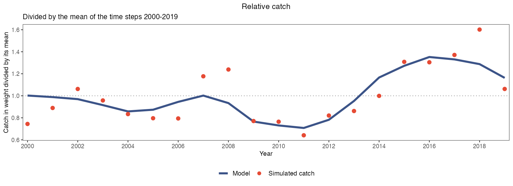](https://github.com/FanZhang-LAB-SHOU/ALSCL/blob/main/docs/figures/ytf/relative_catch.png?raw=true&v=05ee2a8256dc)

线是模型渔获重量除以它在各时间步上的均值，数值来自 `relative_catch()`。点是生成 `YTF_example` 的模拟中的渔获重量，除以它在同样时间步上的均值。用自己的数据时，把上报渔获量作为 `observed` 传入，它是含 `year` 和 `catch` 两列的数据框，单位不限。只拟合调查指数时，渔获量的绝对水平无法确定，它取决于假定的自然死亡率和调查可捕性，所以本图只比较趋势：纵轴标签写明数值是相对值，点线标出均值。上报序列只覆盖部分时间步时，均值取两条序列共有的时间步，`years` 可进一步限定。最后一个时间步的渔获量是预测值，因为该时间步的 F 没有观测提供信息。

The line is the model catch in weight divided by its mean over the time steps, from `relative_catch()`. The points are the catch in weight of the simulation that generated `YTF_example`, divided by its mean over the same time steps. With your own data, pass the reported catch as `observed`, a data frame with the columns `year` and `catch` in any unit. A fit to a survey index alone has no information on the absolute level of catch, which depends on the assumed natural mortality rate and survey catchability, so the figure compares trends only: the y-axis label states that the values are relative, and the dotted line marks the mean. When the reported series covers part of the time steps, the mean is taken over the time steps that both series have, and `years` restricts it further. The catch in the last time step is a prediction, because no observation informs F in that time step.

[参数及默认值 / Arguments and defaults](https://github.com/FanZhang-LAB-SHOU/ALSCL/blob/main/docs/FUNCTION_REFERENCE.md#plot_relative_catch)


## 18. 补充量 / Recruitment

```r
# 绘制本图 / Draw this figure
plot_recruitment(b, se = TRUE)
```

[](https://github.com/FanZhang-LAB-SHOU/ALSCL/blob/main/docs/figures/ytf/recruitment.png?raw=true&v=47a314e4a713)

补充量表示每个时间步进入最小年龄组的估计尾数，阴影为近似 95% 区间。本例估计补充量在 2012 年达到峰值。`rec.age` 指定个体进入模型的年龄。

Recruitment is the estimated number entering the youngest age class per time step. The shaded band gives the approximate 95% interval. Estimated recruitment peaks in 2012 in this example. The age at entry is set by `rec.age`.

[参数及默认值 / Arguments and defaults](https://github.com/FanZhang-LAB-SHOU/ALSCL/blob/main/docs/FUNCTION_REFERENCE.md#plot_recruitment)


## 19. 亲体与补充关系 / Spawning biomass and recruitment

`age_at_recruitment` 的单位是年，默认 NULL 取最小拟合年龄（没有年龄元数据的结果用 1 年）。`plot_SSB_Rec()` 把给定的值除以拟合的 `growth_step`，要求在规则时间网格上对应整数个时间步。季度数据中，0.25 表示滞后一季度，1 表示四季度。允许零滞后；拒绝负值、非有限值及非整数步滞后。没有 `growth_step` 的结果使用规则年份间隔；两类时间元数据都没有时沿用年度步长。

`age_at_recruitment` is in years, and the default NULL uses the youngest fitted age (1 year for a result saved without age metadata). `plot_SSB_Rec()` divides a supplied value by the fit's `growth_step` and requires an integer lag on a regular time grid. With quarterly data, 0.25 means one step and 1 means four steps. Zero lag is allowed; negative, nonfinite and fractional-step lags are rejected. Results without `growth_step` use their regular time spacing, or an annual step when `year` is missing as well.

```r
# 绘制本图 / Draw this figure
plot_SSB_Rec(b, age_at_recruitment = 1)
```

[](https://github.com/FanZhang-LAB-SHOU/ALSCL/blob/main/docs/figures/ytf/SSB_Rec.png?raw=true&v=53681501f48b)

每个点把某期的产卵群体生物量与 `age_at_recruitment` 年后的补充量配对，可用来查看两组估计值的关系。默认 `age_at_recruitment = NULL` 使用最小拟合年龄：本例的年度拟合为 1 年，`rec.age = 0.25` 的季度拟合为一个季度。评估模型用 AR(1) 过程描述补充量的对数偏差。绘图函数只绘制配对值。

Each point pairs spawning stock biomass with recruitment `age_at_recruitment` years later. The default, `age_at_recruitment = NULL`, uses the youngest fitted age: 1 year for this annual fit and one quarter for a quarterly fit with `rec.age = 0.25`. The scatter shows the association in the fitted series. The assessment models log recruitment deviations as an AR(1) process, and the plotting function draws the pairs without fitting a stock–recruitment curve.

[参数及默认值 / Arguments and defaults](https://github.com/FanZhang-LAB-SHOU/ALSCL/blob/main/docs/FUNCTION_REFERENCE.md#plot_SSB_Rec)


<a id="chapter-09"></a>
## 09 生长、死亡与残差图 · Growth, mortality and residuals

先完成第 04 章的 YTF 拟合，得到输入列表 `x` 和拟合结果 `a`、`b`，并设置 `dat <- x$data.CatL`。加载 ggplot2 和 patchwork。第 11 章建立回溯对象 `ra` 和 `rb`。
First complete chapter 04 to create the input bundle `x` and the fits `a` and `b`. Define `dat <- x$data.CatL`, and load ggplot2 and patchwork. Chapter 11 creates the retrospective objects `ra` and `rb`.

```r
library(ggplot2)
library(patchwork)
acl_theme_set(palette="npg", base_theme="theme_bw")
```

## 20. 年龄别平均体长 / Mean length at age

```r
# 模拟的年龄鉴定资料，并非论文实测 / Synthetic age readings, not observations of the paper
set.seed(42)
ref <- data.frame(Age = rep(1:15, each = 5))
ref$Length <- VB_func(60, .2, 1/60, ref$Age) + rnorm(nrow(ref), 0, 2)
# 先把每个体长归入模型的体长组，再求均值 / Assign each length to its model length bin before averaging
ref$Mid <- b$len_mid[findInterval(ref$Length, b$len_border) + 1]
readings <- data.frame(age = 1:15,
  mean_length = as.numeric(tapply(ref$Mid, ref$Age, mean)),
  sd_length = as.numeric(tapply(ref$Mid, ref$Age, sd)))
# 绘制本图 / Draw this figure
plot_VB(b, observed = readings, parameter_curve = TRUE)
```

[](https://github.com/FanZhang-LAB-SHOU/ALSCL/blob/main/docs/figures/ytf/VB.png?raw=true&v=a83fe5b491a7)

对 ALSCL 拟合，`plot_VB()` 画由拟合的体长组、年龄组尾数算出的各年龄平均体长，并取各时间步的均值（实线，数值与 `length_at_age()` 相同）。在 ALSCL 中，`Linf` 和 `k` 决定体长别生长增量，`Linf`、`k` 和 `t0` 决定补充个体的平均体长，所以它们不是各年龄平均体长的 von Bertalanffy 曲线的参数（[模型原理与时间尺度](https://github.com/FanZhang-LAB-SHOU/ALSCL/blob/main/docs/USER_GUIDE.md#model-theory-paper-differences)）。默认图 `plot_VB(b)` 只画实线，不标注 `Linf` 和 `k`。`parameter_curve = TRUE` 把由 `Linf`、`k` 和 `t0` 计算的曲线加画为虚线参考线：原始结构下，它是第一个时间步各年龄的平均体长，也是各时间步补充个体的平均体长。`observed` 把年龄鉴定得到的各年龄平均体长加画为点，本例带一个标准差的线段。对 ACL 拟合，`plot_VB(a)` 画 von Bertalanffy 曲线，它就是该模型的各年龄平均体长，并标注 `Linf` 和 `k`。

For an ALSCL fit, `plot_VB()` shows mean length at age calculated from the fitted numbers by length bin and age class and averaged over the time steps (solid line; the values of `length_at_age()`). In ALSCL, `Linf` and `k` set the growth increment at length, and `Linf`, `k` and `t0` set the mean length of recruits, so they are not the parameters of a von Bertalanffy curve of mean length at age ([Model principles](https://github.com/FanZhang-LAB-SHOU/ALSCL/blob/main/docs/USER_GUIDE.md#model-theory-paper-differences)). The default figure, `plot_VB(b)`, shows the solid line only and has no annotation of `Linf` and `k`. `parameter_curve = TRUE` adds the curve computed from `Linf`, `k` and `t0` as a dashed reference line: with the original structure it is the mean length at age in the first time step and the mean length of recruits in every time step. `observed` adds mean length at age from age readings as points, here with bars of one standard deviation. For an ACL fit, `plot_VB(a)` shows the von Bertalanffy curve, which is the mean length at age of that model, with the annotation of `Linf` and `k`.

每个体长组用其中点代表。本例最后一个体长组包含 49 cm 以上的全部个体，中点为 50 cm，所以高龄组的平均体长在 50 cm 处持平，低于虚线。与年龄鉴定资料比较时，请像上面的代码那样，先把鉴定个体的体长归入模型的体长组，两者才按同样的方法计算。与调查中采集的鉴定资料比较时用 `basis = "survey"`，此时体长别尾数先乘以体长别调查可捕性。`years` 选择求均值的时间步。

Each length bin is represented by its midpoint. The last length bin of this example holds all fish above 49 cm and has the midpoint 50 cm, so the mean length of the older age classes levels off at 50 cm, below the dashed curve. For a comparison with age readings, assign the lengths of the aged fish to the length bins of the model, as the code above does, so that both means are calculated in the same way. Use `basis = "survey"` to compare with age readings of fish caught in the survey: the numbers at length are then multiplied by the survey catchability at length. `years` selects the time steps of the mean.

`se = TRUE` 画由 `Linf`、`k` 和 `t0` 计算的曲线的 95% 区间：对 ACL 拟合是图中曲线的区间，对 ALSCL 拟合是参考线的区间。本例固定了三个参数，因此区间宽度为零。模型不报告由拟合尾数算出的平均体长的标准误，不画参考线而设 `se = TRUE` 时，函数给出警告并只画估计值。若参数协方差不可用，函数会警告并只画估计值，保留传入的标签、字号、刻度和主题。

`se = TRUE` draws the 95% interval of the curve computed from `Linf`, `k` and `t0`: for an ACL fit the interval of the figure, and for an ALSCL fit the interval of the reference line. All three parameters are fixed in this example, so the interval has zero width. The model reports no standard error for mean length at age from the fitted numbers, and `se = TRUE` without the reference line gives a warning and the estimate only. If the parameter covariance is unavailable, the function warns and draws the estimate alone, keeping the labels, text sizes, breaks and theme you passed.

[参数及默认值 / Arguments and defaults](https://github.com/FanZhang-LAB-SHOU/ALSCL/blob/main/docs/FUNCTION_REFERENCE.md#plot_VB)


## 21. 各时间步的年龄别平均体长 / Mean length at age by time step

```r
# 绘制本图 / Draw this figure
plot_length_at_age(b, ages = c(2, 5, 8, 11), facet_ncol = 2,
  line_size = 0.6)
```

[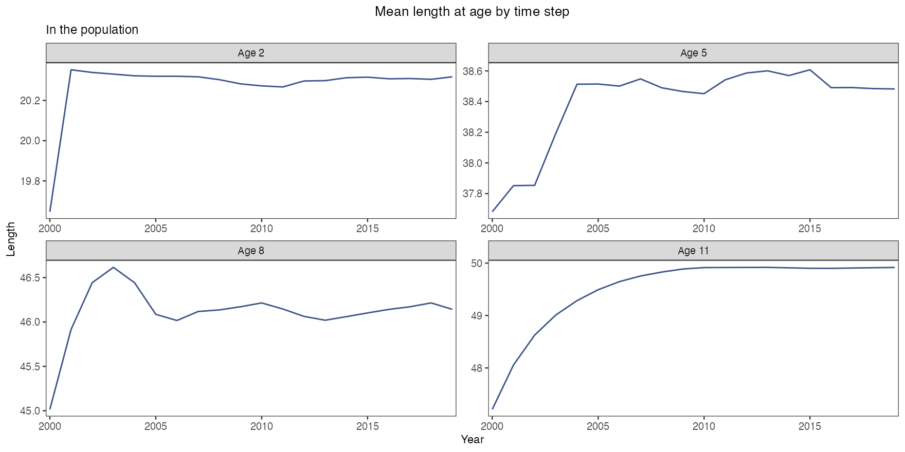](https://github.com/FanZhang-LAB-SHOU/ALSCL/blob/main/docs/figures/ytf/length_at_age.png?raw=true&v=546d1e725222)

每个面板显示一个年龄组在各时间步的平均体长，数值来自 `length_at_age()`。原始结构的 ALSCL 拟合中，第一个时间步各年龄组的体长分布由 `Linf`、`k` 和 `t0` 给出。之后各时间步的体长由生长增量和体长别死亡决定，所以平均体长在最初几年变化较大，随后随补充和捕捞而波动。ACL 拟合只用一个年龄体长概率矩阵，得到水平线。`observed` 接受年龄鉴定得到的各时间步、各年龄平均体长（列 `year`、`age` 和 `mean_length`，可加 `sd_length`），画成所属年龄组面板中的点；与调查中采集的鉴定资料比较时用 `basis = "survey"`。`ages` 和 `years` 选择年龄组和时间步，`facet_by = "none"` 把全部年龄组画在一个面板中。

Each panel shows the mean length of one age class in each time step, from `length_at_age()`. In the first time step of an ALSCL fit with the original structure, every age class has the length distribution given by `Linf`, `k` and `t0`. In later time steps the lengths follow from the growth increments and from mortality at length, so the mean length changes during the first years and then varies with recruitment and fishing. An ACL fit uses one age-length key and gives horizontal lines. `observed` takes mean length at age by time step from age readings (columns `year`, `age` and `mean_length`, optionally `sd_length`) and draws it as points in the panel of its age class; use `basis = "survey"` for readings of fish caught in the survey. `ages` and `years` select age classes and time steps, and `facet_by = "none"` draws all age classes in one panel.

[参数及默认值 / Arguments and defaults](https://github.com/FanZhang-LAB-SHOU/ALSCL/blob/main/docs/FUNCTION_REFERENCE.md#plot_length_at_age)


## 22. 年龄—体长概率矩阵 / Age–length probability matrix

```r
# 绘制本图 / Draw this figure
plot_pla(b)
```

[](https://github.com/FanZhang-LAB-SHOU/ALSCL/blob/main/docs/figures/ytf/pla.png?raw=true&v=90a9ca2b22fd)

静态矩阵 `pla` 的每一列给出一个年龄组的体长组概率，列内概率之和为 1。ACL 在每个时间步用它将年龄别尾数转换为体长别尾数。ALSCL 用它初始化种群并分配补充个体的体长，后续体长分布由生长和存活过程决定。要得到 ALSCL 某年龄、某时期的实际体长分布，应将 `NLA` 中对应的体长向量归一化。颜色表示各组概率，最高体长组包含右尾。横轴显示拟合年龄，最大的年龄是末组（plus group），标为“15+”。保存时没有年龄元数据的结果按年龄组的位置绘制，横轴标签为 Age group。

Each column of the static `pla` matrix gives length-bin probabilities for one age class and sums to one. ACL uses this matrix to convert numbers at age to numbers at length in every time step. ALSCL uses it to initialize the population and assign lengths to recruits; subsequent length distributions follow growth and survival. To obtain the realized distribution at a given age and time in ALSCL, normalize the corresponding length vector in `NLA`. The colour shows the probability in each bin, and the last bin includes the upper tail. The horizontal axis shows the fitted ages, and the oldest age, a plus group, is marked "15+". A result saved without age metadata is plotted against the position of the age class, and its axis label reads Age group.

[参数及默认值 / Arguments and defaults](https://github.com/FanZhang-LAB-SHOU/ALSCL/blob/main/docs/FUNCTION_REFERENCE.md#plot_pla)


## 23. ACL 各年龄组捕捞死亡率随时间的变化 / ACL fishing mortality over time by age class

每个面板只有一个估计值时显示为点，带状区间改用误差棒；已选择 `se_type = "errorbar"` 时不会重复添加区间。

A panel with one estimate uses a point and an error bar in place of a ribbon. Choosing `se_type = "errorbar"` does not add a duplicate interval.

`plot_fishing_mortality()` 从 `acl_theme_set()` 取标题、坐标轴标签、`x_breaks` 和 `x_expand`：标题键为 `F_year`、`F_age`、`F_length`，区间图加 `_se`；标签为 `xlab$year`、`xlab$age` 或 `xlab$length` 以及 `ylab$F`。年龄模式的横轴显示拟合年龄，末组标为“15+”这样的形式；带区间（`se = TRUE`）的 ALSCL 图只显示末组之前的年龄。保存时没有年龄元数据的结果按年龄组的位置绘制，未设置 `xlab$age` 时默认标签为 Age group。默认的 `ylab$F` 标签注明捕捞死亡率的时间基准，例如“Fishing mortality rate (per year)”；调用中给出的标签和刻度优先。`base_theme` 接受 `"theme_bw"`、`"bw"` 等主题名、ggplot2 主题对象或 `NULL`（全局设置），各种情况下都不显示网格线。

`plot_fishing_mortality()` takes its title, axis labels, `x_breaks` and `x_expand` from `acl_theme_set()`: title keys `F_year`, `F_age` and `F_length`, with `_se` added for interval plots, and labels `xlab$year`, `xlab$age` or `xlab$length` and `ylab$F`. In age mode the horizontal axis shows the fitted ages, and the plus group is marked as in "15+"; an ALSCL plot with intervals (`se = TRUE`) shows the ages before the plus group. A result saved without age metadata is plotted against the position of the age class, and its default label reads Age group unless you set `xlab$age`. The default `ylab$F` label states the time basis of the rate, for example "Fishing mortality rate (per year)"; labels and breaks given in the call take precedence. `base_theme` accepts a theme name such as `"theme_bw"` or `"bw"`, a ggplot2 theme object, or `NULL` for the global setting, and gridlines stay hidden in every case.

```r
# 绘制本图 / Draw this figure
plot_fishing_mortality(a, type = "year",
  se = TRUE, facet_ncol = 4, line_size = 0.6)
```

[](https://github.com/FanZhang-LAB-SHOU/ALSCL/blob/main/docs/figures/ytf/F_ACL_year.png?raw=true&v=560f44191128)

每个面板显示 ACL 一个年龄组的瞬时捕捞死亡率（`F`）及其近似 95% 区间。F 的时间单位由模型时间步决定，本例为一年，季度拟合则为一个季度。

Each panel shows the estimated instantaneous fishing mortality rate (`F`) for one ACL age class, with its approximate 95% interval. F is expressed per model time step. The time step is one year here and one quarter in a quarterly fit.

[参数及默认值 / Arguments and defaults](https://github.com/FanZhang-LAB-SHOU/ALSCL/blob/main/docs/FUNCTION_REFERENCE.md#plot_fishing_mortality)


## 24. ACL 各期的年龄别捕捞死亡率 / ACL fishing mortality at age by time step

```r
# 绘制本图 / Draw this figure
plot_fishing_mortality(a, type = "age",
  se = TRUE, facet_ncol = 4, line_size = 0.6)
```

[](https://github.com/FanZhang-LAB-SHOU/ALSCL/blob/main/docs/figures/ytf/F_ACL_age.png?raw=true&v=7f14af41eeb3)

每个面板显示 ACL 在一个时间步的估计值及其近似 95% 区间，横轴为拟合年龄（末组标为“15+”）。本例中多数年份的曲线较平，表示各年龄组的估计捕捞死亡率相近；2007 至 2010 年低龄组的估计值较高。

Each panel shows the same ACL estimates for one time step, with the fitted ages on the horizontal axis (the plus group is marked "15+") and approximate 95% intervals. In most years of this example the profiles are nearly flat, which indicates similar estimated fishing mortality across ages; from 2007 to 2010 the estimates are higher at the younger ages.

[参数及默认值 / Arguments and defaults](https://github.com/FanZhang-LAB-SHOU/ALSCL/blob/main/docs/FUNCTION_REFERENCE.md#plot_fishing_mortality)


## 25. ALSCL 各体长组捕捞死亡率随时间的变化 / ALSCL fishing mortality over time by length bin

```r
# 绘制本图 / Draw this figure
plot_fishing_mortality(b, type = "year",
  se = TRUE, facet_ncol = 4, line_size = 0.6)
```

[](https://github.com/FanZhang-LAB-SHOU/ALSCL/blob/main/docs/figures/ytf/F_ALSCL_year.png?raw=true&v=a1e3db3ee716)

每个面板显示一个体长组的捕捞死亡率（`FL`）随时间的变化及其近似 95% 区间。本例在 2008 年前后的高值以中等体长组最为明显。

Each panel shows how fishing mortality at length (`FL`) changes over time for one length bin, with an approximate 95% interval. The estimated peak around 2008 is most pronounced at intermediate lengths.

[参数及默认值 / Arguments and defaults](https://github.com/FanZhang-LAB-SHOU/ALSCL/blob/main/docs/FUNCTION_REFERENCE.md#plot_fishing_mortality)


## 26. ALSCL 各期的年龄别捕捞死亡率 / ALSCL fishing mortality at age by time step

```r
# 绘制本图 / Draw this figure
plot_fishing_mortality(b, type = "age",
  se = TRUE, facet_ncol = 4, line_size = 0.6)
```

[](https://github.com/FanZhang-LAB-SHOU/ALSCL/blob/main/docs/figures/ytf/F_ALSCL_age.png?raw=true&v=deeb8d0ef699)

ALSCL 先把同一年龄组各体长组的存活尾数相加，再除以该年龄组的期初尾数，得到存活比例。年龄别捕捞死亡率为 `FA = -log(存活比例) - M`。每个面板显示一个时间步的估计值和近似 95% 区间。本图用 `se = TRUE` 绘制，因此只显示带有标准误的单元格：末组之前的年龄（1 到 14 龄）和最后一个时间步之前的各时间步（2000 到 2018 年）。这些就是 `report$FA` 中的单元格，`report$ZA` 保存对应的年龄别总死亡率。不带区间（`se = FALSE`）时，函数还绘制末组（“15+”）和最后一个时间步，这些值按同一公式由报告的体长—年龄别尾数（`report$NLA`）和体长别总死亡率（`report$ZL`）算出。最后一个时间步的 F 由 F 过程预测，没有观测为它提供信息。`extract_estimates(b, "FA")` 返回每个年龄和每个时间步的年龄别 F，末组和最后一个时间步的标准误为 `NA`。

For each age class, ALSCL sums the numbers surviving across length bins and divides by the number present at the start of the step. Fishing mortality at age is `FA = -log(survival proportion) - M`. Each panel shows the estimates and approximate 95% intervals for one time step. The figure is drawn with `se = TRUE`, so it shows the cells that have standard errors: the ages before the plus group (ages 1 to 14) and the time steps before the last (2000 to 2018). These are the cells of `report$FA`, and `report$ZA` holds the matching total mortality at age. Without intervals (`se = FALSE`) the function also draws the plus group ("15+") and the last time step, which it computes from the reported numbers at length and age (`report$NLA`) and total mortality at length (`report$ZL`) with the same formula. F in the last time step is predicted by the F process; no observation informs it. `extract_estimates(b, "FA")` returns F at age for every age and time step; its standard errors are `NA` for the plus group and the last time step.

[参数及默认值 / Arguments and defaults](https://github.com/FanZhang-LAB-SHOU/ALSCL/blob/main/docs/FUNCTION_REFERENCE.md#plot_fishing_mortality)


## 27. ALSCL 各期的体长别捕捞死亡率 / ALSCL fishing mortality at length by time step

```r
# 绘制本图 / Draw this figure
plot_fishing_mortality(b, type = "length",
  se = TRUE, facet_ncol = 4, line_size = 0.6)
```

[](https://github.com/FanZhang-LAB-SHOU/ALSCL/blob/main/docs/figures/ytf/F_ALSCL_length.png?raw=true&v=e811f8727366)

每个面板显示一个时间步各体长组的捕捞死亡率及其近似 95% 区间。横轴按体长组中点（`len_mid`）的实际间距绘制。本例中，体长约 20 至 35 的组估计捕捞死亡率较高。

Each panel shows fishing mortality at length for one time step, with an approximate 95% interval. Length-bin midpoints (`len_mid`) are plotted at their actual spacing. In this example, estimated fishing mortality is higher at intermediate lengths, around 20 to 35.

[参数及默认值 / Arguments and defaults](https://github.com/FanZhang-LAB-SHOU/ALSCL/blob/main/docs/FUNCTION_REFERENCE.md#plot_fishing_mortality)


## 28. 拟合所用的自然死亡率和调查可捕性 / Natural mortality rate and survey catchability used in the fit

```r
# 绘制本图 / Draw this figure
(plot_natural_mortality(b, line_size = 0.8) +
   labs(title = "Natural mortality rate (M)")) |
  (plot_survey_catchability(b, line_size = 0.8, point_size = 1.5) +
     labs(title = "Survey catchability at length"))
```

[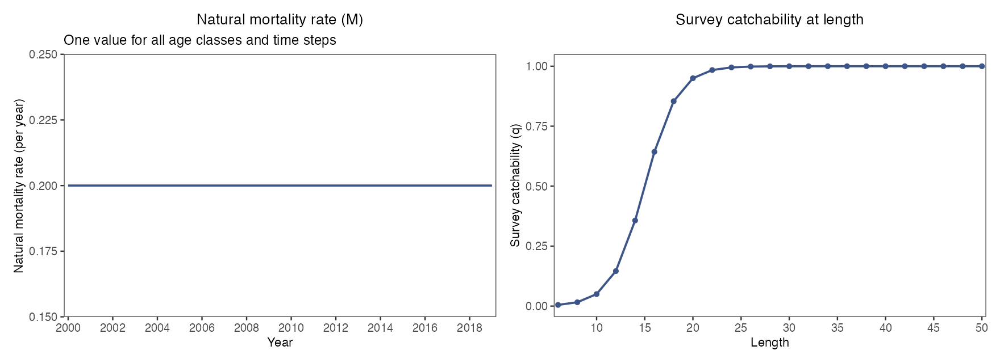](https://github.com/FanZhang-LAB-SHOU/ALSCL/blob/main/docs/figures/ytf/inputs.png?raw=true&v=3a333c6d9c04)

两个面板显示的都是你给定的输入，不是估计值。`plot_natural_mortality()` 的图形随 `M` 的形式而定：单个数值画成水平线（如本例）；按年龄组给定时画 M 随年龄的变化，随时间变化时改为画 M 随时间步的变化，每个年龄组一个面板；按体长给定（ALSCL）时画 M 随体长的变化。`plot_survey_catchability()` 显示由 `sel_L50` 和 `sel_L95` 或由 `survey_q` 给出的体长别可捕性。`survey_q` 各时间步不同时，每条不同的曲线画一条线并标出其适用的时间步；`type = "age"` 显示年龄别乘数（`survey_q_age`）。调查指数不能确定总死亡中捕捞死亡和自然死亡各占多少，也不能确定可捕性的水平，所以 F、渔获量和丰度的水平取决于这两项输入（[选择拟合设置](https://github.com/FanZhang-LAB-SHOU/ALSCL/blob/main/docs/USER_GUIDE.md#fitting)）。报告中请把它们与估计值一并给出。

Both panels show inputs that you supplied, not estimates. `plot_natural_mortality()` follows the form of `M`: a single value is a horizontal line (as here), a rate by age class is drawn against age or, when it changes over time, against the time step with one panel per age class, and a rate by length (ALSCL) is drawn against length. `plot_survey_catchability()` shows the catchability at length from `sel_L50` and `sel_L95` or from `survey_q`. When `survey_q` differs among time steps, it draws one line for each distinct curve and names the time steps of each, and `type = "age"` shows the multiplier by age (`survey_q_age`). The survey index does not inform the split of total mortality into fishing and natural mortality or the level of catchability, so the level of F, catch and abundance depends on these inputs ([Choose the fitting settings](https://github.com/FanZhang-LAB-SHOU/ALSCL/blob/main/docs/USER_GUIDE.md#fitting)). Show them next to the estimates in a report.

[参数及默认值 / Arguments and defaults](https://github.com/FanZhang-LAB-SHOU/ALSCL/blob/main/docs/FUNCTION_REFERENCE.md#plot_natural_mortality) · [`plot_survey_catchability()`](https://github.com/FanZhang-LAB-SHOU/ALSCL/blob/main/docs/FUNCTION_REFERENCE.md#plot_survey_catchability)


## 29. 按体长组分面的对数残差 / Log residuals by length bin

```r
# 绘制本图 / Draw this figure
plot_residuals(b, facet_by = "length", facet_ncol = 4, line_size = 0.6,
  x_breaks = c(2000, 2010, 2015))
```

[](https://github.com/FanZhang-LAB-SHOU/ALSCL/blob/main/docs/figures/ytf/residuals_length.png?raw=true&v=502d02169c07)

对数残差，即观测对数调查指数减拟合值，每个体长组一个面板，横轴为时间：深蓝线连接残差，灰线为零，青绿色虚线为平滑线。用它找模型拟合不好的体长组（零值和缺失观测没有残差）；多年同号的残差（如本例 16 组为正、20 组为负）说明系统性偏差，序列末端的趋势（如 50 组）提示模型没有跟上的变化。

每个分面内，缺失或排除的观测会断开残差线和趋势线。单个有效观测画成点。连续 2–5 个观测用直线拟合趋势，连续至少 6 个观测用 loess。

Log residuals, the observed minus the fitted log survey index, one panel per length bin with time on the horizontal axis: the navy line joins the residuals, the grey line is zero and the dashed teal curve is a smoother. Use it to find bins the model misfits (zero and missing observations have no residual); residuals of one sign over many years, as in bins 16 (positive) and 20 (negative) here, mean a systematic misfit, and a trend at the end of the series, as in bin 50, points to a change the model misses.

Within each facet, a missing or excluded observation breaks the residual line and its trend. A single observed value is drawn as a point. Each consecutive run of 2–5 observations has a linear trend, and a run of 6 or more uses loess.

[参数及默认值 / Arguments and defaults](https://github.com/FanZhang-LAB-SHOU/ALSCL/blob/main/docs/FUNCTION_REFERENCE.md#plot_residuals)


## 30. 按时间步分面的对数残差 / Log residuals by time step

```r
# 绘制本图 / Draw this figure
plot_residuals(b, facet_by = "year", facet_ncol = 4, line_size = 0.6,
  x_breaks = c(10, 30, 50))
```

[](https://github.com/FanZhang-LAB-SHOU/ALSCL/blob/main/docs/figures/ytf/residuals_year.png?raw=true&v=00c4fd04634b)

同一组残差按体长排列：每个时间步一个面板，横轴为体长，带零线和平滑线。观察哪些体长范围的残差持续高于或低于零。本例 2015 年起最大体长组的正尖峰表示那几年的观测指数高于拟合值。重复出现的符号变化可提示偏差随体长变化；平滑线在某个体长穿过零线，本身不表示该体长存在偏差。

The same residuals arranged by length: one panel per time step, with length on the horizontal axis, a zero line and a smoother. Look for length ranges with residuals persistently above or below zero. The positive spikes in the largest bin from 2015 onward indicate observed indices above the fitted values in those years. Repeated changes in sign can suggest length-dependent misfit; the smoother crossing zero at a particular length is not itself evidence of bias at that length.

[参数及默认值 / Arguments and defaults](https://github.com/FanZhang-LAB-SHOU/ALSCL/blob/main/docs/FUNCTION_REFERENCE.md#plot_residuals)


## 31. 补充量的对数偏差 / Log recruitment deviations

```r
# 绘制本图 / Draw this figure
plot_deviance(b, type = "R", log = TRUE, se = TRUE,
  facet_ncol = 3, point_size = 1.2, line_size = 0.5) +
  scale_x_continuous(breaks = c(2000, 2010, 2019), expand = expansion(mult = 0.04))
```

[](https://github.com/FanZhang-LAB-SHOU/ALSCL/blob/main/docs/figures/ytf/deviation_R_TRUE.png?raw=true&v=2a5c43e443a3)

点表示估计的补充量对数偏差，误差棒表示近似 95% 区间。对数偏差为零时，补充量等于拟合过程的中位数 `exp(mean_log_R)`。负值表示该期补充量低于这个中位数。

The points are estimated log recruitment deviations and the bars are approximate 95% intervals. Zero corresponds to the median recruitment of the fitted process, `exp(mean_log_R)`. A negative estimate indicates recruitment below that median.

[参数及默认值 / Arguments and defaults](https://github.com/FanZhang-LAB-SHOU/ALSCL/blob/main/docs/FUNCTION_REFERENCE.md#plot_deviance)


## 32. 补充量相对于中位数的倍数 / Recruitment relative to the process median

```r
# 绘制本图 / Draw this figure
plot_deviance(b, type = "R", log = FALSE, se = TRUE,
  facet_ncol = 3, point_size = 1.2, line_size = 0.5) +
  scale_x_continuous(breaks = c(2000, 2010, 2019), expand = expansion(mult = 0.04))
```

[](https://github.com/FanZhang-LAB-SHOU/ALSCL/blob/main/docs/figures/ytf/deviation_R_FALSE.png?raw=true&v=d71508dcc556)

设置 `log = FALSE` 后，每个点表示该期补充量与过程中位数之比。2012 年的比值为 1.77，表示估计补充量比中位数高 77%。区间端点由对数尺度的端点取指数得到。

With `log = FALSE`, each point is recruitment divided by the process median. A ratio of 1.77, as in 2012, means that estimated recruitment was 77% above that median. The interval endpoints are exponentiated from the log scale.

[参数及默认值 / Arguments and defaults](https://github.com/FanZhang-LAB-SHOU/ALSCL/blob/main/docs/FUNCTION_REFERENCE.md#plot_deviance)


## 33. 捕捞死亡率的对数偏差 / Log fishing mortality deviations

```r
# 绘制本图 / Draw this figure
plot_deviance(b, type = "F", log = TRUE, se = TRUE,
  facet_ncol = 3, point_size = 1.2, line_size = 0.5) +
  scale_x_continuous(breaks = c(2000, 2010, 2019), expand = expansion(mult = 0.04))
```

[](https://github.com/FanZhang-LAB-SHOU/ALSCL/blob/main/docs/figures/ytf/deviation_F_TRUE.png?raw=true&v=40d0b325ae95)

点和近似 95% 区间表示各期捕捞死亡率的对数偏差。偏差为零对应原尺度上的过程中位数 `exp(mean_log_F)`。ALSCL 按体长组分面，ACL 按年龄组分面。各组共用 F 时只有一个面板。

Points and approximate 95% intervals show log fishing mortality deviations over time. Zero corresponds to the process median, `exp(mean_log_F)`, on the original scale. ALSCL shows one panel per length bin, ACL one per age class. A fit with shared F has one panel.

[参数及默认值 / Arguments and defaults](https://github.com/FanZhang-LAB-SHOU/ALSCL/blob/main/docs/FUNCTION_REFERENCE.md#plot_deviance)


## 34. 捕捞死亡率相对于中位数的倍数 / Fishing mortality relative to the process median

```r
# 绘制本图 / Draw this figure
plot_deviance(b, type = "F", log = FALSE, se = TRUE,
  facet_ncol = 3, point_size = 1.2, line_size = 0.5) +
  scale_x_continuous(breaks = c(2000, 2010, 2019), expand = expansion(mult = 0.04))
```

[](https://github.com/FanZhang-LAB-SHOU/ALSCL/blob/main/docs/figures/ytf/deviation_F_FALSE.png?raw=true&v=51a4140b7d98)

每个点表示估计捕捞死亡率与过程中位数之比。比值为 0.5 表示该期该组的捕捞死亡率为中位数的一半。误差棒为对数尺度区间端点取指数后得到的近似 95% 区间。

Each point is the fitted fishing mortality rate divided by the process median. A ratio of 0.5 means fishing mortality was half that median. The error bars show the approximate 95% intervals after exponentiation.

[参数及默认值 / Arguments and defaults](https://github.com/FanZhang-LAB-SHOU/ALSCL/blob/main/docs/FUNCTION_REFERENCE.md#plot_deviance)


## 35. 长度组成山脊图 / Length composition ridges

山脊图两栏均保留模型的完整体长范围，包括最小或最大体长组缺测以及全部观测缺失的情况。自定义 `x_breaks` 和全局 `x_expand` 同时作用于两栏。`ridges_scale` 必须为 `NULL`（自动高度）或一个有限正数；零、负数、缺失值、无穷大和向量均会报错。

Both ridge panels retain the full model length range, even when the shortest or longest bins are unobserved or all observations are missing. Custom `x_breaks` and global `x_expand` apply to both panels. `ridges_scale` must be `NULL` (automatic height) or one finite positive number; zero, negative values, missing values, infinity and vectors are rejected.

```r
# 绘制本图 / Draw this figure
plot_ridges(b) # 默认 viridis 渐变 / Default viridis gradient
```

[](https://github.com/FanZhang-LAB-SHOU/ALSCL/blob/main/docs/figures/ytf/ridges.png?raw=true&v=5b62bafa140e)

每条曲线表示一个时间步各体长组调查指数的相对组成，左图为观测值，右图为拟合值。`plot_ridges()` 返回 patchwork 对象，整张图有一个总标题，两个面板各有标题；`p[[1]]` 和 `p[[2]]` 分别取出观测面板和拟合面板。时间轴在年度拟合中显示年份，在季度拟合中显示季度（如“2000 Q2”）。2012 年之后，峰值向较大的体长组移动。可比较两图的峰值位置和分布宽度。某期全部缺测时不绘制该期的观测曲线，部分缺测时仅用有观测的体长组计算观测比例。

Each ridge shows the relative survey index across lengths in one time step, with observations on the left and the fit on the right. `plot_ridges()` returns a patchwork object with one figure title and a title on each panel; `p[[1]]` and `p[[2]]` extract the observed and the fitted panel. The time axis shows years for annual fits and quarters, as in "2000 Q2", for quarterly fits. The peak shifts toward larger lengths after 2012. Compare the position and spread of the distributions. A step with no observations has no observed ridge, and a partially observed step is normalized over the observed bins only.

缺失或被排除的体长组会断开观测轮廓和填色。孤立的观测体长组在缩放后的组成高度处画为点；归一化仍使用该期全部正观测。左右面板使用相同的时间位置、纵轴范围和时间配色，包括完全缺测的时期。`spectral` 等 Brewer 配色也支持只有两个时期的结果。

Missing or excluded length bins break the observed outline and fill. An isolated observed bin is drawn as a point at its scaled composition height; normalization still uses all positive observations in that period. Both panels keep the same time positions, vertical range and time colors, including periods without observations. Brewer palettes such as `spectral` also support two-period results.

[参数及默认值 / Arguments and defaults](https://github.com/FanZhang-LAB-SHOU/ALSCL/blob/main/docs/FUNCTION_REFERENCE.md#plot_ridges)


### 边界体长组缺测 / Missing boundary length bins

这个合成绘图示例的最小两个和最大两个体长组均缺测，第一期也全部缺测。两栏仍显示 10–90 个长度单位的范围，并保留四个时期的位置。观测组成用剩余体长组归一化，拟合组成用全部体长组归一化，两者的归一化总量不同。空白区域不代表零观测。

This synthetic illustration has no observations in the two smallest or two largest length bins, and no observations in the first period. Both panels still span 10–90 length units and keep all four time positions. The observed composition uses the remaining bins; the fitted composition uses all bins, so their normalizing totals differ. Blank areas are not zero observations.

```r
# Synthetic display example with missing boundary length bins.
lengths <- seq(10, 90, 10)
years <- 2000:2003
log_index <- outer(lengths, seq(35, 50, 5),
  function(length, center) -((length - center) / 18)^2)
ridge_example <- list(year = years, len_mid = lengths,
  observations = exp(log_index), report = list(Elog_index = log_index))
ridge_example$observations[c(1, 2, 8, 9), ] <- NA_real_
ridge_example$observations[, 1L] <- NA_real_
plot_ridges(ridge_example, ridges_scale = 1,
  x_breaks = seq(10, 90, 20))
```

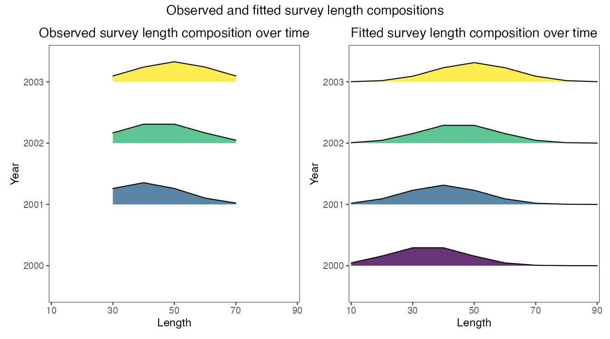


<a id="chapter-10"></a>
## 10 模型比较与真值 · Model comparisons

先完成第 04 章的 YTF 拟合，得到输入列表 `x` 和拟合结果 `a`、`b`，并设置 `dat <- x$data.CatL`。加载 ggplot2 和 patchwork。第 11 章建立回溯对象 `ra` 和 `rb`。
First complete chapter 04 to create the input bundle `x` and the fits `a` and `b`. Define `dat <- x$data.CatL`, and load ggplot2 and patchwork. Chapter 11 creates the retrospective objects `ra` and `rb`.

```r
library(ggplot2)
library(patchwork)
acl_theme_set(palette="npg", base_theme="theme_bw")
```

## 36. 种群时间序列比较 / Population time series comparison

每个模型分别判断是否只有一个估计值；单点用点与误差棒，多期结果仍用曲线与带状区间。

Each model is handled separately: a single estimate uses a point and error bar, while a multi-period series retains its line and ribbon.

```r
# 绘制本图 / Draw this figure
plot_compare_ts(a, b, se = TRUE, facet_ncol = 2)
```

[](https://github.com/FanZhang-LAB-SHOU/ALSCL/blob/main/docs/figures/ytf/compare_ts.png?raw=true&v=5ec8cc9f7b69)

两组拟合的产卵生物量、补充量、总生物量、总丰度和捕获尾数时间序列，每个量一个面板，纵轴各自取值：ACL 为深蓝实线，ALSCL 为朱红虚线（`compare_colors`、`compare_linetypes`），`se = TRUE` 时加上各自的 95% 区间。用它看两个模型在哪里分歧；本例生物量和产卵生物量在 2014 年后分开，自由纵轴使振幅只能在面板内比较，不能跨面板比较。

Time series of spawning biomass, recruitment, total biomass, total abundance and catch in numbers from two fits, one panel per quantity with its own vertical scale: ACL is the navy solid line and ALSCL the vermilion dashed line (`compare_colors`, `compare_linetypes`), and `se = TRUE` adds each fit's 95% band. Use it to see where the two models disagree; the ACL and ALSCL series separate after 2014 in biomass and spawning biomass here, and the free vertical scales make amplitudes comparable within a panel but not across panels.

[参数及默认值 / Arguments and defaults](https://github.com/FanZhang-LAB-SHOU/ALSCL/blob/main/docs/FUNCTION_REFERENCE.md#plot_compare_ts)


## 37. 死亡率矩阵比较 / Fishing mortality matrices

```r
# 绘制本图 / Draw this figure
plot_compare_F(a, b) + scale_x_continuous(breaks = c(2000, 2010, 2019))
```

[](https://github.com/FanZhang-LAB-SHOU/ALSCL/blob/main/docs/figures/ytf/compare_F.png?raw=true&v=35ad35946c11)

两组拟合各一张捕捞死亡率热图，横轴为时间，纵轴为各自的组（ACL 为年龄组，ALSCL 为体长组），共用一个 `F` 色标。用它看每个模型中捕捞在何时、哪些组最重；两图的行是不同维度，所以比较深色列的时间（本例 2007 至 2010 年）而不是逐格比较，F 汇总图可比较各模型的组间最大值或均值，解读时须区分年龄组和体长组的定义。 ACL 热图按拟合使用的年龄标示各行，季度数据可显示小数年龄；最大的年龄组是末组（plus group），用加号标出（“Age 15+”）。旧拟合缺少年龄坐标时，行标签会明确标为年龄组序号。要在相同年龄上汇总两个拟合，使用 `plot_compare_F_ts(basis = "age")`。

Heat maps of fishing mortality, one per fit, time on the horizontal axis and the fit's own groups on the vertical axis (age classes for ACL, length bins for ALSCL) with one colour scale for `F`. Use it to see when and in which groups fishing was heaviest in each model; the rows are different dimensions, so compare the timing of the dark columns (2007 to 2010 here) rather than single cells, and use the summary F figures to compare each model's group maximum or mean, keeping the age and length definitions explicit. The ACL rows show fitted ages, including fractional ages for seasonal data, and the oldest age class, a plus group, is marked with a plus sign ("Age 15+"). For an older fit without age coordinates, the rows are labelled as numbered age groups. For a summary of both fits over the same ages, use `plot_compare_F_ts(basis = "age")`.

[参数及默认值 / Arguments and defaults](https://github.com/FanZhang-LAB-SHOU/ALSCL/blob/main/docs/FUNCTION_REFERENCE.md#plot_compare_F)


## 38. 残差联合诊断 / Combined residual diagnostics

平均残差面板保留完整拟合时间范围，包括首期或末期全部缺测的情况。这些时期保留横轴位置，但不会补造残差或误差棒。

The mean-residual panel retains the full fitted time range, including unobserved first or last periods. These periods occupy space on the axis but do not acquire fabricated residuals or error bars.

```r
# 绘制本图 / Draw this figure
plot_compare_residuals(a, b, dat)
```

[](https://github.com/FanZhang-LAB-SHOU/ALSCL/blob/main/docs/figures/ytf/compare_residuals.png?raw=true&v=fe4fef4e5af6)

四个面板显示两组拟合的样本内对数残差：直方图、以正态分布为参照的 QQ 图、各时间步的平均残差及加减一个标准差的误差棒，以及各体长组绝对残差的箱线图。ACL 为深蓝，ALSCL 为朱红。直方图较宽表示离散程度较大；QQ 图中看点的弯曲和不对称，它们提示偏斜或重尾，不要看斜率：这些残差以拟合的过程偏差为条件，即使模型设定正确，标准化条件残差的标准差也只有约 0.91 到 0.96。绝对残差较大的体长组拟合较差，例如本例 ALSCL 的 16 组和 50 组。标准差误差棒表示残差的离散程度，不是均值的置信区间。

Four panels show the in-sample log residuals of both fits: a histogram, a QQ plot against a normal reference, the mean residual by time step with bars of plus or minus one standard deviation, and box plots of absolute residuals by length bin. ACL is navy and ALSCL vermilion. A wider histogram indicates greater dispersion; in the QQ plot, read curvature and asymmetry of the points as signs of skewness or heavy tails, not the slope: the residuals are conditional on the fitted process deviations, and even a correct model gives standardized conditional residuals with a standard deviation of about 0.91 to 0.96. Higher absolute residuals identify poorly fitted bins, including bins 16 and 50 for ALSCL here. The standard-deviation bars describe residual spread, not confidence intervals for the mean.

整期缺测会断开平均残差线，孤立的有效时期仍显示为点。只有该期至少有两个观测体长组时才绘制标准差误差棒；仅有一个观测时仍保留残差点。

A wholly unobserved period breaks the mean-residual line. Isolated observed periods remain visible as points. An SD bar is drawn only when the period contains at least two observed length bins; a single observation still contributes its residual point.

[参数及默认值 / Arguments and defaults](https://github.com/FanZhang-LAB-SHOU/ALSCL/blob/main/docs/FUNCTION_REFERENCE.md#plot_compare_residuals)


## 39. 两模型的年龄别平均体长 / Mean length at age of both models

参考数据与排版辅助函数 / Reference data and layout helper:

```r
# 模拟参考生长点，并非论文实测 / Synthetic reference points, not paper observations
set.seed(42)
ref <- data.frame(Age = rep(1:15, each = 5))
ref$Length <- VB_func(60, .2, 1/60, ref$Age) + rnorm(nrow(ref), 0, 2)
growth_display <- function(p) {
  p[[1]] <- p[[1]] + theme(legend.text=element_text(size=7))
  p[[2]] <- p[[2]] + scale_x_continuous(breaks=c(1,5,10,15))
  p
}
```

```r
# 绘制本图 / Draw this figure
growth_display(plot_compare_growth(a, b, age_range = c(1, 15), ref_data = ref, ref_name = "Synthetic reference",
    nls_start = list(Linf = 60, k = 0.2, t0 = 1/60)))
```

[](https://github.com/FanZhang-LAB-SHOU/ALSCL/blob/main/docs/figures/ytf/compare_growth.png?raw=true&v=6a580f231902)

左图：两次拟合按同一口径计算、并取各时间步均值的各年龄平均体长（ACL 深蓝实线，来自年龄体长概率矩阵；ALSCL 朱红虚线，来自拟合的体长组、年龄组尾数），另有 `nls()` 对 `ref_data` 拟合的灰色参照曲线及该数据的灰点。副标题给出口径和时间步，以及参照曲线的 `Linf` 和 `k`。右图：两次拟合按同一口径的给定年龄的体长分布热图，横轴为拟合年龄，纵轴为体长组中点；ALSCL 的热图是拟合尾数中各年龄组在各体长组的比例。左图不画由两次拟合的生长参数计算的曲线。在 ACL 中，`Linf`、`k` 和 `t0` 是各年龄平均体长曲线的参数；在 ALSCL 中，它们决定体长别生长增量和补充个体的平均体长，所以两个模型的参数含义不同。`compare_models(a, b, dat)$length_at_age` 以表格给出同样的数值。两次拟合的线在 50 cm 附近持平，因为最后一个体长组包含 49 cm 以上的全部个体，并用其中点代表。参照数据的体长没有归入体长组，所以参照曲线继续上升。

Left: mean length at age of both fits on the same basis, averaged over the time steps (ACL navy solid, from its age-length key; ALSCL vermilion dashed, from its fitted numbers by length bin and age class), with the grey reference curve that `nls()` fits to `ref_data` and the grey points of that data. The subtitle states the basis and the time steps, and gives `Linf` and `k` of the reference curve. Right: the probability of length given age of both fits as heat maps on the same basis, with the fitted ages on the horizontal axis and the length-bin midpoints on the vertical axis; for ALSCL it is the proportion of each age class in each length bin from the fitted numbers. The left panel does not draw curves from the growth parameters of the fits. In ACL, `Linf`, `k` and `t0` are the parameters of a curve of mean length at age; in ALSCL they set the growth increment at length and the mean length of recruits, so the parameters of the two models have different meanings. `compare_models(a, b, dat)$length_at_age` holds the same values as a table. The lines of the two fits level off near 50 cm because the last length bin, which holds all fish above 49 cm, is represented by its midpoint. The reference lengths are not assigned to length bins, so the reference curve continues to rise.

`observed` 把年龄鉴定得到的各年龄平均体长加画为点，可带标准差或区间，例如 `plot_compare_growth(a, b, observed = readings, basis = "survey")`，其中 `readings` 见[生长、死亡与残差图](#plot_VB)。与调查中采集的鉴定资料比较时用 `basis = "survey"`。省略 `age_range` 时画两次拟合的全部年龄组；显式范围须为两个有限且递增的年龄，选取其中的年龄组。`years` 选择求均值的时间步。

`observed` adds mean length at age from age readings as points, with an optional standard deviation or interval, for example `plot_compare_growth(a, b, observed = readings, basis = "survey")` with the `readings` of [Growth, mortality and residuals](#plot_VB). Use `basis = "survey"` for readings of fish caught in the survey. Omit `age_range` to draw all age classes of both fits; an explicit range must contain two finite increasing ages and selects the age classes within it. `years` selects the time steps of the mean.

可选参考曲线仅在不早于其自身拟合 `t0` 的年龄绘制。若其生长参数无效，或没有剩余的正年龄跨度，会警告说明省略参考曲线的原因；两次拟合的线和观测点仍保留。

The optional reference curve is drawn only at ages at or above its own fitted `t0`. If its fitted growth parameters are invalid or no positive age span remains, a warning explains why the reference curve is omitted; the lines of the two fits and the observed points remain.

[参数及默认值 / Arguments and defaults](https://github.com/FanZhang-LAB-SHOU/ALSCL/blob/main/docs/FUNCTION_REFERENCE.md#plot_compare_growth)


## 40. 两模型调查拟合 / Survey fits from both models

```r
# 绘制本图 / Draw this figure
plot_compare_CatL(a, b, dat, years = c(2000, 2005, 2010, 2015), facet_ncol = 2)
```

[](https://github.com/FanZhang-LAB-SHOU/ALSCL/blob/main/docs/figures/ytf/compare_CatL.png?raw=true&v=b68e6751418e)

所选时间步（`years`，省略则显示全部）的调查指数随体长变化，每个时间步一个面板：灰点为观测指数，深蓝实线为 ACL 拟合，朱红虚线为 ALSCL 拟合，均为 `exp(Elog_index)` 中位数，零值和缺失观测不画点。用它看哪个模型跟得上观测的体长组成；本例两者都跟上 20 附近的峰，ALSCL 曲线的局部起伏更多。可结合体长别 F 和其他设置检查这些起伏的原因。

Survey index against length for the selected time steps (`years`; omit it for all), one panel per time step: grey points are the observed index, the navy solid curve the ACL fit and the vermilion dashed curve the ALSCL fit, both as `exp(Elog_index)` medians, and zero and missing observations are left out of the points. Use it to see which model follows the observed length composition; both follow the mode near length 20 here, and the ALSCL curve has more local variation. Examine length-specific F and alternative settings to investigate that variation.

纵轴标签来自 `ylab$survey`，默认为 Survey index；用 `acl_theme_set(ylab = list(survey = "Survey index (relative units)"))` 可一次改好所有调查拟合图的标签，单模型对数图会加上前缀 Log。`ylab$catch` 只用于捕获量图。

The vertical label comes from `ylab$survey` and reads Survey index by default; set `acl_theme_set(ylab = list(survey = "Survey index (relative units)"))` to relabel every survey-fit plot at once, and single-model log-scale plots add the prefix Log. `ylab$catch` labels the catch plots only.

[参数及默认值 / Arguments and defaults](https://github.com/FanZhang-LAB-SHOU/ALSCL/blob/main/docs/FUNCTION_REFERENCE.md#plot_compare_CatL)


## 41. 拟合指标比较 / Fit metric comparison

```r
# 绘制本图 / Draw this figure
plot_compare_metrics(a, b, dat, facet_ncol = 2) & scale_y_continuous(expand = expansion(mult = c(0,
    0.3)))
```

[](https://github.com/FanZhang-LAB-SHOU/ALSCL/blob/main/docs/figures/ytf/compare_metrics.png?raw=true&v=2b6819163e34)

柱图汇总 `diagnostic_metrics()` 的样本内拟合指标：RMSE、MAE、R 平方、MAPE、AIC、BIC、负对数似然和标量参数个数。ACL 为深蓝，ALSCL 为朱红。按各指标的定义解读：误差指标较低、R 平方较高表示对这些观测的拟合较近；AIC 和 BIC 还惩罚参数数量。信息准则只应在同一观测、相容似然的拟合之间比较。本例 ACL 的指标值较好；一个模拟数据集不能证明普遍优势，也不能确定差异原因。

Bars summarize the in-sample fit metrics from `diagnostic_metrics()`: RMSE, MAE, R-squared, MAPE, AIC, BIC, negative log-likelihood and the number of scalar parameters. ACL is navy and ALSCL vermilion. Read each metric according to its definition: lower error metrics and higher R-squared describe closer fits to these observations, whereas AIC and BIC also penalize parameter count. Compare information criteria only for compatible likelihoods fitted to the same observations. ACL has better metric values in this example; one simulated dataset does not establish a general advantage or identify its cause.

柱图与 `diagnostic_metrics()` 使用同一计算：只纳入有限的正观测，观测单元处的非有限预测或维度不一致会报错，常数观测的 R 平方等无定义指标显示为 `NA`。先运行 `compare_models()` 核对两组拟合是否可比。

The bars use the same calculation as `diagnostic_metrics()`: only finite positive observations enter, a nonfinite prediction at an observed cell or a dimension mismatch is an error, and an undefined measure such as R-squared for constant observations is shown as `NA`. Run `compare_models()` first to check that the two fits are comparable.

[参数及默认值 / Arguments and defaults](https://github.com/FanZhang-LAB-SHOU/ALSCL/blob/main/docs/FUNCTION_REFERENCE.md#plot_compare_metrics)


## 42. 固定调查可捕性 / Fixed survey catchability

```r
# 绘制本图 / Draw this figure
plot_compare_selectivity(a, b)
```

[](https://github.com/FanZhang-LAB-SHOU/ALSCL/blob/main/docs/figures/ytf/compare_selectivity.png?raw=true&v=8910454b5721)

各拟合输入的体长别调查可捕性 `q`（`sel_L50` 和 `sel_L95`，或 `survey_q`），ACL 为深蓝实线加点，ALSCL 为朱红虚线加点。用它确认每组拟合用的可捕性曲线；本例两条曲线重合，因为输入相同；这些值是固定输入而不是估计的选择性，两组拟合若不同，只说明输入不同。`survey_q` 按体长和时间步给出时，每条不同的曲线各画一条线，并在图注中说明。按年龄的调查可捕性系数（`survey_q_age`）不显示。

Survey catchability `q` at length from the input of each fit (`sel_L50` and `sel_L95`, or `survey_q`), as lines with points for ACL (navy solid) and ALSCL (vermilion dashed). Use it to confirm which catchability curve each fit used; the curves coincide here because both fits took the same input, and the values are fixed inputs, not an estimated selectivity, so a difference between two fits means different inputs. When `survey_q` was supplied by length and time step, one line is drawn for each distinct curve and a caption says so. A survey catchability multiplier by age (`survey_q_age`) is not shown.

[参数及默认值 / Arguments and defaults](https://github.com/FanZhang-LAB-SHOU/ALSCL/blob/main/docs/FUNCTION_REFERENCE.md#plot_compare_selectivity)


## 43. 每个时间步的最大捕捞死亡率 / Maximum fishing mortality by time step

```r
# 绘制本图 / Draw this figure
plot_compare_F_ts(a, b, method = "apical") +
  labs(title = "Apical fishing mortality")
```

[](https://github.com/FanZhang-LAB-SHOU/ALSCL/blob/main/docs/figures/ytf/compare_F_apical.png?raw=true&v=f66a30e88ca0)

每个时间步内，ACL 取各年龄组捕捞死亡率的最大值，ALSCL 取各体长组的最大值，即 apical F。图中每个点对应该模型在该期估计 F 最高的组。即使针对同一种群，年龄组最大值与体长组最大值也未必相同，因为年龄别 F 汇总了各体长的存活；这时应读两条线的时间变化，不要比较水平。`basis = "age"` 对两个拟合都汇总年龄别 F，只用两者共有的拟合年龄和时间步。ALSCL 的年龄别 F 覆盖每个年龄（包括末组）和每个时间步。末组和最后一个时间步的值不在拟合报告中，由函数按同一公式从报告的体长—年龄别尾数（`report$NLA`）和体长别总死亡率（`report$ZL`）算出。不含体长—年龄别尾数的结果（例如手工构造的列表）没有末组一行，也没有最后一个时间步的值，这时比较不含 ACL 的末组和最后一个时间步。F 是每个时间步的瞬时率，所以两个拟合的时间步长必须相同，不同时函数会停止。季度拟合得到每季度的瞬时率，纵轴标签注明捕捞死亡率的时间基准。[BAM 模型中的 apical F，式（14b）](https://repository.library.noaa.gov/view/noaa/4847/noaa_4847_DS1.pdf#page=11)。

Apical F is the maximum fishing mortality rate across age classes in ACL or across length bins in ALSCL within each time step. The height of each point therefore refers to the group with the highest estimated F in that model and period. An age-group maximum and a length-bin maximum need not be equal, even for the same population, because age-specific F combines survival across lengths. Read the time pattern of such a pair, not the difference in level. `basis = "age"` summarizes F at age for both fits over the fitted ages and time steps that both have. ALSCL F at age covers every age, including the plus group, and every time step. The values for the plus group and the last time step are not in the fitted report; the function computes them from the reported numbers at length and age (`report$NLA`) and total mortality at length (`report$ZL`) with the same formula. A result without numbers at length and age, for example a hand-made list, has no plus-group row and no value for the last time step, and the comparison then leaves out the ACL plus group and the last time step. The two fits must have the same time step, because F is a rate per time step, and the function stops when the steps differ. Quarterly fits give quarterly rates, and the y-axis label states the time basis of the rate. [Apical F in the BAM model, eq. 14b](https://repository.library.noaa.gov/view/noaa/4847/noaa_4847_DS1.pdf#page=11).

[参数及默认值 / Arguments and defaults](https://github.com/FanZhang-LAB-SHOU/ALSCL/blob/main/docs/FUNCTION_REFERENCE.md#plot_compare_F_ts)


## 44. 每个时间步的平均捕捞死亡率 / Mean fishing mortality by time step

```r
# 绘制本图 / Draw this figure
plot_compare_F_ts(a, b, method = "mean") +
  labs(title = "Mean fishing mortality")
```

[](https://github.com/FanZhang-LAB-SHOU/ALSCL/blob/main/docs/figures/ytf/compare_F_mean.png?raw=true&v=69f433e01fd0)

两组拟合的平均捕捞死亡率，即每个时间步各组 `F` 的非加权平均，样式同上。当关心整个选择模式而不是其峰值时用它；平均值取决于模型有多少低 F 的组（本例 15 个年龄组对 23 个体长组），所以看时间模式（两者都在 2008 年达峰）而不是水平高低。

Mean fishing mortality, the unweighted average of `F` over the groups at each time step, for both fits in the same styling. Use it when the whole selection pattern matters more than its peak; the mean depends on how many low-F groups a model has (15 ages against 23 length bins here), so read the time pattern, which both fits share with a 2008 peak, rather than the level.

[参数及默认值 / Arguments and defaults](https://github.com/FanZhang-LAB-SHOU/ALSCL/blob/main/docs/FUNCTION_REFERENCE.md#plot_compare_F_ts)


## 47. 模拟真值与条件估计 / Simulation truth and conditional estimates

```r
# 将生成真值与报告中的估计对齐 / Align truth and fitted reports
years <- a$year
truth <- data.frame(Year=rep(years,3),
  Quantity=rep(c("B","SSB","Rec"),each=length(years)),
  Truth=c(x$truth$TB,x$truth$SSB,x$truth$Rec))
estimates <- rbind(
  data.frame(Year=rep(years,3),Quantity=truth$Quantity,
    Value=c(a$report$B,a$report$SSB,a$report$Rec),Model="ACL"),
  data.frame(Year=rep(years,3),Quantity=truth$Quantity,
    Value=c(b$report$B,b$report$SSB,b$report$Rec),Model="ALSCL"))
```

```r
# 绘制本图 / Draw this figure
ggplot(estimates, aes(Year, Value, color = Model)) + geom_line() + scale_color_manual(values = setNames(acl_theme("compare_colors"),
    c("ACL", "ALSCL"))) + geom_line(data = truth, aes(Year, Truth), inherit.aes = FALSE, linetype = 2) +
    facet_wrap(~Quantity, scales = "free_y", ncol = 1) + theme_bw() + theme(panel.grid.major = element_blank(), panel.grid.minor = element_blank()) + labs(y = NULL)
```

[](https://github.com/FanZhang-LAB-SHOU/ALSCL/blob/main/docs/figures/ytf/truth.png?raw=true&v=4dacc1a55655)

生成模拟的生物量、补充量和产卵生物量（黑色虚线）与 ACL（深蓝）、ALSCL（朱红）拟合的对照，每个量一个面板。上面的代码由 `x$truth` 和两份报告构造 `truth` 与 `estimates`。本例 ACL 紧贴模拟真值，ALSCL 的生物量和产卵生物量在 2013 年后低于真值。这是年龄结构操作模型的一次模拟及给定设置下的拟合。要评估表现如何随模型结构变化，需要在不同生成假设下开展重复模拟。

Biomass, recruitment and spawning biomass of the generating simulation (black dashed) and the ACL (navy) and ALSCL (vermilion) fits, one panel per quantity. The code above constructs `truth` and `estimates` from `x$truth` and the two reports. ACL follows the simulated truth closely here, while ALSCL biomass and spawning biomass fall below it after 2013. This is one realization from the age-based operating model under the stated fitting settings. Repeated simulations under alternative generating assumptions are needed to assess how performance depends on model structure.


## 48. 自检的相对误差 / Relative errors of a self-test

```r
# 用 ACL 拟合模拟五套数据并重新拟合 / Simulate five data sets from the ACL fit and refit them
st <- self_test(a, nsim = 5, seed = 20261101)
```

```r
# 绘制本图 / Draw this figure
plot_self_test(st)
```

[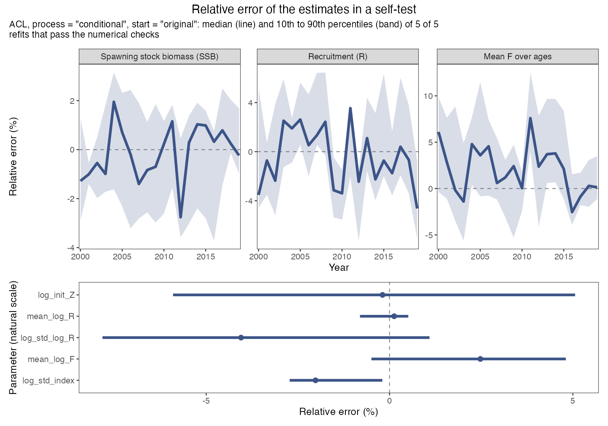](https://github.com/FanZhang-LAB-SHOU/ALSCL/blob/main/docs/figures/workflows/self-test.png?raw=true&v=04eda829c413)

`self_test()` 从 ACL 拟合模拟五套调查数据，用相同设置重新拟合，并把估计值与模拟所用的值比较。上面三幅图给出 SSB、补充量和各年龄平均 F 每年相对误差的中位数（线）和第 10 至第 90 百分位数（带），下图给出估计参数的同样内容，虚线表示误差为零。本例各年份的中位数在真值的 8% 以内；五套数据只演示函数的用法，用于报告的自检需要更多套数据。自检只说明模型假设成立时参数能否估计，不能说明自然死亡率、调查可捕性或生长形式设错带来的偏差。

`self_test()` simulates five survey data sets from the ACL fit, refits them with the same settings and compares the estimates with the values used to simulate them. The three upper panels show the median relative error of SSB, recruitment and mean F over ages by year (line) and its 10th to 90th percentiles (band); the lower panel shows the same for the estimated parameters, and the dashed lines mark no error. Here the medians stay within 8% of the truth in every year; five data sets show how the function works, and a self-test for a report needs more. A self-test shows only whether the parameters can be estimated when the assumptions of the model hold, not the bias from a wrong natural mortality rate, survey catchability or growth form.

[参数及默认值 / Arguments and defaults](https://github.com/FanZhang-LAB-SHOU/ALSCL/blob/main/docs/FUNCTION_REFERENCE.md#plot_self_test)


<a id="chapter-11"></a>
## 11 回溯分析 · Retrospectives

读完本页，你会得到每个模型的 Mohn rho（生物量、产卵生物量、补充量和丰度）、重拟合序列的图和每次重拟合的数值检查。你需要[理解第一次拟合](https://github.com/FanZhang-LAB-SHOU/ALSCL/blob/main/docs/USER_GUIDE.md#builtin)中的输入列表 `x` 和 ALSCL 拟合结果 `b`。

At the end of this page you have, for each model, Mohn's rho for biomass, spawning biomass, recruitment and abundance, a plot of the refitted series and the numerical checks of every refit. You need the input bundle `x` and the ALSCL fit `b` from [Understand your first fit](https://github.com/FanZhang-LAB-SHOU/ALSCL/blob/main/docs/USER_GUIDE.md#builtin).

回溯分析从三张表中去掉最后一个时间步并重拟合模型，再去掉一个，再拟合，依此类推；每次截短重拟合称为一轮。把各轮与完整拟合比较，就能看出加入后来的观测后近期估计改变了多少；各轮修订方向一致时，应进一步调查这种系统性变化的原因。

A retrospective analysis removes the last time step from the three tables, refits the model, removes one more, refits again, and so on; each refit is a peel. Comparing the peels with the full fit shows how much the recent estimates change when later observations are added; revisions in the same direction across peels indicate a retrospective pattern whose causes warrant investigation.

<a id="retrospectives-run"></a>

### 1. 运行分析 / Run the analysis

```r
ra <- retro_acl(x, nyear = 3, silent = TRUE)
rb <- retro_alscl(x, nyear = 3, silent = TRUE)
```

`retro_acl()` 使用 ACL 模型，`retro_alscl()` 使用 ALSCL 模型。每次调用先用完整的数据表拟合模型，再运行 `nyear` 轮：第 1 轮去掉最后一个时间步并重拟合，第 2 轮去掉最后两个，依此类推。`nyear` 是回溯的轮数。每一轮比上一轮多去掉 `peel_step` 个时间步（默认 1），所以季度数据每轮去掉一个季度；第 5 步说明季度模型怎样按年回溯。

`retro_acl()` uses the ACL model and `retro_alscl()` the ALSCL model. Each call fits the model to the full tables, then runs `nyear` peels: peel 1 drops the last time step and refits, peel 2 drops the last two, and so on. `nyear` is the number of peels. Each peel removes `peel_step` further time steps (default 1), so one peel of quarterly data removes one quarter; step 5 shows annual peels of a quarterly model.

每次拟合都使用输入列表中保存的设置，与 `run_acl(x)` 相同，初值个数为列表中显式保存的 `nstarts`，没有保存时为一个；调用时给出的参数会对每次拟合覆盖保存的值。`ncores` 让完整拟合和各轮在工作进程上运行；输入列表中保存的拟合用 `ncores` 会被忽略，一次拟合内部的多个初值依次运行。`silent = FALSE` 时控制台每次拟合打印一行。

Every fit uses the settings stored in the bundle, as `run_acl(x)` does, with the bundle's explicit `nstarts` starts or one start when it stores none; arguments in the call override them for every fit. `ncores` runs the full fit and the peels on worker processes; a fitting `ncores` stored in the bundle is ignored, and the starts inside one fit run one after another. With `silent = FALSE` the console prints one line per fit.

有两种错误会在任何拟合开始之前终止调用：调查指数表的时间列必须带有递增的数字标签（[准备调查数据](https://github.com/FanZhang-LAB-SHOU/ALSCL/blob/main/docs/USER_GUIDE.md#excel)），并且每一轮都必须至少保留两个时间步，所以 `nyear * peel_step` 最多为时间步数减二。某一轮在优化器内部失败时会记录在下一步的表中，分析继续进行。

Two errors stop the call before any fit: the time columns of the survey index table must carry increasing numeric labels ([Prepare your survey data](https://github.com/FanZhang-LAB-SHOU/ALSCL/blob/main/docs/USER_GUIDE.md#excel)), and every peel must keep at least two time steps, so `nyear * peel_step` is at most the number of time steps minus two. A peel that fails inside the optimizer is recorded in the next step's tables while the analysis continues.

<a id="retrospectives-tables"></a>

### 2. 读返回的表 / Read the returned tables

```r
rb$fit_diagnostics
rb$rho_by_peel
rb$rho_text
rb$raw_rho_text
rb$errors
```

返回值是一个由表组成的列表，`ra` 的元素与 `rb` 相同：

The result is a list of tables, and `ra` has the same elements as `rb`:

| 元素 / Element | 每行对应 / One row per | 内容 / Contents |
|---|---|---|
| `fit_diagnostics` | 一次拟合 / fit | `Peel`（0 是完整拟合）、`RetrospectiveYear`（保留的最后一个时间步）、`elapsed`、数值检查及其汇总 `numerical_ok` 和未通过的项目 `issues`，拟合中止时的错误信息 `error`，以及该次拟合产生的警告 `warnings` / `Peel` (0 is the full fit), `RetrospectiveYear` (last time step kept), `elapsed`, the numerical checks with their summary `numerical_ok` and failed items `issues`, the message of a fit that stopped in `error`, and the warnings raised by the fit in `warnings` |
| `rho_by_peel` | 一轮和一个量 / peel and quantity | `RawRho`，该轮末端估计与完整拟合在该时间步估计的相对差；`Rho`，两次拟合都通过数值检查且参考值有限、非零时等于 `RawRho`，否则为 `NA`；`Valid` / `RawRho`, the relative difference between the peel's terminal estimate and the full fit's estimate for that time step; `Rho`, the same when both fits passed the numerical checks and the reference is finite and nonzero, otherwise `NA`; `Valid` |
| `rho_text` | 一个量 / quantity | Mohn rho，即各轮 `Rho` 的平均值，附 `Valid`、`ValidPeels` 和 `RequestedPeels`；`Year` 只是标签位置 / Mohn's rho, the mean of `Rho` over the peels, with `Valid`, `ValidPeels` and `RequestedPeels`; `Year` is only a label position |
| `raw_rho_text` | 一个量 / quantity | 不经检查的 `RawRho` 平均值，仅供诊断；任一比较缺失时为 `NA` / the mean of `RawRho` without the checks, for diagnosis only; `NA` when any comparison is missing |
| `errors` | 一次失败的拟合 / failed fit | `Peel`、`RetrospectiveYear` 和错误信息；所有拟合都运行完成时为零行 / `Peel`, `RetrospectiveYear` and the message; zero rows when every fit ran |

这些量是总生物量 `B`、补充量 `Rec`、产卵生物量 `SSB` 和丰度 `N`；完整序列在 `rb$results` 中。当完整拟合或任一轮未通过数值检查，或某个末端比较缺失时，`rho_text$Rho` 为 `NA` 并发出警告，以便报告的均值只使用两次拟合均通过数值检查的比较。请在 `fit_diagnostics$issues` 和 `errors` 中找到失败的拟合，按[判断拟合是否可用](https://github.com/FanZhang-LAB-SHOU/ALSCL/blob/main/docs/USER_GUIDE.md#diagnostics)修复它并重新运行；`raw_rho_text` 只用来看可用差值的大小。

The quantities are total biomass `B`, recruitment `Rec`, spawning biomass `SSB` and abundance `N`; the full series are in `rb$results`. `rho_text$Rho` is `NA`, with a warning, when the full fit or any peel failed the numerical checks or a terminal comparison is missing, so the reported mean uses only comparisons for which both fits passed the numerical checks. Find the failed fit in `fit_diagnostics$issues` and `errors`, repair it as on [Judge whether a fit can be used](https://github.com/FanZhang-LAB-SHOU/ALSCL/blob/main/docs/USER_GUIDE.md#diagnostics) and rerun; `raw_rho_text` only shows the size of the available differences.

<a id="retrospectives-plot"></a>

### 3. 绘制重拟合序列 / Plot the refitted series

```r
plot_retro(rb, facet_ncol = 2, rho_digits = 3)
```


`plot_retro()` 直接绘制保存的序列，无需重拟合，每个量一个面板，`facet_ncol = 2` 把它们排成两列。每条线是一次拟合，颜色按它的最后一个时间步区分：完整拟合止于 2019 年，各轮止于 2018、2017 和 2016 年。年度时间步的图例标题为“Terminal year”，更短的时间步为“Terminal period”，季度标为“2019 Q4”这样的形式，`peel_step` 大于 1 时也是如此。未通过数值检查的拟合用虚线绘制，没有估计值的拟合仍留在图例中，标为“(no estimates)”。空心点标出每次拟合的末端估计，也就是 rho 与完整拟合比较的那个值；面板标签给出保留 `rho_digits` 位小数的 Mohn rho。本页的图另加了 `rho_size = 3`、`point_size = 1` 和 `line_size = 0.6`。

`plot_retro()` draws the stored series without refitting, one panel per quantity in the two columns set by `facet_ncol = 2`. Each line is one fit, colored by its last time step: the full fit ends in 2019, the peels in 2018, 2017 and 2016. The legend is titled "Terminal year" for annual time steps and "Terminal period" for shorter ones, where quarters are labelled as in "2019 Q4", also when `peel_step` is above 1. A fit that failed the numerical checks is drawn with a dashed line, and a fit without estimates stays in the legend marked "(no estimates)". The open point marks each fit's terminal estimate, the value rho compares with the full fit, and the panel label gives Mohn's rho with `rho_digits` decimals. The figures on this page add `rho_size = 3`, `point_size = 1` and `line_size = 0.6`.


两张图中，截短拟合与完整拟合之间较明显的差异集中在序列末期。其他时间步的修订幅度可通过保存的估计值计算。rho 为 `NA` 时，面板显示 `rho unavailable: check diagnostics`；若没有任何拟合给出估计值，`plot_retro()` 会停止并提示读 `fit_diagnostics` 和 `errors`。标题、标签、字号和各次拟合的颜色（`palette`、`colors`）见 [ggsci 配色与导出](https://github.com/FanZhang-LAB-SHOU/ALSCL/blob/main/docs/PLOT_STYLE.md)；全部参数见 [plot_retro 参考](https://github.com/FanZhang-LAB-SHOU/ALSCL/blob/main/docs/FUNCTION_REFERENCE.md#plot_retro)。

In both figures, the largest visible differences between the peeled and full fits occur near the end of the series. Compare the stored estimates to quantify revisions at other time steps. When rho is `NA` the panel reads `rho unavailable: check diagnostics`; if no fit produced estimates, `plot_retro()` stops and asks you to read `fit_diagnostics` and `errors`. Titles, labels, font sizes and the colors of the fits (`palette`, `colors`) follow [Colors and export](https://github.com/FanZhang-LAB-SHOU/ALSCL/blob/main/docs/PLOT_STYLE.md); every argument is in the [plot_retro reference](https://github.com/FanZhang-LAB-SHOU/ALSCL/blob/main/docs/FUNCTION_REFERENCE.md#plot_retro).

`plot` 和 `silent` 都必须是单个 `TRUE` 或 `FALSE`，无效值会在任何拟合开始前报错。如果没有一行同时包含有限时间和有限估计值，`plot_retro()` 会停止并提示检查诊断；存在有效估计时，序列内部的缺失值继续保留为断点，不跨缺失处连接。

`plot` and `silent` must each be a single `TRUE` or `FALSE`; invalid values stop before any fitting. If no stored row has both a finite time and a finite estimate, `plot_retro()` stops with a diagnostic message. With some valid estimates, missing interior values stay as gaps rather than being joined across.

<a id="retrospectives-rho"></a>

### 4. 解释 Mohn rho / Interpret Mohn's rho

Mohn rho 把每一轮的末端估计与完整拟合在同一时间步的估计之间的相对差，对各轮取平均：

Mohn's rho averages, over the peels, the relative difference between the terminal estimate of each peel and the full fit's estimate for the same time step:

```math
\rho=\frac{1}{K}\sum_{k=1}^{K}\frac{\hat\theta^{(-k)}_{T-k}-\hat\theta^{(0)}_{T-k}}{\hat\theta^{(0)}_{T-k}}.
```

`K` 是 `nyear`，`T` 是完整拟合的最后一个时间步；默认 `peel_step = 1` 时第 `k` 轮止于 `T-k`，否则止于 `T` 减去 `k` 乘 `peel_step`。ρ 为 +0.03 表示截短拟合的末期估计平均比完整拟合对同一期的估计高 3%。ρ 为负表示平均偏低。符号相反的项会抵消，所以也要读 `rho_by_peel`；完整拟合的估计为零时该项没有定义。Mohn rho 衡量的是加入后来的观测后末端估计被修订的程度；预测准确度由[预测检验](https://github.com/FanZhang-LAB-SHOU/ALSCL/blob/main/docs/MODEL_VALIDATION.md)来回答。按评估量分别报告修订的方向和幅度。

`K` is `nyear` and `T` the last time step of the full fit; peel `k` ends at `T-k` with the default `peel_step = 1`, and at `T` minus `k` times `peel_step` otherwise. A rho of +0.03 means that the terminal estimates from shorter fits were on average 3% above the corresponding full-fit estimates. A negative rho means they were lower on average. Terms of opposite sign cancel, so read `rho_by_peel` as well; a full-fit estimate of zero leaves its term undefined. Mohn's rho measures the revision of terminal estimates when later observations are added; forecast accuracy is the question of [hindcast validation](https://github.com/FanZhang-LAB-SHOU/ALSCL/blob/main/docs/MODEL_VALIDATION.md). Report the direction and magnitude of the revisions for each quantity.

<a id="retrospectives-adapt"></a>

### 5. 用于自己的评估 / Adapt the analysis to your assessment

```r
rb2 <- retro_alscl(x, nyear = 3, nstarts = 2, ncores = 3, silent = TRUE)
rb2$fit_diagnostics
```

用你报告的那次拟合的设置运行分析，这样各轮之间的差异只来自去掉的观测。调用中的参数会传给每次拟合：`nstarts = 2` 让每次拟合运行两个初值并保留目标函数值较低的那个，`ncores = 3` 让完整拟合和三轮在三个工作进程上运行（工作进程最多 `nyear + 1` 个），`map`、`parameters` 或 `control` 参数会整体替换保存的列表（[选择拟合设置](https://github.com/FanZhang-LAB-SHOU/ALSCL/blob/main/docs/USER_GUIDE.md#fitting)）。输入列表中保存的或调用中给出的可选模型结构、`start_spread`、ACL 的 `bounds`、ALSCL 的 `t0_lower`，以及以 `survey_q` 或 `survey_q_age` 给出的调查可捕性，也会传给每次拟合。对自己的输入列表有五条规则：

Run the analysis with the settings of the fit you report, so that differences between peels come from the removed observations only. Arguments in the call reach every fit: `nstarts = 2` runs two starts per fit and keeps the lower objective, `ncores = 3` runs the full fit and the three peels on three worker processes (at most `nyear + 1` workers), and a `map`, `parameters` or `control` argument replaces the whole stored list ([Choose the fitting settings](https://github.com/FanZhang-LAB-SHOU/ALSCL/blob/main/docs/USER_GUIDE.md#fitting)). An optional model structure, `start_spread`, the ACL `bounds`, the ALSCL `t0_lower` and a survey catchability given as `survey_q` or `survey_q_age`, stored in the bundle or given in the call, also reach every fit. Five rules apply to your own bundle:

- `dev_log_R` 和 `dev_log_F`（补充量和捕捞死亡率的过程偏差）的 map 必须覆盖完整数据表的全部时间步，先排一个时间步的所有组再排下一个（`F_structure = "year"` 时只有一组）；每一轮保留其时间步对应的 map 项，长度不符的 map 会终止分析。[选择拟合设置](https://github.com/FanZhang-LAB-SHOU/ALSCL/blob/main/docs/USER_GUIDE.md#fitting-controls-map)中对固定项和重复水平的限制适用于每一轮。
- 按年龄和时间步的自然死亡率，以及按体长和时间步的调查可捕性，按完整数据表的时间步每步一列。每一轮使用它所保留的时间步对应的各列。
- 使用与主拟合相同的 F 结构：保存的 `F_structure` 会被使用，调用中显式给出的则作用于每次拟合。
- 最短的一轮至少保留两个观测时间步，序列较短时要保留更多，因为较短的一轮要用更少的观测估计同样多的参数。
- 用 `peel_step` 选择每轮的长度：季度数据默认每轮去掉一个季度，`retro_alscl(x, nyear = 3, peel_step = 4)` 每轮去掉一年，第 `k` 轮止于最后一个时间步之前 `k` 年，Mohn rho 是对按年回溯求均值。`RetrospectiveYear` 显示保留的最后一个时间步。

- Maps for `dev_log_R` and `dev_log_F`, the process deviations of recruitment and fishing mortality, must cover the complete time grid of the full tables, all groups of one time step before the next (one group when `F_structure = "year"`); each peel keeps the map entries of its retained time steps, and a map of another length stops the analysis. The restriction on fixed or repeated entries in [Choose the fitting settings](https://github.com/FanZhang-LAB-SHOU/ALSCL/blob/main/docs/USER_GUIDE.md#fitting-controls-map) applies to every peel.
- A natural mortality rate by age and time step, and a survey catchability by length and time step, have one column per time step of the complete tables. Each peel uses the columns of the time steps that it keeps.
- Use the same F structure as the main fit: the stored `F_structure` is used, and an explicit one in the call applies to every fit.
- Keep at least two observed time steps in the shortest peel, and more when the series is short, because a short peel estimates the same parameters from fewer observations.
- Choose the length of a peel with `peel_step`: with quarterly data the default removes one quarter per peel, and `retro_alscl(x, nyear = 3, peel_step = 4)` removes one year per peel, so that peel `k` ends `k` years before the last time step and Mohn's rho is a mean over annual peels. `RetrospectiveYear` shows the last time step kept.

<a id="retrospectives-record"></a>

### 6. 记录结果 / Record the result

```r
save_assessment(b, "ytf_alscl.rds")
saveRDS(rb, "ytf_alscl_retro.rds")
plot_retro(readRDS("ytf_alscl_retro.rds"), facet_ncol = 2, rho_digits = 3)
```

回溯结果只包含表，没有只在当前会话有效的 TMB 对象，所以 `saveRDS()` 能完整保存它，`plot_retro()` 能在新会话中绘制重新读入的对象。`save_assessment()` 用于拟合结果：它将 `b` 连同重新拟合所需的输入和设置一起保存，供 `refit_model()` 使用；传入回溯结果时以 `A complete fit recipe is required` 停止。把这两个文件放在一起；[进阶、复现与故障处理](https://github.com/FanZhang-LAB-SHOU/ALSCL/blob/main/docs/ADVANCED_WORKFLOWS.md)说明如何记录软件包版本和会话。

The retrospective result holds tables only, with no live TMB object, so `saveRDS()` keeps all of it and `plot_retro()` draws the reloaded object in a new session. `save_assessment()` is for fits: it stores `b` as a saved fit with its recipe for `refit_model()` and stops with `A complete fit recipe is required` when given the retrospective result. Keep the two files together; [Reproducibility](https://github.com/FanZhang-LAB-SHOU/ALSCL/blob/main/docs/ADVANCED_WORKFLOWS.md) shows how to record the package versions and the session.

<a id="retrospectives-next"></a>

### 下一步 / What next

| 想做什么 / What you want to do | 阅读 / Read |
|---|---|
| 完整做一遍案例 / Work through the case | [移除近期数据后，估计结果会怎样变化？](https://github.com/FanZhang-LAB-SHOU/ALSCL/blob/main/docs/CASES.md#case-retrospective-bias) / [Do estimates change when recent data are removed?](https://github.com/FanZhang-LAB-SHOU/ALSCL/blob/main/docs/CASES.md#case-retrospective-bias) |
| 修复失败的一轮 / Repair a failed peel | [判断拟合是否可用](https://github.com/FanZhang-LAB-SHOU/ALSCL/blob/main/docs/USER_GUIDE.md#diagnostics) / [Judge whether a fit can be used](https://github.com/FanZhang-LAB-SHOU/ALSCL/blob/main/docs/USER_GUIDE.md#diagnostics) |
| 更改 map、F 结构或初值 / Change the map, F structure or starts | [选择拟合设置](https://github.com/FanZhang-LAB-SHOU/ALSCL/blob/main/docs/USER_GUIDE.md#fitting) / [Choose the fitting settings](https://github.com/FanZhang-LAB-SHOU/ALSCL/blob/main/docs/USER_GUIDE.md#fitting) |
| 检验对后来时间步的预测 / Test predictions of later time steps | [模型验证](https://github.com/FanZhang-LAB-SHOU/ALSCL/blob/main/docs/MODEL_VALIDATION.md) / [Model validation](https://github.com/FanZhang-LAB-SHOU/ALSCL/blob/main/docs/MODEL_VALIDATION.md) |
| 用更多核心运行各轮 / Run the peels on more cores | [速度设置](https://github.com/FanZhang-LAB-SHOU/ALSCL/blob/main/docs/SPEED_GUIDE.md) / [Speed settings](https://github.com/FanZhang-LAB-SHOU/ALSCL/blob/main/docs/SPEED_GUIDE.md) |
| 更改颜色和标签 / Change colors and labels | [ggsci 配色与导出](https://github.com/FanZhang-LAB-SHOU/ALSCL/blob/main/docs/PLOT_STYLE.md) / [Colors and export](https://github.com/FanZhang-LAB-SHOU/ALSCL/blob/main/docs/PLOT_STYLE.md) |
| 查阅全部参数 / Read every argument | [retro_model](https://github.com/FanZhang-LAB-SHOU/ALSCL/blob/main/docs/FUNCTION_REFERENCE.md#retro_model)、[retro_acl](https://github.com/FanZhang-LAB-SHOU/ALSCL/blob/main/docs/FUNCTION_REFERENCE.md#retro_acl)、[retro_alscl](https://github.com/FanZhang-LAB-SHOU/ALSCL/blob/main/docs/FUNCTION_REFERENCE.md#retro_alscl)、[plot_retro](https://github.com/FanZhang-LAB-SHOU/ALSCL/blob/main/docs/FUNCTION_REFERENCE.md#plot_retro) / [retro_model](https://github.com/FanZhang-LAB-SHOU/ALSCL/blob/main/docs/FUNCTION_REFERENCE.md#retro_model), [retro_acl](https://github.com/FanZhang-LAB-SHOU/ALSCL/blob/main/docs/FUNCTION_REFERENCE.md#retro_acl), [retro_alscl](https://github.com/FanZhang-LAB-SHOU/ALSCL/blob/main/docs/FUNCTION_REFERENCE.md#retro_alscl), [plot_retro](https://github.com/FanZhang-LAB-SHOU/ALSCL/blob/main/docs/FUNCTION_REFERENCE.md#plot_retro) |

<a id="chapter-12"></a>
## 12 年度与季度案例 · Annual and quarterly cases

[使用指南 / User guide](https://github.com/FanZhang-LAB-SHOU/ALSCL/blob/main/docs/USER_GUIDE.md) · [首页 / Home](https://github.com/FanZhang-LAB-SHOU/ALSCL/blob/main/README.md)

## 年度与季度时间步 / Annual and quarterly time steps

学完本页，你已经用 ACL 和 ALSCL 拟合了两个附带案例，一个年度鲽鱼调查和一个季度金枪鱼调查，并知道时间步改为季度时哪些设置的含义会改变。两个案例都是模拟数据（由 `scripts/simulation_workflow.R` 以种子 4 生成，各有 23 个体长组和 20 个时间步）；它们不是论文的数据。你需要安装好的软件包和一份仓库副本；请在同一个 R 会话中从仓库根目录运行各步骤。[理解第一次拟合](https://github.com/FanZhang-LAB-SHOU/ALSCL/blob/main/docs/USER_GUIDE.md#builtin)说明了输入列表和数值检查。

At the end of this page you have fitted ACL and ALSCL to two supplied cases, an annual flatfish survey and a quarterly tuna survey, and you know which settings change their meaning when the time step is a quarter. Both cases are synthetic (`scripts/simulation_workflow.R`, seed 4, 23 length bins and 20 time steps each); they are not the paper's data. You need the package and a copy of the repository; run the steps in one R session from the repository root. [Understand your first fit](https://github.com/FanZhang-LAB-SHOU/ALSCL/blob/main/docs/USER_GUIDE.md#builtin) explains the input bundle and the numerical checks.

<a id="case-studies-read"></a>

### 1. 读取两个案例 / Read the two cases

```r
library(ALSCL)
flatfish_inputs <- read_survey_csv("docs/data/cases/flatfish")
tuna_inputs <- read_survey_csv("docs/data/cases/tuna")
pa <- readRDS("docs/data/cases/tuna/truth.rds")$parameters
pa[c("growth_step", "rec.age", "nage", "M", "Linf", "vbk")]
names(tuna_inputs$data.CatL)[1:5]
```

每个案例文件夹包含三张表 `data.CatL.csv`、`data.wgt.csv` 和 `data.mat.csv`（一列 `LengthBin` 标签，之后每个时间步一列），以及保存生成设置 `parameters` 和模拟种群 `truth` 的 `truth.rds`。`read_survey_csv()` 检查三张表的标签和维度一致、时间标签递增、体重有限且非负、成熟比例在 0 到 1 之间；它不添加生物学设置。生物学设置在后两步输入：

Each case folder holds the three tables `data.CatL.csv`, `data.wgt.csv` and `data.mat.csv` (a `LengthBin` column, then one column per time step) and `truth.rds` with the generator settings `parameters` and the simulated population `truth`. `read_survey_csv()` checks that the tables share labels and dimensions, that the time labels increase, that weights are finite and nonnegative and that maturity lies between 0 and 1; it adds no biology. You enter the biology in the next two steps:

| 设置 / Setting | 鲽鱼 / Flatfish | 金枪鱼 / Tuna |
|---|---|---|
| 生成器，时间步 / Generator, time step | 年龄型，1 年 / age-based, 1 year | 体长型，0.25 年 / length-based, 0.25 year |
| 时间标签 / Time labels | 2000 至 2019，每年一列 / 2000 to 2019, one per year | 2000 至 2004.75，每季一列 / 2000 to 2004.75, one per quarter |
| `rec.age`、`nage` / `rec.age`, `nage` | 1、15 / 1, 15 | 0.25、20 / 0.25, 20 |
| `Linf`、每年的 `vbk`、`t0` / `Linf`, `vbk` per year, `t0` | 60、0.20、1/60 / 60, 0.20, 1/60 | 152、0.38、1/152 / 152, 0.38, 1/152 |
| 每个时间步的 `M` / `M` per time step | 0.20 | 0.20（每年 0.80） / 0.20 (0.80 per year) |
| 成熟 L50、L95 / Maturity L50, L95 | 35、40 / 35, 40 | 100、120 / 100, 120 |
| 调查可捕性 `sel_L50`、`sel_L95` / Survey catchability `sel_L50`, `sel_L95` | 15、20 / 15, 20 | 30、50 / 30, 50 |
| 体长组中点；调查对数 SD / Bin midpoints; survey log SD | 6 至 50，间隔 2；0.20 / 6 to 50 in steps of 2; 0.20 | 12.5 至 122.5，间隔 5；0.10 / 12.5 to 122.5 in steps of 5; 0.10 |

`pa` 打印出 `growth_step` 0.25、`rec.age` 0.25、`nage` 20、`M` 0.2、`Linf` 152 和 `vbk` 0.38；金枪鱼的列名是 `LengthBin`、`2000`、`2000.25`、`2000.5`、`2000.75`。如果 `read_survey_csv()` 停在 `folder must name an existing directory`，说明 R 不在仓库根目录；如果报错信息点名某张表，按[准备调查数据](https://github.com/FanZhang-LAB-SHOU/ALSCL/blob/main/docs/USER_GUIDE.md#excel)修正该文件。

`pa` prints `growth_step` 0.25, `rec.age` 0.25, `nage` 20, `M` 0.2, `Linf` 152 and `vbk` 0.38; the tuna column names are `LengthBin`, `2000`, `2000.25`, `2000.5`, `2000.75`. If `read_survey_csv()` stops with `folder must name an existing directory`, R is not in the repository root; if the message names a table, correct that file as in [Prepare your survey data](https://github.com/FanZhang-LAB-SHOU/ALSCL/blob/main/docs/USER_GUIDE.md#excel).

<a id="case-studies-annual"></a>

### 2. 拟合年度鲽鱼案例 / Fit the annual flatfish case

```r
fix <- function(p) lapply(p, function(v) factor(NA))
F_marginal_sd <- 0.2 / sqrt(1 - 0.75^2)
known <- list(log_Linf = log(60), log_vbk = log(0.2), log_cv_len = log(0.2),
  logit_log_R = qlogis(0.1))
acl_known <- c(known, list(t0 = 1/60, log_std_log_F = log(F_marginal_sd), log_std_log_N0 = log(0.2)))
alscl_known <- c(known, list(log_t0 = log(1/60), log_cv_grow = log(0.2),
  log_sigma_log_F = log(F_marginal_sd), log_sigma_log_N0 = log(0.2)))
x <- prepare_alscl_data(flatfish_inputs,
  fit_args = list(rec.age = 1, nage = 15, M = 0.2, sel_L50 = 15, sel_L95 = 20,
    growth_step = 1, train_times = 2, ncores = 1, silent = TRUE),
  fit_config = list(acl = list(parameters = acl_known, map = fix(acl_known)),
    alscl = list(parameters = alscl_known, map = c(fix(alscl_known),
      list(logit_log_F_l = factor(NA), logit_log_F_y = factor(NA))))))
a <- run_acl(x)
b <- run_alscl(x)
c(a$diagnostics$numerical_ok, b$diagnostics$numerical_ok)
plot_compare_ts(a, b, quantities = c("B", "SSB", "Rec"), se = TRUE)
```

`prepare_alscl_data()` 用三张表和 `fit_args` 中两个模型共用的生物学设置构建输入列表 `x`；体长组来自行标签（中点为 6 至 50、间隔 2，边界取相邻中点的中间值）。`fit_config` 存放各模型的初值和 `map`。平均生长参数和同龄体长 CV 用 `factor(NA)` 固定在预设值上。ALSCL 的生长增量 CV 也固定在预设值上；体长型生成器会使用它，年龄型 flatfish 生成器则不使用。F 的标准差先从操作模型的创新 SD 换算为拟合模型使用的边际 SD：`0.2 / sqrt(1 - 0.75^2)`，即 0.3023716。初始数量 SD、补充量相关系数和 F 相关系数也按指定的拟合假设固定，每个模型留下五个自由标量参数。

`prepare_alscl_data()` builds the input bundle `x` from the three tables and the shared biology in `fit_args`; the length bins come from the row labels (midpoints 6 to 50 in steps of 2, borders halfway between). `fit_config` holds each model's starting values and `map`. The mean growth parameters and CV of length at age are fixed to the preset values with `factor(NA)`. ALSCL's growth-increment CV is also fixed to its preset value; this parameter is used by the length-based generator, but not by the age-based flatfish generator. The F SD is converted from the operating model's innovation SD to the marginal SD used by the fitted models: `0.2 / sqrt(1 - 0.75^2)`, or 0.3023716. The initial-abundance SD, recruitment correlation and F correlations are also fixed as specified fitting assumptions, leaving five free scalar parameters in each model.

操作模型用一个共用的 F 时间序列乘以选择性，生成各组捕捞死亡率。评估模型则估计各组和各期的 F，本例将组间和时间相关系数均固定为 0.75。初始化时，两类模型都逐龄递推尾数，每一步在对数尺度上加入独立扰动。模拟从预热期开始，评估从保留的第一个调查时间步开始。设置和作图代码见[案例脚本](https://github.com/FanZhang-LAB-SHOU/ALSCL/blob/main/scripts/case_studies.R)。

The operating model generates F by multiplying a shared time series by selectivity. The assessment models estimate F across groups and time, with both correlations fixed at 0.75 in these fits. At initialization, both the operating and assessment models calculate numbers at age recursively, with an independent log-scale deviation at each age increment. The simulation starts before the burn-in period. The assessment starts at the first retained survey time step. See the [script for these cases](https://github.com/FanZhang-LAB-SHOU/ALSCL/blob/main/scripts/case_studies.R).

第一次拟合还需编译模型；之后的耗时取决于机器和优化路径。数值检查应打印 `TRUE TRUE`，与脚本的[收敛记录](https://github.com/FanZhang-LAB-SHOU/ALSCL/blob/main/docs/results/case_convergence.csv)一致。若某项检查未通过，按[理解第一次拟合](https://github.com/FanZhang-LAB-SHOU/ALSCL/blob/main/docs/USER_GUIDE.md#first-model-checks)运行 `diagnose_model(x$data.CatL, a)`，并用 `nstarts` 增加初值。

The first fit also compiles the model; later fitting times depend on the machine and optimization path. Expect `TRUE TRUE` from the numerical checks, as in the script's [convergence record](https://github.com/FanZhang-LAB-SHOU/ALSCL/blob/main/docs/results/case_convergence.csv). If a check fails, run `diagnose_model(x$data.CatL, a)` as on [Understand your first fit](https://github.com/FanZhang-LAB-SHOU/ALSCL/blob/main/docs/USER_GUIDE.md#first-model-checks) and add starts with `nstarts`.


热图按年份和体长组显示 log10 调查指数：10 cm 以下很小，因为那里的调查可捕性低于 0.1；15-30 cm 最大。

The heat map shows the log10 survey index by year and length bin: small below 10 cm, where survey catchability is under 0.1, and largest at 15-30 cm.


生长曲线从 1 龄的 11 cm 到 15 龄的 57 cm。成熟（L50 为 35 cm，来自 `data.mat`）和调查可捕性（L50 为 15 cm，由 `sel_L50` 和 `sel_L95` 设定）是两条不同的曲线。

Growth runs from 11 cm at age 1 to 57 cm at age 15. Maturity (L50 35 cm), read from `data.mat`, and survey catchability (L50 15 cm), set by `sel_L50` and `sel_L95`, are different curves.


虚线是生成真值，实线是两个模型的条件估计。对于生物量和产卵生物量，两个模型都跟上了 2010 年之前的下降和之后的回升；2014 年以后 ALSCL 的生物量和产卵生物量低于真值。`plot_compare_ts()` 画出的是同样的轨迹，并附有区间。

Dashed lines are the generating truth, solid lines the two conditional estimates. For biomass and spawning biomass, both models follow the decline to 2010 and the rise after it; ALSCL sits below the truth for biomass and spawning biomass after 2014. `plot_compare_ts()` shows the same trajectories with intervals.

<a id="case-studies-quarterly"></a>

### 3. 拟合季度金枪鱼案例 / Fit the quarterly tuna case

```r
known <- list(log_Linf = log(152), log_vbk = log(0.38), log_cv_len = log(0.2),
  logit_log_R = qlogis(0.1))
acl_known <- c(known, list(t0 = 1/152, log_std_log_F = log(F_marginal_sd), log_std_log_N0 = log(0.3)))
alscl_known <- c(known, list(log_t0 = log(1/152), log_cv_grow = log(0.3),
  log_sigma_log_F = log(F_marginal_sd), log_sigma_log_N0 = log(0.3)))
xq <- prepare_alscl_data(tuna_inputs,
  fit_args = list(rec.age = 0.25, nage = 20, M = 0.2, sel_L50 = 30, sel_L95 = 50,
    growth_step = 0.25, train_times = 2, ncores = 1, silent = TRUE),
  fit_config = list(acl = list(parameters = acl_known, map = fix(acl_known)),
    alscl = list(parameters = alscl_known, map = c(fix(alscl_known),
      list(logit_log_F_l = factor(NA), logit_log_F_y = factor(NA))))))
check_alscl_data(xq, "alscl")$time
aq <- run_acl(xq)
bq <- run_alscl(xq)
c(aq$diagnostics$numerical_ok, bq$diagnostics$numerical_ok)
plot_compare_ts(aq, bq, quantities = c("B", "SSB", "Rec"), se = TRUE)
```

代码相同，但四项设置的含义变了。`growth_step = 0.25` 使每一列代表一个季度，因此时间标签必须相隔 0.25。`M` 和捕捞死亡率都按时间步计：年 M 为 0.8 要输入 `M = 0.2`，而 `vbk` 仍按年计。`rec.age` 以年为单位，0.25 表示一个季度龄补充；`nage = 20` 数的是季度龄组，从 0.25 龄到 5 龄，最后一组包括 5 龄及以上个体；`t0` 必须小于 `rec.age`。

The code is the same; four settings change their meaning. `growth_step = 0.25` makes each column one quarter, so the time labels must be spaced 0.25 apart. `M` and fishing mortality are per time step: an annual M of 0.8 is entered as `M = 0.2`, while `vbk` stays per year. `rec.age` is in years, so 0.25 means recruitment at one quarter, and `nage = 20` counts quarter-age classes from 0.25 to 5 years, the last one the plus group; `t0` must stay below `rec.age`.

`check_alscl_data()$time` 打印 2000 到 2004.75 的 20 个季度：这里的二十个时间步是五年。重新生成的案例中，两次拟合都通过数值检查；可用每份结果的 `elapsed` 字段记录本机耗时。如果标签的间隔不等于 `growth_step`，拟合会停在 `Time column spacing must equal growth_step`；请保留每个季度一列，没有调查的季度填 `NA`，体重和成熟比例则要完整。

`check_alscl_data()$time` prints the 20 quarters from 2000 to 2004.75: twenty time steps are five years here. Both fits pass the numerical checks in the regenerated case; use each result's `elapsed` field to record fitting time on your machine. If the label spacing differs from `growth_step`, fitting stops with `Time column spacing must equal growth_step`; keep every quarter as a column, with `NA` survey values for quarters without a survey and complete weights and maturity.

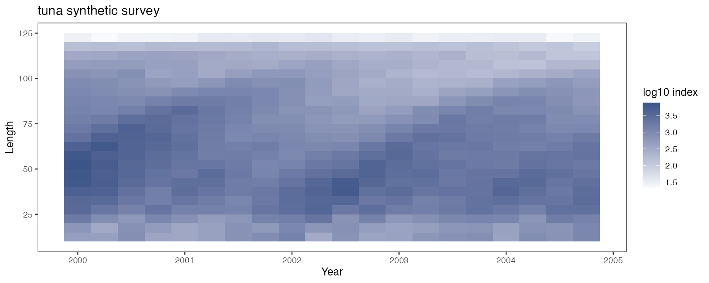

热图每年有四列。指数在 30-70 cm 最大，在 122.5 cm 组最小，生长曲线要到 4 龄以后才到达这个体长。

The heat map has four columns per year. The index is largest at 30-70 cm and smallest in the 122.5 cm bin, which the growth curve reaches only after age 4.

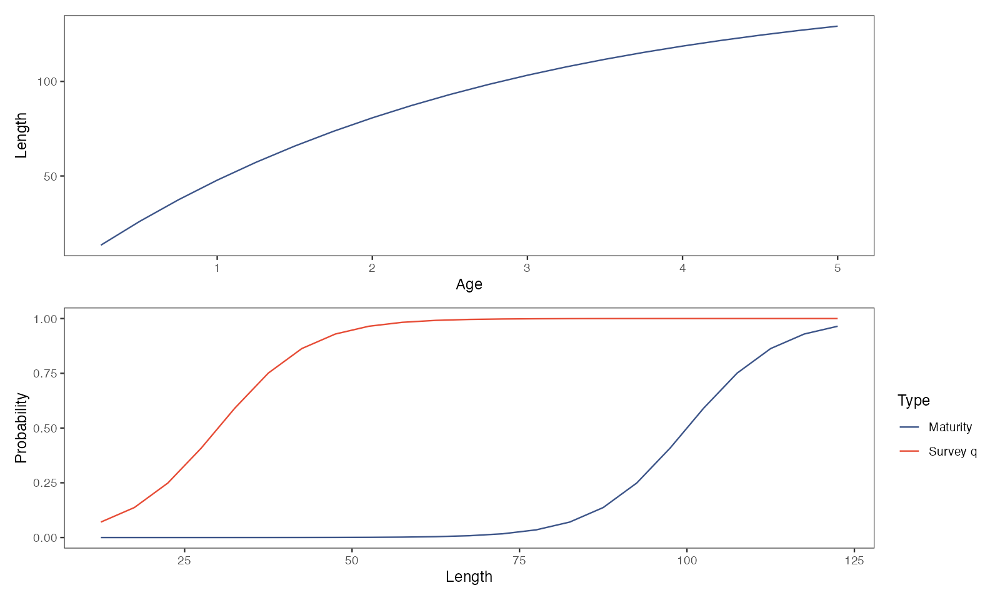

生长曲线从 0.25 龄的 13 cm 到 5 龄的 129 cm（`vbk` 为每年 0.38）；成熟（L50 为 100 cm）远高于调查可捕性（L50 为 30 cm）。

Growth runs from 13 cm at age 0.25 to 129 cm at age 5 (`vbk` 0.38 per year); maturity (L50 100 cm) lies far above survey catchability (L50 30 cm).

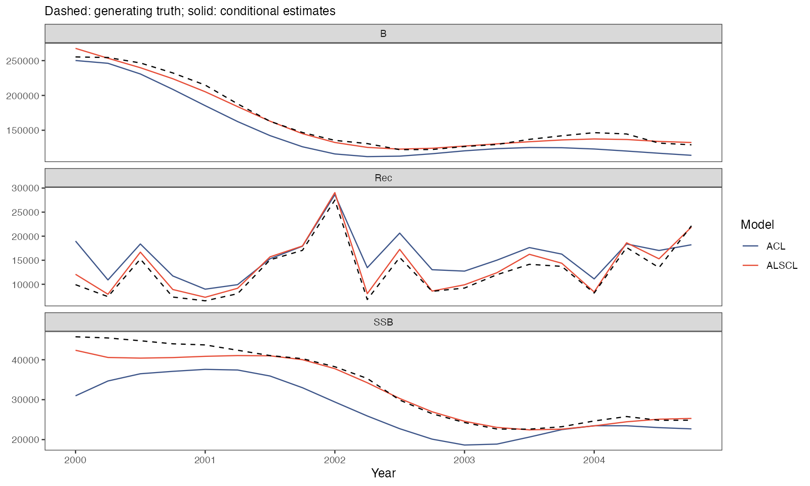

补充量按季度计。ALSCL 的生物量和产卵生物量跟随真值，估计值与真值相差约 11% 以内。ACL 的生物量和产卵生物量在每个季度都低于真值。它的产卵生物量相对真值在 2000 年初以及 2002-2003 年最低（约为真值的 0.68 到 0.77），到 2003 年末才接近真值。两个模型都在 20 个季度中的 19 个高估了补充量，ALSCL 平均高估 9%，ACL 平均高估 31%。该案例使用体长生长转移；拟合过程的假设仍与操作模型不同，因此单个重复不能给两个模型排名。

Recruitment is per quarter. ALSCL follows the truth for biomass and spawning biomass, with estimates within about 11% of the truth. ACL lies below the truth for biomass and spawning biomass in every quarter. Its spawning biomass is lowest relative to the truth at the start of 2000 and again in 2002-2003 (about 0.68 to 0.77 of the truth) and comes close to the truth only from late 2003. Both models overestimate recruitment in 19 of the 20 quarters, on average by 9% for ALSCL and by 31% for ACL. The case uses length-based growth transitions; the fitted process assumptions still differ from the operating model, so one replicate cannot rank the two models.

<a id="case-studies-simulation"></a>

### 4. 扩展为模拟实验 / Extend to a simulation study

```r
source("scripts/simulation_workflow.R", encoding = "UTF-8")
simulations <- run_simulation_examples(out = "my_cases/data/cases", fit_batch = FALSE)
source("scripts/case_studies.R", encoding = "UTF-8")
case_status <- run_case_studies(out = "my_cases")
```

`run_simulation_examples()` 在 `out` 下重新生成两个案例：每个预设物种的三个 CSV 文件、`truth.rds` 和重复文件；`fit_batch = TRUE` 会再对鲽鱼的重复批量拟合 ACL，并写出保留失败拟合的 `batch_checks.csv`。`run_case_studies()` 用第 2 步和第 3 步的设置重新拟合两个案例，在 `out` 下写出七张案例图和 `results/case_convergence.csv`；它从 `out/data/cases` 读取真值，因此本例先直接在 `my_cases/data/cases` 生成案例，再把拟合输出放到 `my_cases`。

`run_simulation_examples()` regenerates both cases under `out`: the three CSV files, `truth.rds` and the replicate files of each preset; `fit_batch = TRUE` adds batch ACL fits of the flatfish replicates and writes `batch_checks.csv`, which keeps the failed fits. `run_case_studies()` refits both cases with the settings of steps 2 and 3 and writes the seven case figures and `results/case_convergence.csv` under `out`; it reads the truth from `out/data/cases`, so the example generates the cases directly under `my_cases/data/cases` before fitting them under `my_cases`.

开展模拟研究时，增大 `iter_range` 以增加重复次数，每次改变一项设置，例如调查观测误差或自然死亡率。用全部拟合计算失败率。偏差和 RMSE 只使用通过数值检查且估计值与真值均有限的配对，区间覆盖率只使用可计算的区间。报告指标时分别列出配对数和区间数。见[模拟调查数据](https://github.com/FanZhang-LAB-SHOU/ALSCL/blob/main/docs/USER_GUIDE.md#simulation)。

Increase `iter_range` for a simulation study and vary one setting at a time, such as survey observation error or natural mortality. Report the failure rate across all attempted fits. Bias and RMSE use finite estimate–truth pairs from fits that passed the numerical checks. Interval coverage uses the subset with usable intervals. Report the number of pairs and intervals alongside the respective statistics. See [Simulate survey data](https://github.com/FanZhang-LAB-SHOU/ALSCL/blob/main/docs/USER_GUIDE.md#simulation).

<a id="case-studies-next"></a>

### 下一步 / What next

| 想做什么 / What you want to do | 阅读 / Read |
|---|---|
| 整理自己的数据表并选择时间步 / Lay out your own tables and choose the time step | [准备调查数据](https://github.com/FanZhang-LAB-SHOU/ALSCL/blob/main/docs/USER_GUIDE.md#excel) / [Prepare your survey data](https://github.com/FanZhang-LAB-SHOU/ALSCL/blob/main/docs/USER_GUIDE.md#excel) |
| 读拟合结果的数值检查、估计值和残差 / Read the numerical checks, estimates and residuals of a fit | [理解第一次拟合](https://github.com/FanZhang-LAB-SHOU/ALSCL/blob/main/docs/USER_GUIDE.md#builtin) / [Understand your first fit](https://github.com/FanZhang-LAB-SHOU/ALSCL/blob/main/docs/USER_GUIDE.md#builtin) |
| 决定哪些参数固定、哪些估计 / Decide which parameters to fix or estimate | [拟合设置](https://github.com/FanZhang-LAB-SHOU/ALSCL/blob/main/docs/USER_GUIDE.md#fitting) / [Fitting controls](https://github.com/FanZhang-LAB-SHOU/ALSCL/blob/main/docs/USER_GUIDE.md#fitting) |
| 生成调查数据并批量拟合重复 / Generate survey data and fit replicates in batch | [模拟与批量实验](https://github.com/FanZhang-LAB-SHOU/ALSCL/blob/main/docs/USER_GUIDE.md#simulation) / [Simulation](https://github.com/FanZhang-LAB-SHOU/ALSCL/blob/main/docs/USER_GUIDE.md#simulation) |
| 从拟合模型模拟调查数据，或预测留出的年份 / Simulate from a fitted model or predict withheld years | [模型验证](https://github.com/FanZhang-LAB-SHOU/ALSCL/blob/main/docs/MODEL_VALIDATION.md) / [Model validation](https://github.com/FanZhang-LAB-SHOU/ALSCL/blob/main/docs/MODEL_VALIDATION.md) |
| 拟合真实的调查指数，并与年龄判读结果和资源评估对比 / Fit a real survey index and compare the fit with age readings and an assessment | [真实调查数据的拟合结果，哪些可以用？](https://github.com/FanZhang-LAB-SHOU/ALSCL/blob/main/docs/CASES.md#case-north-sea-whiting) / [What can a fit to a real survey be used for?](https://github.com/FanZhang-LAB-SHOU/ALSCL/blob/main/docs/CASES.md#case-north-sea-whiting) |

<a id="chapter-13"></a>
## 13 ggsci 配色与导出 · Colors and export

[使用指南 / User guide](https://github.com/FanZhang-LAB-SHOU/ALSCL/blob/main/docs/USER_GUIDE.md) · [首页 / Home](https://github.com/FanZhang-LAB-SHOU/ALSCL/blob/main/README.md)

## ggsci 配色与导出 / Colors and export

本页带你为所有 ALSCL 图一次设置色板和主题、为单张图覆盖颜色、导出图形，以及设置生长图和种群图的标签和坐标轴。你需要[理解第一次拟合](https://github.com/FanZhang-LAB-SHOU/ALSCL/blob/main/docs/USER_GUIDE.md#builtin)中的 `a`、`b` 和 `x`；第 1 步还会拟合一个回溯分析结果 `rb`（[运行回溯分析](https://github.com/FanZhang-LAB-SHOU/ALSCL/blob/main/docs/USER_GUIDE.md#retrospective)）。

On this page you set a palette and theme once for every ALSCL plot, override colors for one plot, export a figure, and set the labels and axes of the growth and population plots. You need `a`, `b` and `x` from [Understand your first fit](https://github.com/FanZhang-LAB-SHOU/ALSCL/blob/main/docs/USER_GUIDE.md#builtin); step 1 also fits a retrospective analysis `rb` ([Run a retrospective analysis](https://github.com/FanZhang-LAB-SHOU/ALSCL/blob/main/docs/USER_GUIDE.md#retrospective)).

<a id="plot-customization-theme"></a>

### 1. 一次设置主题 / Set the theme once

```r
# 先建立回溯结果，再调整绘图样式 / Create the retrospective result before styling it
rb <- retro_alscl(x, nyear = 3, train_times = 2, ncores = 1, silent = TRUE)

# 一次设置，随后重新创建图 / Set once, then recreate plots
acl_theme_set(palette = "npg", base_theme = "theme_bw", font_family = "sans")
plot_retro(rb, facet_ncol = 2, rho_digits = 3)
plot_compare_ts(a, b, se = TRUE)

# 可选期刊色板 / Alternative journal palettes
acl_theme_set(palette = "jama") # npg, aaas, nejm, lancet, jama
plot_abundance(b, type = "NL", facet_ncol = 3)
```

默认色板是 ggsci NPG：估计值用深蓝，观测用朱红，两模型比较用深蓝和朱红。回溯图的颜色按末端时间步从新到旧分配。`acl_theme_set()` 只影响之后创建的图；要改已有的图，就重新创建它。可选色板为 `npg`（10 色）、`aaas`（10）、`nejm`（8）、`lancet`（9）和 `jama`（7）。

The default palette is ggsci NPG: navy estimates, vermilion observations, and navy and vermilion for model comparisons. Retrospective colors follow the terminal time steps, newest first. `acl_theme_set()` changes the plots created afterwards; recreate an existing plot to restyle it. The palettes are `npg` (10 colors), `aaas` (10), `nejm` (8), `lancet` (9) and `jama` (7).

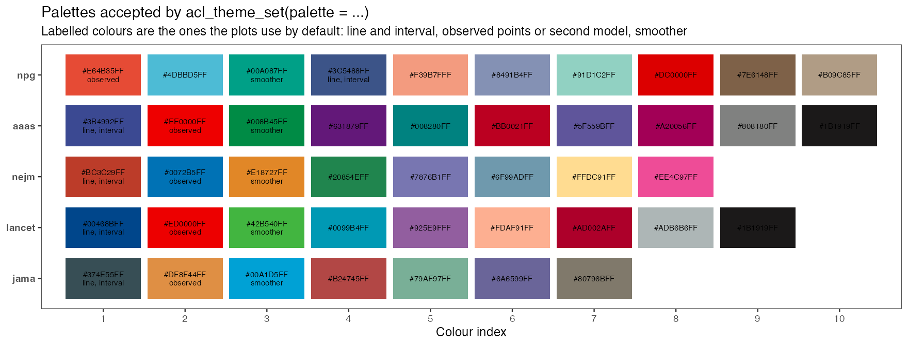

图中是 `acl_theme_set()` 接受的五种色板。每一行里，第一个带标注的颜色用于单模型图的线、区间和点，第二个用于观测和比较图中的第二个模型，第三个用于平滑线；其余颜色按顺序供需要更多分组的图使用，例如回溯图的各轮。下一张图把同一张比较图在每种色板下画出来，便于按视觉效果挑选；仓库中的 `docs/figures/palettes/ssb_by_palette.png` 以同样方式展示单模型图。

The figure shows the five palettes `acl_theme_set()` accepts. In each row the first labelled colour draws lines, intervals and points of single-model plots, the second draws observations and the second model in comparisons, and the third draws smoothers; the remaining colours are used in order when a plot needs more groups, for example the peels of a retrospective. The next figure shows the same comparison plot under every palette, so you can pick one by eye; `docs/figures/palettes/ssb_by_palette.png` in the repository shows a single-model plot in the same way.

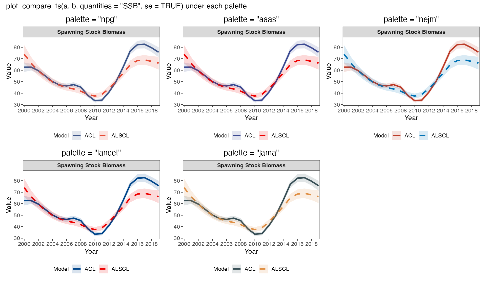

| 设置 / Setting | 范围与优先级 / Scope and precedence |
|---|---|
| `palette` | 切换时重设派生的颜色角色 / Switching resets derived roles |
| `line_color`、`se_color`、`point_color` / `line_color`, `se_color`, `point_color` | 单模型的线、区间和散点 / Single-model lines, intervals and scatter |
| `observed_color`、`smooth_color`、`hline_color` / `observed_color`, `smooth_color`, `hline_color` | 观测、残差平滑线和参考线 / Observation, residual smoother and reference line |
| `compare_colors` | 模型对，可按模型名称匹配 / Model pair, optionally matched by name |
| `low_col`、`high_col` / `low_col`, `high_col` | 连续热图的端点 / Sequential heatmap endpoints |
| `font_family`、`title_size`、`axis_text_size`、`strip_text_size` / `font_family`, `title_size`, `axis_text_size`, `strip_text_size` | 字体与字号 / Typography |
| `line_size`、`point_size` / `line_size`, `point_size` | 单模型图的线宽和所有图的默认点大小（2.5）；比较图线宽使用 `compare_line_size` / Single-model line width and the default point size for all plots (2.5); comparison line widths use `compare_line_size` |
| `compare_point_size` | 可选的比较图点大小；设为 `NULL` 清除覆盖，恢复继承全局 `point_size` / Optional comparison-only point size; `NULL` clears it and restores global `point_size` inheritance |
| `facet_ncol`、`facet_nrow`、`facet_scales` / `facet_ncol`, `facet_nrow`, `facet_scales` | 分面布局，所有图使用相同的参数名 / Facet layout, with the same argument names in every plot |

<a id="plot-customization-override"></a>

### 2. 为单张图覆盖颜色 / Override colors for one plot

```r
# 单图覆盖优先于全局设置 / Per-call overrides take precedence
plot_retro(rb, palette = "nejm", rho_position = "top_left")
plot_retro(rb, colors = c("2019" = "#3C5488", "2018" = "#E64B35",
                         "2017" = "#00A087", "2016" = "#4DBBD5"))
plot_SSB(b, line_color = "#00A087", se = TRUE, se_color = "#00A087")
plot_compare_ts(a, b, colors = c("ACL" = "#3C5488", "ALSCL" = "#E64B35"))

# 连续量使用渐变色 / Sequential gradients encode continuous quantities
plot_pla(b)                         # 全局端点 / Global endpoints
plot_compare_F(a, b, palette = "npg")
plot_compare_F(a, b, palette = "inferno") # 其他渐变 / Another gradient
plot_ridges(b)                      # 默认年份渐变 / Default time gradient
plot_ridges(b, palette = "cividis")
acl_theme_set(ylab = list(year = "Survey year")) # 山脊图时间轴 / Ridge time axis
plot_ridges(b, palette = c("#E8F1FA", "#3C5488"))

# 恢复默认 / Restore defaults
acl_theme_reset()
```

设置 `acl_theme_set(point_size = 3)` 可统一单模型图和比较图的点大小。调用中的 `point_size` 优先级最高。在 `plot_compare_CatL()` 中，其次是显式传入的旧参数 `obs_size`，再是显式设置的主题 `compare_point_size`，最后是全局 `point_size`。其他含点的比较图遵守相同顺序，但不使用 `obs_size`。用 `acl_theme_set(compare_point_size = NULL)` 清除仅针对比较图的覆盖。

Set `acl_theme_set(point_size = 3)` to change points across single-model and comparison plots. A per-call `point_size` has highest priority. In `plot_compare_CatL()`, an explicit legacy `obs_size` comes next, followed by an explicit `compare_point_size` theme setting and then the global `point_size`. The other point-drawing comparison plots follow the same order without `obs_size`. Use `acl_theme_set(compare_point_size = NULL)` to remove a comparison-only override.

调用中显式给出的颜色优先于主题，也优先于同时传入的 `palette`；`NULL` 继承主题。`se_color` 要与 `line_color` 一起指定，否则它仍取主题值。回溯图的命名颜色必须覆盖每个末端时间步；无名称的颜色按同样的顺序对应。轮数超过色板颜色数时，颜色由插值得到。山脊图使用按输入年份顺序取色的 viridis 渐变，观测与拟合两侧共用，与全局色板无关；`NULL` 也使用 viridis，可改为 `cividis`、`plasma`、`ocean` 或一组颜色。

Explicit colors in a call override the theme and a palette passed with them; `NULL` inherits the theme. Set `se_color` together with `line_color`; it stays at the theme value otherwise. Named retrospective colors must cover every terminal time step; unnamed colors follow the same order. With more peels than palette colors, the colors are interpolated. Ridges use a viridis gradient in input-year order, shared by the observed and fitted panels and independent of the global palette; `NULL` also selects viridis, and `cividis`, `plasma`, `ocean` or a vector of colors replace it.

<a id="plot-customization-export"></a>

### 3. 设置文字并导出 / Set typography and export

```r
# 调整文字与布局 / Typography and layout
acl_theme_set(palette="npg", title_size=16, axis_title_size=12,
              axis_text_size=10, strip_text_size=10, title_hjust=0,
              compare_legend_pos="bottom", compare_linetypes=c("solid","dashed"))
p <- plot_retro(rb, facet_ncol = 2, point_size=1.8, line_size=.8)
ggplot2::ggsave("retrospective.png", p, width=11, height=7, dpi=300, bg="white")
ggplot2::ggsave("retrospective.pdf", p, width=11, height=7)
# 显式保存并恢复设置 / Preserve settings explicitly
old <- acl_theme()
acl_theme_set(palette="aaas", x_breaks=c(2000, 2010),
              ylab=list(survey="Survey index"))
do.call(acl_theme_set, old)
acl_theme_reset()
```

`ggsave()` 按给定的尺寸和分辨率写出 `p`。`acl_theme()` 返回当前设置，供 `do.call(acl_theme_set, old)` 恢复，包括自动坐标刻度和原来为 `NULL` 的标签；`acl_theme_reset()` 回到默认值。设置 `x_breaks = NULL` 可恢复自动刻度，`ylab = list(survey = NULL)` 可清除调查标签覆盖值。所选字体也应用于回溯图 rho 和比较图数值标注。色板来源：[ggsci NPG documentation](https://nanx.me/ggsci/reference/pal_npg.html)。

`ggsave()` writes `p` at the given size and resolution. `acl_theme()` returns the current settings for `do.call(acl_theme_set, old)` to restore, including automatic axis breaks and labels previously set to `NULL`; `acl_theme_reset()` returns to the defaults. Set `x_breaks = NULL` to restore automatic breaks or `ylab = list(survey = NULL)` to clear a survey-label override. The chosen font also applies to retrospective rho and comparison metric labels. Palette source: [ggsci NPG documentation](https://nanx.me/ggsci/reference/pal_npg.html).

<a id="plot-customization-growth"></a>

### 4. 设置生长图的范围和文字 / Set the growth-plot range and text

```r
plot_VB(b, parameter_curve = TRUE, ylab = "Length (cm)",
        axis_text_size = 12, x_breaks = c(1, 5, 10, 15),
        age_range = c(1, 15), text_size = 4)
```

对 ALSCL 拟合，`plot_VB()` 在拟合的年龄组上画由拟合尾数算出的各年龄平均体长：`age_range` 选取其中的年龄组，`parameter_curve = TRUE` 加画由 `Linf`、`k` 和 `t0` 计算的曲线及其标注，标注遵守 `text_size` 和 `text_color`。对 ACL 拟合的 von Bertalanffy 曲线，`age_range = NULL` 使用拟合结果中的年龄范围（没有年龄元数据的结果用 1-25 岁），起点不早于 `t0`；没有正跨度时报错。显式范围必须是两个有限、递增的年龄，且起点不早于 `t0`，以避免在理论零体长年龄之前出现负的预测体长。这是 [von Bertalanffy 方程](https://www.fao.org/4/x5685e/x5685e03.htm)中 `t0` 的含义。线、曲线和区间都继承 `ylab$growth` 和所选字体，显式 `ylab` 覆盖全局标签；包中没有体长单位，请在标签中给出。`observed` 的点使用 `observed_color` 和 `point_size`。`se = TRUE` 的区间属于由参数计算的曲线；协方差不可用时，函数给出警告并只画估计值。

For an ALSCL fit, `plot_VB()` draws mean length at age from the fitted numbers at the fitted age classes: `age_range` selects the age classes within it, and `parameter_curve = TRUE` adds the curve computed from `Linf`, `k` and `t0` with its annotation, which honors `text_size` and `text_color`. For the von Bertalanffy curve of an ACL fit, `age_range = NULL` uses the fitted age range (1-25 years for a result without age metadata), starting no earlier than `t0`; a range with no positive span produces an error. An explicit range must contain two finite increasing ages and start at or after `t0`, which avoids negative predicted lengths below the theoretical age at zero length. This is the meaning of `t0` in the [von Bertalanffy equation](https://www.fao.org/4/x5685e/x5685e03.htm). Lines, curves and intervals inherit `ylab$growth` and the selected font, and an explicit `ylab` overrides the global label; the package holds no unit for length, so give it in the label. The points of `observed` take `observed_color` and `point_size`. With `se = TRUE` the interval belongs to the curve computed from the parameters; if the covariance is unavailable, the function warns and draws only the estimate.

<a id="plot-customization-labels"></a>

### 5. 设置全局标签与坐标轴 / Set global labels and axes

```r
acl_theme_set(
  titles = list(SSB = "Spawning biomass",
                SSB_se = "Spawning biomass with 95% intervals"),
  xlab = list(year = "Survey year"),
  ylab = list(ssb = "Spawning biomass"),
  x_breaks = c(2000, 2009, 2019), x_expand = c(0, 0)
)
plot_SSB(b, se = TRUE)
acl_theme_reset()
```

`plot_SSB()`、`plot_biomass()`、`plot_abundance()` 和 `plot_catch()` 的总量、年龄和体长模式，无论是否显示区间，都继承全局 `titles`、`xlab`、`ylab`、`x_breaks` 和 `x_expand`。SSB 的纵轴使用 `ylab$ssb`；标题使用数量键，区间版本加 `_se`。这些设置只改变标签和显示范围，网格线保持隐藏。全局 `x_breaks` 同时用于时间、年龄和体长坐标轴：只有至少一个刻度落在某张图的横轴范围内时，该图才使用它，所以按年份设置的刻度不会清空年龄轴或体长轴。`acl_theme_set(interval = "wald")` 把丰度、生物量、产卵生物量、补充量、渔获量和捕捞死亡率图的 95% 区间从默认的对数正态区间改为对称区间 `estimate +/- 1.96 * SE`；`interval` 参数只对单次调用起同样的作用。误差棒不透明，除非调用中给出 `se_alpha`。调用中给出的 `title`、`xlab`、`ylab` 替换主题标签，字体参数（`font_family`、`title_size`、`axis_title_size`、`axis_text_size`、`strip_text_size`、`legend_text_size`、`base_theme`、`title_hjust`）替换对应的主题设置，与其他单模型图一致；`plot_deviance()` 也接受这些参数。

The total, age and length modes of `plot_SSB()`, `plot_biomass()`, `plot_abundance()` and `plot_catch()` inherit the global `titles`, `xlab`, `ylab`, `x_breaks` and `x_expand`, with or without intervals. For SSB, use `ylab$ssb`; titles use the quantity key, with `_se` for interval variants. These settings change labels and display ranges only, and the gridlines stay hidden. One global `x_breaks` serves time, age and length axes: a plot uses it only when at least one break lies within the range of its horizontal axis, so calendar-year breaks do not blank an age or length axis. `acl_theme_set(interval = "wald")` changes the 95% interval of the abundance, biomass, spawning biomass, recruitment, catch and fishing mortality plots from the default lognormal interval to the symmetric interval `estimate +/- 1.96 * SE`; the `interval` argument does the same for one call. Error bars are opaque unless the call gives `se_alpha`. A `title`, `xlab` or `ylab` given in the call replaces the theme label, and the typography arguments (`font_family`, `title_size`, `axis_title_size`, `axis_text_size`, `strip_text_size`, `legend_text_size`, `base_theme`, `title_hjust`) replace the corresponding settings, as in every other single-model plot; `plot_deviance()` takes the same arguments.

`plot_fishing_mortality()` 继承同样的设置，标题键为 `F_year`、`F_age` 和 `F_length`（区间版本加 `_se`），横轴使用 `xlab$year`、`xlab$age` 或 `xlab$length`，纵轴使用 `ylab$F`。年龄模式按拟合年龄绘制。保存时没有年龄元数据的结果按组序号绘制，在你设置 `xlab$age` 之前默认标签是“Age group”；ACL 的 `type = "length"` 别名使用年龄模式的设置。单次调用中指定的标签和刻度优先。`base_theme` 接受 `"theme_bw"`、`"bw"` 等名称、`ggplot2::theme_bw()` 等主题对象，或 `NULL` 表示全局设置。

`plot_fishing_mortality()` inherits the same settings with the title keys `F_year`, `F_age` and `F_length` (plus `_se`), the horizontal label `xlab$year`, `xlab$age` or `xlab$length` and the vertical label `ylab$F`. Age mode plots the fitted ages. A result saved without age metadata is plotted against group positions, and its default label is "Age group" until you set `xlab$age`; the ACL `type = "length"` alias uses the age settings. Per-call labels and breaks take precedence. `base_theme` accepts a name such as `"theme_bw"` or `"bw"`, a theme object such as `ggplot2::theme_bw()`, or `NULL` for the global setting.

单模型与比较的调查拟合图使用 `ylab$survey`；未设置时，自定义的 `ylab$abundance` 生效，否则为“Survey index”。对数图加“Log”前缀，显式 `ylab` 优先，`ylab$catch` 只用于捕获量图。

Survey-fit plots, single-model and comparison, use `ylab$survey`; when it is unset, a customized `ylab$abundance` applies, otherwise "Survey index". Log plots add a "Log" prefix, an explicit `ylab` wins, and `ylab$catch` labels the catch plots only.

<a id="plot-customization-next"></a>

### 下一步 / What next

| 想做什么 / What you want to do | 阅读 / Read |
|---|---|
| 选择要画的种群图 / Choose which population plot to draw | [调查与种群图](https://github.com/FanZhang-LAB-SHOU/ALSCL/blob/main/docs/PLOT_GALLERY.md) / [Survey and population plots](https://github.com/FanZhang-LAB-SHOU/ALSCL/blob/main/docs/PLOT_GALLERY.md) |
| 在一张图中比较两次拟合 / Compare two fits in one figure | [模型比较与真值](https://github.com/FanZhang-LAB-SHOU/ALSCL/blob/main/docs/PLOT_GALLERY.md) / [Model comparisons](https://github.com/FanZhang-LAB-SHOU/ALSCL/blob/main/docs/PLOT_GALLERY.md) |

<a id="chapter-14"></a>
## 14 全部函数与参数 · Complete function reference

对应 ALSCL 2.4.3.9000，覆盖 **77 个公开函数**。签名及默认值从实际 R 函数提取；每项参数均有中文说明和英文帮助。签名中的 `c(...)` 通常列出可选值，默认取第一项。`NULL` 的含义依函数而异，未必表示停用。

All **77 exported functions** of ALSCL 2.4.3.9000 are covered. Signatures/defaults were extracted from R. Each argument has Chinese guidance and English help. For a choice argument, `c(...)` lists options and the first is the default.

[使用指南 / Guide](https://github.com/FanZhang-LAB-SHOU/ALSCL/blob/main/docs/USER_GUIDE.md) · [图谱 / Gallery](https://github.com/FanZhang-LAB-SHOU/ALSCL/blob/main/docs/PLOT_GALLERY.md)

## 示例环境 / Example context

先执行使用指南中的内置数据拟合，得到 `x`、`inputs`、`a`（ACL）、`b`（ALSCL），并设 `dat <- x$data.CatL`。回溯示例生成 `ra`、`rb`；模拟依次运行 `initialize_params`、`sim_cal`、`sim_data`。独立参数函数无需拟合对象。

First run the guide's built-in fitting example to define `x`, `inputs`, `a` and `b`; set `dat <- x$data.CatL`. Retrospective examples define `ra/rb`. Run simulation constructors in order. Standalone biological functions need no fitted model.

```r
library(ALSCL)
library(ggplot2)
library(patchwork)
data(YTF_example)
x <- YTF_example
inputs <- x[c("data.CatL", "data.wgt", "data.mat")]
dat <- x$data.CatL
```

## 索引 / Index

- [simulate_fit](#simulate_fit) — 给定拟合种群状态，或重新抽取其过程偏差后，模拟调查观测。 / Simulate survey observations conditionally on a fitted population or after resampling its process deviations.
- [self_test](#self_test) — 用拟合模型模拟数据，以相同设置重新拟合同一模型，并把估计值与模拟所用的值比较。 / Simulate data from a fitted model, refit the same model with the same settings and compare the estimates with the values used to simulate.
- [summarize_simulations](#summarize_simulations) — 使用明确分母汇总模拟偏差、RMSE、区间覆盖率、拟合失败与耗时。 / Summarize simulation bias, RMSE, interval coverage, fitting failures and timing with explicit denominators.
- [sim_model](#sim_model) — 使用统一批次流程，把 ACL 或 ALSCL 拟合到已保存的模拟重复数据。 / Fit ACL or ALSCL to saved simulation replicates using the same batch pipeline.
- [sim_alscl](#sim_alscl) — 使用 ALSCL 拟合模拟批次的便捷入口。 / Convenience interface for simulation batches fitted with ALSCL.
- [save_assessment](#save_assessment) — 保存完整可移植评估 / Save a portable assessment
- [refit_model](#refit_model) — 使用保存的输入和设置重新拟合 / Refit using saved inputs and settings
- [read_survey_excel](#read_survey_excel) — 读取 Excel 工作簿中的调查、体重和成熟比例工作表。 / Read survey, weight and maturity sheets from an Excel workbook.
- [read_survey_csv](#read_survey_csv) — 从三个 CSV 文件读取对齐的调查、体重和成熟比例数据表。 / Read aligned survey, weight and maturity tables from three CSV files.
- [read_assessment](#read_assessment) — 读取可移植评估存档 / Read a portable assessment archive
- [project_model](#project_model) — 从 ACL 或 ALSCL 拟合末期状态开始，按明确给定的假设推演确定性种群情景。 / Project explicit deterministic population scenarios from the terminal fitted ACL or ALSCL state.
- [profile_model](#profile_model) — 逐网格固定一个自由标量参数，重新优化其余参数及随机效应。 / Fix a free scalar at each grid value and reoptimize the remaining parameters and random effects.
- [prepare_alscl_data](#prepare_alscl_data) — 把三张数据表、三个 CSV 文件或 Excel 工作簿整理为可直接拟合的输入列表。 / Prepare a reusable input bundle from tables, three CSV files or an Excel workbook.
- [hindcast_model](#hindcast_model) — 逐步扩展训练窗口，对真正留出的调查指数进行点预测并评分。 / Fit expanding training windows and score survey-index point predictions against genuinely withheld periods.
- [inspect_parameters](#inspect_parameters) — 查看实际初值、上下界，以及自由、固定或共享的参数状态。 / Inspect effective parameter starts, bounds and free/fixed/tied restrictions.
- [fit_scenarios](#fit_scenarios) — 在同一观测数据上串行或 socket 并行拟合具名敏感性情景。 / Fit named sensitivity scenarios on common observations with serial or socket execution.
- [extract_parameters](#extract_parameters) — 提取参数、尺度与固定状态 / Extract parameters, scales and estimation status
- [extract_estimates](#extract_estimates) — 统一提取带坐标的种群估计 / Extract population estimates with coordinates
- [check_fit](#check_fit) — 用时间–体长热图、按实际时间间隔计算的滞后相关及正态 QQ 图检查条件观测残差。 / Inspect conditional observation residuals with a time–length heatmap, actual-time lag correlations and a normal QQ plot.
- [check_alscl_data](#check_alscl_data) — 在编译或拟合之前检查完整数据和模型设置。 / Check complete data and model settings before compiling or fitting.
- [acl_theme](#acl_theme) — 读取全局主题 / Read global theme settings
- [acl_theme_reset](#acl_theme_reset) — 恢复默认主题 / Reset theme settings
- [acl_theme_set](#acl_theme_set) — 设置全局主题 / Set global theme settings
- [alscl_speed](#alscl_speed) — 设置拟合速度选项 / Set speed options for model fitting
- [alscl_speed_info](#alscl_speed_info) — 查看速度设置的实际效果 / Show how fits will use the speed settings
- [compare_models](#compare_models) — 生成两个模型的数值比较表 / Compare fitted model summaries
- [create_parameters](#create_parameters) — 建立模型初值及边界 / Construct estimation starts and bounds
- [create_parameters_alscl](#create_parameters_alscl) — ALSCL 初值及边界便捷入口 / ALSCL parameter constructor
- [diagnose_model](#diagnose_model) — 汇总诊断指标 / Summarize diagnostics
- [diagnostic_metrics](#diagnostic_metrics) — 计算样本内拟合误差和信息指标 / Calculate in-sample fit errors and information criteria
- [generate_map](#generate_map) — 合并 ACL 默认固定参数与自定义映射 / Merge ACL default and custom maps
- [initialize_params](#initialize_params) — 建立模拟生物参数 / Initialize simulation biology
- [mat_func](#mat_func) — 计算 logistic 成熟比例 / Calculate logistic maturity
- [plot_abundance](#plot_abundance) — 丰度 N / Abundance N
- [plot_biomass](#plot_biomass) — 生物量 B / Biomass B
- [plot_catch](#plot_catch) — 总渔获尾数、年龄别渔获尾数和体长别渔获尾数 / Total catch in numbers and catch in numbers at age or length
- [plot_CatL](#plot_CatL) — 观测与拟合的分体长调查指数 / Observed and fitted survey indices at length
- [plot_compare_annual_F](#plot_compare_annual_F) — 已弃用，改用 plot_compare_F_ts / Deprecated, use plot_compare_F_ts
- [plot_compare_CatL](#plot_compare_CatL) — 两模型调查拟合 / Survey fits from both models
- [plot_compare_F](#plot_compare_F) — 死亡率矩阵比较 / Fishing mortality matrices
- [plot_compare_F_ts](#plot_compare_F_ts) — 各时间步 F 比较 / Fishing mortality by time step
- [plot_compare_growth](#plot_compare_growth) — 两模型的年龄别平均体长 / Mean length at age of two fits
- [plot_compare_metrics](#plot_compare_metrics) — 拟合指标比较 / Fit metric comparison
- [plot_compare_residuals](#plot_compare_residuals) — 残差联合诊断 / Combined residual diagnostics
- [plot_compare_selectivity](#plot_compare_selectivity) — 固定调查可捕性 / Fixed survey catchability
- [plot_compare_ts](#plot_compare_ts) — 种群时间序列比较 / Population time series comparison
- [plot_deviance](#plot_deviance) — 补充量和捕捞死亡率的过程偏差 / Recruitment and fishing mortality deviations
- [plot_fishing_mortality](#plot_fishing_mortality) — 按年龄或体长绘制捕捞死亡率 / Plot fishing mortality by age or length
- [plot_length_at_age](#plot_length_at_age) — 各时间步的年龄别平均体长 / Mean length at age by time step
- [plot_natural_mortality](#plot_natural_mortality) — 拟合所用的自然死亡率 / Natural mortality rate used in a fit
- [plot_pla](#plot_pla) — 给定年龄的体长分布 / Distribution of length at age
- [plot_recruitment](#plot_recruitment) — 补充量 / Recruitment
- [plot_relative_catch](#plot_relative_catch) — 各时间步的相对渔获量 / Relative catch by time step
- [plot_residuals](#plot_residuals) — 按时间步或体长组绘制调查指数的对数残差 / Log survey-index residuals by time step or length bin
- [plot_retro](#plot_retro) — 截短拟合与完整拟合的比较 / Retrospective estimates and the full fit
- [plot_ridges](#plot_ridges) — 长度组成山脊图 / Length composition ridges
- [plot_self_test](#plot_self_test) — 自检的相对误差 / Relative errors of a self-test
- [plot_SSB](#plot_SSB) — 产卵生物量 SSB / Spawning stock biomass (SSB)
- [plot_SSB_Rec](#plot_SSB_Rec) — 亲体与补充关系 / Spawning stock biomass against recruitment
- [plot_survey_catchability](#plot_survey_catchability) — 拟合所用的调查可捕性 / Survey catchability used in a fit
- [plot_VB](#plot_VB) — 年龄别平均体长：VB 曲线或拟合尾数 / Mean length at age: von Bertalanffy curve or fitted numbers
- [retro_acl](#retro_acl) — ACL 回溯入口 / ACL retrospective wrapper
- [retro_alscl](#retro_alscl) — ALSCL 回溯入口 / ALSCL retrospective wrapper
- [retro_model](#retro_model) — 统一回溯分析 / Unified retrospective analysis
- [run_acl](#run_acl) — 拟合年龄型 ACL / Fit age-based ACL
- [run_alscl](#run_alscl) — 拟合年龄与长度联合 ALSCL / Fit joint age-length ALSCL
- [sim_acl](#sim_acl) — 批量拟合 ACL 模拟重复 / Fit simulated replicates with ACL
- [sim_cal](#sim_cal) — 从参数计算生物矩阵 / Calculate biological arrays
- [sim_data](#sim_data) — 运行完整随机种群模拟 / Simulate full population dynamics
- [simulation_to_tables](#simulation_to_tables) — 把一个模拟重复转换为拟合用的三张表 / Convert one simulated replicate to the tables used for fitting
- [simulate_example_data](#simulate_example_data) — 快速年度教学数据生成 / Generate simple annual teaching data
- [VB_func](#VB_func) — 计算 VB 平均体长 / Calculate VB mean length
- [lorenzen_M](#lorenzen_M) — 按体长的幂函数计算自然死亡率 / Natural mortality rate as a power function of length
- [survey_catchability](#survey_catchability) — 计算 logistic 或穹顶形的体长别调查可捕性 / Survey catchability at length for logistic and dome-shaped curves
- [length_at_age](#length_at_age) — 拟合模型各年龄的平均体长及标准差 / Mean and standard deviation of length at age from a fitted model
- [ssb_at_age](#ssb_at_age) — 按年龄别成熟比例计算产卵生物量 / Spawning stock biomass from maturity at age
- [relative_catch](#relative_catch) — 各时间步的相对渔获量 / Relative catch by time step

<a id="acl_theme"></a>
## `acl_theme()`

读取全局主题 / Read global theme settings

```r
acl_theme (what = NULL)
```

| 参数 / Argument | 默认值 / Default | 中文说明 | English |
|---|---|---|---|
| `what` | `NULL` | NULL 返回全部全局主题设置，字符名称返回单项。 | Optional character. Retrieve a specific element, e.g. "titles", "font_family", "compare_colors". |

**返回 / Returns:** `what=NULL` 时返回完整设置列表，否则返回指定设置项。

The complete settings list when `what=NULL`, or the requested setting otherwise.

**示例 / Example:**

```r
# 调用示例；变量按上文创建 / Use objects defined above
acl_theme()
acl_theme("line_color")
```


<a id="acl_theme_reset"></a>
## `acl_theme_reset()`

恢复默认主题 / Reset theme settings

```r
acl_theme_reset ()
```

| 参数 / Argument | 默认值 / Default | 中文说明 | English |
|---|---|---|---|

**返回 / Returns:** 把每项主题设置恢复为包的默认值，并用 message 报告（可用 `suppressMessages()` 关闭），然后不可见地返回 NULL。

Restores every theme setting to the package default and reports this with a message, which `suppressMessages()` silences. Returns NULL, invisibly.

**示例 / Example:**

```r
# 调用示例；变量按上文创建 / Use objects defined above
acl_theme_reset()
```

<a id="acl_theme_set"></a>
## `acl_theme_set()`

设置全局主题 / Set global theme settings

保存 `old <- acl_theme()`，再用 `do.call(acl_theme_set, old)` 完整恢复设置。显式 `x_breaks = NULL` 恢复自动刻度，`ylab = list(survey = NULL)` 清除调查标签覆盖值；省略参数保留当前值。

Save `old <- acl_theme()` and restore the settings with `do.call(acl_theme_set, old)`. Explicit `x_breaks = NULL` restores automatic breaks and `ylab = list(survey = NULL)` clears a survey-label override; omitted arguments leave current values unchanged.

省略的 `line_size` 与 `se_alpha` 参数继承 `acl_theme_set()`（默认 1.5 与 0.2），函数显式参数优先。比较曲线遵守 `linetypes` 与 `compare_linetypes`，残差和指标组合图的标题及 F 分面文字继承全局字体设置。默认无网格。

Omitted `line_size` and `se_alpha` arguments inherit `acl_theme_set()` (defaults 1.5 and 0.2); explicit function arguments take priority. Comparison curves honor `linetypes` and `compare_linetypes`, and the titles of the combined residual and metric plots and the F facet labels inherit the global typography. Grid lines are absent by default.

```r
acl_theme_set (base_theme = NULL, font_family = NULL, title_size = NULL, title_hjust = NULL,
    axis_title_size = NULL, axis_text_size = NULL, strip_text_size = NULL, legend_text_size = NULL,
    x_breaks = NULL, x_expand = NULL, line_color = NULL, line_size = NULL, point_size = NULL,
    se_color = NULL, se_alpha = NULL, compare_colors = NULL, compare_linetypes = NULL,
    compare_line_size = NULL, compare_point_size = NULL, compare_se_alpha = NULL,
    compare_legend_pos = NULL, compare_facet_ncol = NULL, compare_facet_scales = NULL,
    titles = NULL, xlab = NULL, ylab = NULL, palette = NULL, point_color = NULL,
    observed_color = NULL, smooth_color = NULL, hline_color = NULL, low_col = NULL,
    high_col = NULL, ..., interval = NULL)
```

| 参数 / Argument | 默认值 / Default | 中文说明 | English |
|---|---|---|---|
| `base_theme` | `NULL` | 基础主题名称："bw"、"minimal"、"classic"、"gray"、"grey"、"light"、"linedraw"、"dark" 或 "void"，可带 "theme_" 前缀。其他取值报错。 | Character. Base ggplot2 theme name: "bw", "minimal", "classic", "gray", "grey", "light", "linedraw", "dark" or "void", with or without the "theme_" prefix. Any other value is an error. |
| `font_family` | `NULL` | 文本字体；请使用本机可用字体。 | Character. Font family for all text. |
| `title_size` | `NULL` | 图标题字号。 | Numeric. Plot title size in pt. |
| `title_hjust` | `NULL` | 标题水平对齐：0 左、0.5 中、1 右。 | Numeric. Title alignment (0=left, 0.5=center, 1=right). |
| `axis_title_size` | `NULL` | 坐标轴标题字号。 | Numeric. Axis title size. |
| `axis_text_size` | `NULL` | 坐标刻度文字字号。 | Numeric. Axis tick label size. |
| `strip_text_size` | `NULL` | 分面标签字号。 | Numeric. Facet label size. |
| `legend_text_size` | `NULL` | 图例文字字号。 | Numeric. Legend text size. |
| `x_breaks` | `NULL` | 横轴刻度向量或 NULL。同一设置用于时间、年龄和体长坐标轴：只有至少一个刻度落在某张图的横轴范围内时，该图才使用它，否则自动选择刻度；因此按年份设置的刻度不会清空年龄轴或体长轴。显式传入 NULL 恢复自动刻度；省略该参数则保留当前设置。 | Numeric vector or NULL. Custom x-axis breaks. One setting serves time, age and length axes. A plot uses it only when at least one break lies within the range of its x axis; otherwise that plot chooses its breaks automatically. Calendar-year breaks therefore do not blank age or length axes. Pass NULL explicitly to restore automatically selected breaks; omitting the argument leaves the current setting unchanged. |
| `x_expand` | `NULL` | 横轴留白设置，长度 2 的数值向量。 | Numeric vector of length 2. X-axis expansion. |
| `line_color` | `NULL` | 单模型线条颜色。 | Character. Default line color for single-model plots. |
| `line_size` | `NULL` | NULL 继承全局 line_size，显式值优先。 | NULL inherits global line_size; explicit values take priority. |
| `point_size` | `NULL` | 所有含点图的默认点大小（2.5）；比较图可单独覆盖。 | Default point size for all point-drawing plots (2.5); comparison plots can override it. |
| `se_color` | `NULL` | 区间阴影或误差棒的颜色。 | Character. Default CI color. |
| `se_alpha` | `NULL` | 区间阴影的默认透明度（0.2）。绘图参数为 NULL 时继承该值，显式给出的透明度优先。误差棒默认不透明，除非绘图调用给出 se_alpha。 | Numeric. Default transparency of interval ribbons (0.2). Plot arguments set to NULL inherit this value; explicit alpha takes priority. Error bars are drawn opaque unless a plot call supplies se_alpha. |
| `compare_colors` | `NULL` | 按两个模型顺序提供两种颜色；名称可选。 | Character vector of 2 colors. Can be unnamed (positional) or named. The first color is always model1, second is model2. Examples: c("blue", "red"), c(ACL = "blue", ALSCL = "red"), c("M=0" = "steelblue", "M=0.5" = "tomato"). |
| `compare_linetypes` | `NULL` | 按模型顺序提供两种线型。 | Character vector of 2 linetypes. Same rules as colors. |
| `compare_line_size` | `NULL` | 比较图全局线宽。 | Numeric. Line width for comparison plots. |
| `compare_point_size` | `NULL` | 可选的比较图点大小；显式 NULL 清除覆盖，恢复继承 point_size。 | Optional comparison point-size override; explicit NULL clears it and restores point_size inheritance. |
| `compare_se_alpha` | `NULL` | 比较图区间透明度。 | Numeric. CI ribbon alpha for comparison plots. |
| `compare_legend_pos` | `NULL` | 图例位置，如 bottom、right、none。 | Character. Legend position for comparison plots. |
| `compare_facet_ncol` | `NULL` | 比较图全局分面列数。 | Integer. Default facet columns in comparison plots. |
| `compare_facet_scales` | `NULL` | 比较图全局分面尺度。 | Character. Facet scales for comparison plots. |
| `titles` | `NULL` | 以图名为键的标题列表，用于全局覆盖。 | Named list. Override specific titles. |
| `xlab` | `NULL` | 坐标轴标签；主题设置函数中使用命名列表。 | Named list. Override specific x-axis labels. |
| `ylab` | `NULL` | 命名列表，覆盖指定的纵轴标签。默认的捕捞死亡率标签会加上拟合的时间基准，例如 "(per year)" 或 "(per quarter)"；自定义的 `F` 标签原样使用。 | Named list. Override specific y-axis labels. The default fishing mortality label gains the time basis of the fit, for example "(per year)" or "(per quarter)"; a customized `F` label is used verbatim. |
| `palette` | `NULL` | ggsci 色板名；NULL 继承全局设置，部分图也保留旧色板。 | Character or NULL. ggsci palette: "npg" (default), "aaas", "nejm", "lancet", or "jama". Changing it resets palette-derived colors; explicit color arguments in the same call take precedence. No arguments leaves settings unchanged; use acl_theme_reset() to reset. |
| `point_color` | `NULL` | 点颜色。 | Character or NULL. Default point, observation, smoother and reference-line colors. |
| `observed_color` | `NULL` | 观测数据颜色；NULL 继承全局角色。 | Character or NULL. Default point, observation, smoother and reference-line colors. |
| `smooth_color` | `NULL` | 残差平滑线颜色。 | Character or NULL. Default point, observation, smoother and reference-line colors. |
| `hline_color` | `NULL` | 残差零参考线颜色。 | Character or NULL. Default point, observation, smoother and reference-line colors. |
| `low_col` | `NULL` | 概率热图的低值 / 高值颜色。 | Character or NULL. Continuous heatmap endpoints. |
| `high_col` | `NULL` | 概率热图的低值 / 高值颜色。 | Character or NULL. Continuous heatmap endpoints. |
| `...` | 可选 / optional | 旧参数名 compare_linewidth，仍可使用但会给出警告。 | The former argument name compare_linewidth, accepted with a warning. |
| `interval` | `NULL` | 正值量（丰度、生物量、产卵生物量、补充量、渔获量和捕捞死亡率）默认的 95% 区间："lognormal"（默认）或 "wald"。公式见 `plot_abundance()`。 | Character. Default 95% interval for positive quantities (abundance, biomass, spawning stock biomass, recruitment, catch and fishing mortality): "lognormal" (default) or "wald". See `plot_abundance()` for the formulas. |

**返回 / Returns:** 不可见地返回原 `acl.theme` 选项，并更新当前全局选项。不支持的设置（例如未知的基础主题、少于两种颜色的 `compare_colors`、"lognormal" 和 "wald" 以外的 `interval`）会报错，不改动当前设置。

The previous `acl.theme` option, returned invisibly. The active global option is updated. An unsupported setting, such as an unknown base theme, a `compare_colors` vector with fewer than two colors or an `interval` other than "lognormal" and "wald", is an error and leaves the current settings unchanged.

**示例 / Example:**

```r
# 调用示例；变量按上文创建 / Use objects defined above
acl_theme_set(base_theme = "bw", line_color = "navy")
```


<a id="alscl_speed"></a>
## `alscl_speed()`

Installed socket workers load the same package installation as the parent. During `pkgload::load_all()` or `testthat::test_local()`, workers instead load the same source checkout with pkgload. Install the optional development dependency pkgload for this workflow. CI exercises both source-mode parallel tests and the complete installed-package checks.

```r
alscl_speed (sd_cores = getOption("ALSCL.sd_cores", "auto"), framework = getOption("ALSCL.framework",
    "CppAD"))
```

| 参数 / Argument | 默认值 / Default | 中文说明 | English |
|---|---|---|---|
| `sd_cores` | `getOption("ALSCL.sd_cores", "auto")` | 单次拟合中计算标准误所用的核数，结果与顺序计算逐位相同。选择 fork 进程且 TMB 版本已验证时，也限制优化收尾的 Hessian 核数。"auto" 最多使用 4 个核并保留 1 个，在 R 能区分物理核与逻辑核的系统（macOS 和 Windows）上按物理核计数，并且不超过 Slurm（`SLURM_CPUS_PER_TASK`）或 `options(mc.cores = )` 分配给任务的核数；macOS、Linux 终端中用分叉进程计算 Hessian 与 delta 方法，在 Windows、图形界面（R.app、RGui、RStudio、Positron）及 Apple Accelerate BLAS 下改用 socket 进程计算 delta 方法；BLAS 库可能使用 OpenMP 线程（以 OpenMP 构建的 OpenBLAS、BLIS、FlexiBLAS、Intel MKL）时也不 fork，除非线程数限制为 1（例如设置环境变量 `OMP_NUM_THREADS=1`）。在并行 socket 工作进程上运行的拟合（例如 `ncores` 大于 1 的 `retro_model()`、`sim_acl()` 或 `fit_scenarios()`）各用一个核；同样的函数在 `ncores = 1` 时在主进程中拟合并使用本设置。在自己的并行循环中运行拟合时设 `sd_cores = 1`。 | "auto" or a positive integer. Cores used within one fit to compute standard errors; results are identical to the sequential calculation. Also limits refinement Hessian workers when forked processes and a checked TMB version are used. "auto" uses up to four cores and keeps one free. It counts physical cores where R can tell them from logical cores (macOS and Windows) and does not exceed the number of cores given to the job by Slurm (`SLURM_CPUS_PER_TASK`) or by `options(mc.cores = )`; forked processes compute the Hessian and the delta method on macOS and Linux, and socket workers compute the delta method on Windows, in GUI front-ends and with Apple's Accelerate BLAS. Forking is also avoided with a BLAS library that may use OpenMP threads (OpenBLAS built with OpenMP, BLIS, FlexiBLAS, Intel MKL), unless the number of threads is limited to one, for example with the environment variable `OMP_NUM_THREADS=1`. Fits that run on parallel socket workers (for example `retro_model()`, `sim_acl()` or `fit_scenarios()` with `ncores` greater than 1) use one core each. The same functions with `ncores = 1` fit in the main process and use this setting. Set `sd_cores = 1` when you run fits in your own parallel loop. |
| `framework` | `getOption("ALSCL.framework", "CppAD")` | TMB 编译模型所用的自动微分库。"CppAD" 为默认库；"TMBad" 更快但结果略有不同。收尾步骤可能微调最优点，不保证与旧版本逐位一致。 | Character. Automatic-differentiation library: "CppAD" is the default; "TMBad" is faster but results differ slightly. The refinement steps can move the optimum slightly, so results are not guaranteed to be identical across versions. |

**返回 / Returns:** 不可见地返回原 `ALSCL.sd_cores` 与 `ALSCL.framework` 选项，可用 `options(old)` 恢复。

The previous `ALSCL.sd_cores` and `ALSCL.framework` options, returned invisibly; `options(old)` restores them.

**示例 / Example:**

收尾 Hessian 共用 `sd_cores` 上限，并以自由固定效应数量为限。仅在已验证的 TMB 版本且选择 fork 进程时并行；单参数、socket 会话及未验证版本顺序计算，fork 失败时警告并退回顺序计算。`fit$refinement$hessian_calculations` 记录已计算 Hessian 的方法、核数和回退说明；空表需结合 `fit$refinement$status` 判断原因。

Refinement Hessians share the `sd_cores` limit, capped by the number of free fixed effects. Parallel computation requires a checked TMB version and forked processes; one-parameter fits, socket sessions and unchecked versions remain sequential. Fork failures warn and fall back to sequential calculation. `fit$refinement$hessian_calculations` records computed Hessians, cores and fallback notes; interpret an empty table together with `fit$refinement$status`.

```r
# 调用示例；变量按上文创建 / Use objects defined above
old <- alscl_speed(sd_cores = 1)
alscl_speed(framework = "TMBad")
options(old)
```

<a id="alscl_speed_info"></a>
## `alscl_speed_info()`

查看速度设置的实际效果 / Show how fits will use the speed settings

```r
alscl_speed_info ()
```

| 参数 / Argument | 默认值 / Default | 中文说明 | English |
|---|---|---|---|

**返回 / Returns:** 带有 alscl_speed_info 类的两列数据框：item 是设置或说明项目，value 是其值。内容包括标准误核数、计算方式及原因、收尾 Hessian 的并行设置、自动微分框架、TMB 版本及跨版本数值一致性提示。

A data frame with class alscl_speed_info and columns item (setting or information item) and value. It reports standard-error workers, computation method and reason, the automatic-differentiation framework, the TMB version and the cross-version numerical-identity notice.

**示例 / Example:**

收尾 Hessian 共用 `sd_cores` 上限，并以自由固定效应数量为限。仅在已验证的 TMB 版本且选择 fork 进程时并行；单参数、socket 会话及未验证版本顺序计算，fork 失败时警告并退回顺序计算。`fit$refinement$hessian_calculations` 记录已计算 Hessian 的方法、核数和回退说明；空表需结合 `fit$refinement$status` 判断原因。

Refinement Hessians share the `sd_cores` limit, capped by the number of free fixed effects. Parallel computation requires a checked TMB version and forked processes; one-parameter fits, socket sessions and unchecked versions remain sequential. Fork failures warn and fall back to sequential calculation. `fit$refinement$hessian_calculations` records computed Hessians, cores and fallback notes; interpret an empty table together with `fit$refinement$status`.

```r
# 调用示例；变量按上文创建 / Use objects defined above
alscl_speed_info()
```

<a id="compare_models"></a>
## `compare_models()`

生成两个模型的数值比较表 / Compare fitted model summaries

拟合、诊断和模型比较统一解析普通 data.frame、matrix、tibble 及保存数值文本的 factor 列。因子按标签转为观测值，不使用内部等级编码；体长标签按向量提取。修改了观测值、缺测掩码、年份或体长组顺序时，原有匹配检查仍会报错。

Fitting, diagnostics and comparison use the same interpretation of ordinary data frames, matrices, tibbles and numeric-text factor columns. Factor labels are converted to observation values, never to internal level codes. Length labels are extracted as a vector. The checks for changed observations, missing-data masks, time labels and length-bin order still apply.

比较时请提供两次拟合共同使用的调查表。程序逐格按该正观测自身的大小核对，相对容差为 `1e-12`。例如，把 `1e-13` 改成 `1e-20` 会使对数观测相差约 16，程序会在选择模型前报错。

Use the original survey table for both fits. Each positive index is checked at its own scale, with a relative tolerance of `1e-12`. For example, replacing `1e-13` with `1e-20` changes the log observation by about 16 units. The comparison stops before calculating a preference.

```r
compare_models (model1, model2, data.CatL, model1_name = NULL, model2_name = NULL)
```

| 参数 / Argument | 默认值 / Default | 中文说明 | English |
|---|---|---|---|
| `model1` | `必填 / required` | 第一个拟合对象。 | A list from run_acl or run_alscl. Treated as the reference model. |
| `model2` | `必填 / required` | 第二个拟合对象。 | A list from run_acl or run_alscl. Treated as the alternative model. |
| `data.CatL` | `必填 / required` | 调查数量指数表：首列体长标签，其余列为时间。 | The original survey numbers-at-length or index table used for in-sample goodness-of-fit. |
| `model1_name` | `NULL` | 图例中的模型名称；NULL 自动判断。 | Character. Label for model1. Default is auto-detected from model_type. |
| `model2_name` | `NULL` | 图例中的模型名称；NULL 自动判断。 | Character. Label for model2. Default is auto-detected from model_type. |

**返回 / Returns:** 不可见地返回列表：summary 为优化状态、目标函数、信息准则和耗时比较；growth 按模型分组列出参数，列为 Model、Parameter（Linf、k、t0、cv_len、ALSCL 的 cv_grow，以及对数调查指数观测误差的标准差 sigma_index）、Estimate 和 Meaning，ACL 和 ALSCL 的生长参数不并排放置，因为它们不是同一种量；length_at_age 是含 Age、Basis 和每个模型一列的数据框，给出各年龄的平均体长（对各时间步取平均），生长的比较看这张表，两次拟合的调查可捕性都可用时 Basis 为 "survey"（体长别尾数乘以体长别调查可捕性），否则为 "population"，两次拟合都缺少所需的量时为 NULL（见 `length_at_age()`）；fit_metrics 为样本内调查拟合误差；correlation 为共同种群时间序列的 Pearson 相关系数及均值比 Ratio_Mean（model2/model1），其中尾数和重量计的渔获量按相对渔获量比较（"CN (relative)" 和 "CB (relative)" 两行），只给相关系数，Ratio_Mean 为 NA。fit_diagnostics 保存数值诊断；comparison 包含数据是否核验（data_verified）、比较是否满足条件（eligible）、优选标签（preferred，仅在两次拟合都合格且 AIC 相差至少 2 时给出；差值更小时为 NULL，issues 为空）及问题（issues）。delta_aic 是 model2 的 AIC 减去 model1 的 AIC，aic_threshold 是给出优选所需的最小绝对差（2），reason 说明没有给出优选的原因（给出优选时为 NA）。AIC 差小于 2 并不说明两个模型等价。批量函数的失败记录（例如 fit_scenarios()$fits 中含 error 的元素）会被拒绝，并给出其拟合错误。model1_name 和 model2_name 保存显示标签。

Invisibly returns a list: summary compares optimizer status, objectives, information criteria and timing; growth has one block of rows per model with the columns Model, Parameter (Linf, k, t0, cv_len, cv_grow for ALSCL, and sigma_index, the standard deviation of the observation error of the log survey index), Estimate and Meaning, and the growth parameters of ACL and ALSCL are not placed side by side because they are different quantities; length_at_age is a data frame with Age, Basis and one column per model that holds mean length at age, averaged over the time steps, and is the comparison of growth between the two fits, where Basis is "survey" (numbers at length multiplied by survey catchability at length) when the survey catchability of both fits is available and "population" otherwise, and the element is NULL when neither fit holds the quantities needed (see `length_at_age()`); fit_metrics contains in-sample survey-fit errors; correlation contains Pearson correlations and Ratio_Mean (model2/model1) for shared population series, in which catch in numbers and catch in weight are compared as relative catch (rows "CN (relative)" and "CB (relative)") with the correlation only and Ratio_Mean NA. fit_diagnostics records numerical diagnostics. comparison contains data_verified, eligible, preferred and issues; preferred names the model with the lower AIC only when both fits are eligible and the AIC values differ by at least 2; with a smaller difference it is NULL and issues is empty. delta_aic is the Akaike information criterion (AIC) of model2 minus that of model1, aic_threshold is the smallest absolute difference for which a preference is given (2), and reason states why a preference was withheld (NA when one is given). A difference below 2 does not establish that the models are equivalent. A failure record from a batch function, such as an element of fit_scenarios()$fits that holds an error, is rejected with its fit error. model1_name and model2_name retain display labels.

生长通过各年龄平均体长比较，而不是通过 Linf、k 和 t0。在 ACL 中，它们是各年龄平均体长的 von Bertalanffy 曲线参数。在 ALSCL 中，Linf 和 k 决定一个时间步内平均生长增量随体长的变化，Linf、k 和 t0 决定补充个体的平均体长；更老个体的体长由生长增量和体长别死亡率决定。只拟合调查数据时渔获量的绝对水平无法确定，它取决于所假定的自然死亡率和调查可捕性（见 `relative_catch()`），所以两次拟合的渔获量序列只比较相关系数。ACL 不报告重量计的渔获量；拟合所用的体重可用时，由年龄别渔获尾数和各年龄平均体重算出。

Growth is compared through mean length at age, not through Linf, k and t0. In ACL these are the parameters of a von Bertalanffy curve of mean length at age. In ALSCL, Linf and k set the mean growth increment in one time step as a function of length, and Linf, k and t0 set the mean length of recruits; the lengths of older fish follow from the growth increments and from mortality at length. A fit to survey data alone has no information on the absolute level of catch, which depends on the assumed natural mortality rate and the assumed survey catchability (see `relative_catch()`), so the catch series of the two fits are compared by their correlation only. ACL does not report catch in weight; it is calculated from catch in numbers at age and mean weight at age when the weights used in the fit are available.

**检查 / Checks:** 要求相同时间、体长标签、正观测及缺失掩码；不匹配报错。返回 fit_diagnostics 和 comparison；不合格拟合或无法核验的旧结果保留原始 AIC，但不自动推荐模型。 / Requires matching periods, length labels, positive observations and masks. Returns fit_diagnostics and comparison; failed or unverifiable fits retain raw AIC without an automatic preference.

**示例 / Example:**

```r
# 调用示例；变量按上文创建 / Use objects defined above
comparison <- compare_models(a, b, dat)
comparison$length_at_age
comparison$growth
comparison$correlation
```

<a id="create_parameters"></a>
## `create_parameters()`

建立模型初值及边界 / Construct estimation starts and bounds

`create_parameters(species = "krill", model_type = "acl")` 提供 Linf 初值 90 和边界，不会自动固定 Linf，也不更改 M、nage 或时间步长。需要固定时，显式传入 `map = list(log_Linf = factor(NA))` 和选定初值；生物设置仍需在拟合参数中提供。

`create_parameters(species = "krill", model_type = "acl")` supplies a Linf start of 90 and bounds, but does not fix Linf or change M, nage or the time step. To fix it, explicitly pass `map = list(log_Linf = factor(NA))` with the chosen starting value. Biological settings still belong in the fitting arguments.

```r
create_parameters (model_type = c("acl", "alscl"), species = NULL, parameters = NULL, parameters.L = NULL,
    parameters.U = NULL, bounds = c("default", "wide"))
```

| 参数 / Argument | 默认值 / Default | 中文说明 | English |
|---|---|---|---|
| `model_type` | `c("acl", "alscl")` | 模型选择：acl 或 alscl。 | Character. Either "acl" or "alscl". Determines which TMB model parameter names and defaults to use. |
| `species` | `NULL` | 物种预设 flatfish、tuna、krill；? 列出预设。预设的初值和边界取自模拟操作模型，用于其他种群前应逐项检查。 | Character or NULL. Optional species preset: "flatfish" (M7 yellowtail flounder-like, annual, Linf=60), "tuna" (M6 tuna-like, quarterly, Linf=152), or "krill" (Antarctic krill-like, Linf=60-90). When NULL (default), generic wide-range defaults are used. Each preset supplies initial values and bounds taken from a simulation operating model; inspect these before fitting a different stock. See Details. |
| `parameters` | `NULL` | 命名参数初值列表，采用优化器尺度。 | A list of custom initial values (default NULL = use all defaults). Only the parameters you specify will be overridden; all others keep their default (or species-preset) values. |
| `parameters.L` | `NULL` | 命名下界列表，采用优化器尺度。 | A list of custom lower bounds (default NULL). |
| `parameters.U` | `NULL` | 命名上界列表，采用优化器尺度。 | A list of custom upper bounds (default NULL). |
| `bounds` | `c("default", "wide")` | "default" 保持早期版本的边界。"wide" 让 ACL 的五个参数采用 ALSCL 的边界（见返回说明之后的表）。对 `model_type = "alscl"` 不起作用。parameters.L 和 parameters.U 中给出的项会替换两种选择下的边界。 | Character. "default" keeps the bounds of earlier versions. "wide" gives ACL the bounds that ALSCL has for five parameters (see the table after the return value). It has no effect for `model_type = "alscl"`. Entries of parameters.L and parameters.U replace the bounds of either choice. |

**返回 / Returns:** 包含 parameters（初值）、parameters.L（下界）和 parameters.U（上界）的列表；三个元素均为优化器尺度上的命名列表，名称对应所选 TMB 模型参数。

A list with parameters (starts), parameters.L (lower bounds) and parameters.U (upper bounds). Each is a named list on the optimizer scale, with names matching the selected TMB model.

不选物种预设时，ACL 有五个参数的默认上界低于 ALSCL，用 ACL 拟合黄尾鲽示例以外的种群时常常停在这些边界上。`bounds = "wide"` 让 ACL 的这些参数采用 ALSCL 的边界（自然尺度；死亡率按模型时间步计，k 按年计）。使用物种预设时，ACL 和 ALSCL 对这些参数的边界相同，`bounds` 不起作用。初值不变。

Without a species preset, the default upper bounds of ACL are lower than those of ALSCL for five parameters, and ACL fits to other stocks than the yellowtail flounder example often stop at them. `bounds = "wide"` gives ACL the ALSCL bounds of these parameters (natural scale; rates are per model time step, k is per year). With a species preset the ACL and ALSCL bounds of these parameters are equal, so `bounds` changes nothing. Starting values are not changed.

| 参数 / Parameter | 含义 / Quantity | 默认边界 / Default bounds | 放宽后的边界 / Wide bounds |
|---|---|---|---|
| log_init_Z | 初始总死亡率 / initial total mortality rate | 0.01 - 1 | 0.01 - 10 |
| mean_log_F | 平均捕捞死亡率 / mean fishing mortality rate | 0.01 - 1 | 0.01 - 2 |
| log_std_log_N0 | 初始年龄别尾数的标准差（对数尺度） / standard deviation of the initial numbers at age (log scale) | 0 - 1 | 0 - 10 |
| log_std_log_R | 补充量的标准差（对数尺度） / standard deviation of recruitment (log scale) | 0.01 - 1 | 0.01 - 10 |
| log_vbk | von Bertalanffy 生长率 k / von Bertalanffy growth rate k | 0.1 - 1 | 0.05 - 2 |

**示例 / Example:**

```r
# 调用示例；变量按上文创建 / Use objects defined above
create_parameters(model_type = "acl", species = "flatfish")
# ACL 采用 ALSCL 的五个参数边界 / ACL with the bounds of ALSCL for five parameters
wide <- create_parameters(model_type = "acl", bounds = "wide")
exp(unlist(wide$parameters.U[c("log_init_Z", "mean_log_F", "log_std_log_N0",
                               "log_std_log_R", "log_vbk")]))
```

<a id="create_parameters_alscl"></a>
## `create_parameters_alscl()`

ALSCL 初值及边界便捷入口 / ALSCL parameter constructor

`create_parameters(species = "krill", model_type = "acl")` 提供 Linf 初值 90 和边界，不会自动固定 Linf，也不更改 M、nage 或时间步长。需要固定时，显式传入 `map = list(log_Linf = factor(NA))` 和选定初值；生物设置仍需在拟合参数中提供。

`create_parameters(species = "krill", model_type = "acl")` supplies a Linf start of 90 and bounds, but does not fix Linf or change M, nage or the time step. To fix it, explicitly pass `map = list(log_Linf = factor(NA))` with the chosen starting value. Biological settings still belong in the fitting arguments.

```r
create_parameters_alscl (species = NULL, parameters = NULL, parameters.L = NULL, parameters.U = NULL)
```

| 参数 / Argument | 默认值 / Default | 中文说明 | English |
|---|---|---|---|
| `species` | `NULL` | 物种预设 flatfish、tuna、krill；? 列出预设。预设的初值和边界取自模拟操作模型，用于其他种群前应逐项检查。 | Character or NULL. Optional species preset: "flatfish" (M7 yellowtail flounder-like, annual, Linf=60), "tuna" (M6 tuna-like, quarterly, Linf=152), or "krill" (Antarctic krill-like, Linf=60-90). When NULL (default), generic wide-range defaults are used. Each preset supplies initial values and bounds taken from a simulation operating model; inspect these before fitting a different stock. See Details. |
| `parameters` | `NULL` | 命名参数初值列表，采用优化器尺度。 | A list of custom initial values (default NULL = use all defaults). Only the parameters you specify will be overridden; all others keep their default (or species-preset) values. |
| `parameters.L` | `NULL` | 命名下界列表，采用优化器尺度。 | A list of custom lower bounds (default NULL). |
| `parameters.U` | `NULL` | 命名上界列表，采用优化器尺度。 | A list of custom upper bounds (default NULL). |

**返回 / Returns:** 包含 parameters（初值）、parameters.L（下界）和 parameters.U（上界）的列表；三个元素均为优化器尺度上的命名列表，名称对应所选 TMB 模型参数。

A list with parameters (starts), parameters.L (lower bounds) and parameters.U (upper bounds). Each is a named list on the optimizer scale, with names matching the selected TMB model.

**示例 / Example:**

```r
# 调用示例；变量按上文创建 / Use objects defined above
create_parameters_alscl(species = "flatfish")
```

<a id="diagnose_model"></a>
## `diagnose_model()`

汇总诊断指标 / Summarize diagnostics

拟合、诊断和模型比较统一解析普通 data.frame、matrix、tibble 及保存数值文本的 factor 列。因子按标签转为观测值，不使用内部等级编码；体长标签按向量提取。修改了观测值、缺测掩码、年份或体长组顺序时，原有匹配检查仍会报错。

Fitting, diagnostics and comparison use the same interpretation of ordinary data frames, matrices, tibbles and numeric-text factor columns. Factor labels are converted to observation values, never to internal level codes. Length labels are extracted as a vector. The checks for changed observations, missing-data masks, time labels and length-bin order still apply.

```r
diagnose_model (data.CatL, model_result)
```

| 参数 / Argument | 默认值 / Default | 中文说明 | English |
|---|---|---|---|
| `data.CatL` | `必填 / required` | 调查数量指数表：首列体长标签，其余列为时间。 | Length labels followed by time columns. |
| `model_result` | `必填 / required` | 单次模型拟合结果。 | A fitted model result. |

**返回 / Returns:** 包含 Metric（指标名称）和 Value（数值）的数据框，合并样本内拟合误差与优化、梯度、Hessian 和边界诊断；已有 diagnostics 时还包括数值筛查、协方差条件数及高相关参数对数量；拟合保存了相应记录时，还包括实际上已到极限的参数个数和合理性提示条数（见 `run_acl()` 的说明和 `model_result$diagnostics`）。未定义或不可用的指标为 NA，同时在控制台打印主要诊断。

A data frame with Metric and Value, combining in-sample fit metrics with optimizer, gradient, Hessian and boundary diagnostics. When diagnostics are available, it also includes the numerical screen, covariance condition number and count of highly correlated parameter pairs. For fits that store them, the numbers of parameters at their limit in practice and of plausibility notes are added (see the notes of `run_acl()` and `model_result$diagnostics`). Undefined or unavailable metrics are NA; key diagnostics are also printed.

这些样本内拟合指标仅使用有限正调查观测。拟合值为 `exp(Elog_index)`，即原尺度中位数，未作对数正态均值校正。MASE 使用同一体长组相邻时间步差。AIC/BIC 计数外层自由参数，只应比较同一观测下采用相容似然的拟合。分别检查优化器原始收敛码、梯度、Hessian 和边界。对未参与拟合的观测检验预测时，使用 hindcast_model()。

Only finite positive survey observations enter these in-sample fit metrics. Fitted values are `exp(Elog_index)`, the median on the original scale, without lognormal mean correction. MASE uses within-length one-step differences. AIC/BIC count free outer parameters; compare only compatible likelihoods fitted to the same observations. Inspect the raw optimizer code, gradient, Hessian and boundaries separately. Use hindcast_model() to evaluate predictions for observations excluded from fitting.

`numerical_ok` 按梯度、Hessian、协方差和边界准则计算。优化器原始收敛码及强参数相关单独报告；`high_correlations` 使用相关系数绝对值至少 0.95 的阈值。

The numerical screen uses gradient, Hessian, covariance and boundary criteria. The raw optimizer code and strong parameter correlations are reported separately; `high_correlations` uses an absolute-correlation threshold of at least 0.95.

**示例 / Example:**

```r
# 调用示例；变量按上文创建 / Use objects defined above
diagnose_model(dat, b)
```

<a id="diagnostic_metrics"></a>
## `diagnostic_metrics()`

计算样本内拟合误差和信息指标 / Calculate in-sample fit errors and information criteria

拟合、诊断和模型比较统一解析普通 data.frame、matrix、tibble 及保存数值文本的 factor 列。因子按标签转为观测值，不使用内部等级编码；体长标签按向量提取。修改了观测值、缺测掩码、年份或体长组顺序时，原有匹配检查仍会报错。

Fitting, diagnostics and comparison use the same interpretation of ordinary data frames, matrices, tibbles and numeric-text factor columns. Factor labels are converted to observation values, never to internal level codes. Length labels are extracted as a vector. The checks for changed observations, missing-data masks, time labels and length-bin order still apply.

```r
diagnostic_metrics (data.CatL, model_result)
```

| 参数 / Argument | 默认值 / Default | 中文说明 | English |
|---|---|---|---|
| `data.CatL` | `必填 / required` | 调查数量指数表：首列体长标签，其余列为时间。 | Length labels followed by time columns. |
| `model_result` | `必填 / required` | 单次模型拟合结果。 | A fitted ACL or ALSCL result. |

**返回 / Returns:** 包含 Metric（指标名称）和 Value（数值）的样本内拟合指标数据框；未定义的指标为 NA。

A data frame of in-sample fit metrics with columns Metric and Value. Undefined metrics are NA.

这些样本内拟合指标仅使用有限正调查观测。拟合值为 `exp(Elog_index)`，即原尺度中位数，未作对数正态均值校正。MASE 使用同一体长组相邻时间步差。AIC/BIC 计数外层自由参数，只应比较同一观测下采用相容似然的拟合。分别检查优化器原始收敛码、梯度、Hessian 和边界。对未参与拟合的观测检验预测时，使用 hindcast_model()。

Only finite positive survey observations enter these in-sample fit metrics. Fitted values are `exp(Elog_index)`, the median on the original scale, without lognormal mean correction. MASE uses within-length one-step differences. AIC/BIC count free outer parameters; compare only compatible likelihoods fitted to the same observations. Inspect the raw optimizer code, gradient, Hessian and boundaries separately. Use hindcast_model() to evaluate predictions for observations excluded from fitting.

**示例 / Example:**

```r
# 调用示例；变量按上文创建 / Use objects defined above
diagnostic_metrics(dat, b)
```

<a id="generate_map"></a>
## `generate_map()`

合并 ACL 默认固定参数与自定义映射 / Merge ACL default and custom maps

用具名 `NULL` 释放参数时，从 `inspect_parameters(x, model)` 复制该模型的参数名。名称有误会报错。截取映射因子的子集后，程序会去掉未使用的水平，其余单元保持原来的固定或估计状态。

For a named `NULL` release, copy the exact parameter name from `inspect_parameters(x, model)`. An unknown name stops the fit. When you subset a map factor, unused levels are discarded and the remaining entries keep their fixed or estimated status.

```r
generate_map (map = NULL)
```

| 参数 / Argument | 默认值 / Default | 中文说明 | English |
|---|---|---|---|
| `map` | `NULL` | TMB 映射；factor(NA) 固定，具名 NULL 项释放该项；整个 map=NULL 则使用模型默认固定规则。 | A list containing the custom values for the map elements (default is NULL). log_std_log_F: Custom value for log_std_log_F (default is NA). logit_log_F_y: Custom value for logit_log_F_y (default is NA). logit_log_F_a: Custom value for logit_log_F_a (default is NA). t0: Custom value for t0 (default is NA). Growth parameters log_vbk and log_Linf are free unless explicitly mapped. |

**返回 / Returns:** 合并 ACL 默认规则与用户设置后的具名 TMB 映射列表。factor(NA) 固定参数；具名 NULL 项解除该项默认固定。

A named TMB mapping list combining ACL defaults and supplied settings. factor(NA) fixes a parameter; a named NULL entry releases that default fix.

**示例 / Example:**

```r
# 调用示例；变量按上文创建 / Use objects defined above
generate_map(list(log_Linf = factor(NA), logit_log_F_y = NULL))
```

该函数提供 ACL 默认映射。ALSCL 请使用本例 `x$fit_config$alscl$map` 或模型相应命名参数。默认 `t0/log_std_log_F/logit_log_F_y/logit_log_F_a` 固定，`log_vbk/log_Linf` 默认可估计；自定义未列出的项仍保留默认映射。 / This constructor uses ACL defaults. Use model-specific names for ALSCL. Unmentioned default mappings remain in force.

注意：`generate_map()` 返回值会移除 NULL 项。不要用 `run_acl(x, map = generate_map(list(t0 = NULL)))` 解除 t0，因为拟合函数会再次补入默认项。应直接用 `run_acl(x, map = list(t0 = NULL))`。`map = NULL` 和 `list()` 都是使用模型默认规则，不是全部释放。

The returned map drops NULL entries. Do not use `run_acl(x, map = generate_map(list(t0 = NULL)))` to release t0: the fitter will reapply the absent default. Pass `run_acl(x, map = list(t0 = NULL))` directly. A whole `map = NULL` or `list()` uses model defaults rather than releasing everything.

<a id="initialize_params"></a>
## `initialize_params()`

建立模拟生物参数 / Initialize simulation biology

```r
initialize_params (nyear = NULL, rec.age = NULL, first.year = NULL, nage = NULL, M = NULL,
    init_Z = NULL, vbk = NULL, Linf = NULL, t0 = NULL, len_mid = NULL, len_border = NULL,
    a = NULL, b = NULL, mat_L50 = NULL, mat_L95 = NULL, cv_L = NULL, cv_inc = NULL,
    std_logR = NULL, std_logN0 = NULL, alpha = NULL, beta = NULL, std_SN = NULL,
    q_surv_L50 = NULL, q_surv_L95 = NULL, R_init = NULL, F_mean = NULL, F_ar = NULL,
    F_sd = NULL, R_ar = NULL, species = NULL, growth_step = NULL, burn_in = NULL,
    observation_error = c("independent", "shared_time"), random_numbers = c("sequential",
        "by_process"))
```

| 参数 / Argument | 默认值 / Default | 中文说明 | English |
|---|---|---|---|
| `nyear` | `NULL` | 模拟器为总年数；回溯函数为删除的末端时间步数。 | Integer. Total simulation years including burn-in (default 100). |
| `rec.age` | `NULL` | 补充年龄，单位为年。 | Numeric. Age of recruitment (default 1; use 0.25 for quarterly). |
| `first.year` | `NULL` | 模拟返回观测的起始年份标签。 | Numeric. First retained observation year (default 2020); fractional years are allowed. |
| `nage` | `NULL` | 年龄组数。末组包括达到或超过该组起始年龄的个体。 | Integer. Number of age classes including plus-group (default 15). |
| `M` | `NULL` | 每个模型时间步的自然死亡瞬时率。 | Numeric. Natural mortality rate (default 0.2). |
| `init_Z` | `NULL` | 用于构造初始年龄结构的每时间步总死亡率参数。 | Numeric. Total mortality per model time step used to construct the initial age distribution (default 0.5). |
| `vbk` | `NULL` | VB 生长系数，以年为时间单位。 | Numeric. Von Bertalanffy k (default 0.2). |
| `Linf` | `NULL` | VB 渐近体长，与输入体长单位一致。 | Numeric. Asymptotic length (default 60). |
| `t0` | `NULL` | VB 理论零体长年龄，单位为年。 | Numeric. Von Bertalanffy t0 (default 1/60). |
| `len_mid` | `NULL` | 每个体长组的中心值向量，长度与数据行数相同。 | Numeric vector. Midpoints of length bins. |
| `len_border` | `NULL` | 体长边界；拟合入口需要 nlen-1 个内部边界，模拟器使用 nlen+1 个完整边界。 | Complete boundary vector of nlen+1 entries, including outer boundaries. |
| `a` | `NULL` | 长度重量关系 W=a*L^b 的系数，需匹配单位。 | Numeric. Length-weight coefficient (default exp(-12)). |
| `b` | `NULL` | 长度重量关系 W=a*L^b 的指数。 | Numeric. Length-weight exponent (default 3). |
| `mat_L50` | `NULL` | 成熟比例为 0.5 的体长。 | Numeric. Length at 50 pct maturity (default 35). |
| `mat_L95` | `NULL` | 成熟比例为 0.95 的体长，必须不同于 mat_L50。上升的成熟曲线使用 mat_L95 > mat_L50。 | Length at 95 percent maturity (default 40), distinct from mat_L50. An increasing maturity curve uses mat_L95 > mat_L50. |
| `cv_L` | `NULL` | 给定年龄时体长的变异系数。 | Numeric. CV of length-at-age (default 0.2). |
| `cv_inc` | `NULL` | 生长增量的变异系数。 | Numeric. CV of growth increment (default 0.2). |
| `std_logR` | `NULL` | 对数补充偏差 AR(1) 过程的创新标准差；平稳边际标准差为 std_logR / sqrt(1 - R_ar^2)。 | Innovation SD of AR(1) log-recruitment deviations (default 0.3); the stationary marginal SD is std_logR / sqrt(1 - R_ar^2). |
| `std_logN0` | `NULL` | 初始年龄结构逐龄递推中独立对数增量的标准差。各年龄的总对数偏差由这些增量累加得到。 | SD of independent log-scale increments used to construct the initial age distribution recursively (default 0.2). The total log deviation at each age accumulates these increments. |
| `alpha` | `NULL` | Beverton–Holt 补充关系系数，量纲随丰度与生物量单位改变。 | Numeric. Beverton-Holt alpha (default 400). |
| `beta` | `NULL` | Beverton–Holt 补充关系系数，量纲随丰度与生物量单位改变。 | Numeric. Beverton-Holt beta (default 10). |
| `std_SN` | `NULL` | 调查观测对数误差的标准差。 | Numeric. Survey observation error SD (default 0.2). |
| `q_surv_L50` | `NULL` | 调查可捕性达到 0.5 的体长。 | Length at survey catchability 0.5; the default depends on the species preset. |
| `q_surv_L95` | `NULL` | 调查可捕性达到 0.95 的体长，必须大于 q_surv_L50。 | Length at survey catchability 0.95, greater than q_surv_L50; the default depends on the species preset. |
| `R_init` | `NULL` | 初始补充尾数。 | Numeric. Initial recruitment (default 500). |
| `F_mean` | `NULL` | 每模型时间步的乘法 F 基准水平；不是生成序列的算术平均值。 | Multiplicative F baseline per model step; not the arithmetic mean of the realized trajectory. |
| `F_ar` | `NULL` | 模拟对数 F 过程的 AR(1) 相关参数。 | Numeric. AR(1) correlation of the simulated log-F process (default 0.75). |
| `F_sd` | `NULL` | 对数 F 的 AR(1) 创新标准差；平稳标准差为 F_sd / sqrt(1 - F_ar^2)。 | Innovation SD of the log-F AR(1) process; stationary SD is F_sd / sqrt(1 - F_ar^2). |
| `R_ar` | `NULL` | 模拟补充偏差的 AR(1) 相关参数。 | Numeric. AR1 coefficient for recruitment deviations (default 0.1). |
| `species` | `NULL` | 物种预设 flatfish、tuna、krill；? 列出预设。 | Character or NULL. Species preset name, one of "flatfish", "tuna", "krill", or "?" to list presets. NULL (default) uses generic defaults equivalent to flatfish. |
| `growth_step` | `NULL` | 每个时间步包含的年数；季度为 0.25。 | Time step in years; defaults to the species preset. |
| `burn_in` | `NULL` | 模拟预热年数，必须对齐 growth_step 且小于总模拟年数。 | Burn-in duration in years; must be a whole number of model steps and less than the simulation duration. |
| `observation_error` | `c("independent", "shared_time")` | independent：各单元独立；shared_time：同一期共享误差。 | Independent lognormal errors per length and time cell, or shared_time for an explicitly misspecified, perfectly correlated scenario. |
| `random_numbers` | `c("sequential", "by_process")` | `sim_data()` 抽取一次重复的随机数的方式。"sequential"（默认）：所有过程从同一个随机数流中抽取，与早期版本相同；改变某个过程的设置（例如补充量的相关系数）也会改变 F、初始尾数和调查误差的抽样。"by_process"：补充量、F、初始尾数和调查误差各有自己的随机数流，抽取次数固定，因此只在一个过程上不同的情景在其他过程上使用相同的随机数。两种设置对同一重复编号给出不同的数据。 | How `sim_data()` draws the random numbers of a replicate. "sequential" (default) draws all processes from one stream, as in earlier versions; changing a setting of one process (for example the recruitment correlation) then also changes the draws of F, the initial numbers and the survey errors. "by_process" gives recruitment, F, initial numbers and survey errors separate streams with a fixed number of draws each, so that scenarios which differ in one process share the random numbers of the others. The two settings give different data for the same replicate ID. |

**返回 / Returns:** 包含物种、年龄/时间/体长网格、生长、死亡率、补充、观测和过程设置的命名参数列表。`years` 结束于最后一个观测期。要用可选的模型结构模拟，在返回的列表上设置 `structure`（例如 `pa$structure <- list(initial_plus_group = "equilibrium")`），取值与 `run_acl()`、`run_alscl()` 的 `structure` 参数相同；`sim_cal()` 和 `sim_data()` 读取它。

A named parameter list with species, age/time/length grids, growth, mortality, recruitment, observation and process settings. `years` ends at the last observation period. To simulate with an optional model structure, set `structure` on the returned list (for example `pa$structure <- list(initial_plus_group = "equilibrium")`), with the same values as the `structure` argument of `run_acl()` and `run_alscl()`; `sim_cal()` and `sim_data()` read it.

快速年度模拟器的 `mean_F` 等于生成 F 序列的算术平均值；`mean_F = 0` 生成零捕捞死亡率。

完整模拟器的 `nyear`、`burn_in` 都以年为单位，且分别必须对应整数个 `growth_step`。因此季度模式允许半年预热，年度模式不允许。返回的 `sm$nyear` 是保留时间步数；`first.year` 是第一期保留观测的年份，`sm$years` 保存完整观测时间轴。`simulation_to_tables()` 和 `sim_acl()` 保留这条时间轴；完全没有年份元数据的旧文件仍可使用从 2000 开始的后备规则。只保留一期时仍返回矩阵，但拟合至少需要两期。

`sim_acl()` 在发送 socket 任务前求值路径与参数变量，因此一般控制台或脚本中的变量传参也支持多核。保留失败重复并检查逐次拟合诊断；工作进程运行成功并不单独证明评估结果可用。

In the quick annual simulator, `mean_F` is the arithmetic mean of the generated F trajectory; `mean_F = 0` generates zero F.

For the full simulator, `nyear` and `burn_in` are durations in years and must each contain a whole number of `growth_step` intervals. Thus a half-year burn-in is valid with quarterly steps, but not annual steps. Returned `sm$nyear` counts retained steps. `first.year` labels the first retained observation, and `sm$years` records the complete retained calendar. `simulation_to_tables()` and `sim_acl()` preserve this calendar; old files lacking year metadata still have a documented 2000-based fallback. A single retained period stays a matrix, although fitting requires at least two periods.

`sim_acl()` resolves path and parameter variables before sending tasks to socket workers, so ordinary console/script calls work with multiple cores. Retain failed replicates and inspect each fit's diagnostics; successful worker execution alone does not establish a usable assessment.

**示例 / Example:**

```r
# 调用示例；变量按上文创建 / Use objects defined above
pa <- initialize_params(species = "flatfish", nyear = 100, burn_in = 80)
```

表中 NULL 表示从物种预设取值，英文括号中的数值是通用/flatfish 基线，并非所有物种的默认值。查看 `str(initialize_params(species="tuna"))` 得到完整季度预设。 / NULL inherits the selected preset; numeric defaults mentioned in help describe the generic/flatfish baseline.


完整模拟器的 `F_mean` 是每模型时间步的乘法基准水平：`F_t = F_mean * exp(u_t)`。`F_sd` 是对数 F 的 AR(1) 过程 `u_t` 的创新标准差，平稳标准差为 `F_sd / sqrt(1 - F_ar^2)`；因此 `F_mean` 不是所生成 F 序列的算术平均值。另一个快速模拟器的 `mean_F` 才表示其生成序列的算术平均值。

In the full simulator, `F_mean` is a multiplicative baseline per model step: `F_t = F_mean * exp(u_t)`. `F_sd` is the innovation SD of the AR(1) process `u_t` on the log-F scale; its stationary SD is `F_sd / sqrt(1 - F_ar^2)`. Thus `F_mean` is not the arithmetic mean of a realized F trajectory. The separate quick simulator uses `mean_F` for its realized arithmetic mean.

<a id="mat_func"></a>
## `mat_func()`

计算 logistic 成熟比例 / Calculate logistic maturity

```r
mat_func (L50, L95, length)
```

| 参数 / Argument | 默认值 / Default | 中文说明 | English |
|---|---|---|---|
| `L50` | `必填 / required` | 成熟比例为 0.5 的体长。 | Length at which 50% of individuals are mature. |
| `L95` | `必填 / required` | 比例为 0.95 的体长，必须不同于 L50；下降选择性可小于 L50。 | Length at which 95% of individuals are mature. |
| `length` | `必填 / required` | 计算成熟比例的体长向量。 | Length of the fish. |

**返回 / Returns:** 所给体长对应的比例数值向量。

A numeric vector of proportions at the supplied lengths.

**示例 / Example:**

```r
# 调用示例；变量按上文创建 / Use objects defined above
mat_func(L50 = 35, L95 = 40, length = seq(6, 50, 2))
```

<a id="plot_abundance"></a>
## `plot_abundance()`

丰度 N / Abundance N

所有模式继承全局标题（N, NA_, NL；区间使用对应的 `_se` 键，年龄丰度为 `NA_se`）、`xlab$year`、`ylab$abundance`、`x_breaks` 与 `x_expand`。调用中给出的 `title`、`xlab`、`ylab`、字体和线条参数优先，默认无网格。

All modes inherit global titles (N, NA_, NL; interval variants use the corresponding `_se` keys, with `NA_se` for abundance at age), `xlab$year`, `ylab$abundance`, `x_breaks` and `x_expand`. A `title`, `xlab`, `ylab`, typography or line argument given in the call takes priority. Default panels have no gridlines.

矩阵行列名称不作为下标；年份及体长标签来自拟合元数据。标准误必须完整、有限且非负。 Matrix dimnames are not indices; time and length labels come from fitted metadata. Standard errors must be complete, finite and nonnegative.

面板或模型组只有一个估计值时显示为点。设置 `se = TRUE` 后，以误差棒显示 95% 区间（默认为对数正态区间，见 `interval` 参数），因为只有一个点的带状区间没有可见宽度。该规则适用于种群与捕捞死亡率图，也分别适用于 `plot_compare_ts()` 中的每个模型。点大小继承 `point_size`；单模型图的点继承 `line_color`，区间继承 `se_color`。所有面板仍不显示网格线。

A panel or model group containing only one estimate is shown as a point. With `se = TRUE`, an error bar shows the 95% interval (lognormal by default; see the `interval` argument) because a one-point ribbon has no visible width. This applies to population and fishing-mortality plots and to each model separately in `plot_compare_ts()`. Point size follows `point_size`; single-model points retain `line_color` and intervals retain `se_color`. Panels remain free of gridlines.

```r
plot_abundance (model_result, line_size = NULL, line_color = NULL, line_type = "solid",
    se = FALSE, se_color = NULL, se_alpha = NULL, type = c("N", "NA", "NL"), facet_ncol = NULL,
    facet_scales = "free", return_data = FALSE, title = NULL, xlab = NULL, ylab = NULL,
    font_family = NULL, title_size = NULL, axis_title_size = NULL, axis_text_size = NULL,
    strip_text_size = NULL, legend_text_size = NULL, x_breaks = NULL, base_theme = NULL,
    title_hjust = NULL, interval = NULL)
```

| 参数 / Argument | 默认值 / Default | 中文说明 | English |
|---|---|---|---|
| `model_result` | `必填 / required` | 单次模型拟合结果。 | A list from run_acl or run_alscl. |
| `line_size` | `NULL` | NULL 继承全局 line_size，显式值优先。 | NULL inherits global line_size; explicit values take priority. |
| `line_color` | `NULL` | 单模型线条颜色。 | Character or NULL. NULL inherits the global line_color setting. |
| `line_type` | `"solid"` | 线型，如 solid、dashed。 | Character. Line type. Default is "solid". |
| `se` | `FALSE` | 是否绘制可用标准误对应的近似区间。 | Logical. Whether to plot confidence intervals. Default is FALSE. |
| `se_color` | `NULL` | 区间阴影或误差棒的颜色。 | Character or NULL. NULL inherits the global se_color setting. |
| `se_alpha` | `NULL` | NULL 继承全局 se_alpha，显式值优先。 | NULL inherits global se_alpha; explicit values take priority. |
| `type` | `c("N", "NA", "NL")` | N 为总尾数，NA 为年龄别尾数，NL 为体长别尾数。 | Character. "N" (total), "NA" (at age), or "NL" (at length). Default is "N". |
| `facet_ncol` | `NULL` | 分面排列的列数。 | Number of columns in facet wrap. Default is NULL. |
| `facet_scales` | `"free"` | fixed、free、free_x 或 free_y；自由尺度有助观察组内变化。 | Scales for facet wrap. Default is "free". |
| `return_data` | `FALSE` | TRUE 同时返回绘图对象及整理后的数据；结构见返回说明。 | Logical. Whether to return processed data. Default is FALSE. |
| `title` | `NULL` | 自定义图标题；NULL 继承主题。 | Character or NULL. Custom plot title. If NULL, uses global theme setting. See acl_theme_set(). |
| `xlab` | `NULL` | 自定义横轴标签；NULL 继承主题。 | Character or NULL. Custom x-axis label. If NULL, uses global theme setting. |
| `ylab` | `NULL` | 自定义纵轴标签；NULL 继承主题。 | Character or NULL. Custom y-axis label. If NULL, uses global theme setting. |
| `font_family` | `NULL` | 文本字体；请使用本机可用字体。 | Character or NULL. Custom font family. If NULL, uses global theme setting (default "sans"). |
| `title_size` | `NULL` | 图标题字号。 | Numeric or NULL. Plot title size in pt. If NULL, uses global theme (default 14). |
| `axis_title_size` | `NULL` | 坐标轴标题字号。 | Numeric or NULL. Axis title size in pt. If NULL, uses global theme (default 12). |
| `axis_text_size` | `NULL` | 坐标刻度文字字号。 | Numeric or NULL. Axis tick label size in pt. If NULL, uses global theme (default 10). |
| `strip_text_size` | `NULL` | 分面标签字号。 | Numeric or NULL. Facet label size in pt. If NULL, uses global theme (default 10). |
| `legend_text_size` | `NULL` | 图例文字字号。 | Numeric or NULL. Legend text size in pt. If NULL, uses global theme (default 10). |
| `x_breaks` | `NULL` | 横轴刻度向量；NULL 自动。 | Numeric vector or NULL. Custom x-axis breaks (e.g. seq(1, 20, by = 2)). NULL = auto. |
| `base_theme` | `NULL` | 基础主题名称，如 bw、minimal 或 theme_bw。 | Character or NULL. Base ggplot2 theme name (e.g. "theme_bw"). NULL = global setting. |
| `title_hjust` | `NULL` | 标题水平对齐：0 左、0.5 中、1 右。 | Numeric or NULL. Title horizontal alignment: 0 = left, 0.5 = center, 1 = right. NULL = global setting. |
| `interval` | `NULL` | `se = TRUE` 时绘制的 95% 区间。"lognormal" 为 `exp(log(estimate) +/- 1.96 * SE / estimate)`，不会低于零；"wald" 为 `estimate +/- 1.96 * SE`，可能低于零。NULL 继承全局 `interval` 设置（默认 "lognormal"）。两种区间的点估计相同。 | Character or NULL. The 95% interval drawn when `se = TRUE`. "lognormal" is `exp(log(estimate) +/- 1.96 * SE / estimate)` and stays above zero. "wald" is `estimate +/- 1.96 * SE` and can fall below zero. NULL inherits the global `interval` setting (default "lognormal"). Point estimates are the same for both. |

**返回 / Returns:** ggplot 对象；`return_data=TRUE` 时返回含 `plot` 和整理后的 `data` 的列表。

A ggplot object; with `return_data=TRUE`, a list with `plot` and the processed `data`.

`se = TRUE` 时默认绘制对数正态区间：把正估计值的对数视为正态，标准误为 SE / estimate（delta 方法），区间为 `exp(log(estimate) +/- 1.96 * SE / estimate)`，因此不会低于零。估计值及其标准误（SE）取自 `model_result$est_std`。`interval = "wald"` 或 `acl_theme_set(interval = "wald")` 恢复早期版本使用的对称区间 `estimate +/- 1.96 * SE`。估计值恰为零时保留 Wald 区间，下限取零。两种区间都不能弥补数值状态不好的拟合；使用区间前先检查拟合诊断。

With `se = TRUE` the default interval is lognormal. The log of a positive estimate is treated as normal with standard error SE / estimate (delta method), so the bounds are `exp(log(estimate) +/- 1.96 * SE / estimate)` and cannot fall below zero. The estimate and its standard error (SE) are those stored in `model_result$est_std`. `interval = "wald"`, or `acl_theme_set(interval = "wald")`, restores the symmetric interval `estimate +/- 1.96 * SE` used by earlier versions. An estimate that is exactly zero keeps the Wald bounds, with the lower bound at zero. Neither interval corrects for a poorly determined fit; inspect fit diagnostics before using uncertainty intervals.

年龄分面用 `model_result$age` 中的拟合年龄标注。最大的年龄组是 plus group，用加号标出，例如 "Age 15+"。保存时没有年龄元数据的结果沿用位置标签 "Age bin 1"、"Age bin 2" 等。

Age panels are labelled with the fitted ages in `model_result$age`. The oldest age class is a plus group and is marked with a plus sign, for example "Age 15+". Results saved without age metadata keep the position labels "Age bin 1", "Age bin 2" and so on.

**示例 / Example:**

```r
# 调用示例；变量按上文创建 / Use objects defined above
plot_abundance(b, type = "N", se = TRUE, facet_ncol = 3,
  line_size = 0.6)
```


[查看实际 YTF 图和解读 / Rendered YTF examples](https://github.com/FanZhang-LAB-SHOU/ALSCL/blob/main/docs/PLOT_GALLERY.md#plot_abundance)。

<a id="plot_biomass"></a>
## `plot_biomass()`

生物量 B / Biomass B

所有模式继承全局标题（B, BL, BA；区间使用对应的 `_se` 键，年龄丰度为 `NA_se`）、`xlab$year`、`ylab$biomass`、`x_breaks` 与 `x_expand`。调用中给出的 `title`、`xlab`、`ylab`、字体和线条参数优先，默认无网格。

All modes inherit global titles (B, BL, BA; interval variants use the corresponding `_se` keys, with `NA_se` for abundance at age), `xlab$year`, `ylab$biomass`, `x_breaks` and `x_expand`. A `title`, `xlab`, `ylab`, typography or line argument given in the call takes priority. Default panels have no gridlines.

捕捞死亡率图按矩阵位置和拟合年份、组别元数据构造坐标，矩阵行列名不会改变坐标。生物量、SSB、捕获量和 F 的年龄分面在有无区间时都按数值组序排列。F 图和时间序列比较在 `se = TRUE` 时要求完整、有限的估计与有限非负标准误；缺失摘要会报错，不再重复填充或静默取消区间。只画估计时请明确使用 `se = FALSE`。

Fishing-mortality plots use matrix positions and fitted time/group metadata, so matrix dimnames cannot alter the coordinates. Age panels in biomass, SSB, catch and F plots retain numeric group order with or without intervals. F plots and time-series comparisons require complete finite estimates and nonnegative finite standard errors when `se = TRUE`; missing summaries are errors rather than recycled values or silently removed intervals. Use `se = FALSE` explicitly for estimates only.

面板或模型组只有一个估计值时显示为点。设置 `se = TRUE` 后，以误差棒显示 95% 区间（默认为对数正态区间，见 `interval` 参数），因为只有一个点的带状区间没有可见宽度。该规则适用于种群与捕捞死亡率图，也分别适用于 `plot_compare_ts()` 中的每个模型。点大小继承 `point_size`；单模型图的点继承 `line_color`，区间继承 `se_color`。所有面板仍不显示网格线。

A panel or model group containing only one estimate is shown as a point. With `se = TRUE`, an error bar shows the 95% interval (lognormal by default; see the `interval` argument) because a one-point ribbon has no visible width. This applies to population and fishing-mortality plots and to each model separately in `plot_compare_ts()`. Point size follows `point_size`; single-model points retain `line_color` and intervals retain `se_color`. Panels remain free of gridlines.

```r
plot_biomass (model_result, line_size = NULL, line_color = NULL, line_type = "solid",
    se = FALSE, se_color = NULL, se_alpha = NULL, type = c("B", "BL", "BA"), facet_ncol = NULL,
    facet_scales = "free", return_data = FALSE, title = NULL, xlab = NULL, ylab = NULL,
    font_family = NULL, title_size = NULL, axis_title_size = NULL, axis_text_size = NULL,
    strip_text_size = NULL, legend_text_size = NULL, x_breaks = NULL, base_theme = NULL,
    title_hjust = NULL, interval = NULL)
```

| 参数 / Argument | 默认值 / Default | 中文说明 | English |
|---|---|---|---|
| `model_result` | `必填 / required` | 单次模型拟合结果。 | A list from run_acl or run_alscl. |
| `line_size` | `NULL` | NULL 继承全局 line_size，显式值优先。 | NULL inherits global line_size; explicit values take priority. |
| `line_color` | `NULL` | 单模型线条颜色。 | Character or NULL. NULL inherits the global line_color setting. |
| `line_type` | `"solid"` | 线型，如 solid、dashed。 | Character. Line type. Default is "solid". |
| `se` | `FALSE` | 是否绘制可用标准误对应的近似区间。 | Logical. Whether to plot confidence intervals. Default is FALSE. |
| `se_color` | `NULL` | 区间阴影或误差棒的颜色。 | Character or NULL. NULL inherits the global se_color setting. |
| `se_alpha` | `NULL` | NULL 继承全局 se_alpha，显式值优先。 | NULL inherits global se_alpha; explicit values take priority. |
| `type` | `c("B", "BL", "BA")` | B 为总生物量，BA 为年龄别生物量，BL 为体长别生物量。 | Character. "B" (total), "BL" (at length), or "BA" (at age). Default is "B". |
| `facet_ncol` | `NULL` | 分面排列的列数。 | Integer. Columns in facet_wrap. Default is NULL. |
| `facet_scales` | `"free"` | fixed、free、free_x 或 free_y；自由尺度有助观察组内变化。 | Character. Scales for facet_wrap. Default is "free". |
| `return_data` | `FALSE` | TRUE 同时返回绘图对象及整理后的数据；结构见返回说明。 | Logical. Whether to return processed data. Default is FALSE. |
| `title` | `NULL` | 自定义图标题；NULL 继承主题。 | Character or NULL. Custom plot title. If NULL, uses global theme setting. See acl_theme_set(). |
| `xlab` | `NULL` | 自定义横轴标签；NULL 继承主题。 | Character or NULL. Custom x-axis label. If NULL, uses global theme setting. |
| `ylab` | `NULL` | 自定义纵轴标签；NULL 继承主题。 | Character or NULL. Custom y-axis label. If NULL, uses global theme setting. |
| `font_family` | `NULL` | 文本字体；请使用本机可用字体。 | Character or NULL. Custom font family. If NULL, uses global theme setting (default "sans"). |
| `title_size` | `NULL` | 图标题字号。 | Numeric or NULL. Plot title size in pt. If NULL, uses global theme (default 14). |
| `axis_title_size` | `NULL` | 坐标轴标题字号。 | Numeric or NULL. Axis title size in pt. If NULL, uses global theme (default 12). |
| `axis_text_size` | `NULL` | 坐标刻度文字字号。 | Numeric or NULL. Axis tick label size in pt. If NULL, uses global theme (default 10). |
| `strip_text_size` | `NULL` | 分面标签字号。 | Numeric or NULL. Facet label size in pt. If NULL, uses global theme (default 10). |
| `legend_text_size` | `NULL` | 图例文字字号。 | Numeric or NULL. Legend text size in pt. If NULL, uses global theme (default 10). |
| `x_breaks` | `NULL` | 横轴刻度向量；NULL 自动。 | Numeric vector or NULL. Custom x-axis breaks (e.g. seq(1, 20, by = 2)). NULL = auto. |
| `base_theme` | `NULL` | 基础主题名称，如 bw、minimal 或 theme_bw。 | Character or NULL. Base ggplot2 theme name (e.g. "theme_bw"). NULL = global setting. |
| `title_hjust` | `NULL` | 标题水平对齐：0 左、0.5 中、1 右。 | Numeric or NULL. Title horizontal alignment: 0 = left, 0.5 = center, 1 = right. NULL = global setting. |
| `interval` | `NULL` | `se = TRUE` 时绘制的 95% 区间。"lognormal" 为 `exp(log(estimate) +/- 1.96 * SE / estimate)`，不会低于零；"wald" 为 `estimate +/- 1.96 * SE`，可能低于零。NULL 继承全局 `interval` 设置（默认 "lognormal"）。两种区间的点估计相同。 | Character or NULL. The 95% interval drawn when `se = TRUE`. "lognormal" is `exp(log(estimate) +/- 1.96 * SE / estimate)` and stays above zero. "wald" is `estimate +/- 1.96 * SE` and can fall below zero. NULL inherits the global `interval` setting (default "lognormal"). Point estimates are the same for both. |

**返回 / Returns:** ggplot 对象；`return_data=TRUE` 时返回含 `plot` 和整理后的 `data` 的列表。

A ggplot object; with `return_data=TRUE`, a list with `plot` and the processed `data`.

`se = TRUE` 时默认绘制对数正态区间：把正估计值的对数视为正态，标准误为 SE / estimate（delta 方法），区间为 `exp(log(estimate) +/- 1.96 * SE / estimate)`，因此不会低于零。估计值及其标准误（SE）取自 `model_result$est_std`。`interval = "wald"` 或 `acl_theme_set(interval = "wald")` 恢复早期版本使用的对称区间 `estimate +/- 1.96 * SE`。估计值恰为零时保留 Wald 区间，下限取零。两种区间都不能弥补数值状态不好的拟合；使用区间前先检查拟合诊断。

With `se = TRUE` the default interval is lognormal. The log of a positive estimate is treated as normal with standard error SE / estimate (delta method), so the bounds are `exp(log(estimate) +/- 1.96 * SE / estimate)` and cannot fall below zero. The estimate and its standard error (SE) are those stored in `model_result$est_std`. `interval = "wald"`, or `acl_theme_set(interval = "wald")`, restores the symmetric interval `estimate +/- 1.96 * SE` used by earlier versions. An estimate that is exactly zero keeps the Wald bounds, with the lower bound at zero. Neither interval corrects for a poorly determined fit; inspect fit diagnostics before using uncertainty intervals.

年龄分面用 `model_result$age` 中的拟合年龄标注。最大的年龄组是 plus group，用加号标出，例如 "Age 15+"。保存时没有年龄元数据的结果沿用位置标签 "Age bin 1"、"Age bin 2" 等。

Age panels are labelled with the fitted ages in `model_result$age`. The oldest age class is a plus group and is marked with a plus sign, for example "Age 15+". Results saved without age metadata keep the position labels "Age bin 1", "Age bin 2" and so on.

**示例 / Example:**

```r
# 调用示例；变量按上文创建 / Use objects defined above
plot_biomass(b, type = "B", se = TRUE, facet_ncol = 3,
  line_size = 0.6)
```


[查看实际 YTF 图和解读 / Rendered YTF examples](https://github.com/FanZhang-LAB-SHOU/ALSCL/blob/main/docs/PLOT_GALLERY.md#plot_biomass)。

<a id="plot_catch"></a>
## `plot_catch()`

总渔获尾数、年龄别渔获尾数和体长别渔获尾数 / Total catch in numbers and catch in numbers at age or length

所有模式继承全局标题（CN, CNA, CNL；区间使用对应的 `_se` 键，年龄丰度为 `NA_se`）、`xlab$year`、`ylab$catch`、`x_breaks` 与 `x_expand`。调用中给出的 `title`、`xlab`、`ylab`、字体和线条参数优先，默认无网格。

All modes inherit global titles (CN, CNA, CNL; interval variants use the corresponding `_se` keys, with `NA_se` for abundance at age), `xlab$year`, `ylab$catch`, `x_breaks` and `x_expand`. A `title`, `xlab`, `ylab`, typography or line argument given in the call takes priority. Default panels have no gridlines.

捕捞死亡率图按矩阵位置和拟合年份、组别元数据构造坐标，矩阵行列名不会改变坐标。生物量、SSB、捕获量和 F 的年龄分面在有无区间时都按数值组序排列。F 图和时间序列比较在 `se = TRUE` 时要求完整、有限的估计与有限非负标准误；缺失摘要会报错，不再重复填充或静默取消区间。只画估计时请明确使用 `se = FALSE`。

Fishing-mortality plots use matrix positions and fitted time/group metadata, so matrix dimnames cannot alter the coordinates. Age panels in biomass, SSB, catch and F plots retain numeric group order with or without intervals. F plots and time-series comparisons require complete finite estimates and nonnegative finite standard errors when `se = TRUE`; missing summaries are errors rather than recycled values or silently removed intervals. Use `se = FALSE` explicitly for estimates only.

面板或模型组只有一个估计值时显示为点。设置 `se = TRUE` 后，以误差棒显示 95% 区间（默认为对数正态区间，见 `interval` 参数），因为只有一个点的带状区间没有可见宽度。该规则适用于种群与捕捞死亡率图，也分别适用于 `plot_compare_ts()` 中的每个模型。点大小继承 `point_size`；单模型图的点继承 `line_color`，区间继承 `se_color`。所有面板仍不显示网格线。

A panel or model group containing only one estimate is shown as a point. With `se = TRUE`, an error bar shows the 95% interval (lognormal by default; see the `interval` argument) because a one-point ribbon has no visible width. This applies to population and fishing-mortality plots and to each model separately in `plot_compare_ts()`. Point size follows `point_size`; single-model points retain `line_color` and intervals retain `se_color`. Panels remain free of gridlines.

```r
plot_catch (model_result, line_size = NULL, line_color = NULL, line_type = "solid",
    se = FALSE, se_color = NULL, se_alpha = NULL, facet_ncol = NULL, facet_scales = "free",
    type = c("CN", "CNA", "CNL"), return_data = FALSE, title = NULL, xlab = NULL,
    ylab = NULL, font_family = NULL, title_size = NULL, axis_title_size = NULL, axis_text_size = NULL,
    strip_text_size = NULL, legend_text_size = NULL, x_breaks = NULL, base_theme = NULL,
    title_hjust = NULL, interval = NULL)
```

| 参数 / Argument | 默认值 / Default | 中文说明 | English |
|---|---|---|---|
| `model_result` | `必填 / required` | 单次模型拟合结果。 | A list from run_acl or run_alscl. |
| `line_size` | `NULL` | NULL 继承全局 line_size，显式值优先。 | NULL inherits global line_size; explicit values take priority. |
| `line_color` | `NULL` | 单模型线条颜色。 | Character or NULL. NULL inherits the global line_color setting. |
| `line_type` | `"solid"` | 线型，如 solid、dashed。 | Character. Line type. Default is "solid". |
| `se` | `FALSE` | 是否绘制可用标准误对应的近似区间。 | Logical. Whether to plot confidence intervals. Default is FALSE. |
| `se_color` | `NULL` | 区间阴影或误差棒的颜色。 | Character or NULL. NULL inherits the global se_color setting. |
| `se_alpha` | `NULL` | NULL 继承全局 se_alpha，显式值优先。 | NULL inherits global se_alpha; explicit values take priority. |
| `facet_ncol` | `NULL` | 分面排列的列数。 | Numeric. Columns in facet wrap. Default is NULL. |
| `facet_scales` | `"free"` | fixed、free、free_x 或 free_y；自由尺度有助观察组内变化。 | Character. Scales for facet wrap. Default is "free". |
| `type` | `c("CN", "CNA", "CNL")` | CN 为总捕捞尾数，CNA 为年龄别捕捞尾数，CNL 为体长别捕捞尾数。 | Character. "CN" (total), "CNA" (at age), or "CNL" (at length). Default is "CN". |
| `return_data` | `FALSE` | TRUE 同时返回绘图对象及整理后的数据；结构见返回说明。 | Logical. Whether to return processed data. Default is FALSE. |
| `title` | `NULL` | 自定义图标题；NULL 继承主题。 | Character or NULL. Custom plot title. If NULL, uses global theme setting. See acl_theme_set(). |
| `xlab` | `NULL` | 自定义横轴标签；NULL 继承主题。 | Character or NULL. Custom x-axis label. If NULL, uses global theme setting. |
| `ylab` | `NULL` | 自定义纵轴标签；NULL 继承主题。 | Character or NULL. Custom y-axis label. If NULL, uses global theme setting. |
| `font_family` | `NULL` | 文本字体；请使用本机可用字体。 | Character or NULL. Custom font family. If NULL, uses global theme setting (default "sans"). |
| `title_size` | `NULL` | 图标题字号。 | Numeric or NULL. Plot title size in pt. If NULL, uses global theme (default 14). |
| `axis_title_size` | `NULL` | 坐标轴标题字号。 | Numeric or NULL. Axis title size in pt. If NULL, uses global theme (default 12). |
| `axis_text_size` | `NULL` | 坐标刻度文字字号。 | Numeric or NULL. Axis tick label size in pt. If NULL, uses global theme (default 10). |
| `strip_text_size` | `NULL` | 分面标签字号。 | Numeric or NULL. Facet label size in pt. If NULL, uses global theme (default 10). |
| `legend_text_size` | `NULL` | 图例文字字号。 | Numeric or NULL. Legend text size in pt. If NULL, uses global theme (default 10). |
| `x_breaks` | `NULL` | 横轴刻度向量；NULL 自动。 | Numeric vector or NULL. Custom x-axis breaks (e.g. seq(1, 20, by = 2)). NULL = auto. |
| `base_theme` | `NULL` | 基础主题名称，如 bw、minimal 或 theme_bw。 | Character or NULL. Base ggplot2 theme name (e.g. "theme_bw"). NULL = global setting. |
| `title_hjust` | `NULL` | 标题水平对齐：0 左、0.5 中、1 右。 | Numeric or NULL. Title horizontal alignment: 0 = left, 0.5 = center, 1 = right. NULL = global setting. |
| `interval` | `NULL` | `se = TRUE` 时绘制的 95% 区间。"lognormal" 为 `exp(log(estimate) +/- 1.96 * SE / estimate)`，不会低于零；"wald" 为 `estimate +/- 1.96 * SE`，可能低于零。NULL 继承全局 `interval` 设置（默认 "lognormal"）。两种区间的点估计相同。 | Character or NULL. The 95% interval drawn when `se = TRUE`. "lognormal" is `exp(log(estimate) +/- 1.96 * SE / estimate)` and stays above zero. "wald" is `estimate +/- 1.96 * SE` and can fall below zero. NULL inherits the global `interval` setting (default "lognormal"). Point estimates are the same for both. |

**返回 / Returns:** ggplot 对象；`return_data=TRUE` 时返回含 `plot` 和整理后的 `data` 的列表。

A ggplot object; with `return_data=TRUE`, a list with `plot` and the processed `data`.

`se = TRUE` 时默认绘制对数正态区间：把正估计值的对数视为正态，标准误为 SE / estimate（delta 方法），区间为 `exp(log(estimate) +/- 1.96 * SE / estimate)`，因此不会低于零。估计值及其标准误（SE）取自 `model_result$est_std`。`interval = "wald"` 或 `acl_theme_set(interval = "wald")` 恢复早期版本使用的对称区间 `estimate +/- 1.96 * SE`。估计值恰为零时保留 Wald 区间，下限取零。两种区间都不能弥补数值状态不好的拟合；使用区间前先检查拟合诊断。

With `se = TRUE` the default interval is lognormal. The log of a positive estimate is treated as normal with standard error SE / estimate (delta method), so the bounds are `exp(log(estimate) +/- 1.96 * SE / estimate)` and cannot fall below zero. The estimate and its standard error (SE) are those stored in `model_result$est_std`. `interval = "wald"`, or `acl_theme_set(interval = "wald")`, restores the symmetric interval `estimate +/- 1.96 * SE` used by earlier versions. An estimate that is exactly zero keeps the Wald bounds, with the lower bound at zero. Neither interval corrects for a poorly determined fit; inspect fit diagnostics before using uncertainty intervals.

年龄分面用 `model_result$age` 中的拟合年龄标注。最大的年龄组是 plus group，用加号标出，例如 "Age 15+"。保存时没有年龄元数据的结果沿用位置标签 "Age bin 1"、"Age bin 2" 等。

Age panels are labelled with the fitted ages in `model_result$age`. The oldest age class is a plus group and is marked with a plus sign, for example "Age 15+". Results saved without age metadata keep the position labels "Age bin 1", "Age bin 2" and so on.

**示例 / Example:**

```r
# 调用示例；变量按上文创建 / Use objects defined above
plot_catch(b, type = "CN", se = TRUE, facet_ncol = 3,
  line_size = 0.6)
```


[查看实际 YTF 图和解读 / Rendered YTF examples](https://github.com/FanZhang-LAB-SHOU/ALSCL/blob/main/docs/PLOT_GALLERY.md#plot_catch)。

<a id="plot_CatL"></a>
## `plot_CatL()`

观测与拟合的分体长调查指数 / Observed and fitted survey indices at length

按年份分面时，`line_size1` 设置拟合线宽，`line_size2` 设置观测线宽。遇到缺测会断开观测线，孤立的观测以点显示，大小由 `point_size` 控制。

In year facets, `line_size1` sets the fitted line width and `line_size2` the observed line width. Gaps split the observed line. An isolated observation appears as a point sized by `point_size`.

默认 `plot_CatL(exp_transform = FALSE)` 绘制自然对数调查指数，并在纵轴标明尺度；`exp_transform = TRUE` 绘制原尺度调查指数，预测曲线为中位数。显式 `ylab` 覆盖自动标签。山脊图在对数尺度稳定归一化，极大或极小的有限对数预测仍可绘制；非有限预测会报错。

The default `plot_CatL(exp_transform = FALSE)` displays natural-log survey indices and labels that scale explicitly. `exp_transform = TRUE` displays original-scale survey indices; curves are fitted medians. An explicit `ylab` overrides the automatic label. Ridge compositions are normalized stably on the log scale, including very large or small finite log predictions; nonfinite predictions are rejected.

调查拟合图按矩阵位置及拟合年份、体长元数据对齐观测与预测，增删行列名不会改变坐标；缺失及零观测继续排除。若预测取指数会溢出，请使用 `exp_transform = FALSE`。残差图的 `resid_cap` 必须为有限正标量，或以 `NULL` 关闭截断；不再允许负值或零值抹去诊断特征。

Survey fit plots align both observed and predicted matrices by their positions and fitted calendar/length metadata, even if dimnames are added or removed. Missing and zero observations stay excluded. Use `exp_transform = FALSE` if exponentiating predictions would overflow. In residual plots, `resid_cap` must be a finite positive scalar or `NULL` to disable capping; negative or zero caps cannot erase the diagnostic pattern.

```r
plot_CatL (model_result, point_size = NULL, point_color = NULL, point_shape = 16,
    line_size = NULL, line_color = NULL, line_type = "solid", line_size1 = NULL,
    line_color1 = NULL, line_type1 = "solid", line_alpha1 = 1, line_size2 = NULL,
    line_color2 = NULL, line_type2 = "solid", line_alpha2 = 0.6, facet_ncol = NULL,
    facet_scales = "free", facet_by = c("length", "year"), exp_transform = FALSE,
    return_data = FALSE, title = NULL, xlab = NULL, ylab = NULL, font_family = NULL,
    title_size = NULL, axis_title_size = NULL, axis_text_size = NULL, strip_text_size = NULL,
    legend_text_size = NULL, x_breaks = NULL, base_theme = NULL, title_hjust = NULL,
    ...)
```

| 参数 / Argument | 默认值 / Default | 中文说明 | English |
|---|---|---|---|
| `model_result` | `必填 / required` | 包含 report$Elog_index（拟合的自然对数调查指数）、调查观测及时间和体长元数据的拟合结果。 | A fitted result containing report$Elog_index (predicted natural-log survey indices), observed survey data, and time and length metadata. |
| `point_size` | `NULL` | 点大小；NULL 继承全局 point_size（默认 2.5）。 | Numeric or NULL. NULL inherits the global point_size setting (default 2.5). |
| `point_color` | `NULL` | 点颜色。 | Character or NULL. NULL inherits the global observed_color setting. |
| `point_shape` | `16` | 点形状编号，如 16、21。 | Numeric. Specifies the shape of the point in the plot. Default is 16 (filled circle). Common: 1=open circle, 16=filled circle, 17=triangle, 15=square. |
| `line_size` | `NULL` | NULL 继承全局 line_size，显式值优先。 | NULL inherits global line_size; explicit values take priority. |
| `line_color` | `NULL` | 单模型线条颜色。 | Character or NULL. NULL inherits the global line_color setting. |
| `line_type` | `"solid"` | 线型，如 solid、dashed。 | Character. Line type for type="length" plot. Default is "solid". |
| `line_size1` | `NULL` | NULL 使用全局 line_size 的 1.2 倍。 | NULL uses 1.2 times global line_size. |
| `line_color1` | `NULL` | 拟合曲线颜色；NULL 继承全局 line_color。 | Character or NULL. NULL inherits the global line_color setting. |
| `line_type1` | `"solid"` | 拟合曲线线型。 | Character. Line type for estimated line. Default is "solid". |
| `line_alpha1` | `1` | 拟合曲线透明度（0–1）。 | Numeric. Transparency for estimated line (0-1). Default is 1. |
| `line_size2` | `NULL` | NULL 使用全局 line_size 的 2/3 倍。 | NULL uses 2/3 times global line_size. |
| `line_color2` | `NULL` | 观测曲线颜色；NULL 继承全局 observed_color。 | Character or NULL. NULL inherits the global observed_color setting. |
| `line_type2` | `"solid"` | 观测曲线线型。 | Character. Line type for observed line. Default is "solid". |
| `line_alpha2` | `0.6` | 观测曲线透明度（0–1）。 | Numeric. Transparency for observed line (0-1). Default is 0.6. |
| `facet_ncol` | `NULL` | 分面排列的列数。 | Integer. Specifies the number of columns in the facet_wrap. Default is NULL. |
| `facet_scales` | `"free"` | fixed、free、free_x 或 free_y；自由尺度有助观察组内变化。 | Character. Specifies scales for facet_wrap. Default is "free". |
| `facet_by` | `c("length", "year")` | 布局："length" 每个体长组一个面板、横轴为时间；"year" 每个时间步一个面板、横轴为体长。 | "length" (default) draws one panel per length bin with time on the x axis; "year" draws one panel per time step with length on the x axis. |
| `exp_transform` | `FALSE` | TRUE 将对数观测和拟合值取指数，恢复原调查指数尺度；拟合曲线表示条件中位数。FALSE 保留对数尺度。 | TRUE exponentiates the logged observations and fitted values to the original survey-index scale; fitted curves represent conditional medians. FALSE keeps the log scale. |
| `return_data` | `FALSE` | TRUE 同时返回绘图对象及整理后的数据；结构见返回说明。 | A logical indicating whether to return the processed data alongside the plot. Default is FALSE. |
| `title` | `NULL` | 自定义图标题；NULL 继承默认。 | Character or NULL. Custom plot title. If NULL, uses global theme setting. See acl_theme_set(). |
| `xlab` | `NULL` | 自定义横轴标签；NULL 继承主题。 | Character or NULL. Custom x-axis label. If NULL, uses global theme setting. |
| `ylab` | `NULL` | 自定义纵轴标签；NULL 继承主题。 | Character or NULL. Custom y-axis label. If NULL, uses global theme setting. |
| `font_family` | `NULL` | 文本字体；请使用本机可用字体。 | Character or NULL. Custom font family. If NULL, uses global theme setting (default "sans"). |
| `title_size` | `NULL` | 图标题字号。 | Numeric or NULL. Plot title size in pt. If NULL, uses global theme (default 14). |
| `axis_title_size` | `NULL` | 坐标轴标题字号。 | Numeric or NULL. Axis title size in pt. If NULL, uses global theme (default 12). |
| `axis_text_size` | `NULL` | 坐标刻度文字字号。 | Numeric or NULL. Axis tick label size in pt. If NULL, uses global theme (default 10). |
| `strip_text_size` | `NULL` | 分面标签字号。 | Numeric or NULL. Facet label size in pt. If NULL, uses global theme (default 10). |
| `legend_text_size` | `NULL` | 图例文字字号。 | Numeric or NULL. Legend text size in pt. If NULL, uses global theme (default 10). |
| `x_breaks` | `NULL` | 横轴刻度向量；NULL 自动。 | Numeric vector or NULL. Custom x-axis breaks (e.g. seq(1, 20, by = 2)). NULL = auto. |
| `base_theme` | `NULL` | 基础主题名称，如 bw、minimal 或 theme_bw。 | Character or NULL. Base ggplot2 theme name (e.g. "theme_bw"). NULL = global setting. |
| `title_hjust` | `NULL` | 标题水平对齐：0 左、0.5 中、1 右。 | Numeric or NULL. Title horizontal alignment: 0 = left, 0.5 = center, 1 = right. NULL = global setting. |
| `...` | 可选 / optional | 旧参数名 type，仍可使用但会给出警告。 | The former argument name type, accepted with a warning. |

**返回 / Returns:** ggplot 对象；`return_data=TRUE` 时返回含 `plot`、`data1`（拟合）、`data2`（观测）的列表。

A ggplot object; with `return_data=TRUE`, a list with `plot`, `data1` (fitted) and `data2` (observed).

**示例 / Example:**

```r
# 调用示例；变量按上文创建 / Use objects defined above
plot_CatL(b, facet_by = "length", exp_transform = FALSE, facet_ncol = 4,
  point_size = 1, line_size = 0.6,
  x_breaks = c(2000, 2010, 2015),
  ylab = "Log survey index")
```


[查看实际 YTF 图和解读 / Rendered YTF examples](https://github.com/FanZhang-LAB-SHOU/ALSCL/blob/main/docs/PLOT_GALLERY.md#plot_CatL)。

<a id="plot_compare_annual_F"></a>
## `plot_compare_annual_F()`

已弃用：请改用 plot_compare_F_ts() / Deprecated: use plot_compare_F_ts()

```r
plot_compare_annual_F (...)
```

| 参数 / Argument | 默认值 / Default | 中文说明 | English |
|---|---|---|---|
| `...` | 可选 / optional | 传给 plot_compare_F_ts() 的参数。 | Arguments passed to plot_compare_F_ts(). |

**返回 / Returns:** ggplot 对象。

A ggplot object.

本函数按模型时间步汇总 F，从未把季度值年化，因此更名为 `plot_compare_F_ts()`。旧名每个会话警告一次，以后的版本将删除。

The function summarizes F per model time step and never annualized quarterly values, so it is now called `plot_compare_F_ts()`. The former name warns once per session and will be removed in a later release.

**示例 / Example:**

```r
# 调用示例；变量按上文创建 / Use objects defined above
plot_compare_F_ts(a, b, method = "apical")
```

<a id="plot_compare_CatL"></a>
## `plot_compare_CatL()`

两模型调查拟合 / Survey fits from both models

```r
plot_compare_CatL (model1, model2, data.CatL, years = NULL, model1_name = NULL, model2_name = NULL,
    colors = NULL, linetypes = NULL, line_size = NULL, facet_ncol = 4, facet_scales = "free_y",
    obs_color = "grey40", obs_size = NULL, obs_alpha = 0.6, obs_shape = 16, legend_pos = NULL,
    ..., point_size = NULL)
```

| 参数 / Argument | 默认值 / Default | 中文说明 | English |
|---|---|---|---|
| `model1` | `必填 / required` | 第一个拟合对象。 | First model result (reference). |
| `model2` | `必填 / required` | 第二个拟合对象。 | Second model result (alternative). |
| `data.CatL` | `必填 / required` | 调查数量指数表：首列体长标签，其余列为时间。 | Original survey numbers-at-length or index data frame. |
| `years` | `NULL` | 年份向量；快速模拟器要求连续年度，比较图用它筛选时期。 | Numeric vector of years to show. Default NULL = all years. Use e.g. years = seq(1991, 2011, by = 2) to select specific years. |
| `model1_name` | `NULL` | 图例中的模型名称；NULL 自动判断。 | Character. Labels. Auto-detected if NULL. |
| `model2_name` | `NULL` | 图例中的模型名称；NULL 自动判断。 | Character. Labels. Auto-detected if NULL. |
| `colors` | `NULL` | 按两个模型顺序提供两种颜色；名称可选。 | Named character vector of 2 colors. NULL = use global theme. |
| `linetypes` | `NULL` | 按模型顺序提供两种线型。 | Named character vector of 2 linetypes. NULL = use global theme. |
| `line_size` | `NULL` | 线宽；参数名按函数区别使用。 | Numeric. NULL = use global theme. |
| `facet_ncol` | `4` | 分面排列的列数。 | Integer. Facet columns. Default 4. |
| `facet_scales` | `"free_y"` | fixed、free、free_x 或 free_y；自由尺度有助观察组内变化。 | Character. Facet facet_scales. Default "free_y". |
| `obs_color` | `"grey40"` | 观测点颜色。 | Character. Color for observed points. Default "grey40". |
| `obs_size` | `NULL` | 旧的观测点大小设置；NULL 继承主题。显式 point_size 优先于此值。 | Legacy observed-point size; NULL inherits the theme. An explicit point_size takes priority. |
| `obs_alpha` | `0.6` | 观测点透明度。 | Numeric. Transparency of observed points. Default 0.6. |
| `obs_shape` | `16` | 观测点形状。 | Integer. Shape of observed points. Default 16. |
| `legend_pos` | `NULL` | 图例位置，如 bottom、right、none。 | Character. Legend position. NULL = use global theme. |
| `...` | 可选 / optional | 旧参数名 linewidth、ncol、scales，仍可使用但会给出警告。 | The former argument names linewidth, ncol and scales, accepted with a warning. |
| `point_size` | `NULL` | 点大小；NULL 先使用显式 obs_size，再继承比较图覆盖值或全局 point_size（默认 2.5）。显式值优先。 | Point size; NULL uses an explicit obs_size first, then a comparison override or global point_size (default 2.5). A supplied value takes priority. |

**返回 / Returns:** ggplot 对象，可继续调整样式或用 `ggplot2::ggsave()` 保存。

A ggplot object, suitable for further styling or `ggplot2::ggsave()`.

同一模型的两份结果会自动使用不同图例，例如 `ACL (group_year)` 和 `ACL (year)`，仍支持显式指定不同的 `model1_name`、`model2_name`。时间序列与 F 图保留每份结果自己的真实年份，可以显示不同时间范围。与 `data.CatL` 配对的图会核对已知时间和体长元数据，再匹配观测与预测；网格不一致时明确报错。图形比较不代表似然或生物假设具有可比性。

Comparison plots give distinct default labels to two fits of the same model: for example, `ACL (group_year)` and `ACL (year)`. Explicit distinct `model1_name` and `model2_name` remain supported. Time-series and F plots retain each fit's own calendar, including different time spans. Plots paired with `data.CatL` check known time and length metadata before matching observations to predictions; inconsistent grids are errors. A visual comparison does not establish that likelihoods or biological assumptions are comparable.

**示例 / Example:**

```r
# 调用示例；变量按上文创建 / Use objects defined above
plot_compare_CatL(a, b, dat, years = c(2000, 2005, 2010, 2015), facet_ncol = 2)
```


[查看实际 YTF 图和解读 / Rendered YTF examples](https://github.com/FanZhang-LAB-SHOU/ALSCL/blob/main/docs/PLOT_GALLERY.md#plot_compare_CatL)。

<a id="plot_compare_F"></a>
## `plot_compare_F()`

死亡率矩阵比较 / Fishing mortality matrices

ACL 热图按拟合使用的年龄标示各行，季度数据可显示小数年龄。最大的年龄组是 plus group，用加号标出，例如 "Age 15+"。旧拟合缺少年龄坐标时，行标签会明确标为年龄组序号。ALSCL 的各行对应拟合的体长组。ACL 拟合与 ALSCL 拟合的行不同，两张热图不能逐行比较；要在相同年龄上汇总两个拟合，使用 `plot_compare_F_ts(basis = "age")`。

The ACL rows show fitted ages, including fractional ages for seasonal data. The oldest age class is a plus group and is marked with a plus sign, for example "Age 15+". For an older fit without age coordinates, the rows are labelled as numbered age groups. ALSCL rows follow the fitted length bins. An ACL fit and an ALSCL fit have different rows, so their heatmaps cannot be compared row by row. For a summary of both fits over the same ages, use `plot_compare_F_ts(basis = "age")`.

```r
plot_compare_F (model1, model2, model1_name = NULL, model2_name = NULL, palette = NULL)
```

| 参数 / Argument | 默认值 / Default | 中文说明 | English |
|---|---|---|---|
| `model1` | `必填 / required` | 第一个拟合对象。 | First model result (reference). |
| `model2` | `必填 / required` | 第二个拟合对象。 | Second model result (alternative). |
| `model1_name` | `NULL` | 图例中的模型名称；NULL 自动判断。 | Character. Labels. Auto-detected if NULL. |
| `model2_name` | `NULL` | 图例中的模型名称；NULL 自动判断。 | Character. Labels. Auto-detected if NULL. |
| `palette` | `NULL` | ggsci 色板名；NULL 继承全局设置，部分图也保留旧色板。 | Character or NULL. NULL uses the global sequential colors; a ggsci palette name or a viridis option overrides them. |

**返回 / Returns:** ggplot 对象，可继续调整样式或用 `ggplot2::ggsave()` 保存。

A ggplot object, suitable for further styling or `ggplot2::ggsave()`.

同一模型的两份结果会自动使用不同图例，例如 `ACL (group_year)` 和 `ACL (year)`，仍支持显式指定不同的 `model1_name`、`model2_name`。时间序列与 F 图保留每份结果自己的真实年份，可以显示不同时间范围。与 `data.CatL` 配对的图会核对已知时间和体长元数据，再匹配观测与预测；网格不一致时明确报错。图形比较不代表似然或生物假设具有可比性。

Comparison plots give distinct default labels to two fits of the same model: for example, `ACL (group_year)` and `ACL (year)`. Explicit distinct `model1_name` and `model2_name` remain supported. Time-series and F plots retain each fit's own calendar, including different time spans. Plots paired with `data.CatL` check known time and length metadata before matching observations to predictions; inconsistent grids are errors. A visual comparison does not establish that likelihoods or biological assumptions are comparable.

**示例 / Example:**

```r
# 调用示例；变量按上文创建 / Use objects defined above
plot_compare_F(a, b) + scale_x_continuous(breaks = c(2000, 2010, 2019))
```


[查看实际 YTF 图和解读 / Rendered YTF examples](https://github.com/FanZhang-LAB-SHOU/ALSCL/blob/main/docs/PLOT_GALLERY.md#plot_compare_F)。

<a id="plot_compare_F_ts"></a>
## `plot_compare_F_ts()`

各时间步 F 比较 / Fishing mortality by time step

默认（`basis = "native"`）ACL 按年龄组、ALSCL 按体长组汇总 F。年龄别 F 汇总了各体长的存活，因此年龄组最大值与体长组最大值未必相同，即使针对同一种群；这时应读两条线的时间变化，不要比较水平。`basis = "age"` 对两个拟合都使用年龄别 F，只汇总两者共有的拟合年龄和时间步；F 是每个时间步的瞬时率，两个拟合的时间步长不同时函数会停止。纵轴标签注明捕捞死亡率的时间基准，图注说明每个汇总量覆盖的组别。比较时应同时报告组别和汇总方法。

By default (`basis = "native"`) ACL summarizes F across age groups and ALSCL across length bins. An age-group maximum need not equal a length-bin maximum, even for the same population, because age-specific F combines survival across lengths. Read the time pattern of such a pair, not the difference in level. `basis = "age"` uses F at age for both fits and summarizes only the fitted ages and time steps present in both; the function stops when the two fits have different time steps, because F is a rate per time step. The y-axis label gives the time basis of the fishing mortality rate and the caption states the groups that each summary covers. Report the grouping and summary method with the comparison.

```r
plot_compare_F_ts (model1, model2, model1_name = NULL, model2_name = NULL, method = c("apical",
    "mean"), colors = NULL, linetypes = NULL, line_size = NULL, ..., point_size = NULL,
    basis = c("native", "age"))
```

| 参数 / Argument | 默认值 / Default | 中文说明 | English |
|---|---|---|---|
| `model1` | `必填 / required` | 第一个拟合对象。 | First model result (reference). |
| `model2` | `必填 / required` | 第二个拟合对象。 | Second model result (alternative). |
| `model1_name` | `NULL` | 图例中的模型名称；NULL 自动判断。 | Character. Labels. Auto-detected if NULL. |
| `model2_name` | `NULL` | 图例中的模型名称；NULL 自动判断。 | Character. Labels. Auto-detected if NULL. |
| `method` | `c("apical", "mean")` | 每个时间步内，apical 取各组 F 的最大值，mean 取非加权算术均值；不自动年化。ACL 按年龄组、ALSCL 按体长组汇总，组别不同会影响两种汇总量。 | Summary within each model time step: "apical" takes the maximum F across groups; "mean" takes the unweighted arithmetic mean. Rates are not annualized. ACL uses age groups and ALSCL length bins; both summaries depend on that grouping. |
| `colors` | `NULL` | 按两个模型顺序提供两种颜色；名称可选。 | Named character vector of 2 colors. NULL = use global theme. |
| `linetypes` | `NULL` | 按模型顺序提供两种线型。 | Named character vector of 2 linetypes. NULL = use global theme. |
| `line_size` | `NULL` | 线宽；参数名按函数区别使用。 | Numeric. NULL = use global theme. |
| `...` | 可选 / optional | 旧参数名 linewidth，仍可使用但会给出警告。 | The former argument name linewidth, accepted with a warning. |
| `point_size` | `NULL` | 点大小；NULL 优先继承比较图覆盖值，否则继承全局 point_size（默认 2.5）。显式值优先。 | Point size; NULL inherits an explicit comparison override or global point_size (default 2.5). A supplied value takes priority. |
| `basis` | `c("native", "age")` | 汇总 F 时所用的组别。"native"（默认）使用各模型估计的 F 矩阵：ACL 为年龄别 F，ALSCL 为体长别 F。"age" 对两个拟合都使用年龄别 F（ACL 的 `report$F` 和 ALSCL 推算的 `report$FA`），只汇总两者共有的拟合年龄和时间步。拟合结果含有体长—年龄别尾数（`report$NLA`）时，ALSCL 的年龄别 F 覆盖每个年龄（包括 plus group）和每个时间步；否则没有 plus group 一行，也没有最后一个时间步的值，比较时不含 ACL 的 plus group 和最后一个时间步。两个拟合的时间步长必须相同。 | Character. The groups over which F is summarized. "native" (default) uses the F matrix that each model estimates: F at age for ACL and F at length for ALSCL. "age" uses F at age for both fits: `report$F` for ACL and the derived `report$FA` for ALSCL. Only the fitted ages and the time steps present in both fits are summarized. ALSCL F at age covers every age, including the plus group, and every time step when the fit holds numbers at length and age (`report$NLA`); otherwise it has no plus-group row and no value for the last time step, and the comparison leaves out the ACL plus group and the last time step. The two fits must have the same time step. |

**返回 / Returns:** ggplot 对象，可继续调整样式或用 `ggplot2::ggsave()` 保存。

A ggplot object, suitable for further styling or `ggplot2::ggsave()`.

同一模型的两份结果会自动使用不同图例，例如 `ACL (group_year)` 和 `ACL (year)`，仍支持显式指定不同的 `model1_name`、`model2_name`。时间序列与 F 图保留每份结果自己的真实年份，可以显示不同时间范围。与 `data.CatL` 配对的图会核对已知时间和体长元数据，再匹配观测与预测；网格不一致时明确报错。图形比较不代表似然或生物假设具有可比性。

Comparison plots give distinct default labels to two fits of the same model: for example, `ACL (group_year)` and `ACL (year)`. Explicit distinct `model1_name` and `model2_name` remain supported. Time-series and F plots retain each fit's own calendar, including different time spans. Plots paired with `data.CatL` check known time and length metadata before matching observations to predictions; inconsistent grids are errors. A visual comparison does not establish that likelihoods or biological assumptions are comparable.

**示例 / Example:**

```r
# 调用示例；变量按上文创建 / Use objects defined above
plot_compare_F_ts(a, b, method = "apical") +
  labs(title = "Apical fishing mortality")
```


[查看实际 YTF 图和解读 / Rendered YTF examples](https://github.com/FanZhang-LAB-SHOU/ALSCL/blob/main/docs/PLOT_GALLERY.md#plot_compare_F_ts)。

<a id="plot_compare_growth"></a>
## `plot_compare_growth()`

两模型的年龄别平均体长 / Mean length at age of two fits

左图比较两次拟合的各年龄平均体长，两者按同一口径计算（`length_at_age()`）并取各时间步的均值：ACL 来自年龄体长概率矩阵，ALSCL 来自拟合的体长组、年龄组尾数。右图是同一口径、同样时间步的给定年龄的体长分布热图，单元位于 `model$age` 中的年龄和 `model$len_mid` 中的体长组中点上。ACL 在种群口径下的热图就是 `report$pla`。ALSCL 的热图是拟合尾数中各年龄组在各体长组的比例；`report$pla` 在 ALSCL 中是补充个体（原始结构下还有第一个时间步各年龄）的体长分布，用 `plot_pla()` 查看。

The left panel compares mean length at age of the two fits, calculated on the same basis for both (`length_at_age()`) and averaged over the time steps: for ACL from the age-length key, for ALSCL from the fitted numbers by length bin and age class. The right panel shows heatmaps of the probability of length given age on the same basis and for the same time steps, with cells at the ages in `model$age` and at the length-bin midpoints in `model$len_mid`. For an ACL fit on the population basis the heatmap is `report$pla`. For an ALSCL fit it is the proportion of each age class in each length bin from the fitted numbers; `report$pla` of an ALSCL fit is the length distribution of recruits (and, with the original structure, of every age class in the first time step) and is shown by `plot_pla()`.

左图不再画由生长参数计算的曲线，副标题也不再列出两个模型的 `Linf` 和 `k`。在 ACL 中这些参数是各年龄平均体长曲线的参数，在 ALSCL 中它们决定体长别生长增量和补充个体的平均体长，含义不同，不作比较。副标题给出口径和求均值的时间步。两个面板都需要每次拟合的年龄、体长组中点和时间步，ALSCL 还需要体长别年龄别尾数；缺少这些信息的结果会报错。

The left panel no longer draws curves computed from the growth parameters, and the subtitle no longer lists `Linf` and `k` of the two models. In ACL these are the parameters of a curve of mean length at age; in ALSCL they set the growth increment at length and the mean length of recruits. They have different meanings and are not compared. The subtitle states the basis and the time steps of the mean. Both panels need the ages, the length-bin midpoints and the time steps of each fit, and an ALSCL fit needs its numbers by length and age; a result without them is an error.

`observed` 给出年龄鉴定得到的各年龄平均体长，画成点，可带标准差或区间；与调查中采集的鉴定资料比较时用 `basis = "survey"`。`ref_data` 仍可给出个体的年龄和体长，由 `nls()` 拟合一条 VB 参考曲线，副标题给出该曲线的 `Linf` 和 `k`。

`observed` supplies mean length at age from age readings, drawn as points with an optional standard deviation or interval; use `basis = "survey"` for readings of fish caught in the survey. `ref_data` still takes individual ages and lengths, to which `nls()` fits a VB reference curve; the subtitle gives `Linf` and `k` of that curve.

可选参考曲线仅在不早于其自身拟合 `t0` 的年龄绘制。若其生长参数无效，或没有剩余的正年龄跨度，会警告说明省略参考曲线的原因；两个模型的线和观测点仍保留。

The optional reference curve is drawn only at ages at or above its own fitted `t0`. If its fitted growth parameters are invalid or no positive age span remains, a warning explains why the reference curve is omitted; the lines of the two models and the observed points remain.

省略 `age_range` 时画两次拟合的全部年龄组。显式范围须为两个有限且递增的年龄，选取其中的年龄组；每次拟合至少要有一个年龄组落在范围内。

Omit `age_range` to draw all age classes of both fits. An explicit range must contain two finite increasing ages and selects the age classes within it; each fit needs at least one age class in the range.

提供 `ref_data` 时，`ref_name` 必须为非空字符串，且与两个模型标签均不同；重复名称会在拟合参考曲线前报错。

When supplying `ref_data`, use a nonempty `ref_name` distinct from both model labels; duplicate names are rejected before fitting the reference curve.

```r
plot_compare_growth (model1, model2, age_range = NULL, model1_name = NULL, model2_name = NULL,
    colors = NULL, linetypes = NULL, line_size = NULL, ref_data = NULL, ref_name = "Observed VB",
    ref_color = "grey30", ref_linetype = "dotdash", show_points = TRUE, point_size = NULL,
    point_alpha = 0.4, nls_start = NULL, ..., observed = NULL, basis = c("population", "survey"),
    years = NULL, observed_name = "Age readings")
```

| 参数 / Argument | 默认值 / Default | 中文说明 | English |
|---|---|---|---|
| `model1` | `必填 / required` | 第一个拟合对象。 | First model result (reference). |
| `model2` | `必填 / required` | 第二个拟合对象。 | Second model result (alternative). |
| `age_range` | `NULL` | NULL 画两次拟合的全部年龄组。显式值须为有限递增的二元向量，选取其中的年龄组。 | NULL draws all age classes of both fits. An explicit finite increasing pair selects the age classes within it. |
| `model1_name` | `NULL` | 图例中的模型名称；NULL 自动判断。 | Character. Labels. Auto-detected if NULL. |
| `model2_name` | `NULL` | 图例中的模型名称；NULL 自动判断。 | Character. Labels. Auto-detected if NULL. |
| `colors` | `NULL` | 按两个模型顺序提供两种颜色；名称可选。 | Named character vector of 2 colors. NULL = use global theme. |
| `linetypes` | `NULL` | 按模型顺序提供两种线型。 | Named character vector of 2 linetypes. NULL = use global theme. |
| `line_size` | `NULL` | 线宽；参数名按函数区别使用。 | Numeric. NULL = use global theme. |
| `ref_data` | `NULL` | 可选 Age、Length 列的参考个体生长数据。 | Optional data.frame with columns Age and Length containing observed age-length measurements (e.g. from otolith readings). If provided, a VB curve is fitted via nls() and overlaid as a reference, with the raw data as scatter points. |
| `ref_name` | `"Observed VB"` | 参考曲线名称；提供 ref_data 时必须非空，且不与任一模型标签重复。 | Nonempty reference-curve label distinct from both model labels when ref_data is supplied. |
| `ref_color` | `"grey30"` | 参考曲线及其数据点的颜色，也是 `observed` 的点的颜色。 | Character. Color for the reference curve and its points, and for the points of `observed`. Default "grey30". |
| `ref_linetype` | `"dotdash"` | 参考曲线线型。 | Character. Linetype for reference curve. Default "dotdash". |
| `show_points` | `TRUE` | 是否显示参考数据点。 | Logical. Show raw data points from ref_data. Default TRUE. |
| `point_size` | `NULL` | 点大小；NULL 优先继承比较图覆盖值，否则继承全局 point_size（默认 2.5）。显式值优先。 | Point size; NULL inherits an explicit comparison override or global point_size (default 2.5). A supplied value takes priority. |
| `point_alpha` | `0.4` | `ref_data` 数据点的透明度，0-1。 | Numeric. Transparency of the raw data points of `ref_data`. Default 0.4. |
| `nls_start` | `NULL` | 参考数据 VB 非线性回归初值：Linf、k、t0。 | Named list. Starting values for nls. Default attempts auto-detection from data range. |
| `...` | 可选 / optional | 旧参数名 linewidth，仍可使用但会给出警告。 | The former argument name linewidth, accepted with a warning. |
| `observed` | `NULL` | NULL，或年龄鉴定得到的各年龄平均体长数据框，画成左图中的点。必需列：`age`（岁）和 `mean_length`。可选列：`sd_length`（或 `sd`），画成均值上下各一个标准差的线段；或 `lower` 和 `upper`，画成区间线段；以及 `year`（时间步）。每行画一个点。给出 `years` 时只画这些时间步的行，没有时间步的行总是画出。 | NULL or a data frame of observed mean length at age from age readings, drawn as points in the left panel. Required columns: `age` (years) and `mean_length`. Optional columns: `sd_length` (or `sd`), drawn as bars of one standard deviation on each side of the mean, or `lower` and `upper`, drawn as the bars of an interval; and `year` (the time step). Every row is drawn as one point. With `years`, only the rows of those time steps are drawn; rows without a time step are always drawn. |
| `basis` | `c("population", "survey")` | `"population"`（默认）：种群口径的各年龄平均体长和体长分布。`"survey"`：调查口径，即体长别尾数先乘以拟合所用的体长别调查可捕性；与调查中采集的年龄鉴定资料比较时用这一口径。 | `"population"` (default): mean length at age and the length distribution at age in the population. `"survey"`: in the survey catch, that is, with numbers at length multiplied by the survey catchability at length used in each fit. Use `"survey"` to compare with age readings of fish caught in the survey. |
| `years` | `NULL` | NULL（每次拟合的全部时间步），或求均值的时间步；必须是两次拟合共有的时间步。 | NULL (all time steps of each fit) or the time steps over which the values are averaged. They must be time steps of both fits. |
| `observed_name` | `"Age readings"` | `observed` 的点在图例中的名称，须与两个模型标签和 `ref_name` 不同。 | Character. Name of the points of `observed` in the legend, distinct from both model labels and from `ref_name`. Default is "Age readings". |

**返回 / Returns:** 可直接显示或用 `ggplot2::ggsave()` 保存的组合图对象。

A plot composition that can be displayed or saved with `ggplot2::ggsave()`.

同一模型的两份结果会自动使用不同图例，例如 `ACL (group_year)` 和 `ACL (year)`，仍支持显式指定不同的 `model1_name`、`model2_name`。时间序列与 F 图保留每份结果自己的真实年份，可以显示不同时间范围。与 `data.CatL` 配对的图会核对已知时间和体长元数据，再匹配观测与预测；网格不一致时明确报错。图形比较不代表似然或生物假设具有可比性。

Comparison plots give distinct default labels to two fits of the same model: for example, `ACL (group_year)` and `ACL (year)`. Explicit distinct `model1_name` and `model2_name` remain supported. Time-series and F plots retain each fit's own calendar, including different time spans. Plots paired with `data.CatL` check known time and length metadata before matching observations to predictions; inconsistent grids are errors. A visual comparison does not establish that likelihoods or biological assumptions are comparable.

**示例 / Example:**

```r
# 本例生成参考数据；a 和 b 来自准备代码 / Generate reference data here; a and b come from the setup
set.seed(42)
ref <- data.frame(Age = rep(1:15, each = 5))
ref$Length <- VB_func(60, 0.2, 1/60, ref$Age) + stats::rnorm(nrow(ref), sd = 2)
plot_compare_growth(a, b, age_range = c(1, 15), ref_data = ref,
    ref_name = "Synthetic reference", nls_start = list(Linf = 60, k = 0.2, t0 = 1/60))
```


[查看实际 YTF 图和解读 / Rendered YTF examples](https://github.com/FanZhang-LAB-SHOU/ALSCL/blob/main/docs/PLOT_GALLERY.md#plot_compare_growth)。

这里的参考点是本例生成的模拟年龄–体长数据，用于演示参考曲线拟合；请用独立采集的年龄–体长观测替换它们。 / These reference points are synthetic age–length data generated in this example to demonstrate the reference fit; replace them with independently collected age–length observations.

<a id="plot_compare_metrics"></a>
## `plot_compare_metrics()`

拟合指标比较 / Fit metric comparison

```r
plot_compare_metrics (model1, model2, data.CatL, model1_name = NULL, model2_name = NULL, colors = NULL,
    metrics = NULL, facet_ncol = NULL, legend_pos = NULL, label_size = 3.2, bar_width = 0.6,
    bar_alpha = 0.85, ...)
```

| 参数 / Argument | 默认值 / Default | 中文说明 | English |
|---|---|---|---|
| `model1` | `必填 / required` | 第一个拟合对象。 | First model result (reference). |
| `model2` | `必填 / required` | 第二个拟合对象。 | Second model result (alternative). |
| `data.CatL` | `必填 / required` | 调查数量指数表：首列体长标签，其余列为时间。 | Original survey numbers-at-length or index data frame. |
| `model1_name` | `NULL` | 图例中的模型名称；NULL 自动判断。 | Character. Labels. Auto-detected if NULL. |
| `model2_name` | `NULL` | 图例中的模型名称；NULL 自动判断。 | Character. Labels. Auto-detected if NULL. |
| `colors` | `NULL` | 按两个模型顺序提供两种颜色；名称可选。 | Named character vector of 2 colors. NULL = use global theme. |
| `metrics` | `NULL` | 选择 error、R2、MAPE、IC、npar 面板。 | Character vector selecting which panels to show. Options: "error" (RMSE, MAE), "R2", "MAPE", "IC" (AIC, BIC, NLL), "npar". Default NULL = all five panels. E.g. metrics = c("error", "R2", "IC"). |
| `facet_ncol` | `NULL` | 分面排列的列数。 | Integer. Columns for panel layout. Default: auto. |
| `legend_pos` | `NULL` | 图例位置，如 bottom、right、none。 | Character. Legend position. NULL = use global theme. |
| `label_size` | `3.2` | 柱图数值标签字号。 | Numeric. Text label size on bars. Default 3.2. |
| `bar_width` | `0.6` | 柱子宽度。 | Numeric. Bar width. Default 0.6. |
| `bar_alpha` | `0.85` | 柱子透明度。 | Numeric. Bar transparency. Default 0.85. |
| `...` | 可选 / optional | 旧参数名 ncol，仍可使用但会给出警告。 | The former argument name ncol, accepted with a warning. |

**返回 / Returns:** 可直接显示或用 `ggplot2::ggsave()` 保存的组合图对象。

A plot composition that can be displayed or saved with `ggplot2::ggsave()`.

同一模型的两份结果会自动使用不同图例，例如 `ACL (group_year)` 和 `ACL (year)`，仍支持显式指定不同的 `model1_name`、`model2_name`。时间序列与 F 图保留每份结果自己的真实年份，可以显示不同时间范围。与 `data.CatL` 配对的图会核对已知时间和体长元数据，再匹配观测与预测；网格不一致时明确报错。图形比较不代表似然或生物假设具有可比性。

Comparison plots give distinct default labels to two fits of the same model: for example, `ACL (group_year)` and `ACL (year)`. Explicit distinct `model1_name` and `model2_name` remain supported. Time-series and F plots retain each fit's own calendar, including different time spans. Plots paired with `data.CatL` check known time and length metadata before matching observations to predictions; inconsistent grids are errors. A visual comparison does not establish that likelihoods or biological assumptions are comparable.

**示例 / Example:**

```r
# 调用示例；变量按上文创建 / Use objects defined above
plot_compare_metrics(a, b, dat, facet_ncol = 2) & scale_y_continuous(expand = expansion(mult = c(0,
    0.3)))
```


[查看实际 YTF 图和解读 / Rendered YTF examples](https://github.com/FanZhang-LAB-SHOU/ALSCL/blob/main/docs/PLOT_GALLERY.md#plot_compare_metrics)。

<a id="plot_compare_residuals"></a>
## `plot_compare_residuals()`

残差联合诊断 / Combined residual diagnostics

平均残差面板保留完整拟合时间范围，包括首期或末期全部缺测的情况。这些时期保留横轴位置，但不会补造残差或误差棒。

The mean-residual panel retains the full fitted time range, including unobserved first or last periods. These periods occupy space on the axis but do not acquire fabricated residuals or error bars.

```r
plot_compare_residuals (model1, model2, data.CatL, model1_name = NULL, model2_name = NULL, colors = NULL,
    linetypes = NULL, line_size = NULL, point_size = NULL, legend_pos = NULL, bins = 35,
    qq_alpha = 0.6, errorbar_width = 0.3, ...)
```

| 参数 / Argument | 默认值 / Default | 中文说明 | English |
|---|---|---|---|
| `model1` | `必填 / required` | 第一个拟合对象。 | First model result (reference). |
| `model2` | `必填 / required` | 第二个拟合对象。 | Second model result (alternative). |
| `data.CatL` | `必填 / required` | 调查数量指数表：首列体长标签，其余列为时间。 | Original survey numbers-at-length or index data frame. |
| `model1_name` | `NULL` | 图例中的模型名称；NULL 自动判断。 | Character. Labels. Auto-detected if NULL. |
| `model2_name` | `NULL` | 图例中的模型名称；NULL 自动判断。 | Character. Labels. Auto-detected if NULL. |
| `colors` | `NULL` | 按两个模型顺序提供两种颜色；名称可选。 | Named character vector of 2 colors. NULL = use global theme. |
| `linetypes` | `NULL` | 按模型顺序提供两种线型。 | Named character vector of 2 linetypes. NULL = use global theme. |
| `line_size` | `NULL` | 线宽；参数名按函数区别使用。 | Numeric. NULL = use global theme. |
| `point_size` | `NULL` | 点大小；NULL 优先继承比较图覆盖值，否则继承全局 point_size（默认 2.5）。显式值优先。 | Point size; NULL inherits an explicit comparison override or global point_size (default 2.5). A supplied value takes priority. |
| `legend_pos` | `NULL` | 图例位置，如 bottom、right、none。 | Character. Legend position. NULL = use global theme (default "bottom"). |
| `bins` | `35` | 残差直方图分箱数量。 | Integer. Histogram bins. Default 35. |
| `qq_alpha` | `0.6` | QQ 图点的透明度。 | Numeric. QQ point transparency. Default 0.6. |
| `errorbar_width` | `0.3` | 年度残差 SD 误差棒端帽宽度。 | Numeric. Error bar cap width. Default 0.3. |
| `...` | 可选 / optional | 旧参数名 linewidth，仍可使用但会给出警告。 | The former argument name linewidth, accepted with a warning. |

**返回 / Returns:** 可直接显示或用 `ggplot2::ggsave()` 保存的组合图对象。

A plot composition that can be displayed or saved with `ggplot2::ggsave()`.

同一模型的两份结果会自动使用不同图例，例如 `ACL (group_year)` 和 `ACL (year)`，仍支持显式指定不同的 `model1_name`、`model2_name`。时间序列与 F 图保留每份结果自己的真实年份，可以显示不同时间范围。与 `data.CatL` 配对的图会核对已知时间和体长元数据，再匹配观测与预测；网格不一致时明确报错。图形比较不代表似然或生物假设具有可比性。

Comparison plots give distinct default labels to two fits of the same model: for example, `ACL (group_year)` and `ACL (year)`. Explicit distinct `model1_name` and `model2_name` remain supported. Time-series and F plots retain each fit's own calendar, including different time spans. Plots paired with `data.CatL` check known time and length metadata before matching observations to predictions; inconsistent grids are errors. A visual comparison does not establish that likelihoods or biological assumptions are comparable.

整期缺测会断开平均残差线，孤立的有效时期仍显示为点。只有该期至少有两个观测体长组时才绘制标准差误差棒；仅有一个观测时仍保留残差点。

A wholly unobserved period breaks the mean-residual line. Isolated observed periods remain visible as points. An SD bar is drawn only when the period contains at least two observed length bins; a single observation still contributes its residual point.

**示例 / Example:**

```r
# 调用示例；变量按上文创建 / Use objects defined above
plot_compare_residuals(a, b, dat)
```


[查看实际 YTF 图和解读 / Rendered YTF examples](https://github.com/FanZhang-LAB-SHOU/ALSCL/blob/main/docs/PLOT_GALLERY.md#plot_compare_residuals)。

<a id="plot_compare_selectivity"></a>
## `plot_compare_selectivity()`

固定调查可捕性 / Fixed survey catchability

`read_assessment()` 读取的评估结果可直接绘图，固定调查可捕性根据保存的输入设置恢复；拟合直接给定体长别调查可捕性时取自它的 survey_q。survey_q 按体长和时间步给出时，每条不同的曲线各画一条线，并在图注中说明。按年龄的调查可捕性系数（survey_q_age）不显示。旧会话中的拟合可使用其 TMB 数据；若旧保存结果缺少所需输入，须先用原始输入列表 `x` 重新保存。

Saved assessments from `read_assessment()` can be plotted directly: fixed survey catchability is recovered from the retained input recipe, or taken from its survey_q when the fit used survey catchability at length supplied directly. When survey_q was supplied by length and time step, one line is drawn for each distinct curve and a caption says so. A survey catchability multiplier by age (survey_q_age) is not shown. A legacy live fit can use its TMB data; an older saved fit without the required inputs must first be saved again with its original input bundle `x`.

```r
plot_compare_selectivity (model1, model2, model1_name = NULL, model2_name = NULL, colors = NULL,
    linetypes = NULL, line_size = NULL, ..., point_size = NULL)
```

| 参数 / Argument | 默认值 / Default | 中文说明 | English |
|---|---|---|---|
| `model1` | `必填 / required` | 第一个拟合对象。 | First fit; its fixed survey catchability is plotted. |
| `model2` | `必填 / required` | 第二个拟合对象。 | Second model result (alternative). |
| `model1_name` | `NULL` | 图例中的模型名称；NULL 自动判断。 | Character. Labels. Auto-detected if NULL. |
| `model2_name` | `NULL` | 图例中的模型名称；NULL 自动判断。 | Character. Labels. Auto-detected if NULL. |
| `colors` | `NULL` | 按两个模型顺序提供两种颜色；名称可选。 | Named character vector of 2 colors. NULL = use global theme. |
| `linetypes` | `NULL` | 按模型顺序提供两种线型。 | Named character vector of 2 linetypes. NULL = use global theme. |
| `line_size` | `NULL` | 线宽；参数名按函数区别使用。 | Numeric. NULL = use global theme. |
| `...` | 可选 / optional | 旧参数名 linewidth，仍可使用但会给出警告。 | The former argument name linewidth, accepted with a warning. |
| `point_size` | `NULL` | 点大小；NULL 优先继承比较图覆盖值，否则继承全局 point_size（默认 2.5）。显式值优先。 | Point size; NULL inherits an explicit comparison override or global point_size (default 2.5). A supplied value takes priority. |

**返回 / Returns:** ggplot 对象，可继续调整样式或用 `ggplot2::ggsave()` 保存。

A ggplot object, suitable for further styling or `ggplot2::ggsave()`.

同一模型的两份结果会自动使用不同图例，例如 `ACL (group_year)` 和 `ACL (year)`，仍支持显式指定不同的 `model1_name`、`model2_name`。时间序列与 F 图保留每份结果自己的真实年份，可以显示不同时间范围。与 `data.CatL` 配对的图会核对已知时间和体长元数据，再匹配观测与预测；网格不一致时明确报错。图形比较不代表似然或生物假设具有可比性。

Comparison plots give distinct default labels to two fits of the same model: for example, `ACL (group_year)` and `ACL (year)`. Explicit distinct `model1_name` and `model2_name` remain supported. Time-series and F plots retain each fit's own calendar, including different time spans. Plots paired with `data.CatL` check known time and length metadata before matching observations to predictions; inconsistent grids are errors. A visual comparison does not establish that likelihoods or biological assumptions are comparable.

**示例 / Example:**

```r
# 调用示例；变量按上文创建 / Use objects defined above
plot_compare_selectivity(a, b)
```


[查看实际 YTF 图和解读 / Rendered YTF examples](https://github.com/FanZhang-LAB-SHOU/ALSCL/blob/main/docs/PLOT_GALLERY.md#plot_compare_selectivity)。

<a id="plot_compare_ts"></a>
## `plot_compare_ts()`

种群时间序列比较 / Population time series comparison

捕捞死亡率图按矩阵位置和拟合年份、组别元数据构造坐标，矩阵行列名不会改变坐标。生物量、SSB、捕获量和 F 的年龄分面在有无区间时都按数值组序排列。F 图和时间序列比较在 `se = TRUE` 时要求完整、有限的估计与有限非负标准误；缺失摘要会报错，不再重复填充或静默取消区间。只画估计时请明确使用 `se = FALSE`。

Fishing-mortality plots use matrix positions and fitted time/group metadata, so matrix dimnames cannot alter the coordinates. Age panels in biomass, SSB, catch and F plots retain numeric group order with or without intervals. F plots and time-series comparisons require complete finite estimates and nonnegative finite standard errors when `se = TRUE`; missing summaries are errors rather than recycled values or silently removed intervals. Use `se = FALSE` explicitly for estimates only.

`plot_compare_ts()` 默认比较两模型共有的 SSB、补充量、B、N、CN。显式请求 CB 时，两模型都必须包含它（ACL 不报告 CB）；当前两模型均不报告 CB 标准误。请求的每种输出都必须存在；未知或不可用的输出会明确报错。捕捞死亡率请使用 `plot_compare_F_ts(a, b, method = "apical")` 或 `method = "mean"`。这两个选项分别取每个模型时期的组间最大值或非加权均值，不合并多个时期；该函数不提供汇总 F 的不确定性区间。

`plot_compare_ts()` defaults to the common SSB, recruitment, B, N and CN series. Explicit CB comparisons require CB in both models (ACL does not report it); CB uncertainty is not reported by either current model. Every requested quantity must be available; unknown or unavailable quantities produce an error. For fishing mortality use `plot_compare_F_ts(a, b, method = "apical")` or `method = "mean"`. These summarize F across groups per model period, not across periods; the mean is unweighted. This helper does not provide an uncertainty interval for the aggregate.

面板或模型组只有一个估计值时显示为点。设置 `se = TRUE` 后，以误差棒显示 95% 区间（默认为对数正态区间，见 `interval` 参数），因为只有一个点的带状区间没有可见宽度。该规则适用于种群与捕捞死亡率图，也分别适用于 `plot_compare_ts()` 中的每个模型。点大小继承 `point_size`；单模型图的点继承 `line_color`，区间继承 `se_color`。所有面板仍不显示网格线。

A panel or model group containing only one estimate is shown as a point. With `se = TRUE`, an error bar shows the 95% interval (lognormal by default; see the `interval` argument) because a one-point ribbon has no visible width. This applies to population and fishing-mortality plots and to each model separately in `plot_compare_ts()`. Point size follows `point_size`; single-model points retain `line_color` and intervals retain `se_color`. Panels remain free of gridlines.

```r
plot_compare_ts (model1, model2, quantities = c("SSB", "R", "B", "N", "CN"), se = FALSE,
    model1_name = NULL, model2_name = NULL, colors = NULL, linetypes = NULL, line_size = NULL,
    facet_ncol = NULL, facet_scales = NULL, return_data = FALSE, ..., interval = NULL)
```

| 参数 / Argument | 默认值 / Default | 中文说明 | English |
|---|---|---|---|
| `model1` | `必填 / required` | 第一个拟合对象。 | First model result (reference). |
| `model2` | `必填 / required` | 第二个拟合对象。 | Second model result (alternative). |
| `quantities` | `c("SSB", "R", "B", "N", "CN")` | 选定标量输出：SSB、R/Rec、B、N、CN、CB；F 使用 plot_compare_F_ts()。 | Character vector. Quantities to compare. Accepts: "SSB", "R" (or "Rec"), "B", "N", "CN", "CB". For F use plot_compare_F_ts(). Default c("SSB","R","B","N","CN"). |
| `se` | `FALSE` | 是否绘制可用标准误对应的近似区间。 | Logical. Show confidence intervals. Default FALSE. |
| `model1_name` | `NULL` | 图例中的模型名称；NULL 自动判断。 | Character. Labels. Auto-detected if NULL. |
| `model2_name` | `NULL` | 图例中的模型名称；NULL 自动判断。 | Character. Labels. Auto-detected if NULL. |
| `colors` | `NULL` | 按两个模型顺序提供两种颜色；名称可选。 | Named character vector of 2 colors. NULL = use global theme. |
| `linetypes` | `NULL` | 按模型顺序提供两种线型。 | Named character vector of 2 linetypes. NULL = use global theme. |
| `line_size` | `NULL` | 线宽；参数名按函数区别使用。 | Numeric. NULL = use global theme. |
| `facet_ncol` | `NULL` | 分面排列的列数。 | Integer. Facet columns. NULL = use global theme. |
| `facet_scales` | `NULL` | fixed、free、free_x 或 free_y；自由尺度有助观察组内变化。 | Character. Facet facet_scales. NULL = use global theme. |
| `return_data` | `FALSE` | TRUE 同时返回绘图对象及整理后的数据；结构见返回说明。 | Logical. Return data alongside plot. Default FALSE. |
| `...` | 可选 / optional | 旧参数名 linewidth、ncol、scales，仍可使用但会给出警告。 | The former argument names linewidth, ncol and scales, accepted with a warning. |
| `interval` | `NULL` | `se = TRUE` 时绘制的 95% 区间。"lognormal" 为 `exp(log(estimate) +/- 1.96 * SE / estimate)`，不会低于零；"wald" 为 `estimate +/- 1.96 * SE`，可能低于零。NULL 继承全局 `interval` 设置（默认 "lognormal"）。两种区间的点估计相同。 | Character or NULL. The 95% interval drawn when `se = TRUE`. "lognormal" is `exp(log(estimate) +/- 1.96 * SE / estimate)` and stays above zero. "wald" is `estimate +/- 1.96 * SE` and can fall below zero. NULL inherits the global `interval` setting (default "lognormal"). Point estimates are the same for both. |

**返回 / Returns:** ggplot 对象；`return_data=TRUE` 时返回含 `plot` 和整理后的 `data` 的列表。

A ggplot object; with `return_data=TRUE`, a list with `plot` and the processed `data`.

同一模型的两份结果会自动使用不同图例，例如 `ACL (group_year)` 和 `ACL (year)`，仍支持显式指定不同的 `model1_name`、`model2_name`。时间序列与 F 图保留每份结果自己的真实年份，可以显示不同时间范围。与 `data.CatL` 配对的图会核对已知时间和体长元数据，再匹配观测与预测；网格不一致时明确报错。图形比较不代表似然或生物假设具有可比性。

Comparison plots give distinct default labels to two fits of the same model: for example, `ACL (group_year)` and `ACL (year)`. Explicit distinct `model1_name` and `model2_name` remain supported. Time-series and F plots retain each fit's own calendar, including different time spans. Plots paired with `data.CatL` check known time and length metadata before matching observations to predictions; inconsistent grids are errors. A visual comparison does not establish that likelihoods or biological assumptions are comparable.

**示例 / Example:**

```r
# 调用示例；变量按上文创建 / Use objects defined above
plot_compare_ts(a, b, se = TRUE, facet_ncol = 2)
```


[查看实际 YTF 图和解读 / Rendered YTF examples](https://github.com/FanZhang-LAB-SHOU/ALSCL/blob/main/docs/PLOT_GALLERY.md#plot_compare_ts)。

<a id="plot_deviance"></a>
## `plot_deviance()`

补充量和捕捞死亡率的过程偏差 / Recruitment and fishing mortality deviations

`log = TRUE` 标明对数过程偏差；`log = FALSE` 标明乘数。标题和纵轴标签分别使用 `dev_R`/`dev_F`，指数转换后使用 `dev_R_multiplier`/`dev_F_multiplier`。这些量不是似然偏差统计量。

`log = TRUE` labels log process deviations; `log = FALSE` labels multiplicative factors. Titles and y-axis labels use `dev_R`/`dev_F`, or `dev_R_multiplier`/`dev_F_multiplier` after exponentiation. These quantities are not likelihood deviances.

调用中给出的 `title`、`xlab`、`ylab` 和字体参数替换对应的主题设置。ACL 的 F 偏差图按年龄数字顺序排列面板，并用 `model_result$age` 中的拟合年龄标注；最大的年龄组是 plus group，标为 "Age 15+" 这样的形式。

A `title`, `xlab`, `ylab` or typography argument given in the call replaces the corresponding theme setting. ACL F-deviation age panels keep numeric order and are labelled with the fitted ages in `model_result$age`; the oldest age class is a plus group and is marked with a plus sign, for example "Age 15+".

`se = FALSE` 使用报告中的过程偏差，无需标准误表；绘制区间则要求完整、有限、非负的标准误。 `se = FALSE` uses reported deviations without a standard-error table; intervals require complete, finite, nonnegative standard errors.

```r
plot_deviance (model_result, se = FALSE, point_size = NULL, point_color = "white", point_shape = 21,
    line_size = NULL, line_color = NULL, line_type = "solid", se_color = NULL, se_width = 0.5,
    facet_ncol = NULL, facet_scales = "free", log = TRUE, type = c("R", "F"), title = NULL,
    xlab = NULL, ylab = NULL, font_family = NULL, title_size = NULL, axis_title_size = NULL,
    axis_text_size = NULL, strip_text_size = NULL, legend_text_size = NULL, x_breaks = NULL,
    base_theme = NULL, title_hjust = NULL)
```

| 参数 / Argument | 默认值 / Default | 中文说明 | English |
|---|---|---|---|
| `model_result` | `必填 / required` | 单次模型拟合结果。 | A list from run_acl or run_alscl. |
| `se` | `FALSE` | 是否绘制基于标准误计算的近似 95% 区间；默认 FALSE。 | Whether to draw approximate 95% intervals computed from standard errors. Default is FALSE. |
| `point_size` | `NULL` | 点大小；NULL 继承全局 point_size（默认 2.5）。 | Numeric or NULL. NULL inherits the global point_size setting (default 2.5). |
| `point_color` | `"white"` | 点颜色。 | Character. The color of the point. Default is "white". |
| `point_shape` | `21` | 点形状编号，如 16、21。 | Numeric. The shape of the point. Default is 21. |
| `line_size` | `NULL` | NULL 继承全局 line_size，显式值优先。 | NULL inherits global line_size; explicit values take priority. |
| `line_color` | `NULL` | 单模型线条颜色。 | Character or NULL. NULL inherits the global line_color setting. |
| `line_type` | `"solid"` | 线型，如 solid、dashed。 | Character, the line type. |
| `se_color` | `NULL` | 区间阴影或误差棒的颜色。 | Character or NULL. NULL inherits the global se_color setting. |
| `se_width` | `0.5` | 误差棒端帽宽度，不改变标准误或区间长度。 | Width of the error-bar caps; does not change the standard errors or interval lengths. |
| `facet_ncol` | `NULL` | 分面排列的列数。 | Number of columns in facet wrap. Default is NULL. |
| `facet_scales` | `"free"` | fixed、free、free_x 或 free_y；自由尺度有助观察组内变化。 | Scales for facet wrap. Default is "free". |
| `log` | `TRUE` | TRUE 为对数过程偏差；FALSE 取指数，参考值为 1。 | TRUE plots log process deviations; FALSE plots exponentiated multipliers, not likelihood deviances. |
| `type` | `c("R", "F")` | R 为补充过程偏差，F 为捕捞死亡率过程偏差；均不是似然离差。 | Character. "R" for recruitment deviation, "F" for fishing mortality deviation. |
| `title` | `NULL` | 自定义图标题；NULL 继承主题。 | Character or NULL. Custom plot title. If NULL, uses global theme setting. See acl_theme_set(). |
| `xlab` | `NULL` | 自定义横轴标签；NULL 继承主题。 | Character or NULL. Custom x-axis label. If NULL, uses global theme setting. |
| `ylab` | `NULL` | 自定义纵轴标签；NULL 继承主题。 | Character or NULL. Custom y-axis label. If NULL, uses global theme setting. |
| `font_family` | `NULL` | 文本字体；请使用本机可用字体。 | Character or NULL. Custom font family. If NULL, uses global theme setting (default "sans"). |
| `title_size` | `NULL` | 图标题字号。 | Numeric or NULL. Plot title size in pt. If NULL, uses global theme (default 14). |
| `axis_title_size` | `NULL` | 坐标轴标题字号。 | Numeric or NULL. Axis title size in pt. If NULL, uses global theme (default 12). |
| `axis_text_size` | `NULL` | 坐标刻度文字字号。 | Numeric or NULL. Axis tick label size in pt. If NULL, uses global theme (default 10). |
| `strip_text_size` | `NULL` | 分面标签字号。 | Numeric or NULL. Facet label size in pt. If NULL, uses global theme (default 10). |
| `legend_text_size` | `NULL` | 图例文字字号。 | Numeric or NULL. Legend text size in pt. If NULL, uses global theme (default 10). |
| `x_breaks` | `NULL` | 横轴刻度向量；NULL 自动。 | Numeric vector or NULL. Custom x-axis breaks (e.g. seq(1, 20, by = 2)). NULL = auto. |
| `base_theme` | `NULL` | 基础主题名称，如 bw、minimal 或 theme_bw。 | Character or NULL. Base ggplot2 theme name (e.g. "theme_bw"). NULL = global setting. |
| `title_hjust` | `NULL` | 标题水平对齐：0 左、0.5 中、1 右。 | Numeric or NULL. Title horizontal alignment: 0 = left, 0.5 = center, 1 = right. NULL = global setting. |

**返回 / Returns:** ggplot 对象，可继续调整样式或用 `ggplot2::ggsave()` 保存。

A ggplot object, suitable for further styling or `ggplot2::ggsave()`.

**示例 / Example:**

```r
# 调用示例；变量按上文创建 / Use objects defined above
plot_deviance(b, type = "R", log = TRUE, se = TRUE,
  facet_ncol = 3, point_size = 1.2, line_size = 0.5) +
  scale_x_continuous(breaks = c(2000, 2010, 2019), expand = expansion(mult = 0.04))
```


[查看实际 YTF 图和解读 / Rendered YTF examples](https://github.com/FanZhang-LAB-SHOU/ALSCL/blob/main/docs/PLOT_GALLERY.md#plot_deviance)。

<a id="plot_fishing_mortality"></a>
## `plot_fishing_mortality()`

按年龄或体长绘制捕捞死亡率 / Plot fishing mortality by age or length

所有模式继承全局标题 `F_year`、`F_age` 或 `F_length`（区间加 `_se`）、对应的横轴标签、`ylab$F`、`x_breaks` 和 `x_expand`；显式绘图参数优先。年龄坐标轴和年龄分面使用 `model_result$age` 中的拟合年龄，默认标签为 "Age (years)"；保存时没有年龄元数据的结果按组序号绘制，未自定义的年龄轴标为 Age group。`base_theme` 接受 `"theme_bw"` 等主题名称，也保留 `ggplot2::theme_bw()` 等主题对象，两种方式均保持无网格。

All modes inherit global titles `F_year`, `F_age`, or `F_length` (append `_se` for intervals), matching x-axis labels, `ylab$F`, `x_breaks`, and `x_expand`. Explicit plot arguments take priority. Age axes and age panels use the fitted ages in `model_result$age`, with the default label "Age (years)". Results saved without age metadata are plotted against group positions, and their uncustomized age axis is labeled Age group. `base_theme` accepts a theme name such as `"theme_bw"` or a ggplot2 theme object such as `ggplot2::theme_bw()`; both preserve grid-free panels.

捕捞死亡率图按矩阵位置和拟合年份、组别元数据构造坐标，矩阵行列名不会改变坐标。生物量、SSB、捕获量和 F 的年龄分面在有无区间时都按数值组序排列。F 图和时间序列比较在 `se = TRUE` 时要求完整、有限的估计与有限非负标准误；缺失摘要会报错，不再重复填充或静默取消区间。只画估计时请明确使用 `se = FALSE`。

Fishing-mortality plots use matrix positions and fitted time/group metadata, so matrix dimnames cannot alter the coordinates. Age panels in biomass, SSB, catch and F plots retain numeric group order with or without intervals. F plots and time-series comparisons require complete finite estimates and nonnegative finite standard errors when `se = TRUE`; missing summaries are errors rather than recycled values or silently removed intervals. Use `se = FALSE` explicitly for estimates only.

面板或模型组只有一个估计值时显示为点。设置 `se = TRUE` 后，以误差棒显示 95% 区间（默认为对数正态区间，见 `interval` 参数），因为只有一个点的带状区间没有可见宽度。该规则适用于种群与捕捞死亡率图，也分别适用于 `plot_compare_ts()` 中的每个模型。点大小继承 `point_size`；单模型图的点继承 `line_color`，区间继承 `se_color`。所有面板仍不显示网格线。

A panel or model group containing only one estimate is shown as a point. With `se = TRUE`, an error bar shows the 95% interval (lognormal by default; see the `interval` argument) because a one-point ribbon has no visible width. This applies to population and fishing-mortality plots and to each model separately in `plot_compare_ts()`. Point size follows `point_size`; single-model points retain `line_color` and intervals retain `se_color`. Panels remain free of gridlines.

```r
plot_fishing_mortality (model_result, line_size = NULL, line_color = NULL, line_type = "solid",
    facet_ncol = NULL, facet_scales = "free", se = FALSE, se_color = NULL, se_alpha = NULL,
    se_type = "ribbon", type = c("year", "age", "length"), return_data = FALSE, x_breaks = NULL,
    title = NULL, xlab = NULL, ylab = NULL, font_family = NULL, title_size = NULL,
    base_theme = NULL, axis_title_size = NULL, axis_text_size = NULL, strip_text_size = NULL,
    legend_text_size = NULL, title_hjust = NULL, interval = NULL)
```

| 参数 / Argument | 默认值 / Default | 中文说明 | English |
|---|---|---|---|
| `model_result` | `必填 / required` | 单次模型拟合结果。 | A list obtained from run_acl or run_alscl. |
| `line_size` | `NULL` | NULL 继承全局 line_size，显式值优先。 | NULL inherits global line_size; explicit values take priority. |
| `line_color` | `NULL` | 单模型线条颜色。 | Character or NULL. NULL inherits the global line_color setting. |
| `line_type` | `"solid"` | 线型，如 solid、dashed。 | Character. The type of the line. Default is "solid". |
| `facet_ncol` | `NULL` | 分面排列的列数。 | Integer. The number of columns in facet_wrap. |
| `facet_scales` | `"free"` | fixed、free、free_x 或 free_y；自由尺度有助观察组内变化。 | Character. Scales for facet_wrap. Default is "free". |
| `se` | `FALSE` | 是否绘制可用标准误对应的近似区间。 | Logical. Whether to plot confidence intervals. Default is FALSE. |
| `se_color` | `NULL` | 区间阴影或误差棒的颜色。 | Character or NULL. NULL inherits the global se_color setting. |
| `se_alpha` | `NULL` | 区间阴影的透明度；NULL 继承全局 se_alpha（默认 0.2）。误差棒不透明，除非给出 se_alpha。 | Numeric or NULL. Transparency of the interval ribbon; NULL inherits the global se_alpha setting (default 0.2). Error bars are opaque unless se_alpha is given. |
| `se_type` | `"ribbon"` | 区间样式：ribbon 或 errorbar。 | Character. "ribbon" or "errorbar". Default is "ribbon". |
| `type` | `c("year", "age", "length")` | year 为时间横轴；age 按年绘年龄别 F；ALSCL length 按年绘实际体长别 F。ACL 旧 length 别名仍画年龄并警告。 | year uses a time axis; age facets F-at-age by year; ALSCL length uses actual midpoints and year facets. The legacy ACL length alias still draws age and warns. |
| `return_data` | `FALSE` | TRUE 同时返回绘图对象及整理后的数据；结构见返回说明。 | Logical. Whether to return data alongside the plot. Default is FALSE. |
| `x_breaks` | `NULL` | 横轴刻度向量或 NULL。NULL 时，全局 x_breaks 至少有一个值落在该坐标轴上才继承，否则自动选择刻度。留白沿用全局 x_expand。 | Numeric vector or NULL. Custom x-axis breaks. NULL inherits the global x_breaks setting when at least one of its values lies on this axis; otherwise the breaks are chosen automatically. Expansion follows global x_expand. |
| `title` | `NULL` | 自定义图标题；NULL 继承默认。 | Character. Custom plot title. |
| `xlab` | `NULL` | 自定义横轴标签；NULL 继承主题。 | Character. Custom x-axis label. |
| `ylab` | `NULL` | 自定义纵轴标签；NULL 继承全局 ylab$F。默认标签带有拟合的时间基准，例如 "Fishing mortality rate (per year)"。 | Character or NULL. Custom y-axis label; NULL inherits global ylab$F. The default label gains the time basis of the fit, for example "Fishing mortality rate (per year)". |
| `font_family` | `NULL` | 文本字体；请使用本机可用字体。 | Character. Font family for text elements. |
| `title_size` | `NULL` | 图标题字号。 | Numeric. Title text size. |
| `base_theme` | `NULL` | 主题名称（如 theme_bw）或 ggplot2 主题对象（如 theme_bw()）；NULL 继承全局，保持无网格。 | Theme name or ggplot2 theme object; NULL inherits the global base theme. Panels remain grid-free. |
| `axis_title_size` | `NULL` | 坐标轴标题字号。 | Numeric or NULL. Axis title size in pt. If NULL, uses global theme (default 12). |
| `axis_text_size` | `NULL` | 坐标刻度文字字号。 | Numeric or NULL. Axis tick label size in pt. If NULL, uses global theme (default 10). |
| `strip_text_size` | `NULL` | 分面标签字号。 | Numeric or NULL. Facet label size in pt. If NULL, uses global theme (default 10). |
| `legend_text_size` | `NULL` | 图例文字字号。 | Numeric or NULL. Legend text size in pt. If NULL, uses global theme (default 10). |
| `title_hjust` | `NULL` | 标题水平对齐：0 左、0.5 中、1 右。 | Numeric or NULL. Title horizontal alignment: 0 = left, 0.5 = center, 1 = right. NULL = global setting. |
| `interval` | `NULL` | `se = TRUE` 时绘制的 95% 区间。"lognormal" 为 `exp(log(estimate) +/- 1.96 * SE / estimate)`，不会低于零；"wald" 为 `estimate +/- 1.96 * SE`，可能低于零。NULL 继承全局 `interval` 设置（默认 "lognormal"）。两种区间的点估计相同。估计值不为正时保留 Wald 区间（估计值恰为零时下限取零）；ALSCL 的年龄别 F 由总死亡率减去自然死亡率得到，可能出现这种情况。 | Character or NULL. The 95% interval drawn when `se = TRUE`. "lognormal" is `exp(log(estimate) +/- 1.96 * SE / estimate)` and stays above zero. "wald" is `estimate +/- 1.96 * SE` and can fall below zero. NULL inherits the global `interval` setting (default "lognormal"). Point estimates are the same for both. An estimate that is not positive keeps the Wald bounds, with the lower bound at zero when the estimate is exactly zero. This can occur for ALSCL F at age, which is derived as total mortality minus natural mortality. |

**返回 / Returns:** ggplot 对象；`return_data=TRUE` 时返回含 `plot` 和整理后的 `data` 的列表。

A ggplot object; with `return_data=TRUE`, a list with `plot` and the processed `data`.

F 是每个模型时间步的瞬时率：年度拟合为每年，季度拟合为每季度，默认纵轴标签注明这一时间基准。ACL 拟合的最大年龄组是 plus group，用加号标出，例如分面标题 "Age 15+" 或刻度标签 "15+"。ALSCL 的 `type = "age"` 不带区间时，绘制每个年龄（包括 plus group）和每个时间步的年龄别 F。拟合报告（`report$FA`）包含 plus group 之前的年龄和最后一个时间步之前的各时间步，并带有标准误；其余单元格按同一公式由报告的体长—年龄别尾数（`report$NLA`）和体长别总死亡率（`report$ZL`）算出，没有标准误。因此 `se = TRUE` 时只绘制 plus group 之前的年龄和最后一个时间步之前的各时间步。不含体长—年龄别尾数的结果（例如手工构造的列表）只绘制报告中的单元格。最后一个时间步的 F 由 F 过程预测，没有观测为它提供信息。`return_data = TRUE` 且 `type = "age"` 时，数据在 `AgeGroup` 中保留组序号，并在 `Age` 中给出拟合年龄。各组共享 F（`F_structure = "year"`）时，每组的序列相同，`type = "year"` 只画一个标为 "Shared F" 的分面，返回的数据仍包含每一组。

F is an instantaneous rate per model time step: per year for annual fits and per quarter for quarterly fits. The default y-axis label states this time basis. The oldest age class of an ACL fit is a plus group and is marked with a plus sign, for example the panel title "Age 15+" or the tick label "15+". For ALSCL, `type = "age"` without intervals shows F at age for every age, including the plus group, and for every time step. The fitted report (`report$FA`) holds the ages before the plus group and the time steps before the last, with standard errors. The other cells are computed from the reported numbers at length and age (`report$NLA`) and total mortality at length (`report$ZL`) with the same formula, and they have no standard errors. With `se = TRUE` the plot therefore shows the ages before the plus group and the time steps before the last. A result without numbers at length and age, for example a hand-made list, is drawn with the reported cells only. F in the last time step is predicted by the F process and is not informed by observations. With `return_data = TRUE` and `type = "age"`, the data keep the group position in `AgeGroup` and add the fitted age in `Age`. When F is shared across groups (`F_structure = "year"`), every group has the same series, and `type = "year"` draws one panel labelled "Shared F"; the returned data still hold every group.

**示例 / Example:**

```r
# 调用示例；变量按上文创建 / Use objects defined above
plot_fishing_mortality(a, type = "year",
  se = TRUE, facet_ncol = 4, line_size = 0.6)
```


[查看实际 YTF 图和解读 / Rendered YTF examples](https://github.com/FanZhang-LAB-SHOU/ALSCL/blob/main/docs/PLOT_GALLERY.md#plot_fishing_mortality)。

ACL 的 `type="length"` 当前与 `"age"` 是兼容别名，不能解释为长度别 F。 / For ACL, length remains an age-plot compatibility alias.

<a id="plot_length_at_age"></a>
## `plot_length_at_age()`

各时间步的年龄别平均体长 / Mean length at age by time step

图中画出拟合模型每个年龄组的平均体长随时间步的变化，数值来自 `length_at_age()`；可加画年龄鉴定得到的各时间步、各年龄平均体长。用它查看模型中各年龄体长随时间的变化，并与年龄鉴定资料比较。`plot_VB()` 画的是这些数值在各时间步上的均值随年龄的变化。

The figure shows the mean length of each age class of a fitted model against the time step, from `length_at_age()`, and optionally the observed mean length at age by time step from age readings. Use it to see how the lengths at age of the model change over time and to compare them with age readings. `plot_VB()` shows the mean of the same values over the time steps against age.

ALSCL 的数值来自估计的体长组、年龄组、时间步尾数，随生长、补充和体长别死亡而变化。ACL 的数值来自年龄体长概率矩阵，各时间步相同：种群口径下是水平线；调查口径下，只有给定的调查可捕性随时间变化时才变化。每个体长组用其中点代表，所以有较多个体落在第一个或最后一个体长组的年龄组，其平均体长会偏向该组的中点；与鉴定资料比较时，先把鉴定个体的体长归入模型的体长组。最老的年龄组是末组，用加号标出。标题使用主题键 `length_at_age_time`，坐标轴标签使用 `xlab$year` 和 `ylab$growth`；包中没有体长单位，请在 `ylab` 中给出。

For an ALSCL fit the values come from the estimated numbers by length bin, age class and time step, so they change over time with growth, recruitment and mortality at length. For an ACL fit they come from the age-length key, which is the same in every time step: the lines are horizontal on the population basis, and on the survey basis they change only when the supplied survey catchability changes over time. Each length bin is represented by its midpoint, so the mean of an age class with a large share of its fish in the first or the last length bin is drawn toward the midpoint of that bin; for a comparison with age readings, first assign the lengths of the aged fish to the length bins of the model. The oldest age class is a plus group and is marked with a plus sign. The title uses the theme key `length_at_age_time`, and the axis labels use `xlab$year` and `ylab$growth`; the package holds no unit for length, so give it in `ylab`.

```r
plot_length_at_age (fit, observed = NULL, basis = c("population", "survey"), years = NULL,
    ages = NULL, facet_by = c("age", "none"), line_size = NULL, line_color = NULL,
    line_type = "solid", point_size = NULL, observed_color = NULL, observed_name = "Age readings",
    facet_ncol = NULL, facet_scales = "free", return_data = FALSE, title = NULL, xlab = NULL,
    ylab = NULL, font_family = NULL, title_size = NULL, axis_title_size = NULL,
    axis_text_size = NULL, strip_text_size = NULL, legend_text_size = NULL, x_breaks = NULL,
    base_theme = NULL, title_hjust = NULL)
```

| 参数 / Argument | 默认值 / Default | 中文说明 | English |
|---|---|---|---|
| `fit` | `必填 / required` | ACL 或 ALSCL 的拟合结果，包括用 `read_assessment()` 读取的保存结果。 | A fitted ACL or ALSCL result, including a saved assessment read with `read_assessment()`. |
| `observed` | `NULL` | NULL，或年龄鉴定得到的各年龄平均体长数据框，画成点。必需列：`age`（拟合的年龄组，取 `fit$age` 中的值）、`mean_length` 和 `year`（时间步，与 `fit$year` 同一刻度）。可选列：`sd_length`（或 `sd`），画成均值上下各一个标准差的线段；或 `lower` 和 `upper`，画成区间线段。`length_at_age()` 的输出含有这些列。 | NULL or a data frame of observed mean length at age from age readings, drawn as points. Required columns: `age` (an age class of the fit, as in `fit$age`), `mean_length` and `year` (the time step, on the scale of `fit$year`). Optional columns: `sd_length` (or `sd`), drawn as bars of one standard deviation on each side of the mean, or `lower` and `upper`, drawn as the bars of an interval. The output of `length_at_age()` has these columns. |
| `basis` | `c("population", "survey")` | `"population"`（默认）：种群口径的各年龄平均体长。`"survey"`：调查口径，即体长别尾数先乘以拟合所用的体长别调查可捕性；与调查中采集的年龄鉴定资料比较时用这一口径。 | `"population"` (default): mean length at age in the population. `"survey"`: mean length at age in the survey catch, that is, with numbers at length multiplied by the survey catchability at length used in the fit. Use `"survey"` to compare with age readings of fish caught in the survey. |
| `years` | `NULL` | NULL（全部时间步），或要画的时间步，取 `fit$year` 中的值。 | NULL (all time steps) or the time steps to draw, as values of `fit$year`. |
| `ages` | `NULL` | NULL（全部年龄组），或要画的年龄组，取 `fit$age` 中的值。 | NULL (all age classes) or the age classes to draw, as values of `fit$age`. |
| `facet_by` | `c("age", "none")` | `"age"`（默认）：每个年龄组一个分面。`"none"`：只有一个面板，每个年龄组一条线，按年龄组着色。 | `"age"` (default): one panel per age class. `"none"`: one panel with one line per age class, coloured by age class. |
| `line_size` | `NULL` | NULL 继承全局 line_size，显式值优先。 | NULL inherits global line_size; explicit values take priority. |
| `line_color` | `NULL` | `facet_by = "age"` 时的线条颜色；NULL 继承全局 line_color。`facet_by = "none"` 时各线使用全局配色。 | Character or NULL. Line colour with `facet_by = "age"`; NULL inherits the global line_color setting. With `facet_by = "none"` the lines take the colours of the global palette. |
| `line_type` | `"solid"` | 线型，如 solid、dashed。 | Character. The type of the line in the plot. Default is "solid". |
| `point_size` | `NULL` | 观测点的大小；NULL 继承全局 point_size（默认 2.5）。 | Numeric or NULL. Size of the observed points; NULL inherits the global point_size setting (default 2.5). |
| `observed_color` | `NULL` | `facet_by = "age"` 时观测点的颜色；NULL 继承全局 observed_color。`facet_by = "none"` 时点的颜色与其年龄组相同。 | Character or NULL. Colour of the observed points with `facet_by = "age"`; NULL inherits the global observed_color setting. With `facet_by = "none"` the points take the colour of their age class. |
| `observed_name` | `"Age readings"` | 观测点在图例和图注中的名称。 | Character. Name of the observed points in the legend and the caption. Default is "Age readings". |
| `facet_ncol` | `NULL` | 分面排列的列数。 | Numeric. Columns in facet wrap. Default is NULL. |
| `facet_scales` | `"free"` | fixed、free、free_x 或 free_y；自由尺度有助观察组内变化。 | Character. Scales for facet wrap. Default is "free". |
| `return_data` | `FALSE` | 是否同时返回绘图数据。 | Logical. Whether to return the plotted data with the plot. Default is FALSE. |
| `title` | `NULL` | 自定义图标题；NULL 继承默认。 | Character or NULL. Custom plot title. If NULL, uses global theme setting. See acl_theme_set(). |
| `xlab` | `NULL` | 自定义横轴标签；NULL 继承主题。 | Character or NULL. Custom x-axis label. If NULL, uses global theme setting. |
| `ylab` | `NULL` | 自定义纵轴标签；NULL 继承主题。 | Character or NULL. Custom y-axis label. If NULL, uses global theme setting. |
| `font_family` | `NULL` | 文本字体；请使用本机可用字体。 | Character or NULL. Custom font family. If NULL, uses global theme setting (default "sans"). |
| `title_size` | `NULL` | 图标题字号。 | Numeric or NULL. Plot title size in pt. If NULL, uses global theme (default 14). |
| `axis_title_size` | `NULL` | 坐标轴标题字号。 | Numeric or NULL. Axis title size in pt. If NULL, uses global theme (default 12). |
| `axis_text_size` | `NULL` | 坐标刻度文字字号。 | Numeric or NULL. Axis tick label size in pt. If NULL, uses global theme (default 10). |
| `strip_text_size` | `NULL` | 分面标签字号。 | Numeric or NULL. Facet label size in pt. If NULL, uses global theme (default 10). |
| `legend_text_size` | `NULL` | 图例文字字号。 | Numeric or NULL. Legend text size in pt. If NULL, uses global theme (default 10). |
| `x_breaks` | `NULL` | 横轴刻度向量；NULL 自动。 | Numeric vector or NULL. Custom x-axis breaks (e.g. seq(1, 20, by = 2)). NULL = auto. |
| `base_theme` | `NULL` | 基础主题名称，如 bw、minimal 或 theme_bw。 | Character or NULL. Base ggplot2 theme name (e.g. "theme_bw"). NULL = global setting. |
| `title_hjust` | `NULL` | 标题水平对齐：0 左、0.5 中、1 右。 | Numeric or NULL. Title horizontal alignment: 0 = left, 0.5 = center, 1 = right. NULL = global setting. |

**返回 / Returns:** ggplot 对象；`return_data = TRUE` 时返回含 `plot` 和 `data` 的列表，`data` 每个年龄组和时间步一行：Year、Age、AgeClass（分面标签）、mean_length 和 sd_length。

A ggplot object, or a list with `plot` and `data` when `return_data = TRUE`. `data` has one row per age class and time step: Year, Age, AgeClass (the panel label), mean_length and sd_length.

**示例 / Example:**

```r
# 调用示例；变量按上文创建 / Use objects defined above
plot_length_at_age(b, ages = c(2, 5, 8, 11), facet_ncol = 2)
# 调查口径，并加上各时间步的年龄鉴定均值（本例为模拟值） / Survey basis, with mean length at age from age readings by time step (made up here)
readings <- subset(length_at_age(b, basis = "survey"), age %in% c(2, 5) & year %% 2 == 0)
readings$mean_length <- readings$mean_length + rep(c(-1, 1), length.out = nrow(readings))
plot_length_at_age(b, observed = readings, basis = "survey", ages = c(2, 5))
```


[查看实际 YTF 图和解读 / Rendered YTF examples](https://github.com/FanZhang-LAB-SHOU/ALSCL/blob/main/docs/PLOT_GALLERY.md#plot_length_at_age)。

<a id="plot_natural_mortality"></a>
## `plot_natural_mortality()`

拟合所用的自然死亡率 / Natural mortality rate used in a fit

图中画出 ACL 或 ALSCL 拟合所用的自然死亡率（M）。M 是用户给定的输入，不是估计值。图形随输入的形式而定：单个数值画成随时间步的水平线；按年龄组给定且各时间步相同时，画 M 随年龄的变化，每个年龄组一个点；按年龄组和时间步给定时，画 M 随时间步的变化，每个年龄组一个分面；按体长给定（仅 ALSCL）时，画 M 随体长组中点的变化，每个体长组一个点。副标题写明输入的形式。

The figure shows the natural mortality rate (M) that a fitted ACL or ALSCL model used. M is an input supplied by the user and is not estimated. The figure follows the form of the input: a single value is a horizontal line against the time step; a rate by age class that is the same in every time step is drawn against age, with a point at each age class; a rate by age class and time step is drawn against the time step, one panel per age class; a rate by length (ALSCL only) is drawn against the midpoints of the length bins, with a point at each length bin. The subtitle names the form.

M 是每个模型时间步的瞬时率，默认纵轴标签注明时间基准，例如 "Natural mortality rate (per year)"。数值读自拟合结果中保存的输入设置；没有保存设置的结果读自可用的 TMB 对象。调查指数不能确定总死亡中捕捞死亡和自然死亡各占多少，所以估计的捕捞死亡率和模型渔获量的水平取决于这一输入。标题使用主题键 `natural_mortality`，坐标轴标签使用 `xlab$year`、`xlab$age` 或 `xlab$length` 以及 `ylab$M`。

M is an instantaneous rate per model time step, and the default y-axis label states this time basis, for example "Natural mortality rate (per year)". The rate is read from the recipe stored in the fit, or from the live TMB object of a fit without a recipe. The survey index does not inform the split of total mortality into fishing and natural mortality, so the level of the estimated fishing mortality rate and of the model catch depends on this input. The title uses the theme key `natural_mortality`; the axis labels use `xlab$year`, `xlab$age` or `xlab$length`, and `ylab$M`.

```r
plot_natural_mortality (fit, line_size = NULL, line_color = NULL, line_type = "solid",
    point_size = NULL, facet_ncol = NULL, facet_scales = "free", return_data = FALSE,
    title = NULL, xlab = NULL, ylab = NULL, font_family = NULL, title_size = NULL,
    axis_title_size = NULL, axis_text_size = NULL, strip_text_size = NULL,
    legend_text_size = NULL, x_breaks = NULL, base_theme = NULL, title_hjust = NULL)
```

| 参数 / Argument | 默认值 / Default | 中文说明 | English |
|---|---|---|---|
| `fit` | `必填 / required` | ACL 或 ALSCL 的拟合结果，包括用 `read_assessment()` 读取的保存结果。 | A fitted ACL or ALSCL result, including a saved assessment read with `read_assessment()`. |
| `line_size` | `NULL` | NULL 继承全局 line_size，显式值优先。 | NULL inherits global line_size; explicit values take priority. |
| `line_color` | `NULL` | 单模型线条颜色。 | Character or NULL. NULL inherits the global line_color setting. |
| `line_type` | `"solid"` | 线型，如 solid、dashed。 | Character. The type of the line in the plot. Default is "solid". |
| `point_size` | `NULL` | 年龄组或体长组上的点的大小；NULL 继承全局 point_size（默认 2.5）。 | Numeric or NULL. Size of the points at the age classes or length bins; NULL inherits the global point_size setting (default 2.5). |
| `facet_ncol` | `NULL` | M 按年龄组和时间步给定时的分面列数。 | Numeric. Columns in facet wrap, for M by age class and time step. Default is NULL. |
| `facet_scales` | `"free"` | fixed、free、free_x 或 free_y；自由尺度有助观察组内变化。 | Character. Scales for facet wrap. Default is "free". |
| `return_data` | `FALSE` | 是否同时返回绘图数据。 | Logical. Whether to return the plotted data with the plot. Default is FALSE. |
| `title` | `NULL` | 自定义图标题；NULL 继承默认。 | Character or NULL. Custom plot title. If NULL, uses global theme setting. See acl_theme_set(). |
| `xlab` | `NULL` | 自定义横轴标签；NULL 继承主题。 | Character or NULL. Custom x-axis label. If NULL, uses global theme setting. |
| `ylab` | `NULL` | 自定义纵轴标签；NULL 继承主题。 | Character or NULL. Custom y-axis label. If NULL, uses global theme setting. |
| `font_family` | `NULL` | 文本字体；请使用本机可用字体。 | Character or NULL. Custom font family. If NULL, uses global theme setting (default "sans"). |
| `title_size` | `NULL` | 图标题字号。 | Numeric or NULL. Plot title size in pt. If NULL, uses global theme (default 14). |
| `axis_title_size` | `NULL` | 坐标轴标题字号。 | Numeric or NULL. Axis title size in pt. If NULL, uses global theme (default 12). |
| `axis_text_size` | `NULL` | 坐标刻度文字字号。 | Numeric or NULL. Axis tick label size in pt. If NULL, uses global theme (default 10). |
| `strip_text_size` | `NULL` | 分面标签字号。 | Numeric or NULL. Facet label size in pt. If NULL, uses global theme (default 10). |
| `legend_text_size` | `NULL` | 图例文字字号。 | Numeric or NULL. Legend text size in pt. If NULL, uses global theme (default 10). |
| `x_breaks` | `NULL` | 横轴刻度向量；NULL 自动。 | Numeric vector or NULL. Custom x-axis breaks (e.g. seq(1, 20, by = 2)). NULL = auto. |
| `base_theme` | `NULL` | 基础主题名称，如 bw、minimal 或 theme_bw。 | Character or NULL. Base ggplot2 theme name (e.g. "theme_bw"). NULL = global setting. |
| `title_hjust` | `NULL` | 标题水平对齐：0 左、0.5 中、1 右。 | Numeric or NULL. Title horizontal alignment: 0 = left, 0.5 = center, 1 = right. NULL = global setting. |

**返回 / Returns:** ggplot 对象；`return_data = TRUE` 时返回含 `plot` 和 `data` 的列表。

A ggplot object, or a list with `plot` and `data` when `return_data = TRUE`.

**示例 / Example:**

```r
# 调用示例；变量按上文创建 / Use objects defined above
plot_natural_mortality(b)
# 数值，随输入形式给出 Year、Age 或 Length 列 / The values, with a Year, Age or Length column that follows the form of the input
head(plot_natural_mortality(b, return_data = TRUE)$data)
```


[查看实际 YTF 图和解读 / Rendered YTF examples](https://github.com/FanZhang-LAB-SHOU/ALSCL/blob/main/docs/PLOT_GALLERY.md#plot_natural_mortality)。

<a id="plot_pla"></a>
## `plot_pla()`

给定年龄的体长分布 / Distribution of length at age

`pla` 是静态年龄别体长概率矩阵。ACL 在每个时间步使用它；ALSCL 用它初始化种群并分配补充个体的体长。ALSCL 某年龄、某时期的实际分布应由 `NLA` 中对应的体长向量归一化得到。

`pla` is a static matrix of length probabilities conditional on age. ACL uses it at every time step; ALSCL uses it for initialization and recruitment. Normalize the corresponding length vector in `NLA` to obtain the realized distribution at a given age and time in ALSCL.

各列用 `model_result$age` 中的拟合年龄标注，最大的年龄组是 plus group，用加号标出，例如 "15+"。保存时没有年龄元数据的结果按年龄组的位置标注，横轴标签为 "Age group"。`plot_pla(x_breaks = c(1, 5, 10, 15))` 选择要标注的年龄组位置，不删除热图单元。

Columns are labelled with the fitted ages in `model_result$age`. The oldest age class is a plus group and is marked with a plus sign, for example "15+". A result saved without age metadata is labelled with the positions of the age classes, and the axis label reads "Age group". `plot_pla(x_breaks = c(1, 5, 10, 15))` selects the positions of the age classes to label without removing heatmap cells.

```r
plot_pla (model_result, low_col = NULL, high_col = NULL, title = NULL, xlab = NULL,
    ylab = NULL, font_family = NULL, title_size = NULL, axis_title_size = NULL, axis_text_size = NULL,
    strip_text_size = NULL, legend_text_size = NULL, x_breaks = NULL, base_theme = NULL,
    title_hjust = NULL)
```

| 参数 / Argument | 默认值 / Default | 中文说明 | English |
|---|---|---|---|
| `model_result` | `必填 / required` | 单次模型拟合结果。 | A list that contains model output. The model output should include a PLA report. |
| `low_col` | `NULL` | 概率热图的低值 / 高值颜色。 | Character or NULL. NULL inherits the global low_col setting. |
| `high_col` | `NULL` | 概率热图的低值 / 高值颜色。 | Character or NULL. NULL inherits the global high_col setting. |
| `title` | `NULL` | 自定义图标题；NULL 继承默认。 | Character or NULL. Custom plot title. If NULL, uses global theme setting. See acl_theme_set(). |
| `xlab` | `NULL` | 自定义横轴标签；NULL 继承主题。 | Character or NULL. Custom x-axis label. If NULL, uses global theme setting. |
| `ylab` | `NULL` | 自定义纵轴标签；NULL 继承主题。 | Character or NULL. Custom y-axis label. If NULL, uses global theme setting. |
| `font_family` | `NULL` | 文本字体；请使用本机可用字体。 | Character or NULL. Custom font family. If NULL, uses global theme setting (default "sans"). |
| `title_size` | `NULL` | 图标题字号。 | Numeric or NULL. Plot title size in pt. If NULL, uses global theme (default 14). |
| `axis_title_size` | `NULL` | 坐标轴标题字号。 | Numeric or NULL. Axis title size in pt. If NULL, uses global theme (default 12). |
| `axis_text_size` | `NULL` | 坐标刻度文字字号。 | Numeric or NULL. Axis tick label size in pt. If NULL, uses global theme (default 10). |
| `strip_text_size` | `NULL` | 分面标签字号。 | Numeric or NULL. Facet label size in pt. If NULL, uses global theme (default 10). |
| `legend_text_size` | `NULL` | 图例文字字号。 | Numeric or NULL. Legend text size in pt. If NULL, uses global theme (default 10). |
| `x_breaks` | `NULL` | 要标注的年龄组位置（1 到年龄组数之间的整数）。只改变刻度标签，不改变热图单元。NULL 时，全局 x_breaks 的值全部是这样的位置才继承；为其他坐标轴设置的全局值（例如年份）被忽略，这时每个年龄组都标注。 | Integer positions of the age classes to label (between 1 and the number of age classes). This changes tick labels only, never the heatmap cells. NULL inherits the global x_breaks setting when all of its values are such positions; a global setting meant for another axis, for example calendar years, is ignored. Otherwise every age class is labelled. |
| `base_theme` | `NULL` | 基础主题名称，如 bw、minimal 或 theme_bw。 | Character or NULL. Base ggplot2 theme name (e.g. "theme_bw"). NULL = global setting. |
| `title_hjust` | `NULL` | 标题水平对齐：0 左、0.5 中、1 右。 | Numeric or NULL. Title horizontal alignment: 0 = left, 0.5 = center, 1 = right. NULL = global setting. |

**返回 / Returns:** ggplot 对象，可继续调整样式或用 `ggplot2::ggsave()` 保存。

A ggplot object, suitable for further styling or `ggplot2::ggsave()`.

**示例 / Example:**

```r
# 调用示例；变量按上文创建 / Use objects defined above
plot_pla(b) + scale_x_discrete(labels = as.character(1:15))
```


[查看实际 YTF 图和解读 / Rendered YTF examples](https://github.com/FanZhang-LAB-SHOU/ALSCL/blob/main/docs/PLOT_GALLERY.md#plot_pla)。

<a id="plot_recruitment"></a>
## `plot_recruitment()`

补充量 / Recruitment

标准误必须完整、有限且非负；仅绘制估计值时使用 `se = FALSE`。 Standard errors must be complete, finite and nonnegative; use `se = FALSE` for estimates only.

面板或模型组只有一个估计值时显示为点。设置 `se = TRUE` 后，以误差棒显示 95% 区间（默认为对数正态区间，见 `interval` 参数），因为只有一个点的带状区间没有可见宽度。该规则适用于种群与捕捞死亡率图，也分别适用于 `plot_compare_ts()` 中的每个模型。点大小继承 `point_size`；单模型图的点继承 `line_color`，区间继承 `se_color`。所有面板仍不显示网格线。

A panel or model group containing only one estimate is shown as a point. With `se = TRUE`, an error bar shows the 95% interval (lognormal by default; see the `interval` argument) because a one-point ribbon has no visible width. This applies to population and fishing-mortality plots and to each model separately in `plot_compare_ts()`. Point size follows `point_size`; single-model points retain `line_color` and intervals retain `se_color`. Panels remain free of gridlines.

```r
plot_recruitment (model_result, line_size = NULL, line_color = NULL, line_type = "solid",
    se = FALSE, se_color = NULL, se_alpha = NULL, se_type = c("ribbon", "errorbar"),
    return_data = FALSE, title = NULL, xlab = NULL, ylab = NULL, font_family = NULL,
    title_size = NULL, axis_title_size = NULL, axis_text_size = NULL, strip_text_size = NULL,
    legend_text_size = NULL, x_breaks = NULL, base_theme = NULL, title_hjust = NULL,
    interval = NULL)
```

| 参数 / Argument | 默认值 / Default | 中文说明 | English |
|---|---|---|---|
| `model_result` | `必填 / required` | 单次模型拟合结果。 | A list that contains the model output. The list should have a "report" component which contains a "Rec" component representing Recruitment. |
| `line_size` | `NULL` | NULL 继承全局 line_size，显式值优先。 | NULL inherits global line_size; explicit values take priority. |
| `line_color` | `NULL` | 单模型线条颜色。 | Character or NULL. NULL inherits the global line_color setting. |
| `line_type` | `"solid"` | 线型，如 solid、dashed。 | Character. Specifies the type of the line in the plot. Default is "solid". |
| `se` | `FALSE` | 是否绘制可用标准误对应的近似区间。 | Logical. Draw approximate pointwise 95% confidence intervals using model-based standard errors. Default FALSE. |
| `se_color` | `NULL` | 区间阴影或误差棒的颜色。 | Character or NULL. NULL inherits the global se_color setting. |
| `se_alpha` | `NULL` | 区间阴影的透明度；NULL 继承全局 se_alpha（默认 0.2）。误差棒不透明，除非给出 se_alpha。 | Numeric or NULL. Transparency of the interval ribbon; NULL inherits the global se_alpha setting (default 0.2). Error bars are opaque unless se_alpha is given. |
| `se_type` | `c("ribbon", "errorbar")` | 区间样式：ribbon 或 errorbar。 | Character. Type of CI display: "ribbon" (shaded area) or "errorbar" (error bars). Default is "ribbon". |
| `return_data` | `FALSE` | TRUE 同时返回绘图对象及整理后的数据；结构见返回说明。 | A logical indicating whether to return the processed data alongside the plot. Default is FALSE. |
| `title` | `NULL` | 自定义图标题；NULL 继承默认。 | Character or NULL. Custom plot title. If NULL, uses global theme setting. See acl_theme_set(). |
| `xlab` | `NULL` | 自定义横轴标签；NULL 继承主题。 | Character or NULL. Custom x-axis label. If NULL, uses global theme setting. |
| `ylab` | `NULL` | 自定义纵轴标签；NULL 继承主题。 | Character or NULL. Custom y-axis label. If NULL, uses global theme setting. |
| `font_family` | `NULL` | 文本字体；请使用本机可用字体。 | Character or NULL. Custom font family. If NULL, uses global theme setting (default "sans"). |
| `title_size` | `NULL` | 图标题字号。 | Numeric or NULL. Plot title size in pt. If NULL, uses global theme (default 14). |
| `axis_title_size` | `NULL` | 坐标轴标题字号。 | Numeric or NULL. Axis title size in pt. If NULL, uses global theme (default 12). |
| `axis_text_size` | `NULL` | 坐标刻度文字字号。 | Numeric or NULL. Axis tick label size in pt. If NULL, uses global theme (default 10). |
| `strip_text_size` | `NULL` | 分面标签字号。 | Numeric or NULL. Facet label size in pt. If NULL, uses global theme (default 10). |
| `legend_text_size` | `NULL` | 图例文字字号。 | Numeric or NULL. Legend text size in pt. If NULL, uses global theme (default 10). |
| `x_breaks` | `NULL` | 横轴刻度向量；NULL 自动。 | Numeric vector or NULL. Custom x-axis breaks (e.g. seq(1, 20, by = 2)). NULL = auto. |
| `base_theme` | `NULL` | 基础主题名称，如 bw、minimal 或 theme_bw。 | Character or NULL. Base ggplot2 theme name (e.g. "theme_bw"). NULL = global setting. |
| `title_hjust` | `NULL` | 标题水平对齐：0 左、0.5 中、1 右。 | Numeric or NULL. Title horizontal alignment: 0 = left, 0.5 = center, 1 = right. NULL = global setting. |
| `interval` | `NULL` | `se = TRUE` 时绘制的 95% 区间。"lognormal" 为 `exp(log(estimate) +/- 1.96 * SE / estimate)`，不会低于零；"wald" 为 `estimate +/- 1.96 * SE`，可能低于零。NULL 继承全局 `interval` 设置（默认 "lognormal"）。两种区间的点估计相同。 | Character or NULL. The 95% interval drawn when `se = TRUE`. "lognormal" is `exp(log(estimate) +/- 1.96 * SE / estimate)` and stays above zero. "wald" is `estimate +/- 1.96 * SE` and can fall below zero. NULL inherits the global `interval` setting (default "lognormal"). Point estimates are the same for both. |

**返回 / Returns:** ggplot 对象；`return_data=TRUE` 时返回含 `plot` 和整理后的 `data` 的列表。

A ggplot object; with `return_data=TRUE`, a list with `plot` and the processed `data`.

`se = TRUE` 时默认绘制对数正态区间：把正估计值的对数视为正态，标准误为 SE / estimate（delta 方法），区间为 `exp(log(estimate) +/- 1.96 * SE / estimate)`，因此不会低于零。估计值及其标准误（SE）取自 `model_result$est_std`。`interval = "wald"` 或 `acl_theme_set(interval = "wald")` 恢复早期版本使用的对称区间 `estimate +/- 1.96 * SE`。估计值恰为零时保留 Wald 区间，下限取零。两种区间都不能弥补数值状态不好的拟合；使用区间前先检查拟合诊断。

With `se = TRUE` the default interval is lognormal. The log of a positive estimate is treated as normal with standard error SE / estimate (delta method), so the bounds are `exp(log(estimate) +/- 1.96 * SE / estimate)` and cannot fall below zero. The estimate and its standard error (SE) are those stored in `model_result$est_std`. `interval = "wald"`, or `acl_theme_set(interval = "wald")`, restores the symmetric interval `estimate +/- 1.96 * SE` used by earlier versions. An estimate that is exactly zero keeps the Wald bounds, with the lower bound at zero. Neither interval corrects for a poorly determined fit; inspect fit diagnostics before using uncertainty intervals.

**示例 / Example:**

```r
# 调用示例；变量按上文创建 / Use objects defined above
plot_recruitment(b, se = TRUE)
```


[查看实际 YTF 图和解读 / Rendered YTF examples](https://github.com/FanZhang-LAB-SHOU/ALSCL/blob/main/docs/PLOT_GALLERY.md#plot_recruitment)。

<a id="plot_relative_catch"></a>
## `plot_relative_catch()`

各时间步的相对渔获量 / Relative catch by time step

图中画出模型的渔获尾数或渔获重量除以其均值后的序列，数值来自 `relative_catch()`；可加画上报渔获量，它除以自己在同样时间步上的均值。用它比较模型渔获量和上报渔获量的趋势。

The figure shows the model catch in numbers or in weight divided by its mean, from `relative_catch()`, and optionally a reported catch series divided by its mean over the same time steps. Use it to compare the trend of the model catch with reported catch.

ACL 和 ALSCL 只拟合调查指数。这样的拟合不含渔获量或捕捞死亡率绝对水平的信息，它们取决于假定的自然死亡率和调查可捕性（见 `relative_catch()`）。所以只应比较趋势：两条序列都除以各自在同样时间步上的均值，纵轴标签写明数值是相对值，副标题给出求均值的时间步，水平点线标出数值 1。最后一个时间步的捕捞死亡率没有观测提供信息，该时间步的模型渔获量是预测值；`return_data = TRUE` 时 `extrapolated` 列标出它。ACL 结果既没有可用的 TMB 对象、也没有保存的输入设置时，没有渔获重量，`type = "weight"` 会报错。标题使用主题键 `relative_catch`，坐标轴标签使用 `xlab$year` 和 `ylab$relative_catch_number` 或 `ylab$relative_catch_weight`。

ACL and ALSCL are fitted to a survey index alone. Such a fit has no information on the absolute level of catch or of the fishing mortality rate, which depend on the assumed natural mortality rate and the assumed survey catchability (see `relative_catch()`). Only the trend should be compared: both series are divided by their mean over the same time steps, the y-axis label states that the values are relative, the subtitle gives the time steps of the mean, and a dotted horizontal line marks the value 1. No observation informs the fishing mortality rate in the terminal time step, so the model catch in that time step is a prediction; `return_data = TRUE` marks it in the column `extrapolated`. For an ACL result with neither a live TMB object nor a stored recipe, catch in weight is unavailable and `type = "weight"` is an error. The title uses the theme key `relative_catch`; the axis labels use `xlab$year` and `ylab$relative_catch_number` or `ylab$relative_catch_weight`.

```r
plot_relative_catch (fit, observed = NULL, type = c("number", "weight"), years = NULL,
    line_size = NULL, line_color = NULL, line_type = "solid", point_size = NULL,
    observed_color = NULL, observed_name = "Reported catch", return_data = FALSE, title = NULL,
    xlab = NULL, ylab = NULL, font_family = NULL, title_size = NULL, axis_title_size = NULL,
    axis_text_size = NULL, strip_text_size = NULL, legend_text_size = NULL, x_breaks = NULL,
    base_theme = NULL, title_hjust = NULL)
```

| 参数 / Argument | 默认值 / Default | 中文说明 | English |
|---|---|---|---|
| `fit` | `必填 / required` | ACL 或 ALSCL 的拟合结果，包括用 `read_assessment()` 读取的保存结果。 | A fitted ACL or ALSCL result, including a saved assessment read with `read_assessment()`. |
| `observed` | `NULL` | NULL，或上报渔获量数据框，画成点。必需列：`year`（时间步，取 `fit$year` 中的值）和 `catch`（上报的渔获尾数或渔获重量，与 `type` 一致，单位不限）。不在拟合时间步内的行和渔获量缺失的行不画。 | NULL or a data frame of reported catch, drawn as points. Required columns: `year` (the time step, as in `fit$year`) and `catch` (reported catch in numbers or in weight, to match `type`, in any unit). Rows of time steps that are not in the fit and rows with a missing catch are not drawn. |
| `type` | `c("number", "weight")` | `"number"`（默认）：渔获尾数。`"weight"`：渔获重量。 | `"number"` (default): catch in numbers. `"weight"`: catch in weight. |
| `years` | `NULL` | NULL，或计算均值所用的时间步，取 `fit$year` 中的值。NULL 使用拟合的全部时间步；给出 `observed` 时使用其中有上报渔获量的时间步。给出 `observed` 时，`years` 中没有上报渔获量的时间步不计入。 | NULL or the time steps over which the mean is calculated, as values of `fit$year`. NULL uses all time steps of the fit, or, with `observed`, the time steps of the fit that have a reported catch. With `observed`, time steps without a reported catch are left out of `years`. |
| `line_size` | `NULL` | NULL 继承全局 line_size，显式值优先。 | NULL inherits global line_size; explicit values take priority. |
| `line_color` | `NULL` | 单模型线条颜色。 | Character or NULL. NULL inherits the global line_color setting. |
| `line_type` | `"solid"` | 线型，如 solid、dashed。 | Character. The type of the line in the plot. Default is "solid". |
| `point_size` | `NULL` | `observed` 的点的大小；NULL 继承全局 point_size（默认 2.5）。 | Numeric or NULL. Size of the points of `observed`; NULL inherits the global point_size setting (default 2.5). |
| `observed_color` | `NULL` | `observed` 的点的颜色；NULL 继承全局 observed_color。 | Character or NULL. Colour of the points of `observed`; NULL inherits the global observed_color setting. |
| `observed_name` | `"Reported catch"` | 上报序列在图例中的名称。 | Character. Name of the reported series in the legend. Default is "Reported catch". |
| `return_data` | `FALSE` | 是否同时返回绘图数据。 | Logical. Whether to return the plotted data with the plot. Default is FALSE. |
| `title` | `NULL` | 自定义图标题；NULL 继承默认。 | Character or NULL. Custom plot title. If NULL, uses global theme setting. See acl_theme_set(). |
| `xlab` | `NULL` | 自定义横轴标签；NULL 继承主题。 | Character or NULL. Custom x-axis label. If NULL, uses global theme setting. |
| `ylab` | `NULL` | 自定义纵轴标签；NULL 继承主题。 | Character or NULL. Custom y-axis label. If NULL, uses global theme setting. |
| `font_family` | `NULL` | 文本字体；请使用本机可用字体。 | Character or NULL. Custom font family. If NULL, uses global theme setting (default "sans"). |
| `title_size` | `NULL` | 图标题字号。 | Numeric or NULL. Plot title size in pt. If NULL, uses global theme (default 14). |
| `axis_title_size` | `NULL` | 坐标轴标题字号。 | Numeric or NULL. Axis title size in pt. If NULL, uses global theme (default 12). |
| `axis_text_size` | `NULL` | 坐标刻度文字字号。 | Numeric or NULL. Axis tick label size in pt. If NULL, uses global theme (default 10). |
| `strip_text_size` | `NULL` | 分面标签字号。 | Numeric or NULL. Facet label size in pt. If NULL, uses global theme (default 10). |
| `legend_text_size` | `NULL` | 图例文字字号。 | Numeric or NULL. Legend text size in pt. If NULL, uses global theme (default 10). |
| `x_breaks` | `NULL` | 横轴刻度向量；NULL 自动。 | Numeric vector or NULL. Custom x-axis breaks (e.g. seq(1, 20, by = 2)). NULL = auto. |
| `base_theme` | `NULL` | 基础主题名称，如 bw、minimal 或 theme_bw。 | Character or NULL. Base ggplot2 theme name (e.g. "theme_bw"). NULL = global setting. |
| `title_hjust` | `NULL` | 标题水平对齐：0 左、0.5 中、1 右。 | Numeric or NULL. Title horizontal alignment: 0 = left, 0.5 = center, 1 = right. NULL = global setting. |

**返回 / Returns:** ggplot 对象；`return_data = TRUE` 时返回列表，含 `plot`、`data`（模型序列：Year、relative 和 extrapolated）和 `observed`（上报序列：Year 和 relative，或 NULL）。

A ggplot object, or a list with `plot`, `data` (the model series: Year, relative and extrapolated) and `observed` (the reported series: Year and relative, or NULL) when `return_data = TRUE`.

**示例 / Example:**

```r
# 调用示例；变量按上文创建 / Use objects defined above
plot_relative_catch(b)
# 与生成数据时的渔获重量比较趋势；实际应用中用上报渔获量 / Compare the trend with the catch in weight of the data-generating simulation; use reported catch in practice
simulated <- data.frame(year = b$year, catch = x$truth$CB)
plot_relative_catch(b, observed = simulated, type = "weight", observed_name = "Simulated catch")
```


[查看实际 YTF 图和解读 / Rendered YTF examples](https://github.com/FanZhang-LAB-SHOU/ALSCL/blob/main/docs/PLOT_GALLERY.md#plot_relative_catch)。

<a id="plot_residuals"></a>
## `plot_residuals()`

按时间步或体长组绘制调查指数的对数残差 / Log survey-index residuals by time step or length bin

每个分面内，缺失或排除的观测会断开残差线和趋势线。单个有效观测画成点。连续 2–5 个观测用直线拟合趋势，连续至少 6 个观测用 loess。

Within each facet, a missing or excluded observation breaks the residual line and its trend. A single observed value is drawn as a point. Each consecutive run of 2–5 observations has a linear trend, and a run of 6 or more uses loess.

调查拟合图按矩阵位置及拟合年份、体长元数据对齐观测与预测，增删行列名不会改变坐标；缺失及零观测继续排除。若预测取指数会溢出，请使用 `exp_transform = FALSE`。残差图的 `resid_cap` 必须为有限正标量，或以 `NULL` 关闭截断；不再允许负值或零值抹去诊断特征。

Survey fit plots align both observed and predicted matrices by their positions and fitted calendar/length metadata, even if dimnames are added or removed. Missing and zero observations stay excluded. Use `exp_transform = FALSE` if exponentiating predictions would overflow. In residual plots, `resid_cap` must be a finite positive scalar or `NULL` to disable capping; negative or zero caps cannot erase the diagnostic pattern.

残差图的两种布局均遵守单次调用的 `title`、`xlab`、`ylab` 和 `title_hjust`。例如 `plot_residuals(b, facet_by = "year", title = "Survey residuals", xlab = "Length (cm)", ylab = "Log residual", title_hjust = 0)` 使用指定标签并左对齐标题。所有默认图继续不显示主、次网格线。

Both residual layouts honor per-call `title`, `xlab`, `ylab` and `title_hjust`. For example, `plot_residuals(b, facet_by = "year", title = "Survey residuals", xlab = "Length (cm)", ylab = "Log residual", title_hjust = 0)` uses the supplied labels and a left-aligned title. Default plots remain free of major and minor gridlines.

```r
plot_residuals (model_result, f = 0.4, line_color = NULL, smooth_color = NULL, hline_color = NULL,
    line_size = NULL, facet_scales = "free", facet_ncol = NULL, facet_by = c("length",
        "year"), resid_cap = NULL, return_data = FALSE, title = NULL, xlab = NULL,
    ylab = NULL, font_family = NULL, title_size = NULL, axis_title_size = NULL, axis_text_size = NULL,
    strip_text_size = NULL, legend_text_size = NULL, x_breaks = NULL, base_theme = NULL,
    title_hjust = NULL, ...)
```

| 参数 / Argument | 默认值 / Default | 中文说明 | English |
|---|---|---|---|
| `model_result` | `必填 / required` | run_acl() 或 run_alscl() 的拟合结果，需保存 report 及观测信息。 | A fit from run_acl() or run_alscl(), retaining report and observation information. |
| `f` | `0.4` | 残差平滑参数，越大越平滑。 | Numeric. The smoother span for the loess smooth line in the plot. This gives the proportion of points in the plot which influence the smooth at each value. Larger values result in more smoothing. Default is 0.4. Trends are fitted within consecutive observed runs. Loess is used for at least 6 observations, with a span that includes at least five neighbors. |
| `line_color` | `NULL` | 单模型线条颜色。 | Character or NULL. NULL inherits the global line_color setting. |
| `smooth_color` | `NULL` | 残差平滑线颜色。 | Character or NULL. NULL inherits the global smooth_color setting. |
| `hline_color` | `NULL` | 残差零参考线颜色。 | Character or NULL. NULL inherits the global hline_color setting. |
| `line_size` | `NULL` | NULL 继承全局 line_size，显式值优先。 | NULL inherits global line_size; explicit values take priority. |
| `facet_scales` | `"free"` | fixed、free、free_x 或 free_y；自由尺度有助观察组内变化。 | Character. The "scales" argument for the facet_wrap function in ggplot2. Default is "free". |
| `facet_ncol` | `NULL` | 分面排列的列数。 | Numeric, optional. Number of columns in facet wrap. Default is NULL. |
| `facet_by` | `c("length", "year")` | 布局："length" 每个体长组一个面板、横轴为时间；"year" 每个时间步一个面板、横轴为体长。 | "length" (default) draws one panel per length bin with time on the x axis; "year" draws one panel per time step with length on the x axis. |
| `resid_cap` | `NULL` | 有限正数或 NULL。将显示的残差对称裁剪到正负该阈值，NULL 不裁剪。只改变显示范围；使用时报告阈值及受影响的点。 | Finite positive scalar or NULL. Symmetrically cap displayed residuals at +/- this value; NULL disables capping. This changes the display only. Report the threshold and which points are affected. |
| `return_data` | `FALSE` | TRUE 同时返回绘图对象及整理后的数据；结构见返回说明。 | A logical indicating whether to return the processed data alongside the plot. Default is FALSE. |
| `title` | `NULL` | 自定义图标题；NULL 继承默认。 | Character or NULL. Custom plot title. If NULL, uses global theme setting. See acl_theme_set(). |
| `xlab` | `NULL` | 自定义横轴标签；NULL 继承主题。 | Character or NULL. Custom x-axis label. If NULL, uses global theme setting. |
| `ylab` | `NULL` | 自定义纵轴标签；NULL 继承主题。 | Character or NULL. Custom y-axis label. If NULL, uses global theme setting. |
| `font_family` | `NULL` | 文本字体；请使用本机可用字体。 | Character or NULL. Custom font family. If NULL, uses global theme setting (default "sans"). |
| `title_size` | `NULL` | 图标题字号。 | Numeric or NULL. Plot title size in pt. If NULL, uses global theme (default 14). |
| `axis_title_size` | `NULL` | 坐标轴标题字号。 | Numeric or NULL. Axis title size in pt. If NULL, uses global theme (default 12). |
| `axis_text_size` | `NULL` | 坐标刻度文字字号。 | Numeric or NULL. Axis tick label size in pt. If NULL, uses global theme (default 10). |
| `strip_text_size` | `NULL` | 分面标签字号。 | Numeric or NULL. Facet label size in pt. If NULL, uses global theme (default 10). |
| `legend_text_size` | `NULL` | 图例文字字号。 | Numeric or NULL. Legend text size in pt. If NULL, uses global theme (default 10). |
| `x_breaks` | `NULL` | 横轴刻度向量；NULL 自动。 | Numeric vector or NULL. Custom x-axis breaks (e.g. seq(1, 20, by = 2)). NULL = auto. |
| `base_theme` | `NULL` | 基础主题名称，如 bw、minimal 或 theme_bw。 | Character or NULL. Base ggplot2 theme name (e.g. "theme_bw"). NULL = global setting. |
| `title_hjust` | `NULL` | 标题水平对齐：0 左、0.5 中、1 右。 | Numeric or NULL. Title horizontal alignment: 0 = left, 0.5 = center, 1 = right. NULL = global setting. |
| `...` | 可选 / optional | 旧参数名 type，仍可使用但会给出警告。 | The former argument name type, accepted with a warning. |

**返回 / Returns:** ggplot 对象；`return_data=TRUE` 时返回含 `plot` 和整理后的 `data` 的列表。

A ggplot object; with `return_data=TRUE`, a list with `plot` and the processed `data`.

`plot_ridges()` 和 `plot_residuals()` 使用保存的 `observations`，保留与拟合一致的正观测掩码；旧结果可读取 TMB 数据。NA 和拟合时排除的零值不会变成人造观测或零残差。整期缺测不绘制观测山脊；部分缺测时，观测比例只在有效正观测中归一化，预测比例则覆盖全部体长组，不能把它解释为未观测组也拟合良好。保留 `observations` 的拟合结果移除 `obj` 后仍可使用这两个绘图函数。

`plot_ridges()` and `plot_residuals()` use saved `observations` to preserve the same positive-observation mask as fitting; legacy fits can use their TMB data. NA and excluded zero cells are never converted to artificial observations or zero residuals. A wholly unobserved period has no observed ridge. With partial coverage, the observed ridge is normalized over observed positive cells, whereas predictions cover all bins: do not interpret this as agreement over unobserved bins. These plots work after removing `obj` from a fit that retains `observations`.

**示例 / Example:**

```r
# 调用示例；变量按上文创建 / Use objects defined above
plot_residuals(b, facet_by = "length", facet_ncol = 4, line_size = 0.6,
  x_breaks = c(2000, 2010, 2015))
```


[查看实际 YTF 图和解读 / Rendered YTF examples](https://github.com/FanZhang-LAB-SHOU/ALSCL/blob/main/docs/PLOT_GALLERY.md#plot_residuals)。

<a id="plot_retro"></a>
## `plot_retro()`

截短拟合与完整拟合的比较 / Retrospective estimates and the full fit

```r
plot_retro (retro_result, rho_digits = 4, rho_position = "top_right", rho_size = 3.5,
    line_size = NULL, point_size = NULL, point_shape = 21, facet_scales = "free",
    facet_ncol = NULL, facet_nrow = NULL, title = NULL, xlab = NULL, ylab = NULL,
    font_family = NULL, title_size = NULL, axis_title_size = NULL, axis_text_size = NULL,
    strip_text_size = NULL, legend_text_size = NULL, x_breaks = NULL, base_theme = NULL,
    title_hjust = NULL, palette = NULL, colors = NULL, ...)
```

| 参数 / Argument | 默认值 / Default | 中文说明 | English |
|---|---|---|---|
| `retro_result` | `必填 / required` | retro_model/retro_acl/retro_alscl 的回溯结果。 | A list returned by retro_model(), retro_acl(), or retro_alscl(). |
| `rho_digits` | `4` | Mohn rho 显示的小数位数。 | Integer. Decimal places for Mohn's rho. Default is 4. |
| `rho_position` | `"top_right"` | Mohn rho 标注位置。 | Character. Position of rho text. Default is "top_right". |
| `rho_size` | `3.5` | Mohn rho 标注字号。 | Numeric. Font size of rho text. Default is 3.5. |
| `line_size` | `NULL` | NULL 继承全局 line_size，显式值优先。 | NULL inherits global line_size; explicit values take priority. |
| `point_size` | `NULL` | 点大小；NULL 继承全局 point_size（默认 2.5）。 | Numeric or NULL. NULL inherits the global point_size setting (default 2.5). |
| `point_shape` | `21` | 点形状编号，如 16、21。 | Numeric. Point shape. Default is 21. |
| `facet_scales` | `"free"` | fixed、free、free_x 或 free_y；自由尺度有助观察组内变化。 | Character. Facet scales. Default is "free". |
| `facet_ncol` | `NULL` | 分面排列的列数。 | Integer or NULL. Number of facet columns. |
| `facet_nrow` | `NULL` | 分面排列的行数。 | Integer or NULL. Number of facet rows. |
| `title` | `NULL` | 自定义图标题；NULL 继承默认。 | Character or NULL. Custom plot title. |
| `xlab` | `NULL` | 自定义横轴标签；NULL 继承主题。 | Character or NULL. Custom x-axis label. |
| `ylab` | `NULL` | 自定义纵轴标签；NULL 继承主题。 | Character or NULL. Custom y-axis label. |
| `font_family` | `NULL` | 文本字体；请使用本机可用字体。 | Character or NULL. Font family. |
| `title_size` | `NULL` | 图标题字号。 | Numeric or NULL. Title size in pt. |
| `axis_title_size` | `NULL` | 坐标轴标题字号。 | Numeric or NULL. Axis title size in pt. |
| `axis_text_size` | `NULL` | 坐标刻度文字字号。 | Numeric or NULL. Axis tick label size in pt. |
| `strip_text_size` | `NULL` | 分面标签字号。 | Numeric or NULL. Facet label size in pt. |
| `legend_text_size` | `NULL` | 图例文字字号。 | Numeric or NULL. Legend text size in pt. |
| `x_breaks` | `NULL` | 横轴刻度向量；NULL 自动。 | Numeric vector or NULL. Custom x-axis breaks. |
| `base_theme` | `NULL` | 基础主题名称，如 bw、minimal 或 theme_bw。 | Character or NULL. Base ggplot2 theme name. |
| `title_hjust` | `NULL` | 标题水平对齐：0 左、0.5 中、1 右。 | Numeric or NULL. Title horizontal alignment. |
| `palette` | `NULL` | ggsci 色板名；NULL 继承全局设置，部分图也保留旧色板。 | Character or NULL. ggsci palette name; NULL inherits acl_theme(). Native colors are interpolated when there are more peels than colors. |
| `colors` | `NULL` | 按截止期降序给色，或按截止期命名；需覆盖每条曲线。 | Character vector or NULL. Explicit period colors, ordered by descending terminal period or named by terminal period. Overrides palette. |
| `...` | 可选 / optional | 旧参数名 facet_col、facet_row，仍可使用但会给出警告。 | The former argument names facet_col and facet_row, accepted with a warning. |

**返回 / Returns:** ggplot 对象，可继续调整样式或用 `ggplot2::ggsave()` 保存。

每条线是一次拟合，用其数据的末期标识。年度时间步的图例标题为 "Terminal year"，更短的时间步为 "Terminal period"，季度时期标为 "2019 Q4" 这样的形式，`peel_step` 大于 1 时也是如此（例如按年回溯的季度模型标为 "2004 Q4"）。默认颜色随回溯轮次固定，所以某个末期的拟合不论其他拟合是否给出估计值都保持同一颜色。未通过数值检查的拟合用虚线绘制，并增加 "Numerical screen" 图例。没有估计值的拟合（例如拟合出错）仍留在图例中，标为 "(no estimates)"。副标题列出这两类拟合；Mohn's rho 不予给出时，每个分面说明有多少轮回溯有效。

A ggplot object, suitable for further styling or `ggplot2::ggsave()`.

Each line is one fit and is identified by the terminal period of its data. The legend is titled "Terminal year" for annual steps and "Terminal period" for shorter steps, where quarterly periods are labelled as in "2019 Q4", also when `peel_step` is above 1 (for example "2004 Q4" for annual peels of a quarterly model). Default colors follow the retrospective peel, so the fit with a given terminal period has the same color whether or not another fit returned estimates. A fit that failed the numerical screen is drawn with a dashed line and a "Numerical screen" legend is added. A requested fit without estimates, for example after a fit error, stays in the legend and is marked "(no estimates)". The subtitle names both kinds of fit, and each panel states how many requested peels are valid when Mohn's rho is withheld.

**示例 / Example:**

```r
# 调用示例；变量按上文创建 / Use objects defined above
plot_retro(rb, facet_ncol = 2, rho_digits = 3)
```


[查看实际 YTF 图和解读 / Rendered YTF examples](https://github.com/FanZhang-LAB-SHOU/ALSCL/blob/main/docs/PLOT_GALLERY.md#plot_retro)。

<a id="plot_ridges"></a>
## `plot_ridges()`

长度组成山脊图 / Length composition ridges

分面标题明确标为观测与拟合的调查体长组成，每个时段分别归一化；不表示总捕获量。

Panel titles identify observed and fitted survey length compositions, normalized separately within each period; they do not describe total catch.

保存了观测与拟合报告的结果可直接使用 `plot_ridges()`，不需要活跃 TMB 对象。未保存观测的旧结果仍需原会话对象或重新拟合。记录包版本、提交号、随机种子、数据来源、三表单位、固定参数、边界、时间步和诊断；RDS 不保存可跨会话执行的编译模型。 默认 `plot_CatL(exp_transform = FALSE)` 绘制自然对数调查指数，并在纵轴标明尺度；`exp_transform = TRUE` 绘制原尺度调查指数，预测曲线为中位数。显式 `ylab` 覆盖自动标签。山脊图在对数尺度稳定归一化，极大或极小的有限对数预测仍可绘制；非有限预测会报错。

Saved fits containing observations and fitted reports support `plot_ridges()` without a live TMB object. Older fits without saved observations still require their original live object or refitting. Record version, commit, seed, provenance, units, maps, bounds, time step and diagnostics. An RDS file does not preserve a portable compiled model. The default `plot_CatL(exp_transform = FALSE)` displays natural-log survey indices and labels that scale explicitly. `exp_transform = TRUE` displays original-scale survey indices; curves are fitted medians. An explicit `ylab` overrides the automatic label. Ridge compositions are normalized stably on the log scale, including very large or small finite log predictions; nonfinite predictions are rejected.

山脊图两栏均保留模型的完整体长范围，包括最小或最大体长组缺测以及全部观测缺失的情况。自定义 `x_breaks` 和全局 `x_expand` 同时作用于两栏。`ridges_scale` 必须为 `NULL`（自动高度）或一个有限正数；零、负数、缺失值、无穷大和向量均会报错。

Both ridge panels retain the full model length range, even when the shortest or longest bins are unobserved or all observations are missing. Custom `x_breaks` and global `x_expand` apply to both panels. `ridges_scale` must be `NULL` (automatic height) or one finite positive number; zero, negative values, missing values, infinity and vectors are rejected.

```r
plot_ridges (model_result, ridges_alpha = 0.8, ridges_scale = NULL, palette = "viridis",
    title = NULL, xlab = NULL, ylab = NULL, font_family = NULL, title_size = NULL,
    axis_title_size = NULL, axis_text_size = NULL, strip_text_size = NULL, legend_text_size = NULL,
    x_breaks = NULL, base_theme = NULL, title_hjust = NULL)
```

| 参数 / Argument | 默认值 / Default | 中文说明 | English |
|---|---|---|---|
| `model_result` | `必填 / required` | 单次模型拟合结果。 | A list containing the model result, which includes a data frame of Elog_index and logN_at_len, len_mid, and year. |
| `ridges_alpha` | `0.8` | 山脊图透明度。 | Numeric. Specifies the transparency of the ridgeline plots. Default is 0.8. |
| `ridges_scale` | `NULL` | NULL 自动设定高度，否则须为一个有限正数。 | One finite positive number or NULL. Multiplier for ridge height. When NULL (default), auto-scales so the tallest peak fills ~80\% of inter-year spacing. Increase for taller ridges, decrease for flatter. Useful when many length bins make proportions small (e.g. tuna with 22 bins). |
| `palette` | `"viridis"` | 按时间顺序渐变；NULL 同样使用 viridis，不继承全局分类色板。可选 cividis、plasma、ocean 或自定义渐变端点。 | Sequential gradient across ordered years; NULL also uses viridis independently of the global categorical palette. Accepts other named gradients or a color vector; explicit journal palettes remain available. |
| `title` | `NULL` | 整张图的总标题。NULL 使用全局 `ridges` 标题，空字符串不画标题。两个面板保留各自的标题（全局键 `CatL_obs_length` 和 `CatL_est_length`），因此观测面板和拟合面板始终有标注。 | Character or NULL. One title for the whole figure. NULL uses the global `ridges` title; an empty string draws none. The two panels keep their own titles, from the global `CatL_obs_length` and `CatL_est_length` keys, so observed and fitted panels stay labelled. See acl_theme_set(). |
| `xlab` | `NULL` | 自定义横轴标签；NULL 继承主题。 | Character or NULL. Custom x-axis label. If NULL, uses global theme setting. |
| `ylab` | `NULL` | 自定义纵轴标签；NULL 继承主题。 | Character or NULL. Custom y-axis label. If NULL, uses global theme setting. |
| `font_family` | `NULL` | 文本字体；请使用本机可用字体。 | Character or NULL. Custom font family. If NULL, uses global theme setting (default "sans"). |
| `title_size` | `NULL` | 图标题字号。 | Numeric or NULL. Plot title size in pt. If NULL, uses global theme (default 14). |
| `axis_title_size` | `NULL` | 坐标轴标题字号。 | Numeric or NULL. Axis title size in pt. If NULL, uses global theme (default 12). |
| `axis_text_size` | `NULL` | 坐标刻度文字字号。 | Numeric or NULL. Axis tick label size in pt. If NULL, uses global theme (default 10). |
| `strip_text_size` | `NULL` | 分面标签字号。 | Numeric or NULL. Facet label size in pt. If NULL, uses global theme (default 10). |
| `legend_text_size` | `NULL` | 图例文字字号。 | Numeric or NULL. Legend text size in pt. If NULL, uses global theme (default 10). |
| `x_breaks` | `NULL` | 横轴刻度向量；NULL 自动。 | Numeric vector or NULL. Custom x-axis breaks (e.g. seq(1, 20, by = 2)). NULL = auto. |
| `base_theme` | `NULL` | 基础主题名称，如 bw、minimal 或 theme_bw。 | Character or NULL. Base ggplot2 theme name (e.g. "theme_bw"). NULL = global setting. |
| `title_hjust` | `NULL` | 标题水平对齐：0 左、0.5 中、1 右。 | Numeric or NULL. Title horizontal alignment: 0 = left, 0.5 = center, 1 = right. NULL = global setting. |

**返回 / Returns:** patchwork 对象，包含观测面板和拟合面板，可用 ggplot2::ggsave() 保存。用 `p[[1]]` 或 `p[[2]]` 取出单个面板。时间轴在年度拟合中显示整年（"2000"），在季度拟合中显示季度（"2000 Q2"），其他时间步保留小数标签。

A patchwork object holding the observed panel and the fitted panel, compatible with ggplot2::ggsave(). Extract a panel with `p[[1]]` or `p[[2]]`. The time axis shows whole years for annual fits ("2000") and quarters for quarterly fits ("2000 Q2"); other time steps keep their decimal labels.

`plot_ridges()` 和 `plot_residuals()` 使用保存的 `observations`，保留与拟合一致的正观测掩码；旧结果可读取 TMB 数据。NA 和拟合时排除的零值不会变成人造观测或零残差。整期缺测不绘制观测山脊；部分缺测时，观测比例只在有效正观测中归一化，预测比例则覆盖全部体长组，不能把它解释为未观测组也拟合良好。保留 `observations` 的拟合结果移除 `obj` 后仍可使用这两个绘图函数。

`plot_ridges()` and `plot_residuals()` use saved `observations` to preserve the same positive-observation mask as fitting; legacy fits can use their TMB data. NA and excluded zero cells are never converted to artificial observations or zero residuals. A wholly unobserved period has no observed ridge. With partial coverage, the observed ridge is normalized over observed positive cells, whereas predictions cover all bins: do not interpret this as agreement over unobserved bins. These plots work after removing `obj` from a fit that retains `observations`.

缺失或被排除的体长组会断开观测轮廓和填色。孤立的观测体长组在缩放后的组成高度处画为点；归一化仍使用该期全部正观测。左右面板使用相同的时间位置、纵轴范围和时间配色，包括完全缺测的时期。`spectral` 等 Brewer 配色也支持只有两个时期的结果。

Missing or excluded length bins break the observed outline and fill. An isolated observed bin is drawn as a point at its scaled composition height; normalization still uses all positive observations in that period. Both panels keep the same time positions, vertical range and time colors, including periods without observations. Brewer palettes such as `spectral` also support two-period results.

**示例 / Example:**

```r
# 调用示例；变量按上文创建 / Use objects defined above
plot_ridges(b)
```


[查看实际 YTF 图和解读 / Rendered YTF examples](https://github.com/FanZhang-LAB-SHOU/ALSCL/blob/main/docs/PLOT_GALLERY.md#plot_ridges)。

<a id="plot_SSB"></a>
## `plot_SSB()`

产卵生物量 SSB / Spawning stock biomass (SSB)

所有模式继承全局标题（SSB, SBL, SBA；区间使用对应的 `_se` 键，年龄丰度为 `NA_se`）、`xlab$year`、`ylab$ssb`、`x_breaks` 与 `x_expand`。调用中给出的 `title`、`xlab`、`ylab`、字体和线条参数优先，默认无网格。

All modes inherit global titles (SSB, SBL, SBA; interval variants use the corresponding `_se` keys, with `NA_se` for abundance at age), `xlab$year`, `ylab$ssb`, `x_breaks` and `x_expand`. A `title`, `xlab`, `ylab`, typography or line argument given in the call takes priority. Default panels have no gridlines.

捕捞死亡率图按矩阵位置和拟合年份、组别元数据构造坐标，矩阵行列名不会改变坐标。生物量、SSB、捕获量和 F 的年龄分面在有无区间时都按数值组序排列。F 图和时间序列比较在 `se = TRUE` 时要求完整、有限的估计与有限非负标准误；缺失摘要会报错，不再重复填充或静默取消区间。只画估计时请明确使用 `se = FALSE`。

Fishing-mortality plots use matrix positions and fitted time/group metadata, so matrix dimnames cannot alter the coordinates. Age panels in biomass, SSB, catch and F plots retain numeric group order with or without intervals. F plots and time-series comparisons require complete finite estimates and nonnegative finite standard errors when `se = TRUE`; missing summaries are errors rather than recycled values or silently removed intervals. Use `se = FALSE` explicitly for estimates only.

面板或模型组只有一个估计值时显示为点。设置 `se = TRUE` 后，以误差棒显示 95% 区间（默认为对数正态区间，见 `interval` 参数），因为只有一个点的带状区间没有可见宽度。该规则适用于种群与捕捞死亡率图，也分别适用于 `plot_compare_ts()` 中的每个模型。点大小继承 `point_size`；单模型图的点继承 `line_color`，区间继承 `se_color`。所有面板仍不显示网格线。

A panel or model group containing only one estimate is shown as a point. With `se = TRUE`, an error bar shows the 95% interval (lognormal by default; see the `interval` argument) because a one-point ribbon has no visible width. This applies to population and fishing-mortality plots and to each model separately in `plot_compare_ts()`. Point size follows `point_size`; single-model points retain `line_color` and intervals retain `se_color`. Panels remain free of gridlines.

```r
plot_SSB (model_result, line_size = NULL, line_color = NULL, line_type = "solid",
    se = FALSE, se_color = NULL, se_alpha = NULL, type = c("SSB", "SBL", "SBA"),
    facet_ncol = NULL, facet_scales = "free", return_data = FALSE, title = NULL,
    xlab = NULL, ylab = NULL, font_family = NULL, title_size = NULL, axis_title_size = NULL,
    axis_text_size = NULL, strip_text_size = NULL, legend_text_size = NULL, x_breaks = NULL,
    base_theme = NULL, title_hjust = NULL, interval = NULL, maturity_at_age = NULL,
    weight_at_age = NULL)
```

| 参数 / Argument | 默认值 / Default | 中文说明 | English |
|---|---|---|---|
| `model_result` | `必填 / required` | 单次模型拟合结果。 | A list from run_acl or run_alscl. |
| `line_size` | `NULL` | NULL 继承全局 line_size，显式值优先。 | NULL inherits global line_size; explicit values take priority. |
| `line_color` | `NULL` | 单模型线条颜色。 | Character or NULL. NULL inherits the global line_color setting. |
| `line_type` | `"solid"` | 线型，如 solid、dashed。 | Character. Line type. Default is "solid". |
| `se` | `FALSE` | 是否绘制可用标准误对应的近似区间。 | Logical. Whether to plot confidence intervals. Default is FALSE. |
| `se_color` | `NULL` | 区间阴影或误差棒的颜色。 | Character or NULL. NULL inherits the global se_color setting. |
| `se_alpha` | `NULL` | NULL 继承全局 se_alpha，显式值优先。 | NULL inherits global se_alpha; explicit values take priority. |
| `type` | `c("SSB", "SBL", "SBA")` | SSB 为总产卵生物量，SBA 为年龄别产卵生物量，SBL 为体长别产卵生物量。 | Character. "SSB" (total), "SBL" (at length), or "SBA" (at age). Default is "SSB". |
| `facet_ncol` | `NULL` | 分面排列的列数。 | Numeric. Columns in facet wrap. Default is NULL. |
| `facet_scales` | `"free"` | fixed、free、free_x 或 free_y；自由尺度有助观察组内变化。 | Character. Scales for facet wrap. Default is "free". |
| `return_data` | `FALSE` | TRUE 同时返回绘图对象及整理后的数据；结构见返回说明。 | Logical. Whether to return processed data. Default is FALSE. |
| `title` | `NULL` | 自定义图标题；NULL 继承主题。 | Character or NULL. Custom plot title. If NULL, uses global theme setting. See acl_theme_set(). |
| `xlab` | `NULL` | 自定义横轴标签；NULL 继承主题。 | Character or NULL. Custom x-axis label. If NULL, uses global theme setting. |
| `ylab` | `NULL` | 自定义纵轴标签；NULL 继承主题。 | Character or NULL. Custom y-axis label. If NULL, uses global theme setting. |
| `font_family` | `NULL` | 文本字体；请使用本机可用字体。 | Character or NULL. Custom font family. If NULL, uses global theme setting (default "sans"). |
| `title_size` | `NULL` | 图标题字号。 | Numeric or NULL. Plot title size in pt. If NULL, uses global theme (default 14). |
| `axis_title_size` | `NULL` | 坐标轴标题字号。 | Numeric or NULL. Axis title size in pt. If NULL, uses global theme (default 12). |
| `axis_text_size` | `NULL` | 坐标刻度文字字号。 | Numeric or NULL. Axis tick label size in pt. If NULL, uses global theme (default 10). |
| `strip_text_size` | `NULL` | 分面标签字号。 | Numeric or NULL. Facet label size in pt. If NULL, uses global theme (default 10). |
| `legend_text_size` | `NULL` | 图例文字字号。 | Numeric or NULL. Legend text size in pt. If NULL, uses global theme (default 10). |
| `x_breaks` | `NULL` | 横轴刻度向量；NULL 自动。 | Numeric vector or NULL. Custom x-axis breaks (e.g. seq(1, 20, by = 2)). NULL = auto. |
| `base_theme` | `NULL` | 基础主题名称，如 bw、minimal 或 theme_bw。 | Character or NULL. Base ggplot2 theme name (e.g. "theme_bw"). NULL = global setting. |
| `title_hjust` | `NULL` | 标题水平对齐：0 左、0.5 中、1 右。 | Numeric or NULL. Title horizontal alignment: 0 = left, 0.5 = center, 1 = right. NULL = global setting. |
| `interval` | `NULL` | `se = TRUE` 时绘制的 95% 区间。"lognormal" 为 `exp(log(estimate) +/- 1.96 * SE / estimate)`，不会低于零；"wald" 为 `estimate +/- 1.96 * SE`，可能低于零。NULL 继承全局 `interval` 设置（默认 "lognormal"）。两种区间的点估计相同。 | Character or NULL. The 95% interval drawn when `se = TRUE`. "lognormal" is `exp(log(estimate) +/- 1.96 * SE / estimate)` and stays above zero. "wald" is `estimate +/- 1.96 * SE` and can fall below zero. NULL inherits the global `interval` setting (default "lognormal"). Point estimates are the same for both. |
| `maturity_at_age` | `NULL` | NULL（默认），或年龄别成熟比例，写法与 `ssb_at_age()` 的 `maturity` 相同：每个年龄组一个值的向量，或年龄组乘时间步的矩阵。`type = "SSB"` 时，把按这条年龄别成熟曲线算出的 SSB 加画为虚线，并用图例区分两条序列；其他类型下给出会报错。 | NULL (default) or the proportion mature at age, as `maturity` in `ssb_at_age()`: a vector with one value per age class or a matrix by age class and time step. With `type = "SSB"`, the SSB from this maturity ogive by age is added as a dashed line, and a legend names the two series. It is an error with the other types. |
| `weight_at_age` | `NULL` | NULL，或各年龄平均体重，写法与 `ssb_at_age()` 的 `weight` 相同，与 `maturity_at_age` 一起使用。 | NULL or mean weight at age, as `weight` in `ssb_at_age()`, used with `maturity_at_age`. |

模型按体长别成熟比例计算 SSB。给出 `maturity_at_age` 时，图中加画 `ssb_at_age()` 按年龄别成熟比例算出的 SSB（各年龄生物量乘以该年龄成熟比例后求和），用于和使用年龄别成熟曲线的年龄结构评估比较。`se = TRUE` 的区间属于模型的 SSB，加画的序列没有标准误。两条序列的单位都是模型生物量，其水平取决于假定的调查可捕性。不给 `maturity_at_age` 时图形与以前相同。

The models calculate SSB from the proportion mature at length. With `maturity_at_age`, the figure adds the SSB that `ssb_at_age()` calculates from maturity at age (the sum over age classes of biomass at age multiplied by the proportion mature at age), for a comparison with an age-based assessment that uses a maturity ogive by age. The interval of `se = TRUE` belongs to the SSB of the model; the added series has no standard error. Both series are in the unit of model biomass, whose level depends on the assumed survey catchability. Without `maturity_at_age` the figure is the same as before.

**返回 / Returns:** ggplot 对象；`return_data=TRUE` 时返回含 `plot` 和整理后的 `data` 的列表。

A ggplot object; with `return_data=TRUE`, a list with `plot` and the processed `data`.

`se = TRUE` 时默认绘制对数正态区间：把正估计值的对数视为正态，标准误为 SE / estimate（delta 方法），区间为 `exp(log(estimate) +/- 1.96 * SE / estimate)`，因此不会低于零。估计值及其标准误（SE）取自 `model_result$est_std`。`interval = "wald"` 或 `acl_theme_set(interval = "wald")` 恢复早期版本使用的对称区间 `estimate +/- 1.96 * SE`。估计值恰为零时保留 Wald 区间，下限取零。两种区间都不能弥补数值状态不好的拟合；使用区间前先检查拟合诊断。

With `se = TRUE` the default interval is lognormal. The log of a positive estimate is treated as normal with standard error SE / estimate (delta method), so the bounds are `exp(log(estimate) +/- 1.96 * SE / estimate)` and cannot fall below zero. The estimate and its standard error (SE) are those stored in `model_result$est_std`. `interval = "wald"`, or `acl_theme_set(interval = "wald")`, restores the symmetric interval `estimate +/- 1.96 * SE` used by earlier versions. An estimate that is exactly zero keeps the Wald bounds, with the lower bound at zero. Neither interval corrects for a poorly determined fit; inspect fit diagnostics before using uncertainty intervals.

年龄分面用 `model_result$age` 中的拟合年龄标注。最大的年龄组是 plus group，用加号标出，例如 "Age 15+"。保存时没有年龄元数据的结果沿用位置标签 "Age bin 1"、"Age bin 2" 等。

Age panels are labelled with the fitted ages in `model_result$age`. The oldest age class is a plus group and is marked with a plus sign, for example "Age 15+". Results saved without age metadata keep the position labels "Age bin 1", "Age bin 2" and so on.

**示例 / Example:**

```r
# 调用示例；变量按上文创建 / Use objects defined above
plot_SSB(b, type = "SSB", se = TRUE, facet_ncol = 3,
  line_size = 0.6)
```


[查看实际 YTF 图和解读 / Rendered YTF examples](https://github.com/FanZhang-LAB-SHOU/ALSCL/blob/main/docs/PLOT_GALLERY.md#plot_SSB)。

<a id="plot_SSB_Rec"></a>
## `plot_SSB_Rec()`

亲体与补充关系 / Spawning stock biomass against recruitment

```r
plot_SSB_Rec (model_result, age_at_recruitment = NULL, point_size = NULL, point_color = NULL,
    point_shape = 16, return_data = FALSE, title = NULL, xlab = NULL, ylab = NULL,
    font_family = NULL, title_size = NULL, axis_title_size = NULL, axis_text_size = NULL,
    strip_text_size = NULL, legend_text_size = NULL, x_breaks = NULL, base_theme = NULL,
    title_hjust = NULL)
```

| 参数 / Argument | 默认值 / Default | 中文说明 | English |
|---|---|---|---|
| `model_result` | `必填 / required` | 单次模型拟合结果。 | A list containing the model results. It includes a component "report" that comprises "SSB" and "Rec". |
| `age_at_recruitment` | `NULL` | 以年为单位的补充年龄，用于把 SSB 与之后的补充量配对。NULL（默认）使用最小拟合年龄 `model_result$age[1]`：`rec.age = 1` 的年度拟合为 1 年，`rec.age = 0.25` 的季度拟合为一个季度。没有年龄元数据的结果用 1 年。给定的值必须非负，并且是模型 `growth_step` 的整数倍；0 表示同期配对。 | Numeric or NULL. Recruitment age in years, used to pair SSB with later recruitment. NULL (default) uses the youngest fitted age, `model_result$age[1]`: 1 year for an annual fit with `rec.age = 1`, and one quarter for a quarterly fit with `rec.age = 0.25`. Results saved without age metadata use 1 year. A supplied value must be nonnegative and an exact multiple of the model's `growth_step`; 0 pairs SSB and recruitment in the same period. |
| `point_size` | `NULL` | 点大小；NULL 继承全局 point_size（默认 2.5）。 | Numeric or NULL. NULL inherits the global point_size setting (default 2.5). |
| `point_color` | `NULL` | 点颜色。 | Character or NULL. NULL inherits the global point_color setting. |
| `point_shape` | `16` | 点形状编号，如 16、21。 | Numeric. The shape of the points in the scatter plot, as an integer value (see ?points in base R for more info). Default is 16 (filled circle). |
| `return_data` | `FALSE` | TRUE 同时返回绘图对象及整理后的数据；结构见返回说明。 | A logical indicating whether to return the processed data alongside the plot. Default is FALSE. |
| `title` | `NULL` | 自定义图标题；NULL 继承默认。 | Character or NULL. Custom plot title. If NULL, uses global theme setting. See acl_theme_set(). |
| `xlab` | `NULL` | 自定义横轴标签；NULL 继承主题。 | Character or NULL. Custom x-axis label. If NULL, uses global theme setting. |
| `ylab` | `NULL` | 自定义纵轴标签；NULL 继承主题。 | Character or NULL. Custom y-axis label. If NULL, uses global theme setting. |
| `font_family` | `NULL` | 文本字体；请使用本机可用字体。 | Character or NULL. Custom font family. If NULL, uses global theme setting (default "sans"). |
| `title_size` | `NULL` | 图标题字号。 | Numeric or NULL. Plot title size in pt. If NULL, uses global theme (default 14). |
| `axis_title_size` | `NULL` | 坐标轴标题字号。 | Numeric or NULL. Axis title size in pt. If NULL, uses global theme (default 12). |
| `axis_text_size` | `NULL` | 坐标刻度文字字号。 | Numeric or NULL. Axis tick label size in pt. If NULL, uses global theme (default 10). |
| `strip_text_size` | `NULL` | 分面标签字号。 | Numeric or NULL. Facet label size in pt. If NULL, uses global theme (default 10). |
| `legend_text_size` | `NULL` | 图例文字字号。 | Numeric or NULL. Legend text size in pt. If NULL, uses global theme (default 10). |
| `x_breaks` | `NULL` | 横轴刻度向量；NULL 自动。 | Numeric vector or NULL. Custom x-axis breaks (e.g. seq(1, 20, by = 2)). NULL = auto. |
| `base_theme` | `NULL` | 基础主题名称，如 bw、minimal 或 theme_bw。 | Character or NULL. Base ggplot2 theme name (e.g. "theme_bw"). NULL = global setting. |
| `title_hjust` | `NULL` | 标题水平对齐：0 左、0.5 中、1 右。 | Numeric or NULL. Title horizontal alignment: 0 = left, 0.5 = center, 1 = right. NULL = global setting. |

**返回 / Returns:** ggplot 对象；`return_data=TRUE` 时返回含 `plot` 和整理后的 `data` 的列表。

A ggplot object; with `return_data=TRUE`, a list with `plot` and the processed `data`.

某一时间步的补充量是最小拟合年龄的个体数，所以每个 SSB 值与该年龄之后的补充量配对。`age_at_recruitment` 的单位是年，默认 NULL 取最小拟合年龄；最小拟合年龄不是时间步的整数倍时，默认值取最接近的整数步并用 message 说明。`plot_SSB_Rec()` 把给定的值除以拟合的 `growth_step`，要求在规则时间网格上对应整数个时间步。季度数据中，0.25 表示滞后一季度，1 表示四季度。允许零滞后；拒绝负值、非有限值及非整数步滞后。旧结果没有 `growth_step` 时使用规则年份间隔；两类时间元数据都没有时沿用年度步长。

Recruitment in a time step is the number of fish at the youngest fitted age, so each SSB value is paired with the recruitment that many years later. `age_at_recruitment` is in years, and the default NULL uses the youngest fitted age. If that age is not a whole number of time steps, the default uses the nearest whole number and reports it with a message. `plot_SSB_Rec()` divides a supplied value by the fit's `growth_step` and requires an integer lag on a regular time grid. With quarterly data, 0.25 means one step and 1 means four steps. Zero lag is allowed; negative, nonfinite and fractional-step lags are rejected. Legacy results without `growth_step` use their regular time spacing, or an annual step when neither metadata field is available.

**示例 / Example:**

```r
# 调用示例；变量按上文创建 / Use objects defined above
plot_SSB_Rec(b, age_at_recruitment = 1)
```


[查看实际 YTF 图和解读 / Rendered YTF examples](https://github.com/FanZhang-LAB-SHOU/ALSCL/blob/main/docs/PLOT_GALLERY.md#plot_SSB_Rec)。

<a id="plot_self_test"></a>
## `plot_self_test()`

自检的相对误差 / Relative errors of a self-test

上图按时间序列给出各时间步相对误差的中位数（线）和两个百分位数之间的带，下图给出各估计参数的中位数和同样的百分位数，虚线表示误差为零。只画通过数值检查的重新拟合，副标题给出画出的个数。参数取 `extract_parameters()` 的自然尺度和名称；真值为零的参数没有相对误差，不画。标题使用主题键 `self_test`，坐标轴标签使用 `xlab$year` 和 `ylab$relative_error`。

The upper panels show, for each time series, the median relative error by time step (line) and a band between two percentiles; the lower panel shows the median and the same percentiles for each estimated parameter. A dashed line marks no error. Only refits that pass the numerical checks are drawn, and the subtitle gives their number. Parameters are on the natural scale of `extract_parameters()` and keep its names; a parameter whose truth is zero has no relative error and is not drawn. The title uses the theme key `self_test`; the axis labels use `xlab$year` and `ylab$relative_error`.

```r
plot_self_test (x, what = c("both", "series", "parameters"), probs = c(0.1, 0.9), line_size = NULL,
    line_color = NULL, se_color = NULL, se_alpha = NULL, point_size = NULL, facet_ncol = NULL,
    return_data = FALSE, title = NULL, xlab = NULL, ylab = NULL, font_family = NULL,
    title_size = NULL, axis_title_size = NULL, axis_text_size = NULL, strip_text_size = NULL,
    legend_text_size = NULL, x_breaks = NULL, base_theme = NULL, title_hjust = NULL)
```

| 参数 / Argument | 默认值 / Default | 中文说明 | English |
|---|---|---|---|
| `x` | `必填 / required` | `self_test()` 返回的对象。 | An `alscl_self_test` object from `self_test()`. |
| `what` | `c("both", "series", "parameters")` | both 把时间序列画在参数之上；series 或 parameters 只画一部分。 | both draws the time series above the parameters; series or parameters draws one part. |
| `probs` | `c(0.1, 0.9)` | 带的下、上百分位对应的两个概率，默认第 10 和第 90 百分位数。 | Two probabilities, the lower and upper percentiles of the band; default the 10th and 90th percentiles. |
| `line_size` | `NULL` | NULL 继承全局 line_size，显式值优先。 | NULL inherits global line_size; explicit values take priority. |
| `line_color` | `NULL` | 中位数线和点的颜色；NULL 继承全局 line_color。 | Colour of the median line and points; NULL inherits the global line_color setting. |
| `se_color` | `NULL` | 带的颜色；NULL 继承全局 se_color。 | Colour of the band; NULL inherits the global se_color setting. |
| `se_alpha` | `NULL` | 带的不透明度；NULL 继承全局 se_alpha。 | Opacity of the band; NULL inherits the global se_alpha setting. |
| `point_size` | `NULL` | 参数中位数点的大小；NULL 继承全局 point_size。 | Size of the median of a parameter; NULL inherits the global point_size setting. |
| `facet_ncol` | `NULL` | 时间序列分面的列数；NULL 时一行最多三幅。 | Columns of the time-series panels; NULL puts up to three panels in a row. |
| `return_data` | `FALSE` | 是否同时返回绘图数据。 | Logical. Whether to return the plotted data with the plot. Default is FALSE. |
| `title` | `NULL` | 自定义图标题；NULL 继承默认。 | Character or NULL. Custom plot title. If NULL, uses global theme setting. See acl_theme_set(). |
| `xlab` | `NULL` | 自定义横轴标签；NULL 继承主题。 | Character or NULL. Custom x-axis label. If NULL, uses global theme setting. |
| `ylab` | `NULL` | 自定义相对误差轴标签；NULL 继承主题。 | Character or NULL. Custom label of the relative-error axis. If NULL, uses global theme setting. |
| `font_family` | `NULL` | 文本字体；请使用本机可用字体。 | Character or NULL. Custom font family. If NULL, uses global theme setting (default "sans"). |
| `title_size` | `NULL` | 图标题字号。 | Numeric or NULL. Plot title size in pt. If NULL, uses global theme (default 14). |
| `axis_title_size` | `NULL` | 坐标轴标题字号。 | Numeric or NULL. Axis title size in pt. If NULL, uses global theme (default 12). |
| `axis_text_size` | `NULL` | 坐标刻度文字字号。 | Numeric or NULL. Axis tick label size in pt. If NULL, uses global theme (default 10). |
| `strip_text_size` | `NULL` | 分面标签字号。 | Numeric or NULL. Facet label size in pt. If NULL, uses global theme (default 10). |
| `legend_text_size` | `NULL` | 图例文字字号。 | Numeric or NULL. Legend text size in pt. If NULL, uses global theme (default 10). |
| `x_breaks` | `NULL` | 横轴刻度向量；NULL 自动。 | Numeric vector or NULL. Custom x-axis breaks (e.g. seq(1, 20, by = 2)). NULL = auto. |
| `base_theme` | `NULL` | 基础主题名称，如 bw、minimal 或 theme_bw。 | Character or NULL. Base ggplot2 theme name (e.g. "theme_bw"). NULL = global setting. |
| `title_hjust` | `NULL` | 标题水平对齐：0 左、0.5 中、1 右。 | Numeric or NULL. Title horizontal alignment: 0 = left, 0.5 = center, 1 = right. NULL = global setting. |

**返回 / Returns:** ggplot 对象（`what = "both"` 时为 patchwork）；`return_data = TRUE` 时返回列表，含 `plot`、`series` 和 `parameters`（画出的中位数和百分位数，单位为 %）。

A ggplot object (a patchwork for `what = "both"`), or a list with `plot`, `series` and `parameters` (the plotted medians and percentiles, in percent) when `return_data = TRUE`.

**示例 / Example:**

```r
# 调用示例；变量按上文创建 / Use objects defined above
st <- self_test(a, nsim = 5, seed = 20261101)
plot_self_test(st)
plot_self_test(st, what = "series", probs = c(0.05, 0.95))
```


[查看实际 YTF 图和解读 / Rendered YTF examples](https://github.com/FanZhang-LAB-SHOU/ALSCL/blob/main/docs/PLOT_GALLERY.md#plot_self_test)。

<a id="plot_survey_catchability"></a>
## `plot_survey_catchability()`

拟合所用的调查可捕性 / Survey catchability used in a fit

图中画出 ACL 或 ALSCL 拟合所用的调查可捕性：体长别可捕性（随时间变化时按时间步分线），或给定了年龄别可捕性乘数时的该乘数。调查可捕性是输入，不是估计值。

The figure shows the survey catchability that a fitted ACL or ALSCL model used: catchability at length, by time step when it changes over time, or the catchability multiplier by age class when one was supplied. Survey catchability is an input and is not estimated.

体长别可捕性是由 `sel_L50` 和 `sel_L95` 给出的 logistic 曲线，或用 `survey_q` 直接给定的数值，图中把各体长组的数值直接相连。`survey_q` 按体长和时间步给定且各时间步不同时，每条不同的曲线画一条线，图例给出各曲线适用的时间步。`type = "age"` 画年龄别可捕性乘数（`survey_q_age`）；拟合没有这一输入时报错。体长别调查指数等于体长别可捕性乘以各年龄组的乘数与体长别年龄别尾数之积的和，所以体长别可捕性对所有年龄组相同。可捕性的水平和下降段是假设：调查指数不能确定它们，而估计丰度的水平取决于它们。`plot_compare_selectivity()` 把两次拟合的体长别可捕性画在一个面板中。标题使用主题键 `survey_q` 和 `survey_q_age`，坐标轴标签使用 `xlab$length` 或 `xlab$age` 以及 `ylab$survey_q` 或 `ylab$survey_q_age`。

Catchability at length is the logistic curve from `sel_L50` and `sel_L95`, or the values supplied as `survey_q`; the values of the length bins are connected directly. When `survey_q` was supplied by length and time step and differs among time steps, one line is drawn for each distinct curve, and the legend gives the time steps of each curve. `type = "age"` draws the catchability multiplier by age class (`survey_q_age`) and is an error for a fit without this input. The survey index at length is catchability at length multiplied by the sum over age classes of the multiplier by age and numbers at length and age, so catchability at length is one input for all age classes. The level and the descending part of catchability are assumptions: the survey index does not inform them, and the level of the estimated abundance depends on them. `plot_compare_selectivity()` draws catchability at length of two fits in one panel. The titles use the theme keys `survey_q` and `survey_q_age`; the axis labels use `xlab$length` or `xlab$age`, and `ylab$survey_q` or `ylab$survey_q_age`.

```r
plot_survey_catchability (fit, type = c("length", "age"), line_size = NULL, line_color = NULL,
    line_type = "solid", point_size = NULL, return_data = FALSE, title = NULL, xlab = NULL,
    ylab = NULL, font_family = NULL, title_size = NULL, axis_title_size = NULL,
    axis_text_size = NULL, strip_text_size = NULL, legend_text_size = NULL, x_breaks = NULL,
    base_theme = NULL, title_hjust = NULL)
```

| 参数 / Argument | 默认值 / Default | 中文说明 | English |
|---|---|---|---|
| `fit` | `必填 / required` | ACL 或 ALSCL 的拟合结果，包括用 `read_assessment()` 读取的保存结果。 | A fitted ACL or ALSCL result, including a saved assessment read with `read_assessment()`. |
| `type` | `c("length", "age")` | `"length"`（默认）：体长别调查可捕性，横轴为体长组中点。`"age"`：年龄别可捕性乘数（`survey_q_age`），横轴为年龄；拟合没有这一输入时报错。 | `"length"` (default): survey catchability at length, against the midpoints of the length bins. `"age"`: the survey catchability multiplier by age class (`survey_q_age`), against age; an error for a fit without this input. |
| `line_size` | `NULL` | NULL 继承全局 line_size，显式值优先。 | NULL inherits global line_size; explicit values take priority. |
| `line_color` | `NULL` | 线条颜色；NULL 继承全局 line_color。体长别可捕性随时间变化时，各线使用全局配色。 | Character or NULL. NULL inherits the global line_color setting. When catchability at length changes over time, the lines take the colours of the global palette. |
| `line_type` | `"solid"` | 线型，如 solid、dashed。 | Character. The type of the line in the plot. Default is "solid". |
| `point_size` | `NULL` | 体长组或年龄组上的点的大小；NULL 继承全局 point_size（默认 2.5）。 | Numeric or NULL. Size of the points at the length bins or age classes; NULL inherits the global point_size setting (default 2.5). |
| `return_data` | `FALSE` | 是否同时返回绘图数据。 | Logical. Whether to return the plotted data with the plot. Default is FALSE. |
| `title` | `NULL` | 自定义图标题；NULL 继承默认。 | Character or NULL. Custom plot title. If NULL, uses global theme setting. See acl_theme_set(). |
| `xlab` | `NULL` | 自定义横轴标签；NULL 继承主题。 | Character or NULL. Custom x-axis label. If NULL, uses global theme setting. |
| `ylab` | `NULL` | 自定义纵轴标签；NULL 继承主题。 | Character or NULL. Custom y-axis label. If NULL, uses global theme setting. |
| `font_family` | `NULL` | 文本字体；请使用本机可用字体。 | Character or NULL. Custom font family. If NULL, uses global theme setting (default "sans"). |
| `title_size` | `NULL` | 图标题字号。 | Numeric or NULL. Plot title size in pt. If NULL, uses global theme (default 14). |
| `axis_title_size` | `NULL` | 坐标轴标题字号。 | Numeric or NULL. Axis title size in pt. If NULL, uses global theme (default 12). |
| `axis_text_size` | `NULL` | 坐标刻度文字字号。 | Numeric or NULL. Axis tick label size in pt. If NULL, uses global theme (default 10). |
| `strip_text_size` | `NULL` | 分面标签字号。 | Numeric or NULL. Facet label size in pt. If NULL, uses global theme (default 10). |
| `legend_text_size` | `NULL` | 图例文字字号。 | Numeric or NULL. Legend text size in pt. If NULL, uses global theme (default 10). |
| `x_breaks` | `NULL` | 横轴刻度向量；NULL 自动。 | Numeric vector or NULL. Custom x-axis breaks (e.g. seq(1, 20, by = 2)). NULL = auto. |
| `base_theme` | `NULL` | 基础主题名称，如 bw、minimal 或 theme_bw。 | Character or NULL. Base ggplot2 theme name (e.g. "theme_bw"). NULL = global setting. |
| `title_hjust` | `NULL` | 标题水平对齐：0 左、0.5 中、1 右。 | Numeric or NULL. Title horizontal alignment: 0 = left, 0.5 = center, 1 = right. NULL = global setting. |

**返回 / Returns:** ggplot 对象；`return_data = TRUE` 时返回含 `plot` 和 `data` 的列表。

A ggplot object, or a list with `plot` and `data` when `return_data = TRUE`.

**示例 / Example:**

```r
# 调用示例；变量按上文创建 / Use objects defined above
plot_survey_catchability(b)
# 各体长组的可捕性数值 / The catchability of each length bin
head(plot_survey_catchability(b, return_data = TRUE)$data)
```


[查看实际 YTF 图和解读 / Rendered YTF examples](https://github.com/FanZhang-LAB-SHOU/ALSCL/blob/main/docs/PLOT_GALLERY.md#plot_survey_catchability)。

<a id="plot_VB"></a>
## `plot_VB()`

年龄别平均体长：VB 曲线或拟合尾数 / Mean length at age: von Bertalanffy curve or fitted numbers

图中画出拟合模型各年龄的平均体长。画什么取决于模型，因为生长参数在 ACL 和 ALSCL 中含义不同。对 ACL 拟合，`Linf`、`vbk` 和 `t0` 是种群各年龄平均体长的 von Bertalanffy（VB）曲线的参数，图中画这条曲线并标注 `Linf` 和 `k`，`t0` 是理论零体长年龄。对 ALSCL 拟合，`Linf` 和 `k` 决定体长别平均生长增量，`Linf`、`k` 和 `t0` 决定补充个体的平均体长，它们不是各年龄平均体长曲线的参数。此时图中画由拟合的体长组、年龄组尾数算出的各年龄平均体长（`length_at_age()`），取各时间步的均值，不标注 `Linf` 和 `k`。

The figure shows mean length at age of a fitted model. What is drawn depends on the model, because the growth parameters have different meanings in ACL and ALSCL. For an ACL fit, `Linf`, `vbk` and `t0` are the parameters of a von Bertalanffy (VB) curve of mean length at age in the population; the figure shows this curve with an annotation of `Linf` and `k`, and `t0` is the theoretical age at zero length. For an ALSCL fit, `Linf` and `k` set the mean growth increment at length, and `Linf`, `k` and `t0` set the mean length of recruits; they are not the parameters of a curve of mean length at age. The figure then shows mean length at age calculated from the fitted numbers by length bin and age class (`length_at_age()`), averaged over the time steps, without an annotation of `Linf` and `k`.

`basis = "survey"` 改用调查口径（体长别尾数乘以拟合所用的体长别调查可捕性），与调查中采集的年龄鉴定资料比较时用这一口径；此时 ACL 拟合也按年龄体长概率矩阵计算各年龄平均体长。`years` 选择求均值的时间步。`observed` 给出年龄鉴定得到的各年龄平均体长，画成点，可带标准差或区间。`parameter_curve = TRUE` 把由 `Linf`、`k` 和 `t0` 计算的曲线画成虚线参考线，图例和图注说明它的含义：原始结构下，它是第一个时间步各年龄的平均体长，也是各时间步补充个体的平均体长。`se = TRUE` 的区间属于这条曲线。模型不报告由拟合尾数算出的平均体长的标准误，所以只要求区间而不画这条曲线时，函数给出警告并只画估计值。

`basis = "survey"` uses the survey basis (numbers at length multiplied by the survey catchability at length used in the fit); use it to compare with age readings of fish caught in the survey. An ACL fit then also shows mean length at age from its age-length key. `years` selects the time steps of the mean. `observed` supplies mean length at age from age readings, drawn as points, with an optional standard deviation or interval. `parameter_curve = TRUE` adds the curve computed from `Linf`, `k` and `t0` as a dashed reference line; the legend and the caption say what it is: with the original structure, the mean length at age in the first time step and the mean length of recruits in every time step. The interval of `se = TRUE` belongs to this curve. The model reports no standard error for mean length at age from the fitted numbers, so a request for an interval without the curve gives a warning and the estimate only.

每个体长组用其中点代表，包括两端的开口组。某年龄组有较多个体落在第一个或最后一个体长组时，其平均体长会偏向该组的中点。与年龄鉴定资料比较时，先把鉴定个体的体长归入模型的体长组，再用体长组中点求各年龄平均体长，两者才按同样的方法计算。

Each length bin is represented by its midpoint, including the two open-ended outer bins. Where a large share of an age class lies in the first or the last length bin, its mean length is drawn toward the midpoint of that bin. For a comparison with age readings, assign the lengths of the aged fish to the length bins of the model and average the bin midpoints, so that both means are calculated in the same way.

对 ACL 的 VB 曲线，`age_range = NULL` 使用拟合年龄范围；旧结果没有年龄信息时回退到 1-25 岁，自动起点不早于 `t0`；显式范围必须是有限、递增且起点不早于 `t0` 的二元向量。对由尾数算出的平均体长，`age_range = NULL` 画全部年龄组，显式范围选取其中的年龄组，起点可以早于 `t0`。参数标注遵守 `text_size`、`text_color` 和 `font_family`。纵轴标签继承 `ylab$growth`；包中没有体长单位，请在 `ylab` 中给出，例如 `ylab = "Length (cm)"`。缺少年龄、时间步、体长组中点或体长别年龄别尾数的 ALSCL 结果会报错。

For the VB curve of an ACL fit, `age_range = NULL` uses the fitted age range; older results without age metadata fall back to 1-25 years, and the automatic lower endpoint is at least `t0`. An explicit range must be a finite increasing pair starting at or after `t0`. For mean length at age from the numbers, `age_range = NULL` draws all age classes and an explicit range selects the age classes within it; it may start before `t0`. The parameter annotation honors `text_size`, `text_color` and `font_family`. The y-axis label inherits `ylab$growth`; the package holds no unit for length, so give it in `ylab`, for example `ylab = "Length (cm)"`. An ALSCL result without ages, time steps, length-bin midpoints or numbers by length and age is an error.

`ylab` 在所有模式生效；协方差不可用时提示并仅绘制曲线，保留全部自定义样式。 `ylab` is honored in every mode; unavailable covariance triggers a warning and an estimate-only curve that retains all custom styling.

```r
plot_VB (model_result, age_range = NULL, line_size = NULL, line_color = NULL, line_type = "solid",
    se = FALSE, se_color = NULL, se_alpha = NULL, se_type = c("ribbon", "errorbar"),
    text_color = "black", text_size = 5, title = NULL, xlab = NULL, ylab = NULL,
    font_family = NULL, title_size = NULL, axis_title_size = NULL, axis_text_size = NULL,
    strip_text_size = NULL, legend_text_size = NULL, x_breaks = NULL, base_theme = NULL,
    title_hjust = NULL, observed = NULL, basis = c("population", "survey"), years = NULL,
    parameter_curve = FALSE, point_size = NULL, observed_color = NULL,
    observed_name = "Age readings")
```

| 参数 / Argument | 默认值 / Default | 中文说明 | English |
|---|---|---|---|
| `model_result` | `必填 / required` | ACL 或 ALSCL 的拟合结果。画 VB 曲线只需要 report 中的 Linf、vbk 和 t0；由尾数算平均体长需要 `run_acl()` 或 `run_alscl()` 的结果，或保存的评估结果。 | A fitted ACL or ALSCL result. The von Bertalanffy curve needs a "report" component with "Linf", "vbk" and "t0"; mean length at age from the fitted numbers needs a result of `run_alscl()` or `run_acl()`, or a saved assessment. |
| `age_range` | `NULL` | ACL 的 VB 曲线：默认采用拟合年龄范围，旧结果无年龄信息时回退到 1-25 岁，自动起点不早于 t0；显式范围须有限、递增且起点不早于 t0。由尾数算出的平均体长：NULL 画全部年龄组，显式范围选取其中的年龄组。 | For the von Bertalanffy curve of an ACL fit, NULL uses fitted ages or the legacy 1-25 fallback, with an automatic start no earlier than t0; explicit ranges must be finite increasing pairs starting at or after t0. For mean length at age from the fitted numbers, NULL uses all age classes and an explicit range selects the age classes within it. |
| `line_size` | `NULL` | NULL 继承全局 line_size，显式值优先。 | NULL inherits global line_size; explicit values take priority. |
| `line_color` | `NULL` | 单模型线条颜色。 | Character or NULL. NULL inherits the global line_color setting. |
| `line_type` | `"solid"` | 线型，如 solid、dashed。 | Character. The type of the line in the plot. Default is "solid". |
| `se` | `FALSE` | 是否画由 Linf、k 和 t0 计算的曲线的 95% 置信区间（delta 法）。对 ACL 拟合是图中曲线的区间；对 ALSCL 拟合，区间画在 `parameter_curve = TRUE` 的参考线周围。 | Logical. Whether to draw the 95% confidence interval of the curve computed from Linf, k and t0 (delta method). Default FALSE. For an ACL fit it is the interval of the figure; for an ALSCL fit it is drawn around the reference line when `parameter_curve = TRUE`. |
| `se_color` | `NULL` | 区间阴影或误差棒的颜色。 | Character or NULL. NULL inherits the global se_color setting. |
| `se_alpha` | `NULL` | 区间阴影的透明度；NULL 继承全局 se_alpha（默认 0.2）。误差棒不透明，除非给出 se_alpha。 | Numeric or NULL. Transparency of the interval ribbon; NULL inherits the global se_alpha setting (default 0.2). Error bars are opaque unless se_alpha is given. |
| `se_type` | `c("ribbon", "errorbar")` | 区间样式：ribbon（阴影）或 errorbar（误差棒）。误差棒画在 age_range 内的拟合年龄（model_result$age）上；没有年龄元数据的结果，或范围内没有拟合年龄时，画在每个绘图年龄上。 | Character. Type of interval display: "ribbon" (shaded area) or "errorbar" (error bars). Error bars are drawn at the fitted ages in model_result$age that lie within age_range. Results saved without age metadata, and ranges that contain no fitted age, use every plotted age. Default is "ribbon". |
| `text_color` | `"black"` | 生长参数标注文字颜色。 | Character. The color of the text in the plot. Default is "black". |
| `text_size` | `5` | 生长参数标注文字大小。 | Numeric. The thickness of the text in the plot. Default is 5. |
| `title` | `NULL` | 自定义图标题；NULL 继承默认。 | Character or NULL. Custom plot title. If NULL, uses global theme setting. See acl_theme_set(). |
| `xlab` | `NULL` | 自定义横轴标签；NULL 继承主题。 | Character or NULL. Custom x-axis label. If NULL, uses global theme setting. |
| `ylab` | `NULL` | 自定义纵轴标签；NULL 继承主题。 | Character or NULL. Custom y-axis label. If NULL, uses global theme setting. |
| `font_family` | `NULL` | 文本字体；请使用本机可用字体。 | Character or NULL. Custom font family. If NULL, uses global theme setting (default "sans"). |
| `title_size` | `NULL` | 图标题字号。 | Numeric or NULL. Plot title size in pt. If NULL, uses global theme (default 14). |
| `axis_title_size` | `NULL` | 坐标轴标题字号。 | Numeric or NULL. Axis title size in pt. If NULL, uses global theme (default 12). |
| `axis_text_size` | `NULL` | 坐标刻度文字字号。 | Numeric or NULL. Axis tick label size in pt. If NULL, uses global theme (default 10). |
| `strip_text_size` | `NULL` | 分面标签字号。 | Numeric or NULL. Facet label size in pt. If NULL, uses global theme (default 10). |
| `legend_text_size` | `NULL` | 图例文字字号。 | Numeric or NULL. Legend text size in pt. If NULL, uses global theme (default 10). |
| `x_breaks` | `NULL` | 横轴刻度向量；NULL 自动。 | Numeric vector or NULL. Custom x-axis breaks (e.g. seq(1, 20, by = 2)). NULL = auto. |
| `base_theme` | `NULL` | 基础主题名称，如 bw、minimal 或 theme_bw。 | Character or NULL. Base ggplot2 theme name (e.g. "theme_bw"). NULL = global setting. |
| `title_hjust` | `NULL` | 标题水平对齐：0 左、0.5 中、1 右。 | Numeric or NULL. Title horizontal alignment: 0 = left, 0.5 = center, 1 = right. NULL = global setting. |
| `observed` | `NULL` | NULL，或年龄鉴定得到的各年龄平均体长数据框，画成点。必需列：`age`（岁）和 `mean_length`。可选列：`sd_length`（或 `sd`），画成均值上下各一个标准差的线段；或 `lower` 和 `upper`，画成区间线段；以及 `year`（时间步）。每行画一个点。给出 `years` 时只画这些时间步的行，没有时间步的行总是画出。 | NULL or a data frame of observed mean length at age from age readings, drawn as points. Required columns: `age` (years) and `mean_length`. Optional columns: `sd_length` (or `sd`), drawn as bars of one standard deviation on each side of the mean, or `lower` and `upper`, drawn as the bars of an interval; and `year` (the time step). Every row is drawn as one point. With `years`, only the rows of those time steps are drawn; rows without a time step are always drawn. |
| `basis` | `c("population", "survey")` | `"population"`（默认）：种群口径的各年龄平均体长。`"survey"`：调查口径，即体长别尾数先乘以拟合所用的体长别调查可捕性；与调查中采集的年龄鉴定资料比较时用这一口径。此时 ACL 拟合按年龄体长概率矩阵画各年龄平均体长，不画描述种群的 VB 曲线。 | `"population"` (default): mean length at age in the population. `"survey"`: mean length at age in the survey catch, that is, with numbers at length multiplied by the survey catchability at length used in the fit. Use `"survey"` to compare with age readings of fish caught in the survey. For an ACL fit, `"survey"` draws mean length at age from the age-length key in place of the von Bertalanffy curve, which describes the population. |
| `years` | `NULL` | NULL（全部时间步），或对由尾数算出的平均体长求均值的时间步，取 `model_result$year` 中的值。不改变 ACL 的 VB 曲线。 | NULL (all time steps) or the time steps over which mean length at age from the fitted numbers is averaged, as values of `model_result$year`. It does not change the von Bertalanffy curve of an ACL fit. |
| `parameter_curve` | `FALSE` | 对 ALSCL 拟合，以及 `basis = "survey"` 的 ACL 拟合，是否加画由 Linf、k 和 t0 计算的曲线作为虚线参考线，并在图例和图注中说明。对 ACL 的 VB 曲线没有作用。 | Logical. For an ALSCL fit, and for an ACL fit with `basis = "survey"`, whether to add the curve computed from Linf, k and t0 as a dashed reference line, named in the legend and explained in the caption. It has no effect on the von Bertalanffy curve of an ACL fit. |
| `point_size` | `NULL` | 观测点的大小；NULL 继承全局 point_size（默认 2.5）。 | Numeric or NULL. Size of the observed points; NULL inherits the global point_size setting (default 2.5). |
| `observed_color` | `NULL` | 观测点的颜色；NULL 继承全局 observed_color。 | Character or NULL. Colour of the observed points; NULL inherits the global observed_color setting. |
| `observed_name` | `"Age readings"` | 观测点在图例中的名称。 | Character. Name of the observed points in the legend. Default is "Age readings". |

**返回 / Returns:** ggplot 对象，可继续调整样式或用 `ggplot2::ggsave()` 保存。

A ggplot object, suitable for further styling or `ggplot2::ggsave()`.

**示例 / Example:**

```r
# 调用示例；变量按上文创建 / Use objects defined above
plot_VB(b)
# 模拟的年龄鉴定资料；体长先归入模型体长组 / Synthetic age readings; each length is assigned to its model length bin
set.seed(42)
ref <- data.frame(Age = rep(1:15, each = 5))
ref$Length <- VB_func(60, 0.2, 1/60, ref$Age) + stats::rnorm(nrow(ref), sd = 2)
ref$Mid <- b$len_mid[findInterval(ref$Length, b$len_border) + 1]
readings <- data.frame(age = 1:15, mean_length = as.numeric(tapply(ref$Mid, ref$Age, mean)),
    sd_length = as.numeric(tapply(ref$Mid, ref$Age, sd)))
plot_VB(b, observed = readings, parameter_curve = TRUE)
```


[查看实际 YTF 图和解读 / Rendered YTF examples](https://github.com/FanZhang-LAB-SHOU/ALSCL/blob/main/docs/PLOT_GALLERY.md#plot_VB)。

<a id="retro_acl"></a>
## `retro_acl()`

ACL 回溯入口 / ACL retrospective wrapper

回溯子拟合会随保留时期同步截短 `map$dev_log_R` 与 `map$dev_log_F`。请提供完整数据长度的映射：补充量每期一项；F 按组别×时期矩阵的列顺序排列，ACL 使用年龄组、ALSCL 使用体长组，`F_structure = "year"` 只有一组。各项的因子水平和固定的 NA 项会保留；固定项或重复水平只有在对应过程的标准差和相关系数也固定时才被接受；完整映射长度错误会明确报错。标量映射及 `dev_log_N0` 不随回溯截短。

Retrospective peels shorten time-dependent `map$dev_log_R` and `map$dev_log_F` with the retained periods. Supply maps for the full dataset: recruitment uses one entry per period; F uses group-by-time column order (age groups for ACL, length groups for ALSCL, one group for `F_structure = "year"`). Factor levels and fixed NA entries are retained. Fixed entries or repeated levels are accepted only when the standard deviation and correlations of that process are fixed too. Invalid full-data map lengths are rejected. Scalar maps and `dev_log_N0` do not change with a peel.

```r
retro_acl (nyear = 5, data.CatL, data.wgt, data.mat, rec.age, nage, M, sel_L50, sel_L95,
    parameters = NULL, parameters.L = NULL, parameters.U = NULL, map = NULL, len_mid = NULL,
    len_border = NULL, plot = FALSE, line_size = NULL, point_size = NULL, point_shape = 21,
    facet_scales = "free", facet_ncol = NULL, facet_nrow = NULL, train_times = 1,
    title = NULL, xlab = NULL, ylab = NULL, font_family = NULL, title_size = NULL,
    axis_title_size = NULL, axis_text_size = NULL, strip_text_size = NULL, legend_text_size = NULL,
    x_breaks = NULL, base_theme = NULL, title_hjust = NULL, rho_digits = 4, rho_position = "top_right",
    rho_size = 3.5, ncores = 1, ...)
```

| 参数 / Argument | 默认值 / Default | 中文说明 | English |
|---|---|---|---|
| `nyear` | `5` | 回溯轮数，默认 5。每轮删除的时间步数由传给 `retro_model()` 的 peel_step 决定（默认 1）。 | Integer. Number of retrospective peels. Default is 5. The number of time steps removed per peel follows peel_step of `retro_model()` (default 1). |
| `data.CatL` | `必填 / required` | 原拟合使用的调查数量指数表（首列体长标签，其余列为模型时期），或完整拟合输入列表。 | The original survey numbers-at-length or index table (length labels followed by model periods), or a complete fitting input bundle. |
| `data.wgt` | `必填 / required` | 平均单尾体重表，与调查表完全对齐。 | The weight data. |
| `data.mat` | `必填 / required` | 成熟比例表，0–1，与调查表完全对齐。 | The maturity data. |
| `rec.age` | `必填 / required` | 补充年龄，单位为年。 | The recruitment age. |
| `nage` | `必填 / required` | 年龄组数。末组包括达到或超过该组起始年龄的个体。 | The number of age classes. |
| `M` | `必填 / required` | 每个模型时间步的自然死亡率；可取的形式见 `retro_model()`。 | Natural mortality rate per model time step; see `retro_model()`. |
| `sel_L50` | `必填 / required` | 调查可捕性达到 0.5 的体长。 | Length at survey catchability 0.5. |
| `sel_L95` | `必填 / required` | 调查可捕性达到 0.95 的体长，必须大于 sel_L50。 | Length at survey catchability 0.95, greater than sel_L50. |
| `parameters` | `NULL` | 命名参数初值列表，采用优化器尺度。 | Optional custom starting parameter list. |
| `parameters.L` | `NULL` | 命名下界列表，采用优化器尺度。 | Optional lower bounds for parameters. |
| `parameters.U` | `NULL` | 命名上界列表，采用优化器尺度。 | Optional upper bounds for parameters. |
| `map` | `NULL` | TMB 映射；factor(NA) 固定，具名 NULL 项释放该项；整个 map=NULL 则使用模型默认固定规则。 | Optional TMB map argument for fixing parameters. |
| `len_mid` | `NULL` | 每个体长组的中心值向量，长度与数据行数相同。 | Optional numeric vector of length bin midpoints. |
| `len_border` | `NULL` | 体长边界；拟合入口需要 nlen-1 个内部边界，模拟器使用 nlen+1 个完整边界。 | Optional numeric vector of length bin borders. |
| `plot` | `FALSE` | TRUE 请求附带图；没有有限估计时警告并返回 plot = NULL，仍保留诊断。 | Include a plot when TRUE; if no finite estimates are available, warn and return plot = NULL while retaining diagnostics. |
| `line_size` | `NULL` | NULL 继承全局 line_size，显式值优先。 | NULL inherits global line_size; explicit values take priority. |
| `point_size` | `NULL` | 点大小；NULL 继承全局 point_size（默认 2.5）。 | Numeric or NULL. NULL inherits the global point_size setting (default 2.5). |
| `point_shape` | `21` | 点形状编号，如 16、21。 | Numeric. Point shape for endpoints. Default is 21. |
| `facet_scales` | `"free"` | fixed、free、free_x 或 free_y；自由尺度有助观察组内变化。 | Character. Facet scales argument. Default is "free". |
| `facet_ncol` | `NULL` | 分面排列的列数。 | Integer or NULL. Number of facet columns. |
| `facet_nrow` | `NULL` | 分面排列的行数。 | Integer or NULL. Number of facet rows. |
| `train_times` | `1` | 每个初始点连续优化的次数。 | Number of successive optimization passes per start; not independent random starts. |
| `title` | `NULL` | 自定义图标题；NULL 继承默认。 | Character or NULL. Custom plot title. |
| `xlab` | `NULL` | 坐标轴标签；主题设置函数中使用命名列表。 | Character or NULL. Custom x-axis label. |
| `ylab` | `NULL` | 坐标轴标签；主题设置函数中使用命名列表。 | Character or NULL. Custom y-axis label. |
| `font_family` | `NULL` | 文本字体；请使用本机可用字体。 | Character or NULL. Font family. |
| `title_size` | `NULL` | 图标题字号。 | Numeric or NULL. Title size in pt. |
| `axis_title_size` | `NULL` | 坐标轴标题字号。 | Numeric or NULL. Axis title size in pt. |
| `axis_text_size` | `NULL` | 坐标刻度文字字号。 | Numeric or NULL. Axis tick label size in pt. |
| `strip_text_size` | `NULL` | 分面标签字号。 | Numeric or NULL. Facet label size in pt. |
| `legend_text_size` | `NULL` | 图例文字字号。 | Numeric or NULL. Legend text size in pt. |
| `x_breaks` | `NULL` | 横轴刻度向量；NULL 自动。 | Numeric vector or NULL. Custom x-axis breaks. |
| `base_theme` | `NULL` | 基础主题名称，如 bw、minimal 或 theme_bw。 | Character or NULL. Base ggplot2 theme name. |
| `title_hjust` | `NULL` | 标题水平对齐：0 左、0.5 中、1 右。 | Numeric or NULL. Title horizontal alignment. |
| `rho_digits` | `4` | Mohn rho 显示的小数位数。 | Integer. Decimal places for Mohn's rho display. Default is 4. |
| `rho_position` | `"top_right"` | Mohn rho 标注位置。 | Character. Position of rho text. Default is "top_right". |
| `rho_size` | `3.5` | Mohn rho 标注字号。 | Numeric. Font size of rho text. Default is 3.5. |
| `ncores` | `1` | 独立回溯拟合的最大并行工作进程数；1 为顺序执行。 | Maximum workers across independent retrospective peels; 1 runs sequentially. |
| `...` | 可选 / optional | 转发参数；仅使用目标函数接受的命名参数。 | Additional arguments passed to retro_model(). |

**返回 / Returns:** 列表包含 results（各次回溯轨迹）、last_points（各轨迹末点）、rho_by_peel（逐次回溯的相对差异）、rho_text（通过数值筛查后汇总的 Mohn's rho）和 raw_rho_text（未筛查的描述性汇总）。fit_diagnostics 与 errors 保留逐次拟合状态和错误；model_type、workers、nstarts 记录模型与计算设置，peel_step 记录每轮删除的时间步数。plot=TRUE 时另返回 plot 对象；无有效估计可绘制时 plot 为 NULL。

A list with results (peel trajectories), last_points (terminal estimates), rho_by_peel (relative differences by peel), rho_text (numerically screened Mohn's rho) and raw_rho_text (unscreened descriptive summaries). fit_diagnostics and errors retain fit status and errors. model_type, workers and nstarts record model and computation settings, and peel_step records the number of time steps removed per peel. With plot=TRUE, plot contains the plot object, or NULL when no finite estimates can be drawn.

**诊断 / Diagnostics:** 支持同一份拟合 x，显式设置优先；原逐项参数和 do.call 写法保留。fit_diagnostics 保留完整拟合及每轮状态。若任何要求的拟合未通过数值筛查，或末端差无定义，rho_text 的相应 Rho 为 NA 并警告；rho_by_peel、raw_rho_text 和 errors 保留追查记录。 / Accepts the fitting bundle with explicit overrides and preserves legacy calls. fit_diagnostics retains the full fit and all peels. Any failed requested numerical screen or undefined terminal difference makes the corresponding authoritative rho NA with a warning; rho_by_peel, raw_rho_text and errors retain exploratory records.

当全部回溯拟合失败或没有有限轨迹时，`plot = TRUE` 会警告并返回 `plot = NULL`，同时保留 `fit_diagnostics`、`errors` 及不可用的 rho。应根据这些字段修正输入或拟合设置。请求绘图不再阻止读取失败记录。

When all retrospective fits fail or no finite trajectories remain, `plot = TRUE` now warns and returns `plot = NULL` while preserving `fit_diagnostics`, `errors` and the unavailable rho values. Inspect those fields to correct the input or fitting problem. Requesting a plot must not prevent access to the failure record.

`fit_diagnostics` 还保留所选轮次及完整历史的 `optimizer_message`、`selected_pass`、`optimizer_codes`、`optimizer_messages`。`refinement_status`、`refinement_steps`、`pre_refinement_max_gradient` 记录 Newton 收尾的状态、步数和收尾前梯度；`max_abs_gradient` 仍为最终梯度。旧结果或失败拟合缺少的记录保留为 `NA`。历史中的失败重启不会使较早选中的成功轮次失效，选中的非零退出码也不会被改写为零。

`fit_diagnostics` also retains `optimizer_message`, `selected_pass`, `optimizer_codes` and `optimizer_messages` for the selected pass and complete pass history. `refinement_status`, `refinement_steps` and `pre_refinement_max_gradient` show how Newton refinement changed the fit; `max_abs_gradient` remains the final gradient. Missing records from old or failed fits remain `NA`. A failed restart in the history does not invalidate an earlier selected successful pass, and a selected nonzero code is never relabeled as zero.

拟合过程中产生的警告记录在 `fit_diagnostics$warnings` 中对应的拟合上（包括 socket 工作进程上的拟合），并有一条汇总警告指出这些拟合。map 固定的参数在完整拟合和每一轮中取相同的值：map 固定 `mean_log_R` 而 `parameters` 没有给值时，该值只按完整观测计算一次（各期调查指数总和的均值取对数），并用于每次拟合。Mohn's rho 是各轮末期估计与完整拟合同期估计之相对差的均值；季度数据在 `peel_step = 1` 时是对季度回溯求均值，需要按年回溯的 rho 时设 `peel_step = 4`。

Warnings raised while fitting are recorded in `fit_diagnostics$warnings` for the fit that raised them, including fits on socket workers, and one summary warning names these fits. A parameter that the map fixes has the same value in the full fit and in every peel: when map fixes `mean_log_R` and `parameters` gives no value for it, the value is derived once from the complete observations (the log of the mean total survey index over periods) and used in every fit. Mohn's rho is the mean over peels of the relative difference between the terminal estimate of a peel and the estimate of the full fit for the same period. With `peel_step = 1` on quarterly data this is a mean over quarterly peels; use `peel_step = 4` for a rho based on annual peels.

**示例 / Example:**

```r
# 调用示例；变量按上文创建 / Use objects defined above
ra <- retro_acl(x, nyear = 3)
ra$fit_diagnostics
ra$rho_text
```


<a id="retro_alscl"></a>
## `retro_alscl()`

ALSCL 回溯入口 / ALSCL retrospective wrapper

回溯子拟合会随保留时期同步截短 `map$dev_log_R` 与 `map$dev_log_F`。请提供完整数据长度的映射：补充量每期一项；F 按组别×时期矩阵的列顺序排列，ACL 使用年龄组、ALSCL 使用体长组，`F_structure = "year"` 只有一组。各项的因子水平和固定的 NA 项会保留；固定项或重复水平只有在对应过程的标准差和相关系数也固定时才被接受；完整映射长度错误会明确报错。标量映射及 `dev_log_N0` 不随回溯截短。

Retrospective peels shorten time-dependent `map$dev_log_R` and `map$dev_log_F` with the retained periods. Supply maps for the full dataset: recruitment uses one entry per period; F uses group-by-time column order (age groups for ACL, length groups for ALSCL, one group for `F_structure = "year"`). Factor levels and fixed NA entries are retained. Fixed entries or repeated levels are accepted only when the standard deviation and correlations of that process are fixed too. Invalid full-data map lengths are rejected. Scalar maps and `dev_log_N0` do not change with a peel.

```r
retro_alscl (nyear = 5, data.CatL, data.wgt, data.mat, rec.age, nage, M, sel_L50, sel_L95,
    growth_step = NULL, ...)
```

| 参数 / Argument | 默认值 / Default | 中文说明 | English |
|---|---|---|---|
| `nyear` | `5` | 回溯轮数，默认 5。每轮删除的时间步数由传给 `retro_model()` 的 peel_step 决定（默认 1）。 | Integer. Number of retrospective peels. Default is 5. The number of time steps removed per peel follows peel_step of `retro_model()` (default 1). |
| `data.CatL` | `必填 / required` | 原拟合使用的调查数量指数表（首列体长标签，其余列为模型时期），或完整拟合输入列表。 | The original survey numbers-at-length or index table (length labels followed by model periods), or a complete fitting input bundle. |
| `data.wgt` | `必填 / required` | 平均单尾体重表，与调查表完全对齐。 | The weight data. |
| `data.mat` | `必填 / required` | 成熟比例表，0–1，与调查表完全对齐。 | The maturity data. |
| `rec.age` | `必填 / required` | 补充年龄，单位为年。 | The recruitment age. |
| `nage` | `必填 / required` | 年龄组数。末组包括达到或超过该组起始年龄的个体。 | The number of age classes. |
| `M` | `必填 / required` | 每个模型时间步的自然死亡率；可取的形式见 `retro_model()`。 | Natural mortality rate per model time step; see `retro_model()`. |
| `sel_L50` | `必填 / required` | 调查可捕性达到 0.5 的体长。 | Length at survey catchability 0.5. |
| `sel_L95` | `必填 / required` | 调查可捕性达到 0.95 的体长，必须大于 sel_L50。 | Length at survey catchability 0.95, greater than sel_L50. |
| `growth_step` | `NULL` | 每个时间步包含的年数；NULL 时 rec.age<1 取 rec.age、否则取 1；季度为 0.25。 | Time step in years. NULL uses rec.age when it is below one, otherwise one, as in run_alscl(); a bundle supplies its own value. |
| `...` | 可选 / optional | 转发参数；仅使用目标函数接受的命名参数。 | Additional arguments passed to retro_model(). |

**返回 / Returns:** 列表包含 results（各次回溯轨迹）、last_points（各轨迹末点）、rho_by_peel（逐次回溯的相对差异）、rho_text（通过数值筛查后汇总的 Mohn's rho）和 raw_rho_text（未筛查的描述性汇总）。fit_diagnostics 与 errors 保留逐次拟合状态和错误；model_type、workers、nstarts 记录模型与计算设置，peel_step 记录每轮删除的时间步数。plot=TRUE 时另返回 plot 对象；无有效估计可绘制时 plot 为 NULL。

A list with results (peel trajectories), last_points (terminal estimates), rho_by_peel (relative differences by peel), rho_text (numerically screened Mohn's rho) and raw_rho_text (unscreened descriptive summaries). fit_diagnostics and errors retain fit status and errors. model_type, workers and nstarts record model and computation settings, and peel_step records the number of time steps removed per peel. With plot=TRUE, plot contains the plot object, or NULL when no finite estimates can be drawn.

**诊断 / Diagnostics:** 支持同一份拟合 x，显式设置优先；原逐项参数和 do.call 写法保留。fit_diagnostics 保留完整拟合及每轮状态。若任何要求的拟合未通过数值筛查，或末端差无定义，rho_text 的相应 Rho 为 NA 并警告；rho_by_peel、raw_rho_text 和 errors 保留追查记录。 / Accepts the fitting bundle with explicit overrides and preserves legacy calls. fit_diagnostics retains the full fit and all peels. Any failed requested numerical screen or undefined terminal difference makes the corresponding authoritative rho NA with a warning; rho_by_peel, raw_rho_text and errors retain exploratory records.

当全部回溯拟合失败或没有有限轨迹时，`plot = TRUE` 会警告并返回 `plot = NULL`，同时保留 `fit_diagnostics`、`errors` 及不可用的 rho。应根据这些字段修正输入或拟合设置。请求绘图不再阻止读取失败记录。

When all retrospective fits fail or no finite trajectories remain, `plot = TRUE` now warns and returns `plot = NULL` while preserving `fit_diagnostics`, `errors` and the unavailable rho values. Inspect those fields to correct the input or fitting problem. Requesting a plot must not prevent access to the failure record.

`fit_diagnostics` 还保留所选轮次及完整历史的 `optimizer_message`、`selected_pass`、`optimizer_codes`、`optimizer_messages`。`refinement_status`、`refinement_steps`、`pre_refinement_max_gradient` 记录 Newton 收尾的状态、步数和收尾前梯度；`max_abs_gradient` 仍为最终梯度。旧结果或失败拟合缺少的记录保留为 `NA`。历史中的失败重启不会使较早选中的成功轮次失效，选中的非零退出码也不会被改写为零。

`fit_diagnostics` also retains `optimizer_message`, `selected_pass`, `optimizer_codes` and `optimizer_messages` for the selected pass and complete pass history. `refinement_status`, `refinement_steps` and `pre_refinement_max_gradient` show how Newton refinement changed the fit; `max_abs_gradient` remains the final gradient. Missing records from old or failed fits remain `NA`. A failed restart in the history does not invalidate an earlier selected successful pass, and a selected nonzero code is never relabeled as zero.

拟合过程中产生的警告记录在 `fit_diagnostics$warnings` 中对应的拟合上（包括 socket 工作进程上的拟合），并有一条汇总警告指出这些拟合。map 固定的参数在完整拟合和每一轮中取相同的值：map 固定 `mean_log_R` 而 `parameters` 没有给值时，该值只按完整观测计算一次（各期调查指数总和的均值取对数），并用于每次拟合。Mohn's rho 是各轮末期估计与完整拟合同期估计之相对差的均值；季度数据在 `peel_step = 1` 时是对季度回溯求均值，需要按年回溯的 rho 时设 `peel_step = 4`。

Warnings raised while fitting are recorded in `fit_diagnostics$warnings` for the fit that raised them, including fits on socket workers, and one summary warning names these fits. A parameter that the map fixes has the same value in the full fit and in every peel: when map fixes `mean_log_R` and `parameters` gives no value for it, the value is derived once from the complete observations (the log of the mean total survey index over periods) and used in every fit. Mohn's rho is the mean over peels of the relative difference between the terminal estimate of a peel and the estimate of the full fit for the same period. With `peel_step = 1` on quarterly data this is a mean over quarterly peels; use `peel_step = 4` for a rho based on annual peels.

**示例 / Example:**

```r
# 调用示例；变量按上文创建 / Use objects defined above
rb <- retro_alscl(x, nyear = 3)
rb$fit_diagnostics
rb$rho_text
```


<a id="retro_model"></a>
## `retro_model()`

统一回溯分析 / Unified retrospective analysis

回溯子拟合会随保留时期同步截短 `map$dev_log_R` 与 `map$dev_log_F`。请提供完整数据长度的映射：补充量每期一项；F 按组别×时期矩阵的列顺序排列，ACL 使用年龄组、ALSCL 使用体长组，`F_structure = "year"` 只有一组。各项的因子水平和固定的 NA 项会保留；固定项或重复水平只有在对应过程的标准差和相关系数也固定时才被接受；完整映射长度错误会明确报错。标量映射及 `dev_log_N0` 不随回溯截短。

Retrospective peels shorten time-dependent `map$dev_log_R` and `map$dev_log_F` with the retained periods. Supply maps for the full dataset: recruitment uses one entry per period; F uses group-by-time column order (age groups for ACL, length groups for ALSCL, one group for `F_structure = "year"`). Factor levels and fixed NA entries are retained. Fixed entries or repeated levels are accepted only when the standard deviation and correlations of that process are fixed too. Invalid full-data map lengths are rejected. Scalar maps and `dev_log_N0` do not change with a peel.

```r
retro_model (nyear = 5, data.CatL, data.wgt, data.mat, rec.age, nage, M, sel_L50 = NULL,
    sel_L95 = NULL, model_type = c("acl", "alscl"), growth_step = NULL, parameters = NULL,
    parameters.L = NULL, parameters.U = NULL, map = NULL, len_mid = NULL, len_border = NULL,
    len_lower = NULL, len_upper = NULL, train_times = 1, ncores = 1, silent = FALSE,
    plot = FALSE, line_size = NULL, point_size = NULL, point_shape = 21, facet_scales = "free",
    facet_ncol = NULL, facet_nrow = NULL, title = NULL, xlab = NULL, ylab = NULL, font_family = NULL,
    title_size = NULL, axis_title_size = NULL, axis_text_size = NULL, strip_text_size = NULL,
    legend_text_size = NULL, x_breaks = NULL, base_theme = NULL, title_hjust = NULL,
    rho_digits = 4, rho_position = "top_right", rho_size = 3.5, F_structure = c("group_year",
        "year"), polish = TRUE, zero_action = c("missing", "error"), control = list(),
    nstarts = 1, model = NULL, peel_step = 1, structure = list(), start_spread = 0.15,
    t0_lower = 0, survey_q = NULL, survey_q_age = NULL, bounds = c("default", "wide"),
    ...)
```

| 参数 / Argument | 默认值 / Default | 中文说明 | English |
|---|---|---|---|
| `nyear` | `5` | 回溯轮数，默认 5。每一轮比上一轮多删除 peel_step 个模型时间步；默认 peel_step = 1 时，每轮删除一个时间步（季度数据为一个季度）。 | Integer. Number of retrospective peels. Default is 5. Each successive peel removes peel_step further model time steps. With the default peel_step = 1, one peel removes one model time step (one quarter for quarterly data). |
| `data.CatL` | `必填 / required` | 原拟合使用的调查数量指数表（首列体长标签，其余列为模型时期），或完整拟合输入列表。 | The original survey numbers-at-length or index table (length labels followed by model periods), or a complete fitting input bundle. |
| `data.wgt` | `必填 / required` | 平均单尾体重表，与调查表完全对齐。 | The weight data. |
| `data.mat` | `必填 / required` | 成熟比例表，0–1，与调查表完全对齐。 | The maturity data. |
| `rec.age` | `必填 / required` | 补充年龄，单位为年。 | The recruitment age. |
| `nage` | `必填 / required` | 年龄组数。末组包括达到或超过该组起始年龄的个体。 | The number of age classes. |
| `M` | `必填 / required` | 每个模型时间步的自然死亡率，可取 `run_acl()` 或 `run_alscl()` 接受的任何形式。按年龄和时间步的矩阵按完整数据的时间步每步一列；每一轮使用它所保留的时间步对应的各列。以按体长和时间步的矩阵给出的 survey_q 同样处理。 | Natural mortality rate per model time step, in one of the forms that `run_acl()` or `run_alscl()` accepts. A matrix by age and time step has one column per time step of the complete data; each peel uses the columns of the time steps that it keeps. The same holds for survey_q given as a matrix by length and time step. |
| `sel_L50` | `NULL` | 调查可捕性达到 0.5 的体长。给出 survey_q 时为 NULL。 | Length at 50 percent survey catchability. NULL when survey_q is supplied. |
| `sel_L95` | `NULL` | 调查可捕性达到 0.95 的体长，必须大于 sel_L50。给出 survey_q 时为 NULL。 | Length at 95 percent survey catchability. NULL when survey_q is supplied. |
| `model_type` | `c("acl", "alscl")` | 模型选择：acl 或 alscl。 | Character. Model to use: "acl" (default) or "alscl". |
| `growth_step` | `NULL` | 每个时间步包含的年数；NULL 时 rec.age<1 取 rec.age、否则取 1；季度为 0.25。 | Time step in years. NULL uses recruitment age when below 1, otherwise 1. |
| `parameters` | `NULL` | 命名参数初值列表，采用优化器尺度。 | Optional custom starting parameter list. |
| `parameters.L` | `NULL` | 命名下界列表，采用优化器尺度。 | Optional lower bounds for parameters. |
| `parameters.U` | `NULL` | 命名上界列表，采用优化器尺度。 | Optional upper bounds for parameters. |
| `map` | `NULL` | TMB 映射；factor(NA) 固定，具名 NULL 项释放该项；整个 map=NULL 则使用模型默认固定规则。 | Optional TMB map argument for fixing parameters. |
| `len_mid` | `NULL` | 每个体长组的中心值向量，长度与数据行数相同。 | Optional numeric vector of length bin midpoints. |
| `len_border` | `NULL` | 体长边界；拟合入口需要 nlen-1 个内部边界，模拟器使用 nlen+1 个完整边界。 | Optional numeric vector of length bin borders. |
| `len_lower` | `NULL` | 已弃用，将被移除。ALSCL 每组下界；首项必须为 `-Inf`，其余项须等于 len_border，因此该参数不能改变拟合。 | Deprecated; it will be removed. Optional lower bin boundaries (ALSCL only). The first entry must be `-Inf` and the remaining entries must match len_border, so the argument cannot change a fit. |
| `len_upper` | `NULL` | 已弃用，将被移除。ALSCL 每组上界；末项必须为 `Inf`，其余项须等于 len_border，因此该参数不能改变拟合。 | Deprecated; it will be removed. Optional upper bin boundaries (ALSCL only). The final entry must be `Inf` and the preceding entries must match len_border, so the argument cannot change a fit. |
| `train_times` | `1` | 每个初始点连续优化的次数。 | Number of successive optimization passes per start; not independent random starts. |
| `ncores` | `1` | 完整拟合和各轮回溯使用的 socket 工作进程数，默认 1。多于一个时，完整拟合与各轮在同一批中运行，估计值与单进程相同。不沿用 x 内拟合用的 ncores，须显式指定；每次拟合内部依次运行其 nstarts 个起点。 | Integer. Number of socket workers for the full fit and the peels. Default is 1. With more than one worker, the full fit and the peels run in one batch; estimates are the same as with one worker. A bundle's fitting ncores is ignored: specify this argument explicitly. Each fit runs its nstarts sequentially with ncores = 1. |
| `silent` | `FALSE` | TRUE 减少拟合进度输出。 | Logical. If TRUE, suppress all progress messages. Default is FALSE. |
| `plot` | `FALSE` | TRUE 请求附带图；没有有限估计时警告并返回 plot = NULL，仍保留诊断。 | Include a plot when TRUE; if no finite estimates are available, warn and return plot = NULL while retaining diagnostics. |
| `line_size` | `NULL` | NULL 继承全局 line_size，显式值优先。 | NULL inherits global line_size; explicit values take priority. |
| `point_size` | `NULL` | 点大小；NULL 继承全局 point_size（默认 2.5）。 | Numeric or NULL. NULL inherits the global point_size setting (default 2.5). |
| `point_shape` | `21` | 点形状编号，如 16、21。 | Numeric. Point shape for endpoints. Default is 21. |
| `facet_scales` | `"free"` | fixed、free、free_x 或 free_y；自由尺度有助观察组内变化。 | Character. Facet scales argument. Default is "free". |
| `facet_ncol` | `NULL` | 分面排列的列数。 | Integer or NULL. Number of facet columns. |
| `facet_nrow` | `NULL` | 分面排列的行数。 | Integer or NULL. Number of facet rows. |
| `title` | `NULL` | 自定义图标题；NULL 继承默认。 | Character or NULL. Custom plot title. |
| `xlab` | `NULL` | 坐标轴标签；主题设置函数中使用命名列表。 | Character or NULL. Custom x-axis label. |
| `ylab` | `NULL` | 坐标轴标签；主题设置函数中使用命名列表。 | Character or NULL. Custom y-axis label. |
| `font_family` | `NULL` | 文本字体；请使用本机可用字体。 | Character or NULL. Font family. |
| `title_size` | `NULL` | 图标题字号。 | Numeric or NULL. Title size in pt. |
| `axis_title_size` | `NULL` | 坐标轴标题字号。 | Numeric or NULL. Axis title size in pt. |
| `axis_text_size` | `NULL` | 坐标刻度文字字号。 | Numeric or NULL. Axis tick label size in pt. |
| `strip_text_size` | `NULL` | 分面标签字号。 | Numeric or NULL. Facet label size in pt. |
| `legend_text_size` | `NULL` | 图例文字字号。 | Numeric or NULL. Legend text size in pt. |
| `x_breaks` | `NULL` | 横轴刻度向量；NULL 自动。 | Numeric vector or NULL. Custom x-axis breaks. |
| `base_theme` | `NULL` | 基础主题名称，如 bw、minimal 或 theme_bw。 | Character or NULL. Base ggplot2 theme name. |
| `title_hjust` | `NULL` | 标题水平对齐：0 左、0.5 中、1 右。 | Numeric or NULL. Title horizontal alignment. |
| `rho_digits` | `4` | Mohn rho 显示的小数位数。 | Integer. Decimal places for Mohn's rho display. Default is 4. |
| `rho_position` | `"top_right"` | Mohn rho 标注位置。 | Character. Position of rho text. Default is "top_right". |
| `rho_size` | `3.5` | Mohn rho 标注字号。 | Numeric. Font size of rho text. Default is 3.5. |
| `F_structure` | `c("group_year", "year")` | 默认二维组别 × 时间；year 为每期共用的一维 F 过程，组别相关自动排除。 | Original group-by-time AR1 field or one shared F per step with a 1D AR1 density. |
| `polish` | `TRUE` | 默认对所选拟合进行受保护的 Newton 收尾；FALSE 跳过。原始优化代码保留，Hessian 方法与核数记录在 refinement$hessian_calculations。 | Safeguarded refinement of the selected fit; retain raw optimizer codes. refinement$hessian_calculations records Hessian methods and cores; inspect refinement and diagnostics. |
| `zero_action` | `c("missing", "error")` | 各轮对零观测的处理；NA 始终缺失。 | Zero handling forwarded to every fit; NA is always missing. |
| `control` | `list()` | 各轮 nlminb 优化控制；显式列表整体覆盖。 | nlminb controls forwarded to each fit; explicit lists replace stored lists. |
| `nstarts` | `1` | 每轮独立起点数，在该轮内部依次计算；可沿用 x 设置。 | Starts per fit, run sequentially within a peel; may inherit the bundle value. |
| `model` | `NULL` | 与 model_type 相同，为与其他工作流函数一致而提供；两者只填一个。 | Same as model_type, accepted for consistency with the other workflow functions. Supply one of the two. |
| `peel_step` | `1` | 正整数。每一轮多删除的模型时间步数，默认 1。季度数据设 peel_step = 4 即按年回溯：第 k 轮的数据止于末期之前 k 年。 | Positive integer. Number of model time steps that each successive peel removes. Default is 1. For quarterly data, peel_step = 4 gives annual peels: peel k then ends k years before the terminal period. |
| `structure` | `list()` | 传给完整拟合和每一轮拟合的可选模型结构，取值见 `run_alscl()`。未显式给出时使用 x 内的设置。ALSCL 的 `structure` 只改了 "von_bertalanffy" 这组四项设置中的一部分时，每次调用给出一次 `run_alscl()` 所述的提示（`silent = TRUE` 时不显示）。 | Optional model structures passed to every full and peel fit; see `run_alscl()`. A bundle's own setting is used unless this argument is supplied explicitly. An ALSCL `structure` that changes only some of the four settings of the set "von_bertalanffy" gives the message described in `run_alscl()` once for the call, unless `silent = TRUE`. |
| `start_spread` | `0.15` | 传给完整拟合和每一轮拟合的起点离散程度，含义见 `run_alscl()`。未显式给出时使用 x 内的设置。 | Spread of the second and later starts, passed to every full and peel fit; see `run_alscl()`. A bundle's own setting is used unless this argument is supplied explicitly. |
| `t0_lower` | `0` | 传给完整拟合和每一轮拟合的 ALSCL t0 下限，含义见 `run_alscl()`。未显式给出时使用 x 内的设置。 | Lower limit of the ALSCL t0, passed to every full and peel fit; see `run_alscl()`. A bundle's own setting is used unless this argument is supplied explicitly. |
| `survey_q` | `NULL` | 传给完整拟合和每一轮拟合的体长别调查可捕性，含义见 `run_alscl()`。未显式给出时使用 x 内的设置。 | Survey catchability at length, passed to every full and peel fit; see `run_alscl()`. A bundle's own setting is used unless this argument is supplied explicitly. |
| `survey_q_age` | `NULL` | 传给完整拟合和每一轮拟合的按年龄的调查可捕性系数，含义见 `run_alscl()`。未显式给出时使用 x 内的设置。 | Survey catchability multiplier by age, passed to every full and peel fit; see `run_alscl()`. A bundle's own setting is used unless this argument is supplied explicitly. |
| `bounds` | `c("default", "wide")` | 传给 ACL 的完整拟合和每一轮拟合，含义见 `run_acl()`。未显式给出时使用 x 内的设置。ALSCL 没有这个参数。 | Passed to every full and peel fit of ACL; see `run_acl()`. A bundle's own setting is used unless this is supplied explicitly. ALSCL has no such argument. |
| `...` | 可选 / optional | 旧参数名 facet_col、facet_row，仍可使用但会给出警告。 | The former argument names facet_col and facet_row, accepted with a warning. |

**返回 / Returns:** 列表包含 results（各次回溯轨迹）、last_points（各轨迹末点）、rho_by_peel（逐次回溯的相对差异）、rho_text（通过数值筛查后汇总的 Mohn's rho）和 raw_rho_text（未筛查的描述性汇总）。fit_diagnostics 与 errors 保留逐次拟合状态和错误；model_type、workers、nstarts 记录模型与计算设置，peel_step 记录每轮删除的时间步数。plot=TRUE 时另返回 plot 对象；无有效估计可绘制时 plot 为 NULL。

A list with results (peel trajectories), last_points (terminal estimates), rho_by_peel (relative differences by peel), rho_text (numerically screened Mohn's rho) and raw_rho_text (unscreened descriptive summaries). fit_diagnostics and errors retain fit status and errors. model_type, workers and nstarts record model and computation settings, and peel_step records the number of time steps removed per peel. With plot=TRUE, plot contains the plot object, or NULL when no finite estimates can be drawn.

**诊断 / Diagnostics:** 支持同一份拟合 x，显式设置优先；原逐项参数和 do.call 写法保留。fit_diagnostics 保留完整拟合及每轮状态。若任何要求的拟合未通过数值筛查，或末端差无定义，rho_text 的相应 Rho 为 NA 并警告；rho_by_peel、raw_rho_text 和 errors 保留追查记录。 / Accepts the fitting bundle with explicit overrides and preserves legacy calls. fit_diagnostics retains the full fit and all peels. Any failed requested numerical screen or undefined terminal difference makes the corresponding authoritative rho NA with a warning; rho_by_peel, raw_rho_text and errors retain exploratory records.

当全部回溯拟合失败或没有有限轨迹时，`plot = TRUE` 会警告并返回 `plot = NULL`，同时保留 `fit_diagnostics`、`errors` 及不可用的 rho。应根据这些字段修正输入或拟合设置。请求绘图不再阻止读取失败记录。

When all retrospective fits fail or no finite trajectories remain, `plot = TRUE` now warns and returns `plot = NULL` while preserving `fit_diagnostics`, `errors` and the unavailable rho values. Inspect those fields to correct the input or fitting problem. Requesting a plot must not prevent access to the failure record.

`fit_diagnostics` 还保留所选轮次及完整历史的 `optimizer_message`、`selected_pass`、`optimizer_codes`、`optimizer_messages`。`refinement_status`、`refinement_steps`、`pre_refinement_max_gradient` 记录 Newton 收尾的状态、步数和收尾前梯度；`max_abs_gradient` 仍为最终梯度。旧结果或失败拟合缺少的记录保留为 `NA`。历史中的失败重启不会使较早选中的成功轮次失效，选中的非零退出码也不会被改写为零。

`fit_diagnostics` also retains `optimizer_message`, `selected_pass`, `optimizer_codes` and `optimizer_messages` for the selected pass and complete pass history. `refinement_status`, `refinement_steps` and `pre_refinement_max_gradient` show how Newton refinement changed the fit; `max_abs_gradient` remains the final gradient. Missing records from old or failed fits remain `NA`. A failed restart in the history does not invalidate an earlier selected successful pass, and a selected nonzero code is never relabeled as zero.

拟合过程中产生的警告记录在 `fit_diagnostics$warnings` 中对应的拟合上（包括 socket 工作进程上的拟合），并有一条汇总警告指出这些拟合。map 固定的参数在完整拟合和每一轮中取相同的值：map 固定 `mean_log_R` 而 `parameters` 没有给值时，该值只按完整观测计算一次（各期调查指数总和的均值取对数），并用于每次拟合。Mohn's rho 是各轮末期估计与完整拟合同期估计之相对差的均值；季度数据在 `peel_step = 1` 时是对季度回溯求均值，需要按年回溯的 rho 时设 `peel_step = 4`。

Warnings raised while fitting are recorded in `fit_diagnostics$warnings` for the fit that raised them, including fits on socket workers, and one summary warning names these fits. A parameter that the map fixes has the same value in the full fit and in every peel: when map fixes `mean_log_R` and `parameters` gives no value for it, the value is derived once from the complete observations (the log of the mean total survey index over periods) and used in every fit. Mohn's rho is the mean over peels of the relative difference between the terminal estimate of a peel and the estimate of the full fit for the same period. With `peel_step = 1` on quarterly data this is a mean over quarterly peels; use `peel_step = 4` for a rho based on annual peels.

**示例 / Example:**

```r
# 调用示例；变量按上文创建 / Use objects defined above
rb <- retro_model(data.CatL = x, model_type = "alscl", nyear = 3)
rb$fit_diagnostics
rb$rho_by_peel
rb$rho_text
```


<a id="run_acl"></a>
## `run_acl()`

ALSCL 2.2.0 accepts `run_acl(x)` and `run_alscl(x)` directly. For `YTF_example`, each function selects its model-specific `fit_config` automatically; explicit call arguments override stored settings. The original separate-argument and `do.call()` forms remain valid. Both use the same built-in acceleration; inspect `a$sd_info` or `b$sd_info` for actual execution.

```r
run_acl (data.CatL, data.wgt, data.mat, rec.age, nage, M, sel_L50 = NULL, sel_L95 = NULL,
    parameters = NULL, parameters.L = NULL, parameters.U = NULL, map = NULL, len_mid = NULL,
    len_border = NULL, output = FALSE, train_times = 1, ncores = 1, silent = FALSE,
    growth_step = NULL, zero_action = c("missing", "error"), control = list(), nstarts = ncores,
    F_structure = c("group_year", "year"), polish = TRUE, structure = list(), start_spread = 0.15,
    survey_q = NULL, survey_q_age = NULL, bounds = c("default", "wide"))
```

| 参数 / Argument | 默认值 / Default | 中文说明 | English |
|---|---|---|---|
| `data.CatL` | `必填 / required` | 调查数量指数表，或包含三表及拟合设置的命名列表（如 YTF_example）。 | Data frame or matrix with length labels in its first column, followed by at least two numerically labelled time columns. Alternatively, a named input bundle such as YTF_example. |
| `data.wgt` | `必填 / required` | 平均单尾体重表，与调查表完全对齐。 | Weight-at-length, with identical labels, columns and dimensions. |
| `data.mat` | `必填 / required` | 成熟比例表，0–1，与调查表完全对齐。 | Maturity-at-length between 0 and 1, with the same layout. |
| `rec.age` | `必填 / required` | 补充年龄，单位为年。 | Recruitment age in years, greater than t0. |
| `nage` | `必填 / required` | 年龄组数。末组包括达到或超过该组起始年龄的个体。 | Number of age classes including the plus group (at least two). |
| `M` | `必填 / required` | 每个模型时间步的自然死亡率（季度时间步时为年死亡率除以 4），非负。一个数表示所有年龄和时间步共用一个值。每个年龄组一行（nage 行）、每个时间步一列的矩阵，或只有一列并用于所有时间步的矩阵，是按年龄和时间步的 M；不随时间变化的年龄别 M 写作 `matrix(M_at_age, ncol = 1)`。没有维度的数值向量被当作按体长的 M，只有 `run_alscl()` 接受；ACL 只跟踪各年龄的尾数，个体不保留体长，因此拒绝这种形式。其他对象会报错并说明应有的维度。 | Nonnegative natural mortality rate (M) per model time step (for quarterly time steps, the annual rate divided by 4). A single number is one rate for all ages and time steps. A matrix with one row per age class (nage rows) and one column per time step, or one column that is used for every time step, is M by age and time step; M by age that is constant over time is `matrix(M_at_age, ncol = 1)`. A numeric vector without dimensions is read as M by length, which `run_alscl()` accepts and ACL rejects, because ACL follows numbers at age only and fish do not keep their length. Any other object is rejected with the expected dimensions. |
| `sel_L50` | `NULL` | 调查可捕性达到 50% 的体长；与 sel_L95 一起定义最大值为 1 的 logistic 调查可捕性曲线。给出 survey_q 时两者都保持 NULL。 | Lengths at 50 and 95 percent survey catchability, which define a logistic survey catchability curve with a maximum of 1. Leave both as NULL when survey_q is supplied. |
| `sel_L95` | `NULL` | 调查可捕性达到 95% 的体长，必须大于 sel_L50。给出 survey_q 时两者都保持 NULL。 | Lengths at 50 and 95 percent survey catchability, which define a logistic survey catchability curve with a maximum of 1. Leave both as NULL when survey_q is supplied. |
| `parameters` | `NULL` | 命名参数初值列表，采用优化器尺度。 | Named list of initial fixed-effect values. |
| `parameters.L` | `NULL` | 命名下界列表，采用优化器尺度。 | Named lower and upper bounds. Bounds are aligned with free parameters after applying map. Initial free values are clamped to bounds. |
| `parameters.U` | `NULL` | 命名上界列表，采用优化器尺度。 | Named lower and upper bounds. Bounds are aligned with free parameters after applying map. Initial free values are clamped to bounds. |
| `map` | `NULL` | TMB 映射；factor(NA) 固定，具名 NULL 项释放该项；整个 map=NULL 则使用模型默认固定规则。 | Named TMB factor mappings. factor(NA) fixes a parameter at its supplied value; a named NULL entry releases that parameter. A whole map = NULL or list() applies model defaults. Other unspecified defaults remain in force. |
| `len_mid` | `NULL` | 每个体长组的中心值向量，长度与数据行数相同。 | Finite length-bin midpoints; overrides automatic parsing. |
| `len_border` | `NULL` | 体长边界；拟合入口需要 nlen-1 个内部边界，模拟器使用 nlen+1 个完整边界。 | Interior boundaries, one fewer than the number of length bins. |
| `output` | `FALSE` | 是否导出拟合诊断与图；TRUE 使用 output 目录。 | Save diagnostic tables and plots below output/ when TRUE. |
| `train_times` | `1` | 每个初始点连续优化的次数。 | Number of successive optimization passes per start; not independent random starts. |
| `ncores` | `1` | 独立初始点拟合的最大并行进程数，实际不超过 nstarts；不是单个 TMB 拟合的线程数。 | Maximum socket workers across independent starts, capped at nstarts; not threads within one start. |
| `silent` | `FALSE` | TRUE 减少拟合进度输出。 | Suppress fitting progress messages when TRUE. |
| `growth_step` | `NULL` | 每个时间步包含的年数；NULL 时 rec.age<1 取 rec.age、否则取 1；季度为 0.25，时间标签间隔必须相同。 | Time between consecutive ages, in years; 0.25 for quarters. NULL uses rec.age when it is below one, otherwise one. Numeric time-column labels must have this spacing; keep missing periods as NA survey columns with weights and maturity for every period. |
| `zero_action` | `c("missing", "error")` | missing 排除调查零值；error 报错。NA 始终为缺失。 | Exclude zero observations as missing (historical behavior), or reject them with "error". NA is always missing; negative/infinite values fail. |
| `control` | `list()` | 传入 nlminb 的命名控制列表，如 iter.max、eval.max。 | A named list of nlminb control settings. |
| `nstarts` | `ncores` | 初始点总数；默认等于 ncores 以兼容旧用法。固定此值可公平比较不同并行数；后续起点仅扰动自由参数。 | Total independent starts; defaults to ncores for compatibility. Fix this value for equal-work comparisons. Later starts deterministically jitter free parameters only. |
| `F_structure` | `c("group_year", "year")` | 默认二维组别 × 时间；year 为每期共用的一维 F 过程，组别相关自动排除。 | Original group-by-time AR1 field or one shared F per step with a 1D AR1 density. |
| `polish` | `TRUE` | 默认对所选拟合进行受保护的 Newton 收尾；FALSE 跳过。原始优化代码保留，Hessian 方法与核数记录在 refinement$hessian_calculations。 | Safeguarded refinement of the selected fit; retain raw optimizer codes. refinement$hessian_calculations records Hessian methods and cores; inspect refinement and diagnostics. |
| `structure` | `list()` | 可选的模型结构：一组设置的名称，或各项设置的命名列表。默认（空列表）和 "original" 是原始结构，即本包最初发布时的结构，它实现了 Zhang 和 Cadigan (2022) 的模型。"von_bertalanffy" 对 ACL 选用 `initial_plus_group = "equilibrium"`（这组设置在 ALSCL 中的内容见 `run_alscl()`）；列表可以先指定一组设置再追加单项设置，例如 `list(set = "von_bertalanffy", correlation_range = "symmetric")`。"published" 和 "consistent" 是 "original" 和 "von_bertalanffy" 以前的名称，仍然可以使用。ACL 有两项设置。`initial_plus_group`："single_cohort"（默认，第一期的 plus group 只含一个世代）或 "equilibrium"（等于在总死亡率 init_Z 下所有更老世代之和，因此补充量恒定、无捕捞且 init_Z 等于 M 的种群保持不变）。`correlation_range`："positive"（默认，AR(1) 相关系数在 0 和 1 之间，是 `logit_*` 参数的 logistic 变换）或 "symmetric"（在 -1 和 1 之间，等于 2 * logistic - 1；这时相关系数 rho 在优化器尺度上为 `qlogis((rho + 1) / 2)`）。实际采用的设置保存在拟合结果的 `structure` 中。 | Optional model structures: the name of a set or a named list of settings. The default, an empty list, and "original" are the original structure: the structure of the package as first released, which implements the model of Zhang and Cadigan (2022). "von_bertalanffy" selects `initial_plus_group = "equilibrium"` for ACL (see `run_alscl()` for the ALSCL settings of this set), and a list can name a set and add single settings, for example `list(set = "von_bertalanffy", correlation_range = "symmetric")`. "published" and "consistent" are accepted as the earlier names of "original" and "von_bertalanffy". ACL has two settings. `initial_plus_group`: "single_cohort" (default; the first-period plus group holds one cohort) or "equilibrium" (it holds the sum of all older cohorts at total mortality init_Z, so a population with constant recruitment, no fishing and init_Z equal to M stays constant over time). `correlation_range`: "positive" (default; AR(1) correlations between 0 and 1, the logistic transform of the `logit_*` parameters) or "symmetric" (between -1 and 1, as 2 * logistic - 1; a correlation rho is then `qlogis((rho + 1) / 2)` on the optimizer scale). The settings used are stored in the `structure` element of the fit. |
| `start_spread` | `0.15` | 第二个及之后起点的初值上所加正态偏差的标准差（优化器尺度，多数为对数）。默认 0.15 与早期版本的起点相同。用于报告的结果建议用多个起点并取更大的值（例如 0.5），见返回说明之后的段落。 | Standard deviation of the normal deviates added to the starting values (on the scale of the optimizer, mostly logarithms) of the second and later starts. The default 0.15 keeps the starts used by earlier versions. For results that will be reported, use several starts and a larger value (for example 0.5); see the paragraphs after the return value. |
| `survey_q` | `NULL` | 可选的体长别调查可捕性：每个体长组一个正值的数值向量，用来代替由 sel_L50 和 sel_L95 得到的 logistic 曲线，例如穹顶形曲线；`survey_catchability()` 可以算出 logistic 和穹顶形曲线。每个体长组一行、每个时间步一列的矩阵给出按体长和时间步的调查可捕性，例如用于调查网具更换之后；只有一列的矩阵按向量读取。survey_q 与 sel_L50 或 sel_L95 同时给出会报错；输入列表或已保存的拟合中已有这两项时，在调用中加上 `sel_L50 = NULL, sel_L95 = NULL`。这些值是固定输入，不参与估计。 | Optional survey catchability at length: a numeric vector with one positive value per length bin. It is used in place of the logistic curve from sel_L50 and sel_L95, for example for a dome-shaped curve; `survey_catchability()` computes logistic and dome-shaped curves. A matrix with one row per length bin and one column per time step gives survey catchability by length and time step, for example after a change of survey gear; a matrix with one column is read as the vector. Supplying survey_q together with sel_L50 or sel_L95 is an error; when an input bundle or a stored fit already holds these two, add `sel_L50 = NULL, sel_L95 = NULL` to the call. The values are fixed inputs and are not estimated. |
| `survey_q_age` | `NULL` | 可选的按年龄的调查可捕性系数：每个年龄组一个正值的数值向量。默认 NULL 表示各年龄均为 1。这时体长别调查指数的期望值等于 q(体长) 乘以各年龄的 `survey_q_age[年龄]`、年龄别尾数与该年龄落在该体长的概率三者乘积之和，其中 q(体长) 是由 sel_L50 和 sel_L95 或由 survey_q 得到的体长别调查可捕性。给出 survey_q_age 而 parameters 中没有 mean_log_R 的初值时，mean_log_R 的默认初值提高 `-log(survey_q_age[1])`，因为调查只看到补充个体的这一部分。 | Optional survey catchability multiplier by age: a numeric vector with one positive value per age class. The default NULL is 1 for every age. The expected survey index at length is then q(length) times the sum over ages of `survey_q_age[age]` times numbers at age times the probability of that length at that age, where q(length) is the survey catchability at length from sel_L50 and sel_L95 or from survey_q. When survey_q_age is supplied and parameters holds no start for mean_log_R, the default start of mean_log_R is raised by `-log(survey_q_age[1])`, because the survey then sees only that fraction of the recruits. |
| `bounds` | `c("default", "wide")` | "default" 保持早期版本的边界。"wide" 让 ACL 的五个参数采用 ALSCL 的边界：初始总死亡率（上界由每个时间步 1 改为 10）、平均捕捞死亡率（由每个时间步 1 改为 2）、初始年龄别尾数和补充量在对数尺度上的标准差（由 1 改为 10），以及 von Bertalanffy 生长率 k（由每年 0.1 到 1 改为 0.05 到 2）；见 `create_parameters()`。parameters.L 和 parameters.U 中给出的项会替换这些边界。ACL 拟合停在某个默认上界时，`diagnostics$advice` 和拟合的提示信息会指出这个参数。 | "default" keeps the bounds of earlier versions. "wide" gives ACL the bounds that ALSCL has for five parameters: the initial total mortality rate (upper bound 10 instead of 1 per time step), the mean fishing mortality rate (2 instead of 1 per time step), the standard deviations of the initial numbers at age and of recruitment on the log scale (10 instead of 1) and the von Bertalanffy growth rate k (0.05 to 2 instead of 0.1 to 1 per year); see `create_parameters()`. Entries of parameters.L and parameters.U replace these bounds. When an ACL fit stops at one of the default upper bounds, `diagnostics$advice` and the message of the fit name this argument. |

**返回 / Returns:** alscl_fit 类的列表，保留原有 $ 访问方式。report 保存种群量和调查预测；opt 保存所选优化参数、目标函数和原始状态；obj 是当前会话的 TMB 对象；est_std、vcov 和 pdHess 保存近似不确定性及 Hessian 状态。gradient、max_abs_gradient（亦为 final_outer_mgc）、convergence_code、bound_hit 和 diagnostics 用于数值检查。raw_opt、optimizer_history、refinement 保存优化与收尾记录。year、age、体长元数据、growth_step、F_structure 和 elapsed 记录坐标、结构及耗时；starts、start_diagnostics、nstarts 和 workers 记录各起点参数、PID、时间及计算量。recipe 保存重新拟合所需的完整输入与设置。多起点按最低有限目标函数选取，仍须另查数值状态；obj 只可在原会话动态库保持加载时求值。 sd_info 记录标准误的计算方式（方法、核数、耗时）。structure 记录采用的模型结构，start_spread 记录起点的离散程度；start_summary 给出收敛起点的个数、它们目标函数值的范围以及与最优值一致的个数，范围超过 2 时写入 diagnostics$issues。clamped_starts 列出被移入边界的初值，zero_observations 是被当作缺失的零观测个数，restricted_random 列出 map 中设有共享值或固定值的过程偏差数组。

A list of class alscl_fit, retaining existing $ access. report stores population quantities and survey predictions; opt stores the selected optimizer parameters, objective and raw status; obj is the session-specific TMB object; est_std, vcov and pdHess describe approximate uncertainty and Hessian status. gradient, max_abs_gradient (also final_outer_mgc), convergence_code, bound_hit and diagnostics support numerical checks. raw_opt, optimizer_history and refinement retain optimization records. year, age, length metadata, growth_step, F_structure and elapsed record coordinates, structure and timing. starts, start_diagnostics, nstarts and workers record starting values, PIDs, timestamps and work performed. recipe stores complete inputs and fitting settings. Selection uses the lowest finite objective; inspect numerical status separately. Evaluating obj requires the DLL to remain loaded in the fitting session. sd_info records how the standard errors were computed (method, cores, seconds). structure records the model structure used and start_spread the spread of the starts. start_summary gives the number of converged starts, the range of their objectives and the number that agree with the best one; a range above 2 is added to diagnostics$issues. clamped_starts lists the starting values that were moved into their bounds, zero_observations is the number of zero survey observations treated as missing, and restricted_random names the process-deviation arrays that the map ties or fixes.

如果目标函数值之差不超过 `1e-8`，且每个参数之差不超过 `1e-6 * max(1, abs(p1), abs(p2))`，失败重启不会覆盖实际返回成功的轮次。这些容差只用于识别数值上等价的重复轮次；目标函数有实质改善或参数向量相距较远时，仍选择较低的目标函数值。全部原始退出码和消息保留在 `optimizer_history`，`raw_opt$selected_pass` 指出所保留轮次。最终梯度、Hessian 和边界检查仍独立于优化器退出码。

A failed restart does not replace an actual successful pass when the objective values differ by at most `1e-8` and every parameter differs by at most `1e-6 * max(1, abs(p1), abs(p2))`. These tolerances identify numerically equivalent repeated passes; meaningful objective improvements or separated parameter vectors still compete by the lower objective. All raw codes and messages remain in `optimizer_history`, and `raw_opt$selected_pass` identifies the retained pass. The final gradient, Hessian and boundary checks remain separate from the optimizer code.

单个起点可能停在通过全部数值检查的局部最优，ALSCL 的生长参数尤其如此。`diagnostics` 中的检查只针对所得到的解，不能说明是否存在更好的解。因此，只用一个起点（`nstarts = 1`，默认）的拟合会给出提示，除非 `silent = TRUE`；一次调用运行多个拟合的函数只提示一次。用于报告的结果请至少使用三个起点（`nstarts = 3` 或更多）和更大的 `start_spread`（例如 0.5），并比较 `start_diagnostics` 中的目标函数值。

A single start can stop at a local optimum that passes every numerical check, particularly for the growth parameters of ALSCL. The checks in `diagnostics` are local: they do not show whether a better optimum exists. A fit with one start (`nstarts = 1`, the default) therefore gives a message unless `silent = TRUE`; a function that runs several fits in one call gives it once. For results that will be reported, use at least three starts (`nstarts = 3` or more) with a wider `start_spread` (for example 0.5) and compare the objectives in `start_diagnostics`.

除梯度、Hessian 和优化器边界之外，`diagnostics` 中的数值检查还查找实际上已到极限、但没有碰到边界的参数：`log_t0` 低于 -10（ALSCL；这时 t0 等于 `t0_lower`）、标准差的对数低于 -9（方差为零），以及 logit 相关系数的绝对值大于 15（相关系数落在取值范围的端点）。这样的拟合与停在边界上的拟合一样通不过检查（`numerical_ok = FALSE`）。`diagnostics$limit_parameters` 列出这些参数及其自然尺度上的值，`diagnostics$at_limit` 指出是否存在这样的参数，`diagnostics$advice` 给出处理建议：用 `map` 把该参数固定在选定的值上并重新拟合；相关系数为零时，可改用 `structure = list(correlation_range = "symmetric")`。`diagnostics$plausibility` 列出不改变检查结论的合理性提示：补充个体的平均体长比第二个体长组的下界低两个体长组宽度以上；对数尺度上观测误差标准差的估计值大于 0.9；年龄别体长的变异系数（cv_len）或生长增量的变异系数（cv_grow，ALSCL）的估计值大于 0.3（Stock Synthesis 手册中 cv_len 的示例范围是 0.10 到 0.25）；估计的初始总死亡率低于最小的自然死亡率。除补充个体的平均体长外，这些提示只针对被估计的参数，不针对用 `map` 固定的值。阈值保存在 `diagnostics$check_thresholds` 中。拟合的提示信息、`print()` 和 `summary()` 显示这些建议和提示；`summary()` 的结果在有内容时包含 advice 和 plausibility 两个元素。早期版本保存的拟合保留其原有的检查结论。

Besides the gradient, the Hessian and the optimizer bounds, the numerical screen in `diagnostics` looks for parameters that are at their limit in practice although they have not reached a bound: `log_t0` below -10 (ALSCL; t0 then equals `t0_lower`), the logarithm of a standard deviation below -9 (a variance of zero) and a logit correlation with an absolute value above 15 (a correlation at the end of its range). Such a fit fails the screen (`numerical_ok = FALSE`), as a fit that stopped at a bound does. `diagnostics$limit_parameters` lists these parameters with their values on the natural scale, `diagnostics$at_limit` says whether there is one, and `diagnostics$advice` says what to do: fix the parameter with `map` at a chosen value and refit, or, for a correlation at zero, use `structure = list(correlation_range = "symmetric")`. `diagnostics$plausibility` lists notes that do not change the verdict of the screen: the mean length of recruits lies more than two length-bin widths below the lower border of the second length bin; the estimated standard deviation of the observation error on the log scale is above 0.9; an estimated coefficient of variation of length at age (cv_len) or of the growth increment (cv_grow, ALSCL) is above 0.3 (the example range of cv_len in the Stock Synthesis manual is 0.10 to 0.25); the estimated initial total mortality rate is below the smallest natural mortality rate. Except for the mean length of recruits, the notes concern estimated parameters only, not values fixed with `map`. The thresholds are stored in `diagnostics$check_thresholds`. The messages of a fit, `print()` and `summary()` show the advice and the notes; the result of `summary()` holds them as advice and plausibility when there are any. Fits saved by earlier versions keep their stored verdict.

M 按年龄和时间步给出时，年龄别总死亡率（`Z`）等于 F 加上该年龄、该时间步的 M，存活和渔获方程都用这个值。init_Z 的默认初值使用第一个时间步 M 的中位数。以矩阵给出的常数、与 logistic 曲线相同的 `survey_q`、各列相同的 `survey_q` 矩阵，或全为 1 的 `survey_q_age`，给出的拟合与默认输入的拟合只相差舍入误差。M 是一项假定：调查指数提供总死亡率的信息，不能把它分成捕捞死亡率和自然死亡率，所以 M 的误差直接进入 F，拟合的目标函数不能作为选择 M 的依据。只有在有独立估计（例如多鱼种模型）时才给出按年龄和时间步的 M。`survey_q` 和 `survey_q_age` 是同一类假定：可捕性随体长或年龄下降而没有给出时，拟合会把它当作更高的死亡率。使用了这些形式的拟合，`print()` 和 `summary()` 显示 `Fixed inputs` 一行，`summary()` 的结果中有 inputs 元素。

With M by age and time step, total mortality at age (`Z`) is F plus the M of that age and time step, in survival and in the catch equation. The default start of init_Z uses the median of M in the first time step. A constant given as a matrix, `survey_q` equal to the logistic curve, a `survey_q` matrix with equal columns, or `survey_q_age` of ones gives the fit of the default inputs up to rounding error. M is an assumption. The survey index informs total mortality but not its split into fishing and natural mortality, so an error in M enters F directly, and the objective of a fit is not a basis for choosing M. Supply M by age and time step only when independent estimates exist, for example from a multispecies model. `survey_q` and `survey_q_age` are assumptions of the same kind: a survey catchability that declines with length or age is otherwise fitted as higher mortality. For a fit that uses these forms, `print()` and `summary()` show a line `Fixed inputs`, and the result of `summary()` has the element inputs.

过程密度按完整的偏差数组计算。map 把 `dev_log_R`、`dev_log_F` 或 `dev_log_N0` 的元素设为共享值，或用 NA 固定其中的元素时，只有对应的标准差和相关系数参数也固定才被接受；否则这些估计有偏，拟合被拒绝。每个时间步只用一个各组共享的 F 偏差时，请用 `F_structure = "year"`，它有自己正确归一化的密度。元素共享时，共享值的先验标准差小于所给的标准差；带有共享或固定元素的拟合，其目标函数不能与对这些偏差使用其他 map 的拟合比较（例如用 AIC）。拟合结果的 `restricted_random` 列出涉及的数组。

The process densities are evaluated on the complete arrays of deviations. A map that ties entries of `dev_log_R`, `dev_log_F` or `dev_log_N0` to shared values, or fixes entries with NA, is therefore accepted only when the matching standard deviation and correlation parameters are fixed too; otherwise their estimates would be biased and the fit is rejected. For one F deviation per time step shared by all groups, use `F_structure = "year"`, which has its own correctly normalized density. With tied entries the shared value has a smaller prior standard deviation than the stated one, and the objective of a fit with tied or fixed entries cannot be compared (for example by AIC) with fits that use another map for these deviations. `restricted_random` in the fit names the arrays concerned.

超出边界的初值会被移到最近的边界：用户给定的初值给出警告，默认初值给出提示，拟合结果的 `clamped_starts` 列出这些初值。ACL 中 Linf 的默认初值（60）和边界（10 到 100）采用黄尾鲽示例的体长单位。上界低于最大体长组中点的 1.2 倍，或初值不在该中点的 0.7 到 2 倍之间时，未由用户给定的初值和边界按数据设置。初值是这样一个体长的 1.1 倍：调查指数合计值的 99% 位于该体长以下。上界为最大中点的 2 倍。下界取默认值（10）与该 99% 体长的一半两者中较小的一个，因此体长组延伸到最大个体以上时，真实的 Linf 不会被排除在外。

Starting values outside their bounds are moved to the nearest bound: with a warning when the start was supplied, and with a message for default starts. `clamped_starts` in the fit lists them. The default start (60) and bounds (10 to 100) of Linf are in the length units of the yellowtail flounder example. When the upper bound is below 1.2 times the largest length-bin midpoint, or the start is outside 0.7 to 2 times that midpoint, the start and bounds that were not supplied are set from the data. The start is 1.1 times the length below which 99 percent of the summed survey index lies, the upper bound is 2 times the largest midpoint, and the lower bound is the smaller of the default (10) and half of that 99 percent length, so that length bins extending beyond the largest fish do not exclude the true Linf.

**示例 / Example:**

收尾 Hessian 共用 `sd_cores` 上限，并以自由固定效应数量为限。仅在已验证的 TMB 版本且选择 fork 进程时并行；单参数、socket 会话及未验证版本顺序计算，fork 失败时警告并退回顺序计算。`fit$refinement$hessian_calculations` 记录已计算 Hessian 的方法、核数和回退说明；空表需结合 `fit$refinement$status` 判断原因。

Refinement Hessians share the `sd_cores` limit, capped by the number of free fixed effects. Parallel computation requires a checked TMB version and forked processes; one-parameter fits, socket sessions and unchecked versions remain sequential. Fork failures warn and fall back to sequential calculation. `fit$refinement$hessian_calculations` records computed Hessians, cores and fallback notes; interpret an empty table together with `fit$refinement$status`.

```r
# 调用示例；变量按上文创建 / Use objects defined above
a <- run_acl(x)
```

**初值与固定 / Starts and fixes:** `parameters` 中的值仅为初值，除非 map 将该项固定。`map = NULL` / `list()` 恢复模型默认规则。ACL 默认固定 `log_std_log_F`、`logit_log_F_y`、`logit_log_F_a`、`t0`；ALSCL 默认固定 `log_sigma_log_F`、`log_t0`。具名 NULL 项（如 `list(log_sigma_log_F = NULL)`，仅 ALSCL）解除对应固定。`map["name"] <- list(NULL)` 保留解除指令，`map$name <- NULL` 则删除条目。

Parameters are estimated from their starting values unless fixed by the map. A whole NULL/empty map restores model defaults: four scalar fixes for ACL, two for ALSCL, as listed above. A named NULL entry releases that parameter. Keep it with single-bracket assignment; deleting the entry re-applies a default fix. See the complete [English](https://fanzhang-lab-shou.github.io/ALSCL/articles/case-fit-survey.html) / [简体中文](https://fanzhang-lab-shou.github.io/ALSCL/zh/articles/case-fit-survey.html) input checklist, parameter table and executable example.

<a id="run_alscl"></a>
## `run_alscl()`

ALSCL 2.2.0 accepts `run_acl(x)` and `run_alscl(x)` directly. For `YTF_example`, each function selects its model-specific `fit_config` automatically; explicit call arguments override stored settings. The original separate-argument and `do.call()` forms remain valid. Both use the same built-in acceleration; inspect `a$sd_info` or `b$sd_info` for actual execution.

```r
run_alscl (data.CatL, data.wgt, data.mat, rec.age, nage, M, sel_L50 = NULL, sel_L95 = NULL,
    growth_step = NULL, parameters = NULL, parameters.L = NULL, parameters.U = NULL,
    map = NULL, len_mid = NULL, len_border = NULL, len_lower = NULL, len_upper = NULL,
    output = FALSE, train_times = 1, ncores = 1, silent = FALSE, zero_action = c("missing",
        "error"), control = list(), nstarts = ncores, F_structure = c("group_year",
        "year"), polish = TRUE, structure = list(), start_spread = 0.15, t0_lower = 0,
    survey_q = NULL, survey_q_age = NULL)
```

| 参数 / Argument | 默认值 / Default | 中文说明 | English |
|---|---|---|---|
| `data.CatL` | `必填 / required` | 调查数量指数表，或包含三表及拟合设置的命名列表（如 YTF_example）。 | Data frame or matrix with length labels in its first column, followed by at least two numerically labelled time columns. Alternatively, a named input bundle such as YTF_example. |
| `data.wgt` | `必填 / required` | 平均单尾体重表，与调查表完全对齐。 | Weight-at-length, with identical labels, columns and dimensions. |
| `data.mat` | `必填 / required` | 成熟比例表，0–1，与调查表完全对齐。 | Maturity-at-length between 0 and 1, with the same layout. |
| `rec.age` | `必填 / required` | 补充年龄，单位为年。 | Recruitment age in years, greater than t0. |
| `nage` | `必填 / required` | 年龄组数。末组包括达到或超过该组起始年龄的个体。 | Number of age classes including the plus group (at least two). |
| `M` | `必填 / required` | 每个模型时间步的自然死亡率（季度时间步时为年死亡率除以 4），非负，有三种形式。一个数表示所有体长、年龄和时间步共用一个值。每个年龄组一行（nage 行）、每个时间步一列的矩阵，或只有一列并用于所有时间步的矩阵，是按年龄和时间步的 M。每个体长组一个值的数值向量是按体长的 M，对所有年龄和时间步相同；`lorenzen_M()` 可以算出这样的向量。后两种形式由 `dim` 属性区分：有两个维度的对象（即使只有一列）按年龄读取，没有维度的向量按体长读取，所以不随时间变化的年龄别 M 写作 `matrix(M_at_age, ncol = 1)`。其他对象会报错并说明应有的维度。 | Nonnegative natural mortality rate (M) per model time step (for quarterly time steps, the annual rate divided by 4), in one of three forms. A single number is one rate for all lengths, ages and time steps. A matrix with one row per age class (nage rows) and one column per time step, or one column that is used for every time step, is M by age and time step. A numeric vector with one value per length bin is M by length, the same for all ages and time steps; `lorenzen_M()` computes such a vector. The `dim` attribute tells the last two forms apart: an object with two dimensions is read as M by age, also when it has one column, and a vector without dimensions is read as M by length. M by age that is constant over time is therefore `matrix(M_at_age, ncol = 1)`. Any other object is rejected with the expected dimensions. |
| `sel_L50` | `NULL` | 调查可捕性达到 50% 的体长；与 sel_L95 一起定义最大值为 1 的 logistic 调查可捕性曲线。给出 survey_q 时两者都保持 NULL。 | Lengths at 50 and 95 percent survey catchability, which define a logistic survey catchability curve with a maximum of 1. Leave both as NULL when survey_q is supplied. |
| `sel_L95` | `NULL` | 调查可捕性达到 95% 的体长，必须大于 sel_L50。给出 survey_q 时两者都保持 NULL。 | Lengths at 50 and 95 percent survey catchability, which define a logistic survey catchability curve with a maximum of 1. Leave both as NULL when survey_q is supplied. |
| `growth_step` | `NULL` | 每个时间步包含的年数；NULL 时 rec.age<1 取 rec.age、否则取 1；季度为 0.25，时间标签间隔必须相同。 | Time between consecutive ages, in years; 0.25 for quarters. NULL uses rec.age when it is below one, otherwise one. Numeric time-column labels must have this spacing; keep missing periods as NA survey columns with weights and maturity for every period. |
| `parameters` | `NULL` | 命名参数初值列表，采用优化器尺度。 | Named list of initial fixed-effect values. |
| `parameters.L` | `NULL` | 命名下界列表，采用优化器尺度。 | Named lower and upper bounds. Bounds are aligned with free parameters after applying map. Initial free values are clamped to bounds. |
| `parameters.U` | `NULL` | 命名上界列表，采用优化器尺度。 | Named lower and upper bounds. Bounds are aligned with free parameters after applying map. Initial free values are clamped to bounds. |
| `map` | `NULL` | TMB 映射；factor(NA) 固定，具名 NULL 项释放该项；整个 map=NULL 则使用模型默认固定规则。 | Named TMB factor mappings. factor(NA) fixes a parameter at its supplied value; a named NULL entry releases that parameter. A whole map = NULL or list() applies model defaults. Other unspecified defaults remain in force. |
| `len_mid` | `NULL` | 每个体长组的中心值向量，长度与数据行数相同。 | Finite length-bin midpoints; overrides automatic parsing. |
| `len_border` | `NULL` | 体长边界；拟合入口需要 nlen-1 个内部边界，模拟器使用 nlen+1 个完整边界。 | Interior boundaries, one fewer than the number of length bins. |
| `len_lower` | `NULL` | 可选的每组下界；首项必须为 `-Inf`，其余项须等于 len_border，因此该参数不能改变拟合。在 `prepare_alscl_data()`、`retro_model()` 和用 ACL 拟合的输入列表中已弃用；`run_alscl()` 仍接受它且不给出警告。 | Optional lower bin boundaries. The first entry must be `-Inf` and the remaining entries must match len_border, so the argument cannot change a fit. It is deprecated in `prepare_alscl_data()`, `retro_model()` and bundles fitted with ACL; `run_alscl()` still accepts it without a warning. |
| `len_upper` | `NULL` | 可选的每组上界；末项必须为 `Inf`，其余项须等于 len_border，因此该参数不能改变拟合。在 `prepare_alscl_data()`、`retro_model()` 和用 ACL 拟合的输入列表中已弃用；`run_alscl()` 仍接受它且不给出警告。 | Optional upper bin boundaries. The final entry must be `Inf` and the preceding entries must match len_border, so the argument cannot change a fit. It is deprecated in `prepare_alscl_data()`, `retro_model()` and bundles fitted with ACL; `run_alscl()` still accepts it without a warning. |
| `output` | `FALSE` | 是否导出拟合诊断与图；TRUE 使用 output 目录。 | Save diagnostic tables and plots below output/ when TRUE. |
| `train_times` | `1` | 每个初始点连续优化的次数。 | Number of successive optimization passes per start; not independent random starts. |
| `ncores` | `1` | 独立初始点拟合的最大并行进程数，实际不超过 nstarts；不是单个 TMB 拟合的线程数。 | Maximum socket workers across independent starts, capped at nstarts; not threads within one start. |
| `silent` | `FALSE` | TRUE 减少拟合进度输出。 | Suppress fitting progress messages when TRUE. |
| `zero_action` | `c("missing", "error")` | missing 排除调查零值；error 报错。NA 始终为缺失。 | Exclude zero observations as missing (historical behavior), or reject them with "error". NA is always missing; negative/infinite values fail. |
| `control` | `list()` | 传入 nlminb 的命名控制列表，如 iter.max、eval.max。 | A named list of nlminb control settings. |
| `nstarts` | `ncores` | 初始点总数；默认等于 ncores 以兼容旧用法。固定此值可公平比较不同并行数；后续起点仅扰动自由参数。 | Total independent starts; defaults to ncores for compatibility. Fix this value for equal-work comparisons. Later starts deterministically jitter free parameters only. |
| `F_structure` | `c("group_year", "year")` | 默认二维组别 × 时间；year 为每期共用的一维 F 过程，组别相关自动排除。 | Original group-by-time AR1 field or one shared F per step with a 1D AR1 density. |
| `polish` | `TRUE` | 默认对所选拟合进行受保护的 Newton 收尾；FALSE 跳过。原始优化代码保留，Hessian 方法与核数记录在 refinement$hessian_calculations。 | Safeguarded refinement of the selected fit; retain raw optimizer codes. refinement$hessian_calculations records Hessian methods and cores; inspect refinement and diagnostics. |
| `structure` | `list()` | 可选的模型结构：一组设置的名称，或各项设置的命名列表。默认（空列表）和 "original" 在每项设置上都是原始结构，即本包最初发布时的结构，它实现了 Zhang 和 Cadigan (2022) 的模型。"von_bertalanffy" 同时选用 `growth_increment = "von_bertalanffy"`、`growth_transition = "bin"`、`initial_length = "growth"` 和 `initial_plus_group = "equilibrium"`，使第一期和生长转移遵循同一个生长模型。列表可以先指定一组设置再追加单项设置，例如 `list(set = "von_bertalanffy", correlation_range = "symmetric")`。"published" 和 "consistent" 是 "original" 和 "von_bertalanffy" 以前的名称，仍然可以使用。"von_bertalanffy" 的四项设置是作为一组检验的：每个时间步的生长增量相对组宽较小时，只用其中一部分的拟合可能失败。因此 `structure` 列表只改了四项中的一项、两项或三项时，拟合给出一条提示，列出仍为原始取值的设置（`silent = TRUE` 时不显示；一次调用中运行多个拟合的函数只提示一次）。"von_bertalanffy" 既是这组设置的名称，也是单项设置 `growth_increment` 的一个取值：`structure = list(growth_increment = "von_bertalanffy")` 只改一项，`structure = "von_bertalanffy"` 四项都改。先指定这组设置再替换其中一项的列表，例如 `list(set = "von_bertalanffy", growth_transition = "midpoint")`，视为有意的选择，不给提示。`correlation_range` 不属于这组设置。各项设置及取值（默认值在前）如下。`growth_increment`："logistic"，期望生长增量是体长的递减 logistic 函数，再乘以 `growth_step`。Zhang 和 Cadigan (2022) 定义了这个函数，但没有给出增量等于最大值 50% 和 95% 时的体长，也没有说明增量怎样换算到短于一年的时间步：体长 0.5 Linf 和 0.05 Linf 以及乘以 `growth_step` 是代码中的取法。"von_bertalanffy"，体长 L 低于 Linf 时一个时间步的期望增量为 (Linf - L)(1 - exp(-vbk * growth_step))，高于 Linf 时平滑降到零，因此 Linf 和 vbk 的含义与年龄体长曲线中相同。这时个体长到 Linf 附近就停止生长，Linf 在第一期之后相当于体长的上限：数据中有许多个体大于平均渐近体长时拟合较差，Linf 的标准误可能非常小。logistic 增量在 Linf 以上仍为正。`growth_transition`："midpoint"，体长组内所有个体都从组中点开始生长；"bin"，起始体长在组内均匀分布，转移概率在整个体长组上积分，因此每个时间步的增量相对组宽较小时（例如季度时间步配较宽的体长组），个体仍会进入下一个体长组。这时，组宽为增量的几倍时，世代的平均体长与生长曲线接近；组宽大得多时仍是近似，因为每个时间步之后个体都在所在体长组内均匀分布。`initial_length`："length_at_age"，第一期每个年龄都采用变异系数为 cv_len 的年龄体长分布；"growth"，第一个年龄采用该分布，其后每个年龄由前一年龄按 init_Z 存活并生长一步得到，与之后各期相同。`initial_plus_group`："single_cohort"，第一期的 plus group 只含一个世代；"equilibrium"，等于在总死亡率 init_Z 下所有更老世代之和。`correlation_range`："positive"，补充量以及 F 在时间和体长上的 AR(1) 相关系数在 0 和 1 之间，是 `logit_*` 参数的 logistic 变换；"symmetric"，相关系数在 -1 和 1 之间，等于 2 * logistic - 1，因此 `logit_*` 等于 0 表示不相关，也可以估计负相关。`logit_*` 的初值或固定值在两种设置下含义不同：相关系数 rho 在 "positive" 下为 `qlogis(rho)`，在 "symmetric" 下为 `qlogis((rho + 1) / 2)`。`initial_length = "growth"` 与 `initial_plus_group = "equilibrium"` 同时使用时，补充量恒定、无捕捞且 init_Z 等于 M 的种群保持不变；原始结构做不到这一点。实际采用的设置保存在拟合结果的 `structure` 中。 | Optional model structures: the name of a set or a named list of settings. The default, an empty list, and "original" are the original structure for every setting: the structure of the package as first released, which implements the model of Zhang and Cadigan (2022). "von_bertalanffy" selects `growth_increment = "von_bertalanffy"`, `growth_transition = "bin"`, `initial_length = "growth"` and `initial_plus_group = "equilibrium"` together, so that the first period and the growth transition follow one growth model. A list can name a set and add single settings, for example `list(set = "von_bertalanffy", correlation_range = "symmetric")`. "published" and "consistent" are accepted as the earlier names of "original" and "von_bertalanffy". The four settings of "von_bertalanffy" were tested as a set. A fit with only some of them can fail when the growth increment per time step is small relative to the bin width. A `structure` list that changes one, two or three of the four settings therefore gives a message that names the settings left at their original values (unless `silent = TRUE`; a function that runs several fits in one call gives it once). "von_bertalanffy" is the name of the set and also a value of the single setting `growth_increment`. `structure = list(growth_increment = "von_bertalanffy")` changes one setting, and `structure = "von_bertalanffy"` changes all four. A list that names the set and replaces one of its settings, for example `list(set = "von_bertalanffy", growth_transition = "midpoint")`, is taken as a deliberate choice and gives no message. `correlation_range` does not belong to the set. Settings and values (default first) follow. `growth_increment`: "logistic", the expected growth increment is a decreasing logistic function of length, multiplied by `growth_step`. Zhang and Cadigan (2022) define this function. They give neither the lengths at which the increment is 50% and 95% of its maximum nor the conversion of the increment to a time step shorter than one year. The lengths 0.5 Linf and 0.05 Linf and the multiplication by `growth_step` are those of the code. "von_bertalanffy", the expected increment over one time step is (Linf - L)(1 - exp(-vbk * growth_step)) for length L below Linf and declines smoothly to zero above Linf, so Linf and vbk have the same meaning as in the length-at-age curve. Fish then stop growing at about Linf, so Linf acts as an upper limit of length after the first period: data with many fish larger than the mean asymptotic length fit poorly, and the standard error of Linf can be very small. The logistic increment stays positive above Linf. `growth_transition`: "midpoint", every fish in a length bin grows from the bin midpoint; "bin", starting lengths are uniform within the bin and the transition is integrated over the bin, so fish keep moving to the next bin when the increment per time step is small relative to the bin width (for example quarterly steps with wide bins). The mean length of a cohort then follows the growth curve closely for bins a few times wider than the increment; with much wider bins it remains approximate, because fish are spread evenly over their bin after every step. `initial_length`: "length_at_age", in the first period every age has the length-at-age distribution with coefficient of variation cv_len; "growth", the first age has that distribution and each older age is the previous age after survival at init_Z and one growth step, as in all later periods. `initial_plus_group`: "single_cohort", the first-period plus group holds one cohort; "equilibrium", it holds the sum of all older cohorts at total mortality init_Z. `correlation_range`: "positive", the AR(1) correlations of recruitment and of F over time and length lie between 0 and 1, as the logistic transform of the `logit_*` parameters; "symmetric", they lie between -1 and 1, as 2 * logistic - 1, so a `logit_*` value of 0 means no correlation and negative correlation can be estimated. A `logit_*` start or fixed value has a different meaning under the two settings: a correlation rho is `qlogis(rho)` under "positive" and `qlogis((rho + 1) / 2)` under "symmetric". With `initial_length = "growth"` and `initial_plus_group = "equilibrium"` a population with constant recruitment, no fishing and init_Z equal to M stays constant over time; with the original structure it does not. The settings used are stored in the `structure` element of the fit. |
| `start_spread` | `0.15` | 第二个及之后起点的初值上所加正态偏差的标准差（优化器尺度，多数为对数）。默认 0.15 与早期版本的起点相同。用于报告的结果建议用多个起点并取更大的值（例如 0.5），见返回说明之后的段落。 | Standard deviation of the normal deviates added to the starting values (on the scale of the optimizer, mostly logarithms) of the second and later starts. The default 0.15 keeps the starts used by earlier versions. For results that will be reported, use several starts and a larger value (for example 0.5); see the paragraphs after the return value. |
| `t0_lower` | `0` | von Bertalanffy 参数 t0 的下限，单位为年。模型使用 t0 = t0_lower + exp(log_t0)。默认 0 是原始的参数化，此时 t0 为正。取负值（例如 -1）时允许 t0 为负；已知的 t0 写成 `parameters = list(log_t0 = log(t0 - t0_lower))`。报告的 t0 始终在自然尺度上。 | Lower limit of the von Bertalanffy parameter t0 in years. The model uses t0 = t0_lower + exp(log_t0). The default 0 is the original parameterization, in which t0 is positive. Set a negative value, for example -1, to allow negative t0; a known t0 is then supplied as `parameters = list(log_t0 = log(t0 - t0_lower))`. Reported t0 values are always on the natural scale. |
| `survey_q` | `NULL` | 可选的体长别调查可捕性：每个体长组一个正值的数值向量，用来代替由 sel_L50 和 sel_L95 得到的 logistic 曲线，例如穹顶形曲线；`survey_catchability()` 可以算出 logistic 和穹顶形曲线。每个体长组一行、每个时间步一列的矩阵给出按体长和时间步的调查可捕性，例如用于调查网具更换之后；只有一列的矩阵按向量读取。survey_q 与 sel_L50 或 sel_L95 同时给出会报错；输入列表或已保存的拟合中已有这两项时，在调用中加上 `sel_L50 = NULL, sel_L95 = NULL`。这些值是固定输入，不参与估计。 | Optional survey catchability at length: a numeric vector with one positive value per length bin. It is used in place of the logistic curve from sel_L50 and sel_L95, for example for a dome-shaped curve; `survey_catchability()` computes logistic and dome-shaped curves. A matrix with one row per length bin and one column per time step gives survey catchability by length and time step, for example after a change of survey gear; a matrix with one column is read as the vector. Supplying survey_q together with sel_L50 or sel_L95 is an error; when an input bundle or a stored fit already holds these two, add `sel_L50 = NULL, sel_L95 = NULL` to the call. The values are fixed inputs and are not estimated. |
| `survey_q_age` | `NULL` | 可选的按年龄的调查可捕性系数：每个年龄组一个正值的数值向量。默认 NULL 表示各年龄均为 1。这时体长别调查指数的期望值等于 q(体长) 乘以各年龄的 `survey_q_age[年龄]` 与该体长、该年龄尾数乘积之和，其中 q(体长) 是由 sel_L50 和 sel_L95 或由 survey_q 得到的体长别调查可捕性。给出 survey_q_age 而 parameters 中没有 mean_log_R 的初值时，mean_log_R 的默认初值提高 `-log(survey_q_age[1])`，因为调查只看到补充个体的这一部分。 | Optional survey catchability multiplier by age: a numeric vector with one positive value per age class. The default NULL is 1 for every age. The expected survey index at length is then q(length) times the sum over ages of `survey_q_age[age]` times numbers at that length and age, where q(length) is the survey catchability at length from sel_L50 and sel_L95 or from survey_q. When survey_q_age is supplied and parameters holds no start for mean_log_R, the default start of mean_log_R is raised by `-log(survey_q_age[1])`, because the survey then sees only that fraction of the recruits. |

**返回 / Returns:** alscl_fit 类的列表，保留原有 $ 访问方式。report 保存种群量和调查预测；opt 保存所选优化参数、目标函数和原始状态；obj 是当前会话的 TMB 对象；est_std、vcov 和 pdHess 保存近似不确定性及 Hessian 状态。gradient、max_abs_gradient（亦为 final_outer_mgc）、convergence_code、bound_hit 和 diagnostics 用于数值检查。raw_opt、optimizer_history、refinement 保存优化与收尾记录。year、age、体长元数据、growth_step、F_structure 和 elapsed 记录坐标、结构及耗时；starts、start_diagnostics、nstarts 和 workers 记录各起点参数、PID、时间及计算量。recipe 保存重新拟合所需的完整输入与设置。多起点按最低有限目标函数选取，仍须另查数值状态；obj 只可在原会话动态库保持加载时求值。 sd_info 记录标准误的计算方式（方法、核数、耗时）。structure 记录采用的模型结构，t0_lower 记录 t0 的下限，start_spread 记录起点的离散程度；start_summary 给出收敛起点的个数、它们目标函数值的范围以及与最优值一致的个数，范围超过 2 时写入 diagnostics$issues。clamped_starts 列出被移入边界的初值，zero_observations 是被当作缺失的零观测个数，restricted_random 列出 map 中设有共享值或固定值的过程偏差数组。 growth_check 说明在体长组中点生长转移下生长是否在 Linf 以下停止（stalled、该体长，以及个体每个时间步留在该体长组的概率），见“详细说明”。

A list of class alscl_fit, retaining existing $ access. report stores population quantities and survey predictions; opt stores the selected optimizer parameters, objective and raw status; obj is the session-specific TMB object; est_std, vcov and pdHess describe approximate uncertainty and Hessian status. gradient, max_abs_gradient (also final_outer_mgc), convergence_code, bound_hit and diagnostics support numerical checks. raw_opt, optimizer_history and refinement retain optimization records. year, age, length metadata, growth_step, F_structure and elapsed record coordinates, structure and timing. starts, start_diagnostics, nstarts and workers record starting values, PIDs, timestamps and work performed. recipe stores complete inputs and fitting settings. Selection uses the lowest finite objective; inspect numerical status separately. Evaluating obj requires the DLL to remain loaded in the fitting session. sd_info records how the standard errors were computed (method, cores, seconds). structure records the model structure used, t0_lower the lower limit of t0 and start_spread the spread of the starts. start_summary gives the number of converged starts, the range of their objectives and the number that agree with the best one; a range above 2 is added to diagnostics$issues. clamped_starts lists the starting values that were moved into their bounds, zero_observations is the number of zero survey observations treated as missing, and restricted_random names the process-deviation arrays that the map ties or fixes. growth_check reports whether growth stops below Linf under the midpoint growth transition (stalled, the length and the probability of staying in that length bin per time step); see Details.

如果目标函数值之差不超过 `1e-8`，且每个参数之差不超过 `1e-6 * max(1, abs(p1), abs(p2))`，失败重启不会覆盖实际返回成功的轮次。这些容差只用于识别数值上等价的重复轮次；目标函数有实质改善或参数向量相距较远时，仍选择较低的目标函数值。全部原始退出码和消息保留在 `optimizer_history`，`raw_opt$selected_pass` 指出所保留轮次。最终梯度、Hessian 和边界检查仍独立于优化器退出码。

A failed restart does not replace an actual successful pass when the objective values differ by at most `1e-8` and every parameter differs by at most `1e-6 * max(1, abs(p1), abs(p2))`. These tolerances identify numerically equivalent repeated passes; meaningful objective improvements or separated parameter vectors still compete by the lower objective. All raw codes and messages remain in `optimizer_history`, and `raw_opt$selected_pass` identifies the retained pass. The final gradient, Hessian and boundary checks remain separate from the optimizer code.

`growth_transition = "midpoint"` 时，体长组内所有个体都从组中点开始生长。在每个时间步的增量远小于半个组宽的体长处，个体不再生长，与 Linf 的取值无关；时间步短而体长组宽时会出现这种情况（例如季度时间步配 5 cm 体长组，或生长慢的种群用年时间步配 5 cm 体长组）。拟合结果保存 `growth_check`。拟合得到的转移矩阵中，如果有中点低于 Linf 估计值 90% 的体长组，且个体每个时间步留在该组的概率不低于 0.99，拟合会给出提示（`silent = TRUE` 时不显示），`summary()` 也会显示。这时可以考虑用 `structure = "von_bertalanffy"` 重新拟合。原始结构与 "von_bertalanffy" 这组设置的参数个数相同，目标函数值可以直接比较。

With `growth_transition = "midpoint"` every fish of a length bin grows from the bin midpoint. Growth then stops at the length where the increment in one time step falls well below half the bin width, whatever the value of Linf; this happens with short time steps and wide bins (for example quarterly steps with 5 cm bins, or annual steps with 5 cm bins for a slow-growing stock). The fit stores `growth_check`. When the fitted transition has a length bin, with a midpoint below 90% of the estimated Linf, in which fish stay with a probability of at least 0.99 per time step, the fit reports it in a message (unless `silent = TRUE`) and `summary()` prints it. Consider a refit with `structure = "von_bertalanffy"` in that case. The original structure and the "von_bertalanffy" set have the same number of parameters, so their objective values can be compared directly.

单个起点可能停在通过全部数值检查的局部最优，ALSCL 的生长参数尤其如此。`diagnostics` 中的检查只针对所得到的解，不能说明是否存在更好的解。因此，只用一个起点（`nstarts = 1`，默认）的拟合会给出提示，除非 `silent = TRUE`；一次调用运行多个拟合的函数只提示一次。用于报告的结果请至少使用三个起点（`nstarts = 3` 或更多）和更大的 `start_spread`（例如 0.5），并比较 `start_diagnostics` 中的目标函数值。

A single start can stop at a local optimum that passes every numerical check, particularly for the growth parameters of ALSCL. The checks in `diagnostics` are local: they do not show whether a better optimum exists. A fit with one start (`nstarts = 1`, the default) therefore gives a message unless `silent = TRUE`; a function that runs several fits in one call gives it once. For results that will be reported, use at least three starts (`nstarts = 3` or more) with a wider `start_spread` (for example 0.5) and compare the objectives in `start_diagnostics`.

除梯度、Hessian 和优化器边界之外，`diagnostics` 中的数值检查还查找实际上已到极限、但没有碰到边界的参数：`log_t0` 低于 -10（ALSCL；这时 t0 等于 `t0_lower`）、标准差的对数低于 -9（方差为零），以及 logit 相关系数的绝对值大于 15（相关系数落在取值范围的端点）。这样的拟合与停在边界上的拟合一样通不过检查（`numerical_ok = FALSE`）。`diagnostics$limit_parameters` 列出这些参数及其自然尺度上的值，`diagnostics$at_limit` 指出是否存在这样的参数，`diagnostics$advice` 给出处理建议：用 `map` 把该参数固定在选定的值上并重新拟合；相关系数为零时，可改用 `structure = list(correlation_range = "symmetric")`。`diagnostics$plausibility` 列出不改变检查结论的合理性提示：补充个体的平均体长比第二个体长组的下界低两个体长组宽度以上；对数尺度上观测误差标准差的估计值大于 0.9；年龄别体长的变异系数（cv_len）或生长增量的变异系数（cv_grow，ALSCL）的估计值大于 0.3（Stock Synthesis 手册中 cv_len 的示例范围是 0.10 到 0.25）；估计的初始总死亡率低于最小的自然死亡率。除补充个体的平均体长外，这些提示只针对被估计的参数，不针对用 `map` 固定的值。阈值保存在 `diagnostics$check_thresholds` 中。拟合的提示信息、`print()` 和 `summary()` 显示这些建议和提示；`summary()` 的结果在有内容时包含 advice 和 plausibility 两个元素。早期版本保存的拟合保留其原有的检查结论。

Besides the gradient, the Hessian and the optimizer bounds, the numerical screen in `diagnostics` looks for parameters that are at their limit in practice although they have not reached a bound: `log_t0` below -10 (ALSCL; t0 then equals `t0_lower`), the logarithm of a standard deviation below -9 (a variance of zero) and a logit correlation with an absolute value above 15 (a correlation at the end of its range). Such a fit fails the screen (`numerical_ok = FALSE`), as a fit that stopped at a bound does. `diagnostics$limit_parameters` lists these parameters with their values on the natural scale, `diagnostics$at_limit` says whether there is one, and `diagnostics$advice` says what to do: fix the parameter with `map` at a chosen value and refit, or, for a correlation at zero, use `structure = list(correlation_range = "symmetric")`. `diagnostics$plausibility` lists notes that do not change the verdict of the screen: the mean length of recruits lies more than two length-bin widths below the lower border of the second length bin; the estimated standard deviation of the observation error on the log scale is above 0.9; an estimated coefficient of variation of length at age (cv_len) or of the growth increment (cv_grow, ALSCL) is above 0.3 (the example range of cv_len in the Stock Synthesis manual is 0.10 to 0.25); the estimated initial total mortality rate is below the smallest natural mortality rate. Except for the mean length of recruits, the notes concern estimated parameters only, not values fixed with `map`. The thresholds are stored in `diagnostics$check_thresholds`. The messages of a fit, `print()` and `summary()` show the advice and the notes; the result of `summary()` holds them as advice and plausibility when there are any. Fits saved by earlier versions keep their stored verdict.

M 按年龄和时间步或按体长给出时，存活、渔获方程以及年龄别总死亡率（Z）和 F 都用它代替单一的死亡率。在末组中，从前一年龄组进入的个体和原来就在末组的个体各自使用本年龄组的 M。这时有两个报告量需要定义，因为同一年龄的个体体长不同，同一体长的个体年龄也不同。年龄别 F（`FA`）等于年龄别 Z 减去 M 在各体长上的平均值，以该年龄的体长别尾数为权重。体长别 Z（`ZL`）等于体长别 F 加上 M 在各年龄上的平均值，以该体长的年龄别尾数为权重；它是一个汇总量，不是任何一个年龄实际经历的死亡率。报告中的 `M_LAY`（体长乘年龄乘时间步）保存所用的死亡率。init_Z 的默认初值使用第一个时间步 M 的中位数。以非标量形式给出的常数、与 logistic 曲线相同的 `survey_q`、各列相同的 `survey_q` 矩阵，或全为 1 的 `survey_q_age`，给出的拟合与默认输入的拟合只相差舍入误差。M、`survey_q` 和 `survey_q_age` 都是假定：调查指数不能把总死亡率分成捕捞死亡率和自然死亡率，也不能确定调查可捕性的水平和下降段，所以拟合的目标函数不能作为选择它们的依据。使用了这些形式的拟合，`print()` 和 `summary()` 显示 `Fixed inputs` 一行，`summary()` 的结果中有 inputs 元素。

With M by age and time step or by length, M replaces the single rate in survival, in the catch equation and in total mortality (Z) and F at age. In the plus group, the fish that enter from the age before it and the fish already in it each have the M of their own age class. Two reported quantities then need a definition, because fish of one age have different lengths and fish of one length have different ages. F at age (`FA`) is Z at age minus the mean of M over lengths, weighted by the numbers at length of that age. Z at length (`ZL`) is F at length plus the mean of M over ages, weighted by the numbers at age of that length; it is a summary and not the rate that any one age experiences. The report holds the rates used as `M_LAY` (length by age by time step). The default start of init_Z uses the median of M in the first time step. A constant given in a non-scalar form, `survey_q` equal to the logistic curve, a `survey_q` matrix with equal columns, or `survey_q_age` of ones gives the fit of the default inputs up to rounding error. M, `survey_q` and `survey_q_age` are assumptions: the survey index does not inform the split of total mortality into fishing and natural mortality, nor the level or the descending part of survey catchability, so the objective of a fit is not a basis for choosing them. For a fit that uses these forms, `print()` and `summary()` show a line `Fixed inputs`, and the result of `summary()` has the element inputs.

过程密度按完整的偏差数组计算。map 把 `dev_log_R`、`dev_log_F` 或 `dev_log_N0` 的元素设为共享值，或用 NA 固定其中的元素时，只有对应的标准差和相关系数参数也固定才被接受；否则这些估计有偏，拟合被拒绝。每个时间步只用一个各组共享的 F 偏差时，请用 `F_structure = "year"`，它有自己正确归一化的密度。元素共享时，共享值的先验标准差小于所给的标准差；带有共享或固定元素的拟合，其目标函数不能与对这些偏差使用其他 map 的拟合比较（例如用 AIC）。拟合结果的 `restricted_random` 列出涉及的数组。

The process densities are evaluated on the complete arrays of deviations. A map that ties entries of `dev_log_R`, `dev_log_F` or `dev_log_N0` to shared values, or fixes entries with NA, is therefore accepted only when the matching standard deviation and correlation parameters are fixed too; otherwise their estimates would be biased and the fit is rejected. For one F deviation per time step shared by all groups, use `F_structure = "year"`, which has its own correctly normalized density. With tied entries the shared value has a smaller prior standard deviation than the stated one, and the objective of a fit with tied or fixed entries cannot be compared (for example by AIC) with fits that use another map for these deviations. `restricted_random` in the fit names the arrays concerned.

超出边界的初值会被移到最近的边界：用户给定的初值给出警告，默认初值给出提示，拟合结果的 `clamped_starts` 列出这些初值。未给定时，Linf 的初值为最大体长组中点的 1.1 倍，边界为该中点的 0.7 倍和 2 倍。体长组远超最大个体时请给出 `parameters.L$log_Linf`，否则低于最大中点 0.7 倍的 Linf 被排除在外。

Starting values outside their bounds are moved to the nearest bound: with a warning when the start was supplied, and with a message for default starts. `clamped_starts` in the fit lists them. Unless supplied, the start of Linf is 1.1 times the largest length-bin midpoint and its bounds are 0.7 and 2 times that midpoint. Supply `parameters.L$log_Linf` when the bins extend well beyond the largest fish, because Linf below 0.7 times the largest midpoint is otherwise excluded.

**示例 / Example:**

收尾 Hessian 共用 `sd_cores` 上限，并以自由固定效应数量为限。仅在已验证的 TMB 版本且选择 fork 进程时并行；单参数、socket 会话及未验证版本顺序计算，fork 失败时警告并退回顺序计算。`fit$refinement$hessian_calculations` 记录已计算 Hessian 的方法、核数和回退说明；空表需结合 `fit$refinement$status` 判断原因。

Refinement Hessians share the `sd_cores` limit, capped by the number of free fixed effects. Parallel computation requires a checked TMB version and forked processes; one-parameter fits, socket sessions and unchecked versions remain sequential. Fork failures warn and fall back to sequential calculation. `fit$refinement$hessian_calculations` records computed Hessians, cores and fallback notes; interpret an empty table together with `fit$refinement$status`.

```r
# 调用示例；变量按上文创建 / Use objects defined above
b <- run_alscl(x)
```

**初值与固定 / Starts and fixes:** `parameters` 中的值仅为初值，除非 map 将该项固定。`map = NULL` / `list()` 恢复模型默认规则。ACL 默认固定 `log_std_log_F`、`logit_log_F_y`、`logit_log_F_a`、`t0`；ALSCL 默认固定 `log_sigma_log_F`、`log_t0`。具名 NULL 项（如 `list(log_sigma_log_F = NULL)`，仅 ALSCL）解除对应固定。`map["name"] <- list(NULL)` 保留解除指令，`map$name <- NULL` 则删除条目。

Parameters are estimated from their starting values unless fixed by the map. A whole NULL/empty map restores model defaults: four scalar fixes for ACL, two for ALSCL, as listed above. A named NULL entry releases that parameter. Keep it with single-bracket assignment; deleting the entry re-applies a default fix. See the complete [English](https://fanzhang-lab-shou.github.io/ALSCL/articles/case-fit-survey.html) / [简体中文](https://fanzhang-lab-shou.github.io/ALSCL/zh/articles/case-fit-survey.html) input checklist, parameter table and executable example.

<a id="sim_acl"></a>
## `sim_acl()`

批量拟合 ACL 模拟重复 / Fit simulated replicates with ACL

`sim_acl()` 将每次重复的结果（包括失败状态）保存到 `result_rep_<iter>`。复用输出目录时，本轮失败记录会替换旧成功结果；汇总前检查 `converge` 和 `error`。写入失败会明确报告，不能视为已经保存。`simulation_to_tables(sm, pa)` 使用模拟结果的长度坐标，并拒绝与参数不一致的坐标，不再给观测重新贴错标签；没有坐标的旧模拟可使用匹配的参数元数据。

`sim_acl()` saves the status of every replicate, including failures, to `result_rep_<iter>`. Reusing an output directory replaces an earlier success with the current failure record; inspect `converge` and `error` before summarizing results. Output write failures are reported and must not be treated as saved results. `simulation_to_tables(sm, pa)` uses the simulation length coordinates and rejects conflicting parameter coordinates instead of relabeling observations; legacy simulations without coordinates can use matching parameter metadata.

```r
sim_acl (iter_range = 4:100, sim_data_path = ".", output_dir = ".", parameters = NULL,
    parameters.L = NULL, parameters.U = NULL, map = NULL, M = NULL, ncores = 1, train_times = 1,
    control = list(), F_structure = c("group_year", "year"), polish = TRUE, nstarts = 1,
    allow_M_mismatch = FALSE)
```

| 参数 / Argument | 默认值 / Default | 中文说明 | English |
|---|---|---|---|
| `iter_range` | `4:100` | 互不重复的非负整数编号，包括 0；模拟时也用作随机种子。 | Distinct nonnegative integer replicate IDs, including 0; also used as simulation seeds. |
| `sim_data_path` | `"."` | 包含 sim_rep 文件的目录。 | A character string specifying the path to the folder containing the simulation data files (default is the current working directory). |
| `output_dir` | `"."` | 输出目录；必要时自动建立。 | Character, the directory where simulation results will be saved.(default is the current working directory). |
| `parameters` | `NULL` | 命名参数初值列表，采用优化器尺度。 | A list containing the custom initial values for the parameters (default is NULL). |
| `parameters.L` | `NULL` | 命名下界列表，采用优化器尺度。 | A list containing the custom lower bounds for the parameters (default is NULL). |
| `parameters.U` | `NULL` | 命名上界列表，采用优化器尺度。 | A list containing the custom upper bounds for the parameters (default is NULL). |
| `map` | `NULL` | TMB 映射；factor(NA) 固定，具名 NULL 项释放该项；整个 map=NULL 则使用模型默认固定规则。 | A list containing the custom values for the map elements (default is NULL). |
| `M` | `NULL` | 每个模型时间步的自然死亡率，用于每次拟合。默认 NULL 使用 sim_data() 记录在每个重复文件中的自然死亡率。给定的值必须等于记录值，除非 allow_M_mismatch 为 TRUE。没有记录值的文件必须给出 M。 | Natural mortality rate per model time step used in every fit. The default, NULL, uses the natural mortality rate recorded in each replicate file by sim_data(). A supplied value must equal the recorded rate unless allow_M_mismatch is TRUE. Files without a recorded rate require M. |
| `ncores` | `1` | 独立模拟重复的最大 socket 工作进程数；1 为顺序执行，每次拟合内部使用单进程。 | Maximum socket workers across independent simulated replicates; 1 runs sequentially and each inner fit uses one worker. |
| `train_times` | `1` | 每个初始点连续优化的次数。 | Number of successive optimization passes per start; not independent random starts. |
| `control` | `list()` | 传入 nlminb 的命名控制列表，如 iter.max、eval.max。 | Named nlminb control settings. |
| `F_structure` | `c("group_year", "year")` | 默认二维组别 × 时间；year 为每期共用的一维 F 过程，组别相关自动排除。 | Original group-by-time AR1 field or one shared F per step with a 1D AR1 density. |
| `polish` | `TRUE` | 默认对所选拟合进行受保护的 Newton 收尾；FALSE 跳过。原始优化代码保留，Hessian 方法与核数记录在 refinement$hessian_calculations。 | Safeguarded refinement of the selected fit; retain raw optimizer codes. refinement$hessian_calculations records Hessian methods and cores; inspect refinement and diagnostics. |
| `nstarts` | `1` | 每个模拟重复的独立初值数，在重复内部依次运行；ncores 仍控制外层并行重复数。 | Independent starts per replicate, run sequentially; ncores still controls outer replicate workers. |
| `allow_M_mismatch` | `FALSE` | 逻辑值。FALSE（默认）在给定的 M 与重复文件记录的自然死亡率不同时停止。TRUE 按给定的 M 拟合，用于研究自然死亡率设定有误的情形。 | Logical. FALSE (default) stops when a supplied M differs from the natural mortality rate recorded in a replicate file. TRUE fits the supplied M, for a study of misspecified natural mortality. |

**返回 / Returns:** 按重复编号命名的拟合或错误记录列表（`result_rep_<id>`），包含 iter 和 elapsed。每次重复均写入对应文件，包括失败记录；失败项属于 `alscl_fit_error` 类，另含 converge="FAILED" 和 error。重跑失败会替换旧成功记录，文件写入失败会明确报告。结果不含 TMB 对象 `obj`；需要时对结果调用 `refit_model()`。每个结果在 `simulation_M` 中记录实际使用的自然死亡率、重复文件中记录的值及所用值的来源。`ncores` 大于 1 时每个工作进程用一个核计算标准误；`ncores = 1` 时使用会话的 `alscl_speed()` 设置，结果完全相同。

A named list of replicate fits or error records (`result_rep_<id>`), including iter and elapsed. Every replicate is written to its corresponding file, including failures; failed records have class `alscl_fit_error` and also contain converge="FAILED" and error. A failed rerun replaces an earlier success record, and output-write failures are reported. Results do not contain the TMB object `obj`; use `refit_model()` on a result when one is needed. Each result records in `simulation_M` the natural mortality rate used, the rate recorded in the replicate file and where the rate used came from. With `ncores` greater than 1 each worker computes standard errors on one core; with `ncores = 1` the standard errors use the session setting of `alscl_speed()`, with identical results.

快速年度模拟器的 `mean_F` 等于生成 F 序列的算术平均值；`mean_F = 0` 生成零捕捞死亡率。

完整模拟器的 `nyear`、`burn_in` 都以年为单位，且分别必须对应整数个 `growth_step`。因此季度模式允许半年预热，年度模式不允许。返回的 `sm$nyear` 是保留时间步数；`first.year` 是第一期保留观测的年份，`sm$years` 保存完整观测时间轴。`simulation_to_tables()` 和 `sim_acl()` 保留这条时间轴；完全没有年份元数据的旧文件仍可使用从 2000 开始的后备规则。只保留一期时仍返回矩阵，但拟合至少需要两期。

`sim_acl()` 在发送 socket 任务前求值路径与参数变量，因此一般控制台或脚本中的变量传参也支持多核。保留失败重复并检查逐次拟合诊断；工作进程运行成功并不单独证明评估结果可用。

In the quick annual simulator, `mean_F` is the arithmetic mean of the generated F trajectory; `mean_F = 0` generates zero F.

For the full simulator, `nyear` and `burn_in` are durations in years and must each contain a whole number of `growth_step` intervals. Thus a half-year burn-in is valid with quarterly steps, but not annual steps. Returned `sm$nyear` counts retained steps. `first.year` labels the first retained observation, and `sm$years` records the complete retained calendar. `simulation_to_tables()` and `sim_acl()` preserve this calendar; old files lacking year metadata still have a documented 2000-based fallback. A single retained period stays a matrix, although fitting requires at least two periods.

`sim_acl()` resolves path and parameter variables before sending tasks to socket workers, so ordinary console/script calls work with multiple cores. Retain failed replicates and inspect each fit's diagnostics; successful worker execution alone does not establish a usable assessment.

**示例 / Example:**

```r
# 调用示例；变量按上文创建 / Use objects defined above
do.call(sim_acl, c(list(iter_range = 4:5,
  sim_data_path = "simulation_examples/flatfish",
  output_dir = "simulation_examples/fit", M = pa$M), x$fit_config$acl))
```

<a id="sim_cal"></a>
## `sim_cal()`

从参数计算生物矩阵 / Calculate biological arrays

年龄别体长分布的尾部体长组仍可具有很小的正概率，这些组的模拟调查指数会保留相应的正值。自定义穹顶形渔业选择性时，将 `pa$sel_type` 设为 `"dome"` 并提供上升段和下降段的参数。年龄结构模拟用各年龄的体长分布对体长别选择性加权，得到年龄别选择性。体长结构模拟直接使用体长别曲线。

Length bins in the tails of the length-at-age distribution can have very small positive probabilities. The simulator carries those probabilities into the survey observations. For custom dome-shaped fishery selectivity, set `pa$sel_type` to `"dome"` and supply both logistic limbs. In an age-based simulation, selectivity at each age is the length-specific curve averaged over the distribution of length at that age. The length-based simulation uses the curve directly.

```r
sim_cal (params)
```

| 参数 / Argument | 默认值 / Default | 中文说明 | English |
|---|---|---|---|
| `params` | `必填 / required` | initialize_params() 返回的完整模拟参数列表。 | A list of parameters from initialize_params(). Must contain model_type ("age_based" or "length_based") to determine which transition matrix to build. |

**返回 / Returns:** 生物数组列表：model_type 为生成模型结构；LatA 为平均年龄别体长；W_at_len 为体长别平均个体重量；mat 为成熟比例；q_surv 为调查可捕性；sel 为渔业选择性；pla 为给定年龄的体长概率矩阵。另含体长组坐标和边界；length_based 模型的 Gij 为体长组间一步生长转移矩阵，age_based 模型的 Gij 为 NULL。 另保留 biology_inputs，记录生成数组时采用的规范化生物学参数。

A list of biological arrays: model_type identifies the operating-model structure; LatA is mean length at age; W_at_len is individual weight at length; mat is maturity; q_surv is survey catchability; sel is fishery selectivity; pla is the matrix of length probabilities conditional on age. Length coordinates and bounds are included. Gij is the one-step length-growth transition matrix for length_based models and NULL for age_based models. The list also retains biology_inputs, the canonical biological parameters used to derive the arrays.

**示例 / Example:**

```r
# 调用示例；变量按上文创建 / Use objects defined above
bio <- sim_cal(pa)
```


`pla` 表示给定年龄的体长组概率。age_based 模拟器中行为年龄、列为体长组，每行和为 1；length_based 模拟器中行为体长组、列为年龄，每列和为 1。`Gij[i, j]` 则表示一个模型时间步内从源体长组 j 转入目标组 i 的概率，每列和为 1。修改生物参数后需重新调用 sim_cal()。

`pla` gives length-bin probabilities conditional on age. In the age_based simulator its rows are ages and columns are length bins (each row sums to one); in the length_based simulator its rows are length bins and columns are ages (each column sums to one). `Gij[i, j]` instead gives the probability of moving from source length bin j to destination bin i over one model step; each column sums to one. Call sim_cal() again after modifying biological parameters.


`sim_data()` 在抽取随机数或写文件前，同时核对来源参数和实际数组是否与 `sim_cal(params)` 一致。修改生长、年龄、时间步、体长组、重量、成熟、调查可捕性或渔业选择性后须重算生物学数组；不支持手动编辑数组。只修改死亡率、补充量、误差、模拟时长或日期，无须重算生物学数组。缺少 biology_inputs 的旧对象只要数组一致仍可使用。

`sim_data()` checks both these inputs and the actual arrays against `sim_cal(params)` before drawing random numbers or writing files. Recalculate biology after changing growth, ages, time step, bins, weight, maturity, catchability or fishery selectivity; editing arrays by hand is not supported. Changing only mortality, recruitment, error, simulation duration or calendar settings does not require recalculating biology. Legacy objects without biology_inputs remain valid when their arrays match.

<a id="sim_data"></a>
## `sim_data()`

The quick simulator now integrates the first and last length bins to negative and positive infinity, matching the fitted models. Finite `bin_breaks` still determine labels and midpoints; they do not truncate probability. Corrected simulations can change even with the same seed, especially when the first boundary excludes small fish. Previously saved datasets retain their original generating truth. Use nonnegative M, F and noise scales, positive growth parameters and a nonnegative weight coefficient, and increasing selectivity/maturity endpoints. Invalid parameters or nonfinite generated values stop before CSV files are created. The full simulator also requires normalized age-length keys and growth transitions.

```r
sim_data (bio_vars, params, sim_year = NULL, output_dir = ".", iter_range = 4:100,
    return_iter = NULL)
```

| 参数 / Argument | 默认值 / Default | 中文说明 | English |
|---|---|---|---|
| `bio_vars` | `必填 / required` | sim_cal() 返回的生物矩阵及生成模型类型。 | A list from sim_cal() containing biological variables. |
| `params` | `必填 / required` | initialize_params() 返回的完整模拟参数列表。 | A list from initialize_params() containing parameters. |
| `sim_year` | `NULL` | 模拟总年数；NULL 使用 params$nyear。 | Total simulation years; NULL uses params$nyear. |
| `output_dir` | `"."` | 输出目录；必要时自动建立。 | Directory for saving results (default: current directory). |
| `iter_range` | `4:100` | 互不重复的非负整数编号，包括 0；模拟时也用作随机种子。 | Distinct nonnegative integer replicate IDs, including 0; also used as simulation seeds. |
| `return_iter` | `NULL` | 在内存中返回的重复编号；NULL 默认选 iter_range 中的最大编号。 | Replicate ID to return in memory; NULL selects the largest ID in iter_range. |

**返回 / Returns:** 返回 return_iter 指定的重复结果；NULL 默认选择 iter_range 中的最大编号。结果包含调查数量 SN_at_len、种群体长别数量 N_at_len、年龄别数量 N_at_age、SSB、Rec、捕捞量及时间、年龄、体长等元数据。所有重复另以包含 sim.data 的 `sim_rep<id>` 文件写入 output_dir；全部重复通过检查后才写文件，文件名用编号的整数形式（例如 1e5 为 `sim_rep100000`）。每个重复在 `provenance` 中记录种子、随机数发生器设置和包版本，并在 `provenance$random_numbers` 中记录随机数是顺序抽取（"sequential"）还是按过程抽取（"by_process"，见 `initialize_params()`）。每个重复自行设定种子和发生器，因此同一编号在任何会话设置下给出相同数据，调用结束后调用者的随机数流保持不变。`params$structure` 接受与 `run_acl()`、`run_alscl()` 的 `structure` 相同的列表，`sim_cal()` 也读取它。

The replicate selected by return_iter; NULL selects the largest ID in iter_range. The result includes survey numbers SN_at_len, population numbers at length N_at_len and at age N_at_age, SSB, Rec, fishery catch, and time, age and length metadata. All replicates are also written to output_dir as `sim_rep<id>` files containing sim.data. Files are written only after every replicate is valid, and file names use the integer form of each ID (`sim_rep100000` for 1e5). Each replicate records its seed, random-number generator settings and package version in `provenance`, and `provenance$random_numbers` records whether the random numbers were drawn from one stream ("sequential") or by process ("by_process"; see `initialize_params()`). Each replicate sets its own seed and generator, so a replicate ID gives the same data under any session generator, and the caller's random-number stream is unchanged after the call. `params$structure` takes the same list as the `structure` argument of `run_acl()` and `run_alscl()`; `sim_cal()` reads it too.

快速年度模拟器的 `mean_F` 等于生成 F 序列的算术平均值；`mean_F = 0` 生成零捕捞死亡率。

完整模拟器的 `nyear`、`burn_in` 都以年为单位，且分别必须对应整数个 `growth_step`。因此季度模式允许半年预热，年度模式不允许。返回的 `sm$nyear` 是保留时间步数；`first.year` 是第一期保留观测的年份，`sm$years` 保存完整观测时间轴。`simulation_to_tables()` 和 `sim_acl()` 保留这条时间轴；完全没有年份元数据的旧文件仍可使用从 2000 开始的后备规则。只保留一期时仍返回矩阵，但拟合至少需要两期。

`sim_acl()` 在发送 socket 任务前求值路径与参数变量，因此一般控制台或脚本中的变量传参也支持多核。保留失败重复并检查逐次拟合诊断；工作进程运行成功并不单独证明评估结果可用。

In the quick annual simulator, `mean_F` is the arithmetic mean of the generated F trajectory; `mean_F = 0` generates zero F.

For the full simulator, `nyear` and `burn_in` are durations in years and must each contain a whole number of `growth_step` intervals. Thus a half-year burn-in is valid with quarterly steps, but not annual steps. Returned `sm$nyear` counts retained steps. `first.year` labels the first retained observation, and `sm$years` records the complete retained calendar. `simulation_to_tables()` and `sim_acl()` preserve this calendar; old files lacking year metadata still have a documented 2000-based fallback. A single retained period stays a matrix, although fitting requires at least two periods.

`sim_acl()` resolves path and parameter variables before sending tasks to socket workers, so ordinary console/script calls work with multiple cores. Retain failed replicates and inspect each fit's diagnostics; successful worker execution alone does not establish a usable assessment.

**示例 / Example:**

```r
# 调用示例；变量按上文创建 / Use objects defined above
sm <- sim_data(bio, pa, iter_range = 4:5, return_iter = 4,
               output_dir = "simulation_examples/flatfish")
```


<a id="simulation_to_tables"></a>
## `simulation_to_tables()`

把一个模拟重复转换为拟合用的三张表 / Convert one simulated replicate to the tables used for fitting

```r
simulation_to_tables (sm, pa = NULL, first_year = NULL)
```

| 参数 / Argument | 默认值 / Default | 中文说明 | English |
|---|---|---|---|
| `sm` | `必填 / required` | 一个模拟重复：`sim_data()` 返回的列表，或从 `sim_rep<id>` 文件读入的 `sim.data` 对象。 | A simulated replicate: the list returned by `sim_data()` or the `sim.data` object loaded from a `sim_rep<id>` file. |
| `pa` | `NULL` | 生成该重复的 `initialize_params()` 参数列表，可选。较早的重复没有记录 `len_mid`、`growth_step` 和 `first.year` 时由它提供。`pa` 中的体长组中点必须与 `sm` 中记录的一致。 | Optional parameter list from `initialize_params()` that generated the replicate. It supplies `len_mid`, `growth_step` and `first.year` for older replicates that do not record them. Length-bin midpoints in `pa` must match those recorded in `sm`. |
| `first_year` | `NULL` | 第一个观测年份，可选。给出时替换 `sm` 中记录的年份。 | Optional first observation year. It replaces the years recorded in `sm`. |

**返回 / Returns:** 包含三个数据框的列表：`data.CatL`（调查体长别渔获）、`data.wgt`（体长别体重）和 `data.mat`（体长别成熟比例）。每张表有一列 `LengthBin`，其后每个模型时间步一列。行是体长组，以体长组中点标注；列是该重复记录的模型时间步。

A list with data frames `data.CatL` (survey catch at length), `data.wgt` (weight at length) and `data.mat` (proportion mature at length). Each has a `LengthBin` column followed by one column per model time step. Rows are length bins, labelled by the length-bin midpoints. Columns are the model time steps recorded in the replicate.

`SN_at_len`、`weight` 或 `mat` 的维度与时间和体长坐标不一致时函数停止，因此不会循环补齐行。`sim_model()`、`sim_acl()` 和 `sim_alscl()` 对保存的重复使用同样的转换。得到的三张表可直接传给 `run_acl()` 和 `run_alscl()`；拟合还需要给出补充年龄、年龄组数、自然死亡率和调查可捕性等设置。

The function stops when the dimensions of `SN_at_len`, `weight` or `mat` do not match the time and length coordinates, so rows are never recycled. `sim_model()`, `sim_acl()` and `sim_alscl()` apply the same conversion to saved replicates. The three tables can be passed to `run_acl()` and `run_alscl()`; a fit also needs the recruitment age, the number of age classes, the natural mortality rate and the survey catchability settings.

**示例 / Example:**

```r
pa <- initialize_params(species = "flatfish", nyear = 6, burn_in = 2)
sm <- sim_data(sim_cal(pa), pa, iter_range = 1, output_dir = tempdir())
tables <- simulation_to_tables(sm, pa)
names(tables)
dim(tables$data.CatL)
```

<a id="simulate_example_data"></a>
## `simulate_example_data()`

快速年度教学数据生成 / Generate simple annual teaching data

快速模拟器现在把首尾体长组分别积分到负无穷和正无穷，与拟合模型一致。有限 `bin_breaks` 仍用于标签与中点，不截断概率。修正后，即使种子相同，新模拟结果也可能改变，尤其是首边界排除了较小个体时；已保存数据仍保留原始生成真值。M、F 和噪声尺度必须非负，生长参数为正、重量系数非负，选择性及成熟曲线的 95% 端点高于 50% 端点。非法参数或非有限生成结果会在创建 CSV 前报错。完整模拟器还检查年龄—体长概率及生长转移概率的归一化。

The quick simulator now integrates the first and last length bins to negative and positive infinity, matching the fitted models. Finite `bin_breaks` still determine labels and midpoints; they do not truncate probability. Corrected simulations can change even with the same seed, especially when the first boundary excludes small fish. Previously saved datasets retain their original generating truth. Use nonnegative M, F and noise scales, positive growth parameters and a nonnegative weight coefficient, and increasing selectivity/maturity endpoints. Invalid parameters or nonfinite generated values stop before CSV files are created. The full simulator also requires normalized age-length keys and growth transitions.

```r
simulate_example_data (years = 2000:2025, bin_breaks = c(0, 20, 25, 30, 35, 40, 45, 50, 55, 60),
    Linf = 55, vbk = 0.45, t0 = -0.1, M = 0.8, nage = 7, L50_sel = 28, L95_sel = 36,
    L50_mat = 33, L95_mat = 40, wgt_a = 2.2e-06, wgt_b = 3.2, mean_F = 0.3, cv_catch = 0.3,
    rec_sigma = 0.5, seed = NULL, save_csv = FALSE, output_dir = ".")
```

| 参数 / Argument | 默认值 / Default | 中文说明 | English |
|---|---|---|---|
| `years` | `2000:2025` | 年份向量；快速模拟器要求连续年度，比较图用它筛选时期。 | Numeric vector of years. Default 2000:2025. |
| `bin_breaks` | `c(0, 20, 25, 30, 35, 40, 45, 50, 55, 60)` | 递增完整边界向量，相邻边界定义一个长度组。 | Numeric vector of bin boundary points. Defines n+1 boundaries for n bins. Default c(0, 20, 25, 30, 35, 40, 45, 50, 55, 60) giving 9 bins: 0-20, 20-25, 25-30, ..., 55-60. Works with any bin width (1mm, 2mm, 3mm, 5mm, etc.) and unequal widths. |
| `Linf` | `55` | VB 渐近体长，与输入体长单位一致。 | Numeric. VB asymptotic length. Default 55. |
| `vbk` | `0.45` | VB 生长系数，以年为时间单位。 | Numeric. VB growth coefficient. Default 0.45. |
| `t0` | `-0.1` | VB 理论零体长年龄，单位为年。 | Numeric. VB theoretical age at length 0. Default -0.1. |
| `M` | `0.8` | 每个模型时间步的自然死亡瞬时率。 | Numeric. Natural mortality. Default 0.8. |
| `nage` | `7` | 年龄组数。末组包括达到或超过该组起始年龄的个体。 | Integer. Maximum age (plus group). Default 7. |
| `L50_sel` | `28` | 调查可捕性达到 50% 的体长。 | Numeric. Length at survey catchability 0.5. Default 28. |
| `L95_sel` | `36` | 调查可捕性达到 95% 的体长，必须大于 L50。 | Numeric. Length at survey catchability 0.95. Default 36. |
| `L50_mat` | `33` | 成熟比例为 0.5 的体长。 | Numeric. Length at 50 percent maturity. Default 33. |
| `L95_mat` | `40` | 成熟比例为 0.95 的体长，必须大于 L50_mat。 | Numeric. Length at 95 percent maturity. Default 40. |
| `wgt_a` | `2.2e-06` | 长度重量关系 W=a*L^b 的系数，需匹配单位。 | Numeric. Weight-length parameter a in W = a * L^b. Default 2.2e-6. |
| `wgt_b` | `3.2` | 长度重量关系 W=a*L^b 的指数。 | Numeric. Weight-length parameter b in W = a * L^b. Default 3.2. |
| `mean_F` | `0.3` | 生成 F 轨迹的算术平均值，必须非负，零表示无捕捞。 | Nonnegative arithmetic mean of the generated F trajectory; zero gives zero fishing mortality. |
| `cv_catch` | `0.3` | 简易模拟调查误差的 CV，而非对数 SD。 | Numeric. CV of survey observation noise, not its log-scale SD. Default 0.3. |
| `rec_sigma` | `0.5` | 简易模拟对数补充扰动 SD。 | Numeric. SD of log-recruitment variation. Default 0.5. |
| `seed` | `NULL` | 随机种子；设定后可重复生成，并且不改变调用者的随机数流。 | Integer or NULL. Random seed for reproducibility. Default NULL (different result each run). Set e.g. seed = 42 for reproducible output. A supplied seed does not change the caller's random-number stream. |
| `save_csv` | `FALSE` | TRUE 将生成的三张输入表写为 CSV。 | Logical. Save CSV files to working directory. Default FALSE. |
| `output_dir` | `"."` | 输出目录；必要时自动建立。 | Character. Directory for CSV output. Default ".". |

**返回 / Returns:** 列表包含 data.CatL（调查数量指数）、data.wgt（平均个体重量）、data.mat（成熟比例）三张对齐表，以及 true_params（生成时使用的参数及真值记录）。

A list with three aligned tables: data.CatL (survey numbers or indices), data.wgt (mean individual weights) and data.mat (mature proportions), plus true_params (generating parameters and truth records).

快速年度模拟器的 `mean_F` 等于生成 F 序列的算术平均值；`mean_F = 0` 生成零捕捞死亡率。

完整模拟器的 `nyear`、`burn_in` 都以年为单位，且分别必须对应整数个 `growth_step`。因此季度模式允许半年预热，年度模式不允许。返回的 `sm$nyear` 是保留时间步数；`first.year` 是第一期保留观测的年份，`sm$years` 保存完整观测时间轴。`simulation_to_tables()` 和 `sim_acl()` 保留这条时间轴；完全没有年份元数据的旧文件仍可使用从 2000 开始的后备规则。只保留一期时仍返回矩阵，但拟合至少需要两期。

`sim_acl()` 在发送 socket 任务前求值路径与参数变量，因此一般控制台或脚本中的变量传参也支持多核。保留失败重复并检查逐次拟合诊断；工作进程运行成功并不单独证明评估结果可用。

In the quick annual simulator, `mean_F` is the arithmetic mean of the generated F trajectory; `mean_F = 0` generates zero F.

For the full simulator, `nyear` and `burn_in` are durations in years and must each contain a whole number of `growth_step` intervals. Thus a half-year burn-in is valid with quarterly steps, but not annual steps. Returned `sm$nyear` counts retained steps. `first.year` labels the first retained observation, and `sm$years` records the complete retained calendar. `simulation_to_tables()` and `sim_acl()` preserve this calendar; old files lacking year metadata still have a documented 2000-based fallback. A single retained period stays a matrix, although fitting requires at least two periods.

`sim_acl()` resolves path and parameter variables before sending tasks to socket workers, so ordinary console/script calls work with multiple cores. Retain failed replicates and inspect each fit's diagnostics; successful worker execution alone does not establish a usable assessment.

**示例 / Example:**

```r
# 调用示例；变量按上文创建 / Use objects defined above
simulate_example_data(years = 2000:2019, seed = 42,
                      save_csv = TRUE, output_dir = "quick_simulation")
```

<a id="VB_func"></a>
## `VB_func()`

计算 VB 平均体长 / Calculate VB mean length

```r
VB_func (Linf, k, t0, age)
```

| 参数 / Argument | 默认值 / Default | 中文说明 | English |
|---|---|---|---|
| `Linf` | `必填 / required` | VB 渐近体长，与输入体长单位一致。 | The asymptotic length. |
| `k` | `必填 / required` | VB 生长系数，以年为时间单位。 | The growth coefficient. |
| `t0` | `必填 / required` | VB 理论零体长年龄，单位为年。 | The theoretical age at zero length. |
| `age` | `必填 / required` | 用于计算生长的年龄向量，单位为年。 | Age of the fish. |

**返回 / Returns:** 与 `age` 对应的平均体长数值向量。

A numeric vector of mean lengths, corresponding to `age`.

**示例 / Example:**

```r
# 调用示例；变量按上文创建 / Use objects defined above
VB_func(Linf = 60, k = 0.2, t0 = 1/60, age = 1:15)
```

<a id="estimation_parameters"></a>
## 初值列表内部可以改什么 / Inside estimation parameter lists

`parameters`、`parameters.L`、`parameters.U` 的键名如下。表中变换指从优化参数到自然尺度；初值和界限都要在优化尺度填写。`create_parameters()` 返回的三个命名列表就是传给拟合入口的同名参数。

The keys below apply to starting values and bounds. Transformations map optimizer values to the natural scale; enter starts and bounds on the optimizer scale. The constructor's three named components match the corresponding fit arguments.

| ACL 键名 / Key | ALSCL 键名 / Key | 变换 / Transform | 含义 / Meaning |
|---|---|---|---|
| `log_init_Z` | `log_init_Z` | exp | 用于构造初始年龄结构的总死亡率参数 / Total mortality parameter used to construct the initial age structure |
| `log_std_log_N0` | `log_sigma_log_N0` | exp | 初始年龄结构中逐龄独立对数增量的标准差 / SD of independent log-number increments between initial age classes |
| `mean_log_R` | `mean_log_R` | exp | 对数补充量过程的均值；exp 后为自然尺度的中位数 / Log recruitment process mean; exp gives its natural-scale median |
| `log_std_log_R` | `log_sigma_log_R` | exp | 对数补充量偏差的边际标准差 / Marginal SD of log recruitment deviations |
| `logit_log_R` | `logit_log_R` | plogis；`correlation_range = "symmetric"` 时为 2 * plogis - 1 / plogis; 2 * plogis - 1 with `correlation_range = "symmetric"` | 补充 AR(1) 相关，默认在 0 和 1 之间，对称范围下在 -1 和 1 之间 / Recruitment correlation, between 0 and 1 by default and between -1 and 1 with the symmetric range |
| `mean_log_F` | `mean_log_F` | exp | 对数 F 过程的均值；exp 后为自然尺度的中位数 / Log F process mean; exp gives its natural-scale median |
| `log_std_log_F` | `log_sigma_log_F` | exp | 对数 F 偏差的边际标准差 / Marginal SD of log F deviations |
| `logit_log_F_y` | `logit_log_F_y` | 同 `logit_log_R` / As `logit_log_R` | F 的时间相关 / Temporal F correlation |
| `logit_log_F_a` | `logit_log_F_l` | 同 `logit_log_R` / As `logit_log_R` | F 的年龄/体长相关 / Age/length F correlation |
| `log_vbk` | `log_vbk` | exp | VB k，单位为每年 / Annual VB k |
| `log_Linf` | `log_Linf` | exp | 渐近体长 / Asymptotic length |
| `t0` | `log_t0` | ACL 原值；ALSCL 为 `t0_lower` + exp / Identity (ACL); `t0_lower` + exp (ALSCL) | VB t0；ALSCL 中它大于 `t0_lower`（默认 0） / In ALSCL t0 lies above `t0_lower`, which is 0 by default |
| `log_cv_len` | `log_cv_len` | exp | 同龄个体体长的变异系数 / Coefficient of variation of length among fish of the same age |
| — | `log_cv_grow` | exp | 生长增量的变异系数 / Coefficient of variation of growth increments |
| `log_std_index` | `log_sigma_index` | exp | 对数调查观测 SD / Log survey observation SD |

`exp(mean_log_R)` 和 `exp(mean_log_F)` 是对数位置的指数转换；有随机偏差时不能直接称作无条件算术平均数。两个模板当前都不支持负的 AR(1) 相关。SD 在相关过程中的具体尺度见指南原理部分。

Exponentiating a log location does not give the unconditional arithmetic mean when random deviations are present. Both templates currently restrict AR(1) correlations to positive values. See the theory section for SD conventions in correlated processes.

```r
# 查看某物种的全部初值和上下界 / Inspect all starts and bounds for a preset
p <- create_parameters(model_type = "alscl", species = "flatfish")
keys <- names(p$parameters)
parameter_table <- data.frame(
  Parameter = keys,
  Start = unlist(p$parameters[keys]),
  Lower = unlist(p$parameters.L[keys]),
  Upper = unlist(p$parameters.U[keys]))
parameter_table
# 改一个初值及上界：此处并未自动固定该参数 / Change a start and upper bound
p$parameters$log_sigma_index <- log(0.15)
p$parameters.U$log_sigma_index <- log(0.5)
# 要固定该 SD，还需显式 map；固定值取自 parameters / Explicit map fixes the value
fixed_index <- list(log_sigma_index = factor(NA))
```

拟合会按数据维度建立 `dev_log_R`、`dev_log_F`、`dev_log_N0` 随机效应。它们不是本表的普通标量初值；不要把生成器的 `std_logR`、`F_mean` 等直接作为估计列表键名。

Fits construct random effects `dev_log_R`, `dev_log_F` and `dev_log_N0` from data dimensions. These are not ordinary scalar entries above. Generator names such as `std_logR` and `F_mean` are not estimator keys.


<a id="check_alscl_data"></a>
## `check_alscl_data`

在编译或拟合之前检查完整数据和模型设置。 / Check complete data and model settings before compiling or fitting.

```r
check_alscl_data (x, model = c("acl", "alscl"))
```

| 参数 / Argument | 默认值 / Default | 中文说明 | English description |
|---|---|---|---|
| `x` | `必填 / required` | run_acl() 或 run_alscl() 接受的具名输入列表。 | Named input bundle accepted by run_acl() or run_alscl(). |
| `model` | `c("acl", "alscl")` | 要检查的模型：acl 或 alscl。 | Model to check: acl or alscl. |

**返回 / Returns:** 返回 valid、model、errors、warnings、summary、time 和 length_bins。输入不合法时 valid = FALSE，并给出错误原因。

A list with valid, model, errors, warnings, summary, time and length_bins. Invalid inputs return valid = FALSE with an error message.

与核心拟合共用三表、时间间隔、体长边界、生物学输入、初值、上下界和 map 的准备逻辑，不编译 TMB、不优化。摘要列出正值、零值、缺失值、完全无观测的时段／体长组，以及独立自由固定效应／随机效应数量。警告指出排除的零值、无观测区块，以及正观测数不超过自由固定效应数的情况。这些只是输入检查，不证明可辨识性、收敛或生物学适用性。

Shares the actual fitting preparation for table alignment, time spacing, bins, biology, starts, bounds and maps. Does not compile TMB or optimize. Summary includes positive/zero/missing observations, entirely unobserved periods/bins and independent free fixed/random parameter counts. Warnings identify excluded zeros, unobserved blocks and positive observations no more numerous than free fixed parameters. These are input screens, not evidence of identifiability, convergence or biological adequacy.

**示例 / Example:**

```r
x <- YTF_example
check <- check_alscl_data(x, "alscl")
check$valid
check$summary
check$warnings
# Review check$errors if check$valid is FALSE.
```


<a id="check_fit"></a>
## `check_fit`

用时间–体长热图、按实际时间间隔计算的滞后相关及正态 QQ 图检查条件观测残差。 / Inspect conditional observation residuals with a time–length heatmap, actual-time lag correlations and a normal QQ plot.

```r
check_fit (fit, max_lag = 5)
```

| 参数 / Argument | 默认值 / Default | 中文说明 | English description |
|---|---|---|---|
| `fit` | `必填 / required` | ACL 或 ALSCL 拟合结果。保留观测与报告的保存结果无需活跃 TMB 对象即可使用。 | A fitted ACL or ALSCL result. Saved results with observations and reports work without a live TMB object. |
| `max_lag` | `5` | 以模型时间步为单位的最大滞后阶数，须为正整数；季度模型的四步为一年。 | Positive integer maximum lag in model time steps; four steps are one year for quarterly models. |

**返回 / Returns:** 列表包含残差表 residuals、滞后相关表 lag_correlations（体长、滞后、实际时间差、有效配对数、相关系数与状态）、汇总 QQ 数据、三张图 plots$heatmap/lag/qq、time_step 和解释说明。无法计算的相关系数保留为 NA，并给出原因。

A list with residuals, lag_correlations (length, lag, elapsed_time, n_pairs, correlation, status), pooled qq_data, plots$heatmap, plots$lag, plots$qq, time_step and interpretation notes. Unavailable correlations are NA with an explicit status.

residuals(fit, type = "log") 返回观测对数值减去拟合对数值的长表；type = "standardized" 再除以拟合的观测标准差。表中保留原始观测、模型时间与体长坐标，标记被排除的单元，零值或缺失观测的残差为 NA。check_fit() 使用标准化残差。缺失时段不会压缩；相关系数要求在指定实际时间间隔上至少有三对有限观测，且两侧均非常数。这些残差以拟合的潜在效应为条件：标准化不代表残差独立、检验已校准或模型适合度已得到证明。绘图遵循包的无网格主题。

residuals(fit, type = "log") returns a long table of observed minus fitted log index; type = "standardized" divides by the fitted observation SD. It retains original observations, model times and length coordinates, marks excluded cells, and assigns NA residuals to zero/missing observations. check_fit() uses standardized residuals. Gaps are never compressed; correlations require at least three finite paired values at the requested actual lag and nonconstant values on both sides. These residuals condition on fitted latent effects: standardization is not a guarantee of independence, calibrated tests or model adequacy. Plots follow the package's grid-free theme.

QQ 图把合并的条件对数残差除以拟合的观测标准差后，与标准正态分位数对照，参照线为等值线。这条参照线不是模型正确时残差的分布：拟合的随机效应吸收了一部分观测误差，所以正确设定的模型的点斜率小于 1（用包内示例做的模拟检验中为 0.91 到 0.96），并在两端落在参照线内侧。判断偏态或厚尾时看点的弯曲和不对称，不看点到参照线的距离。标准差接近 1 不说明拟合好，小于 1 也不说明观测误差被高估。图中不画模拟包络。

The quantile-quantile (QQ) plot shows the pooled conditional log residuals divided by the fitted observation standard deviation against standard normal quantiles, with the line of equality as the reference. This reference is not the distribution of the residuals under a correct model: the fitted random effects absorb part of the observation error, so the points of a correctly specified model have a slope below one (0.91 to 0.96 in simulation tests with the package examples) and lie inside the line at both tails. Read curvature and asymmetry of the points, not their distance from the line, as signs of skewness or heavy tails. A standard deviation close to one is not evidence of a good fit, and a value below one is not evidence of overestimated observation error. No simulation envelope is drawn.

**示例 / Example:**

```r
checks <- check_fit(b, max_lag = 4)
head(residuals(b, type = "standardized"))
checks$lag_correlations
checks$plots$heatmap
checks$plots$lag
checks$plots$qq
```


<a id="extract_estimates"></a>
## `extract_estimates`

统一提取带坐标的种群估计 / Extract population estimates with coordinates

```r
extract_estimates (fit, quantities = c("SSB", "Rec", "B", "N", "CN", "F"), conf_level = 0.95)
```

| 参数 / Argument | 默认值 / Default | 中文说明 | English description |
|---|---|---|---|
| `fit` | `必填 / required` | ACL 或 ALSCL 拟合结果；保存的可移植结果也可使用。 | An ACL or ALSCL fit, including a portable saved result. |
| `quantities` | `c("SSB", "Rec", "B", "N", "CN", "F")` | SSB、Rec、B、N、CN、CB、F 及模型实际报告的年龄、体长或联合数组。年龄别尾数可用 N_at_age 请求，它是 NA 的别名。 | Reported population vectors and age, length or joint arrays; F resolves to ACL F or ALSCL FL. Numbers at age can be requested as N_at_age, an alias of NA. |
| `conf_level` | `0.95` | 近似区间的名义置信水平，严格介于 0 与 1。 | Nominal confidence level of the approximate intervals, strictly between zero and one. |

**返回 / Returns:** 含量名、实际报告名、年份、年龄、体长、估计、SE、区间、numerical_ok 及 extrapolated 的长表。numerical_ok 是该拟合的数值检查结论，与 summary() 报告的相同。依赖末期捕捞死亡率的行 extrapolated 为 TRUE。

A long table containing quantity, report name, time, age, length, estimate, SE, interval, numerical_ok and extrapolated. numerical_ok is the numerical screen of the fit, the same verdict that summary() reports. extrapolated is TRUE for rows that depend on the fishing mortality rate (F) of the terminal period.

估计来自 report，SE 只按完整、精确同名的 est_std 行提取。未报告 SE 时保留 NA，不造出区间。F 保留原分组和每模型步单位，不自动求平均或年化。FA 使用存活区间的起始年龄和时期；正态区间不截零。

Estimates use report and complete exact-name SE rows from est_std. Missing uncertainty remains NA. F retains native groups and per-step units without averaging or annualization. FA uses source ages and periods. Normal intervals are not truncated at zero.

没有观测为末期的 F 提供信息。某一期的调查指数反映该期开始时的丰度，而期初丰度只取决于此前各期的 F。因此报告的末期 F（F 和 FL）是由上一期按一阶自回归（AR(1)）过程得到的预测，其标准误反映 F 过程而不是数据。末期的渔获尾数（CN、CNA、CNL、CNLA）和渔获重量（CB、CBA、CBL、CBLA）是有数据支持的丰度与这一预测 F 的乘积。这些行的 extrapolated 为 TRUE，ALSCL 年龄别 F（FA）的末期各行也是如此。最后几期没有正的调查观测时，从最后一个有观测的时期起 F 都是预测，这些时期也会被标记。ALSCL 的 FA 覆盖每个年龄（包括 plus group）和每个时期。拟合报告（`fit$report$FA`）包含 plus group 之前的年龄和末期之前的时期，并带有标准误；其余单元格按同一公式由报告的体长—年龄别尾数（`fit$report$NLA`）和体长别总死亡率（`fit$report$ZL`）算出，标准误为 NA。这些单元格在拟合之后计算，因为在模型模板内计算会使拟合值在舍入水平上改变。不含体长—年龄别尾数的结果（例如手工构造的列表）只返回报告中的单元格。

年龄别尾数可用 N_at_age 请求，它是 NA 的别名：标签为 "NA" 的表写入 CSV 文件后，用 `read.csv()` 的默认设置读回时，"NA" 会被读成缺失值，标签因此丢失（请使用 N_at_age，或在读取时设 `na.strings = ""`）。拟合报告中的矩阵是 `fit$report[["NA"]]`；NA 是 R 的保留字，所以要用双方括号。

No observation informs F in the terminal period. The survey index of a period measures abundance at the start of that period, and abundance at the start of a period depends on F in earlier periods only. The reported terminal-period F (F and FL) is therefore the first-order autoregressive (AR(1)) prediction from the preceding period, and its standard error reflects the F process, not data. Terminal-period catch in number (CN, CNA, CNL, CNLA) and catch in weight (CB, CBA, CBL, CBLA) are the product of an abundance that the data inform and this predicted F. These rows have extrapolated = TRUE, as do the terminal-period rows of ALSCL F at age (FA). When the last periods have no positive survey observation, F is a prediction from the last period with an observation onwards, and those periods are marked as well. For ALSCL, FA covers every age, including the plus group, and every period. The fitted report (`fit$report$FA`) holds the ages before the plus group and the periods before the last, with standard errors. The other cells are computed from the reported numbers at length and age (`fit$report$NLA`) and total mortality at length (`fit$report$ZL`) by the same formula, and their standard errors are NA. They are computed after fitting because computing them in the model template changed fitted values at rounding level. A result without numbers at length and age, for example a hand-made list, returns the reported cells only.

Numbers at age can be requested as N_at_age, an alias of NA: a table with the label "NA" loses that label when it is written to a CSV file and read back with the default settings of `read.csv()`, which read "NA" as a missing value (use N_at_age, or `na.strings = ""` when reading). In the fitted report the matrix is `fit$report[["NA"]]`; the double brackets are needed because NA is a reserved word in R.

**示例 / Example:**

```r
est <- extract_estimates(b, quantities = c("SSB", "Rec", "F"))
head(est)
```


<a id="extract_parameters"></a>
## `extract_parameters`

提取参数、尺度与固定状态 / Extract parameters, scales and estimation status

```r
extract_parameters (fit, scale = c("natural", "internal"), conf_level = 0.95)
```

| 参数 / Argument | 默认值 / Default | 中文说明 | English description |
|---|---|---|---|
| `fit` | `必填 / required` | ACL 或 ALSCL 拟合结果；保存的可移植结果也可使用。 | An ACL or ALSCL fit, including a portable saved result. |
| `scale` | `c("natural", "internal")` | 自然尺度或优化器内部尺度。 | Natural or internal optimizer scale. |
| `conf_level` | `0.95` | 近似区间的名义置信水平，严格介于 0 与 1。 | Nominal confidence level of the approximate intervals, strictly between zero and one. |

**返回 / Returns:** 参数表，包括估计、SE、区间、固定／估计／停用状态及数值检查标记。

A parameter table with estimates, SEs, intervals, fixed/estimated/inactive status and the numerical-screen flag.

保存了完整输入和设置时也会列出固定参数；其 SE 和区间为 NA。旧对象仅能可靠列出自由固定效应。自然尺度 SE 用 delta method，区间转换内部尺度 Wald 端点；相关系数的自然值按拟合的 `correlation_range` 换算，ALSCL 的 log_t0 的自然值是以年为单位的 t0（已计入拟合的 `t0_lower`）；exp(mean_log_F) 和 exp(mean_log_R) 是过程基准水平，不是时间算术平均。numerical_ok 是该拟合的数值检查结论，与 summary() 报告的相同；先检查它再解释不确定性。较早版本写出的存档可能含有当前输入检查不接受的输入，这时表中只有估计的参数，并给出说明原因的警告，原因保存在 "inspection_error" 属性中。

With a recipe, fixed parameters are included with NA uncertainty. Legacy objects expose only free fixed effects. Natural-scale SEs use the delta method; intervals transform internal Wald endpoints. Natural values of correlations follow the `correlation_range` of the fit, and the natural value of the ALSCL log_t0 is t0 in years, including the fit's `t0_lower`. exp(mean_log_F) and exp(mean_log_R) are a process baseline, not a time average. numerical_ok records the numerical screen of the fit, the same verdict that summary() reports; inspect it before interpreting uncertainty. An archive written by an earlier release can hold inputs that the current input checks reject. In that case the table contains the estimated parameters only, a warning gives the reason, and the reason is stored in the "inspection_error" attribute.

**示例 / Example:**

```r
extract_parameters(a)
extract_parameters(b, scale = "internal")
```


<a id="fit_scenarios"></a>
## `fit_scenarios`

在同一观测数据上串行或 socket 并行拟合具名敏感性情景。 / Fit named sensitivity scenarios on common observations with serial or socket execution.

```r
fit_scenarios (x, scenarios, model = c("acl", "alscl"), ncores = 1, F_summary = c("mean",
    "apical"), ...)
```

| 参数 / Argument | 默认值 / Default | 中文说明 | English description |
|---|---|---|---|
| `x` | `必填 / required` | run_acl() 或 run_alscl() 接受的输入集合。 | An input bundle accepted by run_acl() or run_alscl(). |
| `scenarios` | `必填 / required` | 非空具名列表，每项为拟合参数覆盖列表。空列表代表参照情景，不允许修改数据表。 | A nonempty named list of named fitting-argument overrides. An empty list is the reference scenario; data tables cannot be changed. |
| `model` | `c("acl", "alscl")` | "acl"（默认）或 "alscl"。 | "acl" (default) or "alscl". |
| `ncores` | `1` | 不同情景的最大工作进程数。每个情景由一个进程拟合；`ncores` 大于 1 时每个工作进程用一个核计算标准误，`ncores = 1` 时标准误使用会话的 alscl_speed() 设置，结果完全相同。 | Maximum independent scenario workers. Each scenario is fitted by one worker. With ncores greater than 1 each worker computes standard errors on one core; with ncores = 1 the standard errors use the session setting of alscl_speed(). The results are identical. |
| `F_summary` | `c("mean", "apical")` | "mean" 为组间非加权均值，"apical" 为最大值；F 保持每模型时间步单位。 | "mean" for the unweighted group mean, or "apical" for the maximum. F remains per model step. |
| `...` | 可选 / optional | 各情景之前应用的 run_* 共用覆盖。parameters/map/control 均为整份列表替换。 | Common run_* overrides, applied before each scenario. Complete parameter/map/control lists replace their predecessors. |

**返回 / Returns:** 返回具名拟合/错误记录（错误记录属于 `alscl_fit_error` 类）、完整设置、状态、耗时、估计长表、模型、F 汇总方式和工作进程数。

A list with named fits/error records (error records have class `alscl_fit_error`), resolved settings, status, elapsed, estimates, model, F_summary and workers.

保留警告和未通过数值筛查的结果，不自动排名。串行和并行保留相同初始点数量。结果移除会话专用 obj 指针，需要可执行目标函数时使用 refit_model()；本接口不实现断点续跑。

Warnings and failed numerical screens remain visible, with no automatic ranking. Each scenario uses the nstarts of the bundle or of the call; otherwise one start, the rule of hindcast_model() and retro_model(). Fits omit session-specific obj pointers; refit_model() can rebuild a live objective. This interface does not implement checkpoint/resume.

**示例 / Example:**

```r
x <- YTF_example
z <- fit_scenarios(x, list(reference = list(), low_M = list(M = 0.15),
  common_F = list(F_structure = "year")), model = "alscl", ncores = 2,
  F_summary = "mean", silent = TRUE)
z$status
z$estimates
```


<a id="inspect_parameters"></a>
## `inspect_parameters`

查看实际初值、上下界，以及自由、固定或共享的参数状态。 / Inspect effective parameter starts, bounds and free/fixed/tied restrictions.

```r
inspect_parameters (x, model = c("acl", "alscl"))
```

| 参数 / Argument | 默认值 / Default | 中文说明 | English description |
|---|---|---|---|
| `x` | `必填 / required` | 拟合函数接受的具名输入列表。 | Named input bundle accepted by the fitting functions. |
| `model` | `c("acl", "alscl")` | 要检查的模型：acl 或 alscl。 | Model to inspect: acl or alscl. |

**返回 / Returns:** 包含 parameter、kind、start、natural_start、lower、upper、transform、status、map_source、size、dimensions、n_free、n_fixed、n_tied 的数据框。

A data frame with parameter, kind, start, natural_start, lower, upper, transform, status, map_source, size, dimensions, n_free, n_fixed and n_tied.

使用真实的数据初值、按上下界截断的自由初值、补充年龄约束、默认 map 和共享 F 约束。kind=fixed_effect 指外层模型参数，并不表示该参数被 map 固定。status 可为 free、fixed、tied、mixed 或 inactive；map_source 区分 default、explicit、unmapped 和 F_structure。随机效应块初值为零，n_free 为独立映射值数量，n_tied 为共享这些值的额外元素数量。exp(mean_log_R) 和 exp(mean_log_F) 是自然尺度上的过程基准水平，不是算术平均值；随机效应的 natural_start 是乘数。transform 列给出所用的变换：`correlation_range = "symmetric"` 时相关系数为 `2*plogis-1`，ALSCL 设了 `t0_lower` 时 log_t0 为 `t0_lower+exp`。全程无需编译。

Uses actual data-derived starts, clamped free starts, recruitment-age bounds, default maps and shared-F restrictions. kind=fixed_effect means an outer-model parameter, not necessarily a parameter fixed by map. Status can be free, fixed, tied, mixed or inactive. map_source distinguishes default, explicit, unmapped and F_structure. Random blocks start at zero; n_free counts independent mapped values and n_tied counts additional entries sharing them. exp(mean_log_R) and exp(mean_log_F) are baseline process levels on the natural scale, not arithmetic means; random natural_start is a multiplier. The transform column names the transform used: `2*plogis-1` for correlations under `correlation_range = "symmetric"` and `t0_lower+exp` for log_t0 when an ALSCL bundle sets `t0_lower`. No compilation is performed.

**示例 / Example:**

```r
x <- YTF_example
parameters <- inspect_parameters(x, "acl")
parameters[, c("parameter", "status", "map_source", "start", "natural_start")]
x$fit_config$alscl$F_structure <- "year"
inspect_parameters(x, "alscl")[, c("parameter", "status", "dimensions", "n_free")]
```


<a id="prepare_alscl_data"></a>
## `prepare_alscl_data`

把三张数据表、三个 CSV 文件或 Excel 工作簿整理为可直接拟合的输入列表。 / Prepare a reusable input bundle from tables, three CSV files or an Excel workbook.

```r
prepare_alscl_data (data.CatL = NULL, data.wgt = NULL, data.mat = NULL, file = NULL, format = c("tables",
    "csv", "excel"), fit_args = list(), fit_config = NULL)
```

| 参数 / Argument | 默认值 / Default | 中文说明 | English description |
|---|---|---|---|
| `data.CatL` | `NULL` | 调查数据表，或包含三张表的具名列表。 | Survey table, or a named list containing all three tables. |
| `data.wgt` | `NULL` | 与调查数据对齐的体长组体重表。 | Weight-at-length table aligned with the survey table. |
| `data.mat` | `NULL` | 与调查数据对齐的体长组成熟比例表。 | Maturity-at-length table aligned with the survey table. |
| `file` | `NULL` | CSV 文件目录或 Excel 工作簿路径。 | Directory for CSV input or workbook path for Excel input. |
| `format` | `c("tables", "csv", "excel")` | 输入格式：tables、csv 或 excel。 | Input format: tables, csv or excel. |
| `fit_args` | `list()` | 共享的生物学输入和拟合设置：rec.age、nage、M，以及 sel_L50 和 sel_L95 或 survey_q。M 可以是一个数、按年龄和时间步的矩阵，或（ALSCL）按体长的向量；survey_q 可以是按体长的向量或按体长和时间步的矩阵；survey_q_age 是可选的按年龄的调查可捕性系数。这些形式见 `run_alscl()`。三张表单独提供。 | Named list of shared biological and fitting settings, such as rec.age, nage, M, and either sel_L50 and sel_L95 or survey_q. M can be a single number, a matrix by age and time step or, for ALSCL, a vector by length; survey_q can be a vector by length or a matrix by length and time step; survey_q_age is an optional survey catchability multiplier by age. See `run_alscl()` for these forms. Keep the three tables outside this list. |
| `fit_config` | `NULL` | 可选的 acl 和／或 alscl 模型专属设置列表。 | Optional acl and/or alscl lists of model-specific settings. |

**返回 / Returns:** 包含 data.CatL、data.wgt、data.mat、fit_args 以及可选 fit_config 的结构化列表。

A structured list containing data.CatL, data.wgt, data.mat, fit_args and optional fit_config.

安全转换数字文本，并检查三表的数值和排列是否一致；不填补或重排缺失时段，也不推测生物学参数。在 fit_args 中提供 rec.age、nage、M，以及 sel_L50 和 sel_L95 或 survey_q，再运行 check_alscl_data(x, model)。优先级为共享 fit_args、选中的 fit_config、显式运行参数；列表参数整体替换，具名 NULL 的 map 释放规则保留。零值在导入后仍为零，由拟合的 zero_action 决定排除或拒绝。fit_config 中没有某个模型的条目时，该模型只使用共享的 fit_args，所以只含一个模型设置的输入列表也可以用另一个模型拟合。只有三张表、fit_args 和 fit_config 是拟合设置：放在返回列表顶层的拟合参数（例如 `x$M <- 0.3` 或 `x$map <- ...`）不会被使用，拟合时给出警告；请把它放进 `x$fit_args`、`x$fit_config$acl` 或 `x$fit_config$alscl`。仅用于 ALSCL 的 len_lower 和 len_upper 已弃用：它们不能改变拟合，将被移除。

This constructor converts numeric text safely and checks table values and alignment. It never fills or reorders missing periods and does not infer biology. Supply rec.age, nage, M, and either sel_L50 and sel_L95 or survey_q in fit_args, then run check_alscl_data(x, model). Settings follow shared fit_args, selected fit_config, then explicit run arguments; list-valued settings replace the entire corresponding list. Named NULL map releases remain intact. Zeros remain zeros until the fitting zero_action excludes or rejects them. A model without an entry in fit_config uses the shared fit_args only, so a bundle whose fit_config has an entry for one model can be fitted with the other. Only the three tables, fit_args and fit_config are fitting settings. A fitting argument stored at the top level of the returned list, for example `x$M <- 0.3` or `x$map <- ...`, is not used, and fitting warns about it; store such a setting in `x$fit_args`, `x$fit_config$acl` or `x$fit_config$alscl`. The ALSCL-only arguments len_lower and len_upper are deprecated: they cannot change a fit and will be removed.

**示例 / Example:**

```r
tables <- YTF_example[c("data.CatL", "data.wgt", "data.mat")]
x <- prepare_alscl_data(tables, fit_args = YTF_example$fit_args,
                        fit_config = YTF_example$fit_config)
check_alscl_data(x, "acl")$valid
inspect_parameters(x, "alscl")
```


<a id="profile_model"></a>
## `profile_model`

逐网格固定一个自由标量参数，重新优化其余参数及随机效应。 / Fix a free scalar at each grid value and reoptimize the remaining parameters and random effects.

```r
profile_model (fit, parameter, values, scale = c("natural", "internal"), ncores = 1)
```

| 参数 / Argument | 默认值 / Default | 中文说明 | English description |
|---|---|---|---|
| `fit` | `必填 / required` | 保留完整 recipe、最终优化参数和边界的拟合结果。 | A fit retaining its complete recipe, final optimizer estimates and bounds. |
| `parameter` | `必填 / required` | names(fit$opt$par) 中的内部标量名称，如 "log_Linf"；不支持固定参数及外部 M/q。 | One internal scalar name in names(fit$opt$par), such as "log_Linf"; fixed parameters and external M/q are excluded. |
| `values` | `必填 / required` | 原优化边界内互不重复的有限网格值。 | Distinct finite grid values inside the original optimizer bounds. |
| `scale` | `c("natural", "internal")` | "natural"（默认）对 log_*/mean_log_* 使用 exp、logit_* 使用 plogis、t0 使用恒等变换；"internal" 使用优化坐标。参数名始终为内部名称。拟合使用 `correlation_range = "symmetric"` 时，相关系数的自然值在 -1 和 1 之间；ALSCL 拟合设了 `t0_lower` 时，log_t0 的自然值是大于 t0_lower 的 t0。 | "natural" (default) transforms values using exp for log_*/mean_log_*, plogis for logit_* and identity for t0; "internal" uses optimizer coordinates. Parameter names remain internal. For a fit with `correlation_range = "symmetric"`, natural correlation values lie between -1 and 1; for an ALSCL fit with `t0_lower`, natural values of log_t0 are t0 values above t0_lower. |
| `ncores` | `1` | 最大独立 socket 工作进程数；内部拟合及标准误使用一个进程。 | Maximum independent socket workers; inner fits and standard errors use one worker. |

**返回 / Returns:** 返回网格诊断、目标函数及 delta_nll、可移植拟合、完整设置、参照目标值和耗时。

A list containing grid diagnostics, objectives and delta_nll, portable fits, resolved settings, reference objective and timing.

其余自由标量初值取自拟合最优点，保留固定值和具名 NULL 释放。必须至少保留一个其他自由标量。delta_nll 相对于原拟合。负值会保留，小于 -1e-6 时才会因目标函数值更低而警告。应检查该次重新拟合的数值状态，并重查原拟合；很小的负差值可能来自舍入误差。剖面的解释以当前模型及固定参数设置为条件。保留失败点，不自动生成置信区间或卡方阈值；外部假设使用 fit_scenarios()。

Other free scalar starts come from the fitted optimum; fixed values and named NULL releases are preserved. At least one other free scalar must remain. delta_nll is relative to the original fit. Negative values are retained, and a value below -1e-6 triggers a warning about a lower objective. Check that refit's numerical status and recheck the original fit; tiny negative differences can reflect roundoff. The profile is conditional on the model and fixed-parameter settings. Failed points remain visible. No automatic confidence intervals or chi-square cutoffs are provided. External assumptions use fit_scenarios().

**示例 / Example:**

```r
x <- YTF_example
a <- run_acl(x, silent = TRUE)
values <- exp(a$opt$par[["mean_log_F"]]) * c(0.9, 1, 1.1)
p <- profile_model(a, "mean_log_F", values, scale = "natural", ncores = 2)
p$grid
```


<a id="project_model"></a>
## `project_model`

从 ACL 或 ALSCL 拟合末期状态开始，按明确给定的假设推演确定性种群情景。 / Project explicit deterministic population scenarios from the terminal fitted ACL or ALSCL state.

```r
project_model (fit, F, recruitment, weight, maturity, M = NULL, allow_failed_fit = FALSE)
```

| 参数 / Argument | 默认值 / Default | 中文说明 | English description |
|---|---|---|---|
| `fit` | `必填 / required` | 保留末期种群数组、年龄/体长/时间坐标的 ACL 或 ALSCL 结果；建议同时保存重新拟合所需的输入和设置。 | An ACL or ALSCL result retaining terminal population arrays, age/length/time metadata and preferably its portable fit recipe. |
| `F` | `必填 / required` | 每模型时间步的非负瞬时捕捞死亡率：每个未来时段一个值并供所有组共用，或组×未来时段矩阵（ACL 为年龄组，ALSCL 为体长组）。 | Nonnegative instantaneous fishing mortality per model time step: one value per future period shared across groups, or a group-by-period matrix (age for ACL, length for ALSCL). |
| `recruitment` | `必填 / required` | 每个未来时段的有限非负补充数量；向量长度确定推演时段数。 | Finite nonnegative recruitment numbers, one per future period; vector length determines the horizon. |
| `weight` | `必填 / required` | 完整的非负体长×未来时段个体体重矩阵。可选行名须与拟合体长顺序一致，列名须等于未来时间。 | Complete nonnegative length-by-future-period weight matrix. Optional row labels must match fitted length order; column labels must equal future times. |
| `maturity` | `必填 / required` | 完整的体长×未来时段成熟比例矩阵，数值在 [0,1] 内；函数不会隐式延用或循环填充。 | Complete length-by-future-period maturity matrix with values in [0, 1]. No implicit carry-forward or recycling. |
| `M` | `NULL` | 未来每模型时间步的自然死亡率：一个数，或每个未来时段一个值；每个年龄组一行、每个未来时段一列的矩阵（或只有一列并用于所有未来时段）给出按年龄的未来死亡率。NULL 使用拟合时指定的 M。拟合用的是按年龄和时间步的 M 时，若它在各时间步相同，NULL 使用拟合的年龄别死亡率；若它随时间变化，必须给出未来的 M，因为函数不延续任何值。ALSCL 拟合用的是按体长的 M 时，NULL 使用该体长别死亡率。末期拟合时段使用最后一个时间步的拟合死亡率。旧结果须明确提供 M，首值同时用于末期拟合时段的存活计算。 | Future natural mortality rate per model step: a single number or one value per future period. A matrix with one row per age class and one column per future period, or one column that is used for every future period, gives the future rate by age. NULL uses original M from the fit recipe. For a fit with a natural mortality rate by age and time step, NULL uses the fitted rate by age when it is the same in every time step; when it varies over time the future rate must be supplied, because no value is carried forward. For an ALSCL fit with a rate by length, NULL uses that rate by length. The terminal fitted interval uses the fitted rate of the last time step. Legacy fits require explicit M; its first value is also used for the terminal interval. |
| `allow_failed_fit` | `FALSE` | 明确未通过数值检查时默认拒绝投影；TRUE 在警告后允许探索性投影，并记录覆盖。缺诊断的旧结果记为 unknown。 | Reject known numerical-screen failures by default; TRUE permits exploratory projection with a warning and records the override. Legacy missing status remains unknown. |

**返回 / Returns:** summary 包含时间、总数量 N、生物量 B、SSB、补充量 Rec、捕捞数量 CN、捕捞生物量 CB、F_mean 和 F_apical；trajectories 和 fishing_mortality 为长表。states 保存 NA、NL 及 ALSCL 的 NLA；catch 保存 CNA 和 CNL。结果同时保留未来生物资料、F、时间轴及假设。CN 为数量，CB 的单位由个体体重单位决定。

summary contains year, N, B, SSB, Rec, CN, CB, F_mean and F_apical. trajectories and fishing_mortality are long tables. states contains NA, NL and ALSCL NLA; catch contains CNA and CNL. Supplied biology, F, time grid and assumptions are retained. CN is numbers; CB uses the supplied individual-weight units.

种群状态、B 和 SSB 对应每个未来时段开始时。第一期未来状态先让拟合末期种群经历末期拟合 F 和原始 M 的死亡，再加入第一期未来补充量。未来 F[t]/M[t] 决定该期捕捞以及进入 t+1 的存活，因此仅改变一期 F 会改变当期捕捞，而不会改变期初 SSB。ACL 按年龄推进种群，将达到或超过末组起始年龄的存活个体并入该组，并使用拟合时的年龄－体长转换矩阵；ALSCL 先按体长存活，再通过拟合的生长矩阵。ACL 的捕捞生物量由年龄捕捞量经该键转换得到。F_mean 是组间未加权平均值，F_apical 是组间最大值，均不把季度死亡率换算成年率。这是固定生长、明确补充量与未来生物资料的确定性条件情景，没有不确定性区间、没有估计的亲体量–补充量关系，也不自动计算 MSY/TAC。

Population states, B and SSB are at the start of each future period. The first future state survives the terminal fitted population through terminal fitted F and original M, then receives the first future recruitment. Future F[t]/M[t] determine catch[t] and survival into t+1, so a one-period F change affects catch but not start-of-period SSB. ACL advances ages and the plus group through its fitted age-length key; ALSCL applies length-specific survival before its fitted growth matrix. ACL catch biomass is derived by mapping catch-at-age through the fitted key. F_mean is an unweighted group mean and F_apical a group maximum; neither annualizes quarterly rates. These are deterministic conditional scenarios with fixed growth, explicit recruitment and future biology, no uncertainty intervals, no estimated stock-recruitment relationship and no automatic MSY/TAC calculation.

明确未通过数值检查的拟合默认拒绝投影。allow_failed_fit = TRUE 可在警告后进行探索性投影；旧结果缺少诊断时记为 unknown，不视为通过。assumptions 保存状态及是否覆盖。

Fits explicitly failing the numerical screen are rejected by default. allow_failed_fit = TRUE permits exploratory projection with a warning. Missing legacy diagnostics are recorded as unknown, not passed; assumptions retain the status and override.

**示例 / Example:**

```r
# Explicit illustrative assumption: retain last observed biology.
h <- 4L
w <- as.matrix(x$data.wgt[-1L])
mat <- as.matrix(x$data.mat[-1L])
future_w <- matrix(w[, ncol(w)], nrow(w), h)
future_mat <- matrix(mat[, ncol(mat)], nrow(mat), h)
scenario <- project_model(b, F = rep(0.15, h),
  recruitment = rep(tail(b$report$Rec, 1), h),
  weight = future_w, maturity = future_mat)
scenario$summary
# F is per model step; supplied recruitment and biology are assumptions.
```


<a id="read_assessment"></a>
## `read_assessment`

读取可移植评估存档 / Read a portable assessment archive

```r
read_assessment (file)
```

| 参数 / Argument | 默认值 / Default | 中文说明 | English description |
|---|---|---|---|
| `file` | `必填 / required` | save_assessment() 创建的可信 RDS 文件。 | A trusted RDS archive created by save_assessment(). |

**返回 / Returns:** 含原始输入、拟合设置和估计结果的 alscl_fit 对象；没有活跃 obj。

An alscl_fit with its complete recipe and estimates, without a live obj.

校验存档格式和 schema。读取后可使用 summary、提取函数和基于报告的绘图；需要活跃模型时重新拟合。

Validates the archive format and schema. Summaries, extractors and report-based plots work after reading; refit to obtain a live model.

**示例 / Example:**

```r
path <- tempfile(fileext = ".rds")
save_assessment(a, path)
saved <- read_assessment(path)
plot_SSB(saved)
```


<a id="read_survey_csv"></a>
## `read_survey_csv`

从三个 CSV 文件读取对齐的调查、体重和成熟比例数据表。 / Read aligned survey, weight and maturity tables from three CSV files.

```r
read_survey_csv (folder)
```

| 参数 / Argument | 默认值 / Default | 中文说明 | English description |
|---|---|---|---|
| `folder` | `必填 / required` | 包含 data.CatL.csv、data.wgt.csv 和 data.mat.csv 的目录。 | Directory containing data.CatL.csv, data.wgt.csv and data.mat.csv. |

**返回 / Returns:** 包含三张数值数据表的具名列表，可交给 prepare_alscl_data()。

A named list containing the three numeric data tables, ready for prepare_alscl_data().

第一列为体长组标签，后续表头为数值时间标签。空白单元格和 NA 表示缺失；数字文本按显示值转换，不使用因子内部编码。保留原始行列顺序。体重和成熟比例必须完整，调查数据的零值和缺失值保留，不推测生物学输入。

The first column contains length-bin labels and subsequent headers contain numeric time labels. Blank cells and NA represent missing values. Numeric text is converted without using factor level codes. Rows and columns retain their original order. Weight and maturity tables must be complete; survey zeros and missing values remain explicit. Biological inputs are not inferred.

**示例 / Example:**

```r
folder <- tempfile("survey-csv-")
dir.create(folder)
for (nm in c("data.CatL", "data.wgt", "data.mat")) {
  write.csv(YTF_example[[nm]], file.path(folder, paste0(nm, ".csv")),
            row.names = FALSE)
}
tables <- read_survey_csv(folder)
x <- prepare_alscl_data(tables, fit_args = YTF_example$fit_args,
                        fit_config = YTF_example$fit_config)
check_alscl_data(x, "acl")$summary
```


<a id="read_survey_excel"></a>
## `read_survey_excel`

读取 Excel 工作簿中的调查、体重和成熟比例工作表。 / Read survey, weight and maturity sheets from an Excel workbook.

```r
read_survey_excel (file)
```

| 参数 / Argument | 默认值 / Default | 中文说明 | English description |
|---|---|---|---|
| `file` | `必填 / required` | 包含 data.CatL、data.wgt、data.mat 三张工作表的 Excel 文件路径。 | Path to an existing workbook with sheets data.CatL, data.wgt and data.mat. |

**返回 / Returns:** 包含三张数值数据表的具名列表。

A named list containing the three numeric data tables.

需要可选的 readxl 包。工作表名称必须完全一致。第一列为体长组标签，后续表头为数值时间标签。使用与 read_survey_csv() 相同的数值和对齐检查；保留调查零值和缺失值，不推测生物学输入或填补时段。只有空单元格和 `NA` 表示缺失。单元格含 Excel 错误值（例如公式产生的 `#DIV/0!` 或 `#N/A`）时报错，并指出工作表和单元格；否则 readxl 会把它读成缺失值，该观测会在没有提示的情况下被排除在似然之外。这项检查直接读取工作簿文件，适用于 `.xlsx` 和 `.xlsm` 格式；较早的 `.xls` 格式无法这样检查。

Requires the optional readxl package. Sheet names must match exactly. The first column is the length-bin label; remaining headers are numeric time labels. The reader applies the same value and alignment checks as read_survey_csv(), preserves zero and missing survey cells, and does not infer biology or fill missing periods. Only blank cells and `NA` denote missing values. A cell that holds an Excel error value, such as `#DIV/0!` or `#N/A` from a formula, is an error that names the sheet and the cells; readxl would otherwise import it as a missing value and the observation would be left out of the likelihood without a message. This check reads the workbook file directly and applies to the `.xlsx` and `.xlsm` formats; cells of a workbook in the older `.xls` format cannot be checked in this way.

**示例 / Example:**

```r
# Optional dependency: install.packages("readxl")
# Replace this path with your workbook.
if (file.exists("survey.xlsx")) {
  tables <- read_survey_excel("survey.xlsx")
  # Supply biology for your own stock in fit_args before fitting.
  names(tables)
}
```


<a id="refit_model"></a>
## `refit_model`

使用保存的输入和设置重新拟合 / Refit using saved inputs and settings

```r
refit_model (fit, ...)
```

| 参数 / Argument | 默认值 / Default | 中文说明 | English description |
|---|---|---|---|
| `fit` | `必填 / required` | ACL 或 ALSCL 拟合结果；保存的可移植结果也可使用。 | An ACL or ALSCL fit, including a portable saved result. |
| `...` | 可选 / optional | 具名 run_* 覆盖参数；列表整项替换，具名 NULL 保留。 | Named run_* overrides; lists replace whole entries and named NULL is retained. |

**返回 / Returns:** 新的拟合结果、更新后的输入和设置和当前会话活跃 TMB 对象。

A fresh fit with an updated recipe and live TMB object.

默认复用原始初值、完整输入与记录的 AD／标准误设置；完成后恢复调用者速度选项。除非显式 output=TRUE，否则不写绘图文件。更换软件版本不保证逐位一致。

Reuses original starts, complete inputs and recorded AD/SE settings, restoring caller options afterward. File output is disabled unless output=TRUE is explicit. Bitwise identity across software versions is not guaranteed.

`recipe$implementation` 保存可取得的提交号、核心与 R 源码摘要、运行环境。旧存档及来源未知的旧拟合保持可读；重新拟合会提示已知实现或依赖变化。

`recipe$implementation` stores available revision, core/R source hashes and runtime metadata. Legacy archives remain readable; refitting warns about known implementation or dependency changes. A source HEAD does not establish that the working tree was clean.

**示例 / Example:**

```r
updated <- refit_model(a, M = 0.25, silent = TRUE)
summary(updated)
```


<a id="save_assessment"></a>
## `save_assessment`

保存完整可移植评估 / Save a portable assessment

并行保存时，请给每个拟合指定不同文件名。若两个会话用默认的 `overwrite = FALSE` 写入同一新路径，只有一个能成功。如果会话意外中断后仍提示锁错误，请先确认写入进程已停止，再删除报错中列出的锁目录。

Give independent fits distinct filenames when saving in parallel. If two sessions use the same new path with the default `overwrite = FALSE`, only one can save there. If a session was interrupted and a lock error persists, confirm that its writer has stopped before removing the lock directory shown in the error.

```r
save_assessment (fit, file, x = NULL, overwrite = FALSE)
```

| 参数 / Argument | 默认值 / Default | 中文说明 | English description |
|---|---|---|---|
| `fit` | `必填 / required` | ACL 或 ALSCL 拟合结果；保存的可移植结果也可使用。 | An ACL or ALSCL fit, including a portable saved result. |
| `file` | `必填 / required` | 目标 RDS 路径，父目录必须已存在。 | Destination RDS path with an existing parent directory. |
| `x` | `NULL` | 仅给缺少输入记录的旧拟合提供完整输入；原始生物学和设置仍标记为未核实。 | Optional complete input bundle only for a legacy fit without a recipe; original biology and settings remain unverified. |
| `overwrite` | `FALSE` | 是否替换已有文件，默认不覆盖。 | Whether to replace an existing file; FALSE by default. |

**返回 / Returns:** 不可见地返回文件路径；不修改原拟合。

Invisibly returns the file path without changing the original fit.

存档保存输入、map、边界、拟合设置、版本和报告。obj 指针只在原会话中有效。在新会话中可用 refit_model() 重新拟合并获得可执行的 TMB 对象。写入失败时会保留原存档。为旧拟合提供 x 时，拟合中缺少的结果字段（观测、时间标签、年龄、体长组、时间步和 F 结构）由 x 补齐，这样去掉 TMB 对象后残差、估计值和绘图仍然可用；`recipe$provenance` 列出来自 x 的字段。文件使用 R 序列化第 3 版，它记录体长标签和列名的字符编码。

The archive omits the session-specific obj pointer and retains inputs, maps, bounds, settings, versions and reports. Failed replacement preserves the old archive. Use refit_model() to rebuild a live TMB model. For an older fit supplied with x, result fields that it lacks (observations, time labels, ages, length bins, time step and F structure) are filled from x, so that residuals, estimates and plots remain available after the live TMB object is dropped; `recipe$provenance` lists the fields that came from x. The file uses R serialization version 3, which records the character encoding of length labels and column names.

`recipe$implementation` 保存可取得的提交号、核心与 R 源码摘要、运行环境。旧存档及来源未知的旧拟合保持可读；重新拟合会提示已知实现或依赖变化。

`recipe$implementation` stores available revision, core/R source hashes and runtime metadata. Legacy archives remain readable; refitting warns about known implementation or dependency changes. A source HEAD does not establish that the working tree was clean.

**示例 / Example:**

```r
path <- tempfile(fileext = ".rds")
save_assessment(b, path)
saved <- read_assessment(path)
summary(saved)
```


<a id="sim_alscl"></a>
## `sim_alscl`

使用 ALSCL 拟合模拟批次的便捷入口。 / Convenience interface for simulation batches fitted with ALSCL.

`sim_data()`、`sim_model()`、`sim_acl()` 和 `sim_alscl()` 的重复编号须为互不重复的非负整数，可以包含 0。模拟以编号作为随机种子，拟合读取对应的 `sim_rep<id>` 文件；早期版本以 `sim_rep1e+05` 这类名称写出的文件也能读取。

Replicate IDs must be distinct nonnegative integers, including 0, in `sim_data()`, `sim_model()`, `sim_acl()` and `sim_alscl()`. Simulation uses each ID as its seed and fitting reads the matching `sim_rep<id>` file; files that earlier versions wrote under names such as `sim_rep1e+05` are read as well.

```r
sim_alscl (..., nstarts = 1)
```

| 参数 / Argument | 默认值 / Default | 中文说明 | English description |
|---|---|---|---|
| `...` | 可选 / optional | 传入 sim_model() 的参数（model 和 nstarts 除外）；参数名和 map 必须对应 ALSCL。 | Arguments passed to sim_model(), excluding model and nstarts; use ALSCL parameter names and maps. |
| `nstarts` | `1` | 每个模拟重复的独立初值数，在重复内部依次运行；ncores 仍控制外层并行重复数。 | Independent starts per replicate, run sequentially; ncores still controls outer replicate workers. |

**返回 / Returns:** 返回包含 iter 和 elapsed 的具名拟合或错误记录列表；每个结果同时替换对应 `result_rep_<id>` 文件。

A named list of replicate fits or error records, including iter and elapsed. Every result also replaces its `result_rep_<id>` file.

保留模拟文件中的时间和体长坐标。每个重复使用一个拟合进程，`nstarts` 大于 1 时也是如此。重复在并行工作进程上运行（`ncores` 大于 1）时，每个工作进程用一个核计算标准误，避免嵌套并行；`ncores = 1` 时标准误使用会话的 `alscl_speed()` 设置，结果完全相同。结果不含 TMB 对象 `obj`（内存和保存的文件中都没有）；需要 TMB 对象时对结果调用 `refit_model()`。每个结果在 `simulation_M` 中记录自然死亡率：实际使用的值（used）、重复文件中记录的值（recorded，没有时为 NA）和所用值的来源（source）。失败的拟合属于 `alscl_fit_error` 类，包含 converge = "FAILED"、error 和 iter。失败重跑会替换旧成功文件。M、F 均为每模型时间步单位。这是操作模型模拟数据拟合，不自动构成拟合模型参数自助法。

Recorded time and length coordinates are retained. Each replicate uses one fitting worker, including when `nstarts` is greater than 1. When replicates run on parallel workers (`ncores` greater than 1), each worker computes standard errors on one core to avoid nested parallelism. With `ncores = 1` the standard errors use the session setting of `alscl_speed()`; the results are identical. Results do not contain the TMB object `obj`, in memory or in the saved files; use `refit_model()` on a result when a TMB object is needed. Each result records the natural mortality rate in `simulation_M`: the rate used (used), the rate recorded in the replicate file (recorded, NA when absent) and where the rate used came from (source). Failed fits have class `alscl_fit_error` and contain converge = "FAILED", error and iter. Failed reruns replace old success files. M and F are per model step. This fits operating-model simulations; it does not automatically create a fitted parametric bootstrap.

`start_diagnostics` 保留每个初值的结果、进程与耗时。 / `start_diagnostics` retains the result, process and timing of every start.

**示例 / Example:**

```r
x <- YTF_example
pa <- x$parameters
bio <- sim_cal(pa)
folder <- tempfile("alscl-sim-")
sm <- sim_data(bio, pa, iter_range = 1:2, return_iter = 1, output_dir = folder)
cfg <- x$fit_config$alscl
fits <- sim_alscl(1:2, folder, file.path(folder, "fits_alscl"),
  parameters = cfg$parameters, map = cfg$map, M = pa$M, ncores = 2, nstarts = 3)
lapply(fits, function(fit) fit$diagnostics)
```


<a id="sim_model"></a>
## `sim_model`

使用统一批次流程，把 ACL 或 ALSCL 拟合到已保存的模拟重复数据。 / Fit ACL or ALSCL to saved simulation replicates using the same batch pipeline.

```r
sim_model (iter_range = 4:100, sim_data_path = ".", output_dir = ".", parameters = NULL,
    parameters.L = NULL, parameters.U = NULL, map = NULL, M = NULL, ncores = 1, train_times = 1,
    control = list(), F_structure = c("group_year", "year"), polish = TRUE, model = c("acl",
        "alscl"), nstarts = 1, allow_M_mismatch = FALSE)
```

| 参数 / Argument | 默认值 / Default | 中文说明 | English description |
|---|---|---|---|
| `iter_range` | `4:100` | 与 `sim_rep<id>` 文件名对应的互不重复非负整数编号，包括 0。 | Distinct nonnegative integer replicate IDs, including 0, matching `sim_rep<id>` filenames. |
| `sim_data_path` | `"."` | 存放 sim_data() 模拟文件的目录。 | Folder containing simulation files produced by sim_data(). |
| `output_dir` | `"."` | 保存 `result_rep_<id>` 的目录；ACL 和 ALSCL 应使用不同目录。 | Directory for `result_rep_<id>` files; use different directories for ACL and ALSCL. |
| `parameters` | `NULL` | 可选、对应模型的标量参数初值。 | Optional model-specific scalar initial values. |
| `parameters.L` | `NULL` | 可选、对应模型的具名下界。 | Optional named lower bounds, matching the selected model. |
| `parameters.U` | `NULL` | 可选、对应模型的具名上界。 | Optional named upper bounds, matching the selected model. |
| `map` | `NULL` | 对应模型的参数映射；保留具名 NULL 释放。 | Model-specific parameter mappings; named NULL releases are preserved. |
| `M` | `NULL` | 每个模型时间步的自然死亡率，用于每次拟合。默认 NULL 使用 sim_data() 记录在每个重复文件中的自然死亡率。给定的值必须等于记录值，除非 allow_M_mismatch 为 TRUE。没有记录值的文件必须给出 M。 | Natural mortality rate per model time step used in every fit. The default, NULL, uses the natural mortality rate recorded in each replicate file by sim_data(). A supplied value must equal the recorded rate unless allow_M_mismatch is TRUE. Files without a recorded rate require M. |
| `ncores` | `1` | 独立模拟重复的最大 socket 工作进程数。 | Maximum independent replicate socket workers. |
| `train_times` | `1` | 每个初值的优化轮数。 | Optimization passes per start. |
| `control` | `list()` | 具名 nlminb 优化控制。 | Named nlminb optimizer controls. |
| `F_structure` | `c("group_year", "year")` | "group_year"（默认）或 "year"，后者在每个模型时间步共用一个 F。 | "group_year" (default), or one F shared across groups per model step with "year". |
| `polish` | `TRUE` | 是否应用有保护的优化收尾，默认 TRUE。 | Apply safeguarded optimization refinement; default TRUE. |
| `model` | `c("acl", "alscl")` | "acl"（默认）或 "alscl"。 | "acl" (default) or "alscl". |
| `nstarts` | `1` | 每个模拟重复的独立初值数，在重复内部依次运行；ncores 仍控制外层并行重复数。 | Independent starts per replicate, run sequentially; ncores still controls outer replicate workers. |
| `allow_M_mismatch` | `FALSE` | 逻辑值。FALSE（默认）在给定的 M 与重复文件记录的自然死亡率不同时停止。TRUE 按给定的 M 拟合，用于研究自然死亡率设定有误的情形。 | Logical. FALSE (default) stops when a supplied M differs from the natural mortality rate recorded in a replicate file. TRUE fits the supplied M, for a study of misspecified natural mortality. |

**返回 / Returns:** 返回包含 iter 和 elapsed 的具名拟合或错误记录列表；每个结果同时替换对应 `result_rep_<id>` 文件。

A named list of replicate fits or error records, including iter and elapsed. Every result also replaces its `result_rep_<id>` file.

保留模拟文件中的时间和体长坐标。每个重复使用一个拟合进程，`nstarts` 大于 1 时也是如此。重复在并行工作进程上运行（`ncores` 大于 1）时，每个工作进程用一个核计算标准误，避免嵌套并行；`ncores = 1` 时标准误使用会话的 `alscl_speed()` 设置，结果完全相同。结果不含 TMB 对象 `obj`（内存和保存的文件中都没有）；需要 TMB 对象时对结果调用 `refit_model()`。每个结果在 `simulation_M` 中记录自然死亡率：实际使用的值（used）、重复文件中记录的值（recorded，没有时为 NA）和所用值的来源（source）。失败的拟合属于 `alscl_fit_error` 类，包含 converge = "FAILED"、error 和 iter。失败重跑会替换旧成功文件。M、F 均为每模型时间步单位。这是操作模型模拟数据拟合，不自动构成拟合模型参数自助法。

Recorded time and length coordinates are retained. Each replicate uses one fitting worker, including when `nstarts` is greater than 1. When replicates run on parallel workers (`ncores` greater than 1), each worker computes standard errors on one core to avoid nested parallelism. With `ncores = 1` the standard errors use the session setting of `alscl_speed()`; the results are identical. Results do not contain the TMB object `obj`, in memory or in the saved files; use `refit_model()` on a result when a TMB object is needed. Each result records the natural mortality rate in `simulation_M`: the rate used (used), the rate recorded in the replicate file (recorded, NA when absent) and where the rate used came from (source). Failed fits have class `alscl_fit_error` and contain converge = "FAILED", error and iter. Failed reruns replace old success files. M and F are per model step. This fits operating-model simulations; it does not automatically create a fitted parametric bootstrap.

`start_diagnostics` 保留每个初值的结果、进程与耗时。 / `start_diagnostics` retains the result, process and timing of every start.

**示例 / Example:**

```r
x <- YTF_example
pa <- x$parameters
bio <- sim_cal(pa)
folder <- tempfile("alscl-sim-")
sm <- sim_data(bio, pa, iter_range = 1:2, return_iter = 1, output_dir = folder)
cfg <- x$fit_config$alscl
fits <- sim_model(1:2, folder, file.path(folder, "fits_alscl"),
  parameters = cfg$parameters, map = cfg$map, M = pa$M, model = "alscl", ncores = 2, nstarts = 3)
lapply(fits, function(fit) fit$diagnostics)
```


<a id="summarize_simulations"></a>
## `summarize_simulations`

使用明确分母汇总模拟偏差、RMSE、区间覆盖率、拟合失败与耗时。 / Summarize simulation bias, RMSE, interval coverage, fitting failures and timing with explicit denominators.

```r
summarize_simulations (fits, truth, quantities = c("SSB", "Rec"), conf_level = 0.95)
```

| 参数 / Argument | 默认值 / Default | 中文说明 | English description |
|---|---|---|---|
| `fits` | `必填 / required` | 具名拟合或错误记录列表，如 sim_model() 输出。 | A named list of fits or error records, such as sim_model() output. |
| `truth` | `必填 / required` | 与 fits 同名的逐重复列表；每项包含 year 及所选量的真值向量，坐标必须匹配。 | A same-named per-replicate list; each entry contains year and vectors for all requested quantities. Coordinates must match exactly. |
| `quantities` | `c("SSB", "Rec")` | SSB、Rec、B、N、CN、CB 中互不重复的总体时序，默认 SSB 和 Rec。 | Distinct aggregate time series from SSB, Rec, B, N, CN, CB; default SSB and Rec. |
| `conf_level` | `0.95` | 基于报告标准误构造正态区间的名义置信水平；实际覆盖率另行计算。 | Nominal confidence level used to construct normal intervals from reported SEs; empirical coverage is calculated separately. |

**返回 / Returns:** 返回按量跨重复/时间合并的 summary、逐重复状态/耗时（replicates），以及保留失败点的逐点估计和真值（estimates）。summary_converged 对全部收敛的拟合重复 summary 的统计量，不论是否通过数值检查。failures 按原因统计未通过检查的重复：n_replicates 是有该原因的重复数，n_sole 是只有该原因的重复数。replicates 中 converged 标出收敛的拟合，failure_reasons 列出每个重复的原因；estimates 中 converged 和 covered_converged 对每个估计对给出同样的信息。

A list with summary pooled over replicates/time by quantity, per-replicate status/timing (replicates) and all pointwise estimates/truth, including failures (estimates). summary_converged repeats the statistics of summary for all converged fits, whether or not they pass the numerical screen. failures counts the replicates that fail the screen by reason: n_replicates is the number of replicates with that reason and n_sole the number for which it is the only reason. In replicates, converged marks converged fits and failure_reasons lists the reasons of each replicate. In estimates, converged and covered_converged give the same information for each estimate pair.

偏差和 RMSE 使用数值有效估计对，覆盖率额外要求有限的报告标准误。报告尝试/有效重复、点及区间数和 failure_rate。缺失标准误不算覆盖失败。相对偏差排除真值为零的点。F 因需要明确定义聚合和不确定性而排除。这些条件性能统计不证明模型普遍更优。

Bias/RMSE use numerically valid estimate pairs; coverage additionally requires finite reported SEs. Attempted/valid replicate, point and interval counts and failure_rate are reported. Missing SEs are not counted as failed coverage. Relative bias excludes zero truth. F is excluded because its aggregation and uncertainty must be explicitly defined. These conditional performance summaries are not proof of general model superiority.

时间坐标和每个量必须是一维实数数值向量。矩阵和数组即使总长度与时间步数相同也会被拒绝。先将年龄别或体长别数量按所需定义汇总为时间序列，不要把分组数据直接展平当作时间。

Both the time coordinates and each quantity must be one-dimensional real numeric vectors. Matrices and arrays are rejected even when their total length matches the number of periods. Aggregate age- or length-specific quantities to the intended time series before calling; do not flatten grouped values into time.

收敛的拟合指没有报错、目标函数有限且最大绝对梯度低于 1e-3（数值检查的梯度阈值）的拟合。这样的拟合仍可能通不过检查，例如估计的相关系数或标准差落在自然尺度的边界上、某个参数实际上已到极限（failures 中的原因为 "parameter at its limit in practice"），或 Hessian 不正定。比较 summary 与 summary_converged，看被检查排除的拟合是否改变偏差、RMSE 或覆盖率；把失败率当作收敛率之前先读 failures。

A converged fit returned no error and has a finite objective and a maximum absolute gradient below 1e-3, the gradient threshold of the numerical screen. Such a fit can still fail the screen, for example because an estimated correlation or SD lies at a natural-scale boundary, a parameter is at its limit in practice (the reason "parameter at its limit in practice" in failures) or the Hessian is not positive definite. Compare summary with summary_converged to see whether the fits excluded by the screen change bias, RMSE or coverage, and read failures before treating the failure rate as a convergence rate.

**示例 / Example:**

```r
x <- YTF_example
a <- run_acl(x, silent = TRUE)
fits <- list(example = a)
truth <- list(example = list(year = as.numeric(names(x$data.CatL)[-1]),
  SSB = x$truth$SSB, Rec = x$truth$Rec))
performance <- summarize_simulations(fits, truth)
performance$summary
performance$replicates
```


<a id="simulate_fit"></a>
## `simulate_fit`

给定拟合种群状态，或重新抽取其过程偏差后，模拟调查观测。 / Simulate survey observations conditionally on a fitted population or after resampling its process deviations.

```r
simulate_fit (fit, nsim = 1, seed = NULL, process = c("conditional", "resample"), preserve_missing = TRUE,
    allow_failed_fit = FALSE)
```

| 参数 / Argument | 默认值 / Default | 中文说明 | English |
|---|---|---|---|
| `fit` | `必填 / required` | 含完整输入、拟合设置和报告的 ACL／ALSCL 拟合，可为可移植存档读取结果。 | ACL/ALSCL fit with a complete recipe and report, including a portable saved fit. |
| `nsim` | `1` | 正整数模拟重复数。 | Positive integer number of replicate datasets. |
| `seed` | `NULL` | 可选非负整数种子；显式种子恢复调用者随机数状态，NULL 消耗当前随机流。 | Optional nonnegative integer seed; explicit seeds restore caller RNG state, NULL consumes the current stream. |
| `process` | `c("conditional", "resample")` | conditional 固定状态模拟观测；resample 固定标量参数并重新抽取过程。 | conditional simulates observations at fixed fitted states; resample draws new processes at fixed scalar estimates. |
| `preserve_missing` | `TRUE` | 保留原 NA 和零位置；FALSE 生成完整正观测。 | Preserve original NA/zero positions; FALSE generates a complete positive survey. |
| `allow_failed_fit` | `FALSE` | 已知失败拟合默认拒绝；TRUE 警告后允许探索。 | Reject known failed fits by default; TRUE permits warned exploratory use. |

**返回 / Returns:** simulations 为具名重复，每项含可直接拟合的 x、observations 及 truth；metadata 记录过程模式、种子／随机数生成器、坐标、原观测掩码、源数值状态和 parameter_uncertainty = none。真值包括时间、种群量、原生组别 F、标量参数、随机效应及期望指数。

simulations contains named replicates with x, observations and truth; metadata records the process, seed/RNG, coordinates, original observation mask, source numerical status and parameter_uncertainty = none. Truth includes year, population quantities, native group-specific F, scalar parameters, random effects and expected indices.

条件模式固定拟合状态，只改变对数正态观测误差。过程重抽样按平稳 AR(1) 过程生成补充量偏差，按组别与时间可分离的 AR(1) 过程生成 F 偏差（各组共用 F 时只有时间维度）。C++ 模型将独立抽取的初始对数扰动逐龄累加，再计算种群随时间的变化。过程尺度为边际标准差。标量参数、生物学和可捕性保持固定；重抽样拒绝固定／绑定随机效应的 map，不加入参数不确定性或自助法区间。显式种子会恢复调用者随机数状态；默认保留原 NA／零位置。已知失败拟合须显式覆盖并警告。支持读取后的可移植拟合。

Conditional simulation holds fitted states fixed and varies lognormal observation errors. Resampling draws stationary AR(1) recruitment, separable group/time AR(1) F (or shared time-only F) and independent log-scale increments for initial numbers at age. The C++ model accumulates these increments across ages and computes the population trajectory without optimization. Scales are marginal SDs. Scalar parameters, biology and catchability remain fixed. Fixed/tied random-effect maps are rejected for resampling; no parameter uncertainty or bootstrap intervals are added. Explicit seeds restore caller RNG state; original NA/zero cells are preserved by default. Known failed fits require an explicit warned override. Portable saved fits are supported.

模拟返回的输入列表显式保存源拟合的实际固定标量值；重新拟合不会根据新观测改变这些固定值。自由参数保留原初值策略。新 ALSCL 拟合的条件真值含 dev_log_N0，保存并读取后也保留；缺少该字段的旧存档仍返回 NULL。

Returned input bundles explicitly retain the source fit’s effective fixed scalar values, so refitting does not derive different fixed values from new observations. Free parameters keep their original starting-value strategy. Conditional truth from new ALSCL fits retains dev_log_N0 after saving and reading; older archives without that field still return NULL.

**示例 / Example:**

```r
fit <- run_acl(YTF_example, silent = TRUE)
simulated <- simulate_fit(fit, nsim = 3, seed = 42, process = "resample")
refitted <- run_acl(simulated$simulations[[1]]$x, silent = TRUE)
simulated$simulations[[1]]$truth$SSB
```


<a id="self_test"></a>
## `self_test`

用拟合模型模拟数据，以相同设置重新拟合同一模型，并把估计值与模拟所用的值比较。 / Simulate data from a fitted model, refit the same model with the same settings and compare the estimates with the values used to simulate.

```r
self_test (fit, nsim = 20, seed = NULL, process = c("conditional", "resample"), start = c("original",
    "estimates"), nstarts = NULL, ncores = 1, quantities = c("SSB", "Rec", "F"),
    F_summary = c("mean", "apical"), conf_level = 0.95, interval = c("lognormal", "wald"),
    preserve_missing = TRUE, silent = TRUE, save_fits = FALSE)
```

| 参数 / Argument | 默认值 / Default | 中文说明 | English |
|---|---|---|---|
| `fit` | `必填 / required` | 含完整输入设置的 ACL 或 ALSCL 拟合，可为 `read_assessment()` 读取的结果；必须通过数值检查。 | ACL or ALSCL fit with its recipe, including a saved assessment read with `read_assessment()`; it must pass the numerical checks. |
| `nsim` | `20` | 模拟数据集的套数。 | Number of simulated data sets. |
| `seed` | `NULL` | 模拟用的非负整数种子，见 `simulate_fit()`；重新拟合是确定的，所以给定种子即可重复整个自检。 | Nonnegative integer seed of the simulation, see `simulate_fit()`; the refits are deterministic, so a seed makes the whole self-test repeatable. |
| `process` | `c("conditional", "resample")` | conditional 保留拟合的种群，只重抽观测误差；resample 按估计的分布重抽补充量、F 和初始偏差。 | conditional keeps the fitted population and draws observation errors only; resample also draws recruitment, F and initial deviations from their estimated distribution. |
| `start` | `c("original", "estimates")` | original 从源拟合的初值出发，初值个数相同；estimates 从模拟所用的值（源拟合的估计值）出发。 | original starts from the starting values of the source fit, with its number of starts; estimates starts at the values used to simulate (the estimates of the source fit). |
| `nstarts` | `NULL` | NULL 用源拟合的初值个数；正整数设定每次重新拟合的初值个数。 | NULL uses the number of starts of the source fit; a positive integer sets it for every refit. |
| `ncores` | `1` | socket 并行进程的最大数；每个进程一次拟合一套数据，一次重新拟合的各初值依次运行。 | Maximum number of socket workers; each fits one data set at a time, and the starts of a refit run one after another. |
| `quantities` | `c("SSB", "Rec", "F")` | 比较的时间序列，取自 SSB、Rec、F、B、N。 | Time series to compare, from SSB, Rec, F, B and N. |
| `F_summary` | `c("mean", "apical")` | 每个时间步 F 在各年龄（ACL）或各体长组（ALSCL）上的汇总：不加权平均值或最大值。 | Summary of F over ages (ACL) or length bins (ALSCL) at each time step: the unweighted mean or the maximum. |
| `conf_level` | `0.95` | 计算覆盖率的区间的名义置信水平。 | Nominal confidence level of the intervals whose coverage is reported. |
| `interval` | `c("lognormal", "wald")` | 时间序列区间的形式，与绘图函数相同。 | Form of the interval of a time series, as in the plots. |
| `preserve_missing` | `TRUE` | 传给 `simulate_fit()`；保留原来缺失和为零的调查格。 | Passed to `simulate_fit()`; keeps missing and zero survey cells as they are. |
| `silent` | `TRUE` | 不显示拟合过程信息。 | Suppress fitting progress messages. |
| `save_fits` | `FALSE` | 是否在结果中保留各次重新拟合（不含 TMB 对象）。 | Keep the refits, without the TMB object, in the result. |

**返回 / Returns:** `alscl_self_test` 对象：`replicates`（每次重新拟合的数值检查、耗时、报错和警告）、`series` 和 `parameters`（每个重复、量和时间步或参数的真值、估计值、标准误、区间、误差、相对误差和是否覆盖）、`by_year`、`series_summary` 和 `parameter_summary`（通过检查的重新拟合的中位相对误差、第 10 和第 90 百分位数、中位绝对相对误差和覆盖率）、`screen`（通过检查的比例）、`failures`、`settings`、`simulation`（`simulate_fit()` 的 metadata）和 `fits`。`print()` 和 `summary()` 显示汇总，`plot_self_test()` 画相对误差。

An `alscl_self_test` object: `replicates` (numerical checks, time, error and warnings of each refit), `series` and `parameters` (truth, estimate, standard error, interval, error, relative error and coverage for each replicate and quantity and time step, or parameter), `by_year`, `series_summary` and `parameter_summary` (median relative error, 10th and 90th percentiles, median absolute relative error and coverage over the refits that pass the checks), `screen` (the share that pass), `failures`, `settings`, `simulation` (the metadata of `simulate_fit()`) and `fits`. `print()` and `summary()` show the summaries; `plot_self_test()` draws the relative errors.

conditional 时每个重复的真值都是源拟合的种群；resample 时每个重复有自己的种群，由模型从新抽取的偏差算出，检验也包括估计的过程方差。conditional 时偏差是拟合值，而不是从其分布中抽取的值，其均值不一定为零，所以重新拟合可能在过程的均值参数（如 mean_log_F）和偏差之间转移过程的水平，此时时间序列比过程参数更能说明问题。两种情形下标量参数的真值都是源拟合的估计值，固定参数、自然死亡率、调查可捕性、生长和成熟度保持不变。每次重新拟合使用源拟合的模型、结构、map、边界、固定值和固定输入。original 时停在局部最优的重新拟合算作误差，与实际数据的情形一样；estimates 更快，但可能掩盖局部最优和数据不能确定的参数。相对误差为 (估计值 - 真值) / 真值；真值为零时没有定义，真值接近零（如 t0 或接近零的相关系数）时很大，此时看 `error`。时间序列有标准误时（SSB、补充量、总生物量和总丰度，不含 F 的汇总）和估计参数（区间同 `extract_parameters()`）计算覆盖率。

With conditional, the truth of every replicate is the population of the source fit; with resample, each replicate has its own population, computed by the model from the new deviations, and the test also covers the estimated process variances. In conditional mode the deviations are the fitted values, not a draw from their distribution: their mean need not be zero, so the refits can move the level of a process between its mean parameter (for example mean_log_F) and the deviations, and the time series are then a better measure than the process parameters. In both, the truth of a scalar parameter is its estimate in the source fit, and fixed parameters, natural mortality, survey catchability, growth and maturity are unchanged. Each refit uses the model, structure, map, bounds, fixed values and fixed inputs of the source fit. With original, a refit that stops at a local optimum counts as an error, as it would with real data; estimates is faster but can hide local optima and parameters that the data do not determine. The relative error is (estimate - truth) / truth; it is undefined for a zero truth and large for a truth near zero (t0, or a correlation near zero), where `error` is the measure to read. Coverage is computed for series with standard errors (SSB, recruitment, total biomass and abundance, not the summary of F) and for the estimated parameters, with the interval of `extract_parameters()`.

估计值能恢复真值的自检说明，在模型假设成立时，模型能从与此类似的数据估计其参数（Deroba et al. 2015）。它不能说明自然死亡率、调查可捕性或生长形式设错带来的偏差；检验这些需要用假设不同的操作模型做模拟（`sim_model()`）。并行进程的个数不改变结果。

A self-test in which the estimates recover the truth shows that the model can estimate its parameters from data like these when its assumptions hold (Deroba et al. 2015). It says nothing about the bias from a wrong natural mortality rate, survey catchability or growth form; testing those needs simulations from an operating model with different assumptions (`sim_model()`). The number of workers does not change the results.

**示例 / Example:**

```r
st <- self_test(a, nsim = 5, seed = 1)
st
head(st$by_year)
summary(st)$parameter_summary
```


<a id="hindcast_model"></a>
## `hindcast_model`

逐步扩展训练窗口，对真正留出的调查指数进行点预测并评分。 / Fit expanding training windows and score survey-index point predictions against genuinely withheld periods.

```r
hindcast_model (x, model = c("acl", "alscl"), horizon = 1, nfolds = 3, min_train = 3, ncores = 1,
    nstarts = NULL, silent = TRUE, save_fits = FALSE, ...)
```

| 参数 / Argument | 默认值 / Default | 中文说明 | English description |
|---|---|---|---|
| `x` | `必填 / required` | 与核心拟合相同的输入列表；起点和假设不得用留出数据调参。 | The same input bundle used for fitting; choose starts and assumptions without tuning to held-out observations. |
| `model` | `c("acl", "alscl")` | 选择 ACL 或 ALSCL。 | Choose ACL or ALSCL. |
| `horizon` | `1` | 正整数预测期距，单位为模型时间步。 | Positive integer forecast horizon in model time steps. |
| `nfolds` | `3` | 最后若干合格预测起点的数量；每个起点是该次训练数据的末期，不足时明确报错。 | Number of final eligible forecast origins (last training time steps); unavailable requested folds cause an error. |
| `min_train` | `3` | 最少训练时期数，至少 2。 | Minimum training periods, at least two. |
| `ncores` | `1` | 并行折的最大 socket 工作进程数；每折内部单进程。 | Maximum socket workers across folds; each inner fit uses one worker. |
| `nstarts` | `NULL` | 每折独立初值数；NULL 保留列表明确设置，否则 1。 | Independent starts per fold; NULL preserves an explicit bundle setting, otherwise one. |
| `silent` | `TRUE` | 抑制拟合进度；警告仍保留在诊断表。 | Suppress fitting progress; retain warnings in diagnostics. |
| `save_fits` | `FALSE` | 是否返回各折拟合；始终保留配置与诊断。 | Return fold fits; settings and diagnostics are retained regardless. |
| `...` | 可选 / optional | 具名核心拟合覆盖设置，列表整体替换。 | Named core fitting overrides; list arguments replace the complete corresponding list. |

**返回 / Returns:** predictions 按体长／时间／折列出观测、模型和朴素预测的对数预测、误差、尺度分母及纳入状态。scores 按期距报告配对对数 RMSE／MAE、对数 MASE 与计数。diagnostics、recipes、settings、start_diagnostics、process_paths 保留状态、失败、警告和复现细节；可选保存 fits。

predictions is a length/time/fold table with observed, model and persistence predictions on the log scale, errors, scaling denominators and inclusion status. scores reports paired log RMSE/MAE, log MASE and counts by horizon. diagnostics, recipes, settings, start_diagnostics and process_paths retain fit status, failures, warnings and reproduction details; fits are optional.

使用最后若干合格预测起点，每个起点是该次训练数据的末期，且须保留至少 min_train 个训练时间步及完整 horizon。每折只拟合截短输入，不使用完整序列拟合估计作为初值。未来对数补充／F 偏差沿 AR(1) 条件均值路径延伸，经种群转移得到代入式调查预测，不是边际预测均值或预测区间。预测沿用训练末期的体重和成熟比例，以及拟合时指定的调查可捕系数。按年龄和时间步的自然死亡率要按完整的时间网格给出：每次训练拟合使用到预测起点为止的各列，预测使用留出时间步的各列；按体长和时间步给出的调查可捕性同样处理。拒绝固定／绑定随时间变化随机效应的 map。失败／未确认数值状态的拟合保留但不评分。评分使用具备朴素预测的配对正观测；对数 MASE 按同体长组训练期相邻时间步的绝对对数差缩放，只使用两端观测均为正值的配对，不跨缺失时段。零或未定义的分母保持缺失。ncores 并行折，每折内初值和标准误顺序运行。手动假设应在不参考留出数据调参的前提下确定。

Uses the last eligible forecast origins, each the final time step of its training dataset, with at least min_train periods and the complete horizon. Each fold fits truncated inputs; no full-series fit supplies starts. Future log recruitment/F deviations follow AR(1) conditional-mean paths, then population transitions give plug-in survey predictions, not marginal predictive means or predictive intervals. Projections reuse the last training weights and maturity values and the survey catchability specified for the fit. A natural mortality rate by age and time step is supplied for the complete time grid: each training fit uses the columns up to its forecast origin, and the prediction uses the columns of the held-out time steps. The same holds for survey catchability supplied by length and time step. Fixed/tied time-varying random-effect maps are rejected. Failed/unverified fits remain visible but unscored. Scores use paired positive observations with an available persistence forecast; log MASE scales by absolute log changes between adjacent training time steps within each length bin, using only pairs with two positive observations. Gaps are retained. Zero or undefined scales remain missing. ncores parallelizes folds; starts and SEs are sequential inside each fold. User-supplied assumptions must be chosen without tuning to held-out data.

**示例 / Example:**

```r
validation <- hindcast_model(YTF_example, model = "acl", horizon = 1,
  nfolds = 2, min_train = 8, nstarts = 1, ncores = 2)
validation$diagnostics
validation$scores
head(validation$predictions)
```


<a id="lorenzen_M"></a>
## `lorenzen_M()`

按体长的幂函数计算自然死亡率 / Natural mortality rate as a power function of length

```r
lorenzen_M (length, M_ref, L_ref, exponent = -1)
```

| 参数 / Argument | 默认值 / Default | 中文说明 | English |
|---|---|---|---|
| `length` | `必填 / required` | 需要计算 M 的体长，必须为正，通常是模型各体长组的中点，单位与 L_ref 相同。 | Positive lengths at which M is wanted, usually the midpoints of the length bins of the model, in the unit of L_ref. |
| `M_ref` | `必填 / required` | 参考体长 L_ref 处的自然死亡率。用于模型时，它是每个模型时间步的死亡率（季度时间步时为年死亡率除以 4）。 | Natural mortality rate at the reference length L_ref. For use in a model it is a rate per model time step (for quarterly time steps, the annual rate divided by 4). |
| `L_ref` | `必填 / required` | M 等于 M_ref 时的参考体长，必须为正。 | Positive reference length at which M equals M_ref. |
| `exponent` | `-1` | 体长的指数。默认值 -1 是 Lorenzen (2022) 和 Lorenzen 等 (2022) 得到的种群内部 M 随体长变化的指数。 | Exponent of length. The default -1 is the value that Lorenzen (2022) and Lorenzen et al. (2022) found for the change of M with length within a population. |

**返回 / Returns:** 数值向量，`length` 的每个元素对应一个自然死亡率，单位与 `M_ref` 相同。

A numeric vector with one natural mortality rate per element of `length`, in the unit of `M_ref`.

函数按 `M_ref * (length / L_ref)^exponent` 由参考体长处的死亡率算出各体长的自然死亡率（M）。指数取默认值 -1 时，M 与体长成反比。结果可以作为 `M` 传给 `run_alscl()`：每个体长组一个值的数值向量被当作按体长的 M。`M_ref` 是 `L_ref` 处的死亡率，不是各体长上的平均值。文献中的单一死亡率或由最大年龄估计的死亡率通常代表成鱼，所以 `L_ref` 应取成鱼的体长，数值来自模型之外的资料，例如由年龄鉴定资料得到的成熟个体平均体长。不要用模型估计的渐近体长（Linf），否则所假定的 M 会依赖于使用它的那次拟合。曲线只通过乘积 `M_ref * L_ref^(-exponent)` 依赖 `M_ref` 和 `L_ref`，所以敏感性分析只需改变其中一个。指数为负时小体长处的 M 很大，拟合前要检查最小几个体长组的死亡率。Lorenzen (2022) 指出，在体长小于渐近体长约 20% 的早期幼鱼阶段会偏离反比关系。调查指数提供的是总死亡率的信息，不能把它分成捕捞死亡率和自然死亡率。按体长的 M 与单一的 M 一样是一项假定，拟合的目标函数不能作为在两者之间选择的依据。

The function computes a natural mortality rate (M) for each length from the rate at a reference length: `M_ref * (length / L_ref)^exponent`. With the default exponent of -1 the rate is inversely proportional to length. The result can be passed as `M` to `run_alscl()`, which reads a numeric vector with one value per length bin as M by length. `M_ref` is the rate at `L_ref`, not a mean over lengths. A single rate from the literature or from a maximum-age estimator usually stands for adult fish, so `L_ref` should be a length of adult fish. Take it from data outside the model, for example the mean length of mature fish from age readings. Do not use the asymptotic length (Linf) estimated by the model, because the assumed M would then depend on the fit that uses it. The curve depends on `M_ref` and `L_ref` only through the product `M_ref * L_ref^(-exponent)`, so a sensitivity analysis needs to vary only one of them. With a negative exponent M at small lengths is large, so check the rates of the smallest length bins before fitting. Lorenzen (2022) describes departures from the inverse relation in early juveniles, below about 20 percent of the asymptotic length. The survey index informs total mortality, not its split into fishing and natural mortality. M by length is an assumption like a single M, and the objective of a fit is not a basis for choosing between them.

文献 / References: Lorenzen, K. (2022). Size- and age-dependent natural mortality in fish populations: Biology, models, implications, and a generalized length-inverse mortality paradigm. Fisheries Research, 255, 106454. [doi:10.1016/j.fishres.2022.106454](https://doi.org/10.1016/j.fishres.2022.106454). Lorenzen, K., Camp, E. V., and Garlock, T. M. (2022). Natural mortality and body size in fish populations. Fisheries Research, 252, 106327. [doi:10.1016/j.fishres.2022.106327](https://doi.org/10.1016/j.fishres.2022.106327).

**示例 / Example:**

```r
# 示例数据的体长组中点（cm）；成鱼 M 为每年 0.2，参考体长 40 cm / Length-bin midpoints of the example data (cm); an adult M of 0.2 per year at a reference length of 40 cm
mid <- seq(6, 50, 2)
M_length <- lorenzen_M(mid, M_ref = 0.2, L_ref = 40)
round(M_length, 3)
# 随体长下降更快 / A steeper decline with length
round(lorenzen_M(mid, M_ref = 0.2, L_ref = 40, exponent = -1.5), 3)
```

<a id="survey_catchability"></a>
## `survey_catchability()`

计算 logistic 或穹顶形的体长别调查可捕性 / Survey catchability at length for logistic and dome-shaped curves

```r
survey_catchability (length, shape = c("logistic", "dome"), L50, L95, L50_desc = NULL, L95_desc = NULL,
    minimum = 0)
```

| 参数 / Argument | 默认值 / Default | 中文说明 | English |
|---|---|---|---|
| `length` | `必填 / required` | 需要计算调查可捕性的体长，通常是模型各体长组的中点，单位与 L50 相同。 | Lengths at which survey catchability is wanted, usually the midpoints of the length bins of the model, in the unit of L50. |
| `shape` | `c("logistic", "dome")` | "logistic"：可捕性随体长上升到 1。"dome"：可捕性随体长上升到 1，对更大的个体再下降。 | "logistic": catchability increases with length to 1. "dome": catchability increases with length, reaches 1 and decreases for larger fish. |
| `L50` | `必填 / required` | 上升段 logistic 曲线取 0.5 时的体长，须小于 L95；含义与 `run_alscl()` 的 sel_L50 相同。 | Lengths at which the ascending logistic curve is 0.5 and 0.95, with L50 below L95. They have the meaning of sel_L50 and sel_L95 in `run_alscl()`. |
| `L95` | `必填 / required` | 上升段 logistic 曲线取 0.95 时的体长；含义与 `run_alscl()` 的 sel_L95 相同。 | Lengths at which the ascending logistic curve is 0.5 and 0.95, with L50 below L95. They have the meaning of sel_L50 and sel_L95 in `run_alscl()`. |
| `L50_desc` | `NULL` | 仅用于穹顶形。下降段 logistic 曲线取 0.5 时的体长，须大于 L50 和 L95_desc；下降到一半的位置。 | Dome only. Lengths at which the descending logistic curve is 0.5 and 0.95, with L95_desc below L50_desc. The decline therefore starts near L95_desc and is halfway at L50_desc. L50_desc must be above L50. |
| `L95_desc` | `NULL` | 仅用于穹顶形。下降段 logistic 曲线取 0.95 时的体长，须小于 L50_desc；下降大致从这里开始。 | Dome only. Lengths at which the descending logistic curve is 0.5 and 0.95, with L95_desc below L50_desc. The decline therefore starts near L95_desc and is halfway at L50_desc. L50_desc must be above L50. |
| `minimum` | `0` | 仅用于穹顶形。下降段对最大体长趋近的值（缩放之前），在 0 和 1 之间，不含 1。默认 0 使可捕性下降到接近零。取正值时，下降段等于 `minimum + (1 - minimum)` 乘以下降的 logistic 曲线，所以 L50_desc 是 1 与 minimum 中间值对应的体长。 | Dome only. Value between 0 and 1 (1 excluded) that the descending curve approaches for the largest lengths, before scaling. The default 0 lets catchability decline towards zero. With a positive value the descending curve is `minimum + (1 - minimum)` times the descending logistic curve, so L50_desc is the length halfway between 1 and minimum. |

**返回 / Returns:** 数值向量，`length` 的每个元素对应一个调查可捕性。"logistic" 给出的值与 `run_alscl()` 中 `sel_L50 = L50`、`sel_L95 = L95` 给出的值相同。"dome" 是上升段与下降段的乘积除以该乘积在所有体长上的最大值，所以曲线的最大值为 1；`length` 中没有元素落在峰值处时，返回的最大值小于 1。

A numeric vector with one survey catchability per element of `length`. For "logistic" it holds the values that `sel_L50 = L50` and `sel_L95 = L95` give in `run_alscl()`. For "dome" it is the product of the ascending and the descending curve, divided by the maximum of that product over all lengths, so the curve has a maximum of 1. The largest returned value is below 1 when no element of `length` lies at the peak.

调查可捕性是模型把体长别尾数换算成调查指数期望值时所乘的系数，结果可以作为 `survey_q` 传给 `run_acl()` 和 `run_alscl()`。它是 ACL 和 ALSCL 的输入，模型不估计它。只用调查数据时，它的水平估计不出来，因为调查指数只给出相对数量；可捕性随体长的下降也估计不出来，因为它与死亡率相互混淆（Cook 2013）：调查中大个体少，可能是它们已经死亡，也可能是网具捕不到它们。因此，对捕不好大个体的网具给定 logistic 曲线时，模型会估计出更高的死亡率。曲线的形状应来自对调查网具的研究（例如 Fraser 等 2007 对北海国际底拖网调查所用 GOV 拖网的研究）或年龄资料，不要来自拟合本身；并报告结果随它的变化。`survey_q` 必须为正，所以 `minimum = 0` 的穹顶形曲线在最大体长处按双精度已等于零时不能使用，这时请设一个小的 `minimum`。调查可捕性随时间变化时（例如调查网具更换之后），先对每个时期各算一个向量，再把它们合并成每个时间步一列的矩阵（见示例）。

Survey catchability is the factor by which the models multiply numbers at length to obtain the expected survey index, and the result can be passed as `survey_q` to `run_acl()` and `run_alscl()`. It is an input of ACL and ALSCL, and the models do not estimate it. With survey data alone its level cannot be estimated, because the survey index gives relative numbers only. A decline of catchability with length cannot be estimated either, because it is confounded with mortality (Cook 2013): fewer large fish in the survey can mean that they died or that the gear does not catch them. A model that is given a logistic curve for a gear that catches large fish poorly therefore estimates a higher mortality rate. Take the shape from studies of the survey gear (for example Fraser et al. 2007 for the GOV trawl of the North Sea International Bottom Trawl Survey) or from age data, not from the fit, and report how the results change with it. `survey_q` must be positive, so a dome with `minimum = 0` cannot be used when it reaches zero in double precision at the largest lengths; set a small `minimum` in that case. For a survey catchability that changes over time, for example after a change of survey gear, compute one vector per period and bind the vectors into a matrix with one column per time step (see the example).

文献 / References: Cook, R. M. (2013). A fish stock assessment model using survey data when estimates of catch are unreliable. Fisheries Research, 143, 1-11. [doi:10.1016/j.fishres.2013.01.003](https://doi.org/10.1016/j.fishres.2013.01.003). Fraser, H. M., Greenstreet, S. P. R., and Piet, G. J. (2007). Taking account of catchability in groundfish survey trawls: implications for estimating demersal fish biomass. ICES Journal of Marine Science, 64, 1800-1819. [doi:10.1093/icesjms/fsm145](https://doi.org/10.1093/icesjms/fsm145).

**示例 / Example:**

```r
mid <- seq(6, 50, 2)
# 示例设置的 logistic 曲线（sel_L50 = 15，sel_L95 = 20） / The logistic curve of the example settings (sel_L50 = 15, sel_L95 = 20)
logistic <- survey_catchability(mid, "logistic", L50 = 15, L95 = 20)
round(logistic, 3)
# 穹顶形：上升段相同，下降段约从 34 cm 开始，42 cm 处降到一半，最终趋于 0.2 / A dome: the same ascending curve and a descending curve that starts to decline near 34 cm, is halfway at 42 cm and levels off at 0.2
dome <- survey_catchability(mid, "dome", L50 = 15, L95 = 20,
                            L50_desc = 42, L95_desc = 34, minimum = 0.2)
round(dome, 3)
# 按时间步的调查可捕性：示例数据前 15 年用 logistic 曲线，后 5 年用穹顶形曲线 / Survey catchability by time step: the logistic curve in the first 15 years and the dome in the last 5 years of the example data
by_time <- cbind(matrix(logistic, length(mid), 15), matrix(dome, length(mid), 5))
dim(by_time)
```

<a id="length_at_age"></a>
## `length_at_age()`

拟合模型各年龄的平均体长及标准差 / Mean and standard deviation of length at age from a fitted model

```r
length_at_age (fit, basis = c("survey", "population"))
```

| 参数 / Argument | 默认值 / Default | 中文说明 | English |
|---|---|---|---|
| `fit` | `必填 / required` | ACL 或 ALSCL 的拟合结果，包括用 `read_assessment()` 读取的保存结果。 | A fitted ACL or ALSCL result, including a saved assessment read with `read_assessment()`. |
| `basis` | `c("survey", "population")` | "survey"（体长别尾数乘以体长别调查可捕性）和 "population"（种群中的体长别尾数）中的一个或两个。默认两者都返回。 | One or both of "survey" (numbers at length multiplied by survey catchability at length) and "population" (numbers at length in the population). The default returns both. |

**返回 / Returns:** 数据框，每种口径、每个时间步、每个年龄组一行：basis、year（时间步，与 `fit$year` 相同）、age（年龄组，与 `fit$age` 相同；最老的年龄组是末组）、mean_length 和 sd_length（单位与体长组的体长单位相同），以及 numerical_ok（该拟合的数值检查结论，与 summary() 报告的相同）。

A data frame with one row per basis, time step and age class: basis, year (the time step, as in `fit$year`), age (the age class, as in `fit$age`; the oldest age class is a plus group), mean_length and sd_length (in the length unit of the length bins) and numerical_ok (the numerical screen of the fit, the same verdict that summary() reports).

对 ALSCL 拟合，这些量由估计的按体长组、年龄组和时间步的尾数（`fit$report$NLA`）算出。对 ACL 拟合，由年龄-体长概率（`fit$report$pla`，给定年龄时各体长组的概率）算出；ACL 在每个时间步使用同一个矩阵，所以它的值不随时间变化。每个体长组以组中点代表，包括两端的开口组。标准差是各组中点按尾数加权的标准差，不含组内体长的离散。某个年龄组有很大一部分落在第一个或最后一个体长组时，平均体长被拉向该组的中点，标准差偏小。`basis = "survey"` 时，先把各体长组的尾数乘以体长别调查可捕性，再计算均值和标准差。在某个年龄组的体长范围内可捕性随体长上升时，调查渔获中该年龄的小个体偏少，年龄别平均体长大于种群中的值。与同一调查所捕个体的年龄鉴定资料比较时，用这种口径。生长应通过各年龄平均体长比较，而不是通过生长参数。在 ACL 中，Linf、k 和 t0 是各年龄平均体长的 von Bertalanffy 曲线参数。在 ALSCL 中不是：Linf 和 k 决定一个时间步内平均生长增量随体长的变化，Linf、k 和 t0 决定补充个体的平均体长（在原始结构中还决定第一个时间步各年龄组的平均体长，见 `run_alscl()` 的 `structure`）。补充之后，一个世代的体长由生长增量和体长别死亡率决定。由生长增量估计的生长参数与由年龄-体长资料估计的生长参数含义不同，不能直接比较（Francis 1988）。因此，ALSCL 拟合的 Linf、k 和 t0 不应与 ACL 拟合的参数或用年龄鉴定资料拟合的 von Bertalanffy 曲线参数相比较。

For an ALSCL fit the quantities are calculated from the estimated numbers by length bin, age class and time step (`fit$report$NLA`). For an ACL fit they are calculated from the age-length key (`fit$report$pla`, the probability of each length bin given age). ACL uses the same key in every time step, so its values do not change with time. Each length bin is represented by its midpoint, including the two open-ended outer bins. The standard deviation is that of the bin midpoints weighted by numbers and does not include the spread of lengths within a bin. Where a large share of an age class lies in the first or the last length bin, the mean is drawn toward the midpoint of that bin and the standard deviation is too small. With `basis = "survey"`, the numbers in each length bin are multiplied by the survey catchability at length before the mean and standard deviation are calculated. Where catchability increases with length over the lengths of an age class, the small fish of that age class are under-represented in the survey catch, and mean length at age is larger than in the population. Use this basis to compare the fit with mean length at age from age readings of fish caught in the same survey. Compare growth through mean length at age, not through the growth parameters. In ACL, Linf, k and t0 are the parameters of a von Bertalanffy curve of mean length at age. In ALSCL they are not. Linf and k set the mean growth increment in one time step as a function of length, and Linf, k and t0 set the mean length of recruits (and, in the original structure, of every age class in the first time step; see `structure` in `run_alscl()`). After recruitment, the lengths of a cohort follow from the growth increments and from mortality at length. Growth parameters estimated from growth increments and from age-length data have different meanings and are not directly comparable (Francis 1988). Linf, k and t0 of an ALSCL fit should therefore not be compared with those of an ACL fit or of a von Bertalanffy curve fitted to age readings.

文献 / Reference: Francis, R. I. C. C. (1988). Are growth parameters estimated from tagging and age-length data comparable? Canadian Journal of Fisheries and Aquatic Sciences, 45, 936-942. [doi:10.1139/f88-115](https://doi.org/10.1139/f88-115).

**示例 / Example:**

```r
# 调用示例；变量按上文创建 / Use objects defined above
growth <- length_at_age(b)
head(growth)
# 最后一个时间步调查所见的各年龄平均体长 / Mean length at age as the survey sees it, in the last time step
subset(growth, basis == "survey" & year == max(year))
```

<a id="ssb_at_age"></a>
## `ssb_at_age()`

按年龄别成熟比例计算产卵生物量 / Spawning stock biomass from maturity at age

```r
ssb_at_age (fit, maturity, weight = NULL)
```

| 参数 / Argument | 默认值 / Default | 中文说明 | English |
|---|---|---|---|
| `fit` | `必填 / required` | ACL 或 ALSCL 的拟合结果，包括用 `read_assessment()` 读取的保存结果。 | A fitted ACL or ALSCL result, including a saved assessment read with `read_assessment()`. |
| `maturity` | `必填 / required` | 年龄别成熟比例，在 0 和 1 之间。数值向量，拟合的每个年龄组一个值，顺序与 `fit$age` 相同（最后一个值用于末组）；或每个年龄组一行、每个时间步一列的矩阵。 | Proportion mature at age, between 0 and 1. A numeric vector with one value per age class of the fit, in the order of `fit$age` (the last value applies to the plus group), or a matrix with one row per age class and one column per time step. |
| `weight` | `NULL` | NULL（默认）使用模型的年龄别生物量，它由拟合时给定的体长别体重得到。否则给出各年龄的平均体重，形式与 `maturity` 相同的向量或矩阵；这时年龄别生物量等于年龄别尾数乘以这些体重。 | NULL (default) uses the biomass at age of the model, which follows from the weight at length supplied to the fit. Otherwise mean weight at age, as a vector or matrix of the same form as `maturity`; biomass at age is then numbers at age multiplied by these weights. |

**返回 / Returns:** 数据框，每个时间步一行：year（与 `fit$year` 相同）、SSB（按年龄别成熟比例算出）、SSB_model（模型的 SSB，按体长别成熟比例算出）和 numerical_ok（该拟合的数值检查结论）。

A data frame with one row per time step: year (as in `fit$year`), SSB (from maturity at age), SSB_model (the SSB of the model, from maturity at length) and numerical_ok (the numerical screen of the fit).

函数把各年龄组的生物量乘以年龄别成熟比例后求和，得到各时间步的产卵生物量（SSB）。ACL 和 ALSCL 按体长别成熟比例计算 SSB；这个函数给出与年龄别成熟比例相对应的 SSB，例如同一种群按年龄的评估所用的成熟比例。ALSCL 拟合的年龄别生物量是 `fit$report$BA`。ACL 拟合不报告年龄别生物量，它等于年龄别尾数乘以各年龄平均体重，其中各年龄平均体重是拟合时给定的体长别体重按年龄-体长概率求得的平均值。模型的 SSB（`fit$report$SSB`）是各体长组的生物量乘以拟合时给定的体长别成熟比例之和。当年龄别成熟比例等于各年龄组、各时间步内体长别成熟比例按体长别生物量加权的平均值时（对 ALSCL 为 `fit$report$SBA / fit$report$BA`），两条序列相等。有三种情况使它们不同。第一，年龄别成熟比例的来源不同于拟合时给定的体长别成熟比例，例如来自按年龄的评估。第二，年龄别成熟比例不随时间变化，而模型中各年龄的体长，以及由体长别成熟比例得出的年龄别成熟比例，会随时间变化，或与实际种群不同。第三，同一年龄组的所有个体使用一个比例，而体长别成熟比例对该年龄组中较大的个体更高，这些个体也更重。当年龄别成熟比例等于体长别成熟比例按尾数加权的平均值，且体重和成熟比例都随体长增大时，按年龄别成熟比例算出的 SSB 较低。两条序列都以模型生物量为单位，其水平取决于所假定的调查可捕性。与外部序列比较时，比较趋势，不比较水平。

Spawning stock biomass (SSB) by time step is calculated as the sum over age classes of biomass at age multiplied by the proportion mature at age. ACL and ALSCL calculate SSB from the proportion mature at length. This function gives the SSB that corresponds to a maturity ogive by age, such as the one used in an age-based assessment of the same stock. Biomass at age of an ALSCL fit is `fit$report$BA`. An ACL fit does not report biomass at age. It is calculated as numbers at age multiplied by mean weight at age, where mean weight at age is the weight at length supplied to the fit averaged over the age-length key. The SSB of the model (`fit$report$SSB`) is the sum over length bins of biomass at length multiplied by the proportion mature at length supplied to the fit. The two series are equal when maturity at age is the mean of maturity at length within each age class and time step, weighted by biomass at length (for ALSCL, `fit$report$SBA / fit$report$BA`). They differ in three cases. First, the maturity ogive by age comes from a source other than the maturity at length supplied to the fit, for example from an age-based assessment. Second, maturity at age is constant over time, whereas the lengths at age in the model, and with them the proportion mature at age implied by maturity at length, change over time or differ from those of the stock. Third, one proportion is applied to all fish of an age class, whereas maturity at length is higher for the large fish of the age class, which are also the heavy ones. With maturity at age equal to the mean of maturity at length weighted by numbers, and weight and maturity both increasing with length, the SSB from maturity at age is the lower of the two. Both series are in the unit of model biomass, whose level depends on the assumed survey catchability. Compare the trend with an external series, not the level.

**示例 / Example:**

```r
# 假定的年龄别成熟比例：第四个年龄组有一半个体成熟，第六个年龄组起全部成熟 / An assumed maturity ogive by age: half of the fish mature at the fourth age class, all fish from the sixth
ogive <- pmin(1, pmax(0, (seq_along(a$age) - 3) / 2))
ssb <- ssb_at_age(a, maturity = ogive)
head(ssb)
cor(log(ssb$SSB), log(ssb$SSB_model))
```

<a id="relative_catch"></a>
## `relative_catch()`

各时间步的相对渔获量 / Relative catch by time step

```r
relative_catch (fit, years = NULL)
```

| 参数 / Argument | 默认值 / Default | 中文说明 | English |
|---|---|---|---|
| `fit` | `必填 / required` | ACL 或 ALSCL 的拟合结果，包括用 `read_assessment()` 读取的保存结果。 | A fitted ACL or ALSCL result, including a saved assessment read with `read_assessment()`. |
| `years` | `NULL` | 计算均值所用的时间步，取 `fit$year` 中的值。NULL（默认）使用全部时间步。请给出有上报渔获量的时间步，并把上报渔获量除以它在同样时间步上的均值，使两条序列处于同一尺度。 | Time steps over which the mean is calculated, as values of `fit$year`. NULL (default) uses all time steps. Give the time steps with reported catch, and divide the reported catch by its mean over the same time steps, to place both series on the same scale. |

**返回 / Returns:** 数据框，每个时间步一行：year（与 `fit$year` 相同）、catch_number 和 catch_weight（渔获量除以它在 `years` 上的均值，无单位）、extrapolated（渔获量为预测值的时间步为 TRUE，见下文）和 numerical_ok（该拟合的数值检查结论）。

A data frame with one row per time step: year (as in `fit$year`), catch_number and catch_weight (catch divided by its mean over `years`; no unit), extrapolated (TRUE for time steps whose catch is a prediction, see below) and numerical_ok (the numerical screen of the fit).

函数返回模型各时间步的渔获尾数和渔获重量，各自除以它在各时间步上的均值，用于把模型渔获量的趋势与上报渔获量比较。ACL 和 ALSCL 只拟合调查指数。这样的拟合不含渔获量或捕捞死亡率（F）绝对水平的信息。模型渔获量由 Baranov 渔获方程按估计的 F 和丰度算出，两者的水平都取决于所假定的自然死亡率（M）和调查可捕性。总死亡率由各世代在调查中的下降估计，F 等于总死亡率减去所假定的 M，丰度等于调查指数除以所假定的可捕性。所以只应把模型渔获量的趋势与上报渔获量比较，函数因此只返回相对值。最后一个时间步的 F 没有观测提供信息（见 `extract_estimates()`），该时间步的渔获量是预测值，extrapolated = TRUE。最后几个时间步没有正的调查观测时，从最后一个有观测的时间步起的渔获量也是预测值。除非 `years` 排除它们，这些时间步也计入均值。ALSCL 报告重量计的渔获量。对 ACL，它等于年龄别渔获尾数乘以各年龄平均体重，其中各年龄平均体重是拟合时给定的体长别体重按年龄-体长概率求得的平均值。ACL 结果既没有可用的 TMB 对象、也没有保存的输入设置时，体重不可用，catch_weight 为 NA。

The function returns model catch in numbers and in weight for each time step, each divided by its mean over the time steps, for a comparison of the trend of the model catch with reported catch. ACL and ALSCL are fitted to a survey index alone. Such a fit has no information on the absolute level of catch or of the fishing mortality rate (F). The model catch follows from the Baranov catch equation with the estimated F and abundance, and the level of both depends on the assumed natural mortality rate (M) and the assumed survey catchability. Total mortality is estimated from the decline of cohorts in the survey, F is total mortality minus the assumed M, and abundance is the survey index divided by the assumed catchability. Only the trend of the model catch should be compared with reported catch, and the function therefore returns relative values only. No observation informs F in the terminal time step (see `extract_estimates()`). Catch in that time step is a prediction and has extrapolated = TRUE. When the last time steps have no positive survey observation, catch from the last time step with an observation onwards is a prediction as well. These time steps are included in the mean unless `years` excludes them. ALSCL reports catch in weight. For ACL it is calculated as catch in numbers at age multiplied by mean weight at age, where mean weight at age is the weight at length supplied to the fit averaged over the age-length key. For an ACL result with neither a live TMB object nor a stored recipe, the weights are unavailable and catch_weight is NA.

**示例 / Example:**

```r
# 调用示例；变量按上文创建 / Use objects defined above
catch <- relative_catch(a)
head(catch)
# 只对前十个时间步求均值 / Mean taken over the first ten time steps only
head(relative_catch(a, years = a$year[1:10]))
```

<a id="chapter-15"></a>
## 15 复现与故障处理 · Reproducibility and troubleshooting

[使用指南 / User guide](https://github.com/FanZhang-LAB-SHOU/ALSCL/blob/main/docs/USER_GUIDE.md) · [首页 / Home](https://github.com/FanZhang-LAB-SHOU/ALSCL/blob/main/README.md)

## 复现结果与排除故障 / Reproduce results and fix problems

读完[理解第一次拟合](https://github.com/FanZhang-LAB-SHOU/ALSCL/blob/main/docs/USER_GUIDE.md#builtin)之后，你已经有了输入列表 `x` 和拟合好的 ACL 模型 `a`。本页教你记录拟合依赖的内容、在以后的会话中重建拟合、并行运行拟合、在会话之间保留编译好的模型，以及查找常见错误。

After [Understand your first fit](https://github.com/FanZhang-LAB-SHOU/ALSCL/blob/main/docs/USER_GUIDE.md#builtin) you have the input bundle `x` and the fitted ACL model `a`. On this page you record what the fit depends on, rebuild it in a later session, run fits in parallel, keep the compiled models between sessions, and look up the common errors.

<a id="reproducibility-record"></a>

### 1. 记录拟合依赖的内容 / Record what a fit depends on

```r
save_assessment(a, "ytf_acl.rds", overwrite = TRUE)
packageVersion("ALSCL")
a$recipe$versions
a$recipe$implementation$source$revision
writeLines(capture.output(sessionInfo()), "sessionInfo.txt")
```

`save_assessment()` 保存拟合结果，不含当前会话的 TMB 对象 `a$obj`，并在 `recipe` 字段中保存重新拟合所需的数据、设置和版本信息。

`save_assessment()` writes the fit without the live TMB object `a$obj` and with a recipe that records everything the fit depends on:

| 内容 / Item | 在保存的拟合结果中的位置 / Where in the saved fit |
|---|---|
| 数据表、设置、参数初值、边界、`map`、`nstarts` 和调用的其他参数 / Tables, settings, starting values, bounds, `map`, `nstarts` and the other arguments of the call | `recipe$args` |
| ALSCL、TMB 和 R 的版本 / ALSCL, TMB and R versions | `recipe$versions` |
| 模型源文件的 MD5 值、已知时的 Git 修订号、平台、BLAS、LAPACK、Matrix 和 RcppEigen / MD5 hashes of the model source, Git revision when known, platform, BLAS, LAPACK, Matrix and RcppEigen | `recipe$implementation` |
| 速度设置，`framework` 和 `sd_cores` / Speed settings, `framework` and `sd_cores` | `recipe$settings` |

`sessionInfo()` 补充操作系统、BLAS 和 LAPACK 库以及已加载的软件包；把它的输出和保存的文件放在一起。从拟合模型模拟调查数据时，结果还取决于随机种子，`simulate_fit()` 会把它记录在 `metadata$seed` 中。

`sessionInfo()` adds the operating system, the BLAS and LAPACK libraries and the loaded packages; keep its output next to the saved file. A fitted-model simulation also depends on its seed, which `simulate_fit()` records in `metadata$seed`.

当文件已存在（请设置 `overwrite = TRUE`）、文件夹不存在，或缺少重新拟合所需的输入和设置时，`save_assessment()` 会报错。对于缺少输入记录的旧拟合，可用 `x` 提供原始输入列表。

`save_assessment()` stops when the file exists (set `overwrite = TRUE`), when its folder is missing, or when a fit has no recipe; then pass the bundle as `x` and the recipe is rebuilt from it.

<a id="reproducibility-reproduce"></a>

### 2. 在以后重现拟合 / Reproduce a fit later

```r
saved <- read_assessment("ytf_acl.rds")
plot_compare_selectivity(a, saved, model1_name = "Original", model2_name = "Saved")
refit <- refit_model(saved)
max(abs(refit$opt$par - saved$opt$par))
all.equal(refit$report$SSB, saved$report$SSB)
```

`read_assessment()` 返回保存的拟合结果，所有绘图和提取函数都能使用它；它没有可执行的 TMB 对象，因为 `a$obj` 保存的是指向拟合时所在会话中编译模型的指针。`plot_compare_selectivity()` 从保存的输入恢复固定调查可捕性，原结果与保存结果的曲线重合，无须重新拟合。`refit_model()` 使用保存的输入和设置重新拟合，返回带有可执行对象的拟合结果；传入的命名参数会覆盖对应的设置，`map` 这类列表会整体替换保存的列表。

`read_assessment()` returns the saved fit, which every plot and extraction function accepts; it has no live TMB object, because `a$obj` holds pointers into the compiled model of the session that made the fit. `plot_compare_selectivity()` recovers fixed survey catchability from the saved inputs, so the original and saved curves coincide without refitting. `refit_model()` fits the recipe again and returns a fit with a live object; named arguments override the recipe, and a list such as `map` replaces the stored list.

应显式比较重新拟合后的估计值。`all.equal()` 检查数值是否在容差内一致，返回 TRUE 不证明逐位相同。`identical()` 可作包括属性在内的对象精确比较。匹配软件包版本有助于复现，但源码修订、编译器和数值库、拟合设置及数值敏感性也可能影响结果。如果差异影响结论，先比较这些记录、目标函数值、梯度和其他初值的结果，再解释变化。

Compare refitted estimates explicitly. `all.equal()` checks agreement within a numerical tolerance; TRUE does not establish bitwise identity. `identical()` provides an exact object comparison, including attributes. Matching package versions helps reproducibility, but source revisions, compiler and numerical libraries, fitting settings and numerical sensitivity can also matter. If differences affect a conclusion, compare those records, objectives, gradients and alternative starts before interpreting the change.

`refit_model()` 发现 ALSCL、TMB、Matrix 或 RcppEigen 的版本或模型源文件与保存的记录不同时会给出警告；重建原运行环境时，应结合 `saved$recipe$versions`、实现记录和会话信息。`A complete fit recipe is required` 表示拟合结果缺少原始输入和设置；按第 1 步用 `x` 重新保存。

`refit_model()` warns when the ALSCL, TMB, Matrix or RcppEigen version or the model source differs from the recipe; use `saved$recipe$versions` together with the implementation and session records to reconstruct the original environment. `A complete fit recipe is required` means the fit has no recipe; save it again with `x` as in step 1.

<a id="reproducibility-parallel"></a>

### 3. 并行运行拟合 / Run fits in parallel

```r
a4 <- run_acl(x, nstarts = 4, ncores = 2, silent = TRUE)
a4$start_diagnostics
a4$workers
```

`ncores` 决定一个函数启动多少个 socket 进程，即新的 R 进程。每个进程运行完整的初值或完整的拟合，因此结果与顺序运行相同。

`ncores` sets how many socket workers, new R processes, a function starts. Each worker runs whole starts or whole fits, so the results equal a sequential run.

| 函数 / Function | 分配给进程的工作 / What runs on the workers | 每次拟合的初值个数 / Starts in each fit |
|---|---|---|
| `run_acl()`、`run_alscl()` / `run_acl()`, `run_alscl()` | 各个初值，最多 `min(ncores, nstarts)` 个进程 / The starts, on at most `min(ncores, nstarts)` workers | `nstarts`，默认等于 `ncores` / `nstarts`, default `ncores` |
| `retro_model()`、`retro_acl()`、`retro_alscl()` / `retro_model()`, `retro_acl()`, `retro_alscl()` | 回溯分析的各轮 / The peels of the retrospective analysis | 输入列表或调用中明确给出的 `nstarts`，否则为一个，依次运行 / The explicit `nstarts` of the bundle or call, otherwise one, in sequence |
| `fit_scenarios()`、`hindcast_model()` / `fit_scenarios()`, `hindcast_model()` | 各项任务：每个情景或每个训练折 / The tasks: one scenario or training fold each | 同上 / The same rule |
| `sim_model()`、`sim_acl()`、`sim_alscl()` / `sim_model()`, `sim_acl()`, `sim_alscl()` | 各个重复 / The replicates | `nstarts`，默认为一个 / `nstarts`, default one |

由于 `nstarts` 默认等于 `ncores`，比较耗时时请同时设置两者。后续初值加上固定的扰动，最后选出目标函数最小的初值，因此无论 `ncores` 为多少，结果都相同；`a4$start_diagnostics` 记录每个初值。其他函数不使用输入列表中的 `ncores`，每次拟合只用一个进程。在并行工作进程上运行的拟合用一个核计算标准误；`ncores = 1` 时拟合在主会话中运行，使用会话的 `sd_cores` 设置，结果完全相同。

Because `nstarts` defaults to `ncores`, set both when you compare timings. Later starts add fixed perturbations and the lowest objective is selected, so the result is the same for any `ncores`; `a4$start_diagnostics` records each start. The other functions ignore the `ncores` of a bundle and give each fit one worker. Fits that run on parallel workers compute their standard errors on one core; with `ncores = 1` the fits run in the main session and use its `sd_cores` setting, with identical results.

一次拟合内部计算标准误所用的核数是另一项设置，`alscl_speed(sd_cores = ...)`，结果与顺序计算完全相同；[速度设置](https://github.com/FanZhang-LAB-SHOU/ALSCL/blob/main/docs/SPEED_GUIDE.md)有说明。

The cores used for the standard errors inside one fit are a separate setting, `alscl_speed(sd_cores = ...)`, with results identical to the sequential calculation; [Speed settings](https://github.com/FanZhang-LAB-SHOU/ALSCL/blob/main/docs/SPEED_GUIDE.md) explains it.

2026 年 10 月 7 日的基准测试（Apple M2 Pro，R 4.6.0，TMB 1.9.21）用 `YTF_example` 的前 10 年拟合两个模型，每次使用相同的四个初值，每种进程数重复三次；不计编译，计入进程启动。

In a benchmark on 7 October 2026 (Apple M2 Pro, R 4.6.0, TMB 1.9.21), both models were fitted to the first 10 years of `YTF_example` with the same four starts, three times per number of workers; compilation was excluded and worker start-up included.

| 模型 / Model | 进程数 / Workers | 中位数（秒） / Median (s) | 范围（秒） / Range (s) | 加速比 / Speed-up |
|---|---:|---:|---:|---:|
| ACL | 1 | 4.23 | 4.18-4.44 | 1.00x |
| ACL | 2 | 3.50 | 3.27-3.90 | 1.21x |
| ACL | 4 | 3.08 | 2.93-3.14 | 1.38x |
| ALSCL | 1 | 71.4 | 71.3-72.4 | 1.00x |
| ALSCL | 2 | 45.0 | 44.6-51.0 | 1.59x |
| ALSCL | 4 | 33.2 | 31.2-34.0 | 2.15x |

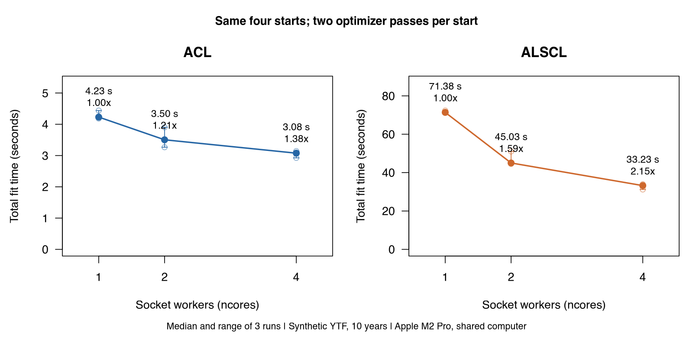

圆点是三次测量，折线是中位数，误差线是范围。测试时电脑与其他分析共用，结果只在该负载和该机器的条件下成立。参见[基准测试报告](https://github.com/FanZhang-LAB-SHOU/ALSCL/blob/main/docs/PARALLEL_BENCHMARK.md)、[原始耗时](https://github.com/FanZhang-LAB-SHOU/ALSCL/blob/main/docs/results/parallel/runs.csv)和[基准测试脚本](https://github.com/FanZhang-LAB-SHOU/ALSCL/blob/main/scripts/benchmark_parallel.R)。

The points are the three measurements, the lines the medians and the bars the ranges. The computer was shared with other analyses, so the results are conditional on that workload and machine. See the [benchmark report](https://github.com/FanZhang-LAB-SHOU/ALSCL/blob/main/docs/PARALLEL_BENCHMARK.md), the [raw timings](https://github.com/FanZhang-LAB-SHOU/ALSCL/blob/main/docs/results/parallel/runs.csv) and the [benchmark script](https://github.com/FanZhang-LAB-SHOU/ALSCL/blob/main/scripts/benchmark_parallel.R).

<a id="reproducibility-compile"></a>

### 4. 编译与缓存 / Compilation and the cache

```r
options(ALSCL.tmb.cache = tools::R_user_dir("ALSCL", "cache"))
a <- run_acl(x, silent = TRUE)
list.files(getOption("ALSCL.tmb.cache"))
```

每个模型的第一次拟合把它的 C++ 模板编译到缓存的一个文件夹中，文件夹名是一个键，由模型源文件和头文件的 MD5 值、R、TMB 和 RcppEigen 版本、`framework`、R 的构建平台以及 R 的 C++ 设置（`Makeconf` 文件中的编译器条目，以及站点和用户的 `Makevars` 文件）计算得到；键相同的拟合直接加载库，不再编译。因此，在多台计算机之间或同一台计算机的两个 R 构建之间共用的缓存文件夹，会为每一个各保留一份编译好的库；较早版本的软件包写入的持久缓存会重新编译一次。默认缓存位于 `tempdir()` 之下，R 在会话结束时删除它。在第一次拟合之前设置 `ALSCL.tmb.cache`，例如写在 `.Rprofile` 中，编译好的模型就能在会话之间保留；socket 进程加载会话编译好的库。

The first fit of each model compiles its C++ template into a cache folder named by a key computed from the MD5 hashes of the model source and header, the R, TMB and RcppEigen versions, the `framework`, the platform of the R build and the C++ settings of R (the compiler entries of its `Makeconf` file and the site and user `Makevars` files); a fit with the same key loads the library without compiling. A cache folder shared between computers, or between two builds of R on one computer, therefore keeps one compiled library for each, and a persistent cache written by an earlier version of the package is compiled again once. The default cache lies under `tempdir()`, which R removes at the end of the session. Set `ALSCL.tmb.cache` before the first fit, for example in `.Rprofile`, to keep the compiled models between sessions; socket workers load the library compiled by the session.

编译需要 C++ 编译器：

Compiling needs a C++ compiler:

| 系统 / System | 编译器 / Compiler |
|---|---|
| Windows | 与 R 版本对应的 Rtools / Rtools for your R version |
| macOS | Xcode Command Line Tools（`xcode-select --install`） / The Xcode Command Line Tools (`xcode-select --install`) |
| Linux | C++ 编译器和 `make`，例如 `build-essential` / A C++ compiler and `make`, for example `build-essential` |

[安装 ALSCL 并完成第一次拟合](https://github.com/FanZhang-LAB-SHOU/ALSCL/blob/main/docs/USER_GUIDE.md#getting-started-compiler)说明安装方法；编译错误中会出现 `TMB::compile`、`make` 或编译器的名字。

[Install ALSCL and run a first fit](https://github.com/FanZhang-LAB-SHOU/ALSCL/blob/main/docs/USER_GUIDE.md#getting-started-compiler) explains the installation; compilation errors name `TMB::compile`, `make` or the compiler.

<a id="reproducibility-troubleshoot"></a>

### 5. 故障排除 / Troubleshooting

错误信息按软件包打印的原文引用。

Error messages are quoted as the package prints them.

| 现象 / Symptom | 常见原因 / Likely cause | 处理方法 / What to do |
|---|---|---|
| `YTF$data.CatL` 是 `NULL` / `YTF$data.CatL` is `NULL` | `YTF` 存放参数，不是数据表 / `YTF` holds parameters, not tables | 使用 `YTF_example` / Use `YTF_example` |
| 年份标签读成 `X2000`，或 `must match data.CatL length labels and time columns` / Year labels read as `X2000`, or `must match data.CatL length labels and time columns` | `read.csv()` 给列名加上 `X`，各表不一致 / `read.csv()` adds `X`; the tables differ | 用 `check.names = FALSE` 读取全部表 / Read all tables with `check.names = FALSE` |
| `Length intervals must have positive widths and be contiguous` | 体长组标签重叠或有空隙 / Bin labels overlap or leave gaps | 改正标签，或提供 `len_mid` 和 `len_border` / Correct the labels or supply `len_mid` and `len_border` |
| `Time columns must have increasing numeric labels` 或 `Time column spacing must equal growth_step` / `Time columns must have increasing numeric labels` or `Time column spacing must equal growth_step` | 缺少时间步，或 `growth_step` 不对 / A missing time step or a wrong `growth_step` | 缺失的时间步保留为 NA 列，并设置 `growth_step` / Keep the step as an NA column and set `growth_step` |
| 调查表中有零 / Zeros in the survey table | 零按缺失处理（`zero_action = "missing"`） / Zeros count as missing (`zero_action = "missing"`) | 拟合前判断零是否真实 / Decide whether a zero is real before fitting |
| 体重表或成熟比例表有空白单元格 / Blank cells in the weight or maturity table | 两张表必须完整 / Both tables must be complete | 补全并记录来源 / Fill them and record the source |
| 收敛码不是 0、梯度大或 Hessian 不正定 / Convergence code not 0, large gradient or Hessian not positive definite | 优化器提前停止，或某个参数得不到信息 / The optimizer stopped early or a parameter is not informed | 见[理解第一次拟合](https://github.com/FanZhang-LAB-SHOU/ALSCL/blob/main/docs/USER_GUIDE.md#first-model-checks) / See [Understand your first fit](https://github.com/FanZhang-LAB-SHOU/ALSCL/blob/main/docs/USER_GUIDE.md#first-model-checks) |
| `numerical_ok` 为 `FALSE`，issues 中指出某个参数实际上已到极限 / `numerical_ok` is `FALSE` and the issues name a parameter at its limit in practice | 方差被估计为零，相关系数落在取值范围的端点，或 ALSCL 的 `t0` 等于 `t0_lower` / A variance is estimated at zero, a correlation is at the end of its range, or the ALSCL `t0` equals `t0_lower` | 按 `diagnostics$advice` 处理；见[判断拟合是否可用](https://github.com/FanZhang-LAB-SHOU/ALSCL/blob/main/docs/USER_GUIDE.md#diagnostics-limits) / Follow `diagnostics$advice`; see [Judge whether a fit can be used](https://github.com/FanZhang-LAB-SHOU/ALSCL/blob/main/docs/USER_GUIDE.md#diagnostics-limits) |
| `survey_q replaces the logistic survey catchability curve, so it cannot be combined with sel_L50 or sel_L95` | 输入列表或保存的拟合中存有 `sel_L50` 和 `sel_L95` / The bundle or the saved fit holds `sel_L50` and `sel_L95` | 在调用中加上 `sel_L50 = NULL, sel_L95 = NULL` / Add `sel_L50 = NULL, sel_L95 = NULL` to the call |
| `run_acl()` 提示 `M is a numeric vector, which is read as the natural mortality rate by length` / `M is a numeric vector, which is read as the natural mortality rate by length` from `run_acl()` | 向量被当作按体长的 M，只有 ALSCL 接受 / A vector is M by length, which only ALSCL accepts | 按年龄的 M 请给出只有一列的矩阵：`matrix(M_at_age, ncol = 1)` / For M by age, supply a matrix with one column, `matrix(M_at_age, ncol = 1)` |
| `project_model()` 提示 `The fitted natural mortality rate varies over time, and no value is carried forward` / `The fitted natural mortality rate varies over time, and no value is carried forward` from `project_model()` | 拟合用的是按年龄和时间步的 M / The fit used M by age and time step | 给出未来各时间步的 `M` / Supply `M` for the future time steps |
| 季度 F 看起来偏小 / Quarterly F looks small | F 在所有输出中都按时间步计 / Every output gives F per time step | 按时间步报告 F / Report F per time step |
| 对 ACL 拟合调用 `plot_fishing_mortality(a, type = "length")` 给出警告 / `plot_fishing_mortality(a, type = "length")` warns on an ACL fit | ACL 没有按体长的 F；`"length"` 等同 `"age"` / ACL has no F by length; `"length"` means `"age"` | 用 `type = "age"`，或拟合 ALSCL / Use `type = "age"` or fit ALSCL |
| `plot_VB()` 只画出一条线，没有区间 / `plot_VB()` draws a line without an interval | 生长参数被固定 / The growth parameters are fixed | 属于预期；用 `map` 释放 / Expected; release them with `map` |
| 第一次拟合报错，信息中出现 `TMB::compile`、`make`、`g++` 或 `clang` / The first fit names `TMB::compile`, `make`, `g++` or `clang` | 没有编译器，或 Rtools 对应另一个 R 版本 / No compiler, or Rtools for another R version | 安装编译器（第 4 步），重启 R / Install the compiler (step 4), restart R |
| `Install RcppEigen to compile model templates` 或 `Model sources are missing` / `Install RcppEigen to compile model templates` or `Model sources are missing` | 缺少 RcppEigen，或安装损坏 / RcppEigen absent, or a damaged installation | 安装 RcppEigen 或重新安装 ALSCL / Install RcppEigen or reinstall ALSCL |
| `Socket worker loaded a different ALSCL installation` | 进程先找到了另一个库中的副本 / A worker found another copy in a different library | 只保留一个安装，或用 `ncores = 1` / Keep one installation, or use `ncores = 1` |
| Windows 或 RStudio 中 socket 进程失败，或 `Parallel standard errors failed` / Socket workers fail on Windows or in RStudio, or `Parallel standard errors failed` | 新的 R 进程无法启动 / The new R processes could not start | 用 `ncores = 1` 或 `alscl_speed(sd_cores = 1)` / Use `ncores = 1` or `alscl_speed(sd_cores = 1)` |
| 回溯分析后 `rho_text$Rho` 是 `NA` / `rho_text$Rho` is `NA` after a retrospective analysis | 某次拟合未通过数值检查 / A fit failed the numerical checks | 查看 `fit_diagnostics` 和 `rho_by_peel`，修正该拟合 / Read `fit_diagnostics` and `rho_by_peel`, fix that fit |
| `The current implementation differs from the saved assessment` | 保存之后软件包、TMB 或模型源文件变了 / Package, TMB or model source changed since the save | 预期末位有差异，或安装记录的版本 / Expect last-digit differences, or install the recorded versions |
| `A complete fit recipe is required` | 缺少重新拟合所需的输入和设置 / The fit has no recipe | 重新拟合，或带 `x = x` 保存 / Refit, or save with `x = x` |

<a id="reproducibility-next"></a>

### 下一步 / What next

| 想做什么 / What you want to do | 阅读 / Read |
|---|---|
| 检验估计值对固定值的敏感性 / Test the sensitivity of the estimates to the fixed values | [判断拟合是否可用](https://github.com/FanZhang-LAB-SHOU/ALSCL/blob/main/docs/USER_GUIDE.md#diagnostics-sensitivity) / [Judge whether a fit can be used](https://github.com/FanZhang-LAB-SHOU/ALSCL/blob/main/docs/USER_GUIDE.md#diagnostics-sensitivity) |
| 选择速度设置并检查本会话的实际情况 / Choose the speed settings and check what your session does | [速度设置](https://github.com/FanZhang-LAB-SHOU/ALSCL/blob/main/docs/SPEED_GUIDE.md) / [Speed settings](https://github.com/FanZhang-LAB-SHOU/ALSCL/blob/main/docs/SPEED_GUIDE.md) |
| 运行回溯分析并解读 Mohn's rho / Run a retrospective analysis and read Mohn's rho | [回溯分析](https://github.com/FanZhang-LAB-SHOU/ALSCL/blob/main/docs/USER_GUIDE.md#retrospective) / [Retrospectives](https://github.com/FanZhang-LAB-SHOU/ALSCL/blob/main/docs/USER_GUIDE.md#retrospective) |
| 从拟合模型模拟调查数据，或检验对留出时间步的预测 / Simulate from the fit or test predictions of withheld time steps | [模型验证](https://github.com/FanZhang-LAB-SHOU/ALSCL/blob/main/docs/MODEL_VALIDATION.md) / [Model validation](https://github.com/FanZhang-LAB-SHOU/ALSCL/blob/main/docs/MODEL_VALIDATION.md) |
| 比较情景、做参数剖面和投影 / Compare scenarios, profile a parameter, project forward | [评估工作流](https://github.com/FanZhang-LAB-SHOU/ALSCL/blob/main/docs/ASSESSMENT_WORKFLOWS.md) / [Assessment workflows](https://github.com/FanZhang-LAB-SHOU/ALSCL/blob/main/docs/ASSESSMENT_WORKFLOWS.md) |

<a id="chapter-16"></a>
## 16 评估工作流 · Assessment workflows

[使用指南 / User guide](https://github.com/FanZhang-LAB-SHOU/ALSCL/blob/main/docs/USER_GUIDE.md) · [首页 / Home](https://github.com/FanZhang-LAB-SHOU/ALSCL/blob/main/README.md)

## 评估工作流：从输入列表到保存结果 / Assessment workflows: from bundle to saved results

本页带你把一个拟合好的模型走完评估报告包含的各项分析：保存估计值、检查残差、检验对固定输入的敏感性、对一个被估计的参数做剖面、投影未来情景、拟合模拟重复，最后得到一份保存的拟合结果和一个结果表文件夹。你需要已安装软件包（[安装并完成第一次拟合](https://github.com/FanZhang-LAB-SHOU/ALSCL/blob/main/docs/USER_GUIDE.md#start)）；使用自己的数据时，按[准备调查数据](https://github.com/FanZhang-LAB-SHOU/ALSCL/blob/main/docs/USER_GUIDE.md#excel)建立输入列表 `x`。第 4 到 7 步每步都要多次重新拟合模型；按需要选做，顺序不限，都从第 1 步的对象开始。

On this page you take one fitted model through the analyses an assessment reports, from saving the estimates to checking residuals, testing sensitivity to fixed inputs, profiling an estimated parameter, projecting future scenarios and fitting simulation replicates, and you end with a saved fit and a folder of result tables. You need the package installed ([Install and run a first fit](https://github.com/FanZhang-LAB-SHOU/ALSCL/blob/main/docs/USER_GUIDE.md#start)); with your own data, build the input bundle `x` as in [Prepare your survey data](https://github.com/FanZhang-LAB-SHOU/ALSCL/blob/main/docs/USER_GUIDE.md#excel). Steps 4 to 7 refit the model several times each; run the ones you need, in any order, from the objects of step 1.

<a id="assessment-workflows-fit-teaching-models"></a>

### 1. 拟合一次，保留对象 / Fit once and keep the objects

```r
library(ALSCL)
library(ggplot2)
data("YTF_example")
x <- YTF_example
a <- run_acl(x, silent = TRUE)
b <- run_alscl(x, silent = TRUE)
summary(a)
summary(b)
```

ACL 拟合 `a` 用于情景和剖面，因为一次 ACL 重新拟合约二十秒；ALSCL 拟合 `b` 用于结果提取、残差和投影。`summary()` 打印模型、时间步、F 结构、一行数值检查（`numerical_ok` 应为 `TRUE`，`issues` 应为空）和自然尺度上的标量参数。适用时还会打印 `Fixed inputs` 一行，说明用了按年龄或按体长的自然死亡率，或以 `survey_q`、`survey_q_age` 给出的调查可捕性；以及来自数值检查的 `Advice` 和 `Plausibility note` 各行（[判断拟合是否可用](https://github.com/FanZhang-LAB-SHOU/ALSCL/blob/main/docs/USER_GUIDE.md#diagnostics-limits)）。先读数值检查：后面的每个函数都会记录它，`project_model()` 会拒绝未通过检查的拟合。若 `numerical_ok` 为 `FALSE`，按[判断拟合是否可用](https://github.com/FanZhang-LAB-SHOU/ALSCL/blob/main/docs/USER_GUIDE.md#diagnostics)改一项设置并重新拟合。

The ACL fit `a` serves the scenarios and profiles, because an ACL refit takes about twenty seconds; the ALSCL fit `b` serves results, residuals and projections. `summary()` prints the model, the time steps, the F structure, the numerical checks in one row (`numerical_ok` should be `TRUE`, `issues` empty) and the scalar parameters on the natural scale. Where they apply, it also prints a line `Fixed inputs` for a natural mortality rate by age or length and a survey catchability supplied as `survey_q` or `survey_q_age`, and lines `Advice` and `Plausibility note` from the numerical checks ([Judge whether a fit can be used](https://github.com/FanZhang-LAB-SHOU/ALSCL/blob/main/docs/USER_GUIDE.md#diagnostics-limits)). Read the checks first: every later function records them, and `project_model()` refuses a fit that failed them. If `numerical_ok` is `FALSE`, change one setting as described in [Judge whether a fit can be used](https://github.com/FanZhang-LAB-SHOU/ALSCL/blob/main/docs/USER_GUIDE.md#diagnostics) and refit.

<a id="assessment-workflows-section-4"></a>

### 2. 提取结果，保存拟合结果 / Extract results and keep a saved fit

```r
parameter_estimates <- extract_parameters(b)
parameter_estimates
estimates <- extract_estimates(b, quantities = c("SSB", "Rec", "F"))
head(estimates)
write.csv(estimates, "ytf_alscl_estimates.csv", row.names = FALSE)
save_assessment(b, "ytf_alscl.rds")
saved <- read_assessment("ytf_alscl.rds")
summary(saved)
saved$recipe$versions
plot_SSB(saved, se = TRUE)
b_again <- refit_model(saved, silent = TRUE)
```

`extract_parameters()` 每个标量参数返回一行：`status`（`estimated`、`fixed` 或 `inactive`）、自然尺度上的估计值、标准误和 95% 区间（固定参数为 `NA`）；`exp(mean_log_F)` 是 F 过程的基准水平，各年的 F 由它乘以指数化的偏差得到。`extract_estimates()` 返回种群量的长表，带 `year`、`age` 或 `length` 和每个值的区间；ALSCL 的 `F` 按体长组给出（`report_name` 为 `FL`），ACL 按年龄给出，不取平均。`extrapolated` 列在最后一个时间步的捕捞死亡率和渔获量上为 `TRUE`，没有观测为它们提供信息：它们是由 F 过程得到的预测，标准误反映的也是这一过程。最后几个时间步没有正的调查观测时，从最后一个有观测的时间步起的各行也会被标记。其他量按名称请求：`extract_estimates(b, c("FA", "N_at_age"))` 返回 ALSCL 每个年龄和每个时间步的年龄别 F，以及年龄别尾数。拟合报告（`b$report$FA`）只包含末组（plus group）之前的年龄和最后一个时间步之前的各时间步的年龄别 F，并带有标准误；其余单元格由 `extract_estimates()` 从报告的体长—年龄别尾数算出，标准误为 `NA`。`N_at_age` 是 `NA` 的别名；标签为“NA”的表写入 CSV 文件后再用 `read.csv()` 的默认设置读回时，这个标签会丢失。`fitted(b)`、`logLik(b)`、`AIC(b)`、`BIC(b)` 和 `nobs(b)` 也可用于拟合结果；保存的协方差非有限或非正定时，`vcov(b)` 返回 `NULL`。

`extract_parameters()` returns one row per scalar parameter: `status` (`estimated`, `fixed` or `inactive`), the estimate on the natural scale, its standard error and a 95% interval (`NA` for fixed parameters); `exp(mean_log_F)` is the baseline of the F process, which the exponentiated yearly deviations scale. `extract_estimates()` returns a long table of population quantities with `year`, `age` or `length` and an interval for each value; `F` comes by length bin for ALSCL (`report_name` is `FL`) and by age for ACL, without averaging. The column `extrapolated` is `TRUE` for the fishing mortality and catch of the last time step, which no observation informs: they are predictions from the F process, and their standard errors reflect that process. When the last time steps have no positive survey observation, the rows from the last time step with an observation onwards are marked as well. Other quantities are requested by name: `extract_estimates(b, c("FA", "N_at_age"))` returns ALSCL F at age, for every age and time step, and numbers at age. The fitted report (`b$report$FA`) holds F at age for the ages before the plus group and the time steps before the last, with standard errors; `extract_estimates()` computes the other cells from the reported numbers at length and age, and their standard errors are `NA`. `N_at_age` is an alias of `NA`; a table labelled "NA" loses that label when it is written to a CSV file and read back with the defaults of `read.csv()`. `fitted(b)`, `logLik(b)`, `AIC(b)`, `BIC(b)` and `nobs(b)` also work on a fit, and `vcov(b)` returns `NULL` when the stored covariance is not finite or not positive definite.

`save_assessment()` 写出保存的拟合结果：`b` 中除 TMB 对象 `b$obj` 以外的全部内容，以及重新拟合所需的信息（三张表、设置、`map`、边界、初值、软件包版本和模型源码的哈希值）。`summary()`、提取函数和绘图函数都能直接用于 `read_assessment()` 读回的对象，同事无需重新拟合就能读你的结果；需要可执行模型时，`refit_model()` 使用保存的输入和设置重新拟合，例如用 `refit_model(saved, M = 0.25)` 改变一项假设，并在软件包、TMB 或模型源码与保存时不同时发出警告。文件已存在时 `save_assessment()` 会停止（传入 `overwrite = TRUE`），拟合结果缺少原始输入和设置时也会停止（把它的输入列表作为 `x` 传入）。

`save_assessment()` writes the saved fit: everything in `b` except the live TMB object `b$obj`, plus the recipe (the three tables, settings, `map`, bounds, starting values, package versions and hashes of the model source). `summary()`, the extraction and plot functions work on what `read_assessment()` returns, so a colleague reads your results without refitting; `refit_model()` reruns the recipe when you need a live model, for example `refit_model(saved, M = 0.25)` to change one assumption, and warns when the package, TMB or the model source differ from the saved ones. `save_assessment()` stops when the file exists (pass `overwrite = TRUE`) or when a fit has no recipe (pass its input bundle as `x`).

并行保存时，请给每个拟合指定不同文件名。若两个会话用默认的 `overwrite = FALSE` 写入同一新路径，只有一个能成功。如果会话意外中断后仍提示锁错误，请先确认写入进程已停止，再删除报错中列出的锁目录。

Give independent fits distinct filenames when saving in parallel. If two sessions use the same new path with the default `overwrite = FALSE`, only one can save there. If a session was interrupted and a lock error persists, confirm that its writer has stopped before removing the lock directory shown in the error.

<a id="assessment-workflows-outputs"></a>

#### 用于与年龄鉴定资料和其他评估比较的输出 / Outputs for comparison with age readings and other assessments

```r
growth <- length_at_age(b)
subset(growth, year == max(year) & age %in% c(1, 5, 10))
# 假定的年龄别成熟比例：第四个年龄组有一半个体成熟 / An assumed maturity ogive by age: half of the fish mature at the fourth age class
ogive <- pmin(1, pmax(0, (seq_along(b$age) - 3) / 2))
ssb <- ssb_at_age(b, maturity = ogive)
head(ssb, 3)
cor(log(ssb$SSB), log(ssb$SSB_model))
catch <- relative_catch(b)
tail(catch, 3)
```

有三个函数返回可以用模型之外的资料核对的量：各年龄平均体长对照年龄鉴定资料，按年龄型评估所用的成熟比例计算的产卵生物量，以及渔获量的趋势对照上报渔获量。它们可用于拟合结果，也可用于保存的拟合结果。

Three functions return quantities that a source outside the model can check: mean length at age against age readings, spawning biomass with the maturity ogive of an age-based assessment, and the trend of catch against reported catch. They work on a fit and on a saved fit.

`length_at_age()` 按两种口径返回每个年龄组和时间步的平均体长及其标准差：种群中的（`"population"`），以及调查所见的（`"survey"`），后者把体长别尾数乘以拟合所用的体长别调查可捕性。与同一调查所捕个体的年龄鉴定资料比较时，用调查口径。本例最后一年 1 龄的平均体长，种群口径为 10.7 cm，调查口径为 12.8 cm，因为调查很少捕到该年龄中最小的个体；5 龄时两种口径一致。ALSCL 拟合由按体长组、年龄组和时间步的尾数算出这些值。ACL 拟合由年龄-体长概率算出，各时间步相同。每个体长组以组中点代表。因此，某个年龄组有很大一部分落在第一个或最后一个体长组时，平均体长会被拉向该组的中点，标准差偏小：10 龄的 49.5 cm 就很接近最后一组的中点 50 cm。把 ALSCL 拟合的生长与年龄鉴定资料比较时，用这些平均体长，不要用 `Linf` 和 `k`，因为由生长增量估计的生长参数与由年龄-体长资料估计的生长参数含义不同（[Francis 1988](https://doi.org/10.1139/f88-115)；[模型原理与时间尺度](https://github.com/FanZhang-LAB-SHOU/ALSCL/blob/main/docs/USER_GUIDE.md#model-theory-difference-increment)）。

`length_at_age()` returns the mean and standard deviation of length for each age class and time step on two bases: in the population (`"population"`), and as the survey sees it (`"survey"`), with numbers at length multiplied by the survey catchability at length used in the fit. Compare the survey basis with mean length at age from age readings of fish caught in the same survey. Here the mean length of age 1 in the last year is 10.7 cm in the population and 12.8 cm on the survey basis, because the survey catches few of the smallest fish of that age; at age 5 the two bases agree. An ALSCL fit gives the values from its numbers by length bin, age class and time step. An ACL fit gives them from its age-length probabilities, which are the same in every time step. Each length bin enters with its midpoint. Where a large share of an age class lies in the first or the last length bin, the mean is therefore drawn toward the midpoint of that bin and the standard deviation is too small: the value of 49.5 cm at age 10 is close to 50 cm, the midpoint of the last bin. Compare the growth of an ALSCL fit with age readings through these means and not through `Linf` and `k`, because growth parameters estimated from growth increments and from age-length data have different meanings ([Francis 1988](https://doi.org/10.1139/f88-115); [Model principles](https://github.com/FanZhang-LAB-SHOU/ALSCL/blob/main/docs/USER_GUIDE.md#model-theory-difference-increment)).

`ssb_at_age()` 把各年龄组的生物量乘以年龄别成熟比例后求和，得到产卵生物量，并同时给出 `SSB_model`，即模型按拟合时给定的体长别成熟比例算出的产卵生物量。`maturity` 是每个年龄组一个值的向量，或按年龄组和时间步的矩阵；`weight` 可以给出各年龄的平均体重。要比较的评估按年龄别成熟比例定义产卵生物量时，用这个函数。两条序列都在模型生物量的尺度上，而这个尺度取决于给定的调查可捕性，所以比较趋势，不比较水平。本例两条对数序列的相关系数为 0.999。

`ssb_at_age()` returns spawning biomass as the sum over age classes of biomass at age multiplied by a proportion mature at age, next to `SSB_model`, the spawning biomass of the model from the maturity at length supplied to the fit. `maturity` is a vector with one value per age class or a matrix by age class and time step, and `weight` can supply mean weight at age. Use it when the assessment you compare with defines spawning biomass by a maturity ogive by age. Both series are on the scale of model biomass, which depends on the supplied survey catchability, so compare trends and not levels. The correlation of the two log series is 0.999 here.

`relative_catch()` 返回尾数和重量计的渔获量，各自除以它在各时间步上的均值，或在 `years` 指定的时间步上的均值。请给出有上报渔获量的时间步，并把上报渔获量除以它在同样时间步上的均值。函数只返回相对值，因为只拟合调查指数时渔获量的水平无法确定（[模型原理与时间尺度](https://github.com/FanZhang-LAB-SHOU/ALSCL/blob/main/docs/USER_GUIDE.md#model-theory-survey)）。`extrapolated` 列在最后一个时间步为 `TRUE`，该时间步的渔获量是预测值。

`relative_catch()` returns catch in numbers and in weight, each divided by its mean over the time steps, or over the time steps given in `years`. Give the time steps that have reported catch, and divide the reported catch by its mean over the same time steps. The function returns relative values only, because a fit to a survey index does not determine the level of catch ([Model principles](https://github.com/FanZhang-LAB-SHOU/ALSCL/blob/main/docs/USER_GUIDE.md#model-theory-survey)). The column `extrapolated` is `TRUE` for the last time step, whose catch is a prediction.

```r
plot_VB(b, basis = "survey")
plot_length_at_age(b, basis = "survey", ages = c(1, 5, 10))
plot_SSB(b, maturity_at_age = ogive)
plot_relative_catch(b)
```

有四个绘图函数显示这些输出。`plot_VB()` 画各时间步平均后的各年龄平均体长，`plot_length_at_age()` 按时间步画；两者都接受 `basis`，并可在 `observed` 中给出年龄鉴定得到的各年龄平均体长，画成点。`plot_SSB()` 加上 `maturity_at_age` 后，在模型的产卵生物量旁加画按年龄别成熟比例算出的产卵生物量。`plot_relative_catch()` 画相对渔获量；给出 `observed` 时，加画除以同样时间步均值后的上报渔获量。`plot_natural_mortality()` 和 `plot_survey_catchability()` 显示拟合所用的自然死亡率和调查可捕性，渔获量和丰度的水平取决于这两项输入（[生长、死亡与残差图](https://github.com/FanZhang-LAB-SHOU/ALSCL/blob/main/docs/PLOT_GALLERY.md)）。

Four plots show these outputs. `plot_VB()` draws mean length at age averaged over the time steps, and `plot_length_at_age()` draws it by time step; both take `basis` and, in `observed`, the mean length at age from age readings, drawn as points. `plot_SSB()` with `maturity_at_age` adds the spawning biomass from the maturity ogive by age to the spawning biomass of the model. `plot_relative_catch()` draws relative catch and, with `observed`, a reported catch series divided by its mean over the same time steps. `plot_natural_mortality()` and `plot_survey_catchability()` show the natural mortality rate and the survey catchability that the fit used, the two inputs on which the level of catch and abundance depends ([Growth, mortality and residuals](https://github.com/FanZhang-LAB-SHOU/ALSCL/blob/main/docs/PLOT_GALLERY.md)).

<a id="assessment-workflows-section-5"></a>

### 3. 按模型时间轴检查残差 / Check residuals on the model time grid

```r
checks <- check_fit(b, max_lag = 4)
head(residuals(b, type = "standardized"))
checks$lag_correlations
checks$plots$heatmap
checks$plots$lag
checks$plots$qq
```


`check_fit()` 把对数残差标准化（观测减拟合的对数指数，再除以拟合的观测 SD），并画三种图。热图按体长组和时间步排列（被排除的零值和空白为灰色），同色成块表示相邻体长组或时间步的残差方向一致。滞后图对每个体长组画出相隔一到 `max_lag` 个时间步的残差相关系数；没有调查的时间步仍是空缺，`checks$lag_correlations` 给出每个点背后的配对数。QQ 图把合并后的残差与标准正态分布 N(0,1) 比较。即使模型设定正确，标准化条件残差的标准差也略小于 1（模拟检验中约为 0.91 到 0.96），所以两端的点略微落在参考线内侧属于预期。教学拟合中，16 cm 体长组几乎每年都是正残差，最大体长组从 2013 年起为正且滞后一步的相关系数接近 0.8，QQ 图正尾偏重：虽然数值检查通过，这些规律仍值得查看。残差以拟合的过程偏差为条件，所以把这些图当作提示而不是检验；[判断拟合是否可用](https://github.com/FanZhang-LAB-SHOU/ALSCL/blob/main/docs/USER_GUIDE.md#diagnostics)说明某种规律通常指向哪项设置。

`check_fit()` standardizes the log residuals (observed minus fitted log index, divided by the fitted observation SD) and draws three views. In the heatmap by length bin and time step (excluded zeros and blanks in grey), a block of one colour shows where residuals have the same sign over neighbouring lengths or time steps. The lag plot shows, per length bin, the correlation between residuals one to `max_lag` time steps apart; an unobserved time step stays a gap, and `checks$lag_correlations` gives the pairs behind each point. The QQ plot compares the pooled residuals with the standard normal distribution, N(0,1). Standardized conditional residuals have a standard deviation slightly below 1 even when the model is correct (about 0.91 to 0.96 in simulation checks), so points just inside the line at both tails are expected. In the teaching fit the 16 cm bin is positive in nearly every year, the largest bin is positive from 2013 on with a lag-one correlation near 0.8, and the QQ plot has a heavier positive tail: worth a look although the numerical checks pass. The residuals are conditional on the fitted process deviations, so treat the views as pointers, not tests; [Judge whether a fit can be used](https://github.com/FanZhang-LAB-SHOU/ALSCL/blob/main/docs/USER_GUIDE.md#diagnostics) says which setting a pattern usually points to.

<a id="assessment-workflows-section-6"></a>

### 4. 敏感性情景与参数剖面 / Sensitivity scenarios versus parameter profiles

`fit_scenarios()` 在具名的改动下重新拟合同一观测，改动的是模型视为给定的输入（自然死亡率、调查可捕性、F 结构、某项 `map`），显示假设改变时结果移动多少。`profile_model()` 把一个被估计的标量参数依次固定在网格的每个值上并重新估计其余参数，显示该参数在当前模型及固定值下受到的约束。示例检验教学拟合的两项假设：

`fit_scenarios()` refits the same observations under named changes of the inputs the model takes as given (natural mortality, survey catchability, the F structure, a `map` entry) and shows how much the result moves when an assumption changes. `profile_model()` fixes one estimated scalar parameter at each value of a grid, refits the rest, and shows the constraint on that parameter under the current model and fixed values. The example tests two assumptions of the teaching fit:

| 情景 / Scenario | 相对参考情景的改动 / Change from the reference | 检验什么 / What it tests |
|---|---|---|
| `reference` | 无：每时间步 `M` = 0.20，`F_structure = "group_year"` / None: `M` = 0.20 per time step, `F_structure = "group_year"` | 第 1 步的设置 / The settings of step 1 |
| `low_M` | `M = 0.15` | 自然死亡率是固定值，生物量的尺度依赖于它 / Natural mortality is fixed, and the biomass scale depends on it |
| `shared_F` | `F_structure = "year"`：每个时间步一个 F，各年龄共用 / `F_structure = "year"`: one F per time step shared by all ages | 是否需要年龄别的 F / Whether age-specific F is needed |

```r
scenarios <- fit_scenarios(x, list(
  reference = list(),
  low_M = list(M = 0.15),
  shared_F = list(F_structure = "year")
), model = "acl", ncores = 2, F_summary = "mean", silent = TRUE)
scenarios$status
head(scenarios$estimates)
scenario_ssb <- subset(scenarios$estimates, quantity == "SSB")
ggplot(scenario_ssb, aes(year, estimate, color = scenario)) +
  geom_line() + labs(x = "Year", y = "SSB") +
  theme_bw() + theme(panel.grid = element_blank())
```


每个情景是一个具名的参数列表，用来替换 `x` 中的设置；空列表就是参考情景，`map` 这类列表会整体替换保存的列表，三张表保持不变。情景也可以给出按年龄组或按体长组的 `M`，或者以 `survey_q` 给出调查可捕性，同时设 `sel_L50 = NULL` 和 `sel_L95 = NULL`（[判断拟合是否可用](https://github.com/FanZhang-LAB-SHOU/ALSCL/blob/main/docs/USER_GUIDE.md#diagnostics-sensitivity)）。先看 `scenarios$status` 再看曲线：它每个情景一行，记录耗时、错误、警告和数值检查。未通过检查的情景仍留在 `scenarios$estimates` 中且 `numerical_ok = FALSE`；因错误停止的情景没有估计值。估计值表按情景和年份给出产卵生物量、补充量和 F，其中 F 由 `F_summary = "mean"` 在每个时间步内对各年龄（或体长组）取平均，或由 `"apical"` 取最大值。`ncores` 把各情景放在不同的工作进程上运行，每个情景使用 `x` 中保存的初值个数，否则一个初值。这里三条曲线几乎重合：较低的 M 和共用的 F 使产卵生物量至多变动百分之几；换成自己的数据，曲线之间的差距就是要报告的敏感性。

Each scenario is a named list of arguments that replace the settings of `x`; an empty list is the reference, a list such as `map` replaces the stored list completely, and the three tables stay the same. A scenario can also supply `M` by age class or by length bin, or a survey catchability as `survey_q` with `sel_L50 = NULL` and `sel_L95 = NULL` ([Judge whether a fit can be used](https://github.com/FanZhang-LAB-SHOU/ALSCL/blob/main/docs/USER_GUIDE.md#diagnostics-sensitivity)). Read `scenarios$status` before the curves: one row per scenario with the time taken, errors, warnings and the numerical checks. A scenario that failed the checks stays in `scenarios$estimates` with `numerical_ok = FALSE`; one that stopped with an error has no estimates. The estimates table holds spawning biomass, recruitment and F by scenario and year, with F averaged over ages (or length bins) within each time step by `F_summary = "mean"` or taken as the maximum by `"apical"`. `ncores` runs scenarios on separate workers, each with the starts stored in `x` or one start. Here the three curves nearly coincide: the lower M and the shared F move spawning biomass by a few percent at most; with your own data, the spread between the curves is the sensitivity to report.

<a id="assessment-workflows-section-7"></a>

#### 对被估计的参数做剖面 / Profile a parameter that was estimated

```r
profile_values <- exp(a$opt$par[["mean_log_F"]]) * c(0.9, 1, 1.1)
profile_F <- profile_model(a, "mean_log_F", profile_values,
                           scale = "natural", ncores = 1)
profile_F$grid
ggplot(profile_F$grid, aes(value, delta_nll)) +
  geom_line() + geom_point() +
  labs(x = "F process baseline", y = "Change in negative log likelihood") +
  theme_bw() + theme(panel.grid = element_blank())
```


`profile_model()` 接受 `names(a$opt$par)` 中的一个名称，即拟合估计的标量参数；`YTF_example` 固定了 `log_Linf`，对它做剖面会以「parameter must name one free scalar」停止。`scale = "natural"` 时网格按自然尺度给出，且必须落在优化器边界内。`profile_F$grid` 列出每个值的目标函数值、`delta_nll`（相对原拟合的负对数似然增量）和该次重新拟合的数值检查。两侧陡升表示该参数在当前模型及固定参数设置下受到较强约束；这里基准 F 变动 10% 使负对数似然上升 0.8 到 0.9。`delta_nll` 小于 `-1e-6` 时会警告，表示某个网格拟合得到更低的目标函数值。解读剖面前，应检查该次拟合的数值状态，并用更多初值重新拟合原模型；很小的负差值可能来自舍入误差。用于报告的剖面需要更密的网格，并且每个点的拟合都通过检查。

`profile_model()` takes one name from `names(a$opt$par)`, the scalar parameters the fit estimated; `YTF_example` fixes `log_Linf`, so asking for it stops with "parameter must name one free scalar". With `scale = "natural"` the grid is given on the natural scale and must lie within the optimizer bounds. `profile_F$grid` lists each value with its objective, `delta_nll` (the rise in negative log likelihood relative to the original fit) and the numerical checks of that refit. A steep rise on both sides indicates stronger constraint under the current model and fixed-parameter settings; here a 10% change of the baseline F costs 0.8 to 0.9 units. A `delta_nll` below `-1e-6` triggers a warning that a grid refit reached a lower objective. Check that refit's numerical status and rerun the original with more starts before interpreting the profile; tiny negative differences can reflect roundoff. A profile for a report needs a denser grid and refits that all pass the checks.

<a id="assessment-workflows-section-8"></a>

### 5. 投影未来情景 / Project future scenarios

```r
h <- 4L
w <- as.matrix(x$data.wgt[-1L])
mat <- as.matrix(x$data.mat[-1L])
future_w <- matrix(w[, ncol(w)], nrow(w), h)
future_mat <- matrix(mat[, ncol(mat)], nrow(mat), h)
future_rec <- rep(tail(b$report$Rec, 1), h)
low_F <- project_model(b, F = rep(0.10, h), recruitment = future_rec,
                       weight = future_w, maturity = future_mat)
higher_F <- project_model(b, F = rep(0.25, h), recruitment = future_rec,
                          weight = future_w, maturity = future_mat)
low_F$summary
low_F$assumptions
projection_ssb <- rbind(
  transform(low_F$summary, scenario = "F = 0.10"),
  transform(higher_F$summary, scenario = "F = 0.25"))
ggplot(projection_ssb, aes(year, SSB, color = scenario)) +
  geom_line() + geom_point() + labs(x = "Year", y = "Start-of-period SSB") +
  theme_bw() + theme(panel.grid = element_blank())
```


`project_model()` 用你提供的值把最后一个拟合的种群向未来时间步推进：`F`（每步一个值、各组共用，或组乘时间步的矩阵）、`recruitment`（它的长度决定投影期数），以及完整的 `weight` 和 `maturity` 矩阵，每个未来时间步一列。函数不替你延续任何值；代码重复最后一列观测的体重和成熟比例以及最后一个拟合的补充量，这是需要在报告中说明的选择。`M` 保持拟合时的值，除非另外传入：一个数，每个未来时间步一个值，或者每个年龄组一行、每个未来时间步一列的矩阵（也可以只有一列并用于所有时间步）。拟合时按年龄给定且各时间步相同的 M，以及 ALSCL 中按体长给定的 M，都按原样使用。拟合时的 M 随时间变化时，函数不延续任何值，`project_model()` 会停止，直到你给出 `M`。`low_F$summary` 对每个未来时间步列出丰度、生物量、产卵生物量、补充量、尾数和重量计的渔获以及 F 的平均值和最大值；`low_F$assumptions` 记录每项选择。

`project_model()` advances the last fitted population through future time steps under values you supply: `F` (one value per step shared by all groups, or a group by step matrix), `recruitment` (its length sets the horizon) and complete `weight` and `maturity` matrices with one column per future step. Nothing is carried forward for you; the code repeats the last observed weight and maturity columns and the last fitted recruitment, a choice to state in the report. `M` stays at the fitted value unless you pass another: a single number, one value per future step, or a matrix with one row per age class and one column per future step (or one column that is used for every step). A fitted M by age that is the same in every time step, and a fitted M by length in ALSCL, are used as they are. When the fitted M varies over time, no value is carried forward and `project_model()` stops until you supply `M`. `low_F$summary` lists, per future step, abundance, biomass, spawning biomass, recruitment, catch in numbers and in weight, and the mean and maximum F; `low_F$assumptions` records every choice.

每一行描述一个时间步的期初：第一个未来状态是最后一个拟合种群经最后一个拟合的 F 和 M 存活后加上第一个提供的补充量，未来的 `F[t]` 决定第 `t` 步的渔获和进入第 `t + 1` 步的存活。因此第一个提供的 F 不会改变第一个未来产卵生物量；两条曲线从第二步起才分开。投影是确定性的，并以拟合为条件，没有区间、亲体补充关系或参考点。来源拟合未通过数值检查时 `project_model()` 会停止，除非 `allow_failed_fit = TRUE`，这时覆盖会记录在 `assumptions` 中；出现「weight must be a finite nonnegative 23-by-4 matrix」这类信息，说明某个矩阵的行数（体长组）或列数（未来时间步）不对。

Each row describes the start of a time step: the first future state is the last fitted population survived through the last fitted F and M plus the first supplied recruitment, and a future `F[t]` sets the catch of step `t` and the survival into step `t + 1`. The first supplied F therefore does not change the first future spawning biomass; the curves separate from the second step on. The projection is deterministic and conditional on the fit, without intervals, stock-recruitment relationship or reference points. `project_model()` stops when the source fit failed the numerical checks unless `allow_failed_fit = TRUE`, which records the override in `assumptions`; a message such as "weight must be a finite nonnegative 23-by-4 matrix" means a matrix has the wrong number of rows (length bins) or columns (future steps).

<a id="assessment-workflows-section-9"></a>

### 6. 拟合模拟重复，报告失败率 / Fit simulation replicates and report failure rates

```r
pa <- x$parameters
bio <- sim_cal(pa)
iterations <- 1:2
simulation_dir <- tempfile("assessment-sim-")
sm <- sim_data(bio, pa, iter_range = iterations,
               return_iter = iterations[1], output_dir = simulation_dir)
cfg <- x$fit_config$alscl
simulation_fits <- sim_model(iterations, simulation_dir,
  file.path(simulation_dir, "fits_alscl"), model = "alscl", ncores = 1,
  parameters = cfg$parameters, parameters.L = cfg$parameters.L,
  parameters.U = cfg$parameters.U, map = cfg$map, M = pa$M)
simulation_truth <- setNames(lapply(iterations, function(i) {
  e <- new.env(parent = emptyenv())
  load(file.path(simulation_dir, paste0("sim_rep", i)), envir = e)
  s <- e$sim.data
  list(year = s$years, SSB = as.numeric(s$SSB), Rec = as.numeric(s$Rec))
}), paste0("result_rep_", iterations))
stopifnot(identical(names(simulation_fits), names(simulation_truth)))
performance <- summarize_simulations(simulation_fits, simulation_truth,
                                     quantities = c("SSB", "Rec"))
performance$replicates
performance$summary
```

这一步问的是模型能否找回一个已知的种群。`x$parameters` 保存生成 `YTF_example` 的模拟器设置；`sim_cal()` 由它推导生物学量，`sim_data()` 为每个重复写一个文件 `sim_rep<i>`，其中的列表 `sim.data` 含调查表以及逐年的真实 `SSB` 和 `Rec`。`sim_model()` 用所选模型及该模型的初值和 `map`（这里是 `x` 中保存的 ALSCL 配置）拟合每个文件，把每个结果保存为 `result_rep_<i>` 并以命名列表返回，因错误停止的重复连同错误信息一起保留。真值列表必须与拟合使用相同的名称和年份，所以代码逐个读取模拟文件；否则 `summarize_simulations()` 会以「identical unique replicate names」或「time coordinates differ」停止。

This step asks whether the model recovers a known population. `x$parameters` holds the settings of the simulator that generated `YTF_example`; `sim_cal()` derives the biology, and `sim_data()` writes one file `sim_rep<i>` per replicate holding a list `sim.data` with the survey tables and the true `SSB` and `Rec` by year. `sim_model()` fits every file with the chosen model and that model's starts and `map` (here the ALSCL configuration stored in `x`), saves each result as `result_rep_<i>` and returns them as a named list, keeping a replicate that stopped with an error together with its message. The truth list must use the same names and years as the fits, which is why the code reads each simulation file; otherwise `summarize_simulations()` stops with "identical unique replicate names" or "time coordinates differ".

读 `performance$summary` 的统计量时同时读它的分母：`n_replicates` 是尝试的拟合数，`n_valid_fits` 是通过数值检查的拟合数（`failure_rate` 是未通过的比例），`n_valid_pairs` 是 `bias`、`relative_bias` 和 `rmse` 所用的估计值与真值配对数，`n_intervals` 是 `coverage` 所用的、标准误有限的区间数，`coverage` 是其中包含真值的比例。缺少标准误的区间不计入覆盖率；`relative_bias` 跳过真值为零的年份。`performance$replicates` 列出每个重复的检查和耗时，`performance$estimates` 列出每个重复的每一年，包括失败的重复。两个重复只演示用法；正式研究需要足够多的重复，失败率和覆盖率才有意义。

Read the denominators of `performance$summary` with its statistics: `n_replicates` fits attempted, `n_valid_fits` fits that passed the numerical checks (`failure_rate` is the share that failed), `n_valid_pairs` the estimate and truth pairs behind `bias`, `relative_bias` and `rmse`, and `n_intervals` the intervals with a finite standard error behind `coverage`, the share of them containing the truth. A missing standard error leaves its interval out of coverage, and `relative_bias` skips years with a true value of zero. `performance$replicates` lists every replicate with its checks and time, `performance$estimates` every year of every replicate, failures included. Two replicates only show the mechanics; a study needs enough replicates for the failure rate and the coverage to mean something.

<a id="assessment-workflows-section-11"></a>

### 7. 模拟拟合模型并验证预测 / Simulate the fitted model and validate predictions

```r
simulated <- simulate_fit(b, nsim = 2, seed = 42, process = "conditional")
names(simulated$simulations[[1]])
validation <- hindcast_model(x, model = "acl", horizon = 1, nfolds = 3, ncores = 2)
validation$diagnostics
validation$scores
```

另外两项检查从拟合本身出发。`simulate_fit()` 从拟合模型生成新的调查观测。可以固定拟合的种群状态（`"conditional"`）或先抽取新的过程偏差（`"resample"`），并为每个重复返回一个 `run_alscl()` 可接受的输入列表 `x`，供你重新拟合并与保存的 `truth` 比较；该列表保留 `b` 的拟合配置，但不含 `output`、`ncores` 和 `silent`。`hindcast_model()` 是预测检验：它只用较早的时间步拟合，从最近的 `nfolds` 个预测起点各预测随后 `horizon` 个时间步的调查指数，并把预测与留出的观测对照评分，同时给出朴素预测的分数。按年龄和时间步的自然死亡率，或按体长和时间步的调查可捕性，要按完整的时间网格给出：每次训练拟合使用到预测起点为止的各列，预测使用留出时间步的各列。[模型能重现并预测调查观测吗？](https://github.com/FanZhang-LAB-SHOU/ALSCL/blob/main/docs/MODEL_VALIDATION.md)完整演示这两项检查。

Two further checks start from the fit itself. `simulate_fit()` is the fitted-model simulation: it draws new survey observations from the fitted model, around the fitted population (`"conditional"`) or after drawing new process deviations (`"resample"`), and returns per replicate an input bundle `x` that `run_alscl()` accepts, so you can refit it and compare with the stored `truth`; the bundle keeps the fitting configuration of `b` except `output`, `ncores` and `silent`. `hindcast_model()` is the hindcast validation: it fits on the earlier time steps only, predicts the next `horizon` steps of the survey index from each of the `nfolds` most recent forecast origins, and scores the predictions against the withheld observations next to a naive forecast. A natural mortality rate by age and time step, or a survey catchability by length and time step, is supplied for the complete time grid: each training fit uses the columns up to its forecast origin, and the prediction uses the columns of the withheld time steps. [Can the model reproduce and predict survey observations?](https://github.com/FanZhang-LAB-SHOU/ALSCL/blob/main/docs/MODEL_VALIDATION.md) works through both checks.

<a id="assessment-workflows-save-workflow"></a>

#### 保存完成的工作流 / Save the completed workflow

```r
record_dir <- "assessment-record"
dir.create(record_dir)
write.csv(scenarios$status, file.path(record_dir, "scenario_status.csv"), row.names = FALSE)
write.csv(profile_F$grid, file.path(record_dir, "profile_F.csv"), row.names = FALSE)
write.csv(performance$summary, file.path(record_dir, "simulation_summary.csv"), row.names = FALSE)
saveRDS(list(input = x, scenarios = scenarios, profile = profile_F,
  projections = list(low_F = low_F, higher_F = higher_F),
  simulation_truth = simulation_truth, performance = performance,
  validation = validation), file.path(record_dir, "workflow_record.rds"))
writeLines(capture.output(sessionInfo()), file.path(record_dir, "session.txt"))
```

做完所用的步骤后运行这段代码，或只保存已有的对象。第 2 步保存的拟合结果就是评估本身；记录另外加入情景和剖面的拟合（不含 TMB 对象的列表）、带假设的投影、模拟真值与表现、验证分数和会话信息，连同输入列表，评估就可以复现。

Run this after the steps you used, or save the objects you have. The saved fit of step 2 is the assessment; the record adds the scenario and profile fits (lists without a live TMB object), the projections with their assumptions, the simulation truth and performance, the validation scores and the session information, which together with the input bundle make the assessment reproducible.

<a id="assessment-workflows-next"></a>

### 下一步 / What next

| 想做什么 / What you want to do | 阅读 / Read |
|---|---|
| 找出残差规律指向的设置 / Find the setting a residual pattern points to | [判断拟合是否可用](https://github.com/FanZhang-LAB-SHOU/ALSCL/blob/main/docs/USER_GUIDE.md#diagnostics) / [Judge whether a fit can be used](https://github.com/FanZhang-LAB-SHOU/ALSCL/blob/main/docs/USER_GUIDE.md#diagnostics) |
| 查看去掉近期时间步后估计值的变化 / See how estimates change when recent time steps are removed | [运行回溯分析](https://github.com/FanZhang-LAB-SHOU/ALSCL/blob/main/docs/USER_GUIDE.md#retrospective) / [Run a retrospective analysis](https://github.com/FanZhang-LAB-SHOU/ALSCL/blob/main/docs/USER_GUIDE.md#retrospective) |
| 带图完整演练模拟与预测检验 / Work through simulation and hindcast validation with figures | [模型能重现并预测调查观测吗？](https://github.com/FanZhang-LAB-SHOU/ALSCL/blob/main/docs/MODEL_VALIDATION.md) / [Can the model reproduce and predict survey observations?](https://github.com/FanZhang-LAB-SHOU/ALSCL/blob/main/docs/MODEL_VALIDATION.md) |
| 针对自己的种群提出敏感性或投影问题 / Ask a sensitivity or projection question about your own stock | [评估对假设有多敏感，未来 F 会怎样改变结果？](https://github.com/FanZhang-LAB-SHOU/ALSCL/blob/main/docs/CASES.md#case-sensitivity-projection) / [How sensitive is the assessment, and what happens under future F?](https://github.com/FanZhang-LAB-SHOU/ALSCL/blob/main/docs/CASES.md#case-sensitivity-projection) |
| 复现结果或排除故障 / Reproduce a result or fix a failure | [复现结果与排除故障](https://github.com/FanZhang-LAB-SHOU/ALSCL/blob/main/docs/ADVANCED_WORKFLOWS.md) / [Reproduce results and fix problems](https://github.com/FanZhang-LAB-SHOU/ALSCL/blob/main/docs/ADVANCED_WORKFLOWS.md) |

<a id="chapter-17"></a>
## 17 模型模拟与预测验证 · Model simulation and prediction checks

[使用指南 / User guide](https://github.com/FanZhang-LAB-SHOU/ALSCL/blob/main/docs/USER_GUIDE.md) · [首页 / Home](https://github.com/FanZhang-LAB-SHOU/ALSCL/blob/main/README.md)

## 模型能重现观测并预测留出时间步吗？ / Can the fitted model reproduce observations and predict withheld time steps?

本页从两个方面检验一个拟合好的模型。先从已拟合的模型模拟调查数据，再用这些数据重新拟合，比较估计值与生成数据时的已知值；预测检验用较早的时间步拟合，再把留出的后续时间步的预测与观测对照打分。你需要已安装的软件包（[安装 ALSCL](https://github.com/FanZhang-LAB-SHOU/ALSCL/blob/main/docs/USER_GUIDE.md#start)）；代码使用模拟的 `YTF_example`。第 3、4 步要多次重新拟合模型，请为优化计算预留时间；实际耗时取决于电脑和拟合设置。只做预测检验时，运行第 1 步后直接到第 4 步。结束时你会有带真值的模拟数据集、偏差、RMSE 和区间覆盖率表、两个模型相对于朴素预测的预测评分，以及保存的拟合结果。

On this page you check a fitted model from two sides. Fitted-model simulation draws new survey data from the fit and refits them, to see whether the estimates recover the known values; hindcast validation fits on the earlier time steps and scores the predictions of the withheld later ones against the observations. You need the package installed ([Install ALSCL](https://github.com/FanZhang-LAB-SHOU/ALSCL/blob/main/docs/USER_GUIDE.md#start)); the code uses the synthetic `YTF_example`. Steps 3 and 4 refit the models several times, so allow time for the optimizations; runtime depends on your computer and the fitting settings. For hindcast validation alone, run step 1 and go to step 4. At the end you have simulated datasets with their truth, a table of bias, RMSE and interval coverage, the prediction scores of both models against a persistence baseline, and a saved fit.

<a id="case-model-validation-section-1"></a>

### 1. 读取输入列表 / Load the input bundle

```r
library(ALSCL)
data("YTF_example")
x <- YTF_example
```

`x` 包含三张调查表和模型设置。只做预测检验时，直接到[第 4 步](#case-model-validation-section-4)：它从 `x` 拟合各个训练窗口，不需要全数据拟合。需要模拟时，继续第 2 步。

`x` contains the three survey tables and the model settings. For hindcast validation alone, continue directly to [step 4](#case-model-validation-section-4): it fits the training windows from `x` and requires no full-data fit. For simulation, continue to step 2.

<a id="case-model-validation-section-2"></a>

### 2. 从拟合生成调查观测 / Generate survey observations from the fit

<a id="case-model-validation-source-fit"></a>

#### 拟合用于模拟的源模型 / Fit the source model for simulation

```r
b <- run_alscl(x, silent = TRUE)
b$diagnostics
stopifnot(b$diagnostics$numerical_ok)
```

`b` 是模拟的起点 ALSCL 拟合。它的 `numerical_ok` 必须为 `TRUE`，因为除非 `allow_failed_fit = TRUE`，`simulate_fit()` 会拒绝未通过数值检查的拟合；若为 `FALSE`，先按[判断拟合是否可用](https://github.com/FanZhang-LAB-SHOU/ALSCL/blob/main/docs/USER_GUIDE.md#diagnostics)处理再模拟。教学示例通过 `map` 固定了生长和若干过程参数；用自己的输入列表时，选择有依据的生物学设置（[选择拟合设置](https://github.com/FanZhang-LAB-SHOU/ALSCL/blob/main/docs/USER_GUIDE.md#fitting)）。每份模拟 `x` 都保留源拟合实际采用的固定标量值，包括由原始数据推得的 `mean_log_R`。要自行选择某个固定值，在拟合源模型时将它写入 `parameters`。

`b` is the ALSCL fit that the simulations start from. Its `numerical_ok` must be `TRUE`, because `simulate_fit()` rejects a fit that failed the numerical checks unless `allow_failed_fit = TRUE`; if it is `FALSE`, follow [Judge whether a fit can be used](https://github.com/FanZhang-LAB-SHOU/ALSCL/blob/main/docs/USER_GUIDE.md#diagnostics) before simulating. The teaching example fixes growth and several process parameters through `map`; with your own bundle choose supported biological settings ([Choose the fitting settings](https://github.com/FanZhang-LAB-SHOU/ALSCL/blob/main/docs/USER_GUIDE.md#fitting)). Each simulated `x` preserves the source fit's effective fixed scalar values, including `mean_log_R` when its value was derived from the original data. To choose a particular fixed value yourself, provide it in `parameters` when fitting the source model.

<a id="case-model-validation-conditional-draws"></a>

#### 保留拟合的种群状态 / Keep the fitted population states

```r
conditional <- simulate_fit(b, nsim = 3, seed = 20261101,
  process = "conditional")
conditional$metadata
conditional$simulations[[1]]$observations[1:3, 1:3]
```

`process = "conditional"` 保持拟合的种群不变，只重新抽取观测误差，是查看同一状态下重复调查的最短路径。`metadata` 记录模型、过程、种子、原始观测掩码、源拟合的状态和假设 `parameter_uncertainty = "none"`。

`process = "conditional"` keeps the fitted population and redraws only the observation error, the shortest way to see repeated surveys of the same states. `metadata` records the model, the process, the seed, the original observation mask, the status of the source fit and the assumption `parameter_uncertainty = "none"`.

<a id="case-model-validation-process-draws"></a>

#### 生成新的种群轨迹 / Generate new population trajectories

```r
resampled <- simulate_fit(b, nsim = 3, seed = 20261101,
  process = "resample")
resampled$simulations[[1]]$truth$SSB
simulated_x <- resampled$simulations[[1]]$x
```

`process = "resample"` 还在拟合的标量参数值下重新抽取补充量、捕捞死亡率和初始丰度的过程偏差：补充量和 F 遵循拟合的平稳 AR(1) 过程（`F_structure = "year"` 时各组共用一条 F 时间序列，每个时间步有一个 F 值），初始尾数在对数尺度上加入独立正态扰动后逐龄递推。C++ 种群模型根据抽得的偏差计算新的种群状态。条件抽样使用源拟合的 `Elog_index`，过程重抽样则从新的过程状态重新计算 `Elog_index`。两种模式均按拟合的观测标准差添加对数尺度的观测误差，因此对应状态的 `exp(Elog_index)` 是观测中位数；标量参数、生物学设置和调查可捕性保持固定，因此两种模式都没有参数不确定性。`$simulations` 的每个元素包含 `observations`（体长组 × 时间步）、`truth`（种群量、标量参数和所用的偏差）和 `x`，后者是可交给 `run_alscl()` 的输入列表，保留 `b` 的拟合配置，但 `output`、`ncores` 和 `silent` 除外，由你在拟合时指定。原始调查的缺失和零值单元保持原样，除非 `preserve_missing = FALSE`；种子让抽样可以重复，结束后恢复调用者的随机数状态。固定或绑定过程偏差的 `map` 会使重抽模式终止，条件抽样仍可使用。若要用有自己补充量假设的操作模型，见[模拟调查数据](https://github.com/FanZhang-LAB-SHOU/ALSCL/blob/main/docs/USER_GUIDE.md#simulation)。

`process = "resample"` also draws new process deviations of recruitment, fishing mortality and initial abundance at the fitted scalar parameter values: recruitment and F follow the fitted stationary AR(1) processes (one shared F time series across groups, with one F value per time step, under `F_structure = "year"`), numbers at age are initialized recursively with independent normal increments on the log scale, and the C++ population model turns the draws into a new population. Conditional draws use the source fit's `Elog_index`; resampled draws use `Elog_index` recomputed from the new process states. Each mode adds observation noise on the log scale using the fitted observation SD, so `exp(Elog_index)` for that state is the observation median; scalar parameters, biology and survey catchability stay fixed, so neither mode carries parameter uncertainty. Each element of `$simulations` holds `observations` (length bins by time steps), `truth` (population quantities, scalar parameters and the deviations used) and `x`, an input bundle for `run_alscl()` that keeps the fitting configuration of `b` except `output`, `ncores` and `silent`, which you choose when fitting it. Missing and zero cells of the original survey stay as they are unless `preserve_missing = FALSE`; the seed makes the draws repeatable, and the caller's random-number state is restored afterwards. A `map` that fixes or ties the process deviations stops the resample mode, while conditional draws still work. For an operating model with its own recruitment assumptions, use [Simulate survey data](https://github.com/FanZhang-LAB-SHOU/ALSCL/blob/main/docs/USER_GUIDE.md#simulation).

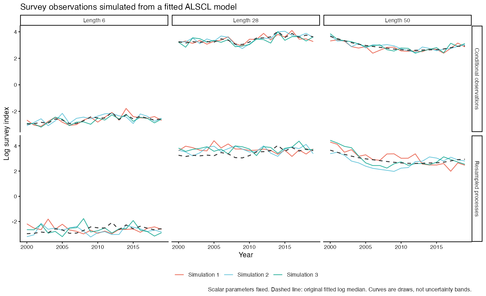

图中为三个体长组在两种模式下各三次抽样；虚线是拟合的对数中位数。条件抽样围绕相同的拟合状态散布，重抽过程的抽样还会移动轨迹。每条曲线是一次抽样，是生成分布的一个例子。

The figure shows three draws per mode for three length bins; the dashed line is the fitted log median. Conditional draws scatter around the same fitted states, and resampled draws also move the trajectory. Each curve is one draw, an example of the generating distribution.

<a id="case-model-validation-section-3"></a>

### 3. 重新拟合重复数据并与真值比较 / Refit the replicates and compare with the truth

```r
replicate_fits <- lapply(resampled$simulations, function(s) {
  tryCatch(run_alscl(s$x, nstarts = 2, ncores = 1, silent = TRUE),
    error = function(e) list(error = conditionMessage(e)))
})
truth <- lapply(resampled$simulations, function(s) s$truth)
performance <- summarize_simulations(replicate_fits, truth,
  quantities = c("SSB", "Rec"))
performance$replicates
performance$summary
```

每次重新拟合都是对模拟输入列表的普通拟合，这里用 `run_alscl(s$x)`，来自 ACL 拟合的抽样用 `run_acl(s$x)`，各用两个初值；`tryCatch()` 保留失败重复的报错信息，使它留在汇总中。`summarize_simulations()` 按重复名和年份把拟合与真值对齐，返回 `replicates`（每次拟合的数值检查、耗时和报错）和 `summary`（每个量的失败率、偏差、相对偏差、RMSE 和区间覆盖率及其分母）；偏差和 RMSE 使用通过检查的拟合，覆盖率只使用标准误有限的区间（[模拟调查数据](https://github.com/FanZhang-LAB-SHOU/ALSCL/blob/main/docs/USER_GUIDE.md#simulation-fit)解释了这些分母）。在记录运行中三次重新拟合都通过检查，60 对数值的覆盖率为产卵生物量 1.0、补充量 0.95（[simulation-performance.csv](https://github.com/FanZhang-LAB-SHOU/ALSCL/blob/main/docs/results/model-validation/simulation-performance.csv)）。`performance$replicates` 的 `elapsed` 列记录每次重新拟合的秒数。三个重复只演示流程；研究偏差或覆盖率需要足够多的重复，失败率才有意义，参数自助法还需要写明重新拟合的规程和区间构造方法，`simulate_fit()` 只提供生成数据这一步。磁盘上已有的重复数据可用 `sim_model()` 批量拟合（[模拟调查数据](https://github.com/FanZhang-LAB-SHOU/ALSCL/blob/main/docs/USER_GUIDE.md#simulation-fit)）。

Each refit is an ordinary fit of the simulated bundle, `run_alscl(s$x)` here and `run_acl(s$x)` for draws from an ACL fit, with two starts each; `tryCatch()` keeps the error message of a failed replicate so that it stays in the summary. `summarize_simulations()` matches the fits with the truth by replicate name and year and returns `replicates` (numerical checks, time and error of each fit) and `summary` (per quantity: failure rate, bias, relative bias, RMSE and interval coverage with their denominators); bias and RMSE use the fits that passed the checks, and coverage uses only intervals with a finite standard error ([Simulate survey data](https://github.com/FanZhang-LAB-SHOU/ALSCL/blob/main/docs/USER_GUIDE.md#simulation-fit) explains the denominators). In the recorded run all three refits passed, with coverage 1.0 for spawning biomass and 0.95 for recruitment over 60 pairs ([simulation-performance.csv](https://github.com/FanZhang-LAB-SHOU/ALSCL/blob/main/docs/results/model-validation/simulation-performance.csv)). The `elapsed` column of `performance$replicates` records seconds per refit. Three replicates show the mechanics; a study of bias or coverage needs enough replicates for the failure rate to mean something, and a parametric bootstrap also needs a stated refitting protocol and interval construction, for which `simulate_fit()` supplies only the generating step. For replicates already on disk, `sim_model()` fits them in batch ([Simulate survey data](https://github.com/FanZhang-LAB-SHOU/ALSCL/blob/main/docs/USER_GUIDE.md#simulation-fit)).

<a id="case-model-validation-self-test"></a>

#### 一次调用完成自检 / Run a self-test in one call

```r
a <- run_acl(x, silent = TRUE)
st <- self_test(a, nsim = 5, seed = 20261101, process = "conditional")
st
head(st$by_year)
plot_self_test(st)
```

`self_test()` 一次完成第 2、3 步：用 `simulate_fit()` 模拟 `nsim` 套数据，用拟合中保存的设置对每套数据重新拟合同一个模型，再把估计值与生成数据时所用的值比较。示例用 ACL 拟合 `a`，因为一次 ACL 拟合只需几秒；对 ALSCL 用 `self_test(b)`，用法相同。`process` 的含义与第 2 步相同。取 `"conditional"` 时种群保持源拟合的种群，所以每个重复的真值相同；取 `"resample"` 时按估计的分布重新抽取补充量、F 和初始偏差，所以每个重复有自己的真值，检验也包括估计的过程方差。默认每次重新拟合从源拟合的初值出发，初值个数也与源拟合相同，这样停在局部最优的重新拟合会算作误差，与实际数据的情形一样。`start = "estimates"` 让每次重新拟合从生成数据所用的值出发；这样更快，但可能掩盖局部最优和数据不能确定的参数。`ncores` 让多套数据并行拟合。

`self_test()` does steps 2 and 3 in one call: it simulates `nsim` data sets with `simulate_fit()`, refits the same model to each with the settings stored in the fit, and compares the estimates with the values used to simulate them. The example uses an ACL fit, `a`, because one ACL fit takes a few seconds; `self_test(b)` works in the same way for ALSCL. `process` has the meaning of step 2. With `"conditional"` the population stays that of the source fit, so the truth is the same in every replicate; with `"resample"` new recruitment, F and initial deviations are drawn from their estimated distribution, so each replicate has its own truth and the test also covers the estimated process variances. By default each refit starts from the starting values of the source fit, with its number of starts, so that a refit that stops at a local optimum counts as an error, as it would with real data. `start = "estimates"` starts each refit at the values used to simulate; this is faster but can hide local optima and parameters that the data do not determine. `ncores` fits several data sets in parallel.

打印 `st` 会显示有多少次重新拟合通过数值检查，以及每个时间序列和每个估计参数的中位相对误差（即偏差）、它的第 10 和第 90 百分位数、中位绝对相对误差和近似 95% 区间的覆盖率。相对误差为 (estimate - truth) / truth。这里的 F 是各年龄的平均值，没有标准误，所以没有覆盖率。`st$by_year` 按年份给出同样的汇总，`st$replicates` 给出每次重新拟合的检查结果，`st$series` 和 `st$parameters` 列出每个估计值及其真值；未通过检查的重新拟合留在这些表中，但不进入汇总。在记录运行中五次重新拟合都通过检查。中位相对误差为产卵生物量 -0.2%、补充量 -0.5%、平均 F 1.9%；产卵生物量和补充量的 100 个区间中分别有 99 个和 98 个包含真值（[self-test-summary.csv](https://github.com/FanZhang-LAB-SHOU/ALSCL/blob/main/docs/results/model-validation/self-test-summary.csv））。五套数据只演示函数的用法；已发表的自检通常每个拟合用 100 套（[Deroba et al. 2015](https://doi.org/10.1093/icesjms/fst237)）。

Printing `st` shows how many refits pass the numerical checks and, for each time series and estimated parameter, the median relative error (the bias), its 10th and 90th percentiles, the median absolute relative error and the coverage of the approximate 95% intervals. The relative error is (estimate - truth) / truth. F is the mean over ages here and has no standard error, so it has no coverage. `st$by_year` gives the same summaries by year, `st$replicates` the checks of each refit, and `st$series` and `st$parameters` every estimate with its truth; refits that fail the checks stay in these tables but not in the summaries. In the recorded run all five refits passed. The median relative error was -0.2% for spawning biomass, -0.5% for recruitment and 1.9% for mean F, and 99 and 98 of the 100 intervals of spawning biomass and recruitment contained the truth ([self-test-summary.csv](https://github.com/FanZhang-LAB-SHOU/ALSCL/blob/main/docs/results/model-validation/self-test-summary.csv)). Five data sets show how the function works; published self-tests commonly use 100 per fit ([Deroba et al. 2015](https://doi.org/10.1093/icesjms/fst237)).


上面几幅图给出各年份相对误差的中位数（线）及其在各次重新拟合间的第 10 至第 90 百分位数（带），虚线表示误差为零。下图对估计参数给出同样的内容，参数取自然尺度，名称与 `extract_parameters()` 相同。这里各年份的中位数都在真值的 8% 以内；只有五套数据时，它们逐年的变化大多是随机波动。估计值能恢复真值的自检说明，在模型假设成立时，模型能从与此类似的数据估计其参数。它不能说明自然死亡率、调查可捕性或生长形式设错带来的偏差，而[北海牙鳕案例](https://github.com/FanZhang-LAB-SHOU/ALSCL/blob/main/docs/CASES.md#case-north-sea-whiting)和文献都指出，对只用调查指数的拟合，这些是误差的主要来源；检验它们需要用假设不同的操作模型做模拟（[模拟调查数据](https://github.com/FanZhang-LAB-SHOU/ALSCL/blob/main/docs/USER_GUIDE.md#simulation)）。

The upper panels show the median relative error by year (line) and its 10th to 90th percentiles across the refits (band); the dashed line marks no error. The lower panel shows the same for the estimated parameters, on the natural scale and with the names of `extract_parameters()`. Here the medians stay within 8% of the truth in every year; with five data sets most of their change from year to year is noise. A self-test in which the estimates recover the truth shows that the model can estimate its parameters from data like these when its assumptions hold. It says nothing about the bias from a wrong natural mortality rate, survey catchability or growth form, which the [North Sea whiting case](https://github.com/FanZhang-LAB-SHOU/ALSCL/blob/main/docs/CASES.md#case-north-sea-whiting) and the literature identify as the main sources of error for fits to a survey index alone; testing those needs simulations from an operating model with different assumptions ([Simulate survey data](https://github.com/FanZhang-LAB-SHOU/ALSCL/blob/main/docs/USER_GUIDE.md#simulation)).

<a id="case-model-validation-section-4"></a>

### 4. 预测未参与拟合的时间步 / Predict time steps withheld from fitting

```r
acl_validation <- hindcast_model(x, model = "acl", horizon = 1,
  nfolds = 2, min_train = 8, nstarts = 1, ncores = 2)
alscl_validation <- hindcast_model(x, model = "alscl", horizon = 1,
  nfolds = 2, min_train = 8, nstarts = 1, ncores = 2)
acl_validation$diagnostics
alscl_validation$diagnostics
acl_validation$scores
alscl_validation$scores
head(alscl_validation$predictions)
```

`hindcast_model()` 在每个预测起点重新拟合模型；预测起点是该次训练数据的最后一个时间步，模型用截至该期的数据拟合，再预测随后 `horizon` 步的调查指数。函数使用最后 `nfolds` 个合格起点，每次都从 `x` 和保存的配置重新拟合。本例中，每个模型先用截至 2017 年的数据预测 2018 年，再用截至 2018 年的数据预测 2019 年。

`hindcast_model()` fits each model using data through a forecast origin, the last time step in that training dataset, then predicts the next `horizon` survey-index steps. It uses the last `nfolds` eligible origins, starting each fit afresh from `x` with the stored configuration. Here each model uses data through 2017 to predict 2018, and through 2018 to predict 2019.

| 设置 / Setting | 在本年度示例中的含义 / Meaning in this annual example |
|---|---|
| `horizon = 1` | 向前预测一个时间步 / Predict one time step ahead |
| `nfolds = 2` | 使用最后两个合格的预测起点 / Use the last two eligible forecast origins |
| `min_train = 8` | 要求至少八个训练时间步 / Require at least eight training time steps |
| `ncores = 2` | 最多并行运行两个训练折；一折内的初值依次运行 / Run at most two training folds in parallel; the starts inside a fold run one after another |

`horizon` 和 `min_train` 都按时间步计（季度数据就是季度）；每一折截短三张表和随时间变化的 map，固定或绑定过程偏差随时间变化的 `map` 会使调用终止。先读 `$diagnostics`：每折一行，含 `origin`、数值检查、`prediction_ok`、警告和报错；失败的折留在表中，但不产生预测和评分。`$predictions` 列出每个留出单元的观测、预测和朴素预测的对数指数，以及是否纳入的标志。

`horizon` and `min_train` count time steps (quarters for quarterly data); each fold truncates the three tables and the time-varying maps, and a `map` that fixes or ties the process deviations over time stops the call. Read `$diagnostics` first: one row per fold with `origin`, the numerical checks, `prediction_ok`, warnings and errors; a fold that failed stays in the table and contributes no predictions or scores. `$predictions` lists every withheld cell with the observed, predicted and persistence log index and an inclusion flag.

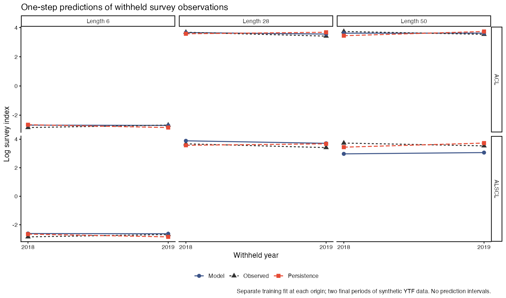

图中按三个体长组比较留出的对数调查指数和两种预测。朴素预测对每个体长组沿用训练期内最近一次大于零的调查观测值。模型预测先将补充量和 F 的末期对数偏差分别乘以各自 AR(1) 相关系数的预测步数次方，再按种群方程推进数量。各体长组的预测尾数乘以预先指定的调查可捕系数，得到这条种群轨迹下原尺度调查指数的条件中位数。计算生物量时沿用训练末期的体重和成熟比例。这些点预测固定参数，并将未来过程扰动设为零。请只用训练期资料选择固定值和初值，并对同一起点、预测期和观测比较模型。[朴素预测的定义](https://otexts.com/fppcn/toolbox.html)。

For each of the three length bins, the figure compares the withheld log survey index with two predictions. The naive forecast repeats the latest positive training observation in that bin. The model advances the population using the fitted AR(1) paths for log recruitment and log F deviations (the last deviation times phi raised to the forecast horizon). On this path, predicted numbers at each length multiplied by the specified survey catchability give the median survey index on the original scale. The last training weights and maturity are reused for biomass. These point predictions hold parameters fixed and omit future process innovations. Choose fixed values and starting values using training data only, and compare models on the same forecast origins, horizons and observations. [Naive forecasting method](https://otexts.com/fpp3/toolbox.html).

<a id="case-model-validation-section-5"></a>

### 5. 读评分并保存分析 / Read the scores and save the analysis

<a id="case-model-validation-prediction-scores"></a>

#### 把评分和样本数放在一起读 / Read the scores and their sample sizes together

| 输出 / Output | 读法 / How to read it |
|---|---|
| `n_positive`、`n_prediction`、`n` / `n_positive`, `n_prediction`, `n` | 正的留出观测数、其中有模型预测的数量，以及模型和朴素预测共同评分的单元数 / Positive withheld observations, those with a model prediction, and cells scored for both model and persistence |
| `log_RMSE`、`log_MAE` / `log_RMSE`, `log_MAE` | 对数指数尺度上的预测误差；在这些单元上越小越好 / Prediction error on the log-index scale; smaller is better on those cells |
| `naive_log_RMSE`、`naive_log_MAE` / `naive_log_RMSE`, `naive_log_MAE` | 同一批单元上朴素预测的误差 / The persistence errors on the same cells |
| `log_MASE`、`naive_log_MASE`、`n_scaled` / `log_MASE`, `naive_log_MASE`, `n_scaled` | 缩放后的绝对误差，以及训练期尺度可用的单元数 / Scaled absolute errors and the number of cells with a usable training scale |

评分使用自然对数调查指数；留出观测中的零值和缺失值被排除，模型和朴素预测的误差使用相同的单元。MASE 把每个绝对对数误差除以该体长组训练期内相邻时间步的平均绝对对数指数变化，只使用两端观测均为正值的配对。保留原时间网格，不跨越零值或缺失时段配对。没有有效配对或缩放分母为零的体长组不计算缩放评分；解读前先查看 `n_scaled`。在记录运行中，两个模型对 2018-2019 年相同的 46 个正观测评分，四个训练拟合都通过检查（[hindcast-scores.csv](https://github.com/FanZhang-LAB-SHOU/ALSCL/blob/main/docs/results/model-validation/hindcast-scores.csv)）：

Scores use natural-log survey indices; zero and missing withheld observations are excluded, and model and persistence errors use the same cells. For MASE, divide each absolute log error by the mean absolute log-index change between adjacent training time steps in that length bin, using pairs whose two observations are positive. The time grid is retained across missing or zero observations. Bins without a usable pair, or with a zero scaling denominator, receive no scaled score; check `n_scaled` before interpreting the result. In the recorded run both models scored the same 46 positive observations of 2018-2019 and all four training fits passed the checks ([hindcast-scores.csv](https://github.com/FanZhang-LAB-SHOU/ALSCL/blob/main/docs/results/model-validation/hindcast-scores.csv)):

| 预测 / Prediction | 评分观测数 / Scored observations | 对数 RMSE / Log RMSE | 对数 MAE / Log MAE | 对数 MASE / Log MASE |
|---|---:|---:|---:|---:|
| ACL | 46 | 0.097 | 0.081 | 0.42 |
| ALSCL | 46 | 0.22 | 0.18 | 0.95 |
| 朴素预测 / Persistence | 46 | 0.17 | 0.15 | 0.74 |

在这份模拟数据、教学 map 和两个起点下，ACL 的预测好于朴素预测，ALSCL 差于基准，尽管两者的优化都收敛了：这个差异值得追查，而两个检验时间步给不出模型的一般排序。

On this synthetic dataset, with the teaching maps and two origins, ACL predicts better than persistence and ALSCL worse, although both optimizations converged: a difference worth investigating, while two validation time steps give no general ranking of the models.

<a id="case-model-validation-save-record"></a>

#### 保存预测检验结果 / Save the validation results

```r
validation_file <- tempfile(fileext = ".rds")
saveRDS(list(acl = acl_validation, alscl = alscl_validation),
  validation_file)
```

预测检验结果是普通列表，`saveRDS()` 将两个模型的结果保存在一起。将临时路径换成永久文件即可。只做预测检验的操作到此完成。

The validation results are plain lists, so `saveRDS()` keeps both models together. Replace the temporary path with a permanent file. This completes the hindcast-only route.

<a id="case-model-validation-simulation-archive"></a>

#### 模拟后保存源拟合 / Save the source fit after simulation

若在第 2 步拟合了 `b`，运行下面的代码。只做了预测检验时，继续到[下一步](#case-model-validation-next)。

Run this block if you fitted `b` in step 2. If you only ran hindcast validation, continue to [What next](#case-model-validation-next).

```r
archive <- tempfile(fileext = ".rds")
save_assessment(b, archive)
saved <- read_assessment(archive)
saved$recipe$implementation
again <- simulate_fit(saved, nsim = 1, seed = 20261101,
  process = "conditional")
```

`save_assessment()` 保存拟合结果时去掉只在当前会话有效的 TMB 对象，`simulate_fit()` 接受 `read_assessment()` 读回的结果，所以新会话无需重新拟合即可模拟；相同种子给出相同抽样。`saved$recipe$implementation` 记录包版本、源码修订和模型源码哈希，`refit_model()` 会与当前安装比较，有差异就警告。把模拟对象和真值与这个拟合一起永久保存。

`save_assessment()` writes the saved fit without the live TMB object, and `simulate_fit()` accepts what `read_assessment()` returns, so a new session can simulate without refitting; the same seed gives the same draws. `saved$recipe$implementation` records the package versions, the source revision and the hashes of the model source, which `refit_model()` compares with the current installation, warning on a difference. Keep the simulation objects and truth beside this fit in permanent files.

<a id="case-model-validation-next"></a>

### 下一步 / What next

| 想做什么 / What you want to do | 阅读 / Read |
|---|---|
| 检查源拟合的残差规律 / Examine residual patterns of the source fit | [判断拟合是否可用](https://github.com/FanZhang-LAB-SHOU/ALSCL/blob/main/docs/USER_GUIDE.md#diagnostics) / [Judge whether a fit can be used](https://github.com/FanZhang-LAB-SHOU/ALSCL/blob/main/docs/USER_GUIDE.md#diagnostics) |
| 看去掉近期时间步后估计如何变化 / See how the estimates change when recent time steps are removed | [移除近期数据后，估计结果会怎样变化？](https://github.com/FanZhang-LAB-SHOU/ALSCL/blob/main/docs/CASES.md#case-retrospective-bias) / [Do estimates change when recent data are removed?](https://github.com/FanZhang-LAB-SHOU/ALSCL/blob/main/docs/CASES.md#case-retrospective-bias) |
| 检验对固定值的敏感性 / Test the sensitivity to the fixed values | [评估对假设有多敏感，未来 F 情景会怎样改变结果？](https://github.com/FanZhang-LAB-SHOU/ALSCL/blob/main/docs/CASES.md#case-sensitivity-projection) / [How sensitive is the assessment, and what happens under future F?](https://github.com/FanZhang-LAB-SHOU/ALSCL/blob/main/docs/CASES.md#case-sensitivity-projection) |
| 批量拟合多次模拟重复 / Fit many simulated replicates in batch | [模拟调查数据](https://github.com/FanZhang-LAB-SHOU/ALSCL/blob/main/docs/USER_GUIDE.md#simulation-fit) / [Simulate survey data](https://github.com/FanZhang-LAB-SHOU/ALSCL/blob/main/docs/USER_GUIDE.md#simulation-fit) |
| 重新生成本页的图和表 / Regenerate the figures and tables of this page | 在仓库根目录运行 `pkgload::load_all("."); source("scripts/model_validation.R"); run_model_validation_guide()` / From the repository root: `pkgload::load_all("."); source("scripts/model_validation.R"); run_model_validation_guide()` |

<a id="chapter-18"></a>
## 18 应用案例 · Worked cases

[使用指南 / User guide](https://github.com/FanZhang-LAB-SHOU/ALSCL/blob/main/docs/USER_GUIDE.md) · [首页 / Home](https://github.com/FanZhang-LAB-SHOU/ALSCL/blob/main/README.md)

## 如何拟合自己的调查数据？ / How do I fit my own survey data?

本页带你从 CSV 或 Excel 文件中的三张调查表出发，得到 ACL 和 ALSCL 两个拟合好的模型，以及它们的数值检查、图和保存的结果。本页按照脚本 [fit_own_data_example.R](https://github.com/FanZhang-LAB-SHOU/ALSCL/blob/main/scripts/fit_own_data_example.R) 展开，该脚本用内附的教学数据完整运行一遍，然后你把其中的数值换成自己的。你需要已安装 ALSCL 2.4.0 或更高版本（[安装 ALSCL](https://github.com/FanZhang-LAB-SHOU/ALSCL/blob/main/docs/USER_GUIDE.md#start)）、按[准备调查数据](https://github.com/FanZhang-LAB-SHOU/ALSCL/blob/main/docs/USER_GUIDE.md#excel)排好的三张表，以及你的种群的生物学数值（`rec.age`、`nage`、`M`、`sel_L50`、`sel_L95`、`growth_step`、`len_mid`、`len_border`），[该页第 4 步](https://github.com/FanZhang-LAB-SHOU/ALSCL/blob/main/docs/USER_GUIDE.md#data-preparation-bundle)逐项解释了它们。

On this page you go from three survey tables in CSV or Excel files to two fitted models, ACL and ALSCL, with their numerical checks, plots and saved results. The page follows the script [fit_own_data_example.R](https://github.com/FanZhang-LAB-SHOU/ALSCL/blob/main/scripts/fit_own_data_example.R), which runs the whole sequence on the bundled teaching data; you then replace its values with yours. You need ALSCL 2.4.0 or later installed ([Install ALSCL](https://github.com/FanZhang-LAB-SHOU/ALSCL/blob/main/docs/USER_GUIDE.md#start)), your tables laid out as in [Prepare your survey data](https://github.com/FanZhang-LAB-SHOU/ALSCL/blob/main/docs/USER_GUIDE.md#excel), and the biological values of your stock (`rec.age`, `nage`, `M`, `sel_L50`, `sel_L95`, `growth_step`, `len_mid`, `len_border`), which [step 4 of that page](https://github.com/FanZhang-LAB-SHOU/ALSCL/blob/main/docs/USER_GUIDE.md#data-preparation-bundle) explains one by one.

<a id="case-fit-survey-bundle"></a>

### 1. 准备并检查输入列表 / Prepare and check the input bundle

```r
library(ALSCL)
tables <- read_survey_csv("my_data")
x <- prepare_alscl_data(tables, fit_args = list(
  rec.age = 1, nage = 15, M = 0.2, sel_L50 = 15, sel_L95 = 20,
  growth_step = 1, len_mid = seq(6, 50, 2), len_border = seq(7, 49, 2)))
check <- check_alscl_data(x, "acl")
check$valid
check$summary
```

两个模型都读取输入列表 `x`：调查指数表 `data.CatL`、体重表 `data.wgt` 和成熟比例表 `data.mat`，行是体长组，列是时间步；再加上 `x$fit_args` 中描述你的种群和调查的设置。`read_survey_csv()` 从一个文件夹读取三个文件，`read_survey_excel()` 读取一个工作簿中的三张工作表；表格布局、时间网格以及空白和零值的处理见[准备调查数据](https://github.com/FanZhang-LAB-SHOU/ALSCL/blob/main/docs/USER_GUIDE.md#excel)。这些设置是模型照原样使用的输入；请为你的种群逐项提供，并记下来源。代码中的数值是教学数据的设置。

Both models read the input bundle `x`: the survey index table `data.CatL`, the weight table `data.wgt` and the maturity table `data.mat`, with the length bins as rows and the time steps as columns, plus the settings in `x$fit_args` that describe your stock and survey. `read_survey_csv()` reads the three files from one folder and `read_survey_excel()` the three sheets of one workbook; [Prepare your survey data](https://github.com/FanZhang-LAB-SHOU/ALSCL/blob/main/docs/USER_GUIDE.md#excel) explains the layout, the time grid and the treatment of blanks and zeros. The settings are inputs that the models use as given; supply each one for your stock and record its source. The numbers in the code are those of the teaching data.

`check_alscl_data()` 按拟合时的方式准备数据，但不编译任何东西。`check$valid` 应为 `TRUE`，`check$summary` 应显示你预期的体长组数和时间步数、正观测数，以及将被估计的标量参数个数 `free_fixed`。若 `check$valid` 为 `FALSE`，`check$errors` 会指出要修改的表、时间列或设置；`check$warnings` 提示没有任何观测的时间步或体长组。拟合 ALSCL 之前，用 `"alscl"` 再检查一遍。

`check_alscl_data()` prepares the data as a fit would, without compiling anything. `check$valid` should be `TRUE` and `check$summary` should show the numbers of bins and time steps you expect, the count of positive observations and `free_fixed`, the number of scalar parameters that will be estimated. When `check$valid` is `FALSE`, `check$errors` names the table, time column or setting to correct; `check$warnings` points to time steps or bins without any observation. Repeat the check with `"alscl"` before fitting that model.

<a id="case-fit-survey-map"></a>

### 2. 确定初值和 map / Decide the starting values and the map

```r
plan <- inspect_parameters(x, "acl")
plan[, c("parameter", "status", "map_source", "natural_start")]
inspect_parameters(x, "alscl")[, c("parameter", "status", "map_source", "natural_start")]
```

`inspect_parameters()` 列出一个模型的各个参数、自然尺度上的初值及其状态，例如 `free`（估计）、`fixed`（固定）或 `tied`（共享）；`map_source` 说明固定状态来自模型默认还是你的 `map`。默认情况下，ACL 固定 `log_std_log_F`、`logit_log_F_y`、`logit_log_F_a` 和 `t0`，估计其余 10 个标量参数；ALSCL 固定 `log_sigma_log_F` 和 `log_t0`，估计 13 个。过程偏差 `dev_log_R`、`dev_log_F` 和 `dev_log_N0` 默认作为随机效应估计。不要把它们写进 `map`：过程似然覆盖每个块的全部偏差，所以固定其中一些偏差或重复使用因子水平的 map 会被拒绝，除非该过程的标准差和相关系数也都固定。需要所有组共用一个捕捞死亡率时，使用 `F_structure = "year"`。[选择拟合设置](https://github.com/FanZhang-LAB-SHOU/ALSCL/blob/main/docs/USER_GUIDE.md#fitting-controls-parameters)列出了两个模型的全部标量参数，并说明这一限制。

`inspect_parameters()` lists the parameters of a model with their starting value on the natural scale and their status, such as `free` (estimated), `fixed` or `tied`; `map_source` says whether a fixed status comes from the model default or from your `map`. By default ACL fixes `log_std_log_F`, `logit_log_F_y`, `logit_log_F_a` and `t0` and estimates the other 10 scalar parameters; ALSCL fixes `log_sigma_log_F` and `log_t0` and estimates 13. The process deviations `dev_log_R`, `dev_log_F` and `dev_log_N0` are estimated as random effects by default. Leave them out of `map`: the process likelihood covers every deviation of a block, so a map that fixes entries or repeats a factor level is rejected unless the process standard deviation and correlations are fixed too. Use `F_structure = "year"` when all groups should share one fishing mortality rate. [Choose the fitting settings](https://github.com/FanZhang-LAB-SHOU/ALSCL/blob/main/docs/USER_GUIDE.md#fitting-controls-parameters) names every scalar parameter of both models and explains this restriction.

初值写在 `x$fit_config$acl$parameters` 或 `x$fit_config$alscl$parameters` 中，采用优化器尺度：渐近体长 60 cm 写 `log_Linf = log(60)`，相关系数 0.1 写 `logit_log_R = qlogis(0.1)`；ALSCL 使用 `log_t0`，因此它的 `t0` 必须在 0 和 `rec.age` 之间。填写初值不会固定参数：只有模型 `map` 中的 `factor(NA)` 才固定参数，具名 `NULL` 项则释放模型默认固定的参数。当外部研究给出的值比拟合更可靠，或第 5 步的检查表明数据无法确定某个参数时，固定该参数，并记录每个固定值的来源。[选择拟合设置](https://github.com/FanZhang-LAB-SHOU/ALSCL/blob/main/docs/USER_GUIDE.md#fitting)给出 `map`、边界和物种预设的规则；[估计参数列表](https://github.com/FanZhang-LAB-SHOU/ALSCL/blob/main/docs/USER_GUIDE.md#fitting)给出全部变换方式。

Starting values go in `x$fit_config$acl$parameters` or `x$fit_config$alscl$parameters` on the optimizer scale: `log_Linf = log(60)` for an asymptotic length of 60 cm, `logit_log_R = qlogis(0.1)` for a correlation of 0.1; ALSCL uses `log_t0`, so its `t0` must lie between 0 and `rec.age`. A starting value does not fix a parameter: only `factor(NA)` in the model's `map` does, and a named `NULL` entry releases a parameter that the model fixes by default. Fix a parameter when an external study gives a better value than the fit could, or when the checks of step 5 show that the data leave it undetermined, and record the source of every fixed value. [Choose the fitting settings](https://github.com/FanZhang-LAB-SHOU/ALSCL/blob/main/docs/USER_GUIDE.md#fitting) gives the rules for `map`, bounds and species presets; [Estimation parameter lists](https://github.com/FanZhang-LAB-SHOU/ALSCL/blob/main/docs/USER_GUIDE.md#fitting) gives every transformation.

<a id="case-fit-survey-run"></a>

### 3. 运行完整示例 / Run the complete example

下面的脚本用教学数据完整运行每一步：读取 `docs/data` 中的三个 CSV 文件，把生物学设置收在 `bio` 中，由行标签推出体长组中点和边界，设置两个模型的初值和 map，组装并检查 `x`，拟合 ACL（`a`）和 ALSCL（`b`），打印它们的数值检查，绘制 `b` 的残差图和产卵生物量图，并把输入列表、去掉 TMB 对象的两个拟合、两张图和会话信息保存到 `output/own-data-example`。请在下载的仓库根目录运行，因为脚本要加载 `scripts/plot_helpers.R` 并读取 `docs/data`：`source("scripts/fit_own_data_example.R", encoding = "UTF-8")`。

The script below runs every step on the teaching data: it reads the three CSV files in `docs/data`, collects the biology in `bio`, derives the bin midpoints and boundaries from the row labels, sets the starting values and maps of both models, builds and checks `x`, fits ACL (`a`) and ALSCL (`b`), prints their numerical checks, draws the residual and spawning biomass plots of `b`, and saves the bundle, both fits without their live TMB object, the two figures and the session information to `output/own-data-example`. Run it from the root of a downloaded copy of the repository, because it sources `scripts/plot_helpers.R` and reads `docs/data`: `source("scripts/fit_own_data_example.R", encoding = "UTF-8")`.

```r

# ALSCL: CSV -> x -> ACL / ALSCL -> diagnostics and saved summaries.
# 从仓库根目录运行 / Run from the repository root:
# source("scripts/fit_own_data_example.R", encoding = "UTF-8")
# 默认读取内附模拟数据。正式分析必须修改第 1、2、3 步。
# The supplied numbers describe the synthetic YTF example, not your stock.
library(ALSCL)
if (packageVersion("ALSCL") < "2.4.0")
  stop("This example requires ALSCL >= 2.4.0. Update ALSCL before running it.", call. = FALSE)
source('scripts/plot_helpers.R')

# 1. 读取三表 / Read the three aligned tables -------------------------------
# 正式数据改成 "my_data"，其中放以下三个 CSV：
# data.CatL.csv, data.wgt.csv, data.mat.csv.
data_dir <- "docs/data"
inputs <- read_survey_csv(data_dir)

# Excel 可替换上一行 / Excel alternative (requires readxl):
# inputs <- read_survey_excel("my_survey.xlsx")
# 2. 共用生物设置 / Shared biology -----------------------------------------
# 以下是年度 YTF 教学值，正式数据必须采用自己的生物学依据。
# M_annual and vbk are annual; lengths are cm; weights in the example are kg.
bio <- list(rec.age = 1, nage = 15, M_annual = 0.2,
            growth_step = 1, sel_L50 = 15, sel_L95 = 20,
            Linf = 60, vbk = 0.2, t0 = 1 / 60,
            cv_len = 0.2, cv_grow = 0.2)
# 当前 ALSCL 使用 log_t0，故要求 0 < t0 < rec.age；不要对负 t0 取绝对值。
stopifnot(bio$t0 > 0, bio$t0 < bio$rec.age)

# 此例 LengthBin 填数值中点：6, 8, ..., 50。
# For labels such as "5-7", supply the actual midpoints explicitly instead.
len_mid <- as.numeric(inputs$data.CatL[[1]])
stopifnot(all(is.finite(len_mid)), all(diff(len_mid) > 0))
# 此例为连续等宽组；非等宽组请直接填写实测的 nlen-1 个内部边界。
# This midpoint formula is only used for the equal-width demonstration bins.
stopifnot(max(abs(diff(len_mid) - diff(len_mid)[1])) < 1e-8)
len_border <- (head(len_mid, -1) + tail(len_mid, -1)) / 2

# 3. 各模型拟合设置 / Model-specific settings ------------------------------
# 生长和多数过程参数作为初值，不再自动固定每个提供的参数。
# Growth and most process values below are starts, not automatic fixes.
# Review starts, bounds and the documented default fixed values for your stock.
p_acl <- list(
  log_Linf = log(bio$Linf), log_vbk = log(bio$vbk), t0 = bio$t0,
  log_cv_len = log(bio$cv_len),
  log_std_log_F = log(0.2), log_std_log_N0 = log(0.2),
  logit_log_R = qlogis(0.1))
p_alscl <- list(
  log_Linf = log(bio$Linf), log_vbk = log(bio$vbk), log_t0 = log(bio$t0),
  log_cv_len = log(bio$cv_len), log_cv_grow = log(bio$cv_grow),
  log_sigma_log_F = log(0.2), log_sigma_log_N0 = log(0.2),
  logit_log_R = qlogis(0.1))
# 使用模型默认 map：ACL 固定 4 项、估计 10 项；ALSCL 固定 2 项、估计 13 项。
# Default maps: ACL fixes 4 and estimates 10 scalars; ALSCL fixes 2 and estimates 13.
# ACL fixes log_std_log_F, logit_log_F_y, logit_log_F_a and t0.
# ALSCL fixes log_sigma_log_F and log_t0. These values still need justification.
map_acl <- list()
map_alscl <- list()

# 可选：只固定 t0；更灵活的设置必须另做诊断，不保证可识别。
# Optional: fix only t0; diagnose this more flexible configuration separately.
# map_acl <- list(t0 = factor(NA), log_std_log_F = NULL,
# logit_log_F_y = NULL, logit_log_F_a = NULL)
# map_alscl <- list(log_t0 = factor(NA), log_sigma_log_F = NULL)
# 解除默认固定项需保留具名 NULL；$t0 <- NULL 仅删除条目。
# Preserve a named NULL to release a default fix; $t0 <- NULL deletes the entry.
# map_acl["t0"] <- list(NULL)
# map_alscl["log_t0"] <- list(NULL)
# 4. 组装并检查 x / Assemble and check the input bundle --------------------
x <- prepare_alscl_data(inputs,
  fit_args = list(
    rec.age = bio$rec.age, nage = bio$nage,
    M = bio$M_annual * bio$growth_step,
    sel_L50 = bio$sel_L50, sel_L95 = bio$sel_L95,
    growth_step = bio$growth_step,
    len_mid = len_mid, len_border = len_border,
    zero_action = "error", train_times = 2,
    nstarts = 1, ncores = 1, silent = FALSE),
  fit_config = list(
    acl = list(parameters = p_acl, map = map_acl),
    alscl = list(parameters = p_alscl, map = map_alscl)))
# 不编译即可检查数据、时间网格和参数设置 / Check data, time grid and settings without compiling.
for (model in c("acl", "alscl")) {
  check <- check_alscl_data(x, model)
  if (!check$valid) stop(paste(check$errors, collapse = "\n"))
  print(check$summary)
}

# 5. 直接拟合 / Fit directly ----------------------------------------------
# 内置加速使用当前 alscl_speed() 设置，无需额外包装。
alscl_speed_info()
a <- run_acl(x)
b <- run_alscl(x)

# 可直接覆盖设置；固定 nstarts 才能公平比较并行数：
# a <- run_acl(x, nstarts = 4, ncores = 2)
# b <- run_alscl(x, nstarts = 4, ncores = 2)
# 6. 检查、绘图、保存 / Inspect, plot and save ------------------------------
checks <- list(ACL = diagnose_model(x$data.CatL, a),
               ALSCL = diagnose_model(x$data.CatL, b))
print(checks)
print(a$sd_info)
print(b$sd_info)
for (fit in list(a, b)) {
  print(fit$par_low_up) # 实际自由参数及边界 / Actual free scalars and bounds
  print(list(convergence = fit$convergence_code,
             max_gradient = fit$max_abs_gradient,
             pdHess = fit$pdHess, bound_hit = fit$bound_hit))
  print(fit$refinement)
  print(fit$diagnostics)
  if (!isTRUE(fit$convergence_code == 0L) || !isTRUE(fit$pdHess) ||
      !isTRUE(fit$diagnostics$numerical_ok))
    warning("Review fit diagnostics before interpreting this assessment.")
}
residual_plot <- plot_residuals(b, facet_by = "year", facet_ncol = 4,
                                x_breaks = pretty(len_mid, n = 4))
# Hessian 非正定时省略近似 95% 区间 / Omit approximate 95% intervals if Hessian is not positive definite.
ssb_plot <- plot_SSB(b, se = isTRUE(b$pdHess))
print(residual_plot)
print(ssb_plot)
# obj 是当前会话的 TMB 指针，不包含在可移植结果中。
portable <- function(fit) {
  fit$obj <- NULL
  fit
}
output_dir <- "output/own-data-example"
dir.create(output_dir, recursive = TRUE, showWarnings = FALSE)
save_grid_free_plot(file.path(output_dir, "residuals.png"), residual_plot,
                width = 10, height = 8, dpi = 150)
save_grid_free_plot(file.path(output_dir, "SSB.png"), ssb_plot,
                width = 8, height = 5, dpi = 150)
saveRDS(x, file.path(output_dir, "inputs_x.rds"))
saveRDS(list(ACL = portable(a), ALSCL = portable(b), diagnostics = checks),
        file.path(output_dir, "assessment_summary.rds"))
writeLines(capture.output(sessionInfo()), file.path(output_dir, "sessionInfo.txt"))
# 新会话可读取 x 并重新拟合 / Refit in a new session:
# x <- readRDS("output/own-data-example/inputs_x.rds")
# b <- run_alscl(x)
```

脚本运行时会打印两个模型的 `check$summary`；教学数据显示 23 个体长组、20 个时间步、460 个正观测、没有零值和空白，以及 10 个（ACL）或 13 个（ALSCL）自由标量参数。随后 `diagnose_model()` 打印每个拟合的数值检查，第 5 步会解释。在记录运行（[own-data-example-checks.csv](https://github.com/FanZhang-LAB-SHOU/ALSCL/blob/main/docs/results/own-data-example-checks.csv)）中，两个拟合的收敛码都是 0，Hessian 正定，没有参数落在边界上，最大梯度约为 3e-9。脚本保存的两张图如下：

While the script runs, `check$summary` is printed for both models; with the teaching data it shows 23 length bins, 20 time steps, 460 positive observations, no zeros or blanks, and 10 (ACL) or 13 (ALSCL) free scalar parameters. `diagnose_model()` then prints the numerical checks of each fit, which step 5 explains. In the recorded run ([own-data-example-checks.csv](https://github.com/FanZhang-LAB-SHOU/ALSCL/blob/main/docs/results/own-data-example-checks.csv)) both fits ended with convergence code 0, a positive definite Hessian, no parameter on a bound and a maximum gradient near 3e-9. The script saved these two figures:


结合数值诊断检查残差规律，并将区间宽度解释为给定假设下的条件精度。产卵生物量区间较窄本身不能证明模型适用；固定输入的不确定性没有包含在该区间中。若脚本提示 "This example requires ALSCL >= 2.4.0"，安装当前版本（[安装 ALSCL](https://github.com/FanZhang-LAB-SHOU/ALSCL/blob/main/docs/USER_GUIDE.md#start)）；若找不到 `scripts/plot_helpers.R` 或 `docs/data`，说明 R 运行在仓库根目录之外；若 `check_alscl_data()` 报错，第 1 步解释了这些信息；若拟合结束时出现 "Review fit diagnostics" 警告，第 5 步说明要改什么。

Inspect residual patterns together with the numerical diagnostics, and interpret interval widths as conditional precision under the stated assumptions. A narrow spawning-biomass interval alone does not establish model adequacy; fixed inputs do not contribute uncertainty to it. If the script reports "This example requires ALSCL >= 2.4.0", install the current version ([Install ALSCL](https://github.com/FanZhang-LAB-SHOU/ALSCL/blob/main/docs/USER_GUIDE.md#start)); if it fails to find `scripts/plot_helpers.R` or `docs/data`, R is running outside the repository root; if `check_alscl_data()` reports an error, step 1 explains the messages; if a fit ends with the warning "Review fit diagnostics", step 5 says what to change.

<a id="case-fit-survey-replace"></a>

### 4. 换成自己的观测数据 / Replace the demonstration with your observations

```r
data_dir <- "my_data"
bio <- list(rec.age = 2, nage = 12, M_annual = 0.25,
            growth_step = 1, sel_L50 = 22, sel_L95 = 30,
            Linf = 80, vbk = 0.15, t0 = 0.5,
            cv_len = 0.15, cv_grow = 0.15)
len_mid <- c(8, 11, 14, 17, 20, 24, 28, 33, 39, 46)
len_border <- c(9.5, 12.5, 15.5, 18.5, 22, 26, 30.5, 36, 42.5)
map_acl <- list(log_Linf = factor(NA), log_vbk = factor(NA))
map_alscl <- list(log_Linf = factor(NA), log_vbk = factor(NA))
# 然后运行脚本中的 prepare_alscl_data() 调用，并确认： / Then run the prepare_alscl_data() call of the script and confirm:
for (model in c("acl", "alscl")) {
  check <- check_alscl_data(x, model)
  print(check$valid); print(check$warnings); print(check$summary)
  print(inspect_parameters(x, model)[, c("parameter", "status", "map_source")])
}
```

上面的数值只是说明每一项的形式；请把每一项都换成你的种群的数值。保留 `inputs`、`x`、`a` 和 `b` 这些名字，脚本的其余部分就不用改。

The values above only show the shape of each entry; replace every one with the value for your stock. Keep the names `inputs`, `x`, `a` and `b` so that the rest of the script runs unchanged.

| 脚本中的行 / Lines in the script | 改成 / Replace with | 注意 / Keep in mind |
|---|---|---|
| `data_dir <- "docs/data"` | 你的 CSV 文件夹，或 `inputs <- read_survey_excel("my_survey.xlsx")` / Your CSV folder, or `inputs <- read_survey_excel("my_survey.xlsx")` | 三个文件或工作表必须使用这些名称；调查缺测留空 / Three files or sheets with exactly these names; blank cells for missing survey values |
| `bio <- list(...)` | 你的种群的数值 / The values of your stock | `M_annual` 是年值，会乘以 `growth_step`；`vbk` 仍按年计；ALSCL 要求 `0 < t0 < rec.age` / `M_annual` is per year and is multiplied by `growth_step`; `vbk` stays per year; ALSCL needs `0 < t0 < rec.age` |
| `len_mid <- ...`、`len_border <- ...` / `len_mid <- ...`, `len_border <- ...` | 你的体长组中点和内部边界 / The midpoints and internal boundaries of your bins | 体长组宽度不等时，删除等宽 `stopifnot()` 和中点公式那两行 / Delete the equal-width `stopifnot()` and the midpoint formula when your bins differ in width |
| `p_acl`、`p_alscl` / `p_acl`, `p_alscl` | 优化器尺度上的初值 / Starting values on the optimizer scale | ACL 填 `t0`，ALSCL 填 `log(t0)` / ACL takes `t0`, ALSCL `log(t0)` |
| `map_acl`、`map_alscl` / `map_acl`, `map_alscl` | 你要固定或释放的参数 / The parameters you fix or release | 空列表沿用模型默认；每次都列出全部固定项 / An empty list keeps the model defaults; list every fix each time |
| `zero_action = "error"` | `"missing"`，把零值当作缺失而不是终止 / `"missing"` to treat zeros as missing values instead of stopping | 零值随后不进入似然 / Zeros then drop out of the likelihood |
| `output_dir` | 本次评估的文件夹 / A folder for this assessment | 脚本会覆盖其中的文件 / The script overwrites the files in it |

修改后，把脚本运行到检查循环。两个模型的 `check$valid` 都必须为 `TRUE`，`check$summary` 必须显示你的体长组数和时间步数，`inspect_parameters()` 中状态为 `fixed` 且 `map_source` 为 `explicit` 的参数必须恰好是你固定的那些。类似 "No positive observations in periods: 2004" 的警告表示某个时间步没有调查值，按未观测处理；`zero_action = "missing"` 且调查表含零值时，会出现零值被排除的警告。拟合之前，先想清楚每条警告对你的调查意味着什么。

After editing, run the script down to the check loop. `check$valid` must be `TRUE` for both models, `check$summary` must show your numbers of bins and time steps, and `inspect_parameters()` must show `fixed` with `map_source` equal to `explicit` for exactly the parameters you fixed. A warning such as "No positive observations in periods: 2004" means that a time step has no survey values and is treated as unobserved; the warning about excluded zeros appears when `zero_action = "missing"` and the survey table contains zeros. Decide what each warning means for your survey before you fit.

<a id="case-fit-survey-fit"></a>

### 5. 直接拟合并读结果 / Fit directly and read the results

```r
a <- run_acl(x)
b <- run_alscl(x)
diagnose_model(x$data.CatL, a)
diagnose_model(x$data.CatL, b)
b$diagnostics$issues
estimates <- extract_estimates(b)
subset(estimates, quantity == "SSB")
extract_parameters(b)
plot_CatL(b, facet_by = "year", facet_ncol = 5)
plot_residuals(b, facet_by = "year", facet_ncol = 5)
plot_SSB(b, se = TRUE)
```

`x` 装好你的表和设置后，每个模型的拟合就是一次调用；脚本存入 `x$fit_args` 的 `train_times = 2` 和 `nstarts = 1` 随之生效，调用中给出的参数，例如 `run_acl(x, nstarts = 4, ncores = 2)`，只在本次调用中覆盖保存的值。看任何估计值之前先读数值检查：收敛码 0、最大梯度小于 0.001、Hessian 正定、没有参数落在边界上，以及 `numerical_ok` 为 `TRUE`；`b$diagnostics$issues` 给出未通过的项目。`extract_estimates()` 返回一张表，包含 `quantity`、`year`、该量所在的 `age` 或 `length`（如有）、`estimate`、`std_error` 和区间 `conf_low` 到 `conf_high`；`extract_parameters()` 列出每个标量参数在自然尺度上的值及其状态 `estimated`、`fixed` 或 `inactive`（共用 F 结构用不到的相关系数）。`plot_CatL()`、`plot_residuals()` 和 `plot_SSB()` 分别画出对观测的拟合、对数残差和带区间的产卵生物量，与[理解第一次拟合](https://github.com/FanZhang-LAB-SHOU/ALSCL/blob/main/docs/USER_GUIDE.md#builtin)中相同。

Once `x` holds your tables and settings, each fit is one call; the `train_times = 2` and `nstarts = 1` that the script stores in `x$fit_args` apply, and an argument in the call, such as `run_acl(x, nstarts = 4, ncores = 2)`, overrides the stored value for that call only. Read the numerical checks before any estimate: convergence code 0, maximum gradient below 0.001, a positive definite Hessian, no parameter on a bound and `numerical_ok` equal to `TRUE`; `b$diagnostics$issues` names any check that failed. `extract_estimates()` returns one table with `quantity`, `year`, the `age` or `length` where the quantity has one, `estimate`, `std_error` and the interval `conf_low` to `conf_high`; `extract_parameters()` lists every scalar parameter on the natural scale with its status, `estimated`, `fixed` or `inactive` (a correlation that the shared F structure leaves unused). `plot_CatL()`, `plot_residuals()` and `plot_SSB()` draw the fit to the observations, the log residuals and the spawning biomass with its interval, as in [Understand your first fit](https://github.com/FanZhang-LAB-SHOU/ALSCL/blob/main/docs/USER_GUIDE.md#builtin).

检查未通过时，每次只改一处再重新拟合：收敛码不是 0 或梯度很大时，多用几个初值（`nstarts = 4, ncores = 2`）；Hessian 检查未通过时，检查参数尺度、边界、其他初值和剖面。有诊断及生物学依据后，再固定参数或考虑 `F_structure = "year"`；[理解第一次拟合](https://github.com/FanZhang-LAB-SHOU/ALSCL/blob/main/docs/USER_GUIDE.md#first-model-checks)中的表把每项未通过的检查对应到常见原因。即使检查通过，相邻体长或相邻年份的残差同号成串也说明模型漏掉了数据中的某种特征；[判断拟合是否可用](https://github.com/FanZhang-LAB-SHOU/ALSCL/blob/main/docs/USER_GUIDE.md#diagnostics)说明如何检查这类规律，以及对 `M` 和其他固定值的敏感性。

When a check fails, change one thing at a time and refit: more starts (`nstarts = 4, ncores = 2`) when the code differs from 0 or the gradient is large, checks of parameter scales, bounds, alternative starts and profiles when the Hessian check fails. Fix a parameter or consider `F_structure = "year"` only with supporting diagnostic and biological evidence; the table in [Understand your first fit](https://github.com/FanZhang-LAB-SHOU/ALSCL/blob/main/docs/USER_GUIDE.md#first-model-checks) matches each failed check with its usual cause. Residuals with the same sign across neighbouring lengths or years mean that the model misses a feature of the data even when the checks pass; [Judge whether a fit can be used](https://github.com/FanZhang-LAB-SHOU/ALSCL/blob/main/docs/USER_GUIDE.md#diagnostics) shows how to examine such patterns and the sensitivity to `M` and the other fixed values.

<a id="case-fit-survey-save"></a>

### 6. 保存并复用结果 / Save and reuse the results

```r
dir.create("output/my-assessment", recursive = TRUE, showWarnings = FALSE)
saveRDS(x, "output/my-assessment/inputs_x.rds")
save_assessment(a, "output/my-assessment/acl.rds")
save_assessment(b, "output/my-assessment/alscl.rds")
# 在以后的会话中 / In a later session
x <- readRDS("output/my-assessment/inputs_x.rds")
saved <- read_assessment("output/my-assessment/alscl.rds")
summary(saved)
plot_SSB(saved, se = TRUE)
b2 <- refit_model(saved)
```

`x` 是普通列表，`saveRDS()` 保存表和设置，`readRDS()` 把它们读回。`save_assessment()` 写出保存的拟合结果：拟合中除 `b$obj` 以外的全部内容（`b$obj` 是只在当前会话有效的 TMB 对象指针），以及重新拟合所需的信息（数据表、设置、map、边界和软件包版本）。`read_assessment()` 把它读回，`summary()`、提取函数和绘图函数都能直接使用；`refit_model()` 使用保存的输入和设置重新拟合，接受 `refit_model(saved, nstarts = 4)` 这样的覆盖参数，并在软件包或 TMB 版本与记录不同时发出警告。文件夹必须已存在，已有文件只有在 `overwrite = TRUE` 时才被替换。脚本则保存 `assessment_summary.rds`，即去掉 `obj` 的两个拟合，以及两张图和 `sessionInfo.txt`。把数据文件、保存的输入列表和保存的拟合结果放在一起。

`x` is a plain list, so `saveRDS()` keeps the tables and settings and `readRDS()` brings them back. `save_assessment()` writes a saved fit: everything in the fit except the live TMB object `b$obj`, a pointer valid only in the current session, together with the recipe (tables, settings, map, bounds and package versions). `read_assessment()` reads it back, and `summary()`, the extraction functions and the plots work on it directly; `refit_model()` rebuilds a live fit from the recipe, accepts overrides such as `refit_model(saved, nstarts = 4)`, and warns when the package or TMB version differs from the recorded one. The folder must exist, and an existing file is replaced only with `overwrite = TRUE`. The script instead stores `assessment_summary.rds`, both fits without `obj`, with the two figures and `sessionInfo.txt`. Keep the data files, the saved bundle and the saved fits together.

<a id="case-fit-survey-continue"></a>

### 7. 继续比较和回溯 / Continue with comparison and retrospectives

```r
comparison <- compare_models(a, b, x$data.CatL)
comparison$fit_diagnostics
comparison$comparison
ra <- retro_acl(x, nyear = 3, train_times = 2, silent = TRUE)
rb <- retro_alscl(x, nyear = 3, train_times = 2, silent = TRUE)
rb$fit_diagnostics
rb$rho_by_peel
rb$rho_text
plot_fishing_mortality(b, type = "length", se = TRUE)
```

`compare_models()` 先核对两次拟合使用了同一张调查表，再比较 AIC、BIC 和拟合统计量。`comparison$comparison` 记录 `data_verified`、`eligible`（两次拟合都通过数值检查）、`preferred`（AIC 较低的模型，仅在两者都合格且 AIC 相差至少 2 时给出）和 `issues`。AIC 在似然拟合与参数数量之间作权衡；对同一观测和相容似然，AIC 较低表示该准则更支持该候选模型。它的结构是否适合这个种群，要用生物学知识判断。[ACL 与 ALSCL 的评估结果有什么不同？](https://github.com/FanZhang-LAB-SHOU/ALSCL/blob/main/docs/CASES.md#case-compare-assessments)用图继续这一比较。

`compare_models()` first verifies that both fits used the same survey table, then compares AIC, BIC and the fit statistics. `comparison$comparison` records `data_verified`, `eligible` (both fits passed the numerical checks), `preferred` (the model with the lower AIC, given only when both are eligible and the AIC values differ by at least 2) and `issues`. AIC balances likelihood fit against parameter count; among compatible fits to the same observations, a lower value supports that candidate under this criterion. Whether its structure suits the stock is a biological decision. [Do ACL and ALSCL give different answers?](https://github.com/FanZhang-LAB-SHOU/ALSCL/blob/main/docs/CASES.md#case-compare-assessments) continues the comparison with figures.

回溯分析依次去掉最后 1、2、3 个时间步后重新拟合模型（`nyear` 是回溯的轮数，每一轮多去掉一个时间步，所以季度数据四轮等于一年；`peel_step = 4` 则每轮去掉一年）。它读取输入列表，因此保存的设置对每一轮都生效；在回溯调用中设置 `ncores` 可以并行运行各轮。`rb$fit_diagnostics` 列出完整拟合（`Peel = 0`）和每一轮的数值检查，`rb$rho_by_peel` 给出每个量、每一轮的 Mohn's rho，`rb$rho_text$Rho` 只在完整拟合和所有轮次都通过检查时报告均值，否则为 `NA` 并警告。`plot_retro(rb)` 画出各轮的序列（[运行回溯分析](https://github.com/FanZhang-LAB-SHOU/ALSCL/blob/main/docs/USER_GUIDE.md#retrospective)）；`plot_fishing_mortality(b, type = "length")` 画出 ALSCL 估计的体长别捕捞死亡率。

The retrospective analysis refits a model after removing the last one, two and three time steps (`nyear` is the number of peels and each peel removes one more time step, so four peels equal one year of quarterly data; `peel_step = 4` removes one year per peel). It reads the bundle, so the stored settings apply to every peel; set `ncores` on the retrospective call to run peels in parallel. `rb$fit_diagnostics` lists the full fit (`Peel = 0`) and every peel with its numerical checks, `rb$rho_by_peel` gives Mohn's rho per quantity and peel, and `rb$rho_text$Rho` reports the mean only when the full fit and all peels pass the checks, otherwise `NA` with a warning. `plot_retro(rb)` draws the peeled series ([Run a retrospective analysis](https://github.com/FanZhang-LAB-SHOU/ALSCL/blob/main/docs/USER_GUIDE.md#retrospective)); `plot_fishing_mortality(b, type = "length")` draws the fishing mortality at length estimated by ALSCL.

在[2.4.3 的记录运行](https://github.com/FanZhang-LAB-SHOU/ALSCL/blob/main/docs/results/own-data-retrospective.csv)中，所有拟合均通过数值筛查，但截至 2018 年和 2016 年的 ALSCL 截断拟合保留了优化器码 1。两次拟合的第一轮实际都返回了 0；第二轮将目标函数降低了不到 `8e-10`，却报告 `false convergence (8)`。由于参数向量存在微小差异，原来的选择规则保留了第二轮。开发中的修正会在目标函数和每个参数均数值等价时保留成功轮次，再进行通常的收尾和独立数值检查。重新拟合后，两次均返回码 0，最大梯度低于 `2e-8`；SSB 和 F 相对原结果的变化小于 `1.2e-11`。

In the [recorded 2.4.3 run](https://github.com/FanZhang-LAB-SHOU/ALSCL/blob/main/docs/results/own-data-retrospective.csv), all fits passed the numerical screen, but the ALSCL peels ending in 2018 and 2016 retained optimizer code 1. Each first pass had actually returned code 0; a second pass improved the objective by less than `8e-10` and reported `false convergence (8)`. The earlier selection rule kept that second pass because the parameter vectors differed slightly. The development correction retains the successful pass when both objectives and all parameters are numerically equivalent, then applies the usual refinement and independent numerical checks. Fresh fits return code 0 for both peels, with maximum gradients below `2e-8`; SSB and F differ from the earlier results by less than `1.2e-11` in relative terms.

查看 `fit_diagnostics$optimizer_message`、`selected_pass`、`optimizer_codes` 和 `optimizer_messages`，区分所选结果与其他轮次。失败的重启仍保留在历史中，实际选中的非零码不会被改写。仅凭 `numerical_ok = TRUE` 不能断定优化器返回了 0。这份教学数据中的生长参数仍高度相关：解释评估结果前，应结合梯度、Hessian、边界、残差和不同初值的敏感性进行判断。

Read `fit_diagnostics$optimizer_message`, `selected_pass`, `optimizer_codes` and `optimizer_messages` to distinguish the selected result from the other passes. The failed restart remains in the history, and a genuinely selected nonzero code is never relabelled. `numerical_ok = TRUE` alone does not mean that the optimizer returned code 0. Strong growth-parameter correlation also remains in this teaching dataset: examine the gradient, Hessian, boundaries, residuals and sensitivity to alternative starts before interpreting an assessment.

<a id="case-fit-survey-next"></a>

### 下一步 / What next

| 想做什么 / What you want to do | 阅读 / Read |
|---|---|
| 修改检查指出的设置，或更换 F 结构 / Change a setting that a check pointed to, or the F structure | [选择拟合设置](https://github.com/FanZhang-LAB-SHOU/ALSCL/blob/main/docs/USER_GUIDE.md#fitting) / [Choose the fitting settings](https://github.com/FanZhang-LAB-SHOU/ALSCL/blob/main/docs/USER_GUIDE.md#fitting) |
| 检查残差规律和对固定值的敏感性 / Examine residual patterns and the sensitivity to the fixed values | [判断拟合是否可用](https://github.com/FanZhang-LAB-SHOU/ALSCL/blob/main/docs/USER_GUIDE.md#diagnostics) / [Judge whether a fit can be used](https://github.com/FanZhang-LAB-SHOU/ALSCL/blob/main/docs/USER_GUIDE.md#diagnostics) |
| 用图比较两个拟合 / Compare the two fits with figures | [ACL 与 ALSCL 的评估结果有什么不同？](https://github.com/FanZhang-LAB-SHOU/ALSCL/blob/main/docs/CASES.md#case-compare-assessments) / [Do ACL and ALSCL give different answers?](https://github.com/FanZhang-LAB-SHOU/ALSCL/blob/main/docs/CASES.md#case-compare-assessments) |
| 运行回溯分析并读 Mohn's rho / Run a retrospective analysis and read Mohn's rho | [运行回溯分析](https://github.com/FanZhang-LAB-SHOU/ALSCL/blob/main/docs/USER_GUIDE.md#retrospective) / [Run a retrospective analysis](https://github.com/FanZhang-LAB-SHOU/ALSCL/blob/main/docs/USER_GUIDE.md#retrospective) |
| 做参数剖面或向前投影 / Profile a parameter or project the stock forward | [评估工作流](https://github.com/FanZhang-LAB-SHOU/ALSCL/blob/main/docs/ASSESSMENT_WORKFLOWS.md) / [Assessment workflows](https://github.com/FanZhang-LAB-SHOU/ALSCL/blob/main/docs/ASSESSMENT_WORKFLOWS.md) |
| 拟合季度调查 / Fit a quarterly survey | [年度与季度时间步](https://github.com/FanZhang-LAB-SHOU/ALSCL/blob/main/docs/CASE_STUDIES.md) / [Annual and quarterly time steps](https://github.com/FanZhang-LAB-SHOU/ALSCL/blob/main/docs/CASE_STUDIES.md) |
| 让拟合更快 / Make fits faster | [速度设置](https://github.com/FanZhang-LAB-SHOU/ALSCL/blob/main/docs/SPEED_GUIDE.md) / [Speed settings](https://github.com/FanZhang-LAB-SHOU/ALSCL/blob/main/docs/SPEED_GUIDE.md) |

<a id="case-north-sea-whiting"></a>
### 真实调查数据的拟合结果，哪些可以用？ / What can a fit to a real survey be used for?

本页用一组真实的调查指数拟合 ALSCL 和 ACL，数据是 1983 至 2026 年北海牙鳕（*Merlangius merlangus*）的调查指数，然后把拟合结果与两类没有进入拟合的资料对比：同一调查的年龄判读数据，以及国际海洋考察理事会（ICES）对该种群的评估。读完本页，你会知道只用调查数据的拟合有哪些输出与这两类资料一致，哪些输出取决于固定的输入。你需要已安装 ALSCL（[安装 ALSCL](https://github.com/FanZhang-LAB-SHOU/ALSCL/blob/main/docs/USER_GUIDE.md#start)），并了解[理解第一次拟合](https://github.com/FanZhang-LAB-SHOU/ALSCL/blob/main/docs/USER_GUIDE.md#builtin)中的数值检查。完整序列每个初值约需 10 分钟，所以第 1 步先用一段较短的序列。本页按照脚本 [whiting_case.R](https://github.com/FanZhang-LAB-SHOU/ALSCL/blob/main/scripts/whiting_case.R) 和 [whiting_case_report.R](https://github.com/FanZhang-LAB-SHOU/ALSCL/blob/main/scripts/whiting_case_report.R) 展开，文中引用的每个数值都列在 [numbers.csv](https://github.com/FanZhang-LAB-SHOU/ALSCL/blob/main/docs/results/whiting-case/numbers.csv) 中。

On this page you fit ALSCL and ACL to a real survey index, that of whiting (*Merlangius merlangus*) in the North Sea from 1983 to 2026, and compare the fits with two sources that they do not use: age readings from the same survey and the assessment of the stock by the International Council for the Exploration of the Sea (ICES). At the end you know which outputs of a fit to survey data alone agree with those sources and which follow from the fixed inputs. You need ALSCL installed ([Install ALSCL](https://github.com/FanZhang-LAB-SHOU/ALSCL/blob/main/docs/USER_GUIDE.md#start)) and the numerical checks explained in [Understand your first fit](https://github.com/FanZhang-LAB-SHOU/ALSCL/blob/main/docs/USER_GUIDE.md#builtin). One start on the complete series takes about 10 minutes, so step 1 uses a short series. The page follows the scripts [whiting_case.R](https://github.com/FanZhang-LAB-SHOU/ALSCL/blob/main/scripts/whiting_case.R) and [whiting_case_report.R](https://github.com/FanZhang-LAB-SHOU/ALSCL/blob/main/scripts/whiting_case_report.R), and every number quoted here is listed in [numbers.csv](https://github.com/FanZhang-LAB-SHOU/ALSCL/blob/main/docs/results/whiting-case/numbers.csv).

<a id="case-north-sea-whiting-quick"></a>

#### 1. 先拟合一段较短的序列 / Run a short series first

```r
library(ALSCL)
x <- whiting_example
short <- x
for (tab in c("data.CatL", "data.wgt", "data.mat")) short[[tab]] <- x[[tab]][, 1:21]
check_alscl_data(short, "alscl")$summary
quick <- run_alscl(short, nstarts = 3, ncores = 3, start_spread = 0.5)
quick$start_diagnostics[, c("start_id", "objective", "convergence")]
quick$diagnostics$numerical_ok
```

`whiting_example` 是一个输入列表，包含 18 个体长组、44 年的调查指数表 `data.CatL`、体重表 `data.wgt` 和成熟比例表 `data.mat`，`fit_args` 和 `fit_config` 中的设置，以及第 5、6 步核对时用到的表。`short` 保留 `LengthBin` 列和前 20 年（1983-2002），设置不变。它只是为了节省时间而截取的子集：先用几分钟把本页的代码跑通，再开始拟合完整序列。

`whiting_example` is an input bundle. It holds the survey index table `data.CatL`, the weight table `data.wgt` and the maturity table `data.mat` for 18 length bins and 44 years, the settings in `fit_args` and `fit_config`, and the tables that steps 5 and 6 use for checks. `short` keeps the `LengthBin` column and the first 20 years, 1983-2002, with the same settings. It is a subset for speed. With it you can run the code of this page in a few minutes before you start the complete series.

`check_alscl_data()` 应显示 18 个体长组、20 个时间步、360 个正观测和 13 个自由标量参数。在记录的这次运行中，三个初值得到相同的目标函数值（负对数似然）245.56，`numerical_ok` 为 `TRUE`。三个初值在三个核上并行，共用 2.7 分钟，每个初值约 2 分钟。核数较少时减小 `ncores`，各初值依次运行。后面各步的结果来自完整序列 `x`，与 `short` 的结果不同。

`check_alscl_data()` should show 18 length bins, 20 time steps, 360 positive observations and 13 free scalar parameters. In the recorded run the three starts ended at the same objective (the negative log-likelihood), 245.56, and `numerical_ok` was `TRUE`. The fit took 2.7 minutes with three starts on three cores, about 2 minutes per start. With fewer cores, lower `ncores`; the starts then run one after another. The results in the following steps are those of the complete series `x` and differ from those of `short`.

<a id="case-north-sea-whiting-data"></a>

#### 2. 了解数据和固定输入的来源 / Read where the data and the fixed inputs come from

```r
x$provenance[c("survey", "areas", "gear", "index", "incomplete_years")]
subset(x$survey_coverage, hauls_missing > 2)
x$fit_args[c("rec.age", "nage", "M", "sel_L50", "sel_L95")]
x$provenance$settings
x$provenance$citation
```

指数来自北海国际底拖网调查（NS-IBTS）第一季度在圆鱼区 1 至 7 用 GOV（Grande Ouverture Verticale）底拖网完成的网次，数据取自 ICES 的拖网调查数据库（DATRAS）。按体长的单位努力渔获量（每拖网小时的尾数）先在每个 ICES 统计方格内平均，再在方格间平均。`x$provenance` 记录了这些规则、下载日期、引用格式和许可（CC BY 4.0），`?whiting_example` 给出同样的信息。

The index comes from the quarter 1 hauls of the North Sea International Bottom Trawl Survey (NS-IBTS) made with the GOV (Grande Ouverture Verticale) bottom trawl in roundfish areas 1 to 7, as held in the ICES Database of Trawl Surveys (DATRAS). Catch per unit effort by length, in number of fish per hour of trawling, was averaged within each ICES statistical rectangle and then across rectangles. `x$provenance` records these rules, the download dates, the citations and the licence (CC BY 4.0); `?whiting_example` gives the same information.

这组数据有一些拟合无法消除的局限。数据只来自一个调查的一个季度，没有渔获量数据进入拟合。DATRAS 的数据产品缺少 2009 年的 63 个有效网次和 2012 年的 56 个有效网次，这两年的指数由较少的网次算出（见 `x$survey_coverage` 的 `hauls_missing` 列）。该调查从 2025 年开始更换新网具，2025 和 2026 年的指数没有区分用新网具完成的网次。各体长的体重和成熟比例在所有年份都用同一条曲线。指数是各网次的简单平均，而 ICES 的评估使用基于模型的指数，并且并入了其他调查。

The data have limits that a fit cannot remove. They come from one survey in one quarter, and no catch data enter the fit. The DATRAS product lacks 63 valid hauls of 2009 and 56 of 2012, so the index of these two years rests on fewer hauls (`hauls_missing` in `x$survey_coverage`). The survey started to change to a new trawl in 2025, and the index of 2025 and 2026 does not separate the hauls made with it. Weight and maturity at length are one curve each for all years. The index is a plain mean of the hauls, whereas the ICES assessment uses a model-based index that includes other surveys.

两个模型都按给定值使用下表中的输入。只有调查数据时，按体长的调查可捕性和资源数量的尺度都无法估计，只有假定自然死亡率 M 的取值，才能把捕捞死亡率和自然死亡率分开（[Zhang & Cadigan 2022](https://doi.org/10.1111/faf.12673)）。请像 `x$provenance$settings` 那样记下每项输入的来源。

Both models use the inputs in the following table as given. With survey data alone, survey catchability at length and the scale of stock numbers cannot be estimated, and fishing mortality can be separated from natural mortality only by assuming a value of the natural mortality rate M ([Zhang & Cadigan 2022](https://doi.org/10.1111/faf.12673)). Record the source of each input, as `x$provenance$settings` does.

| 输入 / Input | 取值 / Value | 怎样确定 / How it was chosen |
|---|---|---|
| 体长组 / Length bins | 2 cm，标签 9 至 43 / 2 cm, labelled 9 to 43 | 在 1、2、5 cm 中取最小的宽度，使指数中间 98% 的范围不超过 24 组；第一组和最后一组分别包含所有更小和更大的鱼 / The smallest of 1, 2 and 5 cm with which the central 98% of the index spans at most 24 bins; the first and the last bin hold all smaller and all larger fish |
| `rec.age`、`nage` / `rec.age`, `nage` | 1、10 / 1, 10 | 1 龄是第一季度指数中最小的年龄；取 10 个年龄组时，最后一组（加群）在只有 M 的情况下约含一个世代的 1% / Age 1 is the youngest age in the quarter 1 index; with 10 age classes the last one, a plus group, holds about 1% of a cohort under M alone |
| `M` | 每年 0.50 / 0.50 per year | 4.899 × tmax^-0.916（[Then et al. 2015](https://doi.org/10.1093/icesjms/fsu136)），年龄判读数据中的最大年龄 tmax 为 12 龄 / 4.899 × tmax^-0.916 ([Then et al. 2015](https://doi.org/10.1093/icesjms/fsu136)), with a maximum age tmax of 12 years in the age readings |
| `sel_L50`、`sel_L95` / `sel_L50`, `sel_L95` | 10 cm、14 cm / 10 cm, 14 cm | 假设值：没有研究给出第一季度牙鳕的调查可捕性随体长上升的部分 / An assumption. No study gives the increase of survey catchability with length for whiting in quarter 1 |
| `cv_len`（各龄体长的变异系数） / `cv_len`, the coefficient of variation of length at age | 固定为 0.15 / fixed at 0.15 | 年龄判读数据中 1 至 3 龄体长的变异系数为 0.148 / The coefficient of variation of length at ages 1 to 3 in the age readings is 0.148 |
| 生长参数 Linf（渐近体长）、k（生长率系数）和 t0（体长为零时的年龄） / Growth parameters Linf (asymptotic length), k (growth rate coefficient) and t0 (age at zero length) | 估计 / estimated | 初值来自年龄判读数据；`t0_lower = -2` 使 ALSCL 的 t0 可以为负 / Starting values from the age readings; `t0_lower = -2` lets the t0 of ALSCL be negative |

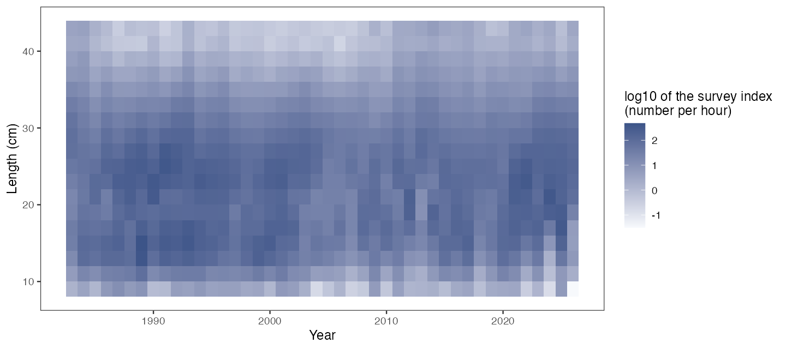

热图显示各年、各体长组调查指数的 log10 值。各体长组指数之和最低为 2007 年的每小时 339 尾，最高为 1989 年的 2360 尾；每年的网次数在 192 至 491 之间。

The heat map shows the log10 survey index by year and length bin. The index summed over length ranges from 339 fish per hour in 2007 to 2,360 in 1989, and the number of hauls per year from 192 to 491.

<a id="case-north-sea-whiting-fit"></a>

#### 3. 用多个初值拟合完整序列 / Fit the complete series with several starts

```r
b <- run_alscl(x, nstarts = 5, ncores = 5, start_spread = 0.5)
b$start_diagnostics[, c("start_id", "objective", "convergence")]
b$start_summary[c("converged", "agree_with_best", "objective_range")]
b$diagnostics[c("numerical_ok", "issues", "advice")]
b$diagnostics$plausibility
plot_residuals(b, facet_by = "length", facet_ncol = 6)
```

`nstarts = 5` 从五组不同的初值出发各拟合一次，`ncores = 5` 让它们并行运行。`start_spread = 0.5` 是在优化器尺度上加到第二个及以后各初值上的正态随机数的标准差，默认值为 0.15。拟合保留目标函数值最低的那个初值的结果。

`nstarts = 5` runs five starts from different starting values, and `ncores = 5` runs them in parallel. `start_spread = 0.5` is the standard deviation of the normal deviates that are added to the starting values of the second and later starts, on the scale of the optimizer; the default is 0.15. The fit keeps the start with the lowest objective.

五个初值中有四个得到 722.59。另一个停在 755.72，此时生长增量的变异系数 cv_grow 位于下界 0.01。如果只用这一个初值，拟合返回的就是这个解，而单次拟合中没有任何信息提示还有更好的解。`b$diagnostics$issues` 报告 "starts converged to different optima"（各初值收敛到不同的解），被保留的初值 `numerical_ok` 为 `TRUE`。`advice` 给出检查未通过时的处理建议，`plausibility` 列出取值不合理但不会使检查失败的估计值，这里两者都为空。这次拟合在五个核上用了 12 分钟。

Four of the five starts ended at 722.59. One start stopped at 755.72, with the coefficient of variation of the growth increment, cv_grow, at its lower bound of 0.01. A fit with that start alone would have returned this solution, and nothing in a single fit shows that a better one exists. `b$diagnostics$issues` reports "starts converged to different optima", and `numerical_ok` is `TRUE` for the start that was kept. `advice`, which says what to do when a check fails, and `plausibility`, which lists estimates with implausible values that do not fail the checks, are both empty. The fit took 12 minutes on five cores.

各初值的结果不一致时，拟合保留目标函数值最低的解。请查看 `b$start_summary$agree_with_best`，确认不止一个初值到达该解；如果只有一个，就增加初值。`advice` 不为空时，按其中的建议修改并重新拟合，第 4 步对 ACL 就是这样做的。

When the starts disagree, the fit keeps the lowest objective. Check in `b$start_summary$agree_with_best` that more than one start reached it, and add starts if only one did. When `advice` is not empty, do what it says and refit, as step 4 does for ACL.

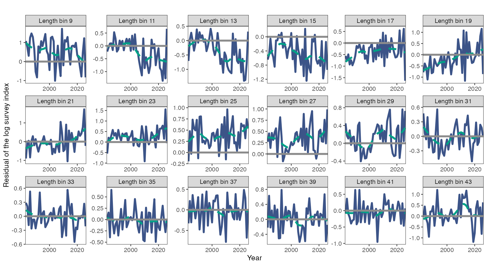

每个小图是一个体长组各年的对数指数残差。有几个体长组的残差多年保持同一符号：标签为 9 cm 的组为正（均值 0.53），23 至 29 cm 为正（均值 0.27），13 至 17 cm 为负（均值 -0.40）。同一年相邻体长组残差的平均相关系数为 0.54，而模型假定观测误差相互独立。数值检查不检验这两种情形。它们都说明模型没有反映指数的某些特征，这次拟合的标准误偏小。

Each panel shows the residuals of the log index of one length bin over the years. In several bins they keep the same sign for many years. They are positive in the bin labelled 9 cm (mean 0.53) and from 23 to 29 cm (mean 0.27), and negative from 13 to 17 cm (mean -0.40). Residuals of neighbouring length bins in the same year have a mean correlation of 0.54, whereas the model assumes independent observation errors. The numerical checks test neither pattern. Both mean that the model misses features of the index and that the standard errors of this fit are too small.

<a id="case-north-sea-whiting-acl"></a>

#### 4. 拟合 ACL 并按建议修改 / Fit ACL and follow its advice

```r
a <- run_acl(x, nstarts = 5, ncores = 5, start_spread = 0.5)
a$diagnostics[c("numerical_ok", "issues", "advice")]
a$diagnostics$plausibility$note
a2 <- run_acl(x,
  parameters = c(x$fit_config$acl$parameters, list(log_std_log_N0 = -3)),
  map = c(x$fit_config$acl$map, list(log_std_log_N0 = factor(NA))),
  nstarts = 5, ncores = 5, start_spread = 0.5)
a2$diagnostics[c("numerical_ok", "issues")]
```

ACL 的五个初值都得到相同的目标函数值 736.88，Hessian 矩阵正定，但拟合仍然没有通过数值检查。初始各龄数量偏差的标准差估计为 2e-05，实际上等于零。这样的参数没有碰到优化器的边界，但数据无法确定它。`a$diagnostics$advice` 建议用 `map` 把 `log_std_log_N0` 固定在选定的值上，然后重新拟合。

All five starts of ACL ended at the same objective, 736.88, with a positive definite Hessian, and the fit still failed the numerical checks. The standard deviation of the deviations of the initial numbers at age was estimated at 2e-05, which is zero in practice. Such a parameter has not reached a bound of the optimizer, but the data do not determine it. `a$diagnostics$advice` says to fix `log_std_log_N0` with `map` at a chosen value and to refit.

第二次调用按这一建议把标准差固定为 exp(-3) = 0.05。显式给出的 `map` 或 `parameters` 参数会替换输入列表中存储的内容，所以两处都重复了已存储的条目。目标函数值变化了 0.08，Linf、k 和 t0 的估计值前三位数字不变，`numerical_ok` 为 `TRUE`。`issues` 中还剩三项，它们不会使检查失败：k 与 t0 估计值的相关系数为 0.96，优化器的精修停在最大梯度 1e-05 处，高于其容许值，以及有一个初值停在目标函数值 1308 处。

The second call follows the advice with a standard deviation of exp(-3) = 0.05. An explicit `map` or `parameters` argument replaces the one stored in the bundle, so both calls repeat the stored entries. The objective changed by 0.08, the estimates of Linf, k and t0 stayed the same to three digits, and `numerical_ok` was `TRUE`. Three entries remained in `issues` that do not fail the checks: a correlation of 0.96 between the estimates of k and t0, a refinement of the optimizer that stopped at a largest gradient of 1e-05, above its tolerance, and one start that stopped at an objective of 1308.

两次 ACL 拟合都留有一条合理性提示：初始总死亡率估计为每年 0.34，低于假定的 M（0.5）。这意味着 1983 年各龄数量随年龄下降的速度比只有自然死亡时还慢，原因可能在假定的 M、假定的调查可捕性，或者 1983 年以前补充量在上升。这条提示不改变数值检查的结论，报告拟合结果时应一并说明。ALSCL 的估计值为每年 0.88。

One plausibility note stayed in both ACL fits. The initial total mortality rate was estimated at 0.34 per year, below the assumed M of 0.5. The numbers at age of 1983 then decline with age more slowly than natural mortality alone would give, which can come from the assumed M, from the assumed survey catchability, or from recruitment that increased before 1983. The note does not change the verdict of the checks; report it with the fit. ALSCL estimated 0.88 per year.

ALSCL 的目标函数值较低，为 722.59，ACL 为 736.96；估计的标量参数分别为 13 个和 9 个。目标函数值不能说明哪个模型对种群的描述更好。第 5、6 步用没有进入拟合的数据来对比这两次拟合。

ALSCL has the lower objective, 722.59 against 736.96, with 13 against 9 estimated scalar parameters. The objective does not show which model describes the stock better. Steps 5 and 6 compare both fits with data that they did not use.

<a id="case-north-sea-whiting-growth"></a>

#### 5. 与年龄判读数据对比各龄平均体长 / Compare mean length at age with age readings

```r
by_age <- function(fit) {
  la <- length_at_age(fit, "survey")
  tapply(la$mean_length, la$age, mean)
}
readings <- subset(x$age_readings$length_at_age, period == "1983-2026")
round(cbind(readings = readings$mean_length, ALSCL = by_age(b), ACL = by_age(a2)), 1)
```

`x$age_readings$length_at_age` 是由同一调查的年龄判读数据得到的各龄平均体长，这些数据没有进入拟合。耳石是按体长组采集的，所以读过年龄的鱼不是渔获的随机样本，直接对它们的体长按年龄求平均会偏向大鱼。因此这张表是用年龄体长键算出的：对每一年，把每个 1 cm 体长组中读过年龄的鱼的各龄比例乘以该体长组的调查指数。结果是调查所见的各龄平均体长，与之对应的模型输出是 `length_at_age(fit, "survey")`，其中各体长的数量乘以了调查可捕性。代码对各年取平均，并输出 1 至 10 龄的结果；模型的 10 龄是加群，下表没有列出。

`x$age_readings$length_at_age` holds the mean length at age from the age readings of the same survey, which do not enter the fit. Otoliths are collected by length class, so the aged fish are not a random sample of the catch, and a plain mean of their lengths at age is biased towards large fish. The table was therefore computed with an age-length key. For each year, the proportion at age among the fish aged in each 1-cm class was multiplied by the survey index of that class. The result is the mean length at age as the survey sees it, and the matching model output is `length_at_age(fit, "survey")`, in which numbers at length are multiplied by survey catchability. The code averages it over the years and prints ages 1 to 10; age 10 is a plus group in the model and is left out of the table below.

比较生长时要用各龄平均体长，不要用生长参数。在 ACL 中，Linf、k 和 t0 描述的是各龄平均体长的 von Bertalanffy 曲线。在 ALSCL 中，Linf 和 k 决定各体长的生长增量，并与 t0 一起决定补充群体的平均体长。ALSCL 估计的 Linf 为 53.1 cm、k 为每年 0.17，ACL 为 33.9 cm 和每年 0.43。

Compare growth through mean length at age and not through the growth parameters. In ACL, Linf, k and t0 describe a von Bertalanffy curve of mean length at age. In ALSCL, Linf and k set the growth increment at length and, with t0, the mean length of recruits. ALSCL estimated Linf at 53.1 cm and k at 0.17 per year, ACL at 33.9 cm and 0.43 per year.

| 年龄（龄） / Age (years) | 1 | 2 | 3 | 4 | 5 | 6 | 7 | 8 | 9 |
|---|---|---|---|---|---|---|---|---|---|
| 年龄判读数据（cm） / Age readings (cm) | 17.0 | 23.2 | 27.3 | 30.0 | 32.0 | 33.1 | 33.8 | 35.0 | 34.1 |
| ALSCL（cm） / ALSCL (cm) | 15.8 | 22.1 | 27.1 | 30.5 | 33.5 | 36.2 | 38.5 | 40.4 | 41.8 |
| ACL（cm） / ACL (cm) | 15.7 | 22.0 | 26.2 | 28.9 | 30.6 | 31.8 | 32.5 | 33.0 | 33.3 |

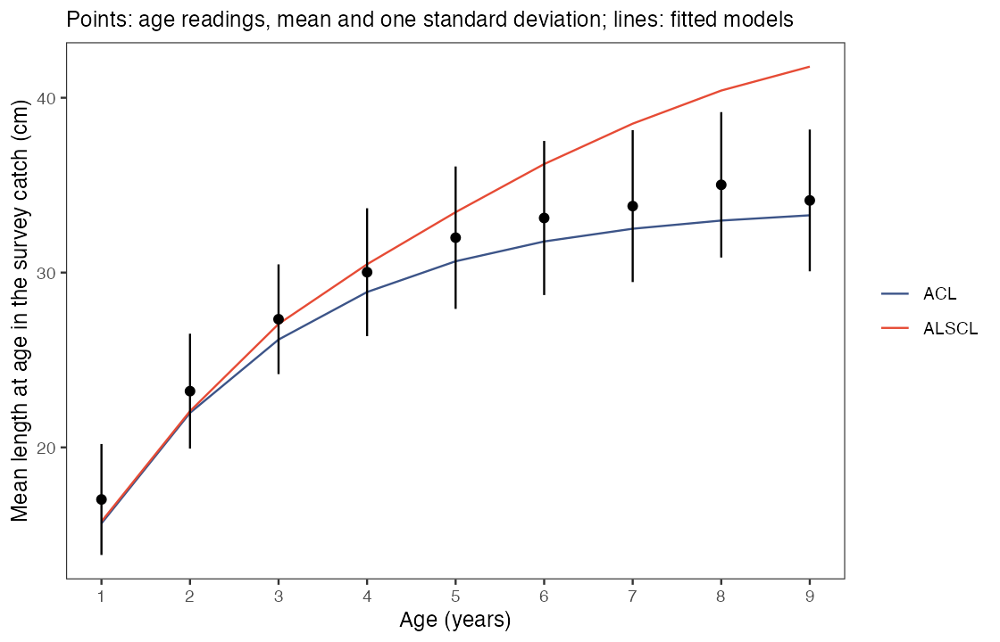

1 至 4 龄时，ALSCL 与年龄判读数据的差别在 1.3 cm 以内。从 5 龄起 ALSCL 偏大，5 龄偏大 1.5 cm，9 龄偏大 7.7 cm。ACL 在每个年龄都比年龄判读数据小 0.9 至 2.0 cm，曲线形状与之相同。1 龄和 2 龄时，两个模型都比年龄判读数据小 1 cm 以上。

ALSCL lies within 1.3 cm of the age readings at ages 1 to 4. From age 5 it lies above them, by 1.5 cm at age 5 and by 7.7 cm at age 9. ACL lies 0.9 to 2.0 cm below the age readings at every age and follows their shape. Both models lie more than 1 cm below the age readings at ages 1 and 2.

体长指数中只有最小的几个年龄形成分开的峰。较大年龄的体长相互重叠，指数中大鱼少，既可能是因为鱼长得慢，也可能是因为大鱼死得快。只有体长数据时，无法把大龄鱼的生长和按体长的死亡率分开。在这两次拟合中，ALSCL 让大龄鱼长到更大的体长并给它们更高的捕捞死亡率（第 6 步），ACL 则给它们较低的渐近体长；从 6 龄起，年龄判读数据与 ACL 更接近。年龄判读数据本身也随时间变化，而两个模型都不允许这种变化：5 龄的平均体长在各个年代之间为 30.2 至 33.5 cm。ALSCL 的 1 至 4 龄平均体长可以使用，不要把它的 Linf 或更大年龄的体长当作生长的估计值。

In a length index only the youngest ages form separate peaks. The lengths of older ages overlap, and few large fish in the index can mean that fish grow slowly or that large fish die fast. Length data alone do not separate the growth of older fish from mortality at length. In these fits ALSCL lets old fish grow to larger lengths and gives them a higher fishing mortality (step 6), and ACL gives them a lower asymptotic length; the age readings agree better with ACL from age 6. The age readings also change over time, which neither model allows. Mean length at age 5 ranges from 30.2 to 33.5 cm among the decades. Use the mean lengths of ALSCL at ages 1 to 4, and do not read its Linf or its lengths at older ages as estimates of growth.

<a id="case-north-sea-whiting-assessment"></a>

#### 6. 与评估对比趋势和死亡率 / Compare trends and mortality with the assessment

```r
ices <- x$ices$assessment
at <- function(v, lag = 0) v[match(b$year - lag, ices$year)]
cor(log(b$report$SSB), log(at(ices$ssb)))
cor(log(b$report$Rec), log(at(ices$recruitment_age0, lag = 1)))
maturity <- x$ices$maturity[c(1:6, 6, 6, 6, 6), as.character(pmin(pmax(b$year, 1991), 2021))]
cor(log(ssb_at_age(b, maturity)$SSB), log(at(ices$ssb)))
catch <- relative_catch(b, years = 1983:2025)
keep <- !catch$extrapolated
cor(log(catch$catch_weight[keep]), log(at(ices$catch)[keep]))
```

`x$ices$assessment` 是 ICES 2026 年评估（[ICES 2026](https://doi.org/10.17895/ices.pub.32676345)）给出的产卵生物量（SSB）、补充量、2 至 5 龄平均捕捞死亡率（F）和渔获量。该评估使用各龄渔获量、第一和第三季度的调查指数以及按年龄和年份变化的自然死亡率，所以它是外部的对照，不是真值。拟合得到的 SSB 和补充量以调查指数为单位，所以只比较趋势，这里用对数值的相关系数。拟合的补充量是第一季度的 1 龄鱼，评估的补充量是 0 龄鱼，所以代码把评估序列错开一年。`ssb_at_age()` 用评估的各龄成熟比例重新计算 SSB（6 龄及以上合为一组，1991-2021 以外的年份取最近的年份），`relative_catch()` 返回模型渔获量除以其均值后的序列。

`x$ices$assessment` holds spawning biomass (SSB), recruitment, the mean fishing mortality rate (F) at ages 2 to 5 and catch from the ICES assessment of 2026 ([ICES 2026](https://doi.org/10.17895/ices.pub.32676345)). That assessment uses catch at age, survey indices for quarters 1 and 3 and a natural mortality rate by age and year, so it is an external comparison and not a true value. SSB and recruitment of a fit are in the unit of the survey index, so compare trends, here as the correlation of the logarithms. Recruitment of the fits is at age 1 in quarter 1 and that of the assessment at age 0, so the code shifts the assessment by one year. `ssb_at_age()` recomputes SSB with the maturity at age of the assessment (ages 6 and older in one group, years outside 1991-2021 taken from the nearest year), and `relative_catch()` returns the catch of the model divided by its mean.

| 与评估的对比 / Comparison with the assessment | ALSCL | ACL | ICES |
|---|---|---|---|
| SSB 对数值的相关系数 / Correlation of log SSB | 0.74 | 0.72 |  |
| SSB 对数值的相关系数，用评估的各龄成熟比例 / Correlation of log SSB, maturity at age of the assessment | 0.74 | 0.71 |  |
| 补充量对数值的相关系数 / Correlation of log recruitment | 0.67 | 0.67 |  |
| 渔获重量对数值的相关系数 / Correlation of log catch in weight | 0.62 | 0.71 |  |
| 2 至 5 龄平均 F（每年），1983-1999 / Mean F at ages 2 to 5 (per year), 1983-1999 | 0.62 | 0.57 | 0.51 |
| 2 至 5 龄平均 F（每年），2000-2012 / Mean F at ages 2 to 5 (per year), 2000-2012 | 0.44 | 0.31 | 0.21 |
| 2 至 5 龄平均 F（每年），2013-2025 / Mean F at ages 2 to 5 (per year), 2013-2025 | 0.36 | 0.12 | 0.18 |

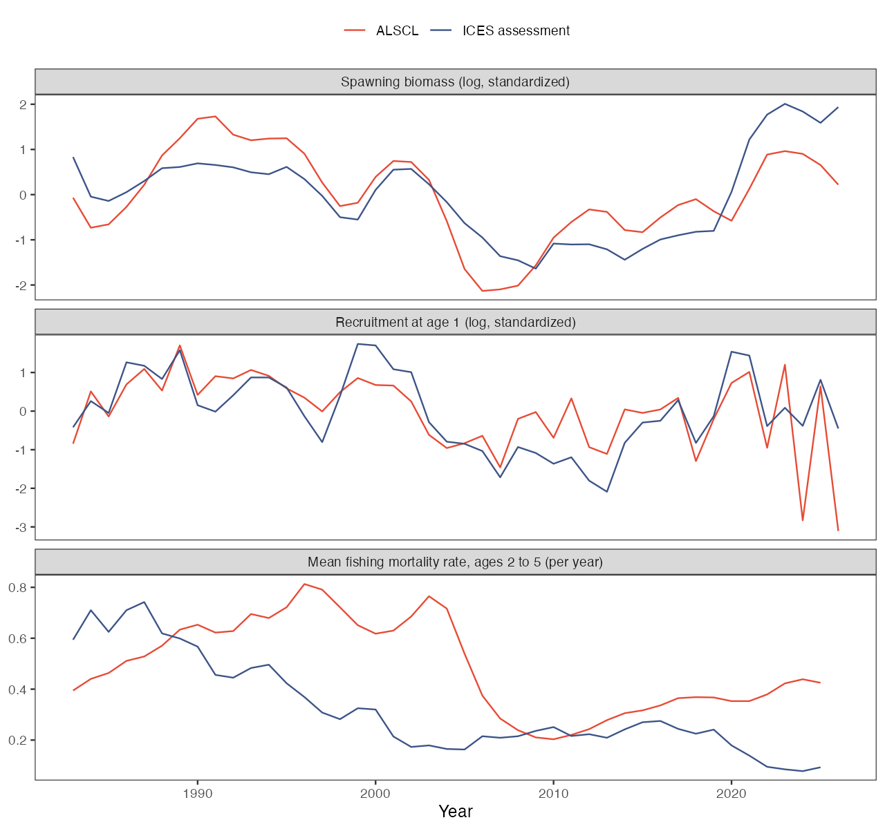

SSB 和补充量的趋势与评估部分一致，ALSCL 的相关系数为 0.67 至 0.74。SSB 的最低值在 ALSCL 拟合中出现在 2006 年，在评估中出现在 2009 年，此后两者都回升。两者在近期水平上不同：2017-2026 年的平均 SSB 与 1983-1992 年的平均 SSB 之比，ALSCL 为 0.87，评估为 1.22。把按体长的成熟比例换成评估的各龄成熟比例，相关系数的变化不到 0.01。

The trends of SSB and recruitment agree in part with the assessment, with correlations of 0.67 to 0.74 for ALSCL. SSB is lowest in 2006 in the ALSCL fit and in 2009 in the assessment, and rises afterwards in both. The two differ in the recent level. Mean SSB of 2017-2026 divided by that of 1983-1992 is 0.87 for ALSCL and 1.22 for the assessment. The maturity at age of the assessment in place of maturity at length changes the correlation by less than 0.01.

F 的水平不能比较。ALSCL 的 F 在三个时期都高于评估，2000 年以后约为评估的两倍，两个序列的秩相关系数为 0.31。ACL 的 F 在前两个时期更接近评估，在最后一个时期低于评估。只用调查数据拟合时，总死亡率是在假定的调查可捕性下由指数中各世代的下降估计的，F 等于总死亡率减去假定的 M。因此 F 的水平以及渔获量的水平都取决于固定的输入，第 7 步给出变化的幅度。

The level of F cannot be compared. F of ALSCL is above that of the assessment in all three periods and about twice as high after 2000, and the rank correlation between the two series is 0.31. F of ACL lies closer to that of the assessment in the first two periods and below it in the last. In a fit to survey data alone, total mortality is estimated from the decline of cohorts in the index under the assumed survey catchability, and F is total mortality minus the assumed M. The level of F, and with it the level of catch, therefore follows from the fixed inputs; step 7 shows by how much.

调查数据能够提供的，是一个世代的指数从一年到下一年的下降率，即调查所见的总死亡率。下表给出它在 2 至 5 龄上的均值：由年龄判读数据的各龄指数（`x$age_readings$index_at_age`）计算的值，由每次拟合对应的各龄指数计算的值，以及评估的 F 与 M 之和。

What the survey does inform is the rate at which the index of a cohort declines from one year to the next, the apparent total mortality rate from the survey. The table gives its mean over ages 2 to 5, calculated from the index at age of the age readings (`x$age_readings$index_at_age`) and from the index at age that each fit implies, next to the sum of F and M of the assessment.

| 时期 / Period | 年龄判读数据 / Age readings | ALSCL | ACL | 评估的 F + M / Assessment, F + M |
|---|---|---|---|---|
| 1983-1999 | 1.05 | 1.12 | 1.07 | 1.03 |
| 2000-2012 | 0.78 | 0.94 | 0.81 | 0.76 |
| 2013-2025 | 0.95 | 0.86 | 0.62 | 0.73 |

ALSCL 在每个时期与年龄判读数据的差别都在每年 0.17 以内。ACL 在前两个时期的差别在每年 0.04 以内，在最后一个时期降到 0.62，而年龄判读数据给出 0.95。只有当调查可捕性不随年龄变化时，调查所见的下降率才等于种群的总死亡率；评估对这个调查指数的每个年龄分别估计可捕性。

ALSCL stays within 0.17 per year of the age readings in every period. ACL lies within 0.04 per year in the first two periods and falls to 0.62 in the last, where the age readings give 0.95. The apparent rate equals the total mortality rate of the stock only where survey catchability does not change with age; the assessment estimates a separate catchability of this survey index for each age.

<a id="case-north-sea-whiting-sensitivity"></a>

#### 7. 改变两项固定输入 / Change two fixed inputs

```r
M_age <- x$ices$M[c(1:6, 6, 6, 6, 6), ]
M_ices <- cbind(M_age, M_age[, rep("2022", 4)])
dimnames(M_ices) <- list(age = 1:10, year = 1983:2026)
b_M <- run_alscl(x, M = M_ices, nstarts = 3, ncores = 3, start_spread = 0.5)
q_dome <- survey_catchability(x$fit_args$len_mid, "dome", L50 = 10, L95 = 14,
                              L50_desc = 29.5, L95_desc = 22, minimum = 0.22)
b_q <- run_alscl(x, survey_q = q_dome, sel_L50 = NULL, sel_L95 = NULL,
                 nstarts = 3, ncores = 3, start_spread = 0.5)
```

第一次拟合把常数 M 换成评估取自多物种模型的按年龄和年份变化的自然死亡率（`x$ices$M`，[ICES 2026](https://doi.org/10.17895/ices.pub.32676345) 的输入表）。这时 `M` 是一个矩阵，每个年龄组一行，每个时间步一列。6 至 10 龄取表中最大年龄组的值，2023-2026 年取 2022 年的值。各年的均值在 1 龄为每年 1.18，2 龄为 0.66，6 龄及以上为 0.40。

The first fit replaces the constant M by the natural mortality rate by age and year that the assessment takes from a multispecies model (`x$ices$M`, the input table of [ICES 2026](https://doi.org/10.17895/ices.pub.32676345)). `M` is then a matrix with one row per age class and one column per time step. Ages 6 to 10 take the value of the oldest group of the table and 2023-2026 take the values of 2022. The mean over the years is 1.18 per year at age 1, 0.66 at age 2 and 0.40 for ages 6 and older.

第二次拟合把 logistic 形式的调查可捕性换成对大鱼下降的曲线。[Fraser et al. (2007)](https://doi.org/10.1093/icesjms/fsm145) 估计了 GOV 拖网对牙鳕按体长的可捕性：21 cm 及以下为常数，22 至 37 cm 线性下降，38 cm 起约为该常数水平的 0.22。他们的曲线针对第三季度的调查，并且以当时的评估结果为基准，所以只能提供形状；它也不含小体长处上升段的信息，这里上升段仍取 10 和 14 cm。`survey_catchability()` 取 `"dome"` 时构造这样的曲线：下降从 `L95_desc` 附近开始，在 `L50_desc` 处降到一半，最后停在 `minimum`。`survey_q` 取代 `sel_L50` 和 `sel_L95`，这两个参数必须设为 `NULL`。

The second fit replaces the logistic survey catchability by a curve that declines for large fish. [Fraser et al. (2007)](https://doi.org/10.1093/icesjms/fsm145) estimated the catchability of the GOV trawl at length for whiting: constant up to 21 cm, a linear decline from 22 to 37 cm, and about 0.22 of the constant level from 38 cm. Their curve is for the quarter 3 survey and is scaled to the assessment of that time, so it gives the shape only, and it has no information on the increase at small lengths, which stays at 10 and 14 cm here. `survey_catchability()` with `"dome"` builds such a curve, in which the decline starts near `L95_desc`, is halfway at `L50_desc` and ends at `minimum`. `survey_q` takes the place of `sel_L50` and `sel_L95`, which must be `NULL`.

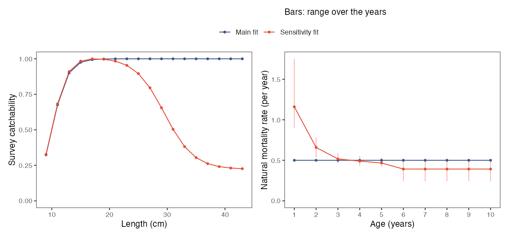

| 结果 / Result | 主拟合 / Main fit | M 按年龄和年份变化 / M by age and year | 可捕性随体长下降 / Catchability declining with length |
|---|---|---|---|
| 目标函数值 / Objective | 722.59 | 857.41 | 752.76 |
| 到达最低目标函数值的初值数 / Starts at the lowest objective | 5 个中 4 个 / 4 of 5 | 3 个中 3 个 / 3 of 3 | 3 个中 2 个 / 2 of 3 |
| 2 至 5 龄平均 F（每年），1983-1999 / Mean F at ages 2 to 5 (per year), 1983-1999 | 0.62 | 0.54 | 0.37 |
| 2 至 5 龄平均 F（每年），2000-2012 / Mean F at ages 2 to 5 (per year), 2000-2012 | 0.44 | 0.33 | 0.21 |
| 2 至 5 龄平均 F（每年），2013-2025 / Mean F at ages 2 to 5 (per year), 2013-2025 | 0.36 | 0.28 | 0.08 |
| 与主拟合的 SSB 对数值相关系数 / Correlation of log SSB with the main fit |  | 0.99 | 0.97 |
| 与主拟合的补充量对数值相关系数 / Correlation of log recruitment with the main fit |  | 0.99 | 1.00 |
| 平均 SSB 与主拟合之比 / Mean SSB divided by that of the main fit | 1 | 0.92 | 1.66 |
| 平均补充量与主拟合之比 / Mean recruitment divided by that of the main fit | 1 | 1.48 | 1.13 |
| 7 龄平均体长（cm）；年龄判读数据为 33.8 / Mean length at age 7 (cm); age readings 33.8 | 38.5 | 38.3 | 38.6 |

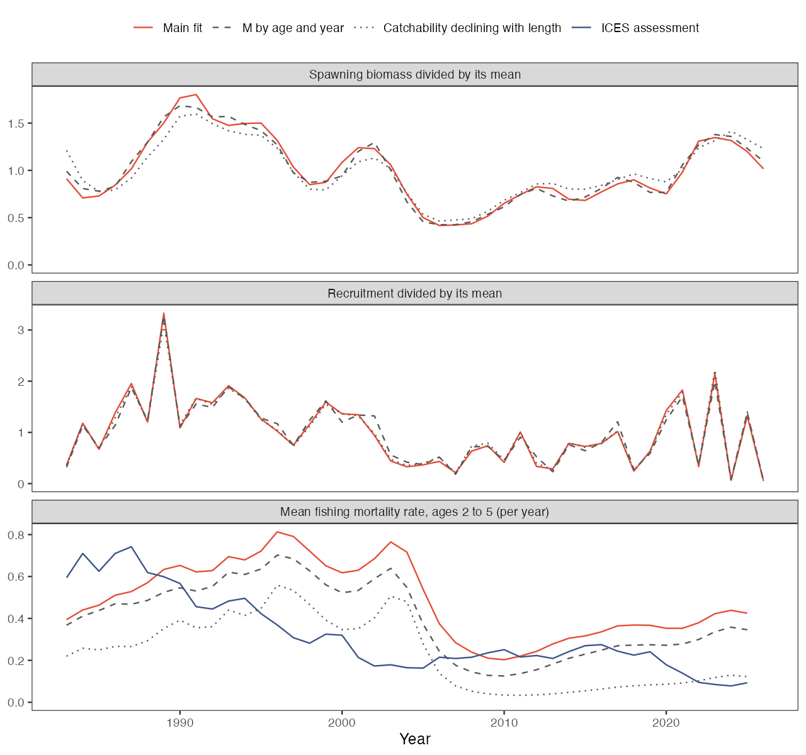

两次敏感性拟合都通过了数值检查。SSB 和补充量的趋势几乎不变：它们与主拟合的相关系数都不低于 0.97。水平则发生变化。M 按年龄变化时 1 龄鱼死亡更多，补充量是主拟合的 1.48 倍；可捕性随体长下降时调查捕到的大鱼比例更小，SSB 是主拟合的 1.66 倍。2013-2025 年 2 至 5 龄的平均 F 在三次拟合中分别为每年 0.36、0.28 和 0.08，评估为 0.18。7 龄平均体长仍比年龄判读数据大 4 至 5 cm：这两项输入都不能消除大龄鱼体长的差别。

Both sensitivity fits passed the numerical checks. The trends of SSB and recruitment hardly change. Their correlations with the main fit are 0.97 or higher. The levels change. Recruitment is 1.48 times that of the main fit with M by age, in which more fish of age 1 die, and SSB is 1.66 times that of the main fit with the declining catchability, in which the survey catches a smaller share of the large fish. Mean F at ages 2 to 5 in 2013-2025 is 0.36, 0.28 and 0.08 per year in the three fits, against 0.18 in the assessment. Mean length at age 7 stays 4 to 5 cm above the age readings in all three fits, so neither input removes the difference at older ages.

两次敏感性拟合的目标函数值都更高，分别高 135 和 30。不要用目标函数值来选择 M 或调查可捕性的形状。只有调查数据时，自然死亡率、渔业的选择性和调查可捕性可能相互混淆，要得到唯一的解，必须对其中一项或几项作出假设（[Cook 2013](https://doi.org/10.1016/j.fishres.2013.01.003)）。[Zhang & Cadigan (2022)](https://doi.org/10.1111/faf.12673) 把模型的 F 估计称为绝对估计，该文没有考察 M 或调查可捕性形状设错的情形。这一步的三次拟合说明，F 的水平只在所假定的 M 和调查可捕性下成立。

The objective is higher in both sensitivity fits, by 135 and by 30. Do not choose M or the shape of survey catchability by the objective. With survey data alone, the natural mortality rate, the selectivity of the fishery and survey catchability may be confounded, and a unique solution needs an assumption about one or more of them ([Cook 2013](https://doi.org/10.1016/j.fishres.2013.01.003)). [Zhang & Cadigan (2022)](https://doi.org/10.1111/faf.12673) describe the F estimates of the model as absolute, and their paper does not examine a wrong M or a wrong shape of survey catchability. The three fits of this step show that the level of F holds only for the M and the survey catchability that were assumed.

<a id="case-north-sea-whiting-use"></a>

#### 8. 决定报告哪些结果 / Decide what to report

```r
estimates <- extract_estimates(b)
subset(estimates, quantity %in% c("SSB", "Rec") & year >= 2022,
       c(quantity, year, estimate, conf_low, conf_high))
tail(relative_catch(b), 3)
save_assessment(b, "whiting_alscl.rds")
```

`extract_estimates()` 返回 SSB 和补充量及其区间；`relative_catch()` 返回模型渔获量除以其均值后的序列，最后一年没有观测提供信息，其 `extrapolated` 为 `TRUE`；`save_assessment()` 把拟合结果写入文件，供以后的会话使用。下表列出本页的核对对这组指数支持哪些用法。对你自己的数据要重新做这些核对，同样的输出未必能通过。

`extract_estimates()` returns SSB and recruitment with their intervals, `relative_catch()` the catch of the model divided by its mean, with `extrapolated = TRUE` for the last year, which no observation informs, and `save_assessment()` writes the fit to a file for later sessions. The table lists what the checks of this page support for this index. Repeat the checks for your own data; the same outputs need not pass them.

| 输出 / Output | 用法 / Use | 本页的依据 / Basis on this page |
|---|---|---|
| 各年补充量 / Recruitment by year | 趋势 / Trend | 与年龄判读数据 1 龄指数的相关系数为 0.77，与评估的相关系数为 0.67；第 7 步三次拟合之间的相关系数不低于 0.99 / Correlation of 0.77 with the index at age 1 of the age readings and of 0.67 with the assessment; correlation of 0.99 or higher among the three fits of step 7 |
| 产卵生物量 / Spawning biomass | 趋势，作为相对序列 / Trend, as a relative series | 与评估的相关系数为 0.74，三次拟合之间不低于 0.97 / Correlation of 0.74 with the assessment and of 0.97 or higher among the three fits |
| 1 至 4 龄平均体长 / Mean length at ages 1 to 4 | 调查所见的值 / As the survey sees it | 与年龄判读数据的差别在 1.3 cm 以内 / Within 1.3 cm of the age readings |
| 2 至 5 龄调查所见的总死亡率 / Apparent total mortality rate from the survey, ages 2 to 5 | 作为指数的下降率，不作为种群的总死亡率 / As a rate of decline of the index, not as the total mortality rate of the stock | 每个时期与年龄判读数据的差别都在每年 0.17 以内 / Within 0.17 per year of the age readings in each period |
| F 和渔获量的水平 / Level of F and of catch | 不要使用 / Do not use | F 等于总死亡率减去假定的 M；2013-2025 年三次拟合的 F 为每年 0.08 至 0.36 / F is total mortality minus the assumed M; 0.08 to 0.36 per year in 2013-2025 among the three fits |
| SSB 和补充量的水平 / Level of SSB and of recruitment | 不要使用 / Do not use | 以调查指数为单位；换用第 7 步的输入后分别变为 1.66 倍和 1.48 倍 / In the unit of the survey index; they change by factors of 1.66 and 1.48 with the inputs of step 7 |
| Linf 和 5 龄及以上的平均体长 / Linf and mean length at ages 5 and older | 不要当作生长的估计值 / Do not use as growth estimates | 比年龄判读数据大 1.5 至 7.7 cm / 1.5 to 7.7 cm above the age readings |
| 标准误和区间 / Standard errors and intervals | 作为不确定性的下限 / As lower limits of the uncertainty | 不包含固定输入的不确定性，相邻体长组的残差相关（0.54） / They leave out the uncertainty of the fixed inputs, and residuals of neighbouring length bins are correlated (0.54) |

<a id="case-north-sea-whiting-next"></a>

#### 下一步 / What next

| 想做什么 / What you want to do | 阅读 / Read |
|---|---|
| 整理自己的表和设置 / Lay out your own tables and settings | [如何拟合自己的调查数据？](https://github.com/FanZhang-LAB-SHOU/ALSCL/blob/main/docs/CASES.md) / [How do I fit my own survey data?](https://github.com/FanZhang-LAB-SHOU/ALSCL/blob/main/docs/CASES.md) |
| 读数值检查、建议和合理性提示 / Read the numerical checks, the advice and the plausibility notes | [判断拟合是否可用](https://github.com/FanZhang-LAB-SHOU/ALSCL/blob/main/docs/USER_GUIDE.md#diagnostics) / [Judge whether a fit can be used](https://github.com/FanZhang-LAB-SHOU/ALSCL/blob/main/docs/USER_GUIDE.md#diagnostics) |
| 选择初值、边界和要固定的参数 / Choose starts, bounds and the parameters to fix | [选择拟合设置](https://github.com/FanZhang-LAB-SHOU/ALSCL/blob/main/docs/USER_GUIDE.md#fitting) / [Choose the fitting settings](https://github.com/FanZhang-LAB-SHOU/ALSCL/blob/main/docs/USER_GUIDE.md#fitting) |
| 在真值已知的数据上比较 ACL 和 ALSCL / Compare ACL and ALSCL on data with known truth | [ACL 与 ALSCL 的评估结果有什么不同？](https://github.com/FanZhang-LAB-SHOU/ALSCL/blob/main/docs/CASES.md#case-compare-assessments) / [Do ACL and ALSCL give different answers?](https://github.com/FanZhang-LAB-SHOU/ALSCL/blob/main/docs/CASES.md#case-compare-assessments) |
| 把其他 M 取值作为情景来拟合 / Run fits with other values of M as scenarios | [评估对假设有多敏感，未来 F 会怎样改变结果？](https://github.com/FanZhang-LAB-SHOU/ALSCL/blob/main/docs/CASES.md#case-sensitivity-projection) / [How sensitive is the assessment, and what happens under future F?](https://github.com/FanZhang-LAB-SHOU/ALSCL/blob/main/docs/CASES.md#case-sensitivity-projection) |
| 去掉最后几年后重新拟合 / Refit after removing the last years | [运行回溯分析](https://github.com/FanZhang-LAB-SHOU/ALSCL/blob/main/docs/USER_GUIDE.md#retrospective) / [Run a retrospective analysis](https://github.com/FanZhang-LAB-SHOU/ALSCL/blob/main/docs/USER_GUIDE.md#retrospective) |

<a id="case-compare-assessments"></a>
### ACL 与 ALSCL 的评估结果有什么不同？ / Do ACL and ALSCL give different answers?

本页带你对同一组模拟 YTF 观测拟合 ACL 和 ALSCL，看两种种群结构在哪些方面一致、在哪些方面不同。你需要已安装的软件包（[安装 ALSCL](https://github.com/FanZhang-LAB-SHOU/ALSCL/blob/main/docs/USER_GUIDE.md#start)）；`YTF_example` 提供数据表、生物学设置和两个模型的固定参数，因此这一比较以这些教学数值为条件。结束时你会有比较表、四张图和一个保存文件夹。

On this page you fit ACL and ALSCL to the same synthetic YTF observations and see where the two population structures agree and where they differ. You need the package installed ([Install ALSCL](https://github.com/FanZhang-LAB-SHOU/ALSCL/blob/main/docs/USER_GUIDE.md#start)); `YTF_example` supplies the tables, the biology and the fixed parameters of both models, so the comparison is conditional on those teaching values. At the end you have comparison tables, four figures and a saved folder.

<a id="case-compare-assessments-fit"></a>

#### 1. 对同一组观测拟合两个模型 / Fit both models to the same observations

```r
library(ALSCL)
data("YTF_example")
x <- YTF_example
inputs <- x[c("data.CatL", "data.wgt", "data.mat")]
a <- run_acl(x, train_times = 2, silent = TRUE)
b <- run_alscl(x, train_times = 2, silent = TRUE)
```

两次拟合都读取输入列表 `x`，因此共用数据表、`M`、调查可捕性和时间网格，每个模型从 `x$fit_config` 取自己的初值和 `map`；固定的生长和过程参数值对区间没有贡献不确定性。给两个模型相同的数据表和生物学输入，并记录各自的 map、固定值、边界和数值检查结果。评估模型结构的影响时，应结合这些拟合配置解释差异。

Both fits read the input bundle `x`, so they share the tables, `M`, survey catchability and time grid, and each model takes its starting values and `map` from `x$fit_config`; the fixed growth and process values contribute no uncertainty to the intervals. Use the same tables and biological inputs, and document each model's map, fixed values, bounds and numerical checks. Interpret the differences under these fitting configurations when assessing the effect of model structure.

<a id="case-compare-assessments-checks"></a>

#### 2. 检查两次拟合并比较拟合统计量 / Check both fits and compare the fit statistics

```r
diagnose_model(x$data.CatL, a)
diagnose_model(x$data.CatL, b)
comparison <- compare_models(a, b, x$data.CatL)
comparison$summary
comparison$fit_diagnostics
comparison$comparison
plot_compare_residuals(a, b, x$data.CatL)
```

先读每次拟合的数值检查（[理解第一次拟合](https://github.com/FanZhang-LAB-SHOU/ALSCL/blob/main/docs/USER_GUIDE.md#first-model-checks)）。`compare_models()` 核对两次拟合使用了同一张调查表，再比较目标函数、AIC、BIC 和 `fit_metrics` 中的拟合统计量。`comparison$comparison` 记录 `data_verified`、`eligible`（两次拟合都通过检查）、`preferred`（AIC 较低的模型，仅在两者都合格且 AIC 相差至少 2 时给出）和 `issues`。在记录运行（[comparison_summary.csv](https://github.com/FanZhang-LAB-SHOU/ALSCL/blob/main/docs/results/comparison_summary.csv)）中，两次拟合都通过检查；ACL 的 AIC 更低，调查指数 RMSE 也更小，为 2.5 对 4.4。AIC 较低只是这些数据上的统计支持；结构是否适合这个种群，要用生物学知识判断。

Read the numerical checks first ([Understand your first fit](https://github.com/FanZhang-LAB-SHOU/ALSCL/blob/main/docs/USER_GUIDE.md#first-model-checks)). `compare_models()` verifies that both fits used the same survey table, then compares the objective, AIC, BIC and the fit statistics in `fit_metrics`. `comparison$comparison` records `data_verified`, `eligible` (both fits passed the checks), `preferred` (the model with the lower AIC, given only when both are eligible and the AIC values differ by at least 2) and `issues`. In the recorded run ([comparison_summary.csv](https://github.com/FanZhang-LAB-SHOU/ALSCL/blob/main/docs/results/comparison_summary.csv)) both fits passed; ACL had the lower AIC and the smaller survey-index RMSE, 2.5 against 4.4. A lower AIC is statistical support on these data; whether the structure suits the stock is a biological decision.


四个面板分别是残差直方图、QQ 图、逐年平均残差（误差线为一个标准差）和按体长组的绝对残差；[判断拟合是否可用](https://github.com/FanZhang-LAB-SHOU/ALSCL/blob/main/docs/USER_GUIDE.md#diagnostics-residuals)解释这些规律。

The four panels show the residual histogram, the QQ plot, the mean residual by year (error bars: one standard deviation) and the absolute residual by length bin; [Judge whether a fit can be used](https://github.com/FanZhang-LAB-SHOU/ALSCL/blob/main/docs/USER_GUIDE.md#diagnostics-residuals) explains the patterns.

<a id="case-compare-assessments-survey"></a>

#### 3. 比较对调查观测的拟合 / Compare the fit to the survey observations

```r
plot_compare_CatL(a, b, x$data.CatL,
                  years = c(2000, 2005, 2010, 2015), facet_ncol = 2)
```


点是观测，曲线是选定四个年份的拟合中位数。读丰度差异之前，先比较拟合形状，特别是调查指数较低的大体长组。

Points are the observations and curves the fitted medians in the four selected years. Compare the fitted shapes, in particular in the larger length bins with low survey indices, before reading differences in abundance.

<a id="case-compare-assessments-estimates"></a>

#### 4. 比较种群估计 / Compare the population estimates

```r
plot_compare_ts(a, b, quantities = c("B", "SSB", "Rec"), se = TRUE)
comparison$correlation
comparison$length_at_age
comparison$growth
```


先比较点估计的时间位置、趋势和大小，再检查不确定性；`se = TRUE` 加上各拟合的近似区间。仅凭重叠不能说明点估计接近：很宽的区间即使点估计差异很大也可能重叠。定量比较时，报告同一时间的估计差或比值。由于两次拟合使用同一数据，对差异作统计推断时需要考虑其联合不确定性。本例只描述这一组数据。

Compare the timing, trends and magnitudes of the point estimates, then inspect their uncertainty; `se = TRUE` adds each fit's approximate intervals. Overlap alone does not show that point estimates are close: wide intervals can overlap despite large differences. For a quantitative comparison, report differences or ratios at matching times. Inference about those differences requires their joint uncertainty because the fits use the same data. This example describes one dataset.

`comparison$correlation` 对产卵生物量、补充量、生物量和丰度给出两次拟合之间的相关系数和均值之比。渔获量按相对渔获量比较（`CN (relative)` 和 `CB (relative)` 两行，不给比值），因为只拟合调查指数时渔获量的水平无法确定。生长的比较看 `comparison$length_at_age`，即两次拟合各年龄的平均体长。`comparison$growth` 把 `Linf`、`k` 和 `t0` 按模型分开列出，因为它们在 ACL 中是各年龄平均体长的 von Bertalanffy 曲线参数，在 ALSCL 中决定体长别生长增量（[判断拟合是否可用](https://github.com/FanZhang-LAB-SHOU/ALSCL/blob/main/docs/USER_GUIDE.md#diagnostics-compare)）。

`comparison$correlation` gives the correlation between the two fits and the ratio of their means for spawning biomass, recruitment, biomass and abundance. Catch is compared as relative catch (rows `CN (relative)` and `CB (relative)`, without a ratio), because a fit to a survey index does not determine the level of catch. Compare growth through `comparison$length_at_age`, the mean length at age of both fits. `comparison$growth` lists `Linf`, `k` and `t0` in a separate block for each model, because they are the parameters of a von Bertalanffy curve of mean length at age in ACL and set the growth increment at length in ALSCL ([Judge whether a fit can be used](https://github.com/FanZhang-LAB-SHOU/ALSCL/blob/main/docs/USER_GUIDE.md#diagnostics-compare)).

<a id="case-compare-assessments-mortality"></a>

#### 5. 比较捕捞死亡率 / Compare fishing mortality

```r
plot_compare_F(a, b)
```


ACL 按年龄估计捕捞死亡率，ALSCL 按体长估计，所以两个面板的单元格只在时间上对应。`plot_compare_F_ts()` 用最大值（`method = "apical"`，默认）或均值汇总每个时间步的各组；季度值仍按季度计。

ACL estimates fishing mortality by age and ALSCL by length, so the panels' cells match only in time. `plot_compare_F_ts()` summarizes the groups of each time step by their maximum (`method = "apical"`, the default) or mean; quarterly values stay per quarter.

<a id="case-compare-assessments-save"></a>

#### 6. 保存比较结果供复核 / Save the comparison for review

```r
dir.create("my_model_comparison", showWarnings = FALSE)
write.csv(comparison$summary, "my_model_comparison/summary.csv", row.names = FALSE)
write.csv(comparison$fit_metrics, "my_model_comparison/fit_metrics.csv", row.names = FALSE)
write.csv(comparison$fit_diagnostics, "my_model_comparison/fit_diagnostics.csv", row.names = FALSE)
p_population <- plot_compare_ts(a, b, quantities = c("B", "SSB", "Rec"), se = TRUE)
ggplot2::ggsave("my_model_comparison/population.png", p_population,
               width = 10, height = 7, dpi = 300)
saveRDS(list(inputs = inputs, fit_args = x$fit_args, fit_config = x$fit_config,
             comparison = comparison, ACL_report = a$report, ALSCL_report = b$report),
        "my_model_comparison/summary.rds")
writeLines(capture.output(sessionInfo()), "my_model_comparison/session.txt")
```

文件夹里有 CSV 表、种群图、装有输入、设置、比较结果和两个报告的 RDS 文件，以及会话信息。报告时一并写明时间窗、固定的生物学设置、零值的处理和对固定值的敏感性。

The folder holds the CSV tables, the population figure, an RDS with the inputs, settings, comparison and both reports, and the session information. Report with it the time window, fixed biology, zero treatment and sensitivity to the fixed values.

<a id="case-compare-assessments-next"></a>

#### 下一步 / What next

| 想做什么 / What you want to do | 阅读 / Read |
|---|---|
| 绘制其他比较图 / Draw the other comparison figures | [模型比较与真值](https://github.com/FanZhang-LAB-SHOU/ALSCL/blob/main/docs/PLOT_GALLERY.md) / [Model comparisons](https://github.com/FanZhang-LAB-SHOU/ALSCL/blob/main/docs/PLOT_GALLERY.md) |
| 检查单个拟合的残差规律 / Examine the residual patterns of one fit | [判断拟合是否可用](https://github.com/FanZhang-LAB-SHOU/ALSCL/blob/main/docs/USER_GUIDE.md#diagnostics) / [Judge whether a fit can be used](https://github.com/FanZhang-LAB-SHOU/ALSCL/blob/main/docs/USER_GUIDE.md#diagnostics) |
| 去掉近期时间步后重新拟合 / Remove recent time steps and refit | [移除近期数据后，估计结果会怎样变化？](https://github.com/FanZhang-LAB-SHOU/ALSCL/blob/main/docs/CASES.md#case-retrospective-bias) / [Do estimates change when recent data are removed?](https://github.com/FanZhang-LAB-SHOU/ALSCL/blob/main/docs/CASES.md#case-retrospective-bias) |
| 检验对 M 和 F 结构的敏感性 / Test the sensitivity to M and the F structure | [评估对假设有多敏感，未来 F 情景会怎样改变结果？](https://github.com/FanZhang-LAB-SHOU/ALSCL/blob/main/docs/CASES.md#case-sensitivity-projection) / [How sensitive is the assessment, and what happens under future F?](https://github.com/FanZhang-LAB-SHOU/ALSCL/blob/main/docs/CASES.md#case-sensitivity-projection) |
| 对自己的数据表拟合两个模型 / Fit both models to your own tables | [如何拟合自己的调查数据？](https://github.com/FanZhang-LAB-SHOU/ALSCL/blob/main/docs/CASES.md) / [How do I fit my own survey data?](https://github.com/FanZhang-LAB-SHOU/ALSCL/blob/main/docs/CASES.md) |

<a id="case-retrospective-bias"></a>
### 移除近期数据后，估计结果会怎样变化？ / Do estimates change when recent data are removed?

本页带你对模拟 YTF 示例运行 ACL 和 ALSCL 的回溯分析：每个模型在去掉最后 1、2、3 个时间步后重新拟合，每一轮与完整拟合比较，再用 Mohn's rho 汇总修订幅度。你需要已安装的软件包（[安装 ALSCL](https://github.com/FanZhang-LAB-SHOU/ALSCL/blob/main/docs/USER_GUIDE.md#start)）；每次分析运行四次拟合，[运行回溯分析](https://github.com/FanZhang-LAB-SHOU/ALSCL/blob/main/docs/USER_GUIDE.md#retrospective)解释了函数及其返回表。结束时你会有两个结果、它们的图和一个保存文件夹。

On this page you run a retrospective analysis of ACL and ALSCL on the synthetic YTF example: each model is refitted after removing the last one, two and three time steps, each peel is compared with the full fit, and Mohn's rho summarizes the revisions. You need the package installed ([Install ALSCL](https://github.com/FanZhang-LAB-SHOU/ALSCL/blob/main/docs/USER_GUIDE.md#start)); each analysis runs four fits, and [Run a retrospective analysis](https://github.com/FanZhang-LAB-SHOU/ALSCL/blob/main/docs/USER_GUIDE.md#retrospective) explains the function and its tables. At the end you have both results, their figures and a saved folder.

<a id="case-retrospective-bias-run"></a>

#### 1. 运行 ALSCL 回溯分析 / Run the ALSCL retrospective analysis

```r
library(ALSCL)
data("YTF_example")
x <- YTF_example
rb <- retro_alscl(x, nyear = 3, train_times = 2, silent = TRUE)
rb$fit_diagnostics
rb$rho_text
plot_retro(rb, facet_ncol = 2, rho_digits = 3)
```

`retro_alscl()` 像 `run_alscl(x)` 一样读取输入列表 `x`，先拟合完整序列，再做三轮：第 1 轮去掉最后一个时间步，第 2 轮去掉最后两个，第 3 轮去掉最后三个。`nyear` 是回溯的轮数。每一轮多去掉一个时间步，季度数据就是一个季度，除非用 `peel_step = 4` 按年回溯；每一轮至少要保留两个时间步。调用中的参数对每次拟合都生效，本次调用的 `ncores` 让各轮并行运行（[运行回溯分析](https://github.com/FanZhang-LAB-SHOU/ALSCL/blob/main/docs/USER_GUIDE.md#retrospectives-run)）。先读 `rb$fit_diagnostics`：每次拟合一行（`Peel` 为 0 是完整拟合），含数值检查和报错信息。只有完整拟合和所有轮次都通过检查、每个末端比较都有限且参考值非零时，`rb$rho_text$Rho` 才给出每个量的 Mohn's rho；否则为 `NA` 并警告，`rb$errors` 列出失败的拟合，`rb$raw_rho_text` 保留未经检查的均值供诊断。教学数据的四次拟合约需六到十分钟（取决于计算机及其负载），全部通过（[retro_diagnostics_ALSCL.csv](https://github.com/FanZhang-LAB-SHOU/ALSCL/blob/main/docs/results/retro_diagnostics_ALSCL.csv)）。

`retro_alscl()` reads the input bundle `x` as `run_alscl(x)` does, fits the full series and then three peels: peel 1 removes the last time step, peel 2 the last two, peel 3 the last three. `nyear` is the number of peels. Each peel removes one more time step, which is one quarter for quarterly data unless `peel_step = 4` asks for annual peels, and every peel must keep at least two time steps. Arguments in the call reach every fit, and `ncores` on this call runs the peels in parallel ([Run a retrospective analysis](https://github.com/FanZhang-LAB-SHOU/ALSCL/blob/main/docs/USER_GUIDE.md#retrospectives-run)). Read `rb$fit_diagnostics` first: one row per fit (`Peel` 0 is the full fit) with the numerical checks and any error. `rb$rho_text$Rho` gives Mohn's rho per quantity only when the full fit and all peels passed the checks and every terminal comparison is finite with a nonzero reference; otherwise it is `NA` with a warning, `rb$errors` lists the failed fits and `rb$raw_rho_text` keeps the unchecked mean for diagnosis. With the teaching data the four fits take about six to ten minutes, depending on the computer and its load, and all pass ([retro_diagnostics_ALSCL.csv](https://github.com/FanZhang-LAB-SHOU/ALSCL/blob/main/docs/results/retro_diagnostics_ALSCL.csv)).


每条线是一次拟合，按其最后一个时间步着色；空心点标出末端估计，rho 把它与完整拟合在同一时间步的值比较。像这里一样，各轮的线在大部分序列上与完整拟合重合、只在最后几年分开，说明图中较明显的修订集中在近期。在记录运行中，生物量的 rho 为 0.022，产卵生物量 0.010，丰度 0.016，补充量 −0.0051（[rho_ALSCL.csv](https://github.com/FanZhang-LAB-SHOU/ALSCL/blob/main/docs/results/rho_ALSCL.csv)）；正值表示截短拟合的末期估计平均高于完整拟合对同一期的估计，负值表示平均低于后者。符号相反的项在均值中会抵消，所以也要读 `rb$rho_by_peel`。若没有任何拟合给出估计，`plot_retro()` 会停止并提示你读 `fit_diagnostics` 和 `errors`。

Each line is one fit, coloured by its last time step; the open point marks the terminal estimate that rho compares with the full fit at the same time step. Lines on the full fit for most of the series that split only in the last years, as here, show that the largest visible revisions are near the end of the series. In the recorded run rho is 0.022 for biomass, 0.010 for spawning biomass, 0.016 for abundance and −0.0051 for recruitment ([rho_ALSCL.csv](https://github.com/FanZhang-LAB-SHOU/ALSCL/blob/main/docs/results/rho_ALSCL.csv)); a positive value means the shorter fits gave higher terminal estimates on average, and a negative value lower ones. Terms of opposite sign cancel in the mean, so read `rb$rho_by_peel` as well. If no fit produced estimates, `plot_retro()` stops and asks you to read `fit_diagnostics` and `errors`.

<a id="case-retrospective-bias-acl"></a>

#### 2. 运行 ACL 分析并比较两个模型 / Run the ACL analysis and compare the two models

```r
ra <- retro_acl(x, nyear = 3, train_times = 2, silent = TRUE)
ra$fit_diagnostics
ra$rho_text
plot_retro(ra, facet_ncol = 2, rho_digits = 3)
```


两个模型使用相同的观测和三轮截短拟合。对于生物量、产卵生物量和总丰度，ACL 的 Mohn’s ρ 绝对值较小，其 ρ 依次为 0.0054、0.0070 和 −0.0018。补充量的 ρ 在 ACL 中为 −0.0105，在 ALSCL 中为 −0.0051，两个模型中截短拟合的末期补充量估计平均都偏低，ACL 的绝对值较大。可在 `rho_by_peel` 中查看每一轮末期修订的方向和幅度。[ACL 结果](https://github.com/FanZhang-LAB-SHOU/ALSCL/blob/main/docs/results/rho_ACL.csv) · [ALSCL 结果](https://github.com/FanZhang-LAB-SHOU/ALSCL/blob/main/docs/results/rho_ALSCL.csv)。

Both models use the same observations and three peels. For biomass, spawning biomass and total abundance, ACL has the smaller absolute Mohn’s rho (the signed ACL values are 0.0054, 0.0070 and −0.0018, respectively). For recruitment, rho is −0.0105 for ACL and −0.0051 for ALSCL. In both models the shorter fits therefore gave lower terminal recruitment estimates on average, and the absolute rho is larger for ACL. Inspect the individual terminal comparisons in `rho_by_peel` for their signs and magnitudes. [ACL results](https://github.com/FanZhang-LAB-SHOU/ALSCL/blob/main/docs/results/rho_ACL.csv) · [ALSCL results](https://github.com/FanZhang-LAB-SHOU/ALSCL/blob/main/docs/results/rho_ALSCL.csv).

<a id="case-retrospective-bias-save"></a>

#### 3. 保存记录 / Save the record

```r
dir.create("my_retrospective", showWarnings = FALSE)
write.csv(rb$results, "my_retrospective/alscl_trajectories.csv", row.names = FALSE)
write.csv(rb$rho_text, "my_retrospective/alscl_rho.csv", row.names = FALSE)
write.csv(rb$fit_diagnostics, "my_retrospective/fit_diagnostics.csv", row.names = FALSE)
write.csv(rb$rho_by_peel, "my_retrospective/rho_by_peel.csv", row.names = FALSE)
write.csv(ra$rho_text, "my_retrospective/acl_rho.csv", row.names = FALSE)
p_retro <- plot_retro(rb, facet_ncol = 2, rho_digits = 3)
ggplot2::ggsave("my_retrospective/alscl.png", p_retro,
               width = 10, height = 7, dpi = 300)
saveRDS(list(ACL = ra, ALSCL = rb, fit_args = x$fit_args,
             fit_config = x$fit_config), "my_retrospective/results.rds")
writeLines(capture.output(sessionInfo()), "my_retrospective/session.txt")
```

结果是没有活动 TMB 对象的表，所以 `saveRDS()` 能完整保存，`plot_retro()` 在新会话中可以重画。文件夹记录每次拟合的序列、每个量和每一轮的 rho、数值检查、图、`x` 的设置和会话信息。对自己的评估，用你报告的那次拟合的设置运行分析，使各轮与完整拟合只差去掉的观测；季度数据用 `nyear = 4` 去掉一年。

The results are tables without a live TMB object, so `saveRDS()` keeps them whole and `plot_retro()` redraws them in a new session. The folder records every fit's series, rho per quantity and peel, the numerical checks, the figure, the settings of `x` and the session information. For your own assessment, run the analysis with the settings of the fit you report, so that the peels differ from the full fit only in the removed observations; with quarterly data `nyear = 4` removes one year.

<a id="case-retrospective-bias-next"></a>

#### 下一步 / What next

| 想做什么 / What you want to do | 阅读 / Read |
|---|---|
| 读每张返回表和 rho 的公式 / Read every returned table and the rho formula | [运行回溯分析](https://github.com/FanZhang-LAB-SHOU/ALSCL/blob/main/docs/USER_GUIDE.md#retrospective) / [Run a retrospective analysis](https://github.com/FanZhang-LAB-SHOU/ALSCL/blob/main/docs/USER_GUIDE.md#retrospective) |
| 修复未通过数值检查的一轮 / Repair a peel that failed the numerical checks | [判断拟合是否可用](https://github.com/FanZhang-LAB-SHOU/ALSCL/blob/main/docs/USER_GUIDE.md#diagnostics) / [Judge whether a fit can be used](https://github.com/FanZhang-LAB-SHOU/ALSCL/blob/main/docs/USER_GUIDE.md#diagnostics) |
| 给留出时间步的预测打分 / Score predictions of the withheld time steps | [模型能重现观测并预测留出时间步吗？](https://github.com/FanZhang-LAB-SHOU/ALSCL/blob/main/docs/MODEL_VALIDATION.md) / [Can the fitted model reproduce observations and predict withheld time steps?](https://github.com/FanZhang-LAB-SHOU/ALSCL/blob/main/docs/MODEL_VALIDATION.md) |
| 用更多核心运行各轮 / Run the peels on more cores | [速度设置](https://github.com/FanZhang-LAB-SHOU/ALSCL/blob/main/docs/SPEED_GUIDE.md) / [Speed settings](https://github.com/FanZhang-LAB-SHOU/ALSCL/blob/main/docs/SPEED_GUIDE.md) |

<a id="case-sensitivity-projection"></a>
### 评估对假设有多敏感，未来 F 情景会怎样改变结果？ / How sensitive is an assessment, and what happens under future F scenarios?

本页对同一个拟合好的评估（模拟 YTF 示例）提出三个问题：固定的自然死亡率或 F 结构改变时估计值移动多少，数据对一个被估计的参数能确定到什么程度，以及确定性的未来 F 情景意味着什么。你需要已安装的软件包（[安装 ALSCL](https://github.com/FanZhang-LAB-SHOU/ALSCL/blob/main/docs/USER_GUIDE.md#start)）；代码从第 1 步的拟合开始按顺序运行，需要几分钟。结束时你会有情景表和图、一个参数剖面和两个投影，各自带有数值检查。

On this page you ask three questions of one fitted assessment, the synthetic YTF example: how much the estimates move when the fixed natural mortality or the F structure changes, how well the data determine an estimated parameter, and what deterministic future F scenarios imply. You need the package installed ([Install ALSCL](https://github.com/FanZhang-LAB-SHOU/ALSCL/blob/main/docs/USER_GUIDE.md#start)); the code runs in order from the fits of step 1 and takes a few minutes. At the end you have a scenario table and figure, a parameter profile and two projections, each with its numerical checks.

<a id="case-sensitivity-projection-fit"></a>

#### 1. 拟合参考模型 / Fit the reference models

```r
library(ALSCL)
library(ggplot2)
data("YTF_example")
x <- YTF_example
acl_theme_set(palette = "npg", base_theme = "theme_bw")

check_alscl_data(x, "acl")$summary
check_alscl_data(x, "alscl")$summary
a <- run_acl(x, silent = TRUE)
b <- run_alscl(x, silent = TRUE)
summary(a)
summary(b)
```

ACL 拟合 `a` 用于情景和剖面，因为一次 ACL 重新拟合约需二十秒；ALSCL 拟合 `b` 用于投影。`summary()` 打印时间步、F 结构、数值检查（`numerical_ok` 应为 `TRUE`）和自然尺度上的标量参数。`YTF_example` 把生长、体长 CV、两个过程标准差和补充量相关系数固定在教学值上，`M` 为每个年度时间步 0.20，F 结构为默认的 `F_structure = "group_year"`；你自己的输入列表需要有依据的生物学设置（[选择拟合设置](https://github.com/FanZhang-LAB-SHOU/ALSCL/blob/main/docs/USER_GUIDE.md#fitting)）。若检查未通过，先修好拟合再做任何情景（[判断拟合是否可用](https://github.com/FanZhang-LAB-SHOU/ALSCL/blob/main/docs/USER_GUIDE.md#diagnostics)）。

The ACL fit `a` serves the scenarios and the profile, because an ACL refit takes about twenty seconds; the ALSCL fit `b` serves the projections. `summary()` prints the time steps, the F structure, the numerical checks (`numerical_ok` should be `TRUE`) and the scalar parameters on the natural scale. `YTF_example` fixes growth, the length CVs, two process standard deviations and the recruitment correlation at teaching values, with `M` = 0.20 per annual time step and the default `F_structure = "group_year"`; your own bundle needs supported biology ([Choose the fitting settings](https://github.com/FanZhang-LAB-SHOU/ALSCL/blob/main/docs/USER_GUIDE.md#fitting)). If a check fails, repair the fit before any scenario ([Judge whether a fit can be used](https://github.com/FanZhang-LAB-SHOU/ALSCL/blob/main/docs/USER_GUIDE.md#diagnostics)).

<a id="case-sensitivity-projection-scenarios"></a>

#### 2. 拟合敏感性情景 / Fit the sensitivity scenarios

```r
scenarios <- fit_scenarios(x, list(
  reference = list(),
  low_M = list(M = 0.15),
  shared_F = list(F_structure = "year")
), model = "acl", ncores = 1, nstarts = 1,
   F_summary = "mean", silent = TRUE)
scenarios$status
head(scenarios$estimates)

scenario_ssb <- subset(scenarios$estimates, quantity == "SSB")
ggplot(scenario_ssb, aes(year, estimate, color = scenario)) +
  geom_line() + labs(x = "Year", y = "SSB") +
  theme_bw() + theme(panel.grid = element_blank())
```

`fit_scenarios()` 在模型照原样使用的输入发生具名改变时，重新拟合同样的三张表：每个情景是一个替换 `x` 设置的参数列表，空列表是参考情景，`map` 这样的列表会整体替换保存的列表。`low_M` 把每个时间步的自然死亡率从 0.20 降到 0.15；`shared_F` 设置 `F_structure = "year"`，每个时间步所有年龄共用一个 F（季度数据就是每季度一个），年龄间的相关系数随之变为 inactive。`ncores` 在独立的工作进程上运行各情景，每次拟合使用一个工作进程和输入列表或调用中的 `nstarts`（两者都未设置时用一个初值）；`F_summary = "mean"` 对每个时间步的各年龄取 F 的均值，`"apical"` 取最大值。先读 `scenarios$status`：每个情景一行，含耗时、警告、报错和数值检查。未通过检查的情景保留在 `scenarios$estimates` 中并标为 `numerical_ok = FALSE`，报错终止的情景没有估计值。

`fit_scenarios()` refits the same three tables under named changes of the inputs the model takes as given: each scenario is a list of arguments that replace the settings of `x`, an empty list is the reference, and a list such as `map` replaces the stored list completely. `low_M` lowers natural mortality from 0.20 to 0.15 per time step; `shared_F` sets `F_structure = "year"`, one F per time step shared by all ages (one per quarter for quarterly data), leaving the correlation across ages inactive. `ncores` runs scenarios on separate workers, each fit with one worker and the bundle's or the call's `nstarts` (one start when neither sets it); `F_summary = "mean"` averages F over the ages of each time step and `"apical"` takes the maximum. Read `scenarios$status` first: one row per scenario with time taken, warnings, errors and the numerical checks. A scenario that failed the checks stays in `scenarios$estimates` with `numerical_ok = FALSE`, and one that stopped with an error has no estimates.


在记录运行中三个拟合都通过检查（[scenario-status.csv](https://github.com/FanZhang-LAB-SHOU/ALSCL/blob/main/docs/results/workflows/scenario-status.csv)），最后一个时间步（2019 年）的结果如下（[scenario-estimates.csv](https://github.com/FanZhang-LAB-SHOU/ALSCL/blob/main/docs/results/workflows/scenario-estimates.csv)）：

In the recorded run all three fits passed ([scenario-status.csv](https://github.com/FanZhang-LAB-SHOU/ALSCL/blob/main/docs/results/workflows/scenario-status.csv)), and at the last time step, 2019 ([scenario-estimates.csv](https://github.com/FanZhang-LAB-SHOU/ALSCL/blob/main/docs/results/workflows/scenario-estimates.csv)):

| 情景 / Scenario | 2019 年产卵生物量 / Spawning biomass 2019 | 每时间步平均 F / Mean F per time step |
|---|---:|---:|
| `reference` | 75.5 | 0.320 |
| `low_M` | 75.4 | 0.371 |
| `shared_F` | 74.1 | 0.335 |

较低的 M 抬高了估计的 F，而末期产卵生物量几乎没变，三条曲线几乎重合；用你自己的数据时，曲线之间的差距就是要报告的敏感性。

The lower M raises the estimated F while terminal spawning biomass hardly moves, and the three curves nearly coincide; with your own data the spread between the curves is the sensitivity to report.

<a id="case-sensitivity-projection-profile"></a>

#### 3. 对一个被估计的参数做剖面 / Profile an estimated parameter

```r
profile_values <- exp(a$opt$par[["mean_log_F"]]) * c(0.9, 1, 1.1)
profile_F <- profile_model(a, "mean_log_F", profile_values,
                           scale = "natural", ncores = 1)
profile_F$grid
ggplot(profile_F$grid, aes(value, delta_nll)) +
  geom_line() + geom_point() +
  labs(x = "F process baseline", y = "Change in negative log likelihood") +
  theme_bw() + theme(panel.grid = element_blank())
```

`profile_model()` 把一个被估计的标量参数依次固定在网格值上，重新拟合其余标量参数和过程偏差；参数名必须在 `names(a$opt$par)` 中，所以 `YTF_example` 中固定的 `log_Linf` 会报错终止，而 `mean_log_F` 是被估计的。`scale = "natural"` 时网格在自然尺度上，这里是拟合基准值的 0.9、1 和 1.1 倍，并且必须在优化器边界之内。`profile_F$grid` 给出每个值及其目标函数、`delta_nll`（相对于原始拟合的负对数似然增量）和该次重新拟合的数值检查；失败的点保留可见。负的 `delta_nll` 会保留；小于 `-1e-6` 时才会因目标函数值更低而警告。应检查该网格拟合的数值状态，并用更多初值重新拟合原模型。很小的负差值可能来自舍入误差。`M` 和调查可捕性这类固定输入属于第 2 步。

`profile_model()` fixes one estimated scalar parameter at each grid value and refits the other scalar parameters and the process deviations; the name must be in `names(a$opt$par)`, so `log_Linf`, fixed in `YTF_example`, stops with an error, while `mean_log_F` is estimated. With `scale = "natural"` the grid is on the natural scale, here 0.9, 1 and 1.1 times the fitted baseline, and must lie within the optimizer bounds. `profile_F$grid` gives each value with its objective, `delta_nll` (the rise in negative log likelihood relative to the original fit) and the numerical checks of that refit; failed points stay visible. Negative `delta_nll` values are retained; a value below `-1e-6` triggers a warning about a lower objective. Check that grid fit's numerical status and rerun the original with more starts. Tiny negative differences can reflect roundoff. Fixed inputs such as `M` and survey catchability belong in step 2.


在记录运行（[profile-F.csv](https://github.com/FanZhang-LAB-SHOU/ALSCL/blob/main/docs/results/workflows/profile-F.csv)）中，0.278、0.309 和 0.340 三个点的增量分别为 0.43、约 0（-1e-10，舍入误差）和 0.35，全部通过检查：基准 F 改变 10% 要付出约 0.4 个单位。三个点只演示方法；用于报告的剖面需要更密的网格，函数也不会由此推断置信区间。

In the recorded run ([profile-F.csv](https://github.com/FanZhang-LAB-SHOU/ALSCL/blob/main/docs/results/workflows/profile-F.csv)) the three points 0.278, 0.309 and 0.340 gave changes of 0.43, about 0 (-1e-10, rounding) and 0.35, all passing the checks: a 10% change of the baseline F costs about 0.4 units. Three points show the method; a profile for a report needs a denser grid, and the function infers no confidence interval from it.

<a id="case-sensitivity-projection-project"></a>

#### 4. 投影未来 F 情景 / Project future F scenarios

```r
h <- 4L
w <- as.matrix(x$data.wgt[-1L])
mat <- as.matrix(x$data.mat[-1L])
future_w <- matrix(w[, ncol(w)], nrow(w), h)
future_mat <- matrix(mat[, ncol(mat)], nrow(mat), h)
future_rec <- rep(tail(b$report$Rec, 1), h)

low_F <- project_model(b, F = rep(0.10, h), recruitment = future_rec,
                       weight = future_w, maturity = future_mat)
higher_F <- project_model(b, F = rep(0.25, h), recruitment = future_rec,
                          weight = future_w, maturity = future_mat)
low_F$summary
higher_F$summary
low_F$assumptions
projection_ssb <- rbind(
  transform(low_F$summary, scenario = "F = 0.10"),
  transform(higher_F$summary, scenario = "F = 0.25"))
ggplot(projection_ssb, aes(year, SSB, color = scenario)) +
  geom_line() + geom_point() + labs(x = "Year", y = "Start-of-period SSB") +
  theme_bw() + theme(panel.grid = element_blank())
```

`project_model()` 在你提供的数值下把最后拟合的种群推进到未来时间步：`F`（每步一个值、所有组共用，或组 × 步矩阵）、`recruitment`（其长度决定投影期数），以及每个未来步一列的完整 `weight` 和 `maturity` 矩阵；`M` 保持拟合值，除非你另行传入。函数不会替你延续任何值：代码把最后观测的体重和成熟比例列以及末期拟合的补充量重复四步，这是要在报告中写明的选择。`summary` 的每一行描述一个时间步的期初：第一个未来状态是最后拟合的种群经过末期拟合的 F 和 M 存活后，加上第一个提供的补充量；未来的 `F[t]` 决定第 `t` 步的渔获和进入第 `t + 1` 步的存活，所以两个情景的第一个未来产卵生物量相同，从第二步起才分开，但第一步的渔获已经不同。投影是确定性的、以拟合为条件的，没有区间、亲体补充关系或参考点；`low_F$assumptions` 记录每一项选择。未通过数值检查的拟合会被拒绝，除非 `allow_failed_fit = TRUE`，此时会记录这一覆盖。

`project_model()` advances the last fitted population through future time steps under values you supply: `F` (one value per step shared by all groups, or a group by step matrix), `recruitment` (its length sets the horizon), and complete `weight` and `maturity` matrices with one column per future step; `M` stays at the fitted value unless you pass another. Nothing is carried forward for you: the code repeats the last observed weight and maturity columns and the last fitted recruitment for four steps, a choice to state in the report. Each row of `summary` describes the start of a time step: the first future state is the last fitted population survived through the last fitted F and M plus the first supplied recruitment, and a future `F[t]` sets the catch of step `t` and the survival into step `t + 1`, so the two scenarios share the first future spawning biomass and separate from the second step on, though their first catches differ. The projection is deterministic and conditional on the fit, without intervals, a stock-recruitment relationship or reference points; `low_F$assumptions` records every choice. A fit that failed the numerical checks is refused unless `allow_failed_fit = TRUE`, which records the override.


在记录运行（[projections.csv](https://github.com/FanZhang-LAB-SHOU/ALSCL/blob/main/docs/results/workflows/projections.csv)）中，两个情景 2020 年都从产卵生物量 66.1 开始；2023 年在 F = 0.10 下为 114，在 F = 0.25 下为 73.0，单位由示例的体重决定，并以保持不变的补充量和生物学设置为条件。

In the recorded run ([projections.csv](https://github.com/FanZhang-LAB-SHOU/ALSCL/blob/main/docs/results/workflows/projections.csv)) both scenarios start at a spawning biomass of 66.1 in 2020; in 2023 it is 114 under F = 0.10 and 73.0 under F = 0.25, in the units implied by the example's weights and conditional on the held recruitment and biology.

<a id="case-sensitivity-projection-next"></a>

#### 下一步 / What next

| 想做什么 / What you want to do | 阅读 / Read |
|---|---|
| 把情景、剖面和投影记录与拟合一起保存 / Save the scenario, profile and projection record with the fit | [评估工作流](https://github.com/FanZhang-LAB-SHOU/ALSCL/blob/main/docs/ASSESSMENT_WORKFLOWS.md#assessment-workflows-save-workflow) / [Assessment workflows](https://github.com/FanZhang-LAB-SHOU/ALSCL/blob/main/docs/ASSESSMENT_WORKFLOWS.md#assessment-workflows-save-workflow) |
| 在相信投影之前检查残差规律 / Examine residual patterns before trusting a projection | [判断拟合是否可用](https://github.com/FanZhang-LAB-SHOU/ALSCL/blob/main/docs/USER_GUIDE.md#diagnostics) / [Judge whether a fit can be used](https://github.com/FanZhang-LAB-SHOU/ALSCL/blob/main/docs/USER_GUIDE.md#diagnostics) |
| 去掉近期时间步后重新拟合 / Refit after removing recent time steps | [移除近期数据后，估计结果会怎样变化？](https://github.com/FanZhang-LAB-SHOU/ALSCL/blob/main/docs/CASES.md#case-retrospective-bias) / [Do estimates change when recent data are removed?](https://github.com/FanZhang-LAB-SHOU/ALSCL/blob/main/docs/CASES.md#case-retrospective-bias) |
| 从拟合模拟并给留出时间步的预测打分 / Simulate from the fit and score predictions of withheld time steps | [模型能重现观测并预测留出时间步吗？](https://github.com/FanZhang-LAB-SHOU/ALSCL/blob/main/docs/MODEL_VALIDATION.md) / [Can the fitted model reproduce observations and predict withheld time steps?](https://github.com/FanZhang-LAB-SHOU/ALSCL/blob/main/docs/MODEL_VALIDATION.md) |

<a id="case-simulate-survey"></a>
### 如何模拟调查数据？ / How do I simulate survey data?

本页带你从已知的种群生成调查表，对一次重复拟合 ACL 和 ALSCL，并把估计值与真值比较。你需要已安装的软件包（[安装 ALSCL](https://github.com/FanZhang-LAB-SHOU/ALSCL/blob/main/docs/USER_GUIDE.md#start)）。结束时你会有这些表、一次重复及其真值、两个拟合，以及估计值与真值对照的图。本页配图是 flatfish 预设的第 4 次重复，由 [scripts/case_studies.R](https://github.com/FanZhang-LAB-SHOU/ALSCL/blob/main/scripts/case_studies.R) 绘制。

On this page you generate survey tables from a known population, fit ACL and ALSCL to one replicate and compare the estimates with the truth. You need the package installed ([Install ALSCL](https://github.com/FanZhang-LAB-SHOU/ALSCL/blob/main/docs/USER_GUIDE.md#start)). At the end you have the tables, one replicate with its truth, two fits and a figure of their estimates against the truth. The figures show the flatfish preset, replicate 4, drawn by [scripts/case_studies.R](https://github.com/FanZhang-LAB-SHOU/ALSCL/blob/main/scripts/case_studies.R).

<a id="case-simulate-survey-quick"></a>

#### 1. 用快速模拟器生成年度输入表 / Create annual input tables with the quick simulator

```r
library(ALSCL)
quick <- simulate_example_data(
  years = 2000:2019, seed = 42, bin_breaks = seq(5, 51, 2),
  Linf = 60, vbk = 0.2, t0 = 1/60, M = 0.2, nage = 15,
  L50_sel = 15, L95_sel = 20, L50_mat = 35, L95_mat = 40,
  wgt_a = exp(-12), wgt_b = 3, mean_F = 0.3,
  cv_catch = 0.2, rec_sigma = 0.3,
  save_csv = TRUE, output_dir = "my_annual_simulation")
str(quick, max.level = 1)
```

`simulate_example_data()` 是用来测试导入、拟合和绘图的快速模拟器：它返回三张表 `data.CatL`、`data.wgt`、`data.mat` 和生成值 `true_params`，`save_csv = TRUE` 还把三个 CSV 文件写入 `output_dir`。做实验要用第 2 步的操作模型。无效的设置，例如 `L95_sel` 小于 `L50_sel`，会在写出任何文件之前终止调用；[模拟调查数据](https://github.com/FanZhang-LAB-SHOU/ALSCL/blob/main/docs/USER_GUIDE.md#simulation-choose)列出了全部设置。

`simulate_example_data()` is the quick simulator for testing import, fitting and plotting: it returns the three tables `data.CatL`, `data.wgt` and `data.mat` and the generating values `true_params`, and `save_csv = TRUE` writes the three CSV files to `output_dir`. Experiments use the operating model of step 2. An invalid setting, such as `L95_sel` below `L50_sel`, stops the call before any file is written; [Simulate survey data](https://github.com/FanZhang-LAB-SHOU/ALSCL/blob/main/docs/USER_GUIDE.md#simulation-choose) lists every setting.

<a id="case-simulate-survey-replicate"></a>

#### 2. 用完整操作模型生成一次重复 / Generate one replicate with the full operating model

```r
pa <- initialize_params(species = "flatfish", first.year = 2000,
                        observation_error = "independent")
bio <- sim_cal(pa)
sm <- sim_data(bio, pa, iter_range = 4:5, return_iter = 4,
               output_dir = "my_full_simulation")
inputs <- simulation_to_tables(sm, pa)
saveRDS(list(parameters = pa, truth = sm, inputs = inputs),
        "my_full_simulation/truth_and_inputs.rds")
str(inputs)
```

`initialize_params()` 建立 flatfish 预设（年龄结构动态，80 年预热后保留 20 个年度时间步，标签 2000-2019），`sim_cal()` 推出生物学数组，`sim_data()` 运行种群：`iter_range` 给出重复编号，也是随机种子；每次重复用 `save()` 保存为 `sim_rep<编号>`（用 `load()` 读回）；`return_iter = 4` 把该次重复作为 `sm` 返回，其中有调查数量 `SN_at_len`、保留的 `years` 以及真值 `SSB`、`Rec` 和 `TB`（[模拟调查数据](https://github.com/FanZhang-LAB-SHOU/ALSCL/blob/main/docs/USER_GUIDE.md#simulation-generate)列出了每个元素）。`simulation_to_tables(sm, pa)` 返回三张表，行是体长组中点，列是 `sm$years`；`str(inputs)` 应显示三个 23 行 21 列的数据框。若转换器因 `len_mid` 与重复中记录的坐标不同而停止，请传入生成该文件的参数列表。

`initialize_params()` builds the flatfish preset (age-based dynamics, 20 annual time steps labelled 2000-2019 after an 80-year burn-in), `sim_cal()` derives the biological arrays and `sim_data()` runs the population: `iter_range` gives the replicate ids and seeds, each saved as `sim_rep<id>` with `save()` (read it back with `load()`), and `return_iter = 4` returns that replicate as `sm`, with the survey numbers `SN_at_len`, the retained `years` and the truth `SSB`, `Rec` and `TB` ([Simulate survey data](https://github.com/FanZhang-LAB-SHOU/ALSCL/blob/main/docs/USER_GUIDE.md#simulation-generate) lists every element). `simulation_to_tables(sm, pa)` returns the three tables with the length midpoints as rows and `sm$years` as columns; `str(inputs)` should show three 23-by-21 data frames. If the converter stops because `len_mid` differs from the replicate's recorded coordinates, pass the parameter list that generated the file.

<a id="case-simulate-survey-plot"></a>

#### 3. 绘制模拟观测 / Plot the simulated observations

```r
library(ggplot2)
years <- as.numeric(names(inputs$data.CatL)[-1])
observations <- data.frame(
  Year = rep(years, each = length(pa$len_mid)),
  Length = rep(pa$len_mid, length(years)),
  Index = as.vector(as.matrix(inputs$data.CatL[-1])))
p_data <- ggplot(observations, aes(Year, Length, fill = log10(Index))) +
  geom_tile() + scale_fill_gradient(low = "white", high = "steelblue") +
  labs(fill = "log10 index") + theme_bw() +
  theme(panel.grid.major = element_blank(), panel.grid.minor = element_blank())
p_data
ggsave("my_full_simulation/survey.png", p_data, width = 10, height = 4, dpi = 160)
```

热图显示按年份和体长组排列的 log10 调查指数，`pa$len_mid` 是 23 个体长组中点。

The heatmap shows the log10 survey index by year and length bin, with `pa$len_mid` as the 23 bin midpoints.


图中显示调查指数随体长和年份的分布。移动的条带可能反映世代生长，但一个体长组可包含多个年龄；追踪某个世代时应查看模拟的年龄别状态。指数在 10 cm 以下很小（那里的可捕性低于 0.1），在 15-30 cm 最大。在同一种群状态下，改变调查可捕性会改变期望调查指数。

The figure shows how the survey index varies across lengths and years. Moving bands can reflect cohort growth, but several ages can contribute to one length bin; use the simulated age-specific states to track a cohort. The index is small below 10 cm, where catchability is under 0.1, and largest at 15-30 cm. Changing survey catchability changes the expected indices for a given population state.


上图是生长曲线，从 1 龄 11 cm 到 15 龄 57 cm。下图是成熟比例（L50 为 35 cm，来自 `data.mat`）和调查可捕性（L50 为 15 cm，来自 `sel_L50` 和 `sel_L95`）；你的种群需要自己的数值。

The upper panel is the growth curve, 11 cm at age 1 to 57 cm at age 15. The lower curves are maturity (L50 35 cm, from `data.mat`) and survey catchability (L50 15 cm, from `sel_L50` and `sel_L95`); your stock needs its own values.

<a id="case-simulate-survey-fit"></a>

#### 4. 对这次重复拟合两个模型 / Fit both models to the replicate

```r
F_marginal_sd <- pa$F_sd / sqrt(1 - pa$F_ar^2)
pA <- list(log_Linf = log(pa$Linf), log_vbk = log(pa$vbk), t0 = pa$t0,
           log_cv_len = log(pa$cv_L), log_std_log_F = log(F_marginal_sd),
           log_std_log_N0 = log(pa$std_logN0), logit_log_R = qlogis(pa$R_ar))
pB <- list(log_Linf = log(pa$Linf), log_vbk = log(pa$vbk), log_t0 = log(pa$t0),
           log_cv_len = log(pa$cv_L), log_cv_grow = log(pa$cv_inc),
           log_sigma_log_F = log(F_marginal_sd), log_sigma_log_N0 = log(pa$std_logN0),
           logit_log_R = qlogis(pa$R_ar))
mA <- lapply(pA, function(value) factor(NA))
mB <- lapply(pB, function(value) factor(NA))
mB$logit_log_F_l <- mB$logit_log_F_y <- factor(NA)
x <- prepare_alscl_data(inputs,
  fit_args = list(rec.age = pa$rec.age, nage = pa$nage, M = pa$M,
    sel_L50 = pa$q_surv_L50, sel_L95 = pa$q_surv_L95,
    len_mid = pa$len_mid, len_border = pa$len_border[-c(1, length(pa$len_border))],
    growth_step = pa$growth_step, train_times = 2, ncores = 1, silent = TRUE),
  fit_config = list(acl = list(parameters = pA, map = mA),
                    alscl = list(parameters = pB, map = mB)))
for (model in c("acl", "alscl")) print(check_alscl_data(x, model)$summary)
a <- run_acl(x)
b <- run_alscl(x)
checks <- list(ACL = diagnose_model(x$data.CatL, a),
               ALSCL = diagnose_model(x$data.CatL, b))
c(a$diagnostics$numerical_ok, b$diagnostics$numerical_ok)
```

输入列表 `x` 在 `fit_args` 中装入生成模型的生物学设置，在 `fit_config` 中按各模型自己的参数名装入初值和 `map`。平均生长参数和同龄体长 CV 固定在预设值上。ALSCL 的生长增量 CV 也固定在预设值上，但年龄型 flatfish 生成器不使用这个参数。对于 F，`pa$F_sd` 是创新 SD，因此代码用 `pa$F_sd / sqrt(1 - pa$F_ar^2)` 换算成拟合模型的边际 SD（该预设为 0.3023716）。初始数量 SD 和补充量相关系数按指定的拟合假设固定，两个 F 相关系数均固定为 0.75。每个模型估计 5 个标量参数。

The input bundle `x` carries the generating biology in `fit_args` and each model's starting values and `map`, under its own parameter names, in `fit_config`. The mean growth parameters and CV of length at age are fixed to the preset values. ALSCL's growth-increment CV is fixed to its preset value, although this parameter is not used by the age-based flatfish generator. For F, `pa$F_sd` is an innovation SD, so the code converts it to the fitted models' marginal SD with `pa$F_sd / sqrt(1 - pa$F_ar^2)` (0.3023716 for this preset). The initial-abundance SD and recruitment correlation are fixed as specified fitting assumptions; both F correlations are fixed at 0.75. Each model estimates five scalar parameters.

操作模型用共用的 F 时间序列乘以选择性。本例的评估模型允许 F 随组别和时间变化。操作模型和评估模型都在对数尺度上加入独立扰动，逐龄递推初始尾数。操作模型在预热期开始时初始化，评估模型在保留序列的第一期初始化。见[年度与季度时间步](https://github.com/FanZhang-LAB-SHOU/ALSCL/blob/main/docs/CASE_STUDIES.md#case-studies-annual)。

The operating model combines a shared time series of F with selectivity. In this example the assessment models allow F to vary by group and time. Both the operating model and the assessments initialize numbers at age recursively with independent log-scale increments. The operating model is initialized before burn-in and the assessment at the start of the retained series. See [Annual and quarterly time steps](https://github.com/FanZhang-LAB-SHOU/ALSCL/blob/main/docs/CASE_STUDIES.md#case-studies-annual).

`pa$len_border` 从 `-Inf` 到 `Inf`，去掉首尾剩下 22 个内部边界。两个模型的 `check_alscl_data()` 都应报告 23 个体长组、20 个时间步、460 个正观测和 `free_fixed` 为 5；最后一行应打印 `TRUE TRUE`。拟合耗时取决于机器和优化路径，`a$elapsed` 和 `b$elapsed` 会分别记录。若检查未通过，按[理解第一次拟合](https://github.com/FanZhang-LAB-SHOU/ALSCL/blob/main/docs/USER_GUIDE.md#first-model-checks)运行 `diagnose_model()`，并用 `nstarts` 增加初值。

`pa$len_border` runs from `-Inf` to `Inf`; dropping its ends leaves the 22 internal boundaries. `check_alscl_data()` should report 23 length bins, 20 time steps, 460 positive observations and `free_fixed` 5 for both models; the last line should print `TRUE TRUE`. Fitting time depends on the machine and optimization path; `a$elapsed` and `b$elapsed` record it for each fit. If a check fails, run `diagnose_model()` as on [Understand your first fit](https://github.com/FanZhang-LAB-SHOU/ALSCL/blob/main/docs/USER_GUIDE.md#first-model-checks) and add starts with `nstarts`.

<a id="case-simulate-survey-truth"></a>

#### 5. 将估计值与生成真值比较 / Compare the estimates with the generating truth

```r
truth <- data.frame(Year = rep(years, 3),
  Quantity = rep(c("B", "SSB", "Rec"), each = length(years)),
  Truth = c(sm$TB, sm$SSB, sm$Rec))
estimates <- rbind(
  data.frame(Year = rep(years, 3), Quantity = truth$Quantity,
    Value = c(a$report$B, a$report$SSB, a$report$Rec), Model = "ACL"),
  data.frame(Year = rep(years, 3), Quantity = truth$Quantity,
    Value = c(b$report$B, b$report$SSB, b$report$Rec), Model = "ALSCL"))
p_truth <- ggplot(estimates, aes(Year, Value, color = Model)) + geom_line() +
  geom_line(data = truth, aes(Year, Truth), inherit.aes = FALSE, linetype = 2) +
  facet_wrap(~ Quantity, scales = "free_y", ncol = 1) + theme_bw() +
  theme(panel.grid.major = element_blank(), panel.grid.minor = element_blank())
p_truth
ggsave("my_full_simulation/truth_comparison.png", p_truth,
       width = 10, height = 6, dpi = 160)
saveRDS(list(parameters = pa, truth = sm, inputs = inputs, checks = checks,
             ACL_report = a$report, ALSCL_report = b$report),
        "my_full_simulation/assessment_summary.rds")
```

模拟器把总生物量叫 `TB`，拟合报告叫 `B`；代码先按年份和指标把两者对齐。

The simulator calls total biomass `TB` and the fitted report calls it `B`; the code lines them up by year and quantity.


虚线是真值，实线是两个条件估计；各面板的纵轴自由缩放，所以在同一面板内比较。对于生物量和产卵生物量，两个模型都跟上了 2010 年前的下降和之后的回升，ALSCL 在 2014 年后的生物量和产卵生物量低于真值。这里只展示年龄结构生成模型的一次重复；要给模型排序，需要很多次重复并保留失败的拟合，[模拟调查数据](https://github.com/FanZhang-LAB-SHOU/ALSCL/blob/main/docs/USER_GUIDE.md#simulation-fit)用 `summarize_simulations()` 做汇总。

Dashed lines are the truth, solid lines the two conditional estimates; the y scales are free, so compare within each panel. For biomass and spawning biomass, both models follow the decline to 2010 and the rise after it, and ALSCL sits below the truth for biomass and spawning biomass after 2014. One replicate of an age-based generator is shown; ranking the models needs many replicates with the failed fits kept, which [Simulate survey data](https://github.com/FanZhang-LAB-SHOU/ALSCL/blob/main/docs/USER_GUIDE.md#simulation-fit) summarizes with `summarize_simulations()`.

<a id="case-simulate-survey-next"></a>

#### 下一步 / What next

| 想做什么 / What you want to do | 阅读 / Read |
|---|---|
| 拟合季度 tuna 重复 / Fit the quarterly tuna replicate | [年度与季度时间步](https://github.com/FanZhang-LAB-SHOU/ALSCL/blob/main/docs/CASE_STUDIES.md) / [Annual and quarterly time steps](https://github.com/FanZhang-LAB-SHOU/ALSCL/blob/main/docs/CASE_STUDIES.md) |
| 拟合多次重复并汇总偏差、RMSE 和覆盖率 / Fit many replicates and summarize bias, RMSE and coverage | [模拟调查数据](https://github.com/FanZhang-LAB-SHOU/ALSCL/blob/main/docs/USER_GUIDE.md#simulation-fit) / [Simulate survey data](https://github.com/FanZhang-LAB-SHOU/ALSCL/blob/main/docs/USER_GUIDE.md#simulation-fit) |
| 从拟合模型模拟调查数据，再重新拟合 / Simulate from a fitted model and refit the draws | [模型能重现观测并预测留出时间步吗？](https://github.com/FanZhang-LAB-SHOU/ALSCL/blob/main/docs/MODEL_VALIDATION.md) / [Can the fitted model reproduce observations and predict withheld time steps?](https://github.com/FanZhang-LAB-SHOU/ALSCL/blob/main/docs/MODEL_VALIDATION.md) |
| 保存种子、设置和版本 / Keep seeds, settings and versions | [复现结果与排除故障](https://github.com/FanZhang-LAB-SHOU/ALSCL/blob/main/docs/ADVANCED_WORKFLOWS.md) / [Reproduce results and fix problems](https://github.com/FanZhang-LAB-SHOU/ALSCL/blob/main/docs/ADVANCED_WORKFLOWS.md) |
