# ALSCL 完整使用手册 · Complete user manual


**调查体长数据的种群评估 · Survey catch-at-length stock assessment**

**ALSCL 2.2.9 · 简体中文与英文 · 17 章 / chapters**

本手册介绍模型原理、输入数据、模拟、拟合、诊断、绘图及回溯分析，提供双语 R 示例、Excel 填表示例、45 张 YTF 图、案例图及 6 张评估工作流图。普通图使用 ggsci 配色；山脊图使用按年份排列的 viridis 渐变。

This manual covers model principles, data, simulation, fitting, diagnostics, plotting and retrospectives, with bilingual R examples, input worksheets, 45 YTF figures, case-study figures and six assessment-workflow figures. Plots use ggsci colors; ridges use an ordered viridis gradient.

[开始使用 · Getting started](https://github.com/FanZhang-LAB-SHOU/ALSCL/wiki/01-Start) · [仓库主页 · Repository](https://github.com/FanZhang-LAB-SHOU/ALSCL/tree/main) · [单页书稿 · Single-page book](https://github.com/FanZhang-LAB-SHOU/ALSCL/blob/main/docs/BOOK.md) · [Excel 示例 · Workbook](https://github.com/FanZhang-LAB-SHOU/ALSCL/blob/main/docs/data/ALSCL_Data_Entry_Example.xlsx)


## 全书目录 · Book contents

- [01 开始使用 · Getting started](#chapter-01)
- [02 模型原理与时间尺度 · Model principles](#chapter-02)
- [03 数据、Excel 与实测导入 · Data and observations](#chapter-03)
- [04 内置数据与首个拟合 · Built-in YTF](#chapter-04)
- [05 模拟与批量实验 · Simulation](#chapter-05)
- [06 初值、边界与拟合 · Fitting controls](#chapter-06)
- [07 诊断与结果解读 · Diagnostics](#chapter-07)
- [08 调查与种群图 · Survey and population plots](#chapter-08)
- [09 生长、死亡与残差图 · Growth, mortality and residuals](#chapter-09)
- [10 模型比较与真值 · Model comparisons](#chapter-10)
- [11 回溯分析 · Retrospectives](#chapter-11)
- [12 年度与季度案例 · Annual and quarterly cases](#chapter-12)
- [13 ggsci 配色与导出 · Colors and export](#chapter-13)
- [14 全部函数与参数 · Complete function reference](#chapter-14)
- [15 进阶、复现与故障处理 · Reproducibility](#chapter-15)
- [16 评估工作流 · Assessment workflows](#chapter-16)
- [17 模型模拟与预测验证 · Model simulation and prediction checks](#chapter-17)

<a id="chapter-01"></a>
## 01 开始使用 · Getting started

安装 ALSCL 2.2.9 后即可使用内置数据、拟合模型和绘图。以下代码在 R 中运行。

Install ALSCL 2.2.9 to use the bundled data, fit models and create plots. Run the following in R.

```r
# 安装 ALSCL / Install ALSCL
install.packages("remotes")
remotes::install_github("FanZhang-LAB-SHOU/ALSCL")
library(ALSCL)
packageVersion("ALSCL")
data("YTF_example")
str(YTF_example[c("data.CatL", "data.wgt", "data.mat")])
```

首次拟合需要与 R 匹配的 C++ 工具链。安装程序自动处理依赖；读取 Excel 示例另需 `readxl`。包含 `source("scripts/...")` 的示例请从下载的仓库根目录执行。

The first fit needs an R-compatible C++ toolchain. Dependencies are installed automatically; Excel examples additionally use readxl. Run examples containing `source("scripts/...")` from the downloaded repository root.

[仓库主页 / Repository](https://github.com/FanZhang-LAB-SHOU/ALSCL/blob/main/README.md) · [Excel 示例 / Workbook](https://github.com/FanZhang-LAB-SHOU/ALSCL/blob/main/docs/data/ALSCL_Data_Entry_Example.xlsx)

<a id="chapter-02"></a>
## 02 模型原理与时间尺度 · Model principles

ALSCL 包提供 ACL（年龄结构）和 ALSCL（年龄—体长联合结构）两个调查体长评估模型。下式采用 Zhang & Cadigan (2022) 的模型框架，并明确本包的时间单位和随机效应参数化。

The ALSCL package provides an age-structured model (ACL) and a joint age–length model (ALSCL) for survey catch-at-length assessment. The framework follows [Zhang & Cadigan (2022)](https://doi.org/10.1111/faf.12673), with time units and random-effect parameterization stated explicitly below.

### 种群动态 / Population dynamics

令 $`i=1,\ldots,A`$ 为年龄组索引，$`a_i=a_{rec}+(i-1)\Delta t`$ 为实际年龄，$`t`$ 为模型时间步。ACL 在年龄维度推进存活；补充量进入第一组，最大年龄组为加组：

Let $`i=1,\ldots,A`$ index age classes, with actual age $`a_i=a_{rec}+(i-1)\Delta t`$, and let $`t`$ index model steps. ACL advances survivors by age, introduces recruitment in the first class, and retains survivors in the oldest plus group:

```math
N_{1,t}=R_t,\qquad Z_{i,t}=M+F_{i,t},
```

```math
N_{i+1,t+1}=N_{i,t}\exp(-Z_{i,t}),\qquad i=1,\ldots,A-2,
```

```math
N_{A,t+1}=N_{A-1,t}\exp(-Z_{A-1,t})+N_{A,t}\exp(-Z_{A,t}).
```

`M` 和 F 是**每个模型时间步**的瞬时死亡率；季度模型的 `growth_step=0.25`，M 和 F 也须使用季度率。生长参数 $`k`$ 按年定义。

M and F are instantaneous rates **per model step**. A quarterly model uses `growth_step=0.25` and quarterly mortality rates; growth parameter $`k`$ is annual.

### 捕捞死亡率 / Fishing mortality structure

ACL 按年龄估计 F，ALSCL 按体长估计 F。以 $`s`$ 表示相应的年龄或体长组，两个模型均使用可分离的 AR(1) × AR(1) 对数 F 偏差：

ACL estimates F by age, whereas ALSCL estimates F by length. With $`s`$ denoting the corresponding age or length class, both use separable AR(1) × AR(1) deviations in log F:

```math
F_{s,t}=\exp(\mu_F+d_{s,t}),\qquad
\mathrm{Cov}(d_{s,t},d_{s-h,t-j})=\sigma_F^2\phi_S^{|h|}\phi_T^{|j|}.
```

这里 $`\sigma_F`$ 是 TMB `SCALE(SEPARABLE(AR1(),AR1()), sigma_F)` 中的**边际标准差**；$`\phi_S`$、$`\phi_T`$ 分别控制组间和时间相关性。若用创新方差定义 AR(1)，协方差公式的尺度会不同；不能在本式中再除以两个 $`1-\phi^2`$ 因子。自然死亡率 M 作为已知输入。

Here $`\sigma_F`$ is the **marginal SD** in TMB's scaled, separable AR(1) density. The correlation parameters describe dependence across groups and time. Innovation-variance parameterizations use a different scaling; dividing this expression again by two $`1-\phi^2`$ factors would be incorrect. Natural mortality M is supplied as known.

### 补充量 / Recruitment

拟合模型用 AR(1) 对数偏差描述补充量。下面写成与边际标准差 $`\sigma_R`$ 一致的平稳形式：

The fitted models use AR(1) log recruitment deviations. The following stationary representation uses marginal SD $`\sigma_R`$:

```math
R_t=\exp(\mu_R+r_t),\qquad
r_1\sim N(0,\sigma_R^2),\qquad
r_{t+1}=\phi_R r_t+\eta_t,\quad
\eta_t\sim N\!\left(0,\sigma_R^2(1-\phi_R^2)\right).
```

$`\exp(\mu_R)`$ 是补充量的中位尺度，不是包含随机变异后的算术均值。完整模拟器 `sim_data()` 使用 Beverton–Holt 亲体补充关系及随机偏差；模拟器与拟合器的补充过程应分别理解。

$`\exp(\mu_R)`$ is the median recruitment scale, not the arithmetic mean including stochastic variation. The full `sim_data()` operating model uses Beverton–Holt stock–recruitment with random deviations; its recruitment process differs from the fitted model.

### 初始条件 / Initial conditions

第一期最小年龄组由 $`R_1`$ 给定，其余年龄组按初始死亡率与逐组扰动递推：

Initial recruitment defines the youngest class; older classes follow a recursive decline with an initial mortality rate and class-to-class deviations:

```math
\log N_{1,1}=\log R_1,\qquad
\log N_{i,1}=\log N_{i-1,1}-Z_{init}+u_{i-1},\quad
u_{i-1}\sim N(0,\sigma_{N0}^2).
```

因此 $`\log N_{i,1}=\log R_1-(i-1)Z_{init}+\sum_{j=1}^{i-1}u_j`$。扰动沿年龄组累积；不能把每个年龄的总扰动误当作相互独立。ALSCL 再用初始年龄—体长概率分配这些个体。

Thus the initial log abundance contains the cumulative sum of earlier class deviations. The total deviations at different ages are not independent. ALSCL allocates these initial numbers across length using age–length probabilities.

### 年龄—体长转换 / Age-to-length conversion (ACL)

给定年龄的长度服从均值由 von Bertalanffy 曲线决定的正态分布：

Length conditional on age follows a normal distribution whose mean is defined by the von Bertalanffy curve:

```math
\mu_i=L_\infty\left[1-e^{-k(a_i-t_0)}\right],\qquad
\sigma_i=CV_L\mu_i,
```

```math
p_{l|i}=\Phi\!\left(\frac{UB_l-\mu_i}{\sigma_i}\right)
       -\Phi\!\left(\frac{LB_l-\mu_i}{\sigma_i}\right),\qquad
N_{l,t}=\sum_i p_{l|i}N_{i,t}.
```

`pla` 表示这个年龄—体长概率矩阵，`plot_pla()` 用热图展示。实现使用支持自动微分的正态 CDF 差，并通过右尾对称计算和归一化处理数值稳定性。长度边界必须与调查分组一致。论文 Appendix S1 给出的固定阶 Taylor 近似是另一种积分近似，本包使用上述 CDF 实现。

`pla` is the age–length probability matrix shown by `plot_pla()`. Differentiable normal CDF differences, symmetric right-tail calculations and normalization provide the implemented numerical treatment. Boundaries must match survey bins. Appendix S1 describes a fixed-order Taylor approximation; the package uses the CDF formulation above.

### 生长转移矩阵 / Growth transition matrix (ALSCL)

ALSCL 保留 $`N_{l,i,t}`$ 的体长、年龄、时间三个维度。$`G_{j,l}`$ 表示从源体长组 $`l`$ 转入目的体长组 $`j`$ 的概率。普通年龄组的存活与增长为：

ALSCL retains length, age and time in $`N_{l,i,t}`$. Entry $`G_{j,l}`$ is the probability of moving from source length bin $`l`$ to destination bin $`j`$. Survival and growth for ordinary age classes follow:

```math
N_{j,i+1,t+1}=\sum_l G_{j,l}N_{l,i,t}\exp[-(M+F_{l,t})].
```

加组累加前一年龄组和原最大年龄组的存活及增长；补充量按最小年龄的长度分布进入第一年龄组。G 的各列和为 1，不允许缩短，最大体长组吸收右尾概率。长度变化仍可能留在同一分组内。

The plus group combines survivors and growth from the preceding and oldest age classes. Recruitment enters the youngest class with its length distribution. Columns of G sum to one, shrinkage is excluded, and the largest bin absorbs right-tail probability. Growth can still leave an individual within its original bin.

增长增量使用下面的平滑下降函数，标准差为 $`CV_G\mu_{\Delta L}`$：

Growth increments use the following smooth decreasing mean, with SD $`CV_G\mu_{\Delta L}`$:

```math
\mu_{\Delta L}(L)=\frac{\Delta t(1-e^{-k})L_\infty}
{1+\exp\!\left(-\log(19)\frac{L-0.5L_\infty}{0.05L_\infty-0.5L_\infty}\right)}.
```

此函数不是精确的任意时间步 VB 增量 $`(L_\infty-L)(1-e^{-k\Delta t})`$。`pla` 是给定年龄的长度分布，G 是给定源长度的一步转移概率，两者不能互换。`FL` 是长度别 F，`FA` 则由原队列的存活率推导。

This is not the exact arbitrary-step VB increment $`(L_\infty-L)(1-e^{-k\Delta t})`$. `pla` describes length given age, while G describes a one-step transition given source length. They are not interchangeable. `FL` is length-specific F; `FA` is derived from original-cohort survival.

### 派生量 / Derived quantities

输入的平均个体重量 $`w_{l,t}`$ 和成熟比例 $`m_{l,t}`$ 用于计算体长别生物量、成熟生物量及总量：

Mean individual weight $`w_{l,t}`$ and maturity proportion $`m_{l,t}`$ convert abundance into length-specific biomass, spawning biomass and totals:

```math
b_{l,t}=N_{l,t}w_{l,t},\qquad sb_{l,t}=b_{l,t}m_{l,t},\qquad
B_t=\sum_l b_{l,t},\qquad SSB_t=\sum_l sb_{l,t}.
```

`CN`、`CB` 是模型推算的渔业捕获尾数与重量，区别于输入的调查数量指数。生物量单位由个体重量和调查数量尺度共同决定。

`CN` and `CB` are derived fishery catch numbers and biomass, distinct from the input survey number index. Biomass units depend on weight units and the abundance scale.

### 调查观测 / Survey observations

令 $`I_{l,t}`$ 为调查数量指数，$`N_{l,t}`$ 为种群尾数。调查观测使用对数正态模型：

Let $`I_{l,t}`$ denote the survey number index and $`N_{l,t}`$ population abundance. Survey observations follow a lognormal model:

```math
\log I_{l,t}=\log q_l+\log N_{l,t}+\epsilon_{l,t},\qquad
\epsilon_{l,t}\sim N(0,\sigma_I^2),
```

```math
q_l=\left[1+\exp\!\left(-\log(19)\frac{L_l-L_{50}}{L_{95}-L_{50}}\right)\right]^{-1}.
```

`sel_L50`、`sel_L95` 固定调查可捕性 q，在两个指定体长处分别取 0.5 和 0.95；它们不是估计出来的渔业选择性。绝对丰度依赖 q、M 等假设。`exp(report$Elog_index)` 给出原尺度的中位数，算术均值还需乘以 $`\exp(\sigma_I^2/2)`$。

`sel_L50` and `sel_L95` fix survey catchability at 0.5 and 0.95 at the specified lengths; they are not estimated fishery selectivity. Absolute abundance depends on q, M and related assumptions. `exp(report$Elog_index)` is the original-scale median; the arithmetic mean also includes $`\exp(\sigma_I^2/2)`$.

### 估计与区间 / Estimation and uncertainty

TMB 用自动微分计算目标函数及导数，对随机效应采用 Laplace 近似；R 的 `nlminb()` 优化固定效应。`sdreport()` 使用局部曲率及 delta 方法给出近似标准误。绘图中的约 95% 区间是逐点区间；固定参数不贡献估计不确定性。

TMB uses automatic differentiation and a Laplace approximation for random effects; R's `nlminb()` optimizes fixed effects. `sdreport()` obtains approximate standard errors from local curvature and the delta method. Plotted 95% intervals are pointwise, and parameters held fixed do not contribute estimation uncertainty.

## 从隐状态到调查观测 · From latent state to survey observation

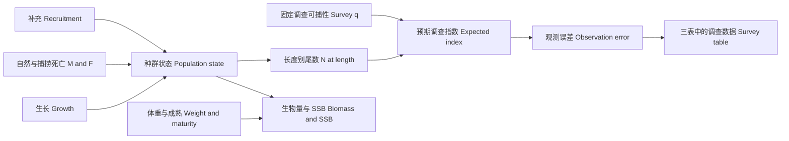

模型用调查数量数据约束隐含种群状态，再结合体重、成熟与生存计算派生量。渔业捕获 `CN` 不等于调查输入；`plot_CatL()` 展示调查观测与拟合值。

Survey numbers constrain latent population states; weights, maturity and survival define derived quantities. Fishery catch `CN` is not the survey input. `plot_CatL()` shows observations and fitted survey indices.

## 两种概率矩阵不可混用 · Two different probability matrices

| 矩阵 / Matrix | 条件与方向 / Meaning | 检查 / Check |
|---|---|---|
| `pla` | 给定年龄的长度分布 $`P(l\mid a)`$；R 模拟器方向随模型而异 / Length given age; simulator orientation varies | 先检查维度方向 / Check orientation |
| `G` | 一个时间步内从源长度列转入目的长度行 / Destination row conditional on source column | `colSums(G)` 约等于 1；非负、不缩短 / Nonnegative, normalized, no shrinkage |

`plot_pla()` 画的是年龄长度关系。下面是 tuna 条件 ALSCL 拟合的增长矩阵，可看出“停留原组”及“进入较大组”的概率。

`plot_pla()` shows age-length probabilities. The tuna ALSCL growth matrix below instead shows the probabilities of staying in a bin or advancing to larger bins.

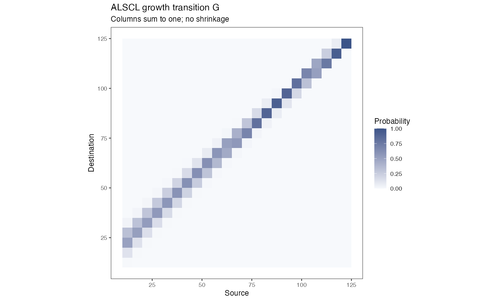

```r
# b 为 ALSCL 拟合对象 / b is an ALSCL fit
G <- b$report$G
range(colSums(G))
stopifnot(all(G >= 0), max(abs(colSums(G) - 1)) < 1e-8)
```

同一组内的增长仍可能落回本组；这是离散分组造成的“留组”，不表示鱼停止生长。最后一组承接右尾概率，长度组边界改变会影响矩阵与状态解释。

Growth can remain within the same bin; this is bin retention, not zero individual growth. The largest bin absorbs the right tail. Changing bin boundaries changes both matrices and state interpretation.

## 不确定性与参数可识别性 · Uncertainty and identifiability

TMB 的 `sdreport` 通过局部曲率和 delta 方法得到近似标准误。图示为约 95% 逐点区间，不是同时置信带；生长区间描述平均曲线的参数不确定性，不是单尾鱼长度的预测范围。

TMB `sdreport` uses local curvature and the delta method. Approximate 95% pointwise intervals are not simultaneous bands. Growth intervals represent parameter uncertainty in the mean curve, not individual-fish prediction ranges.

YTF 教学例固定了生长和部分随机过程参数，因此生长区间可以退化为线，SSB 等区间也只反映其余自由参数的条件不确定性。Hessian 非正定、参数碰界或梯度偏大时，应先解决数值和识别问题，再解读区间。

YTF fixes growth and selected process parameters. Its growth interval can collapse to a line, and other intervals are conditional on these fixed values. Investigate Hessian, bounds and gradients before interpreting intervals.

## 年度、季度与死亡率 · Annual and quarterly units

年龄格点为 $`a_i=a_{rec}+(i-1)\Delta t`$。季度设 `growth_step=.25`；`k` 始终按年，`M` 和 F 为每个模型时间步的瞬时率。若已知年 M = 0.8，则季度 M = 0.8 × 0.25 = 0.2。生存概率是 $`\exp[-(M+F)]`$，不是直接从数量减去 M 和 F。

Ages use the stated step. Growth k is annual; M and F are instantaneous rates per model step. Annual M = 0.8 becomes quarterly M = 0.2. Survival is exponential, not a direct subtraction of rates from abundance.

```r
rec.age <- .25; nage <- 20; growth_step <- .25
ages <- rec.age + (seq_len(nage) - 1) * growth_step
range(ages) # 0.25–5 年 / years
M_quarter <- .8 * growth_step
# 四个季度的累计瞬时率 / Sum four quarterly instantaneous rates
F_quarter <- c(.1, .15, .2, .15)
F_annual <- sum(F_quarter)
```

`plot_compare_annual_F()` 不会将季度输出自动年化；`method="apical"` 是每期组间最大值，`"mean"` 是非加权平均。不同模型的原生 F 维度不同，不能把同一颜色的热图单元当成相同年龄长度群。

`plot_compare_annual_F()` does not annualize quarterly values. Apical is a within-step group maximum; mean is unweighted. Native F dimensions differ between models.

<a id="chapter-03"></a>
## 03 数据、Excel 与实测导入 · Data and observations

下载 [ALSCL_Data_Entry_Example.xlsx](https://github.com/FanZhang-LAB-SHOU/ALSCL/blob/main/docs/data/ALSCL_Data_Entry_Example.xlsx)。工作簿的 `Instructions` 是双语说明页；其余三张表已填入与 `YTF_example` 相同的数值。请另存副本再替换数据。

Download the workbook. `Instructions` contains bilingual directions, and the other three sheets contain the exact YTF example. Save a copy before replacing values.

| 位置 / Location | 填写规则 / Entry rule |
|---|---|
| 工作表名 / Sheet names | 必须为 `data.CatL`、`data.wgt`、`data.mat` / Use these exact names |
| A1 | `LengthBin`，不要在表头上方加标题 / No title rows above the header |
| A2:A… | 每行一个体长组；示例为中心值 6、8、…、50 / One length-bin label per row; example uses midpoints |
| B1、C1、… | 递增数字年份，如 2000、2001；季度如 2000、2000.25 / Increasing numeric time headers |
| B2 等数值单元 / Numeric cells | 对应这一体长组、这一期的值 / Value for that bin and period |
| 三表顺序 / Alignment | 体长组、时间、行列顺序必须完全相同 / Exact same bins, periods and order |

**调查数量指数 `data.CatL` / Survey number index**


填数量或已标准化为可比尺度的数量指数；若使用 CPUE，各期努力量、单位和标准化方式必须一致。正数可为小数。未知调查单元留空或填 `NA`；不要用 0、破折号、`<1` 或“未测”代替缺失值。

Enter counts or a consistently standardized number index. For CPUE, maintain comparable effort, units and standardization. Decimals are valid. Use blank/`NA` for unknown observations; do not use zero, dashes, `<1` or text labels as missing-value substitutes.

**平均个体重量 `data.wgt` / Mean individual weight**


填每组每期的平均单尾重量，不是该组总重。选择同一重量单位并记录在说明页。没有逐年数据时，可以在有依据的条件下重复同一长度重量关系，但要在分析报告说明。不得留缺失值。

Enter mean weight per fish, not the total weight in the bin. Use one unit and document it separately. Repeating a defensible length-weight relationship across periods is possible but must be reported. Missing weights are not accepted.

**成熟比例 `data.mat` / Maturity proportion**


填写 0–1，例如 60% 填 `0.6`，不要填 `60`。0 和 1 在成熟表中是合法值；不要将“调查零值”的规则误用于成熟表。三张表的数据区不要插入单位行、合计、合并单元格或解释文字。

Enter proportions in [0,1], e.g. `0.6` for 60%. Both 0 and 1 are valid maturity values. Do not insert units, totals, merged cells or prose inside the three data grids.

Excel 使用科学记数显示小数，例如 `5.1361E-02` 等于 `0.051361`；显示精度不会改变保存的底层数值。 / Scientific notation avoids displaying tiny positive values as zero; it does not round the stored values.

**体长边界与缺测期 / Bin boundaries and missing periods.** 本示例中心值是 6:50，每隔 2 cm；拟合时显式传入 22 个内部边界 7:49，首尾尾部按模型约定处理。自己的不等宽组应提供真实边界。区间标签如 `0-20`、`20-25` 要连续且不重叠；原标签若为 `0-20`、`21-25`，不能未经核实就消除间隙。缺整个年度时保留对应列并在调查表填 NA，重量和成熟表仍需完整；不要删掉这一列而假装时间间隔没变。

The example uses midpoints 6:50 by 2 and 22 explicit internal boundaries 7:49. Supply the actual boundaries for unequal bins. Interval labels must be contiguous and non-overlapping; do not silently close gaps in legacy labels. Retain an entirely missing period as an NA survey column while supplying weight and maturity, so the temporal grid remains regular.

## 5. 导入自己的实测数据 / Importing your observations

下面保留旧的 [real_data_workflow.R](https://github.com/FanZhang-LAB-SHOU/ALSCL/blob/main/scripts/real_data_workflow.R) 脚本工作流，其 `validate_survey_tables()` 和 `fit_survey_tables()` 仍需 `source()`。当前开发版本另提供公开的 `read_survey_csv()`、`read_survey_excel()`、`prepare_alscl_data()` 和 `check_alscl_data()`，无需加载仓库脚本；完整用法见[评估工作流](https://github.com/FanZhang-LAB-SHOU/ALSCL/blob/main/docs/ASSESSMENT_WORKFLOWS.md)。Excel 读取需要可选的 `readxl`，保留时间表头并显式转换数字文本。

The legacy script workflow below remains supported; its validate_survey_tables() and fit_survey_tables() helpers require source(). The current development version additionally exports read_survey_csv(), read_survey_excel(), prepare_alscl_data() and check_alscl_data(), with no repository script required; see [assessment workflows](https://github.com/FanZhang-LAB-SHOU/ALSCL/blob/main/docs/ASSESSMENT_WORKFLOWS.md). Excel import requires optional readxl and preserves time headers while converting numeric text explicitly.

```r
install.packages("readxl") # 只需安装一次 / Install once
source("scripts/real_data_workflow.R", encoding = "UTF-8")
# 先用附带工作簿练习 / Start with the supplied workbook
my_inputs <- read_survey_excel("docs/data/ALSCL_Data_Entry_Example.xlsx")
validate_survey_tables(my_inputs, growth_step = 1, zero_action = "error")
# CSV 也可以，目录内需有三张同名 CSV / Three named CSV files also work
csv_inputs <- read_survey_csv("docs/data")
str(csv_inputs)
```

导入步骤只检查三表，不自动套用内置 YTF 的固定参数。完整的 x、参数分类、map 和双模型拟合见本节下方 5.2–5.3。 / Importing checks the three tables without applying the bundled YTF fixed-parameter configuration. Sections 5.2–5.3 below provide the complete x, parameter classification, maps and both fits.

换成自己的文件时，替换路径，并依据自己的物种设置 `rec.age`、`nage`、`M`、`sel_L50`、`sel_L95`、`growth_step`、边界及拟合初值/固定参数。不能因为输入表尺寸相同，就沿用 YTF 的生物参数或固定参数表。生长、长度重量关系、成熟信息和调查可捕性应有独立依据。

For your own workbook, replace the path and supply species-specific biology, boundaries, starts and fixed parameters. Equal table dimensions do not justify reusing YTF biology. Growth, weight, maturity and survey catchability need independent support.

`validate_survey_tables()` 默认遇到调查零值报错，要求先确认其含义。包的拟合入口默认 `zero_action="missing"`，把零值从对数似然中排除。如果零是真实的无捕获结果，排除它会改变推断；本包没有提供零膨胀观测模型，不应随意加小常数伪装为正数。

The guide validator rejects survey zeros by default. Package fits retain the historical default `zero_action="missing"`, excluding zeros from the log likelihood. Excluding genuine zero catches changes inference. This package does not implement a zero-inflated observation model; arbitrary small constants are not a principled substitute.

### 5.1 原有 `example_data` / Legacy data inspection

```r
data("example_data")
names(example_data)
head(example_data$data.CatL)
# 查看标签与零值，暂不盲目拟合 / Inspect bins and zeros before fitting
example_data$data.CatL[[1]]
sum(as.matrix(example_data$data.CatL[-1]) == 0, na.rm = TRUE)
```

这三张表从原 ALSCL 仓库原样保留，原说明称匿名调查数据，列为 2001–2021，9 个长度组。物种、单位、原始出处和零值含义没有得到核实，而且 `0-20`、`21-25` 等标签存在间隔。当前长度检查会拒绝这些不连续区间。读者应先补齐元数据和真实分组边界，不能把它标注成本文论文的已核实实测数据，也不能擅自改标签后给出正式评估。

The legacy tables are preserved unchanged from ALSCL. Their old help calls them anonymized survey data, but species, units, original source and zero meanings are unverified. Their gapped interval labels are rejected by the current bin parser. Recover metadata and actual boundaries before assessment; these are not verified empirical data from the cited paper.

### 5.2 参数与 map：正式分析前的设置 / Parameters and maps before assessment

#### 哪些输入需要自己提供

`parameters` 提供初值，或由 `map` 固定的参数取值。**填写一个数值本身不等于固定参数。** 以下数据和生物设置不会由任一拟合函数估计。

|输入|需要提供的内容|
|---|---|
|`data.CatL`|按体长和时间排列的调查数量或口径一致的标准化数量指数，不是总捕获重量|
|`data.wgt`, `data.mat`|与调查表对齐的平均单尾重量和成熟比例；作为已提供的值使用|
|`M`|有外部依据的每模型步长自然死亡率；年度瞬时率乘以 `growth_step`|
|`rec.age`, `nage`, `growth_step`|补充年龄（年）、包含加组的年龄组数、每步多少年|
|`sel_L50`, `sel_L95`|固定调查可捕性曲线的位置，L95 大于 L50；不是待估的捕捞选择性|
|`len_mid`, `len_border`|实际体长组中点和内部边界；核对任何从标签推导的值|

`map` 不能让 `M`、调查可捕性或年龄与分组定义变成待估参数：它们是当前模型的输入，不属于参数向量。模型不会自动传播这些输入的不确定性。请记录来源、单位和敏感性情景；脚本中的生物数值是演示设置，不是你研究种群的估计结果。

#### 哪些参数可以由模型估计

只要 map 允许，下表中的每个标量参数都可以参与估计。未提供的初值和边界使用套件默认值，部分初值会根据数据调整；仍需核对是否适合你的物种。`log_` 参数填写 `log(原尺度值)`，相关系数初值填写 `qlogis(rho)`，其中 `0 < rho < 1`；当前模型的这些相关系数限于正值。

|含义|ACL 名称|ALSCL 名称|
|---|---|---|
|用于初始年龄结构的总死亡率|`log_init_Z`|`log_init_Z`|
|初始对数数量偏差标准差|`log_std_log_N0`|`log_sigma_log_N0`|
|对数补充量的位置参数|`mean_log_R`|`mean_log_R`|
|补充过程标准差尺度|`log_std_log_R`|`log_sigma_log_R`|
|补充量时间相关性|`logit_log_R`|`logit_log_R`|
|对数捕捞死亡率的位置参数|`mean_log_F`|`mean_log_F`|
|捕捞死亡率过程标准差尺度|`log_std_log_F`|`log_sigma_log_F`|
|捕捞死亡率时间相关性|`logit_log_F_y`|`logit_log_F_y`|
|捕捞死亡率年龄／体长相关性|`logit_log_F_a`|`logit_log_F_l`|
|渐近体长和年度 VB 生长 k|`log_Linf`, `log_vbk`|`log_Linf`, `log_vbk`|
|VB t0|`t0`（原尺度）|`log_t0`（对数尺度）|
|年龄对应体长的 CV|`log_cv_len`|`log_cv_len`|
|生长增量 CV|无此参数|`log_cv_grow`|
|对数调查观测标准差|`log_std_index`|`log_sigma_index`|

`log_init_Z` 与输入的自然死亡率 `M` 不同。对数过程位置参数取指数不等于无条件算术均值。ACL 允许负的 `t0`；ALSCL 当前要求 `0 < t0 < rec.age`，不能把外部负 t0 取绝对值后使用。初值和 `parameters.L` / `parameters.U` 均采用优化器尺度；相等上下界会报错，固定参数请使用 map。

模型还会推断随机效应 `dev_log_R`、`dev_log_F` 和 `dev_log_N0`。它们的维度根据数据构建，不要加入标量初值列表。ACL 的 F 随年龄和年份变化，ALSCL 的 F 随体长和年份变化。这些随机效应不列在 `fit$opt$par` 中。

#### 如何设置 map 而不把参数都固定住

|设置|效果|
|---|---|
|`parameters = list(log_Linf = log(60))`|自由参数的初值；只有 map 固定它时才成为固定值|
|`map = list(log_Linf = factor(NA))`|将 Linf 固定在提供的值，未提供时使用其模型默认值|
|`map = list(log_std_log_F = NULL)`|解除 ACL 这一默认固定项，其他项仍按模型默认规则|
|`map = NULL` 或 `map = list()`|使用模型默认规则，不是全部开放估计|
|`run_acl(x)` / `run_alscl(x)` 不写 `map`|使用对应 `x$fit_config` 中保存的 map（如果存在）|

|模型|默认固定的标量参数|其余自由标量参数数目|
|---|---|---|
|ACL|`log_std_log_F`, `logit_log_F_y`, `logit_log_F_a`, `t0`|10|
|ALSCL|`log_sigma_log_F`, `log_t0`|13|

下方完整脚本使用 `map_acl <- list()` 和 `map_alscl <- list()`：**取消旧教学例子对生长、初始数量变异和补充量相关性等参数的额外固定**，保留上表列明的模型默认固定项。所有固定值仍需审查。默认设置是可复现的对照配置，不代表每个数据集都能识别全部自由参数。

本脚本仍固定的标量取值为：两个模型的 F 过程标准差 0.2、t0 = 1/60，以及 ACL 跨年份和跨年龄的 F 相关系数 0.75（这两个固定相关参数的套件初值）。这些数值也必须按你的种群审查。脚本使用两轮连续优化（`train_times = 2`），不是两个独立起点。

不修改旧 x，也可以直接取消其中额外的教学固定设置：

```r
fit_acl <- run_acl(x, map = NULL)
fit_alscl <- run_alscl(x, map = NULL)
```

如果只固定 t0、估计其余标量参数，需要显式解除其他默认固定项。将 map 保存回 x 后仍可直接调用：

```r
x$fit_config$acl$map <- list(
  t0 = factor(NA), log_std_log_F = NULL,
  logit_log_F_y = NULL, logit_log_F_a = NULL)
x$fit_config$alscl$map <- list(
  log_t0 = factor(NA), log_sigma_log_F = NULL)
# 先审查 parameters 中保存的 t0 / log_t0 取值。
fit_acl <- run_acl(x)
fit_alscl <- run_alscl(x)
# ACL 有 13 个自由标量参数，ALSCL 有 14 个。
```

这组更灵活的设置是可选方案，不是下方配图使用的基线。若 t0 也需要估计，应保留具名 NULL 项：

```r
x$fit_config$acl$map["t0"] <- list(NULL)
x$fit_config$alscl$map["log_t0"] <- list(NULL)
# 下次拟合时，全部 14 / 15 个标量参数均自由。
```

不要用 `map$t0 <- NULL` 解除默认固定的 t0：它会删除条目，随后默认规则会再次固定 t0。解除列表应直接传给 `run_*()` 或保存在 x 中。`generate_map()` 仅使用 ACL 默认规则，而且返回值会移除 NULL 项；将其结果再交给 `run_acl()` 会重新补入缺失的默认项，可能撤销原本的解除设置。

显式传入的 `map` 会整体替换 x 中原有 map，然后应用模型默认规则。若只修改保存的一个项目并保留其他设置，例如使用 `x$fit_config$acl$map["log_Linf"] <- list(NULL)`。正式分析不要对每个初值自动应用 `factor(NA)` 来生成 map。

拟合后检查实际自由参数和诊断：

```r
names(fit_acl$opt$par)
fit_acl$par_low_up
names(fit_alscl$opt$par)
fit_alscl$par_low_up
diagnose_model(x$data.CatL, fit_acl)
diagnose_model(x$data.CatL, fit_alscl)
```

同时检查优化码、梯度、Hessian、边界、估计不确定性和残差。将逐组解除的配置分别保存并比较诊断；增加优化次数或起点数不能让缺乏信息的参数变得可识别。较少固定项的拟合可能暴露旧教学设置掩盖的问题，应报告这些问题，不能为了得到好看的诊断而悄悄增加固定项。

#### Inputs you must supply

`parameters` supplies starting values, or the values of parameters fixed by `map`. **Supplying a number does not itself fix a parameter.** The input data and biological settings below are not estimated by either fitting function.

|Input|What you must provide|
|---|---|
|`data.CatL`|Survey numbers or a consistently standardized number index by length and time; not total catch weight|
|`data.wgt`, `data.mat`|Aligned mean individual weights and mature proportions; these are treated as supplied values|
|`M`|Natural mortality per model step, supported by external information; annual instantaneous M multiplied by `growth_step`|
|`rec.age`, `nage`, `growth_step`|Recruitment age in years, number of age classes including the plus group, and years per step|
|`sel_L50`, `sel_L95`|Locations of the fixed survey catchability curve, with L95 greater than L50; not estimated fishery selectivity|
|`len_mid`, `len_border`|Actual bin midpoints and internal boundaries; verify any values inferred from labels|

Changing `map` cannot make `M`, survey catchability or the age/bin definitions estimable: they are model inputs, not entries in the current parameter vector. Their uncertainty is not propagated automatically. Record sources, units and sensitivity scenarios. The script's biological values are illustrative, not estimates for your stock.

#### Parameters the models can estimate

Every scalar parameter below can be estimated if its map allows it. Unspecified starting values and bounds use package defaults, with some starts adapted to the data. Check their suitability for your species. `log_` values use `log(value)` and correlation starts use `qlogis(rho)` for `0 < rho < 1`; the current models restrict these correlations to positive values.

|Meaning|ACL name|ALSCL name|
|---|---|---|
|Initial total mortality setting the initial age structure|`log_init_Z`|`log_init_Z`|
|Initial log-number deviation SD|`log_std_log_N0`|`log_sigma_log_N0`|
|Log recruitment location|`mean_log_R`|`mean_log_R`|
|Recruitment process SD scale|`log_std_log_R`|`log_sigma_log_R`|
|Recruitment time correlation|`logit_log_R`|`logit_log_R`|
|Log fishing-mortality location|`mean_log_F`|`mean_log_F`|
|Fishing-mortality process SD scale|`log_std_log_F`|`log_sigma_log_F`|
|Fishing-mortality time correlation|`logit_log_F_y`|`logit_log_F_y`|
|Fishing-mortality age / length correlation|`logit_log_F_a`|`logit_log_F_l`|
|Asymptotic length and annual VB growth k|`log_Linf`, `log_vbk`|`log_Linf`, `log_vbk`|
|VB t0|`t0` (untransformed)|`log_t0` (log scale)|
|Length-at-age CV|`log_cv_len`|`log_cv_len`|
|Growth-increment CV|Not present|`log_cv_grow`|
|Log survey observation SD|`log_std_index`|`log_sigma_index`|

`log_init_Z` is distinct from the supplied natural mortality `M`. Exponentiating a log-process location is not the unconditional arithmetic mean. ACL allows negative `t0`; ALSCL currently requires `0 < t0 < rec.age`. Do not replace a negative external t0 by its absolute value. Starts and `parameters.L` / `parameters.U` use the optimizer scale; equal bounds are rejected, so use a map to fix a parameter.

The models also infer random effects `dev_log_R`, `dev_log_F` and `dev_log_N0`. Their dimensions are constructed from the data; do not add them to the scalar starting-value list. F varies over ages and years in ACL, and lengths and years in ALSCL. These random effects are not listed in `fit$opt$par`.

#### Set map without fixing everything

|Setting|Effect|
|---|---|
|`parameters = list(log_Linf = log(60))`|A starting value if free; a fixed value only if the map fixes it|
|`map = list(log_Linf = factor(NA))`|Fix Linf at the supplied value, or its model default when omitted|
|`map = list(log_std_log_F = NULL)`|Release this default-fixed ACL parameter; keep other model defaults|
|`map = NULL` or `map = list()`|Apply model defaults, not an all-free model|
|Omit `map` in `run_acl(x)` / `run_alscl(x)`|Use the map stored in the selected `x$fit_config`, if present|

|Model|Default-fixed scalar parameters|Other free scalar parameters|
|---|---|---|
|ACL|`log_std_log_F`, `logit_log_F_y`, `logit_log_F_a`, `t0`|10|
|ALSCL|`log_sigma_log_F`, `log_t0`|13|

The complete script below uses `map_acl <- list()` and `map_alscl <- list()`: **it removes the previous teaching-only fixes on growth, initial-number variability and recruitment correlation**, while retaining the documented model defaults. All fixed values still require review. The defaults are a reproducible baseline, not proof of identifiability for every dataset.

The remaining fixed scalar values in this script are F-process SD 0.2 and t0 = 1/60 in both models, plus F correlations 0.75 across years and ages in ACL (the package starting values for those two fixed correlations). These numbers must also be reviewed for your stock. The script uses two successive optimization passes (`train_times = 2`); this is not two independent starts.

To remove an older bundle's extra fixed assumptions without editing it:

```r
fit_acl <- run_acl(x, map = NULL)
fit_alscl <- run_alscl(x, map = NULL)
```

To fix only t0 and estimate all remaining scalar parameters, explicitly release the other defaults. Save the maps in `x` to retain the direct-call syntax:

```r
x$fit_config$acl$map <- list(
  t0 = factor(NA), log_std_log_F = NULL,
  logit_log_F_y = NULL, logit_log_F_a = NULL)
x$fit_config$alscl$map <- list(
  log_t0 = factor(NA), log_sigma_log_F = NULL)
# Review the t0 / log_t0 values already stored in parameters first.
fit_acl <- run_acl(x)
fit_alscl <- run_alscl(x)
# 13 free scalar parameters in ACL; 14 in ALSCL.
```

This more flexible configuration is an option, not the baseline used for the figures. If t0 should also be estimated, preserve an explicit named NULL:

```r
x$fit_config$acl$map["t0"] <- list(NULL)
x$fit_config$alscl$map["log_t0"] <- list(NULL)
# All 14 / 15 scalar parameters are now free on the next fit.
```

Do not use `map$t0 <- NULL` to release default-fixed t0: it deletes the entry and the default will fix it again. Pass release lists directly to `run_*()` or store them in `x`. `generate_map()` is ACL-specific and removes NULL entries from its result; feeding that result back into `run_acl()` re-applies absent defaults and can undo a release.

Explicit `map` arguments replace the whole map stored in `x`, after which model defaults are applied. To change one stored entry while preserving the rest, use `x$fit_config$acl$map["log_Linf"] <- list(NULL)`, for example. Do not generate a map by applying `factor(NA)` to every supplied start for an empirical assessment.

After fitting, inspect the actual free parameters and diagnostics:

```r
names(fit_acl$opt$par)
fit_acl$par_low_up
names(fit_alscl$opt$par)
fit_alscl$par_low_up
diagnose_model(x$data.CatL, fit_acl)
diagnose_model(x$data.CatL, fit_alscl)
```

Check the optimizer code, gradient, Hessian, boundary hits, uncertainty and residuals together. Release parameter groups in separate, saved configurations and compare diagnostics; increasing optimizer iterations or the number of starts does not make weakly identified parameters identifiable. The more flexible map may expose problems that a heavily fixed teaching fit hid. Report those problems rather than silently fixing additional parameters to obtain a favorable diagnostic.

### 5.3 完整 CSV → x → 双模型示例 / Complete CSV-to-both-models example

2.2.2 新增完整脚本 [fit_own_data_example.R](https://github.com/FanZhang-LAB-SHOU/ALSCL/blob/main/scripts/fit_own_data_example.R)。先从仓库根目录运行下面的教学流程，再修改数据路径、生物参数、体长边界、初值及固定参数。内附数据是模拟数据，不能只换观测文件便沿用其固定假设。

Version 2.2.2 adds a complete executable script. Run the teaching workflow from the repository root, then replace the data, biology, bin definitions, initial values and fixed assumptions for your stock. The bundled observations are synthetic; changing only the input file does not justify retaining their conditional settings.

`x` 包含三表、共用 `fit_args`，以及 `fit_config$acl` 和 `fit_config$alscl`。两个模型共用观测，自动选择自己的配置；显式传参优先，内置加速继续生效。

`x` contains the three tables, shared `fit_args`, and separate `fit_config$acl` and `fit_config$alscl`. Both models use the same observations and select their own settings. Explicit call arguments take precedence and built-in acceleration remains active.

```r
source("scripts/fit_own_data_example.R", encoding = "UTF-8")
```

以下为完整脚本 / Complete script:

```r
# ALSCL 2.2.2: CSV -> x -> ACL / ALSCL -> diagnostics and saved summaries.
# 从仓库根目录运行 / Run from the repository root:
# source("scripts/fit_own_data_example.R", encoding = "UTF-8")
# 默认读取内附模拟数据。正式分析必须修改第 1、2、3 步。
# The supplied numbers describe the synthetic YTF example, not your stock.

library(ALSCL)
stopifnot(packageVersion("ALSCL") >= "2.2.2")
source("scripts/real_data_workflow.R", encoding = "UTF-8")

# 1. 读取三表 / Read the three aligned tables -------------------------------
# 正式数据改成 "my_data"，其中放以下三个 CSV：
# data.CatL.csv, data.wgt.csv, data.mat.csv.
data_dir <- "docs/data"
inputs <- read_survey_csv(data_dir)
# Excel 可替换上一行 / Excel alternative (requires readxl):
# inputs <- read_survey_excel("my_survey.xlsx")

# 2. 共用生物设置 / Shared biology -----------------------------------------
# 以下是年度 YTF 教学值，正式数据必须采用自己的生物学依据。
# M_annual and vbk are annual; lengths are cm; weights in the example are kg.
bio <- list(rec.age = 1, nage = 15, M_annual = 0.2,
            growth_step = 1, sel_L50 = 15, sel_L95 = 20,
            Linf = 60, vbk = 0.2, t0 = 1 / 60,
            cv_len = 0.2, cv_grow = 0.2)
# 当前 ALSCL 使用 log_t0，故要求 0 < t0 < rec.age；不要对负 t0 取绝对值。
stopifnot(bio$t0 > 0, bio$t0 < bio$rec.age)

# 此例 LengthBin 填数值中点：6, 8, ..., 50。
# For labels such as "5-7", supply the actual midpoints explicitly instead.
len_mid <- as.numeric(inputs$data.CatL[[1]])
stopifnot(all(is.finite(len_mid)), all(diff(len_mid) > 0))
# 此例为连续等宽组；非等宽组请直接填写实测的 nlen-1 个内部边界。
# This midpoint formula is only used for the equal-width demonstration bins.
stopifnot(max(abs(diff(len_mid) - diff(len_mid)[1])) < 1e-8)
len_border <- (head(len_mid, -1) + tail(len_mid, -1)) / 2
validate_survey_tables(inputs, growth_step = bio$growth_step, zero_action = "error")

# 3. 各模型拟合设置 / Model-specific settings ------------------------------
# 生长和多数过程参数作为初值，不再自动固定每个提供的参数。
# Growth and most process values below are starts, not automatic fixes.
# Review starts, bounds and the documented default fixed values for your stock.
p_acl <- list(
  log_Linf = log(bio$Linf), log_vbk = log(bio$vbk), t0 = bio$t0,
  log_cv_len = log(bio$cv_len),
  log_std_log_F = log(0.2), log_std_log_N0 = log(0.2),
  logit_log_R = qlogis(0.1))
p_alscl <- list(
  log_Linf = log(bio$Linf), log_vbk = log(bio$vbk), log_t0 = log(bio$t0),
  log_cv_len = log(bio$cv_len), log_cv_grow = log(bio$cv_grow),
  log_sigma_log_F = log(0.2), log_sigma_log_N0 = log(0.2),
  logit_log_R = qlogis(0.1))
# 使用模型默认 map：ACL 固定 4 项、估计 10 项；ALSCL 固定 2 项、估计 13 项。
# Default maps: ACL fixes 4 and estimates 10 scalars; ALSCL fixes 2 and estimates 13.
# ACL fixes log_std_log_F, logit_log_F_y, logit_log_F_a and t0.
# ALSCL fixes log_sigma_log_F and log_t0. These values still need justification.
map_acl <- list()
map_alscl <- list()
# 可选：只固定 t0；更灵活的设置必须另做诊断，不保证可识别。
# Optional: fix only t0; diagnose this more flexible configuration separately.
# map_acl <- list(t0 = factor(NA), log_std_log_F = NULL,
#                 logit_log_F_y = NULL, logit_log_F_a = NULL)
# map_alscl <- list(log_t0 = factor(NA), log_sigma_log_F = NULL)
# 解除默认固定项需保留具名 NULL；$t0 <- NULL 仅删除条目。
# Preserve a named NULL to release a default fix; $t0 <- NULL deletes the entry.
# map_acl["t0"] <- list(NULL)
# map_alscl["log_t0"] <- list(NULL)

# 4. 组装 x / Assemble the input bundle -----------------------------------
x <- list(
  data.CatL = inputs$data.CatL,
  data.wgt = inputs$data.wgt,
  data.mat = inputs$data.mat,
  fit_args = list(
    rec.age = bio$rec.age, nage = bio$nage,
    M = bio$M_annual * bio$growth_step,
    sel_L50 = bio$sel_L50, sel_L95 = bio$sel_L95,
    growth_step = bio$growth_step,
    len_mid = len_mid, len_border = len_border,
    zero_action = "error", train_times = 2,
    nstarts = 1, ncores = 1, silent = FALSE),
  fit_config = list(
    acl = list(parameters = p_acl, map = map_acl),
    alscl = list(parameters = p_alscl, map = map_alscl)))

# 5. 直接拟合 / Fit directly ----------------------------------------------
# 内置加速使用当前 alscl_speed() 设置，无需额外包装。
alscl_speed_info()
a <- run_acl(x)
b <- run_alscl(x)
# 可直接覆盖设置；固定 nstarts 才能公平比较并行数：
# a <- run_acl(x, nstarts = 4, ncores = 2)
# b <- run_alscl(x, nstarts = 4, ncores = 2)

# 6. 检查、绘图、保存 / Inspect, plot and save ------------------------------
checks <- list(ACL = diagnose_model(x$data.CatL, a),
               ALSCL = diagnose_model(x$data.CatL, b))
print(checks)
print(a$sd_info)
print(b$sd_info)
for (fit in list(a, b)) {
  print(fit$par_low_up) # 实际自由参数及边界 / Actual free scalars and bounds
  print(list(convergence = fit$convergence_code,
             max_gradient = fit$max_abs_gradient,
             pdHess = fit$pdHess, bound_hit = fit$bound_hit))
  print(fit$refinement)
  print(fit$diagnostics)
  if (!isTRUE(fit$convergence_code == 0L) || !isTRUE(fit$pdHess) ||
      !isTRUE(fit$diagnostics$numerical_ok))
    warning("Review fit diagnostics before interpreting this assessment.")
}
residual_plot <- plot_residuals(b, type = "year", facet_ncol = 4,
                                x_breaks = pretty(len_mid, n = 4))
# 非正定 Hessian 时不展示标准误区间 / Omit SE intervals if Hessian is not positive definite.
ssb_plot <- plot_SSB(b, se = isTRUE(b$pdHess))
print(residual_plot)
print(ssb_plot)
# obj 是当前会话的 TMB 指针，不包含在可移植结果中。
portable <- function(fit) fit[setdiff(names(fit), "obj")]
output_dir <- "output/own-data-example"
dir.create(output_dir, recursive = TRUE, showWarnings = FALSE)
ggplot2::ggsave(file.path(output_dir, "residuals.png"), residual_plot,
                width = 10, height = 8, dpi = 150)
ggplot2::ggsave(file.path(output_dir, "SSB.png"), ssb_plot,
                width = 8, height = 5, dpi = 150)
saveRDS(x, file.path(output_dir, "inputs_x.rds"))
saveRDS(list(ACL = portable(a), ALSCL = portable(b), diagnostics = checks),
        file.path(output_dir, "assessment_summary.rds"))
writeLines(capture.output(sessionInfo()), file.path(output_dir, "sessionInfo.txt"))
# 新会话可读取 x 并重新拟合 / Refit in a new session:
# x <- readRDS("output/own-data-example/inputs_x.rds")
# b <- run_alscl(x)
```

实测的模拟 CSV 流程中，ACL 与 ALSCL 都得到收敛码 0、正定 Hessian、无边界命中及小于 0.001 的最大梯度。以下图由该脚本生成。正式数据仍需独立诊断与敏感性检查。

Both models completed the synthetic CSV workflow with convergence code 0, a positive-definite Hessian, no boundary hits and maximum gradients below 0.001. These figures come from that run; empirical assessments require their own diagnostics and sensitivity checks.

更新后的脚本使用模型默认 map、两轮连续优化重新运行，保存的[诊断记录](https://github.com/FanZhang-LAB-SHOU/ALSCL/blob/main/docs/results/own-data-example-checks.csv)如下：

|模型|自由标量参数|收敛码|最大梯度|Hessian 正定|命中边界|
|---|---|---|---|---|---|
|ACL|10|0|2.62e-9|是|否|
|ALSCL|13|0|2.59e-9|是|否|

2.2.2 此次运行使用 4 核计算标准误，并启用默认受保护的收尾。这是模拟数据的数值检查，不是对尚未提供的正式评估的验证。加入收尾前（2.2.1），只固定 t0 的 ALSCL 可能在相同最优点误报 false convergence；2.2.2 保留先前成功轮次，并将梯度修正至约 5.37e-9。原 F 结构下只固定 t0 的 ACL 仍存在年龄相关边界，不能通过数值筛查；改用共用 F 是另一项生物学模型选择，下文说明。

The updated script was rerun with the model-default maps and two successive optimization passes. The recorded [diagnostics](https://github.com/FanZhang-LAB-SHOU/ALSCL/blob/main/docs/results/own-data-example-checks.csv) are:

|Model|Free scalars|Convergence code|Maximum gradient|Positive-definite Hessian|Boundary hit|
|---|---|---|---|---|---|
|ACL|10|0|2.62e-9|Yes|No|
|ALSCL|13|0|2.59e-9|Yes|No|

The 2.2.2 run used four cores for standard errors and the default safeguarded refinement. These are numerical checks of synthetic data, not validation of an unseen stock assessment. Before refinement was added (2.2.1), the t0-only ALSCL fit could return false convergence at an unchanged optimum. Version 2.2.2 retains the successful earlier pass and refines its gradient to about 5.37e-9. The t0-only ACL with the original F structure still has an age-correlation boundary and fails the numerical screen; choosing shared F is a separate biological model decision, described below.

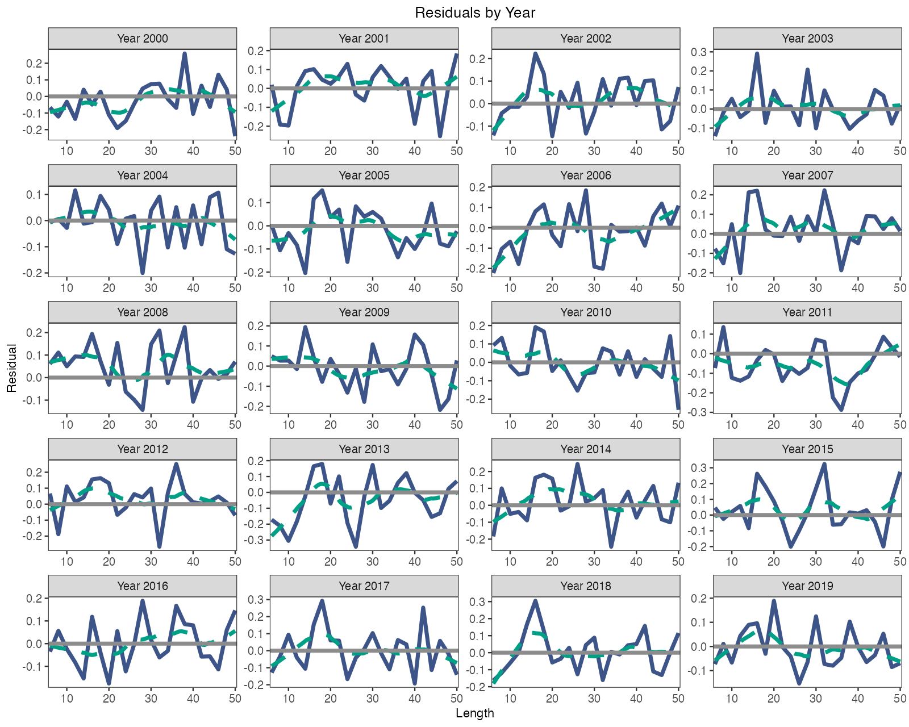

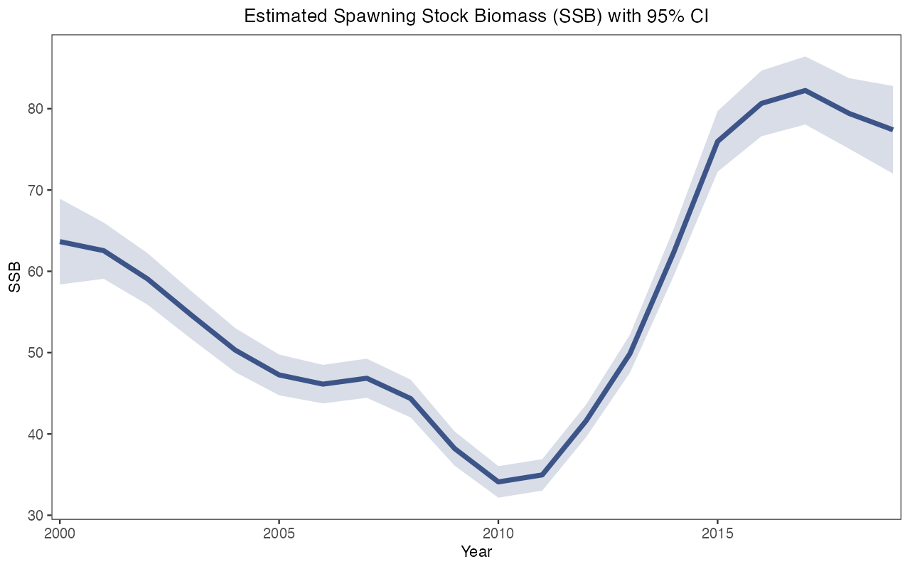

详细的修改步骤 / Detailed adaptation instructions: [简体中文](https://fanzhang-lab-shou.github.io/ALSCL/zh/articles/case-fit-survey.html) · [English](https://fanzhang-lab-shou.github.io/ALSCL/articles/case-fit-survey.html).


<a id="chapter-04"></a>
## 04 内置数据与首个拟合 · Built-in YTF

```r
install.packages("remotes")
remotes::install_github("FanZhang-LAB-SHOU/ALSCL")
library(ALSCL)
data("YTF_example")
x <- YTF_example
inputs <- x[c("data.CatL", "data.wgt", "data.mat")]
# 检查维度与来源 / Inspect dimensions and provenance
str(inputs)
x$provenance
# 两模型使用相同观测及条件设置 / Same observations and conditional settings
a <- run_acl(x, train_times = 2, silent = TRUE)
b <- run_alscl(x, train_times = 2, silent = TRUE)
plot_compare_ts(a, b, quantities = c("B", "SSB", "Rec"), se = TRUE)
```

ALSCL 2.2.0 支持直接使用 `run_acl(x)` 和 `run_alscl(x)`。对于 `YTF_example`，函数自动选择对应模型的 `fit_config`，显式传参可覆盖已有设置。原来的逐项传参和 `do.call()` 写法继续有效。两种写法共用内置加速，可查看 `a$sd_info` 或 `b$sd_info` 确认实际执行方式。

ALSCL 2.2.0 accepts `run_acl(x)` and `run_alscl(x)` directly. For `YTF_example`, each function selects its model-specific `fit_config` automatically; explicit call arguments override stored settings. The original separate-argument and `do.call()` forms remain valid. Both use the same built-in acceleration; inspect `a$sd_info` or `b$sd_info` for actual execution.


| 对象 / Object | 内容和适用方式 / Contents and use |
|---|---|
| `YTF` | 原有 26 项参数列表，无 `data.CatL` / Original 26-element biological parameter list, no survey table |
| `YTF_example` | 23 个体长组 × 20 期；三张表、参数、模拟真值、拟合设置、来源 / 23 bins × 20 periods, three tables, parameters, truth, fit settings and provenance |
| `example_data` | 从原 ALSCL 保留的 9 组 × 21 年三张表；来源待核实 / Legacy ALSCL tables, 9 bins × 21 years, provenance unverified |

`YTF_example` 复用 `YTF` 的共有参数，特别是调查对数 SD = 0.1；其余采用 flatfish 模拟预设。随机种子 4，预热 80 年、保留 20 年；2000–2019 仅为示意年份。教学单位约定为 cm、kg，数据不是论文实测样本。调用 [data-raw/YTF_example.R](https://github.com/FanZhang-LAB-SHOU/ALSCL/blob/main/data-raw/YTF_example.R) 可重建 `.rda`，脚本恢复调用者的随机状态。

`YTF_example` reuses shared YTF parameters, including survey log SD 0.1, with remaining flatfish defaults. Seed 4, 80 burn-in years and 20 retained years are used. Dates are illustrative; cm and kg are teaching conventions. These are not empirical paper data. The data-raw script rebuilds the object and restores the caller's RNG state.

`x$fit_config` 固定已知生长、部分过程误差及相关参数，让示例聚焦工作流程。区间是在这些固定参数条件下的近似区间，不包含全部生物不确定性。这种教学拟合不能证明同时估计所有参数时可识别。

`x$fit_config` fixes known growth and selected process/correlation parameters. Intervals are conditional on these assumptions and omit their uncertainty. The example does not establish identifiability when all parameters are estimated together.

这仅指内置 `YTF_example` 的教学配置。第 5 节的正式数据导入脚本使用较少固定项的模型默认 map，勿混淆两者。 / This refers only to the bundled `YTF_example` teaching configuration. The own-data import script in section 5 uses the less restrictive model-default maps.

<a id="chapter-05"></a>
## 05 模拟与批量实验 · Simulation

### 3.1 快速生成三张表 / Quick input-table simulator

```r
# 简单年度模拟，可直接导出 CSV / Simple annual simulation with CSV export
quick <- simulate_example_data(
  years = 2000:2019, seed = 42, bin_breaks = seq(5, 51, 2),
  Linf = 60, vbk = 0.2, t0 = 1/60, M = 0.2, nage = 15,
  L50_sel = 15, L95_sel = 20, L50_mat = 35, L95_mat = 40,
  wgt_a = exp(-12), wgt_b = 3, mean_F = 0.3,
  cv_catch = 0.2, rec_sigma = 0.3,
  save_csv = TRUE, output_dir = "my_simulation")
str(quick)
```

`years` 必须是连续年度，不能通过写季度列名把该简易模拟器变成季度模型。`cv_catch` 控制调查观测 CV；`rec_sigma` 控制对数补充变异；该函数使用简化的共同 F、独立补充扰动及固定长度 CV = 0.1。它不等于完整 Beverton–Holt 模拟器，也不等于内置 `YTF_example` 的生成流程。

Use consecutive annual `years`. Changing labels does not create quarterly dynamics. `cv_catch` controls survey observation CV and `rec_sigma` log recruitment variation. This simplified simulator uses common F, independent recruitment perturbations and fixed length CV 0.1; it differs from both the full operating model and the bundled YTF generation recipe.

### 3.2 完整模拟器与两个案例 / Full simulator and two cases

两个预设的 seed 4 数据、三张 CSV 和完整真值对象已随文档保存：[下载及读取方法 / Download and read the two saved cases](https://github.com/FanZhang-LAB-SHOU/ALSCL/blob/main/docs/data/cases/README.md)。

```r
# 参数 → 生物量表 → 随机模拟 / Parameters → biological arrays → simulation
pa <- initialize_params(species = "flatfish", first.year = 2000,
                        observation_error = "independent")
bio <- sim_cal(pa)
sm <- sim_data(bio, pa, iter_range = 4:5, return_iter = 4,
               output_dir = "simulation_examples/flatfish")
# 长度型季度案例 / Length-based quarterly case
tuna_pa <- initialize_params(species = "tuna", first.year = 2000)
tuna <- sim_data(sim_cal(tuna_pa), tuna_pa, iter_range = 4:5,
                 return_iter = 4, output_dir = "simulation_examples/tuna")
# 将模拟矩阵变成模型输入 / Convert simulated matrices to input tables
source("scripts/simulation_workflow.R", encoding = "UTF-8")
flatfish_inputs <- simulation_to_tables(sm, pa)
tuna_inputs <- simulation_to_tables(tuna, tuna_pa)
```

| 设置 / Setting | flatfish / YTF 风格 | tuna / 金枪鱼风格 |
|---|---|---|
| 生成模型 / Operating model | 年龄型 / Age-based | 年龄与长度联合 / Joint age-length |
| `growth_step` | 1 年 / year | 0.25 年 / year |
| `nyear`, `burn_in` | 100, 80 年 / years | 100, 95 年 / years |
| 保留观测 / Retained observations | 20 年度 / annual steps | 20 季度 / quarterly steps |
| `nage`, `rec.age` | 15, 1 年 / year | 20, 0.25 年 / year |
| `Linf`, `vbk` | 60, 0.2/年 / year | 152, 0.38/年 / year |
| `M`, `F_mean` | 0.2, 0.3 每年 / per step | 0.2, 0.2 每季度 / per step |

这是包内的两个模拟预设案例，不能当成已取得论文两个案例的原始观测。完整参数见 [initialize_params](https://github.com/FanZhang-LAB-SHOU/ALSCL/blob/main/docs/FUNCTION_REFERENCE.md#initialize_params)。`nyear`、`burn_in`、`sim_year` 的单位是**年**；返回 `sm$nyear` 是保留的**时间步数**。`SN_at_len` 是时间 × 长度，导入时要转置；`weight` 和 `mat` 已是长度 × 时间。

These are the two package simulation presets, not recovered empirical datasets from the paper. Duration arguments are in **years**, whereas returned `sm$nyear` counts retained **steps**. Transpose `SN_at_len` (time × length); weight and maturity are already length × time.

`iter_range` 同时指定重复编号和随机种子；`return_iter` 选择在内存中返回哪次重复。每个 `sim_rep4` 等文件由 `save()` 写出，应用 `load()`，不是 `readRDS()`。`observation_error="independent"` 让每个长度与时间单元有独立扰动；`"shared_time"` 让同一期的长度组共享扰动，适合专门的误差结构实验。

`iter_range` provides replicate IDs and seeds; `return_iter` selects the in-memory replicate. `sim_rep*` files use `save()/load()`, not RDS. Independent error varies across cells, while shared-time error applies the same perturbation to all length bins in a period.

```r
# 同时生成两个案例及 CSV、真值文件 / Generate both cases, CSV and truth files
cases <- run_simulation_examples(out = "simulation_examples", fit_batch = FALSE)
# 加上两个 ACL 重复拟合，保存失败诊断 / Add two ACL fits and retain failures
# run_simulation_examples(out = "simulation_examples", fit_batch = TRUE)
e <- new.env()
load("simulation_examples/flatfish/sim_rep4", envir = e)
str(e$sim.data)
```

### 3.3 死亡率、变异和时间单位 / Rates, variation and time units

`simulate_example_data()` 的 `mean_F` 是生成年度 F 序列的算术平均值。完整模拟器的 `F_mean` 则是 `F[t] = F_mean * exp(d[t])` 中的过程基准水平；加入随机偏差后，通常不等于实际序列的算术平均值。`F_sd` 是对数 F 的 AR(1) 创新标准差，平稳相关为 `F_ar` 时，边际标准差为 `F_sd / sqrt(1 - F_ar^2)`，不同于拟合模型采用的边际对数 F 标准差。`q_surv_L50` 和 `q_surv_L95` 定义调查可捕性曲线，是调查输入，不是捕捞选择性的估计结果。

完整模拟器的 `nyear`、`burn_in` 都以年为单位，且分别必须对应整数个 `growth_step`。因此季度模式允许半年预热，年度模式不允许。返回的 `sm$nyear` 是保留时间步数；`first.year` 是第一期保留观测的年份，`sm$years` 保存完整观测时间轴。`simulation_to_tables()` 与批量拟合函数保留这条时间轴；完全没有年份元数据的旧文件仍可使用从 2000 开始的后备规则。只保留一期时仍返回矩阵，但拟合至少需要两期。

`mean_F` in `simulate_example_data()` is the arithmetic mean of the generated annual F trajectory. In the full simulator, `F_mean` instead sets the process baseline in `F[t] = F_mean * exp(d[t])`; random variation means it is not generally the realized arithmetic mean. `F_sd` is the innovation SD of the log-F AR(1) process. For stationary correlation `F_ar`, its marginal SD is `F_sd / sqrt(1 - F_ar^2)`. This differs from the marginal log-F SD used by the fitted models. Survey catchability is set by `q_surv_L50` and `q_surv_L95`; these are survey inputs, not fishing selectivity estimates.

For the full simulator, `nyear` and `burn_in` are durations in years and must each contain a whole number of `growth_step` intervals. Thus a half-year burn-in is valid with quarterly steps, but not annual steps. Returned `sm$nyear` counts retained steps. `first.year` labels the first retained observation, and `sm$years` records the complete retained calendar. `simulation_to_tables()` and the batch-fitting functions preserve this calendar; old files lacking year metadata still have a documented 2000-based fallback. A single retained period stays a matrix, although fitting requires at least two periods.

```r
quick <- simulate_example_data(years = 2000:2019, mean_F = 0.3, seed = 42)
stopifnot(isTRUE(all.equal(mean(quick$true_params$F_trend), 0.3)))
zero_F <- simulate_example_data(years = 2000:2019, mean_F = 0, seed = 42)
stopifnot(all(zero_F$true_params$F_trend == 0))
pa <- initialize_params(species = "flatfish", nyear = 5, burn_in = 2,
                        first.year = 2024)
sm <- sim_data(sim_cal(pa), pa, iter_range = 4:5, return_iter = 4,
               output_dir = "simulation_224")
stopifnot(identical(as.numeric(sm$years), as.numeric(2024:2026)))
source("scripts/simulation_workflow.R", encoding = "UTF-8")
inputs <- simulation_to_tables(sm, pa)
```

### 3.4 生物输入与零值 / Biological inputs and zeros

`mat_func()` 使用稳定的 logistic 计算，陡峭上升曲线接近 1 时不会溢出。`L50` 与 `L95` 必须是不同的有限标量；仍允许下降曲线（`L95 < L50`），用于穹顶选择性。体长及派生生物矩阵必须有限，模拟的自然与捕捞死亡率必须非负。当 `M = 0` 且 `F_mean = 0` 时，渔获尾数和生物量为零，不再返回未定义数值；丰度和补充量仍按选定模拟模型演变。


`mat_func()` uses a stable logistic calculation: a steep increasing curve approaches one without overflowing. `L50` and `L95` must be distinct finite scalars; a descending curve (`L95 < L50`) remains available for dome selectivity. Length values and derived biological arrays must be finite. Simulated natural and fishing mortality must be nonnegative. With both `M = 0` and `F_mean = 0`, fishery catch numbers and biomass are zero, rather than undefined; abundance and recruitment still follow the chosen operating model.

```r
stopifnot(all(is.finite(mat_func(20, 20.1, c(20, 30, 50)))))
pa0 <- initialize_params(species = "flatfish", nyear = 4, burn_in = 2,
                         M = 0, F_mean = 0)
sm0 <- sim_data(sim_cal(pa0), pa0, iter_range = 4,
                output_dir = file.path(tempdir(), "alscl-zero-mortality"))
stopifnot(all(sm0$CN == 0), all(sm0$CB == 0))
```


### 体长分组与过程参数 / Length bins and process parameters

快速模拟器把首尾体长组分别积分到负无穷和正无穷，与拟合模型一致。有限 `bin_breaks` 仍用于标签与中点，不截断概率。M、F 和噪声尺度必须非负，生长参数为正、重量系数非负，选择性及成熟曲线的 95% 端点高于 50% 端点。非法参数或非有限生成结果会在创建 CSV 前报错。完整模拟器还检查年龄—体长概率及生长转移概率的归一化。

The quick simulator integrates the first and last length bins to negative and positive infinity, matching the fitted models. Finite `bin_breaks` still determine labels and midpoints; they do not truncate probability. Use nonnegative M, F and noise scales, positive growth parameters and a nonnegative weight coefficient, and increasing selectivity/maturity endpoints. Invalid parameters or nonfinite generated values stop before CSV files are created. The full simulator also requires normalized age-length keys and growth transitions.

完整模拟器要求 `init_Z`、过程与观测标准差、F 过程基准水平均为有限非负值。`F_ar` 与 `R_ar` 必须严格介于 -1 和 1 之间，允许负的平稳相关。Beverton–Holt 的 alpha 和初始补充量可以为零，beta 必须为正。非法过程输入会在随机抽样或创建文件前报错，保留已有模拟文件及调用者的随机数状态。

The full simulator validates `init_Z`, process and observation standard deviations, and the F process baseline as finite nonnegative values. `F_ar` and `R_ar` must lie strictly between -1 and 1; negative stationary correlations remain valid. Beverton–Holt alpha and initial recruitment may be zero, while beta must be positive. Invalid process inputs stop before random draws or file creation, preserving existing simulations and the caller's random-number state.

### 观测尺度与坐标 / Observation scale and coordinates

完整模拟保留零值和极小正调查观测。调查生物量等于调查尾数乘以重量，零资源情形也保持一致。拟合时，`zero_action = "missing"` 将零视为缺失，`"error"` 拒绝零值；全零调查没有正观测，不能使用当前对数正态模型拟合。

Full simulations retain zero and very small positive survey observations. Survey biomass equals survey abundance times weight, including extinction scenarios. For fitting, zero observations are missing with `zero_action = "missing"` and rejected with `"error"`; an entirely zero survey contains no positive observations and cannot be fitted by the current lognormal model.

模拟体长中点必须落在对应组内，检查规则与拟合一致；首尾组仍吸收分布尾部。参数准备阶段会拒绝无效分组，生物量计算和模拟前还会再次检查，包括用户手动修改的输入；错误发生在随机抽样和写文件前。

Simulation length midpoints must lie within their corresponding bins, using the same containment rules as fitting. The first and last bins absorb the tails. Invalid bin geometry is rejected during parameter preparation and rechecked before biological calculations or simulation, including manually modified inputs, before random draws or output files.

### 3.5 批量拟合与表现汇总 / Batch fitting and performance summaries

`sim_model(model = "acl")` 和 `sim_model(model = "alscl")` 可批量拟合重复文件；`sim_acl()` 和 `sim_alscl()` 提供模型专用入口，原来的 `sim_acl()` 写法保留。自行循环调用 `run_acl()` 或 `run_alscl()` 也是可选方式。生成器与拟合器的参数名不同，应使用对应模型的初值与 map，保留每次重复及其生成真值，并报告偏差、RMSE、区间覆盖率和失败率。匹配输入与汇总分母见[完整批量示例](https://github.com/FanZhang-LAB-SHOU/ALSCL/blob/main/docs/ASSESSMENT_WORKFLOWS.md)。

`sim_model(model = "acl")` and `sim_model(model = "alscl")` fit replicate files with the selected model. `sim_acl()` and `sim_alscl()` provide model-specific interfaces; the original `sim_acl()` calls remain valid. A custom loop around `run_acl()` or `run_alscl()` is optional. Generator and estimator parameter names differ. Use model-specific starts and maps, retain every replicate and its generating truth, and report bias, RMSE, interval coverage and failure rates. See the [complete batch example](https://github.com/FanZhang-LAB-SHOU/ALSCL/blob/main/docs/ASSESSMENT_WORKFLOWS.md) for matched inputs and summary denominators.

`sim_model()`、`sim_acl()` 和 `sim_alscl()` 在发送 socket 任务前求值路径与参数变量，因此一般控制台或脚本中的变量传参也支持多核。保留失败重复并检查逐次拟合诊断；工作进程运行成功并不单独证明评估结果可用。

`sim_model()`, `sim_acl()` and `sim_alscl()` resolve path and parameter variables before sending tasks to socket workers, so ordinary console/script calls work with multiple cores. Retain failed replicates and inspect each fit's diagnostics; successful worker execution alone does not establish a usable assessment.

`sim_model()`、`sim_acl()` 和 `sim_alscl()` 将每次重复的结果（包括失败状态）保存到 `result_rep_<iter>`。复用输出目录时，本轮失败记录会替换旧成功结果；汇总前检查 `converge` 和 `error`。写入失败会明确报告，不能视为已经保存。`simulation_to_tables(sm, pa)` 使用模拟结果的长度坐标，并拒绝与参数不一致的坐标，不再给观测重新贴错标签；没有坐标的旧模拟可使用匹配的参数元数据。

`sim_model()`, `sim_acl()` and `sim_alscl()` save the status of every replicate, including failures, to `result_rep_<iter>`. Reusing an output directory replaces an earlier success with the current failure record; inspect `converge` and `error` before summarizing results. Output write failures are reported and must not be treated as saved results. `simulation_to_tables(sm, pa)` uses the simulation length coordinates and rejects conflicting parameter coordinates instead of relabeling observations; legacy simulations without coordinates can use matching parameter metadata.

### 复现已保存实验 / Reproducing saved experiments

复现旧实验时，应保存原始输入、生成真值、种子和包的代码版本。2.2.4 对快速模拟器 `mean_F` 的修正、首尾组概率积分修正，以及 2.2.9 取消完整模拟器调查值的 `1e-6` 下限，都可能使相同种子重新生成不同观测。已保存的数据不会被改写。版本沿革见[更新日志](https://github.com/FanZhang-LAB-SHOU/ALSCL/blob/main/NEWS.md)。

To reproduce an older experiment, keep its saved inputs, generating truth, seed and package revision. The correction to quick-simulator `mean_F` in 2.2.4, tail-bin integration changes, and removal of the full simulator's `1e-6` survey floor in 2.2.9 can change regenerated observations with the same seed. Saved datasets are not rewritten. See the [changelog](https://github.com/FanZhang-LAB-SHOU/ALSCL/blob/main/NEWS.md) for version history.

### 拟合模型生成与预测验证 / Fitted-model generation and prediction validation

新增 `simulate_fit()` 区分固定状态的观测模拟与固定标量参数的过程重抽样，返回可直接拟合的输入及真值；`hindcast_model()` 用早期数据拟合，再对留出调查指数评分。完整运行步骤见[模型验证案例](https://github.com/FanZhang-LAB-SHOU/ALSCL/blob/main/docs/MODEL_VALIDATION.md)。模拟批次的 `nstarts` 控制每个重复的独立初值数，`ncores` 仍控制外层并行。

`simulate_fit()` distinguishes observation simulation at fitted states from process resampling at fixed scalar estimates, retaining reusable inputs and truth. `hindcast_model()` fits earlier data and scores withheld survey observations. See the complete [model-validation case](https://github.com/FanZhang-LAB-SHOU/ALSCL/blob/main/docs/MODEL_VALIDATION.md). Simulation-batch `nstarts` controls independent starts per replicate; `ncores` controls outer parallelism.

<a id="chapter-06"></a>
## 06 初值、边界与拟合 · Fitting controls

| 设置 / Setting | 怎么调整及影响 / Meaning and effect |
|---|---|
| `rec.age`, `nage` | 起始年龄（年）和年龄组数；年龄网格为 rec.age + (0:nage-1) × growth_step / Recruitment age and number of age classes |
| `growth_step` | 每步多少年；ACL 的 NULL 按 rec.age<1 时取 rec.age、否则取 1，ALSCL 默认 1，季度应显式设 0.25 / Years per step; specify 0.25 for quarterly ALSCL |
| `M` | 每模型步长自然死亡瞬时率；年率转季度需相应换算 / Instantaneous natural mortality per model step |
| `sel_L50`, `sel_L95` | 固定调查 q 的位置和斜率，L95 必须大于 L50 / Fixed survey catchability locations |
| `len_mid`, `len_border` | 组中心及内部边界；ALSCL 外端点必须为 −∞/+∞ / Midpoints and internal boundaries; ALSCL outer endpoints must be −∞/+∞ |
| `parameters`, `.L`, `.U` | 命名初值、下界、上界；在程序参数化尺度上提供 / Named starting values and bounds on the optimizer scale |
| `map` | 固定或释放参数；固定值来自 `parameters` / Fix or release parameters at their supplied values |
| `train_times` | 从优化结果继续优化的次数，并非随机多起点 / Successive optimization passes, not independent random starts |
| `control` | 传给 `nlminb` 的控制项，如 `eval.max`、`iter.max` / Optimizer controls |
| `ncores` | 最大 socket 并行进程数 / Maximum socket workers |
| `nstarts` | 总起点数，默认等于 ncores；固定后可公平比较并行数 / Total starts, default ncores; hold fixed for timing comparisons |
| `alscl_speed()` | Speed settings for all later fits: `sd_cores` (cores for standard errors) and `framework` (AD library); see 6.1 |
| `output` | FALSE 不写文件，TRUE 在 output 目录导出诊断与图 / Export diagnostics and plots under output when TRUE |

`initialize_params(species=...)` 建立模拟参数；`create_parameters(model_type=..., species=...)` 建立估计初值及边界。后者的物种预设不会自动替你更改 `run_*` 的 M、年龄、调查 q 或数据。

Simulation presets and estimation starts are separate. Choosing a species in `create_parameters()` does not automatically change the biological arguments passed to `run_*()`.

```r
p <- create_parameters(model_type = "acl", species = "flatfish")
names(p) # 查看初值及上下界列表 / Inspect start and bound components
# 明确固定参数；不同模型参数名不同 / Explicit fixed parameters, model-specific names
fixed <- list(log_Linf = factor(NA), log_vbk = factor(NA))
# factor(NA) 固定；映射中的 NULL 可释放默认固定项 / NULL releases a default fixed item
released <- list(logit_log_F_y = NULL) # 直接传给 run_acl 的 map / Pass directly as map
VB_func(Linf = 60, k = 0.2, t0 = 1/60, age = 1:15)
mat_func(L50 = 35, L95 = 40, length = seq(6, 50, 2))
```

| 生物含义 / Meaning | ACL 参数名 / Name | ALSCL 参数名 / Name |
|---|---|---|
| 生长 / Growth | `log_Linf`, `log_vbk`, `t0` | `log_Linf`, `log_vbk`, `log_t0` |
| 长度离散 / Length dispersion | `log_cv_len` | `log_cv_len`, `log_cv_grow` |
| 过程 SD / Process SD | `log_std_log_R`, `log_std_log_F`, `log_std_log_N0` | `log_sigma_log_R`, `log_sigma_log_F`, `log_sigma_log_N0` |
| F 相关 / F correlation | `logit_log_F_a`, `logit_log_F_y` | `logit_log_F_l`, `logit_log_F_y` |
| 补充相关 / Recruitment correlation | `logit_log_R` | `logit_log_R` |

`log_` 参数通常用 `log(自然尺度值)`，相关系数的变换必须以对应模板为准。尤其 ACL 的 `t0` 是原尺度，而 ALSCL 的 `log_t0` 经 exp 变换，因此本版 ALSCL 的该参数化不支持负 t0。不要将 ACL 参数表直接用于 ALSCL。全部 14/15 个估计参数的名称、变换及上下界查询方法见 [初值列表参考](https://github.com/FanZhang-LAB-SHOU/ALSCL/blob/main/docs/FUNCTION_REFERENCE.md#estimation_parameters)。

Most `log_` parameters use log-transformed values; correlation transforms must match the template. ACL `t0` is untransformed, while ALSCL exponentiates `log_t0`, preventing negative t0 in this parameterization. Do not interchange their parameter lists.

### 6.1 Speed settings

`alscl_speed()` sets two options that apply to every later call of `run_acl()`, `run_alscl()`, `retro_model()` and `sim_acl()`:

- `sd_cores` (default `"auto"`): the number of cores used within one fit to compute standard errors. The fixed-effect Hessian and the delta-method standard errors are computed in parallel, and the results match the sequential calculation at the same fitted parameters. Since 2.2.2, refinement can change the optimum, so complete fits need not be identical to older versions. `"auto"` uses up to four cores. On macOS and Linux in a terminal, forked processes compute both; on Windows, in GUI front-ends such as RStudio and R.app, and with Apple's Accelerate BLAS, socket workers compute the delta method when it would take more than about 3 seconds. This is separate from `ncores`, which sets the number of workers for multiple starts.
- `framework` (default `"CppAD"`): the automatic-differentiation library that TMB compiles the model with. `"TMBad"` is faster, but its estimates differ slightly from CppAD (by up to 2.7e-8, relative, in the fits tested), so it is an option.

```r
alscl_speed()                      # defaults: parallel standard errors at the fitted optimum
alscl_speed(framework = "TMBad")   # faster; results not identical to the default
alscl_speed(sd_cores = 1)          # sequential standard errors, e.g. inside your own parallel loop
b <- run_alscl(x, silent = TRUE)
```

In the pre-2.2.2 benchmark of 90 fits (ACL and ALSCL fitted to `YTF_example` and the flatfish and tuna cases), the default settings made fits 1.13-1.24 times faster with every estimate and standard error identical to the original code, and `framework = "TMBad"` made them 1.25-1.68 times faster. `alscl_speed_info()` shows what the settings mean on your computer, and `fit$sd_info` records how the standard errors of a fit were computed. The [speed guide](https://github.com/FanZhang-LAB-SHOU/ALSCL/blob/main/docs/SPEED_GUIDE.md) explains every setting, how to check and record them, and when to use TMBad; the full record of the checks is [docs/SPEED.md](https://github.com/FanZhang-LAB-SHOU/ALSCL/blob/main/docs/SPEED.md).

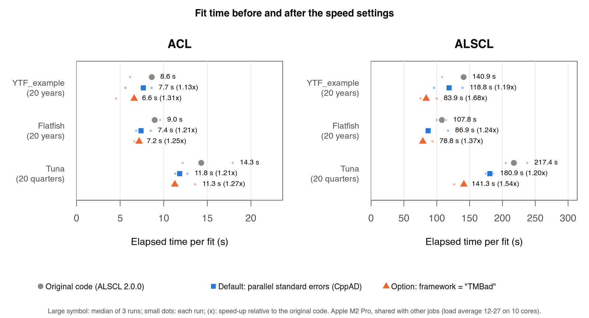

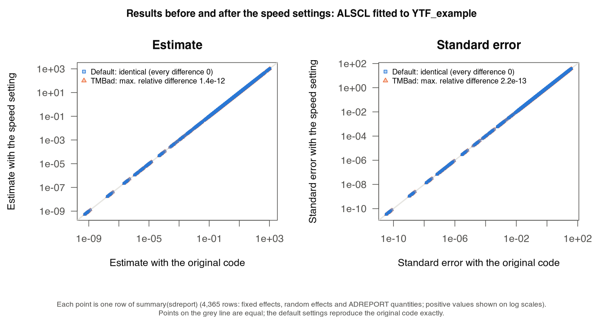

## 优化收尾与时间步内共用 F

`run_acl(x)` 和 `run_alscl(x)` 默认对选中的拟合执行最多五步受保护的 Newton 收尾（`polish = TRUE`）。每步要求数值 Hessian 正定、参数严格位于上下界内、最大绝对梯度下降，且目标函数增加不超过 `1e-8` 的浮点舍入容差。不满足条件就停止；收尾不能补足资料信息，也不能修复不合适的模型。`polish = FALSE` 可跳过收尾。2.2.2 引入的收尾可能改变数值精度层面的估计；复现旧拟合时应保留包版本与 `polish` 设置。

每轮优化的原始参数、目标函数、代码和信息保存在 `fit$optimizer_history`。后续一轮在同一点误报失败时，不再覆盖前一轮成功状态。`fit$raw_opt` 保存收尾前选中的结果；`fit$refinement` 记录接受的步骤及前后梯度。`convergence_code` 始终表示所选优化轮次的原始代码，不会因收尾而强行改为成功。多起点仍按收尾前最低有限目标函数选取；`starts` 和 `start_diagnostics` 记录收尾前各起点的结果。

`fit$diagnostics` 提供独立的数值筛查：最大梯度小于 `1e-3`、Hessian 与协方差正定、不触及优化器边界或自然尺度边界。自由相关系数距离 0 或 1 不超过 `1e-4`，以及自由过程／观测标准差不超过 `1e-4`，都会标记。这些是筛查阈值，不是统计检验。`high_correlations` 列出绝对相关系数至少 0.95 的参数对，需进一步审查，但不能单凭高相关就断言不可识别。协方差条件数取决于参数尺度。`diagnose_model()` 分别显示原始优化代码和数值筛查结果；仍需检查残差、多起点、似然剖面和敏感性。

### 明确选择 F 结构

默认 `F_structure = "group_year"` 保留原来的年龄 × 时间（ACL）或体长 × 时间（ALSCL）二维可分离 AR(1) 场。可选 `F_structure = "year"` 假设**同一时间步内所有年龄或体长的瞬时 F 相同**。季度数据是每季度一个 F，不是每个日历年一个 F。这项生物学假设必须符合渔业情况，不能只为得到收敛结果而选择。

共用结构为 `log(F[y]) = mean_log_F + u[y]`，采用平稳一维 AR(1)：`u[1]` 的标准差为 `sigma_F`，后续创新标准差为 `sigma_F * sqrt(1 - rho_y^2)`。F 随机效应从 A × Y 或 L × Y 减为 Y 个。C++ 似然只有一个正确归一化的一维 AR(1) 密度，并非把二维密度的单元格强制设成相同值。不再使用的年龄／体长相关参数自动固定，从自由参数及拟合报告中移除，即使其 map 项为 NULL 也不会估计；其他默认 map 规则保持不变。`report$dev_log_F` 为 1 × Y；`report$F`（ACL）或 `report$FL`（ALSCL）仍保留完整的组别 × Y 维度，F 偏差图显示一条共用序列。

以下假设 `x` 已按完整调查案例整理好三表、生物设置与初值。这里只固定**有效标量参数中的 t0**；不使用的组别相关参数由模型结构排除：

```r
map_acl_t0 <- list(t0 = factor(NA), log_std_log_F = NULL,
                   logit_log_F_y = NULL, logit_log_F_a = NULL)
map_alscl_t0 <- list(log_t0 = factor(NA), log_sigma_log_F = NULL)
a_year <- run_acl(x, map = map_acl_t0, F_structure = "year")
b_year <- run_alscl(x, map = map_alscl_t0, F_structure = "year")
a_year$optimizer_history
a_year$refinement
b_year$diagnostics
b_year$sd_info
diagnose_model(x$data.CatL, b_year)
plot_deviance(a_year, type = "F", se = TRUE)
plot_fishing_mortality(b_year, se = TRUE)
# 保存设置后，继续使用最短写法：
x$fit_config$acl$map <- map_acl_t0
x$fit_config$alscl$map <- map_alscl_t0
x$fit_args$F_structure <- "year"
a_year <- run_acl(x)
b_year <- run_alscl(x)
```

原来的逐项传参和 `do.call()` 写法保留。`retro_model()`（含其包装函数）和 `sim_acl()` 也支持 `F_structure` 与 `polish`；回溯每轮应使用相同结构。并行标准误和多起点继续沿用现有加速设置。注意 `sim_data()` 的 F 创新标准差不等于拟合 AR(1) 的边际标准差；一维平稳 AR(1) 的边际标准差为创新标准差除以 `sqrt(1 - rho_y^2)`。

此前模拟 YTF 数据的只固定 t0 ACL 拟合中，年龄相关系数逼近 1；生成数据恰好在同一年对所有年龄使用相同 F，共用 F 结构可处理这种不匹配。只固定 t0 的 ALSCL 则主要受优化收尾误报影响。两项发现都不代表你的正式数据能识别全部参数。实测结果与适用限制见 [2.2.2 可复现验证](https://github.com/FanZhang-LAB-SHOU/ALSCL/blob/main/docs/RELEASE_2.2.2.md)。

## Optimizer refinement and F shared within each time step

`run_acl(x)` and `run_alscl(x)` finish the selected fit with up to five safeguarded Newton steps (`polish = TRUE`). Each step requires a positive-definite numerical Hessian, parameters strictly inside their bounds, a smaller maximum absolute gradient, and an objective increase no greater than `1e-8` for floating-point roundoff. Refinement stops if a condition fails; it cannot repair insufficient information or an inappropriate model. Set `polish = FALSE` to skip it. Refinement, introduced in 2.2.2, can change estimates at numerical precision; preserve the package revision and `polish` setting when reproducing older fits.

Repeated optimizer passes retain their raw parameters, objective, code and message in `fit$optimizer_history`. An unchanged failed restart no longer overwrites an earlier successful pass. `fit$raw_opt` records the selected result before refinement; `fit$refinement` records accepted steps and before/after gradients. `convergence_code` remains the selected raw optimizer code, not an invented success code after refinement. Multistart selection still uses the lowest finite objective before refinement; `starts` and `start_diagnostics` describe those unrefined starts.

`fit$diagnostics` reports a separate numerical screen: maximum gradient below `1e-3`, positive-definite Hessian and covariance, no optimizer boundary and no natural-scale boundary. Free correlations within `1e-4` of 0 or 1 and free process/observation SDs at or below `1e-4` are flagged. These are screening thresholds, not statistical tests. `high_correlations` lists parameter pairs with absolute correlation at least 0.95; this warrants investigation but does not alone prove non-identifiability. The covariance condition number depends on parameter scaling. `diagnose_model()` prints the raw optimizer status and numerical screen separately; inspect residuals, alternative starts, profiles and sensitivity as well.

### Choose the F structure explicitly

The default `F_structure = "group_year"` preserves the original age × time (ACL) or length × time (ALSCL) separable AR(1) field. The optional `F_structure = "year"` assumes **the same instantaneous F for all ages or lengths within each time step**. For quarterly data, this is one F per quarter, not one per calendar year. This biological assumption is appropriate only when supported by the fishery; it is not an automatic cure for non-convergence.

In the shared structure, `log(F[y]) = mean_log_F + u[y]`, with a stationary one-dimensional AR(1): `u[1]` has SD `sigma_F`, and later innovations have SD `sigma_F * sqrt(1 - rho_y^2)`. There are Y random F effects instead of A × Y or L × Y. The C++ likelihood includes exactly one normalized AR(1) density. It does not tie together cells of a two-dimensional density. The unused age/length correlation is automatically fixed, excluded from free parameters and omitted from the fitted report, even if its map entry is NULL. Other map defaults remain unchanged. `report$dev_log_F` is 1 × Y; `report$F` (ACL) or `report$FL` (ALSCL) retains its full group × Y shape, and F-deviation plots show one shared series.

The following example assumes `x` contains your validated input tables, biology and starting values from the complete survey example. It fixes only t0 among the **active** scalar parameters; the unused group correlation is structurally absent:

```r
map_acl_t0 <- list(t0 = factor(NA), log_std_log_F = NULL,
                   logit_log_F_y = NULL, logit_log_F_a = NULL)
map_alscl_t0 <- list(log_t0 = factor(NA), log_sigma_log_F = NULL)
a_year <- run_acl(x, map = map_acl_t0, F_structure = "year")
b_year <- run_alscl(x, map = map_alscl_t0, F_structure = "year")
a_year$optimizer_history
a_year$refinement
b_year$diagnostics
b_year$sd_info
diagnose_model(x$data.CatL, b_year)
plot_deviance(a_year, type = "F", se = TRUE)
plot_fishing_mortality(b_year, se = TRUE)
# Store the choice to continue using the shortest syntax:
x$fit_config$acl$map <- map_acl_t0
x$fit_config$alscl$map <- map_alscl_t0
x$fit_args$F_structure <- "year"
a_year <- run_acl(x)
b_year <- run_alscl(x)
```

Original separate-argument and `do.call()` calls remain valid. `retro_model()` (including its wrappers) and `sim_acl()` also accept `F_structure` and `polish`; pass the same structure to all retrospective peels. Parallel standard errors and multistart workers continue to use the existing speed settings. In `sim_data()`, F innovation SD is not the same as the marginal SD in the fitting AR(1); for one-dimensional stationary AR(1), marginal SD equals innovation SD divided by `sqrt(1 - rho_y^2)`.

The earlier t0-only ACL failure on the synthetic YTF data was associated with age correlation approaching 1; those data were generated with shared F across ages. The shared-F alternative addresses that mismatch. The t0-only ALSCL false-convergence case instead benefits from numerical refinement. Neither finding establishes that all parameters are identifiable in your own observations. See the [2.2.2 reproducible validation](https://github.com/FanZhang-LAB-SHOU/ALSCL/blob/main/docs/RELEASE_2.2.2.md) for measured results and limitations.

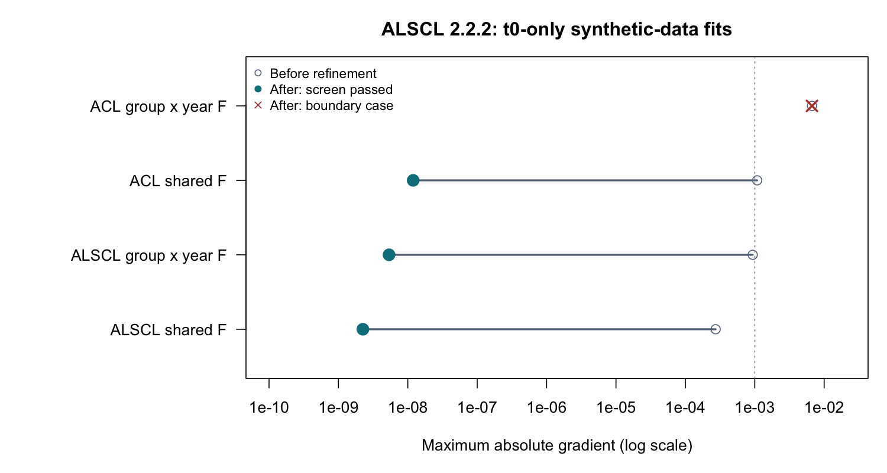

2.2.3 的拟合入口会检查数值时间标签的间隔等于 `growth_step`。例如年度表不能直接从 2001 跳到 2003；应补齐 2002 的调查列并用 NA 表示未观测，同时提供该期体重及成熟度。季度表用 2000、2000.25、2000.5、2000.75 等标签。修改标签不能替代正确的时间单位转换。

The fitting entry points require time-column spacing equal to growth_step. An annual table cannot skip directly from 2001 to 2003: include 2002 with NA survey observations and supply its weights and maturity. Quarterly labels are 2000, 2000.25, 2000.5, 2000.75, and so on. Relabelling is not a substitute for converting time units correctly.

### 2.2.5 的并行安装库一致性

多起点拟合、回溯和模拟批次的 socket 进程先接收主会话的库路径，再加载 ALSCL；通过 `.libPaths()` 选择新安装版本时也适用。所有工作进程必须加载与主进程相同的 ALSCL 安装，包括安装时启用 `R_KEEP_PKG_SOURCE` 的情况。比较核数时保持 `nstarts` 相同，标准误并行继续由 `alscl_speed()` 控制。

### Consistent package libraries in 2.2.5

Multistart fits, retrospective peels and simulation batches initialize socket workers with the parent session's library paths before loading ALSCL. This also applies when a newer installation is selected with `.libPaths()`. All workers must load the same ALSCL installation as the parent, including installations retaining source references with `R_KEEP_PKG_SOURCE`. Keep `nstarts` fixed when comparing worker counts; standard-error parallelism continues to use `alscl_speed()`.

### 2.2.7 的体长组边界

模型首尾体长组吸收分布尾部。`len_border` 只包含内部边界，`len_mid` 是每组递增的中心值。ALSCL 可以省略 `len_lower` 和 `len_upper`，由内部边界生成；若显式提供，必须分别为 `c(-Inf, len_border)` 和 `c(len_border, Inf)`。显式有限外端点会被拒绝，不会实现有限截断的体长分布。`0-20` 等有限区间标签仍可使用，但遵循原有首尾组吸收尾部的约定。

```r
# x 是调查数据示例中已对齐的输入组合。
borders <- x$fit_args$len_border
if (!is.null(borders)) {
  fit <- run_alscl(x, len_lower = c(-Inf, borders),
                  len_upper = c(borders, Inf))
}
```

### Length-bin limits in 2.2.7

The first and last model bins absorb the distribution tails. `len_border` contains only the internal boundaries; `len_mid` contains one increasing midpoint per bin. For ALSCL, omit `len_lower` and `len_upper` to derive these bounds, or supply `c(-Inf, len_border)` and `c(len_border, Inf)`. Explicit finite outer endpoints are rejected: they do not implement a truncated length distribution. Finite labels such as `0-20` remain accepted as labels under the existing tail-bin convention.

```r
# x is the aligned input bundle from the survey example.
borders <- x$fit_args$len_border
if (!is.null(borders)) {
  fit <- run_alscl(x, len_lower = c(-Inf, borders),
                  len_upper = c(borders, Inf))
}
```


### 一致性修正 / Consistency fixes

安装模式的 socket 工作进程继续加载与主进程相同的包安装。在 `pkgload::load_all()` 或 `testthat::test_local()` 下，工作进程改为用 pkgload 加载同一源码目录；该开发流程需要可选依赖 pkgload。CI 同时运行源码模式并行测试和完整安装包检查。

Installed socket workers load the same package installation as the parent. During `pkgload::load_all()` or `testthat::test_local()`, workers instead load the same source checkout with pkgload. Install the optional development dependency pkgload for this workflow. CI exercises both source-mode parallel tests and the complete installed-package checks.

### 2.2.9 修订 · Changes in 2.2.9

标准误计算结束后，返回的可执行 TMB 对象会恢复到最终拟合参数。在拟合所在的 R 会话中，`fit$obj$report()` 与 `fit$report` 因此描述同一个拟合状态，包括顺序计算及并行失败后的回退。已保存的估计值和标准误不因此改变。序列化保存的结果仍需重新拟合后才能使用可执行 TMB 对象。

After standard-error calculation, the returned live TMB objective is restored to the final fitted parameters. In the fitting R session, `fit$obj$report()` therefore describes the same fitted state as `fit$report`, including sequential standard errors and a fallback from parallel calculation. This does not change the saved estimates or standard errors. Serialized fits still require refitting before using a live TMB objective.

已验证的 TMB 版本为 1.9.21 和 1.9.25。现有 Windows、macOS、Linux 检查已在 1.9.25 上通过两模型、两种 AD 框架的严格并行一致性测试，不允许用单核回退代替通过；Windows 使用 socket，并跳过 Unix fork 测试。其他 TMB 版本继续使用顺序计算保护。这扩大了可启用加速的版本范围，不保证小模型也会提速；实际方法请看 `fit$sd_info`。

The checked TMB versions are 1.9.21 and 1.9.25. TMB 1.9.25 passed the strict, no-fallback parallel-equivalence tests for both models and both AD frameworks in the existing Windows, macOS and Linux checks; Windows uses socket workers and skips Unix-fork tests. Other TMB versions retain the sequential safety fallback. This extends eligibility for acceleration, without promising a speed-up for small fits; inspect `fit$sd_info` for the actual method.

`create_parameters(species = "krill", model_type = "acl")` 提供 Linf 初值 90 和边界，不会自动固定 Linf，也不更改 M、nage 或时间步长。需要固定时，显式传入 `map = list(log_Linf = factor(NA))` 和选定初值；生物设置仍需在拟合参数中提供。

`create_parameters(species = "krill", model_type = "acl")` supplies a Linf start of 90 and bounds, but does not fix Linf or change M, nage or the time step. To fix it, explicitly pass `map = list(log_Linf = factor(NA))` with the chosen starting value. Biological settings still belong in the fitting arguments.

<a id="chapter-07"></a>
## 07 诊断与结果解读 · Diagnostics

### 7.1 数值状态 / Numerical status

```r
# 数值检查 / Numerical checks
c(code = b$convergence_code, gradient = b$max_abs_gradient,
  pdHess = b$pdHess, boundary = b$bound_hit)
diagnose_model(x$data.CatL, b)
diagnostic_metrics(x$data.CatL, b)
comparison <- compare_models(a, b, x$data.CatL)
comparison$fit_metrics
comparison$correlation # 包括 Ratio_Mean / Includes Ratio_Mean
plot_residuals(b, type = "length", facet_ncol = 4)
plot_compare_residuals(a, b, x$data.CatL)
```

本次 YTF 主拟合的优化码均为 0，最大绝对梯度约为 ACL `1.22e-4`、ALSCL `5.75e-9`，Hessian 均正定，没有检测到边界命中。结果记录见 [convergence.csv](https://github.com/FanZhang-LAB-SHOU/ALSCL/blob/main/docs/results/convergence.csv)。梯度 < 0.001 是本教学流程的数值筛查阈值，不是适用于所有模型的科学有效性标准。

Both example fits returned code 0, positive-definite Hessians and no detected bound hits. Maximum absolute gradients were about `1.22e-4` and `5.75e-9`. The tutorial's 0.001 screening threshold is not a universal validity criterion.

### 7.2 残差与生物假设 / Residuals and biological assumptions

还需查看残差结构、不同初值和固定参数假设的敏感性、时间末端稳定性以及生物合理性。`plot_residuals()` 的残差是“观测对数 − 预测对数”，没有除以观测 SD；`plot_deviance` 展示的是过程偏差，不是似然 deviance。AIC/BIC 比较需使用相同观测与可比似然口径；当前由年龄模型生成的一个样本不能证明 ACL 或 ALSCL 普遍更好。

Also assess residual structure, sensitivity to starts and fixed assumptions, terminal stability and biological plausibility. `plot_residuals()` displays raw log residuals, and process-deviation plots are not likelihood deviance. Information criteria require comparable observations and likelihoods; one age-generated sample cannot establish general model superiority.

`check_fit()` 提供条件标准化残差、热图、按实际时间间隔计算的滞后相关和 QQ 图。标准化不会使这些以拟合潜在效应为条件的残差相互独立。完整解释见[评估工作流](https://github.com/FanZhang-LAB-SHOU/ALSCL/blob/main/docs/ASSESSMENT_WORKFLOWS.md)。

`check_fit()` adds conditional standardized residuals, a heatmap, actual-time lag correlations and a QQ plot. Standardization does not make residuals conditional on fitted latent effects independent. See the [assessment workflow](https://github.com/FanZhang-LAB-SHOU/ALSCL/blob/main/docs/ASSESSMENT_WORKFLOWS.md) for interpretation.

```r
checks <- check_fit(b, max_lag = 4)
checks$plots$heatmap
checks$plots$lag
checks$plots$qq
checks$lag_correlations
```


### 7.3 比较前核对观测 / Match observations before comparison

`compare_models()` 会核对时间、体长标签、实际用于拟合的正观测及缺失掩码；已知不一致会报错。返回的 `fit_diagnostics` 和 `comparison` 说明数值状态和可比较性。若任一拟合不合格，或旧结果缺少核验数据的元信息，仍显示原始 AIC，但警告并取消自动偏好结论。保留的非零原始优化代码不单独决定失败，需结合收尾后的梯度、Hessian 和边界。

`compare_models()` checks periods, length labels, fitted positive observations and the missing-data mask. Known mismatches are errors. Its fit_diagnostics and comparison outputs record numerical status and comparability. Failed numerical screens or old objects with insufficient metadata retain raw AIC but produce a warning and no automatic preference. A nonzero raw optimizer code alone does not imply failure after refinement; examine the final gradient, Hessian and boundaries together.

`plot_compare_metrics()` 与 `diagnostic_metrics()` 使用同一套正观测筛选，NA 和零观测不会污染整组指标。`plot_fishing_mortality(b, type = "length", se = TRUE)` 对 ALSCL 以真实体长中点为横轴，按年份分面；year 模式保持以时间为横轴。ACL 没有独立的长度别 F，旧 length 别名仍画年龄别 F，但会警告，建议改用 age。

plot_compare_metrics uses the same positive-observation mask as diagnostic_metrics, excluding NA and zeros consistently. For ALSCL, plot_fishing_mortality(b, type = "length", se = TRUE) uses actual length midpoints on the horizontal axis and facets by year; year mode retains time on the horizontal axis. ACL has no independent F-at-length: its legacy length alias still plots F-at-age with a warning; use age explicitly.

`diagnostic_metrics()`、`diagnose_model()` 和 `compare_models()` 核对已知时间标签、体长标签、正观测掩码及拟合时保存的观测。即使维度相同，颠倒年份或体长组顺序也会报错。请传原始拟合表，例如 `diagnose_model(x$data.CatL, b)`；这些是样本内诊断，不是留出预测接口。缺少元数据的旧结果仍可计算原始指标，但不能据此确认模型可比较。

比较表和指标图共用计算规则：只使用有限正观测，常数观测的 R 方为 `NA`，观测位置的原尺度预测非有限时会报错；缺测与零值仍被排除。通过这些检查不代表模型在生物学上充分。

`diagnostic_metrics()`, `diagnose_model()` and `compare_models()` check known time labels, length labels, the positive-observation mask and the observations stored with the fit. A table with reordered years or length bins is an error even when its dimensions match. Pass the original fitting table, for example `diagnose_model(x$data.CatL, b)`; these are in-sample diagnostics, not an interface for held-out prediction. Older results without metadata still support raw metrics, but cannot establish verified model comparability.

Comparison tables and metric plots share the same calculations: only finite positive observations contribute, R-squared is `NA` for constant observations, and nonfinite original-scale predictions at observed cells cause an error. Missing or zero observations remain excluded. Passing these checks does not establish model adequacy.


拟合、诊断和模型比较统一解析普通 data.frame、matrix、tibble 及保存数值文本的 factor 列。因子按标签转为观测值，不使用内部等级编码；体长标签按向量提取。修改了观测值、缺测掩码、年份或体长组顺序时，原有匹配检查仍会报错。

Fitting, diagnostics and comparison use the same interpretation of ordinary data frames, matrices, tibbles and numeric-text factor columns. Factor labels are converted to observation values, never to internal level codes. Length labels are extracted as a vector. The checks for changed observations, missing-data masks, time labels and length-bin order still apply.

### 比较图中的观测匹配 / Observation matching in comparison plots

`plot_compare_residuals()` 和 `plot_compare_CatL()` 除时间及体长元数据外，也核对已知观测值及正观测掩码。请传原始拟合表；修改数值或将缺失单元改为观测会报错。没有保存观测的旧结果仍可使用，但无法完整核验观测匹配。比较图的观测点排除零值和 NA，与拟合约定一致；这些位置仍可显示预测曲线。

`plot_compare_residuals()` and `plot_compare_CatL()` verify known observations and their positive-observation mask as well as time and length metadata. Pass the original fitting table; changing its values or turning a missing cell into an observation is an error. Older fits without stored observations remain usable, but their observation alignment cannot be fully verified. Zero and NA observations are omitted from the comparison points, consistently with fitting; prediction curves remain available at those positions.

### 7.4 比较同一模型的不同配置 / Compare configurations of the same model

同一模型的两份结果会自动使用不同图例，例如 `ACL (group_year)` 和 `ACL (year)`，仍支持显式指定不同的 `model1_name`、`model2_name`。时间序列与 F 图保留每份结果自己的真实年份，可以显示不同时间范围。与 `data.CatL` 配对的图会核对已知时间和体长元数据，再匹配观测与预测；网格不一致时明确报错。图形比较不代表似然或生物假设具有可比性。

Comparison plots give distinct default labels to two fits of the same model: for example, `ACL (group_year)` and `ACL (year)`. Explicit distinct `model1_name` and `model2_name` remain supported. Time-series and F plots retain each fit's own calendar, including different time spans. Plots paired with `data.CatL` check known time and length metadata before matching observations to predictions; inconsistent grids are errors. A visual comparison does not establish that likelihoods or biological assumptions are comparable.

```r
a_group <- run_acl(x, F_structure = "group_year", silent = TRUE)
a_shared <- run_acl(x, F_structure = "year", silent = TRUE)
plot_compare_ts(a_group, a_shared, quantities = "SSB")
plot_compare_annual_F(a_group, a_shared)
plot_compare_F(a_group, a_shared)
```

<a id="chapter-08"></a>
## 08 调查与种群图 · Survey and population plots

先完成第 04 章的 YTF 拟合，得到 `a`、`b`、`x`、`inputs`，并设置 `dat <- x$data.CatL`。加载 ggplot2 和 patchwork。第 11 章建立回溯对象 `ra/rb`。
First complete chapter 04, define `dat <- x$data.CatL`, and load ggplot2 and patchwork. Chapter 11 defines retrospective objects.

```r
library(ggplot2)
library(patchwork)
acl_theme_set(palette="npg", base_theme="theme_bw")
```

## 1. 调查拟合 length 对数尺度 / Survey fit length log scale

```r
# 绘制本图 / Draw this figure
plot_CatL(b, type = "length", exp_transform = FALSE, facet_ncol = 4,
  point_size = 1, line_size = 0.6,
  x_breaks = c(2000, 2010, 2015),
  ylab = "Log survey index")
```

[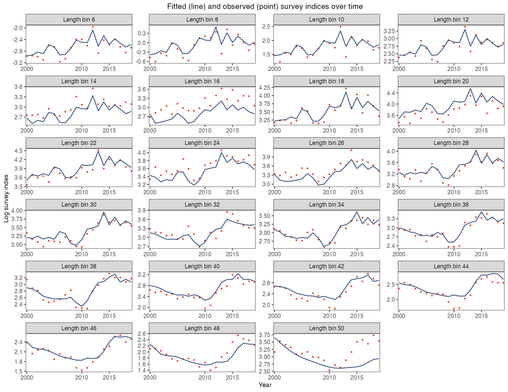](https://github.com/FanZhang-LAB-SHOU/ALSCL/blob/main/docs/figures/ytf/CatL_length_FALSE.png?raw=true&v=f8ee055dae55)

点为观测对数，曲线为拟合的 Elog_index。

Points are log observations; curves show fitted Elog_index.

[参数及默认值 / Arguments and defaults](https://github.com/FanZhang-LAB-SHOU/ALSCL/blob/main/docs/FUNCTION_REFERENCE.md#plot_CatL)


## 2. 调查拟合 length 原尺度 / Survey fit length original scale

```r
# 绘制本图 / Draw this figure
plot_CatL(b, type = "length", exp_transform = TRUE, facet_ncol = 4,
  point_size = 1, line_size = 0.6,
  x_breaks = c(2000, 2010, 2015),
  ylab = "Survey index")
```

[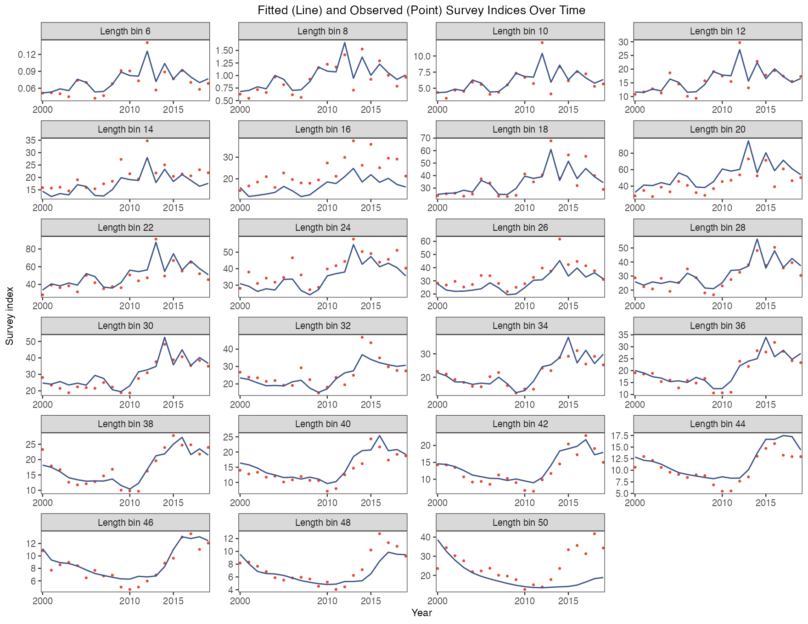](https://github.com/FanZhang-LAB-SHOU/ALSCL/blob/main/docs/figures/ytf/CatL_length_TRUE.png?raw=true&v=5245da6943bb)

原尺度曲线为 exp(Elog_index)，即对数正态中位数。

Original-scale curves are lognormal medians, exp(Elog_index).

[参数及默认值 / Arguments and defaults](https://github.com/FanZhang-LAB-SHOU/ALSCL/blob/main/docs/FUNCTION_REFERENCE.md#plot_CatL)


## 3. 调查拟合 year 对数尺度 / Survey fit year log scale

```r
# 绘制本图 / Draw this figure
plot_CatL(b, type = "year", exp_transform = FALSE, facet_ncol = 4,
  line_size1 = 0.6, line_size2 = 0.4,
  x_breaks = c(10, 30, 50),
  ylab = "Log survey index")
```

[](https://github.com/FanZhang-LAB-SHOU/ALSCL/blob/main/docs/figures/ytf/CatL_year_FALSE.png?raw=true&v=3996ebd05b97)

`line_size1 = 0.6` 控制拟合线，`line_size2 = 0.4` 控制观测线；年份模式不使用 `line_size` 和 `point_size`。 / `line_size1 = 0.6` controls fitted curves and `line_size2 = 0.4` controls observations; year mode does not use `line_size` or `point_size`.

朱红色为观测对数，深蓝色为拟合的 Elog_index。

Vermilion curves are log observations; navy curves show fitted Elog_index.

[参数及默认值 / Arguments and defaults](https://github.com/FanZhang-LAB-SHOU/ALSCL/blob/main/docs/FUNCTION_REFERENCE.md#plot_CatL)


## 4. 调查拟合 year 原尺度 / Survey fit year original scale

```r
# 绘制本图 / Draw this figure
plot_CatL(b, type = "year", exp_transform = TRUE, facet_ncol = 4,
  line_size1 = 0.6, line_size2 = 0.4,
  x_breaks = c(10, 30, 50),
  ylab = "Survey index")
```

[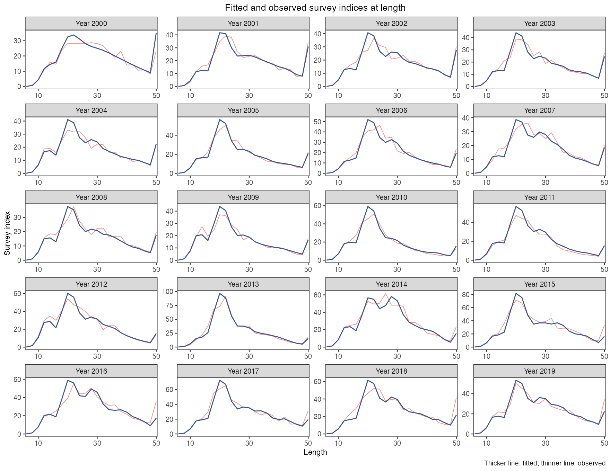](https://github.com/FanZhang-LAB-SHOU/ALSCL/blob/main/docs/figures/ytf/CatL_year_TRUE.png?raw=true&v=9bea7ab23a28)

`line_size1 = 0.6` 控制拟合线，`line_size2 = 0.4` 控制观测线；年份模式不使用 `line_size` 和 `point_size`。 / `line_size1 = 0.6` controls fitted curves and `line_size2 = 0.4` controls observations; year mode does not use `line_size` or `point_size`.

原尺度曲线为 exp(Elog_index)，即对数正态中位数。

Original-scale curves are lognormal medians, exp(Elog_index).

[参数及默认值 / Arguments and defaults](https://github.com/FanZhang-LAB-SHOU/ALSCL/blob/main/docs/FUNCTION_REFERENCE.md#plot_CatL)


## 5. 丰度 N / Abundance N

```r
# 绘制本图 / Draw this figure
plot_abundance(b, type = "N", se = TRUE, facet_ncol = 3,
  line_size = 0.6)
```

[](https://github.com/FanZhang-LAB-SHOU/ALSCL/blob/main/docs/figures/ytf/plot_abundance_N.png?raw=true&v=27bc774353ed)

ALSCL 示例；A 表示年龄组，L 表示长度组。有可用标准误时显示近似 95% 区间。 总量图显示各组之和；分面图的纵轴按组调整。

ALSCL example: A denotes age, L length. Approximate 95% intervals appear where standard errors are available. Totals sum across groups; faceted y axes adjust to each group.

[参数及默认值 / Arguments and defaults](https://github.com/FanZhang-LAB-SHOU/ALSCL/blob/main/docs/FUNCTION_REFERENCE.md#plot_abundance)


## 6. 丰度 NA / Abundance NA

```r
# 绘制本图 / Draw this figure
plot_abundance(b, type = "NA", se = TRUE, facet_ncol = 3,
  line_size = 0.6)
```

[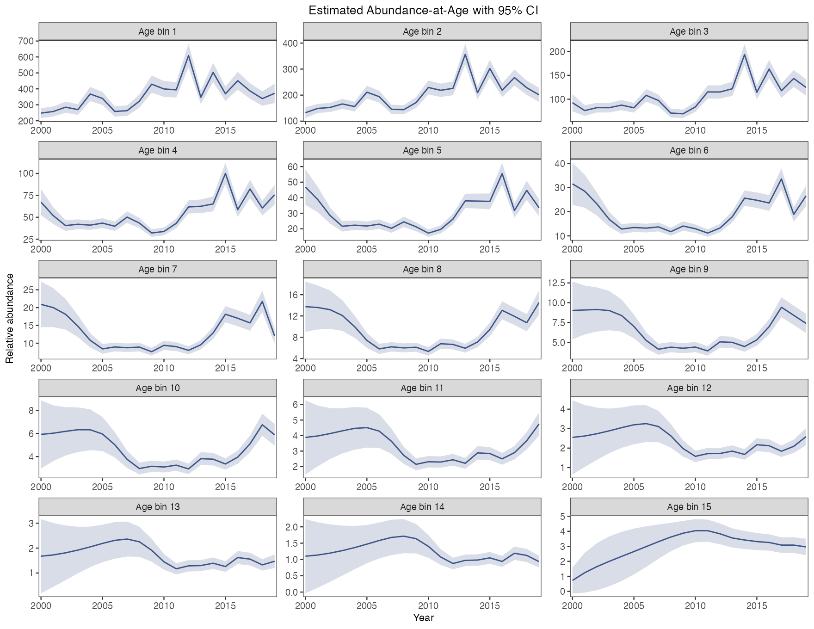](https://github.com/FanZhang-LAB-SHOU/ALSCL/blob/main/docs/figures/ytf/plot_abundance_NA.png?raw=true&v=47232e1008f0)

ALSCL 示例；A 表示年龄组，L 表示长度组。有可用标准误时显示近似 95% 区间。 总量图显示各组之和；分面图的纵轴按组调整。

ALSCL example: A denotes age, L length. Approximate 95% intervals appear where standard errors are available. Totals sum across groups; faceted y axes adjust to each group.

[参数及默认值 / Arguments and defaults](https://github.com/FanZhang-LAB-SHOU/ALSCL/blob/main/docs/FUNCTION_REFERENCE.md#plot_abundance)


## 7. 丰度 NL / Abundance NL

```r
# 绘制本图 / Draw this figure
plot_abundance(b, type = "NL", se = TRUE, facet_ncol = 3,
  line_size = 0.6)
```

[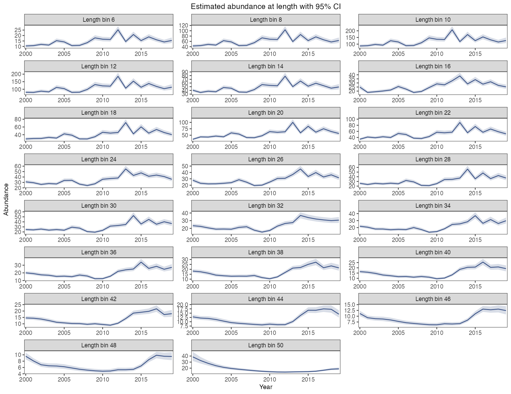](https://github.com/FanZhang-LAB-SHOU/ALSCL/blob/main/docs/figures/ytf/plot_abundance_NL.png?raw=true&v=e38ec3099196)

ALSCL 示例；A 表示年龄组，L 表示长度组。有可用标准误时显示近似 95% 区间。 总量图显示各组之和；分面图的纵轴按组调整。

ALSCL example: A denotes age, L length. Approximate 95% intervals appear where standard errors are available. Totals sum across groups; faceted y axes adjust to each group.

[参数及默认值 / Arguments and defaults](https://github.com/FanZhang-LAB-SHOU/ALSCL/blob/main/docs/FUNCTION_REFERENCE.md#plot_abundance)

### 2.2.5 的模型、输出与区间支持范围

`se = TRUE` 请求逐点近似 95% 区间（`估计值 ± 1.96 × 标准误`）。体长别生物量和产卵生物量现在会绘制可用区间。数量或标准误不可用时会明确报错；确实只需要估计线时才使用 `se = FALSE`。解释区间前仍须检查收敛与 Hessian。

| 函数 | 类型 | ACL | ALSCL |
|---|---|---|---|
| `plot_biomass()` | `B` | 估计 + 区间 | 估计 + 区间 |
| `plot_biomass()` | `BL` | 仅估计 | 估计 + 区间 |
| `plot_biomass()` | `BA` | 不可用 | 估计 + 区间 |
| `plot_SSB()` | `SSB` | 估计 + 区间 | 估计 + 区间 |
| `plot_SSB()` | `SBL` | 仅估计 | 估计 + 区间 |
| `plot_SSB()` | `SBA` | 不可用 | 估计 + 区间 |
| `plot_catch()` | `CN` | 估计 + 区间 | 估计 + 区间 |
| `plot_catch()` | `CNA` | 仅估计 | 估计 + 区间 |
| `plot_catch()` | `CNL` | 不可用 | 估计 + 区间 |

```r
plot_biomass(b, type = "BL", se = TRUE)
plot_SSB(b, type = "SBL", se = TRUE)
plot_catch(a, type = "CNA", se = FALSE)
```

### Model, output and interval support in 2.2.5

`se = TRUE` requests pointwise approximate 95% intervals (`estimate ± 1.96 × SE`). Length-specific biomass and spawning biomass now draw these intervals when available. Unavailable quantities or standard errors produce a clear error; use `se = FALSE` only when an estimate-only plot is intended. Inspect convergence and Hessian diagnostics before interpreting intervals.

| Function | Type | ACL | ALSCL |
|---|---|---|---|
| `plot_biomass()` | `B` | Estimate + interval | Estimate + interval |
| `plot_biomass()` | `BL` | Estimate only | Estimate + interval |
| `plot_biomass()` | `BA` | Unavailable | Estimate + interval |
| `plot_SSB()` | `SSB` | Estimate + interval | Estimate + interval |
| `plot_SSB()` | `SBL` | Estimate only | Estimate + interval |
| `plot_SSB()` | `SBA` | Unavailable | Estimate + interval |
| `plot_catch()` | `CN` | Estimate + interval | Estimate + interval |
| `plot_catch()` | `CNA` | Estimate only | Estimate + interval |
| `plot_catch()` | `CNL` | Unavailable | Estimate + interval |

```r
plot_biomass(b, type = "BL", se = TRUE)
plot_SSB(b, type = "SBL", se = TRUE)
plot_catch(a, type = "CNA", se = FALSE)
```


## 8. 生物量 B / Biomass B

```r
# 绘制本图 / Draw this figure
plot_biomass(b, type = "B", se = TRUE, facet_ncol = 3,
  line_size = 0.6)
```

[](https://github.com/FanZhang-LAB-SHOU/ALSCL/blob/main/docs/figures/ytf/plot_biomass_B.png?raw=true&v=3bd9af33900d)

ALSCL 示例；A 表示年龄组，L 表示长度组。有可用标准误时显示近似 95% 区间。 总量图显示各组之和；分面图的纵轴按组调整。

ALSCL example: A denotes age, L length. Approximate 95% intervals appear where standard errors are available. Totals sum across groups; faceted y axes adjust to each group.

[参数及默认值 / Arguments and defaults](https://github.com/FanZhang-LAB-SHOU/ALSCL/blob/main/docs/FUNCTION_REFERENCE.md#plot_biomass)


## 9. 生物量 BA / Biomass BA

```r
# 绘制本图 / Draw this figure
plot_biomass(b, type = "BA", se = TRUE, facet_ncol = 3,
  line_size = 0.6)
```

[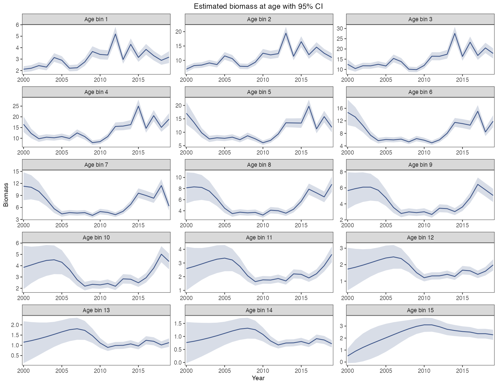](https://github.com/FanZhang-LAB-SHOU/ALSCL/blob/main/docs/figures/ytf/plot_biomass_BA.png?raw=true&v=5c812e8a0bdb)

ALSCL 示例；A 表示年龄组，L 表示长度组。有可用标准误时显示近似 95% 区间。 总量图显示各组之和；分面图的纵轴按组调整。

ALSCL example: A denotes age, L length. Approximate 95% intervals appear where standard errors are available. Totals sum across groups; faceted y axes adjust to each group.

[参数及默认值 / Arguments and defaults](https://github.com/FanZhang-LAB-SHOU/ALSCL/blob/main/docs/FUNCTION_REFERENCE.md#plot_biomass)


## 10. 生物量 BL / Biomass BL

```r
# 绘制本图 / Draw this figure
plot_biomass(b, type = "BL", se = TRUE, facet_ncol = 3,
  line_size = 0.6)
```

[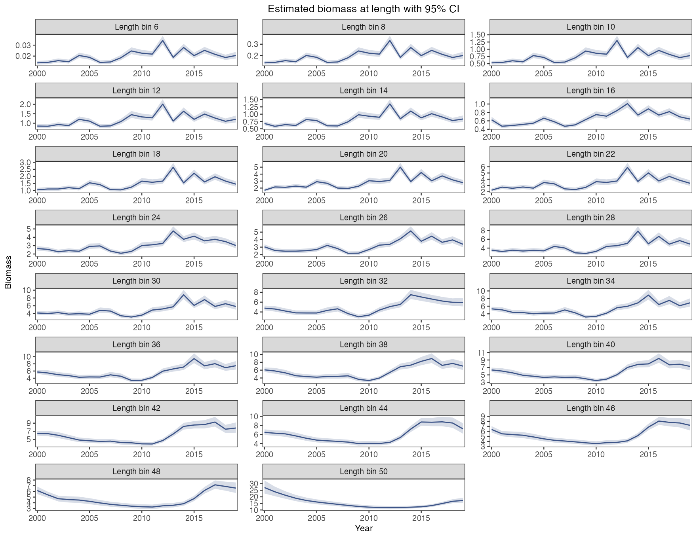](https://github.com/FanZhang-LAB-SHOU/ALSCL/blob/main/docs/figures/ytf/plot_biomass_BL.png?raw=true&v=a40885f32d74)

ALSCL 示例；A 表示年龄组，L 表示长度组。有可用标准误时显示近似 95% 区间。 总量图显示各组之和；分面图的纵轴按组调整。

ALSCL example: A denotes age, L length. Approximate 95% intervals appear where standard errors are available. Totals sum across groups; faceted y axes adjust to each group.

[参数及默认值 / Arguments and defaults](https://github.com/FanZhang-LAB-SHOU/ALSCL/blob/main/docs/FUNCTION_REFERENCE.md#plot_biomass)


## 11. 产卵生物量 SSB / Spawning biomass SSB

```r
# 绘制本图 / Draw this figure
plot_SSB(b, type = "SSB", se = TRUE, facet_ncol = 3,
  line_size = 0.6)
```

[](https://github.com/FanZhang-LAB-SHOU/ALSCL/blob/main/docs/figures/ytf/plot_SSB_SSB.png?raw=true&v=55985b071cbf)

ALSCL 示例；A 表示年龄组，L 表示长度组。有可用标准误时显示近似 95% 区间。 总量图显示各组之和；分面图的纵轴按组调整。

ALSCL example: A denotes age, L length. Approximate 95% intervals appear where standard errors are available. Totals sum across groups; faceted y axes adjust to each group.

[参数及默认值 / Arguments and defaults](https://github.com/FanZhang-LAB-SHOU/ALSCL/blob/main/docs/FUNCTION_REFERENCE.md#plot_SSB)


## 12. 产卵生物量 SBA / Spawning biomass SBA

```r
# 绘制本图 / Draw this figure
plot_SSB(b, type = "SBA", se = TRUE, facet_ncol = 3,
  line_size = 0.6)
```

[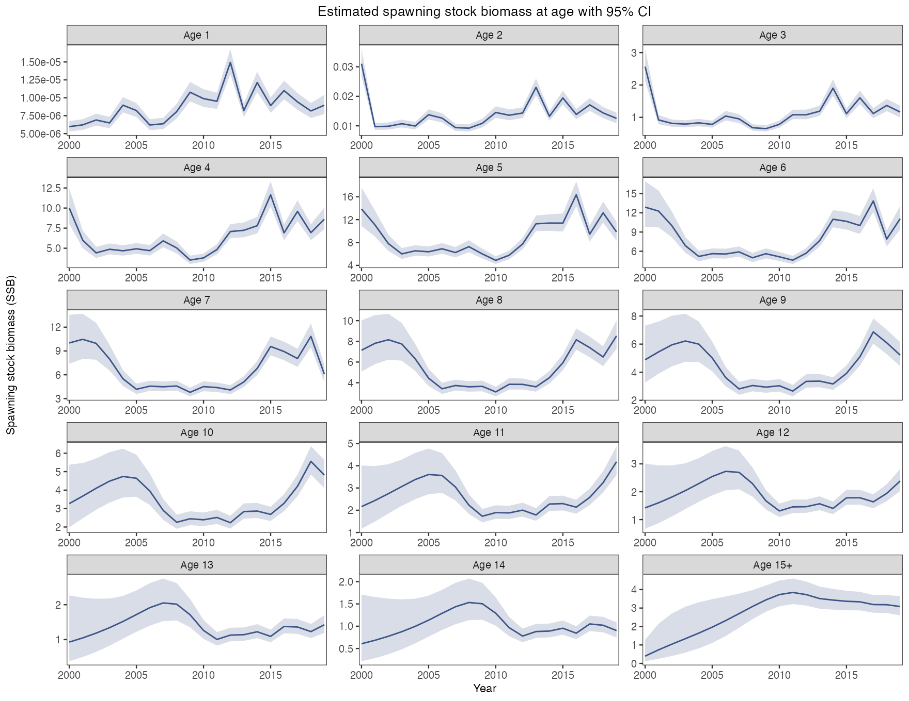](https://github.com/FanZhang-LAB-SHOU/ALSCL/blob/main/docs/figures/ytf/plot_SSB_SBA.png?raw=true&v=db023568dd89)

ALSCL 示例；A 表示年龄组，L 表示长度组。有可用标准误时显示近似 95% 区间。 总量图显示各组之和；分面图的纵轴按组调整。

ALSCL example: A denotes age, L length. Approximate 95% intervals appear where standard errors are available. Totals sum across groups; faceted y axes adjust to each group.

[参数及默认值 / Arguments and defaults](https://github.com/FanZhang-LAB-SHOU/ALSCL/blob/main/docs/FUNCTION_REFERENCE.md#plot_SSB)


## 13. 产卵生物量 SBL / Spawning biomass SBL

```r
# 绘制本图 / Draw this figure
plot_SSB(b, type = "SBL", se = TRUE, facet_ncol = 3,
  line_size = 0.6)
```

[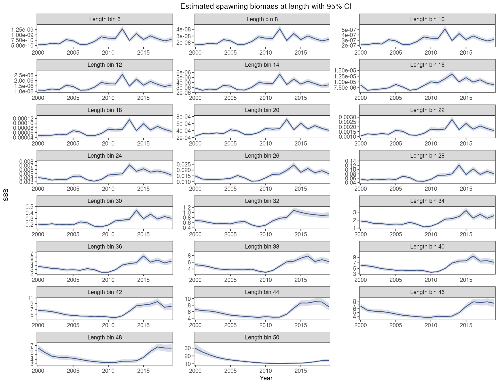](https://github.com/FanZhang-LAB-SHOU/ALSCL/blob/main/docs/figures/ytf/plot_SSB_SBL.png?raw=true&v=72962b741480)

ALSCL 示例；A 表示年龄组，L 表示长度组。有可用标准误时显示近似 95% 区间。 总量图显示各组之和；分面图的纵轴按组调整。

ALSCL example: A denotes age, L length. Approximate 95% intervals appear where standard errors are available. Totals sum across groups; faceted y axes adjust to each group.

[参数及默认值 / Arguments and defaults](https://github.com/FanZhang-LAB-SHOU/ALSCL/blob/main/docs/FUNCTION_REFERENCE.md#plot_SSB)


## 14. 捕获尾数 CN / Catch numbers CN

```r
# 绘制本图 / Draw this figure
plot_catch(b, type = "CN", se = TRUE, facet_ncol = 3,
  line_size = 0.6)
```

[](https://github.com/FanZhang-LAB-SHOU/ALSCL/blob/main/docs/figures/ytf/plot_catch_CN.png?raw=true&v=309e230f000a)

ALSCL 示例；A 表示年龄组，L 表示长度组。有可用标准误时显示近似 95% 区间。 捕获尾数是模型推算的渔业捕获，不是调查指数。

ALSCL example: A denotes age, L length. Approximate 95% intervals appear where standard errors are available. These are model-derived fishery catches, not survey indices.

[参数及默认值 / Arguments and defaults](https://github.com/FanZhang-LAB-SHOU/ALSCL/blob/main/docs/FUNCTION_REFERENCE.md#plot_catch)


## 15. 捕获尾数 CNA / Catch numbers CNA

```r
# 绘制本图 / Draw this figure
plot_catch(b, type = "CNA", se = TRUE, facet_ncol = 3,
  line_size = 0.6)
```

[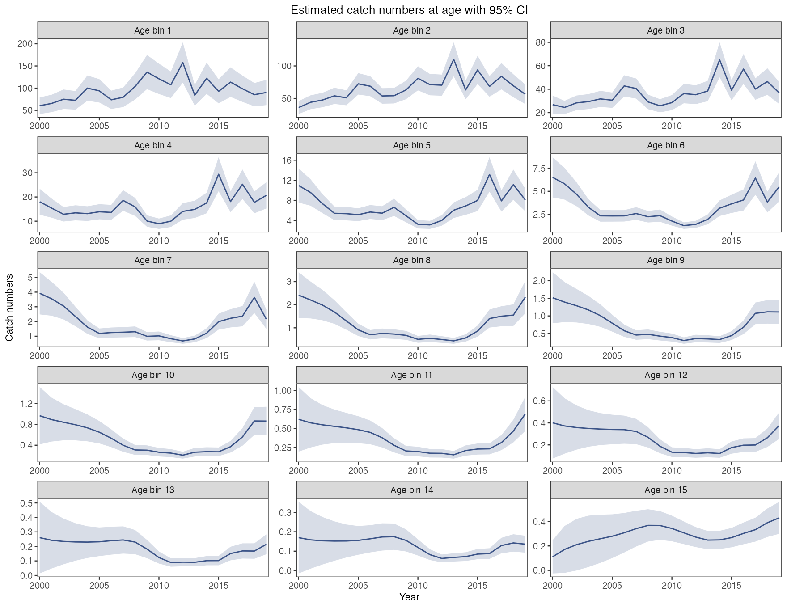](https://github.com/FanZhang-LAB-SHOU/ALSCL/blob/main/docs/figures/ytf/plot_catch_CNA.png?raw=true&v=3b562c13a649)

ALSCL 示例；A 表示年龄组，L 表示长度组。有可用标准误时显示近似 95% 区间。 捕获尾数是模型推算的渔业捕获，不是调查指数。

ALSCL example: A denotes age, L length. Approximate 95% intervals appear where standard errors are available. These are model-derived fishery catches, not survey indices.

[参数及默认值 / Arguments and defaults](https://github.com/FanZhang-LAB-SHOU/ALSCL/blob/main/docs/FUNCTION_REFERENCE.md#plot_catch)


## 16. 捕获尾数 CNL / Catch numbers CNL

```r
# 绘制本图 / Draw this figure
plot_catch(b, type = "CNL", se = TRUE, facet_ncol = 3,
  line_size = 0.6)
```

[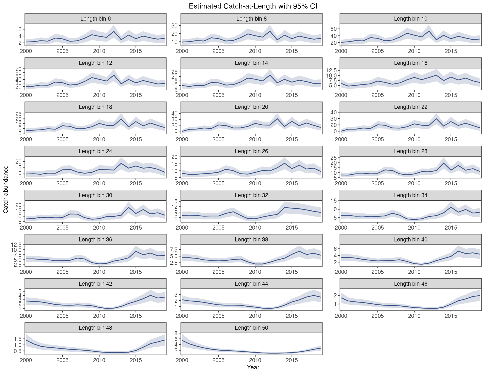](https://github.com/FanZhang-LAB-SHOU/ALSCL/blob/main/docs/figures/ytf/plot_catch_CNL.png?raw=true&v=0d7b88fbcb17)

ALSCL 示例；A 表示年龄组，L 表示长度组。有可用标准误时显示近似 95% 区间。 捕获尾数是模型推算的渔业捕获，不是调查指数。

ALSCL example: A denotes age, L length. Approximate 95% intervals appear where standard errors are available. These are model-derived fishery catches, not survey indices.

[参数及默认值 / Arguments and defaults](https://github.com/FanZhang-LAB-SHOU/ALSCL/blob/main/docs/FUNCTION_REFERENCE.md#plot_catch)


## 17. 补充量 / Recruitment

```r
# 绘制本图 / Draw this figure
plot_recruitment(b, se = TRUE)
```

[](https://github.com/FanZhang-LAB-SHOU/ALSCL/blob/main/docs/figures/ytf/recruitment.png?raw=true&v=58c7ec3d9671)

补充量对应最小年龄组；受设定的补充年龄和时间步长影响。

Recruitment enters the youngest age class; its interpretation depends on recruitment age and time step.

[参数及默认值 / Arguments and defaults](https://github.com/FanZhang-LAB-SHOU/ALSCL/blob/main/docs/FUNCTION_REFERENCE.md#plot_recruitment)


## 18. 亲体与补充关系 / Spawning biomass and recruitment

`age_at_recruitment` 的单位是年。`plot_SSB_Rec()` 除以拟合的 `growth_step`，要求在规则时间网格上对应整数个时间步。季度数据中，0.25 表示滞后一季度，1 表示四季度。允许零滞后；拒绝负值、非有限值及非整数步滞后。旧结果没有 `growth_step` 时使用规则年份间隔；两类时间元数据都没有时沿用年度步长。

`age_at_recruitment` is in years. `plot_SSB_Rec()` divides it by the fit's `growth_step` and requires an integer lag on a regular time grid. With quarterly data, 0.25 means one step and 1 means four steps. Zero lag is allowed; negative, nonfinite and fractional-step lags are rejected. Legacy results without `growth_step` use their regular time spacing, or an annual step when neither metadata field is available.

```r
# 绘制本图 / Draw this figure
plot_SSB_Rec(b, age_at_recruitment = 1)
```

[](https://github.com/FanZhang-LAB-SHOU/ALSCL/blob/main/docs/figures/ytf/SSB_Rec.png?raw=true&v=9f25bff42fd3)

本年度示例按 1 年（1 个观测步）对齐 SSB 与后续补充量；季度数据会自动换算为 4 步。这里只画散点，不拟合资源补充函数。

This annual example aligns SSB with recruitment one year (one step) later; quarterly data use four steps for the same age. This is a scatter plot, not a fitted stock recruitment curve.

[参数及默认值 / Arguments and defaults](https://github.com/FanZhang-LAB-SHOU/ALSCL/blob/main/docs/FUNCTION_REFERENCE.md#plot_SSB_Rec)


<a id="chapter-09"></a>
## 09 生长、死亡与残差图 · Growth, mortality and residuals

先完成第 04 章的 YTF 拟合，得到 `a`、`b`、`x`、`inputs`，并设置 `dat <- x$data.CatL`。加载 ggplot2 和 patchwork。第 11 章建立回溯对象 `ra/rb`。
First complete chapter 04, define `dat <- x$data.CatL`, and load ggplot2 and patchwork. Chapter 11 defines retrospective objects.

```r
library(ggplot2)
library(patchwork)
acl_theme_set(palette="npg", base_theme="theme_bw")
```

## 19. 生长曲线与区间 / Growth curve and interval

```r
# 绘制本图 / Draw this figure
plot_VB(b, se = TRUE)
```

[](https://github.com/FanZhang-LAB-SHOU/ALSCL/blob/main/docs/figures/ytf/VB.png?raw=true&v=6dcfc65cbadd)

生长参数在本例中固定，区间退化为曲线；释放参数后区间才反映估计不确定性，不是个体长度分布。省略 age_range 时使用拟合年龄范围，并避开 t0 之前的年龄；显示区间时仍保留 Linf/k 标注。

Growth is fixed in this example, so its interval collapses. With estimated growth, intervals reflect parameter uncertainty, not individual length variation. Omitting age_range uses the fitted age range and avoids ages before t0. Linf/k annotations remain visible with intervals.

[参数及默认值 / Arguments and defaults](https://github.com/FanZhang-LAB-SHOU/ALSCL/blob/main/docs/FUNCTION_REFERENCE.md#plot_VB)


## 20. 年龄—体长概率矩阵 / Age–length probability matrix

```r
# 绘制本图 / Draw this figure
plot_pla(b) + scale_x_discrete(labels = as.character(1:15))
```

[](https://github.com/FanZhang-LAB-SHOU/ALSCL/blob/main/docs/figures/ytf/pla.png?raw=true&v=ef5002aab224)

色值是长度组给定年龄的概率；不是增长转移矩阵 G。年龄标签为组序号。

Cells are length-bin probabilities conditional on age, not the growth transition matrix G. Age labels are class indices.

[参数及默认值 / Arguments and defaults](https://github.com/FanZhang-LAB-SHOU/ALSCL/blob/main/docs/FUNCTION_REFERENCE.md#plot_pla)


## 21. ACL 捕捞死亡率 year / ACL fishing mortality year

```r
# 绘制本图 / Draw this figure
plot_fishing_mortality(a, type = "year",
  se = TRUE, facet_ncol = 4, line_size = 0.6)
```

[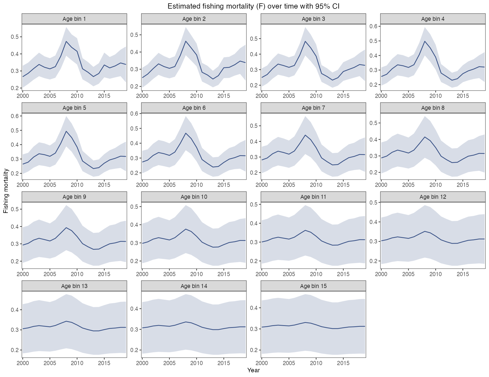](https://github.com/FanZhang-LAB-SHOU/ALSCL/blob/main/docs/figures/ytf/F_ACL_year.png?raw=true&v=6459bbc874c9)

年度示例的 F 为每年瞬时率；季度数据得到每季度率。不同模型的原生 F 维度不同。

F is an instantaneous rate per model step. Native F dimensions differ between the models.

[参数及默认值 / Arguments and defaults](https://github.com/FanZhang-LAB-SHOU/ALSCL/blob/main/docs/FUNCTION_REFERENCE.md#plot_fishing_mortality)


## 22. ACL 捕捞死亡率 age / ACL fishing mortality age

```r
# 绘制本图 / Draw this figure
plot_fishing_mortality(a, type = "age",
  se = TRUE, facet_ncol = 4, line_size = 0.6)
```

[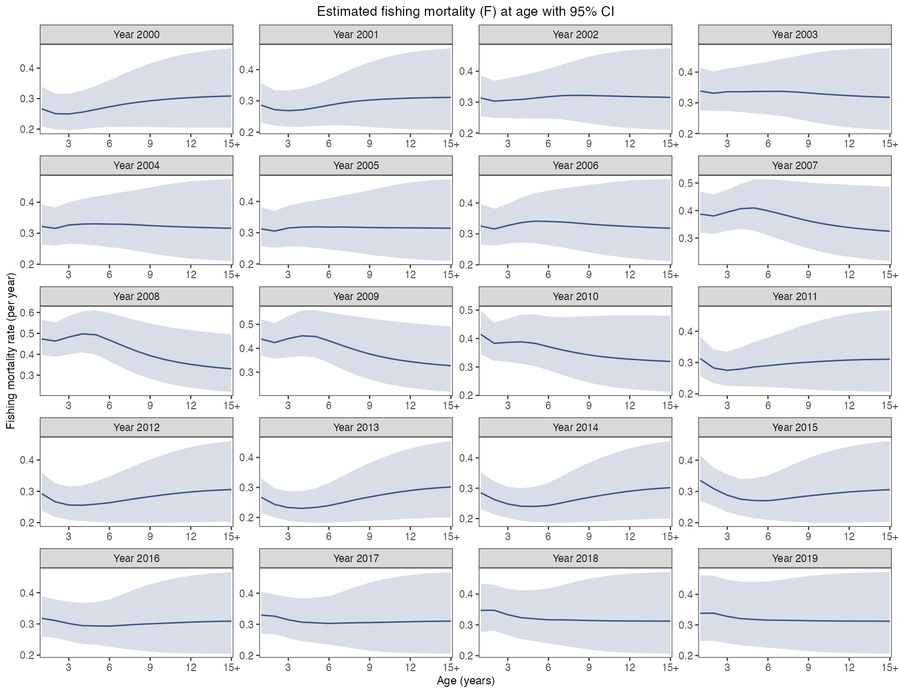](https://github.com/FanZhang-LAB-SHOU/ALSCL/blob/main/docs/figures/ytf/F_ACL_age.png?raw=true&v=fdd297ac4b33)

年度示例的 F 为每年瞬时率；季度数据得到每季度率。不同模型的原生 F 维度不同。

F is an instantaneous rate per model step. Native F dimensions differ between the models.

[参数及默认值 / Arguments and defaults](https://github.com/FanZhang-LAB-SHOU/ALSCL/blob/main/docs/FUNCTION_REFERENCE.md#plot_fishing_mortality)


## 23. ACL 捕捞死亡率 length / ACL fishing mortality length

```r
# 绘制本图 / Draw this figure
plot_fishing_mortality(a, type = "age",
  se = TRUE, facet_ncol = 4, line_size = 0.6)
```

[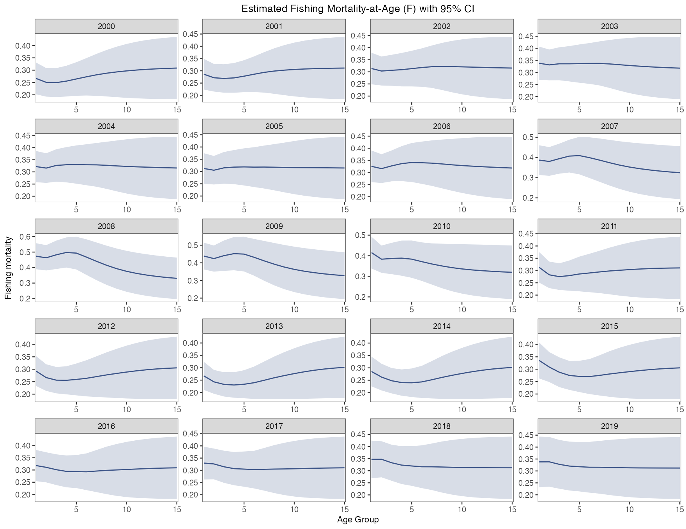](https://github.com/FanZhang-LAB-SHOU/ALSCL/blob/main/docs/figures/ytf/F_ACL_length.png?raw=true&v=fdd297ac4b33)

ACL 没有独立长度别 F；示例明确使用 age。旧 length 别名保留并警告，仍表示年龄别 F。

ACL has no independent F-at-length. Use age explicitly; the legacy length alias warns and still returns this age-specific plot.

[参数及默认值 / Arguments and defaults](https://github.com/FanZhang-LAB-SHOU/ALSCL/blob/main/docs/FUNCTION_REFERENCE.md#plot_fishing_mortality)


## 24. ALSCL 捕捞死亡率 year / ALSCL fishing mortality year

```r
# 绘制本图 / Draw this figure
plot_fishing_mortality(b, type = "year",
  se = TRUE, facet_ncol = 4, line_size = 0.6)
```

[](https://github.com/FanZhang-LAB-SHOU/ALSCL/blob/main/docs/figures/ytf/F_ALSCL_year.png?raw=true&v=8cc56a095b67)

年度示例的 F 为每年瞬时率；季度数据得到每季度率。不同模型的原生 F 维度不同。

F is an instantaneous rate per model step. Native F dimensions differ between the models.

[参数及默认值 / Arguments and defaults](https://github.com/FanZhang-LAB-SHOU/ALSCL/blob/main/docs/FUNCTION_REFERENCE.md#plot_fishing_mortality)


## 25. ALSCL 捕捞死亡率 age / ALSCL fishing mortality age

```r
# 绘制本图 / Draw this figure
plot_fishing_mortality(b, type = "age",
  se = TRUE, facet_ncol = 4, line_size = 0.6)
```

[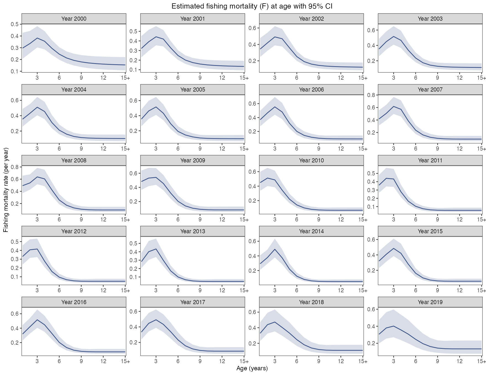](https://github.com/FanZhang-LAB-SHOU/ALSCL/blob/main/docs/figures/ytf/F_ALSCL_age.png?raw=true&v=0c7d455f97cc)

年度示例的 F 为每年瞬时率；季度数据得到每季度率。不同模型的原生 F 维度不同。

F is an instantaneous rate per model step. Native F dimensions differ between the models.

[参数及默认值 / Arguments and defaults](https://github.com/FanZhang-LAB-SHOU/ALSCL/blob/main/docs/FUNCTION_REFERENCE.md#plot_fishing_mortality)


## 26. ALSCL 捕捞死亡率 length / ALSCL fishing mortality length

```r
# 绘制本图 / Draw this figure
plot_fishing_mortality(b, type = "length",
  se = TRUE, facet_ncol = 4, line_size = 0.6)
```

[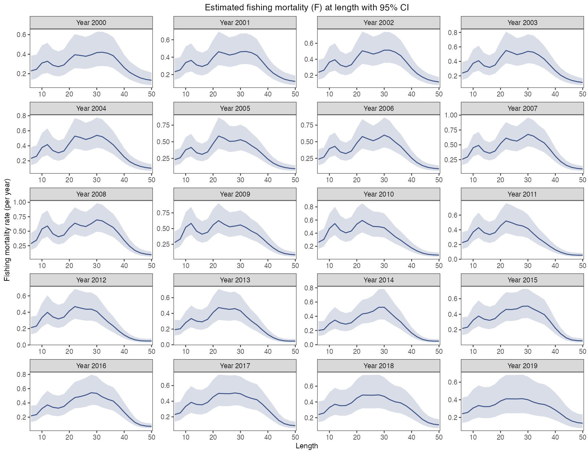](https://github.com/FanZhang-LAB-SHOU/ALSCL/blob/main/docs/figures/ytf/F_ALSCL_length.png?raw=true&v=3e7b72988619)

2.2.3 起，横轴为真实体长中点，按年份分面，阴影为近似 95% 区间。F 的单位为每模型时间步瞬时率。

Since 2.2.3, the horizontal axis uses actual length midpoints, with one panel per year and approximate 95% intervals. F is an instantaneous rate per model step.

[参数及默认值 / Arguments and defaults](https://github.com/FanZhang-LAB-SHOU/ALSCL/blob/main/docs/FUNCTION_REFERENCE.md#plot_fishing_mortality)


## 27. 对数残差 length / Log residuals length

`plot_ridges()` 和 `plot_residuals()` 使用保存的 `observations`，保留与拟合一致的正观测掩码；旧结果可读取 TMB 数据。NA 和拟合时排除的零值不会变成人造观测或零残差。整期缺测不绘制观测山脊；部分缺测时，观测比例只在有效正观测中归一化，预测比例则覆盖全部体长组，不能把它解释为未观测组也拟合良好。保留 `observations` 的拟合结果移除 `obj` 后仍可使用这两个绘图函数。

`plot_ridges()` and `plot_residuals()` use saved `observations` to preserve the same positive-observation mask as fitting; legacy fits can use their TMB data. NA and excluded zero cells are never converted to artificial observations or zero residuals. A wholly unobserved period has no observed ridge. With partial coverage, the observed ridge is normalized over observed positive cells, whereas predictions cover all bins: do not interpret this as agreement over unobserved bins. These plots work after removing `obj` from a fit that retains `observations`.

```r
# 绘制本图 / Draw this figure
plot_residuals(b, type = "length", facet_ncol = 4, line_size = 0.6,
  x_breaks = c(2000, 2010, 2015))
```

[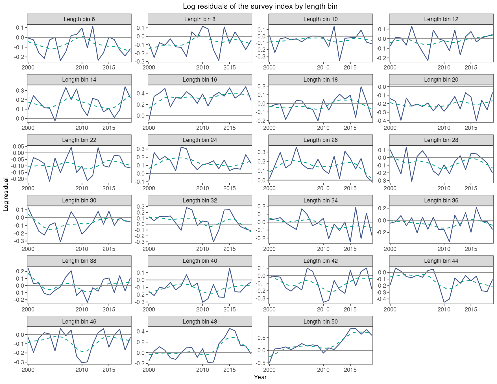](https://github.com/FanZhang-LAB-SHOU/ALSCL/blob/main/docs/figures/ytf/residuals_length.png?raw=true&v=b5821541998b)

观测对数减预测对数；未经标准差标准化。平滑线用于发现结构，不是显著性检验。每个分面按自身有效观测的不同横坐标数量选择趋势：少于 2 个不画平滑线，2–5 个使用线性趋势，至少 6 个使用 loess；需要时仅增加该分面的 span，以包含至少 5 个邻近点。稀疏尾部体长组不会删除或改变其他分面的趋势。

Observed minus fitted log index, without standardization. Smooth curves reveal structure, not significance. Each facet chooses its smoother independently using the number of distinct observed x values: fewer than two omit smoothing, two to five use a linear trend, and six or more use loess. The loess span is enlarged within that facet when needed for at least five neighbors. A sparse tail bin does not remove or change trends in other panels.

[参数及默认值 / Arguments and defaults](https://github.com/FanZhang-LAB-SHOU/ALSCL/blob/main/docs/FUNCTION_REFERENCE.md#plot_residuals)


## 28. 对数残差 year / Log residuals year

```r
# 绘制本图 / Draw this figure
plot_residuals(b, type = "year", facet_ncol = 4, line_size = 0.6,
  x_breaks = c(10, 30, 50))
```

[](https://github.com/FanZhang-LAB-SHOU/ALSCL/blob/main/docs/figures/ytf/residuals_year.png?raw=true&v=33d40c01318a)

观测对数减预测对数；未经标准差标准化。平滑线用于发现结构，不是显著性检验。每个分面按自身有效观测的不同横坐标数量选择趋势：少于 2 个不画平滑线，2–5 个使用线性趋势，至少 6 个使用 loess；需要时仅增加该分面的 span，以包含至少 5 个邻近点。稀疏尾部体长组不会删除或改变其他分面的趋势。

Observed minus fitted log index, without standardization. Smooth curves reveal structure, not significance. Each facet chooses its smoother independently using the number of distinct observed x values: fewer than two omit smoothing, two to five use a linear trend, and six or more use loess. The loess span is enlarged within that facet when needed for at least five neighbors. A sparse tail bin does not remove or change trends in other panels.

[参数及默认值 / Arguments and defaults](https://github.com/FanZhang-LAB-SHOU/ALSCL/blob/main/docs/FUNCTION_REFERENCE.md#plot_residuals)


## 29. 对数过程偏差 R / Log process deviations R

```r
# 绘制本图 / Draw this figure
plot_deviance(b, type = "R", log = TRUE, se = TRUE,
  facet_ncol = 3, point_size = 1.2, line_size = 0.5) +
  scale_x_continuous(breaks = c(2000, 2010, 2019), expand = expansion(mult = 0.04))
```

[](https://github.com/FanZhang-LAB-SHOU/ALSCL/blob/main/docs/figures/ytf/deviation_R_TRUE.png?raw=true&v=a9db81d17a07)

对数过程偏差以 0 为参照。这不是似然偏差统计量。

Log process deviations use zero as reference; these are not likelihood deviance statistics.

[参数及默认值 / Arguments and defaults](https://github.com/FanZhang-LAB-SHOU/ALSCL/blob/main/docs/FUNCTION_REFERENCE.md#plot_deviance)


## 30. 过程乘数 R / Process multipliers R

```r
# 绘制本图 / Draw this figure
plot_deviance(b, type = "R", log = FALSE, se = TRUE,
  facet_ncol = 3, point_size = 1.2, line_size = 0.5) +
  scale_x_continuous(breaks = c(2000, 2010, 2019), expand = expansion(mult = 0.04))
```

[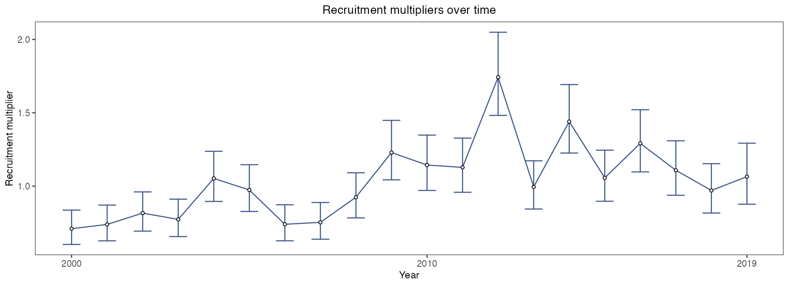](https://github.com/FanZhang-LAB-SHOU/ALSCL/blob/main/docs/figures/ytf/deviation_R_FALSE.png?raw=true&v=59993ea53790)

指数转换后以 1 为参照，区间不对称。这不是原尺度残差。

Exponentiated deviations use one as reference and asymmetric intervals; these are not original-scale residuals.

[参数及默认值 / Arguments and defaults](https://github.com/FanZhang-LAB-SHOU/ALSCL/blob/main/docs/FUNCTION_REFERENCE.md#plot_deviance)


## 31. 对数过程偏差 F / Log process deviations F

```r
# 绘制本图 / Draw this figure
plot_deviance(b, type = "F", log = TRUE, se = TRUE,
  facet_ncol = 3, point_size = 1.2, line_size = 0.5) +
  scale_x_continuous(breaks = c(2000, 2010, 2019), expand = expansion(mult = 0.04))
```

[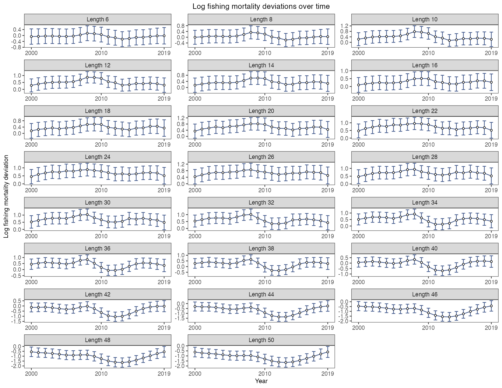](https://github.com/FanZhang-LAB-SHOU/ALSCL/blob/main/docs/figures/ytf/deviation_F_TRUE.png?raw=true&v=da77cce5c3aa)

对数过程偏差以 0 为参照。这不是似然偏差统计量。

Log process deviations use zero as reference; these are not likelihood deviance statistics.

[参数及默认值 / Arguments and defaults](https://github.com/FanZhang-LAB-SHOU/ALSCL/blob/main/docs/FUNCTION_REFERENCE.md#plot_deviance)


## 32. 过程乘数 F / Process multipliers F

```r
# 绘制本图 / Draw this figure
plot_deviance(b, type = "F", log = FALSE, se = TRUE,
  facet_ncol = 3, point_size = 1.2, line_size = 0.5) +
  scale_x_continuous(breaks = c(2000, 2010, 2019), expand = expansion(mult = 0.04))
```

[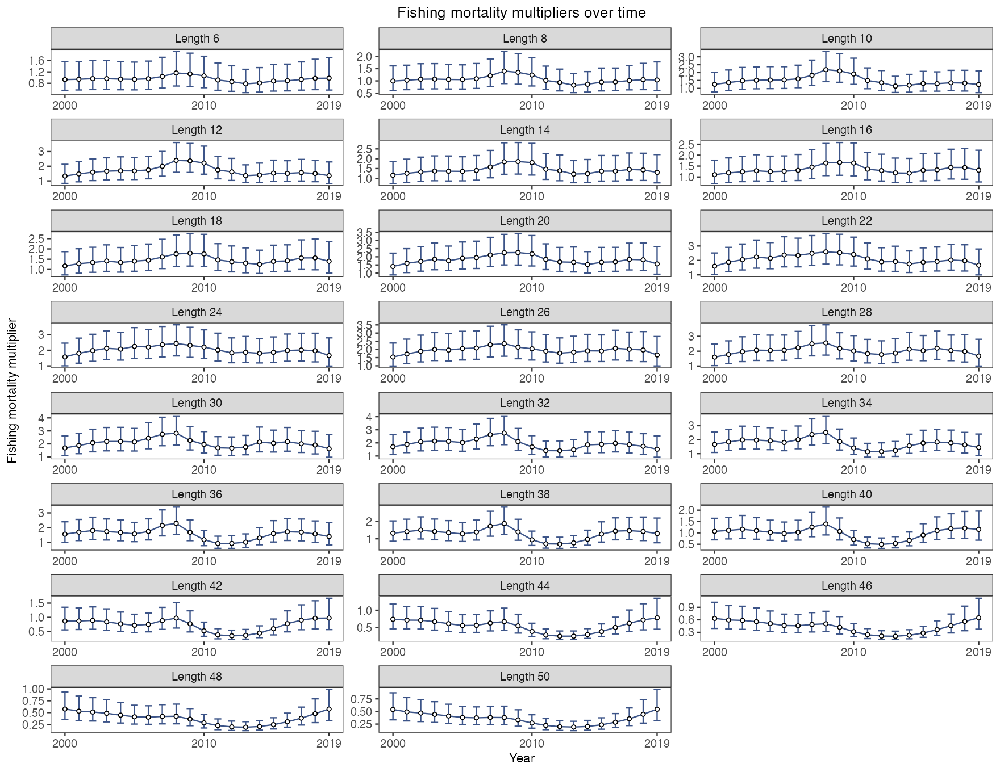](https://github.com/FanZhang-LAB-SHOU/ALSCL/blob/main/docs/figures/ytf/deviation_F_FALSE.png?raw=true&v=069999ae5a7e)

指数转换后以 1 为参照，区间不对称。这不是原尺度残差。

Exponentiated deviations use one as reference and asymmetric intervals; these are not original-scale residuals.

[参数及默认值 / Arguments and defaults](https://github.com/FanZhang-LAB-SHOU/ALSCL/blob/main/docs/FUNCTION_REFERENCE.md#plot_deviance)


## 33. 长度组成山脊图 / Length composition ridges

`plot_ridges()` 和 `plot_residuals()` 使用保存的 `observations`，保留与拟合一致的正观测掩码；旧结果可读取 TMB 数据。NA 和拟合时排除的零值不会变成人造观测或零残差。整期缺测不绘制观测山脊；部分缺测时，观测比例只在有效正观测中归一化，预测比例则覆盖全部体长组，不能把它解释为未观测组也拟合良好。保留 `observations` 的拟合结果移除 `obj` 后仍可使用这两个绘图函数。

`plot_ridges()` and `plot_residuals()` use saved `observations` to preserve the same positive-observation mask as fitting; legacy fits can use their TMB data. NA and excluded zero cells are never converted to artificial observations or zero residuals. A wholly unobserved period has no observed ridge. With partial coverage, the observed ridge is normalized over observed positive cells, whereas predictions cover all bins: do not interpret this as agreement over unobserved bins. These plots work after removing `obj` from a fit that retains `observations`.

```r
# 绘制本图 / Draw this figure
plot_ridges(b) # 默认 viridis 渐变 / Default viridis gradient
```

[](https://github.com/FanZhang-LAB-SHOU/ALSCL/blob/main/docs/figures/ytf/ridges.png?raw=true&v=0e54771c9642)

每期分别归一化；左为观测，右为拟合。不能由此读出总丰度趋势。保留 observations 的保存结果无需活跃 obj。

Each period is normalized separately: observations left, fit right. This does not show total abundance trends. Saved results retaining observations do not require a live obj.

[参数及默认值 / Arguments and defaults](https://github.com/FanZhang-LAB-SHOU/ALSCL/blob/main/docs/FUNCTION_REFERENCE.md#plot_ridges)


<a id="chapter-10"></a>
## 10 模型比较与真值 · Model comparisons

先完成第 04 章的 YTF 拟合，得到 `a`、`b`、`x`、`inputs`，并设置 `dat <- x$data.CatL`。加载 ggplot2 和 patchwork。第 11 章建立回溯对象 `ra/rb`。
First complete chapter 04, define `dat <- x$data.CatL`, and load ggplot2 and patchwork. Chapter 11 defines retrospective objects.

```r
library(ggplot2)
library(patchwork)
acl_theme_set(palette="npg", base_theme="theme_bw")
```

## 34. 种群时间序列比较 / Population time series comparison

同一模型的两份结果会自动使用不同图例，例如 `ACL (group_year)` 和 `ACL (year)`，仍支持显式指定不同的 `model1_name`、`model2_name`。时间序列与 F 图保留每份结果自己的真实年份，可以显示不同时间范围。与 `data.CatL` 配对的图会核对已知时间和体长元数据，再匹配观测与预测；网格不一致时明确报错。图形比较不代表似然或生物假设具有可比性。

Comparison plots give distinct default labels to two fits of the same model: for example, `ACL (group_year)` and `ACL (year)`. Explicit distinct `model1_name` and `model2_name` remain supported. Time-series and F plots retain each fit's own calendar, including different time spans. Plots paired with `data.CatL` check known time and length metadata before matching observations to predictions; inconsistent grids are errors. A visual comparison does not establish that likelihoods or biological assumptions are comparable.

```r
# 绘制本图 / Draw this figure
plot_compare_ts(a, b, se = TRUE, ncol = 2)
```

[](https://github.com/FanZhang-LAB-SHOU/ALSCL/blob/main/docs/figures/ytf/compare_ts.png?raw=true&v=92c7a56eb1fb)

只比较共同输出与相同时间窗；自由纵轴不能直接比较不同量的振幅。

Compare common quantities over the same time window. Free y axes preclude amplitude comparisons across quantities.

[参数及默认值 / Arguments and defaults](https://github.com/FanZhang-LAB-SHOU/ALSCL/blob/main/docs/FUNCTION_REFERENCE.md#plot_compare_ts)


## 35. 死亡率矩阵比较 / Fishing mortality matrices

```r
# 绘制本图 / Draw this figure
plot_compare_F(a, b) + scale_x_continuous(breaks = c(2000, 2010, 2019))
```

[](https://github.com/FanZhang-LAB-SHOU/ALSCL/blob/main/docs/figures/ytf/compare_F.png?raw=true&v=3a1e2b27586b)

ACL 纵轴是年龄，ALSCL 纵轴是长度；颜色可辅助观察，但两行不逐格对应。

ACL uses age and ALSCL length on the vertical axis; cells do not correspond one to one.

[参数及默认值 / Arguments and defaults](https://github.com/FanZhang-LAB-SHOU/ALSCL/blob/main/docs/FUNCTION_REFERENCE.md#plot_compare_F)


## 36. 残差联合诊断 / Combined residual diagnostics

**2.2.9 修订 / Changes in 2.2.9.** `plot_compare_residuals()` 和 `plot_compare_CatL()` 除时间及体长元数据外，也核对已知观测值及正观测掩码。请传原始拟合表；修改数值或将缺失单元改为观测会报错。没有保存观测的旧结果仍可使用，但无法完整核验观测匹配。比较图的观测点排除零值和 NA，与拟合约定一致；这些位置仍可显示预测曲线。

`plot_compare_residuals()` and `plot_compare_CatL()` verify known observations and their positive-observation mask as well as time and length metadata. Pass the original fitting table; changing its values or turning a missing cell into an observation is an error. Older fits without stored observations remain usable, but their observation alignment cannot be fully verified. Zero and NA observations are omitted from the comparison points, consistently with fitting; prediction curves remain available at those positions.

```r
# 绘制本图 / Draw this figure
plot_compare_residuals(a, b, dat)
```

[](https://github.com/FanZhang-LAB-SHOU/ALSCL/blob/main/docs/figures/ytf/compare_residuals.png?raw=true&v=fa4a3b4f8912)

包括直方图、QQ 图、年度残差和长度组箱线图。年度误差棒是标准差，不是置信区间。

Includes histograms, QQ plots, annual residuals and length-bin boxplots. Annual error bars represent SD, not confidence intervals.

[参数及默认值 / Arguments and defaults](https://github.com/FanZhang-LAB-SHOU/ALSCL/blob/main/docs/FUNCTION_REFERENCE.md#plot_compare_residuals)


## 37. 生长与外部参照接口 / Growth and reference-data interface

参考数据与排版辅助函数 / Reference data and layout helper:

```r
# 模拟参考生长点，并非论文实测 / Synthetic reference points, not paper observations
set.seed(42)
ref <- data.frame(Age = rep(1:15, each = 5))
ref$Length <- VB_func(60, .2, 1/60, ref$Age) + rnorm(nrow(ref), 0, 2)
growth_display <- function(p) {
  p[[1]] <- p[[1]] + labs(subtitle = paste(strsplit(
    p[[1]]$labels$subtitle, " | ", fixed=TRUE)[[1]], collapse="\n")) +
    theme(legend.text=element_text(size=7))
  p[[2]] <- p[[2]] + scale_x_continuous(breaks=c(1,5,10,15))
  p
}
```

```r
# 绘制本图 / Draw this figure
growth_display(plot_compare_growth(a, b, age_range = c(1, 15), ref_data = ref, ref_name = "Synthetic reference",
    nls_start = list(Linf = 60, k = 0.2, t0 = 1/60)))
```

[](https://github.com/FanZhang-LAB-SHOU/ALSCL/blob/main/docs/figures/ytf/compare_growth.png?raw=true&v=8415934e346c)

灰色参照曲线来自模拟 Age 与 Length；不代表论文实测生长。提供 `ref_data` 时，`ref_name` 必须是一个非空字符串，且不能与任一模型名称相同。名称用于标识独立的参照曲线；重复名称会在拟合参照曲线前报错。

The reference curve uses synthetic Age and Length data, not empirical measurements from the paper. When `ref_data` is supplied, `ref_name` must be one nonempty string and differ from both model names. The name identifies a separate reference curve; duplicate names are rejected before fitting the reference.

[参数及默认值 / Arguments and defaults](https://github.com/FanZhang-LAB-SHOU/ALSCL/blob/main/docs/FUNCTION_REFERENCE.md#plot_compare_growth)


## 38. 两模型调查拟合 / Survey fits from both models

**2.2.9 修订 / Changes in 2.2.9.** `plot_compare_residuals()` 和 `plot_compare_CatL()` 除时间及体长元数据外，也核对已知观测值及正观测掩码。请传原始拟合表；修改数值或将缺失单元改为观测会报错。没有保存观测的旧结果仍可使用，但无法完整核验观测匹配。比较图的观测点排除零值和 NA，与拟合约定一致；这些位置仍可显示预测曲线。

`plot_compare_residuals()` and `plot_compare_CatL()` verify known observations and their positive-observation mask as well as time and length metadata. Pass the original fitting table; changing its values or turning a missing cell into an observation is an error. Older fits without stored observations remain usable, but their observation alignment cannot be fully verified. Zero and NA observations are omitted from the comparison points, consistently with fitting; prediction curves remain available at those positions.

```r
# 绘制本图 / Draw this figure
plot_compare_CatL(a, b, dat, years = c(2000, 2005, 2010, 2015), ncol = 2)
```

[](https://github.com/FanZhang-LAB-SHOU/ALSCL/blob/main/docs/figures/ytf/compare_CatL.png?raw=true&v=20206096e520)

显示 4 个指定年份；省略 years 将显示全部年份。点为调查数据，线为拟合中位数。纵轴为调查指数，不是捕获量；自定义标签使用 ylab$survey。

Four selected years are shown. Omit years to show all periods. Points are observations and curves fitted medians. The vertical axis is a survey index, not catch abundance; use ylab$survey for a custom label.

[参数及默认值 / Arguments and defaults](https://github.com/FanZhang-LAB-SHOU/ALSCL/blob/main/docs/FUNCTION_REFERENCE.md#plot_compare_CatL)


## 39. 拟合指标比较 / Fit metric comparison

```r
# 绘制本图 / Draw this figure
plot_compare_metrics(a, b, dat, ncol = 2) & scale_y_continuous(expand = expansion(mult = c(0,
    0.3)))
```

[](https://github.com/FanZhang-LAB-SHOU/ALSCL/blob/main/docs/figures/ytf/compare_metrics.png?raw=true&v=1dd25e70ecf3)

当前数据由年龄模型生成。图示差异不能证明任一模型普遍较优；IC 还需要相同数据与似然口径。

The generating model is age based. This comparison cannot establish universal superiority; information criteria also require comparable data and likelihoods.

[参数及默认值 / Arguments and defaults](https://github.com/FanZhang-LAB-SHOU/ALSCL/blob/main/docs/FUNCTION_REFERENCE.md#plot_compare_metrics)


## 40. 固定调查可捕性 / Fixed survey catchability

```r
# 绘制本图 / Draw this figure
plot_compare_selectivity(a, b)
```

[](https://github.com/FanZhang-LAB-SHOU/ALSCL/blob/main/docs/figures/ytf/compare_selectivity.png?raw=true&v=95e7157ec17b)

当前函数展示输入 q 的连接线，不是估计的渔业选择性。两模型使用同一输入，曲线重合。

This function connects the input survey q; it does not estimate fishery selectivity. Identical inputs produce overlapping curves.

[参数及默认值 / Arguments and defaults](https://github.com/FanZhang-LAB-SHOU/ALSCL/blob/main/docs/FUNCTION_REFERENCE.md#plot_compare_selectivity)


## 41. 总体 F 比较 apical / Summary F comparison apical

```r
# 绘制本图 / Draw this figure
plot_compare_annual_F(a, b, method = "apical") +
  labs(title = "Apical fishing mortality")
```

[](https://github.com/FanZhang-LAB-SHOU/ALSCL/blob/main/docs/figures/ytf/compare_F_apical.png?raw=true&v=a22655e57f3c)

apical 取最大值，mean 取组间算术平均，均非丰度加权。函数名称含 annual，但不会自动把季度率年化。

Apical is the maximum; mean is an unweighted group average. Despite its name, the function does not annualize quarterly rates.

[参数及默认值 / Arguments and defaults](https://github.com/FanZhang-LAB-SHOU/ALSCL/blob/main/docs/FUNCTION_REFERENCE.md#plot_compare_annual_F)


## 42. 总体 F 比较 mean / Summary F comparison mean

```r
# 绘制本图 / Draw this figure
plot_compare_annual_F(a, b, method = "mean") +
  labs(title = "Mean fishing mortality")
```

[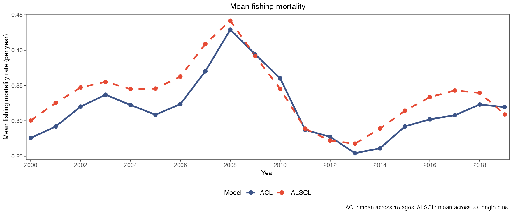](https://github.com/FanZhang-LAB-SHOU/ALSCL/blob/main/docs/figures/ytf/compare_F_mean.png?raw=true&v=7ebefc35c147)

apical 取最大值，mean 取组间算术平均，均非丰度加权。函数名称含 annual，但不会自动把季度率年化。

Apical is the maximum; mean is an unweighted group average. Despite its name, the function does not annualize quarterly rates.

[参数及默认值 / Arguments and defaults](https://github.com/FanZhang-LAB-SHOU/ALSCL/blob/main/docs/FUNCTION_REFERENCE.md#plot_compare_annual_F)


## 45. 模拟真值与条件估计 / Simulation truth and conditional estimates

```r
# 将生成真值与报告中的估计对齐 / Align truth and fitted reports
years <- a$year
truth <- data.frame(Year=rep(years,3),
  Quantity=rep(c("B","SSB","Rec"),each=length(years)),
  Truth=c(x$truth$TB,x$truth$SSB,x$truth$Rec))
estimates <- rbind(
  data.frame(Year=rep(years,3),Quantity=truth$Quantity,
    Value=c(a$report$B,a$report$SSB,a$report$Rec),Model="ACL"),
  data.frame(Year=rep(years,3),Quantity=truth$Quantity,
    Value=c(b$report$B,b$report$SSB,b$report$Rec),Model="ALSCL"))
```

```r
# 绘制本图 / Draw this figure
ggplot(estimates, aes(Year, Value, color = Model)) + geom_line() + scale_color_manual(values = setNames(acl_theme("compare_colors"),
    c("ACL", "ALSCL"))) + geom_line(data = truth, aes(Year, Truth), inherit.aes = FALSE, linetype = 2) +
    facet_wrap(~Quantity, scales = "free_y", ncol = 1) + theme_bw() + theme(panel.grid.major = element_blank(), panel.grid.minor = element_blank()) + labs(y = NULL)
```

[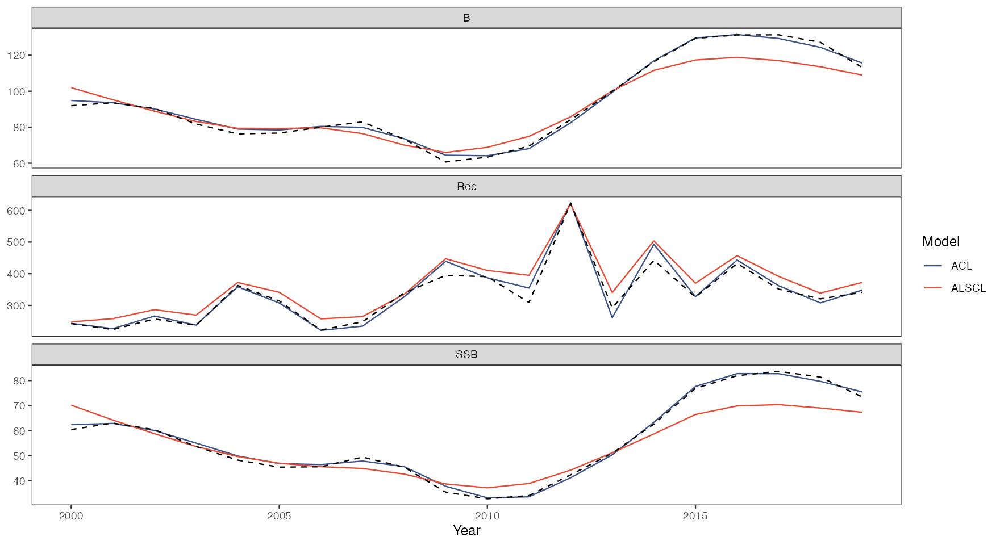](https://github.com/FanZhang-LAB-SHOU/ALSCL/blob/main/docs/figures/ytf/truth.png?raw=true&v=a10cc16cca33)

黑虚线为生成真值；固定生物参数，且模拟与拟合的补充过程不同。

Black dashed curves are generating truth. Biology is fixed; recruitment processes differ.

调查拟合图标题表示调查指数，山脊图标题表示调查体长组成，两者都不是渔业捕获量估计。过程偏差图在 `log = TRUE` 时标为对数偏差（参照值 0），在 `log = FALSE` 时标为乘数（参照值 1）。取指数只改变尺度，不改变已拟合的过程；两者都不是似然偏差统计量。

Survey-fit titles refer to survey indices, and ridge titles refer to survey length compositions; neither is a fishery catch estimate. In process-deviation plots, `log = TRUE` labels log deviations (reference value 0), while `log = FALSE` labels multiplicative factors (reference value 1). Exponentiation changes the scale, not the underlying fitted process; neither quantity is a likelihood deviance statistic.


<a id="chapter-11"></a>
## 11 回溯分析 · Retrospectives

```r
# 删除最后 1、2、3 个时间步后分别重拟合 / Refit after peeling 1, 2 and 3 steps
ra <- retro_acl(x, nyear = 3, train_times = 2, silent = TRUE)
rb <- retro_alscl(x, nyear = 3, train_times = 2, silent = TRUE)
plot_retro(rb, facet_col = 2, rho_digits = 3)
rb$fit_diagnostics
rb$rho_by_peel
rb$rho_text
```

这里 `nyear` 是删除的**末端时间步数**，季度数据中 4 步才是一年。保留至少两个观测期，各次回溯使用一致的生物假设与固定参数。Mohn's rho 衡量末端修订方向和幅度，不是未来预测准确率，也不能替代检查每次拟合的数值状态。

Here `nyear` counts terminal **steps**: four quarterly steps equal one year. Retain at least two observations and keep assumptions consistent across peels. Mohn's rho measures retrospective revision, not forecast accuracy; inspect each fit's numerical status.

2.2.3 起，同一份正式数据 `x` 可直接传给 `retro_acl()`、`retro_alscl()`；也可用 `retro_model(data.CatL = x, model_type = "alscl", nyear = 3)`。显式参数覆盖 x 中的设置，`map = NULL` 等覆盖仍被保留。`zero_action`、`control` 和 `nstarts` 会传到各次拟合。`ncores` 在这里表示并行回溯轮数，默认 1；x 中用于多起点拟合的 ncores 不会自动变成回溯并行数，每轮内部依次运行 nstarts 个起点。

Since 2.2.3, the same own-data bundle works with both retrospective wrappers or `retro_model(data.CatL = x, model_type = "alscl", nyear = 3)`. Explicit arguments override stored settings, including `map = NULL`. Each fit receives zero_action, control and nstarts. Here ncores explicitly selects peel workers (default 1); stored fitting ncores is not reused. Starts within each fit run sequentially.

`fit_diagnostics` 保留完整拟合（Peel = 0）和各轮的优化代码、最大梯度、Hessian、边界及错误。只要完整拟合或任一要求的回溯不合格，或末端相对差无定义，对应的 `rho_text$Rho` 就是 NA，并发出警告，不会悄悄删除失败轮次。`rho_by_peel` 的 RawRho 和 `raw_rho_text` 仅供追查原始数值，不是可靠结论；`plot_retro()` 也会标明不可用的 rho。数值筛查通过仍不等于模型适合数据。

`fit_diagnostics` retains the full fit (Peel = 0) and every peel's raw code, maximum gradient, Hessian, boundaries and error. If the full fit or any requested peel fails its numerical screen, or a terminal relative difference is undefined, the corresponding rho_text$Rho is NA with a warning. Failed peels are not silently dropped. RawRho in rho_by_peel and raw_rho_text are exploratory records only; plots label unavailable rho. Passing a numerical screen does not establish model adequacy.


```r
# 从仓库根目录重建图、结果 CSV 和会话记录 / Rebuild figures, CSV and session record
source("scripts/ytf_workflow.R", encoding = "UTF-8")
result <- run_ytf_guide(out = "my_ytf_guide", npeels = 3)
# 使用保存的观测绘图 / Plot using the stored observations
plot_ridges(result$alscl)
```

默认输出目录为 `docs`，会覆盖同名图和结果文件；使用自己的目录可保留仓库版本。工作流依赖 `ggplot2`、`patchwork`、`jsonlite`。首次 TMB 编译需要编译器，回溯要执行多次优化。可设置 `options(ALSCL.tmb.cache="可写路径")`；保存 `.rds` 不能保证其中 TMB 外部指针跨会话有效，重新打开 R 后应重拟合依赖活跃 `obj` 的操作。

The default output is `docs` and overwrites matching outputs; choose another folder to preserve bundled files. The workflow requires ggplot2, patchwork and jsonlite. Initial compilation needs a compiler, and retrospectives involve multiple fits. A writable TMB cache can be configured. Saved R objects do not preserve usable TMB external pointers across sessions; refit for operations requiring a live `obj`.

### 全部拟合失败时保留诊断 / Retaining diagnostics when every fit fails

当全部回溯拟合失败或没有有限轨迹时，`plot = TRUE` 会警告并返回 `plot = NULL`，同时保留 `fit_diagnostics`、`errors` 及不可用的 rho。应根据这些字段修正输入或拟合设置。请求绘图不再阻止读取失败记录。

When all retrospective fits fail or no finite trajectories remain, `plot = TRUE` now warns and returns `plot = NULL` while preserving `fit_diagnostics`, `errors` and the unavailable rho values. Inspect those fields to correct the input or fitting problem. Requesting a plot must not prevent access to the failure record.

### 按时期截短映射 / Time-dependent maps

回溯子拟合会随保留时期同步截短 `map$dev_log_R` 与 `map$dev_log_F`。请提供完整数据长度的映射：补充量每期一项；F 按组别×时期矩阵的列顺序排列，ACL 使用年龄组、ALSCL 使用体长组，`F_structure = "year"` 只有一组。因子共享关系和固定的 NA 项会保留；完整映射长度错误会明确报错。标量映射及 `dev_log_N0` 不随回溯截短。

Retrospective peels shorten time-dependent `map$dev_log_R` and `map$dev_log_F` with the retained periods. Supply maps for the full dataset: recruitment uses one entry per period; F uses group-by-time column order (age groups for ACL, length groups for ALSCL, one group for `F_structure = "year"`). Factor ties and fixed NA entries are retained. Invalid full-data map lengths are rejected. Scalar maps and `dev_log_N0` do not change with a peel.
## Mohn rho 的含义 · Meaning of Mohn's rho

对每个删除末端数据的拟合，在其最后保留期与完整拟合同期的估计比较，再取相对差的平均：
Compare each peeled estimate with the full fit at that peel's terminal period, then average relative differences:

```math
\rho=\frac{1}{K}\sum_{k=1}^{K}\frac{\hat\theta^{(-k)}_{T-k}-\hat\theta^{(0)}_{T-k}}{\hat\theta^{(0)}_{T-k}}.
```

正值表示较短序列在这些终点总体偏高，负值表示偏低；正负可能互相抵消。检查每条曲线与每次拟合，而不只报告单个 rho 数字。全长基准为零时相对差没有定义，应检查数据与结果。
Positive rho means shorter fits tend to be higher at their terminal periods; signs can cancel. Inspect individual trajectories and fits. A zero full-fit denominator makes the relative difference undefined.


## 43. ACL 回溯分析 / ACL retrospective analysis

```r
# 绘制本图 / Draw this figure
plot_retro(ra, facet_col = 2, rho_digits = 3, rho_size = 3, point_size = 1, line_size = 0.6)
```

[](https://github.com/FanZhang-LAB-SHOU/ALSCL/blob/main/docs/figures/ytf/retro_ACL.png?raw=true&v=920438715eb7)


逐步删除末端观测并重拟合；各颜色代表不同截止期。 / Successively peel terminal observations and refit; colors indicate different terminal periods.

[参数及默认值 / Arguments and defaults](https://github.com/FanZhang-LAB-SHOU/ALSCL/blob/main/docs/FUNCTION_REFERENCE.md#plot_retro)


## 44. ALSCL 回溯分析 / ALSCL retrospective analysis

```r
# 绘制本图 / Draw this figure
plot_retro(rb, facet_col = 2, rho_digits = 3, rho_size = 3, point_size = 1, line_size = 0.6)
```

[](https://github.com/FanZhang-LAB-SHOU/ALSCL/blob/main/docs/figures/ytf/retro_ALSCL.png?raw=true&v=d49e0acf2091)


逐步删除末端观测并重拟合；各颜色代表不同截止期。 / Successively peel terminal observations and refit; colors indicate different terminal periods.

[参数及默认值 / Arguments and defaults](https://github.com/FanZhang-LAB-SHOU/ALSCL/blob/main/docs/FUNCTION_REFERENCE.md#plot_retro)


<a id="chapter-12"></a>
## 12 年度与季度案例 · Annual and quarterly cases

两案例重新使用当前包拟合。它们用于学习年度/季度工作流，不能替代原论文数据复现；单个随机重复也不能给两个模型排名。所有拟合图的通用操作仍以 `YTF_example` 为主线。

Both cases are refitted with the current package to teach annual and quarterly workflows. They do not reproduce the paper's data, and one replicate cannot rank the models. General plotting lessons continue to use `YTF_example`.

| 设置 / Setting | 黄尾鲽 Flatfish | 大眼金枪鱼 Tuna |
|---|---|---|
| 生成动力学 / Generator | age_based | length_based |
| 时间步 / Step, years | 1 | 0.25 |
| 总年数 / 预热年数 · Total / burn-in | 100 / 80 | 100 / 95 |
| 保留步数 / Retained steps | 20 | 20 |
| rec.age / nage | 1 / 15 | 0.25 / 20 |
| Linf / annual k | 60 / 0.20 | 152 / 0.38 |
| t0, years | 1/60 | 1/152 |
| M / mean F, per step | 0.20 / 0.30 | 0.20 / 0.20 |
| 成熟 L50/L95 · Maturity | 35 / 40 | 100 / 120 |
| 调查 q L50/L95 · Survey | 15 / 20 | 30 / 50 |
| 长度中点 / Midpoints | 6, 8, …, 50 | 12.5, 17.5, …, 122.5 |
| 调查 log SD / Survey log SD | 0.20 | 0.10 |

这里 flatfish 的调查 SD = 0.20，主线 `YTF_example` 则沿用 YTF 的 0.10，不能混称同一数据。tuna 的 M = 0.2 为每季度率。长度与体重单位必须与幂函数系数匹配；示例年份从 2000 开始仅用于坐标标签。

The flatfish preset uses survey SD 0.20, while `YTF_example` retains YTF's 0.10. Tuna M is per quarter. Units must match the length-weight coefficients; dates starting in 2000 are illustrative.

## 读取和重建 · Read and rebuild

```r
# 读取已有案例 / Read the supplied cases
source("scripts/real_data_workflow.R", encoding="UTF-8")
flatfish_inputs <- read_survey_csv("docs/data/cases/flatfish")
tuna_inputs <- read_survey_csv("docs/data/cases/tuna")
validate_survey_tables(flatfish_inputs, growth_step=1)
validate_survey_tables(tuna_inputs, growth_step=.25)
pa <- readRDS("docs/data/cases/tuna/truth.rds")$parameters
str(pa)
# 重新产生数据 / Regenerate inputs
source("scripts/simulation_workflow.R", encoding="UTF-8")
simulations <- run_simulation_examples(out="my_simulations", fit_batch=FALSE)
# 重跑两个案例的拟合和七张图 / Refit both cases and regenerate seven figures
source("scripts/case_studies.R", encoding="UTF-8")
case_status <- run_case_studies(out="docs")
```

最后一行读取 `out/data/cases` 的已保存真值并将输出写入同一目录下。要换目录，先复制案例输入及真值。完整拟合初值、map 和生物参数构造均在 [case_studies.R](https://github.com/FanZhang-LAB-SHOU/ALSCL/blob/main/scripts/case_studies.R)，数据下载见 [两个案例目录](https://github.com/FanZhang-LAB-SHOU/ALSCL/blob/main/docs/data/cases/README.md)。

The final call reads saved truth from `out/data/cases` and writes results under `out`. Copy these inputs first when choosing another directory. The linked R script defines every starting value, map and biological argument.

## 年度黄尾鲽 · Annual flatfish


颜色为 log10 调查数量指数。沿时间和体长延伸的条带可反映队列结构；它们仍同时受调查可捕性和观测误差影响。

Colors encode log10 survey numbers. Cohort patterns are modified by catchability and observation noise.


生长曲线决定年龄与平均长度的联系；成熟概率和调查 q 有不同的 L50/L95，不可相互替代。

The growth curve links age to mean length. Maturity and survey q use different L50/L95 values and are not interchangeable.


黑虚线为生成真值，彩色线是固定部分生物参数的条件估计。比较每种量的趋势和偏移；同一时期曲线接近并不证明所有参数可识别。

Black dashed curves are generating truth; colored curves are conditional estimates. Compare trajectories and offsets without treating agreement as proof of identifiability.

## 季度大眼金枪鱼 · Quarterly tuna


20 个保留步长覆盖 5 年，非 20 年。物种预设同时改变生成动力学、长度组、年龄网格及生物参数。

Twenty retained quarters span five years, not twenty. The preset changes dynamics, bins, ages and biological parameters together.


tuna 由长度型过程生成；拟合仍要明确 `growth_step=.25`。案例固定了真实生长、CV、部分过程离散及相关参数，估计的区间不能覆盖这些假设本身的误差。

Tuna is generated with length-based dynamics and fitted with an explicit quarterly step. Known growth, CV and selected process/correlation parameters are fixed; conditional uncertainty omits errors in those assumptions.

## 如何扩展为模拟实验 · Extend into a simulation study

改变 `iter_range` 生成多个随机重复；系统改变观测误差、M、q、长度分箱或数据长度。保留所有失败拟合和诊断，再汇总偏差、RMSE、区间覆盖率及回溯表现。仅平均“成功重复”会形成选择偏差。

Use multiple seeds and vary observation noise, M, q, binning or series length systematically. Retain failed fits before summarizing bias, RMSE, coverage and retrospectives; averaging only successful fits introduces selection bias.

[本次四个拟合的数值状态 / Four-fit convergence record](https://github.com/FanZhang-LAB-SHOU/ALSCL/blob/main/docs/results/case_convergence.csv)。

<a id="chapter-13"></a>
## 13 ggsci 配色与导出 · Colors and export

先完成[使用指南](https://github.com/FanZhang-LAB-SHOU/ALSCL/blob/main/docs/USER_GUIDE.md)中的内置 YTF 拟合，得到 `a`、`b` 和 `x`。下面先建立回溯结果 `rb`，再调整图形；回溯含义见指南第 9 节。

First complete the bundled YTF fit in the [user guide](https://github.com/FanZhang-LAB-SHOU/ALSCL/blob/main/docs/USER_GUIDE.md) to create `a`, `b` and `x`. The following block creates the retrospective result `rb` before styling it; section 9 explains retrospectives.

默认使用 **ggsci NPG**。单模型估计用深蓝，观测用朱红；两模型比较按模型顺序使用深蓝、朱红；回溯按截止期从新到旧分配 NPG 原生颜色。设置在创建图时生效，已有图对象不会自动重绘。

The default is **ggsci NPG**: navy estimates, vermilion observations, and navy/vermilion model comparisons. Retrospective colors follow descending terminal periods. Settings affect newly created plots, not existing objects.

```r
# 建立回溯结果 / Create the retrospective result
rb <- retro_alscl(x, nyear = 3, train_times = 2, ncores = 1, silent = TRUE)

# 一次设置，随后重新创建图 / Set once, then recreate plots
acl_theme_set(palette = "npg", base_theme = "theme_bw", font_family = "sans")
plot_retro(rb, facet_col = 2, rho_digits = 3)
plot_compare_ts(a, b, se = TRUE)

# 可选期刊色板 / Alternative journal palettes
acl_theme_set(palette = "jama") # npg, aaas, nejm, lancet, jama
plot_abundance(b, type = "NL", facet_ncol = 3)

# 单图覆盖优先于全局设置 / Per-call overrides take precedence
plot_retro(rb, palette = "nejm", rho_position = "top_left")
plot_retro(rb, colors = c("2019" = "#3C5488", "2018" = "#E64B35",
                         "2017" = "#00A087", "2016" = "#4DBBD5"))
plot_SSB(b, line_color = "#00A087", se = TRUE, se_color = "#00A087")
plot_compare_ts(a, b, colors = c("ACL" = "#3C5488", "ALSCL" = "#E64B35"))

# 连续量使用浅到深渐变 / Sequential gradients encode continuous quantities
plot_pla(b)                         # 全局端点 / Global endpoints
plot_compare_F(a, b, palette = "npg")
plot_compare_F(a, b, palette = "inferno") # 其他渐变 / Another gradient
plot_ridges(b)                      # 默认 viridis 年份渐变 / Default time gradient
plot_ridges(b, palette = "cividis")
acl_theme_set(ylab = list(year = "Survey year")) # 山脊图时间轴 / Ridge time axis
plot_ridges(b, palette = c("#E8F1FA", "#3C5488"))

# 恢复默认 / Restore defaults
acl_theme_reset()
```

山脊图 `plot_ridges()` 独立使用 **viridis 连续渐变**，按输入年份顺序取色，两侧观测与拟合使用相同的年份颜色。它不继承全局 ggsci 分类色板；`palette=NULL` 也使用 viridis。可改为 `"cividis"`、`"plasma"`、`"ocean"`，或提供两个以上颜色作为渐变端点。

Ridges independently use the **sequential viridis gradient**, sampled in input-year order and shared by observed and fitted panels. They do not inherit the global ggsci categorical palette; NULL also selects viridis. Choose cividis, plasma, ocean, or a vector of gradient colors for an alternative.

`plot_retro(colors=...)` 的命名向量必须覆盖本次结果的所有截止期；无名称时按截止期降序对应。普通 `retro_*` 拟合入口通过全局主题控制自动生成的图；对已返回结果调用 `plot_retro()` 可单独改色。

Named retrospective colors must cover every terminal period; unnamed colors follow descending periods. Use the global theme for automatic plots from `retro_*`, or call `plot_retro()` on the returned result for per-plot styling.

| 设置 / Setting | 范围与优先级 / Scope and precedence |
|---|---|
| `palette` | `npg`（10 色）、`aaas`（10）、`nejm`（8）、`lancet`（9）、`jama`（7）；切换时重设色彩角色 / Switching resets derived roles |
| `line_color`, `se_color`, `point_color` | 单模型线、区间、散点；NULL 继承主题 / Single-model lines, intervals and scatter |
| `observed_color`, `smooth_color`, `hline_color` | 观测、残差平滑和零参考线 / Observation, residual smoother and reference |
| `compare_colors` | 模型 1、模型 2；可按模型名称匹配 / Model pair, optionally matched by name |
| `low_col`, `high_col` | 连续热图端点；不把分类色板当数值刻度 / Sequential heatmap endpoints |
| `font_family`, `title_size`, `axis_text_size`, `strip_text_size` | 字体、标题、刻度与分面文字 / Typography |
| `line_size` / `linewidth` | 单模型 / 比较图线宽，按函数签名使用 / Function-specific line width |
| `facet_ncol` / `facet_col` / `ncol` | 单模型 / 回溯 / 比较图分面列数 / Function-specific layout |

当类别数超过色板原生颜色数，回溯图使用插值扩展，**不代表 ggsci 原生提供了更多独立类别色**。大量回溯应减少同时展示的期数，或显式提供经过检查的命名颜色；打印时也要检查线型和端点。

Beyond native palette size, retrospective colors are interpolated. These are not additional native categorical colors. For many peels, show fewer at once or supply reviewed named colors; check lines and endpoints in print.

```r
# 调整文字与布局 / Typography and layout
acl_theme_set(palette="npg", title_size=16, axis_title_size=12,
              axis_text_size=10, strip_text_size=10, title_hjust=0,
              compare_legend_pos="bottom", compare_linetypes=c("solid","dashed"))
p <- plot_retro(rb, facet_col=2, point_size=1.8, line_size=.8)
ggplot2::ggsave("retrospective.png", p, width=11, height=7, dpi=300, bg="white")
ggplot2::ggsave("retrospective.pdf", p, width=11, height=7)
# 保存并恢复主题；无参数 acl_theme_set() 不会重置 / Preserve settings explicitly
old <- acl_theme()
acl_theme_set(palette="aaas")
do.call(acl_theme_set, old)
acl_theme_reset()
```

可显式指定颜色；默认颜色参数为 `NULL`，从全局主题取值。改变 `line_color` 不会自动改变 `se_color`；要让自定义线与区间同色，请一起指定。`palette` 与颜色同时传入时，显式颜色优先。

Explicit colors override the theme; `NULL` color arguments inherit it. Changing `line_color` alone does not change `se_color`; specify both to match custom ribbons. Explicit colors win when supplied together with a palette.

色板来源：[ggsci NPG documentation](https://nanx.me/ggsci/reference/pal_npg.html)。

### 2.2.5 默认无网格线

所有包内绘图默认去掉主、次面板网格线，包括模型比较和回溯图；配色、置信区间及坐标轴保留原设置。升级后需重新创建旧图，才会应用新默认值。以下使用完整拟合示例中的 `b`，对旧图或手写 ggplot 图明确应用无网格样式：

```r
p <- plot_SSB(b, se = TRUE)
p + ggplot2::theme(panel.grid.major = ggplot2::element_blank(),
                   panel.grid.minor = ggplot2::element_blank())
```

### Grid-free defaults in 2.2.5

All package plotting functions omit major and minor panel gridlines by default, including comparison panels and retrospectives. Colours, confidence intervals and axes retain their existing settings. Recreate an old plot after upgrading to apply the new defaults. Using `b` from the worked fitting example, explicitly apply the grid-free style to an older plot or a hand-written ggplot:

```r
p <- plot_SSB(b, se = TRUE)
p + ggplot2::theme(panel.grid.major = ggplot2::element_blank(),
                   panel.grid.minor = ggplot2::element_blank())
```

2.2.6 进一步保证 SSB、丰度、生物量、捕获量、偏差和捕捞死亡率图在主题加载失败后的回退路径也不显示网格。显式指定的主题仍优先。说明书的 ggplot 导出统一检查各子图的主、次网格；发现网格时停止导出并保留原文件。正式 2.2.6 下载包包含更新后的帮助图片。

Version 2.2.6 also keeps SSB, abundance, biomass, catch, deviation and fishing-mortality plots grid-free if theme loading fails. Explicit theme choices remain available. Manual ggplot exports check major and minor grids in every panel; a visible grid stops export without replacing an existing file. The 2.2.6 release archive includes the refreshed help images.

### 2.2.7 的保存结果与不确定性

丰度图按矩阵位置和拟合结果中的 `year`、`len_label` 对齐。给 `report$NA` 或 `report$NL` 添加行列名称，不会改变年份或组别对应关系。保存结果时应一起保留矩阵原有顺序和拟合元数据。

丰度、补充量和过程偏差的区间需要完整的有限估计值，以及有限、非负的标准误。标准误缺失、非法或不完整时会明确报错。只需绘制估计值时使用 `se = FALSE`；过程偏差图此时读取 `report$dev_log_R` 或 `report$dev_log_F`，没有 `est_std` 也可绘制，旧结果可使用有效摘要表中的估计值。解释区间前仍须查看拟合诊断。

```r
saved <- b
saved$obj <- NULL
saved$est_std <- NULL
plot_abundance(saved, type = "NL", se = FALSE)
plot_recruitment(saved, se = FALSE)
plot_deviance(saved, type = "F", se = FALSE)
```

### Saved results and uncertainty in 2.2.7

Abundance plots use matrix positions with the fitted `year` and `len_label` metadata. Adding row or column names to `report$NA` or `report$NL` does not change time or group alignment. Keep the original matrix order and the fitted metadata together when saving results.

Abundance, recruitment and process-deviation intervals require a complete table of finite estimates and finite, nonnegative standard errors. Missing, invalid or incomplete uncertainty produces an explicit error. Use `se = FALSE` when only estimates are intended. Process-deviation plots then read `report$dev_log_R` or `report$dev_log_F`, so they work without `est_std`; older results can use the estimates in a valid summary table. Review the fit diagnostics before interpreting any interval.

```r
saved <- b
saved$obj <- NULL
saved$est_std <- NULL
plot_abundance(saved, type = "NL", se = FALSE)
plot_recruitment(saved, se = FALSE)
plot_deviance(saved, type = "F", se = FALSE)
```

### 生长图范围与文字设置

`age_range = NULL` 时，`plot_VB()` 使用拟合结果中的年龄范围；没有年龄元数据的旧结果从 1–25 岁开始。自动范围的起点不早于 `t0`，若没有正跨度则报错。显式范围必须为两个有限、递增的年龄，且起点不早于 `t0`，避免在生长曲线起点之前出现负体长和上下界倒置的区间。仍支持合法的显式范围，包括超出最老拟合年龄的外推。

曲线和区间均继承 `ylab$growth` 及所选字体。无论是否显示区间，都保留 Linf/k 标注，并遵守 `text_size`、`text_color`；显式 `ylab` 覆盖全局标签。如果 `se = TRUE` 但协方差不可用，会提示并仅绘制曲线，同时保留指定的标签、字号、刻度、基础主题和标注设置。

```r
plot_VB(b, se = FALSE, ylab = "Length (cm)",
        axis_text_size = 12, x_breaks = c(1, 5, 10, 15),
        age_range = c(1, 15), text_size = 4)
```

### Growth-plot ranges and text settings

`plot_VB()` uses the fitted age range when `age_range = NULL`. For older results without age metadata, it starts from 1–25 years. Automatic ranges start no earlier than `t0`; a range with no positive span produces an error. An explicit range must contain two finite increasing ages and start at or after `t0`. This avoids negative predicted lengths and reversed intervals before the biological growth curve begins. Explicit valid ranges, including extrapolation beyond the oldest fitted age, remain supported.

Curves and intervals both inherit `ylab$growth` and the selected font. The Linf/k annotation is shown with and without intervals and honors `text_size` and `text_color`. Explicit `ylab` overrides the global label. If covariance is unavailable and `se = TRUE`, the function warns and draws only the curve while retaining the requested labels, text sizes, axis breaks, base theme and annotation settings.

```r
plot_VB(b, se = FALSE, ylab = "Length (cm)",
        axis_text_size = 12, x_breaks = c(1, 5, 10, 15),
        age_range = c(1, 15), text_size = 4)
```

## 2.2.9

2.2.9 中，省略的通用 `line_size` 与 `se_alpha` 继承 `acl_theme_set()`（默认 1.5 与 0.2），函数显式参数优先。比较曲线遵守 `linetypes` 与 `compare_linetypes`，残差／指标组合图标题及 F 分面文字继承全局字体设置。默认仍无网格。ACL F 偏差图按年龄数字排序；`plot_pla(x_breaks = c(1, 5, 10, 15))` 选择年龄组刻度，不删除热图单元。

In 2.2.9, omitted generic `line_size` and `se_alpha` inherit `acl_theme_set()` (defaults 1.5 and 0.2); explicit function arguments take priority. Comparison curves honor `linetypes` and `compare_linetypes`. Combined residual/metric titles and F facet labels inherit the global typography. Grid lines remain absent by default. ACL F-deviation age panels use numeric order. `plot_pla(x_breaks = c(1, 5, 10, 15))` selects age-bin ticks without removing heatmap cells.

## 全局标签、坐标与诊断图 · Global labels, axes and diagnostic plots

`plot_SSB()`、`plot_biomass()`、`plot_abundance()` 和 `plot_catch()` 的总量、年龄及体长模式，无论是否显示区间，都继承全局 `titles`、`xlab`、`ylab`、`x_breaks` 和 `x_expand`。SSB 的纵轴使用 `ylab$ssb`；标题使用数量键，区间版本加 `_se`（年龄别丰度保留 `NA_` 与 `NA_se`）。这些设置只改变标签和显示范围，不会换算估计值或单位，主、次网格线仍默认隐藏。

The total, age and length modes of `plot_SSB()`, `plot_biomass()`, `plot_abundance()` and `plot_catch()` inherit global `titles`, `xlab`, `ylab`, `x_breaks` and `x_expand`, with or without intervals. For SSB, use `ylab$ssb`; titles use the quantity key, with `_se` for interval variants (age-specific abundance retains `NA_` and `NA_se`). These settings only change labels and display ranges, not estimates or units. Major and minor gridlines remain absent.

```r
acl_theme_set(
  titles = list(SSB = "Spawning biomass",
                SSB_se = "Spawning biomass with 95% intervals"),
  xlab = list(year = "Survey year"),
  ylab = list(ssb = "Spawning biomass"),
  x_breaks = c(2000, 2009, 2019), x_expand = c(0, 0)
)
plot_SSB(b, se = TRUE)
acl_theme_reset()
```

每个分面按自身有效观测的不同横坐标数量选择趋势：少于 2 个不画平滑线，2–5 个使用线性趋势，至少 6 个使用 loess；需要时仅增加该分面的 span，以包含至少 5 个邻近点。稀疏尾部体长组不会删除或改变其他分面的趋势。

Each facet chooses its smoother independently using the number of distinct observed x values: fewer than two omit smoothing, two to five use a linear trend, and six or more use loess. The loess span is enlarged within that facet when needed for at least five neighbors. A sparse tail bin does not remove or change trends in other panels.

提供 `ref_data` 时，`ref_name` 必须是一个非空字符串，且不能与任一模型名称相同。名称用于标识独立的参照曲线；重复名称会在拟合参照曲线前报错。

When `ref_data` is supplied, `ref_name` must be one nonempty string and differ from both model names. The name identifies a separate reference curve; duplicate names are rejected before fitting the reference.

调查拟合图标题表示调查指数，山脊图标题表示调查体长组成，两者都不是渔业捕获量估计。过程偏差图在 `log = TRUE` 时标为对数偏差（参照值 0），在 `log = FALSE` 时标为乘数（参照值 1）。取指数只改变尺度，不改变已拟合的过程；两者都不是似然偏差统计量。

Survey-fit titles refer to survey indices, and ridge titles refer to survey length compositions; neither is a fishery catch estimate. In process-deviation plots, `log = TRUE` labels log deviations (reference value 0), while `log = FALSE` labels multiplicative factors (reference value 1). Exponentiation changes the scale, not the underlying fitted process; neither quantity is a likelihood deviance statistic.

`plot_fishing_mortality()` 也继承全局标题、标签、`x_breaks` 与 `x_expand`。标题键为 `F_year`、`F_age`、`F_length`，区间版本加 `_se`；横轴分别使用 `xlab$year`、`xlab$age`、`xlab$length`，纵轴使用 `ylab$F`。年龄模式的坐标是组序号，因此未修改时默认标签仍为 “Age Group”，自定义的 `xlab$age` 则会生效。ACL 的旧 length 别名使用年龄模式设置。单次调用中显式指定的标签和刻度优先。`base_theme` 支持 `"theme_bw"`、`"bw"` 等名称、`ggplot2::theme_bw()` 等现有主题对象，或以 `NULL` 继承全局设置；这些形式均保持无主、次网格线。

`plot_fishing_mortality()` also inherits global titles, labels, `x_breaks` and `x_expand`. Title keys are `F_year`, `F_age` and `F_length`, with `_se` for interval variants. The horizontal label uses `xlab$year`, `xlab$age` or `xlab$length`; the vertical label uses `ylab$F`. Age-mode coordinates are group indices, so the unchanged default label is “Age Group”; a custom `xlab$age` is honored. The ACL legacy length alias uses the age settings. Explicit per-call labels and breaks take precedence. `base_theme` accepts a name such as `"theme_bw"` or `"bw"`, an existing ggplot2 theme object such as `ggplot2::theme_bw()`, or `NULL` for the global setting. All forms keep major and minor gridlines hidden.

单模型与比较调查拟合图使用调查指数标签，不再取渔业捕获量标签。可用 `acl_theme_set(ylab = list(survey = "Survey index (relative units)"))` 统一设置；未设置 `survey` 时仍兼容旧的自定义 `ylab$abundance`，否则默认为 “Survey index”。单模型对数图会增加 “Log” 前缀，显式 `ylab` 仍优先。`ylab$catch` 继续用于真实捕获量图，不会改变调查指数标签。

Single-model and comparison survey-fit plots use the survey-index label rather than the fishery-catch label. Set `acl_theme_set(ylab = list(survey = "Survey index (relative units)"))` to label both consistently. When `survey` is unset, a customized legacy `ylab$abundance` still applies; otherwise the default is “Survey index”. Single-model log plots add a “Log” prefix, and their explicit `ylab` remains authoritative. `ylab$catch` continues to describe actual catch plots and does not relabel survey indices.

<a id="chapter-14"></a>
## 14 全部函数与参数 · Complete function reference

对应基于 ALSCL 2.2.9 的开发源码，覆盖 **64 个公开函数**。签名及默认值从实际 R 函数提取；每项参数均有中文说明和英文帮助。签名中的 `c(...)` 通常列出可选值，默认取第一项。`NULL` 的含义依函数而异，未必表示停用。

All **64 exported functions** in the development source based on ALSCL 2.2.9 are covered. Signatures/defaults were extracted from R. Each argument has Chinese guidance and English help. For a choice argument, `c(...)` lists options and the first is the default.

[使用指南 / Guide](https://github.com/FanZhang-LAB-SHOU/ALSCL/blob/main/docs/USER_GUIDE.md) · [图谱 / Gallery](https://github.com/FanZhang-LAB-SHOU/ALSCL/blob/main/docs/PLOT_GALLERY.md)

## 示例环境 / Example context

先执行使用指南中的内置数据拟合，得到 `x`、`inputs`、`a`（ACL）、`b`（ALSCL），并设 `dat <- x$data.CatL`。回溯示例生成 `ra`、`rb`；模拟依次运行 `initialize_params`、`sim_cal`、`sim_data`。独立参数函数无需拟合对象。

First run the guide's built-in fitting example to define `x`, `inputs`, `a` and `b`; set `dat <- x$data.CatL`. Retrospective examples define `ra/rb`. Run simulation constructors in order. Standalone biological functions need no fitted model.

```r
library(ALSCL)
library(ggplot2)
library(patchwork)
data(YTF_example)
x <- YTF_example
inputs <- x[c("data.CatL", "data.wgt", "data.mat")]
dat <- x$data.CatL
```

## 索引 / Index

- [summarize_simulations](#summarize_simulations) — 使用明确分母汇总模拟偏差、RMSE、区间覆盖率、拟合失败与耗时。 / Summarize simulation bias, RMSE, interval coverage, fitting failures and timing with explicit denominators.
- [sim_model](#sim_model) — 使用统一批次流程，把 ACL 或 ALSCL 拟合到已保存的模拟重复数据。 / Fit ACL or ALSCL to saved simulation replicates using the same batch pipeline.
- [sim_alscl](#sim_alscl) — 使用 ALSCL 拟合模拟批次的便捷入口。 / Convenience interface for simulation batches fitted with ALSCL.
- [save_assessment](#save_assessment) — 保存完整可移植评估 / Save a portable assessment
- [refit_model](#refit_model) — 按保存配方重新拟合 / Refit a stored assessment recipe
- [read_survey_excel](#read_survey_excel) — 读取 Excel 工作簿中的调查、体重和成熟比例工作表。 / Read survey, weight and maturity sheets from an Excel workbook.
- [read_survey_csv](#read_survey_csv) — 从三个 CSV 文件读取对齐的调查、体重和成熟比例数据表。 / Read aligned survey, weight and maturity tables from three CSV files.
- [read_assessment](#read_assessment) — 读取可移植评估存档 / Read a portable assessment archive
- [project_model](#project_model) — 从 ACL 或 ALSCL 拟合末期状态开始，按明确给定的假设推演确定性种群情景。 / Project explicit deterministic population scenarios from the terminal fitted ACL or ALSCL state.
- [profile_model](#profile_model) — 逐网格固定一个自由标量参数，重新优化其余参数及随机效应。 / Fix a free scalar at each grid value and reoptimize the remaining parameters and random effects.
- [prepare_alscl_data](#prepare_alscl_data) — 把三张数据表、三个 CSV 文件或 Excel 工作簿整理为可直接拟合的输入列表。 / Prepare a reusable input bundle from tables, three CSV files or an Excel workbook.
- [inspect_parameters](#inspect_parameters) — 查看实际初值、上下界，以及自由、固定或共享的参数状态。 / Inspect effective parameter starts, bounds and free/fixed/tied restrictions.
- [fit_scenarios](#fit_scenarios) — 在同一观测数据上串行或 socket 并行拟合具名敏感性情景。 / Fit named sensitivity scenarios on common observations with serial or socket execution.
- [extract_parameters](#extract_parameters) — 提取参数、尺度与固定状态 / Extract parameters, scales and estimation status
- [extract_estimates](#extract_estimates) — 统一提取带坐标的种群估计 / Extract population estimates with coordinates
- [check_fit](#check_fit) — 用时间–体长热图、按实际时间间隔计算的滞后相关及正态 QQ 图检查条件观测残差。 / Inspect conditional observation residuals with a time–length heatmap, actual-time lag correlations and a normal QQ plot.
- [check_alscl_data](#check_alscl_data) — 在编译或拟合之前检查完整数据和模型设置。 / Check complete data and model settings before compiling or fitting.
- [acl_theme](#acl_theme) — 读取全局主题 / Read global theme settings
- [acl_theme_reset](#acl_theme_reset) — 恢复默认主题 / Reset theme settings
- [acl_theme_set](#acl_theme_set) — 设置全局主题 / Set global theme settings
- [alscl_speed](#alscl_speed) — 设置拟合速度选项 / Set speed options for model fitting
- [alscl_speed_info](#alscl_speed_info) — 查看速度设置的实际效果 / Show how fits will use the speed settings
- [compare_models](#compare_models) — 生成两个模型的数值比较表 / Compare fitted model summaries
- [create_parameters](#create_parameters) — 建立模型初值及边界 / Construct estimation starts and bounds
- [create_parameters_alscl](#create_parameters_alscl) — ALSCL 初值及边界便捷入口 / ALSCL parameter constructor
- [diagnose_model](#diagnose_model) — 汇总诊断指标 / Summarize diagnostics
- [diagnostic_metrics](#diagnostic_metrics) — 计算样本内拟合误差和信息指标 / Calculate in-sample fit errors and information criteria
- [generate_map](#generate_map) — 合并 ACL 默认固定参数与自定义映射 / Merge ACL default and custom maps
- [initialize_params](#initialize_params) — 建立模拟生物参数 / Initialize simulation biology
- [mat_func](#mat_func) — 计算 logistic 成熟比例 / Calculate logistic maturity
- [plot_abundance](#plot_abundance) — 丰度 N / Abundance N
- [plot_biomass](#plot_biomass) — 生物量 B / Biomass B
- [plot_catch](#plot_catch) — 捕获尾数 CN / Catch numbers CN
- [plot_CatL](#plot_CatL) — 调查拟合 length 对数尺度 / Survey fit length log scale
- [plot_compare_annual_F](#plot_compare_annual_F) — 总体 F 比较 apical / Summary F comparison apical
- [plot_compare_CatL](#plot_compare_CatL) — 两模型调查拟合 / Survey fits from both models
- [plot_compare_F](#plot_compare_F) — 死亡率矩阵比较 / Fishing mortality matrices
- [plot_compare_growth](#plot_compare_growth) — 生长与外部参照接口 / Growth and reference-data interface
- [plot_compare_metrics](#plot_compare_metrics) — 拟合指标比较 / Fit metric comparison
- [plot_compare_residuals](#plot_compare_residuals) — 残差联合诊断 / Combined residual diagnostics
- [plot_compare_selectivity](#plot_compare_selectivity) — 固定调查可捕性 / Fixed survey catchability
- [plot_compare_ts](#plot_compare_ts) — 种群时间序列比较 / Population time series comparison
- [plot_deviance](#plot_deviance) — 过程偏差 R TRUE / Process deviations R TRUE
- [plot_fishing_mortality](#plot_fishing_mortality) — ACL 捕捞死亡率 year / ACL fishing mortality year
- [plot_pla](#plot_pla) — 年龄长度转换 / Age length conversion
- [plot_recruitment](#plot_recruitment) — 补充量 / Recruitment
- [plot_residuals](#plot_residuals) — 对数残差 length / Log residuals length
- [plot_retro](#plot_retro) — ACL 回溯分析 / ACL retrospective analysis
- [plot_ridges](#plot_ridges) — 长度组成山脊图 / Length composition ridges
- [plot_SSB](#plot_SSB) — 产卵生物量 SSB / Spawning biomass SSB
- [plot_SSB_Rec](#plot_SSB_Rec) — 亲体与补充关系 / Spawning biomass and recruitment
- [plot_VB](#plot_VB) — 生长曲线与区间 / Growth curve and interval
- [retro_acl](#retro_acl) — ACL 回溯入口 / ACL retrospective wrapper
- [retro_alscl](#retro_alscl) — ALSCL 回溯入口 / ALSCL retrospective wrapper
- [retro_model](#retro_model) — 统一回溯分析 / Unified retrospective analysis
- [run_acl](#run_acl) — 拟合年龄型 ACL / Fit age-based ACL
- [run_alscl](#run_alscl) — 拟合年龄与长度联合 ALSCL / Fit joint age-length ALSCL
- [sim_acl](#sim_acl) — 批量拟合 ACL 模拟重复 / Fit simulated replicates with ACL
- [sim_cal](#sim_cal) — 从参数计算生物矩阵 / Calculate biological arrays
- [sim_data](#sim_data) — 运行完整随机种群模拟 / Simulate full population dynamics
- [simulate_example_data](#simulate_example_data) — 快速年度教学数据生成 / Generate simple annual teaching data
- [VB_func](#VB_func) — 计算 VB 平均体长 / Calculate VB mean length

<a id="acl_theme"></a>
## `acl_theme()`

读取全局主题 / Read global theme settings

```r
acl_theme (what = NULL)
```

| 参数 / Argument | 默认值 / Default | 中文说明 | English |
|---|---|---|---|
| `what` | `NULL` | NULL 返回全部全局主题设置，字符名称返回单项。 | Optional character. Retrieve a specific element, e.g. "titles", "font_family", "compare_colors". |

**返回 / Returns:** `what=NULL` 时返回完整设置列表，否则返回指定设置项。

The complete settings list when `what=NULL`, or the requested setting otherwise.

**示例 / Example:**

```r
# 调用示例；变量按上文创建 / Use objects defined above
acl_theme()
acl_theme("line_color")
```

<a id="acl_theme_reset"></a>
## `acl_theme_reset()`

恢复默认主题 / Reset theme settings

```r
acl_theme_reset ()
```

| 参数 / Argument | 默认值 / Default | 中文说明 | English |
|---|---|---|---|

**返回 / Returns:** 重置选项并打印提示后，不可见地返回 NULL。

Invisibly returns NULL after resetting the option and printing a confirmation.

**示例 / Example:**

```r
# 调用示例；变量按上文创建 / Use objects defined above
acl_theme_reset()
```

<a id="acl_theme_set"></a>
## `acl_theme_set()`

设置全局主题 / Set global theme settings

2.2.9 中，省略的通用 `line_size` 与 `se_alpha` 继承 `acl_theme_set()`（默认 1.5 与 0.2），函数显式参数优先。比较曲线遵守 `linetypes` 与 `compare_linetypes`，残差／指标组合图标题及 F 分面文字继承全局字体设置。默认仍无网格。ACL F 偏差图按年龄数字排序；`plot_pla(x_breaks = c(1, 5, 10, 15))` 选择年龄组刻度，不删除热图单元。

In 2.2.9, omitted generic `line_size` and `se_alpha` inherit `acl_theme_set()` (defaults 1.5 and 0.2); explicit function arguments take priority. Comparison curves honor `linetypes` and `compare_linetypes`. Combined residual/metric titles and F facet labels inherit the global typography. Grid lines remain absent by default. ACL F-deviation age panels use numeric order. `plot_pla(x_breaks = c(1, 5, 10, 15))` selects age-bin ticks without removing heatmap cells.

```r
acl_theme_set (base_theme = NULL, font_family = NULL, title_size = NULL, title_hjust = NULL,
    axis_title_size = NULL, axis_text_size = NULL, strip_text_size = NULL, legend_text_size = NULL,
    x_breaks = NULL, x_expand = NULL, line_color = NULL, line_size = NULL, se_color = NULL,
    se_alpha = NULL, compare_colors = NULL, compare_linetypes = NULL, compare_linewidth = NULL,
    compare_point_size = NULL, compare_se_alpha = NULL, compare_legend_pos = NULL,
    compare_facet_ncol = NULL, compare_facet_scales = NULL, titles = NULL, xlab = NULL,
    ylab = NULL, palette = NULL, point_color = NULL, observed_color = NULL, smooth_color = NULL,
    hline_color = NULL, low_col = NULL, high_col = NULL)
```

| 参数 / Argument | 默认值 / Default | 中文说明 | English |
|---|---|---|---|
| `base_theme` | `NULL` | 基础主题名称，如 bw、minimal 或 theme_bw。 | Character. Base ggplot2 theme name. |
| `font_family` | `NULL` | 文本字体；请使用本机可用字体。 | Character. Font family for all text. |
| `title_size` | `NULL` | 图标题字号。 | Numeric. Plot title size in pt. |
| `title_hjust` | `NULL` | 标题水平对齐：0 左、0.5 中、1 右。 | Numeric. Title alignment (0=left, 0.5=center, 1=right). |
| `axis_title_size` | `NULL` | 坐标轴标题字号。 | Numeric. Axis title size. |
| `axis_text_size` | `NULL` | 坐标刻度文字字号。 | Numeric. Axis tick label size. |
| `strip_text_size` | `NULL` | 分面标签字号。 | Numeric. Facet label size. |
| `legend_text_size` | `NULL` | 图例文字字号。 | Numeric. Legend text size. |
| `x_breaks` | `NULL` | 横轴刻度向量；NULL 自动。 | Numeric vector or NULL. Custom x-axis breaks. |
| `x_expand` | `NULL` | 横轴留白设置，长度 2 的数值向量。 | Numeric vector of length 2. X-axis expansion. |
| `line_color` | `NULL` | 单模型线条颜色。 | Character. Default line color for single-model plots. |
| `line_size` | `NULL` | NULL 继承全局 line_size，显式值优先。 | NULL inherits global line_size; explicit values take priority. |
| `se_color` | `NULL` | 区间阴影或误差棒的颜色。 | Character. Default CI color. |
| `se_alpha` | `NULL` | NULL 继承全局 se_alpha，显式值优先。 | NULL inherits global se_alpha; explicit values take priority. |
| `compare_colors` | `NULL` | 按两个模型顺序提供两种颜色；名称可选。 | Character vector of 2 colors. Can be unnamed (positional) or named. The first color is always model1, second is model2. Examples: c("blue", "red"), c(ACL = "blue", ALSCL = "red"), c("M=0" = "steelblue", "M=0.5" = "tomato"). |
| `compare_linetypes` | `NULL` | 按模型顺序提供两种线型。 | Character vector of 2 linetypes. Same rules as colors. |
| `compare_linewidth` | `NULL` | 比较图全局线宽。 | Numeric. Line width for comparison plots. |
| `compare_point_size` | `NULL` | 比较图全局点大小。 | Numeric. Point size for comparison plots. |
| `compare_se_alpha` | `NULL` | 比较图区间透明度。 | Numeric. CI ribbon alpha for comparison plots. |
| `compare_legend_pos` | `NULL` | 图例位置，如 bottom、right、none。 | Character. Legend position for comparison plots. |
| `compare_facet_ncol` | `NULL` | 比较图全局分面列数。 | Integer. Default facet columns in comparison plots. |
| `compare_facet_scales` | `NULL` | 比较图全局分面尺度。 | Character. Facet scales for comparison plots. |
| `titles` | `NULL` | 以图名为键的标题列表，用于全局覆盖。 | Named list. Override specific titles. |
| `xlab` | `NULL` | 坐标轴标签；主题设置函数中使用命名列表。 | Named list. Override specific x-axis labels. |
| `ylab` | `NULL` | 坐标轴标签；主题设置函数中使用命名列表。 | Named list. Override specific y-axis labels. |
| `palette` | `NULL` | ggsci 色板名；NULL 继承全局设置，部分图也保留旧色板。 | Character or NULL. ggsci palette: "npg" (default), "aaas", "nejm", "lancet", or "jama". Changing it resets palette-derived colors; explicit color arguments in the same call take precedence. No arguments leaves settings unchanged; use acl_theme_reset() to reset. |
| `point_color` | `NULL` | 点颜色。 | Character or NULL. Default point, observation, smoother and reference-line colors. |
| `observed_color` | `NULL` | 观测数据颜色；NULL 继承全局角色。 | Character or NULL. Default point, observation, smoother and reference-line colors. |
| `smooth_color` | `NULL` | 残差平滑线颜色。 | Character or NULL. Default point, observation, smoother and reference-line colors. |
| `hline_color` | `NULL` | 残差零参考线颜色。 | Character or NULL. Default point, observation, smoother and reference-line colors. |
| `low_col` | `NULL` | 概率热图的低值 / 高值颜色。 | Character or NULL. Continuous heatmap endpoints. |
| `high_col` | `NULL` | 概率热图的低值 / 高值颜色。 | Character or NULL. Continuous heatmap endpoints. |

**返回 / Returns:** 不可见地返回原 `acl.theme` 选项，并更新当前全局选项。

The previous `acl.theme` option, returned invisibly. The active global option is updated.

**示例 / Example:**

```r
# 调用示例；变量按上文创建 / Use objects defined above
acl_theme_set(base_theme = "bw", line_color = "navy")
```

<a id="alscl_speed"></a>
## `alscl_speed()`

**2.2.9 修订 / Changes in 2.2.9.**

已验证的 TMB 版本为 1.9.21 和 1.9.25。现有 Windows、macOS、Linux 检查已在 1.9.25 上通过两模型、两种 AD 框架的严格并行一致性测试，不允许用单核回退代替通过；Windows 使用 socket，并跳过 Unix fork 测试。其他 TMB 版本继续使用顺序计算保护。这扩大了可启用加速的版本范围，不保证小模型也会提速；实际方法请看 `fit$sd_info`。

The checked TMB versions are 1.9.21 and 1.9.25. TMB 1.9.25 passed the strict, no-fallback parallel-equivalence tests for both models and both AD frameworks in the existing Windows, macOS and Linux checks; Windows uses socket workers and skips Unix-fork tests. Other TMB versions retain the sequential safety fallback. This extends eligibility for acceleration, without promising a speed-up for small fits; inspect `fit$sd_info` for the actual method.

设置拟合速度选项 / Set speed options for model fitting

安装模式的 socket 工作进程继续加载与主进程相同的包安装。在 `pkgload::load_all()` 或 `testthat::test_local()` 下，工作进程改为用 pkgload 加载同一源码目录；该开发流程需要可选依赖 pkgload。CI 同时运行源码模式并行测试和完整安装包检查。

Installed socket workers load the same package installation as the parent. During `pkgload::load_all()` or `testthat::test_local()`, workers instead load the same source checkout with pkgload. Install the optional development dependency pkgload for this workflow. CI exercises both source-mode parallel tests and the complete installed-package checks.

```r
alscl_speed (sd_cores = getOption("ALSCL.sd_cores", "auto"), framework = getOption("ALSCL.framework",
    "CppAD"))
```

| 参数 / Argument | 默认值 / Default | 中文说明 | English |
|---|---|---|---|
| `sd_cores` | `getOption("ALSCL.sd_cores", "auto")` | 单次拟合中计算标准误所用的核数，结果与顺序计算逐位相同。"auto" 最多使用 4 个物理核并保留 1 个；macOS、Linux 终端中用分叉进程计算 Hessian 与 delta 方法，在 Windows、图形界面（R.app、RGui、RStudio、Positron）及 Apple Accelerate BLAS 下改用 socket 进程计算 delta 方法。 | "auto" or a positive integer. Cores used within one fit to compute standard errors; results are identical to the sequential calculation. "auto" uses up to four physical cores and keeps one free; forked processes compute the Hessian and the delta method on macOS and Linux, and socket workers compute the delta method on Windows, in GUI front-ends and with Apple's Accelerate BLAS. |
| `framework` | `getOption("ALSCL.framework", "CppAD")` | TMB 编译模型所用的自动微分库。"CppAD" 为默认库；"TMBad" 更快但结果略有不同。2.2.2 收尾可能微调最优点，不保证与旧版逐位一致。 | Character. Automatic-differentiation library: "CppAD" is the default; "TMBad" is faster but results differ slightly. Refinement in 2.2.2 can change the optimum; cross-version identity is not guaranteed. |

**返回 / Returns:** 不可见地返回原 `ALSCL.sd_cores` 与 `ALSCL.framework` 选项，可用 `options(old)` 恢复。

The previous `ALSCL.sd_cores` and `ALSCL.framework` options, returned invisibly; `options(old)` restores them.

**示例 / Example:**

```r
# 调用示例；变量按上文创建 / Use objects defined above
old <- alscl_speed(sd_cores = 1)
alscl_speed(framework = "TMBad")
options(old)
```

<a id="alscl_speed_info"></a>
## `alscl_speed_info()`

查看速度设置的实际效果 / Show how fits will use the speed settings

```r
alscl_speed_info ()
```

| 参数 / Argument | 默认值 / Default | 中文说明 | English |
|---|---|---|---|

**返回 / Returns:** 带有 alscl_speed_info 类的两列数据框：item 是设置或说明项目，value 是其值。内容包括标准误核数、计算方式及原因、自动微分框架、TMB 版本及跨版本数值一致性提示。

A data frame with class alscl_speed_info and columns item (setting or information item) and value. It reports standard-error workers, computation method and reason, the automatic-differentiation framework, the TMB version and the cross-version numerical-identity notice.

**示例 / Example:**

```r
# 调用示例；变量按上文创建 / Use objects defined above
alscl_speed_info()
```

<a id="compare_models"></a>
## `compare_models()`

生成两个模型的数值比较表 / Compare fitted model summaries

拟合、诊断和模型比较统一解析普通 data.frame、matrix、tibble 及保存数值文本的 factor 列。因子按标签转为观测值，不使用内部等级编码；体长标签按向量提取。修改了观测值、缺测掩码、年份或体长组顺序时，原有匹配检查仍会报错。

Fitting, diagnostics and comparison use the same interpretation of ordinary data frames, matrices, tibbles and numeric-text factor columns. Factor labels are converted to observation values, never to internal level codes. Length labels are extracted as a vector. The checks for changed observations, missing-data masks, time labels and length-bin order still apply.

```r
compare_models (model1, model2, data.CatL, model1_name = NULL, model2_name = NULL)
```

| 参数 / Argument | 默认值 / Default | 中文说明 | English |
|---|---|---|---|
| `model1` | `必填 / required` | 第一个拟合对象。 | A list from run_acl or run_alscl. Treated as the reference model. |
| `model2` | `必填 / required` | 第二个拟合对象。 | A list from run_acl or run_alscl. Treated as the alternative model. |
| `data.CatL` | `必填 / required` | 调查数量指数表：首列体长标签，其余列为时间。 | The original survey numbers-at-length or index table used for in-sample goodness-of-fit. |
| `model1_name` | `NULL` | 图例中的模型名称；NULL 自动判断。 | Character. Label for model1. Default is auto-detected from model_type. |
| `model2_name` | `NULL` | 图例中的模型名称；NULL 自动判断。 | Character. Label for model2. Default is auto-detected from model_type. |

**返回 / Returns:** 不可见地返回列表：summary 为优化状态、目标函数、信息准则和耗时比较；growth 为生长参数；fit_metrics 为样本内调查拟合误差；correlation 为共同种群时间序列的 Pearson 相关系数及均值比 Ratio_Mean（model2/model1）。fit_diagnostics 保存数值诊断；comparison 包含数据是否核验（data_verified）、比较是否满足条件（eligible）、满足条件时的优选标签（preferred）及问题（issues）。model1_name 和 model2_name 保存显示标签。

Invisibly returns a list: summary compares optimizer status, objectives, information criteria and timing; growth contains growth parameters; fit_metrics contains in-sample survey-fit errors; correlation contains Pearson correlations and Ratio_Mean (model2/model1) for shared population series. fit_diagnostics records numerical diagnostics. comparison contains data_verified, eligible, preferred and issues; a preference is reported only when comparison conditions are met. model1_name and model2_name retain display labels.

**检查 / Checks:** 要求相同时间、体长标签、正观测及缺失掩码；不匹配报错。返回 fit_diagnostics 和 comparison；不合格拟合或无法核验的旧结果保留原始 AIC，但不自动推荐模型。 / Requires matching periods, length labels, positive observations and masks. Returns fit_diagnostics and comparison; failed or unverifiable fits retain raw AIC without an automatic preference.

### 2.2.5 的拟合数据匹配检查

`diagnostic_metrics()`、`diagnose_model()` 和 `compare_models()` 核对已知时间标签、体长标签、正观测掩码及拟合时保存的观测。即使维度相同，颠倒年份或体长组顺序也会报错。请传原始拟合表，例如 `diagnose_model(x$data.CatL, b)`；这些是样本内诊断，不是留出预测接口。缺少元数据的旧结果仍可计算原始指标，但不能据此确认模型可比较。

比较表和指标图共用计算规则：只使用有限正观测，常数观测的 R 方为 `NA`，观测位置的原尺度预测非有限时会报错；缺测与零值仍被排除。通过这些检查不代表模型在生物学上充分。

### Matching fitted data in 2.2.5

`diagnostic_metrics()`, `diagnose_model()` and `compare_models()` check known time labels, length labels, the positive-observation mask and the observations stored with the fit. A table with reordered years or length bins is an error even when its dimensions match. Pass the original fitting table, for example `diagnose_model(x$data.CatL, b)`; these are in-sample diagnostics, not an interface for held-out prediction. Older results without metadata still support raw metrics, but cannot establish verified model comparability.

Comparison tables and metric plots share the same calculations: only finite positive observations contribute, R-squared is `NA` for constant observations, and nonfinite original-scale predictions at observed cells cause an error. Missing or zero observations remain excluded. Passing these checks does not establish model adequacy.

**示例 / Example:**

```r
# 调用示例；变量按上文创建 / Use objects defined above
compare_models(a, b, dat)
```

<a id="create_parameters"></a>
## `create_parameters()`

建立模型初值及边界 / Construct estimation starts and bounds

`create_parameters(species = "krill", model_type = "acl")` 提供 Linf 初值 90 和边界，不会自动固定 Linf，也不更改 M、nage 或时间步长。需要固定时，显式传入 `map = list(log_Linf = factor(NA))` 和选定初值；生物设置仍需在拟合参数中提供。

`create_parameters(species = "krill", model_type = "acl")` supplies a Linf start of 90 and bounds, but does not fix Linf or change M, nage or the time step. To fix it, explicitly pass `map = list(log_Linf = factor(NA))` with the chosen starting value. Biological settings still belong in the fitting arguments.

```r
create_parameters (model_type = c("acl", "alscl"), species = NULL, parameters = NULL, parameters.L = NULL,
    parameters.U = NULL)
```

| 参数 / Argument | 默认值 / Default | 中文说明 | English |
|---|---|---|---|
| `model_type` | `c("acl", "alscl")` | 模型选择：acl 或 alscl。 | Character. Either "acl" or "alscl". Determines which TMB model parameter names and defaults to use. |
| `species` | `NULL` | 物种预设 flatfish、tuna、krill；? 列出预设。 | Character or NULL. Optional species preset: "flatfish" (M7 yellowtail flounder-like, annual, Linf=60), "tuna" (M6 tuna-like, quarterly, Linf=152), or "krill" (Antarctic krill-like, Linf=60-90). When NULL (default), generic wide-range defaults are used. Each preset provides species-specific initial values and bounds that have been tested in simulation studies. See Details. |
| `parameters` | `NULL` | 命名参数初值列表，采用优化器尺度。 | A list of custom initial values (default NULL = use all defaults). Only the parameters you specify will be overridden; all others keep their default (or species-preset) values. |
| `parameters.L` | `NULL` | 命名下界列表，采用优化器尺度。 | A list of custom lower bounds (default NULL). |
| `parameters.U` | `NULL` | 命名上界列表，采用优化器尺度。 | A list of custom upper bounds (default NULL). |

**返回 / Returns:** 包含 parameters（初值）、parameters.L（下界）和 parameters.U（上界）的列表；三个元素均为优化器尺度上的命名列表，名称对应所选 TMB 模型参数。

A list with parameters (starts), parameters.L (lower bounds) and parameters.U (upper bounds). Each is a named list on the optimizer scale, with names matching the selected TMB model.

**示例 / Example:**

```r
# 调用示例；变量按上文创建 / Use objects defined above
create_parameters(model_type = "acl", species = "flatfish")
```

<a id="create_parameters_alscl"></a>
## `create_parameters_alscl()`

ALSCL 初值及边界便捷入口 / ALSCL parameter constructor

`create_parameters(species = "krill", model_type = "acl")` 提供 Linf 初值 90 和边界，不会自动固定 Linf，也不更改 M、nage 或时间步长。需要固定时，显式传入 `map = list(log_Linf = factor(NA))` 和选定初值；生物设置仍需在拟合参数中提供。

`create_parameters(species = "krill", model_type = "acl")` supplies a Linf start of 90 and bounds, but does not fix Linf or change M, nage or the time step. To fix it, explicitly pass `map = list(log_Linf = factor(NA))` with the chosen starting value. Biological settings still belong in the fitting arguments.

```r
create_parameters_alscl (species = NULL, parameters = NULL, parameters.L = NULL, parameters.U = NULL)
```

| 参数 / Argument | 默认值 / Default | 中文说明 | English |
|---|---|---|---|
| `species` | `NULL` | 物种预设 flatfish、tuna、krill；? 列出预设。 | Character or NULL. Optional species preset: "flatfish" (M7 yellowtail flounder-like, annual, Linf=60), "tuna" (M6 tuna-like, quarterly, Linf=152), or "krill" (Antarctic krill-like, Linf=60-90). When NULL (default), generic wide-range defaults are used. Each preset provides species-specific initial values and bounds that have been tested in simulation studies. See Details. |
| `parameters` | `NULL` | 命名参数初值列表，采用优化器尺度。 | A list of custom initial values (default NULL = use all defaults). Only the parameters you specify will be overridden; all others keep their default (or species-preset) values. |
| `parameters.L` | `NULL` | 命名下界列表，采用优化器尺度。 | A list of custom lower bounds (default NULL). |
| `parameters.U` | `NULL` | 命名上界列表，采用优化器尺度。 | A list of custom upper bounds (default NULL). |

**返回 / Returns:** 包含 parameters（初值）、parameters.L（下界）和 parameters.U（上界）的列表；三个元素均为优化器尺度上的命名列表，名称对应所选 TMB 模型参数。

A list with parameters (starts), parameters.L (lower bounds) and parameters.U (upper bounds). Each is a named list on the optimizer scale, with names matching the selected TMB model.

**示例 / Example:**

```r
# 调用示例；变量按上文创建 / Use objects defined above
create_parameters_alscl(species = "flatfish")
```

<a id="diagnose_model"></a>
## `diagnose_model()`

汇总诊断指标 / Summarize diagnostics

拟合、诊断和模型比较统一解析普通 data.frame、matrix、tibble 及保存数值文本的 factor 列。因子按标签转为观测值，不使用内部等级编码；体长标签按向量提取。修改了观测值、缺测掩码、年份或体长组顺序时，原有匹配检查仍会报错。

Fitting, diagnostics and comparison use the same interpretation of ordinary data frames, matrices, tibbles and numeric-text factor columns. Factor labels are converted to observation values, never to internal level codes. Length labels are extracted as a vector. The checks for changed observations, missing-data masks, time labels and length-bin order still apply.

```r
diagnose_model (data.CatL, model_result)
```

| 参数 / Argument | 默认值 / Default | 中文说明 | English |
|---|---|---|---|
| `data.CatL` | `必填 / required` | 调查数量指数表：首列体长标签，其余列为时间。 | Length labels followed by time columns. |
| `model_result` | `必填 / required` | 单次模型拟合结果。 | A fitted model result. |

**返回 / Returns:** 包含 Metric（指标名称）和 Value（数值）的数据框，合并样本内拟合误差与优化、梯度、Hessian 和边界诊断；已有 diagnostics 时还包括数值筛查、协方差条件数及高相关参数对数量。未定义或不可用的指标为 NA，同时在控制台打印主要诊断。

A data frame with Metric and Value, combining in-sample fit metrics with optimizer, gradient, Hessian and boundary diagnostics. When diagnostics are available, it also includes the numerical screen, covariance condition number and count of highly correlated parameter pairs. Undefined or unavailable metrics are NA; key diagnostics are also printed.

### 2.2.5 的拟合数据匹配检查

`diagnostic_metrics()`、`diagnose_model()` 和 `compare_models()` 核对已知时间标签、体长标签、正观测掩码及拟合时保存的观测。即使维度相同，颠倒年份或体长组顺序也会报错。请传原始拟合表，例如 `diagnose_model(x$data.CatL, b)`；这些是样本内诊断，不是留出预测接口。缺少元数据的旧结果仍可计算原始指标，但不能据此确认模型可比较。

比较表和指标图共用计算规则：只使用有限正观测，常数观测的 R 方为 `NA`，观测位置的原尺度预测非有限时会报错；缺测与零值仍被排除。通过这些检查不代表模型在生物学上充分。

### Matching fitted data in 2.2.5

`diagnostic_metrics()`, `diagnose_model()` and `compare_models()` check known time labels, length labels, the positive-observation mask and the observations stored with the fit. A table with reordered years or length bins is an error even when its dimensions match. Pass the original fitting table, for example `diagnose_model(x$data.CatL, b)`; these are in-sample diagnostics, not an interface for held-out prediction. Older results without metadata still support raw metrics, but cannot establish verified model comparability.

Comparison tables and metric plots share the same calculations: only finite positive observations contribute, R-squared is `NA` for constant observations, and nonfinite original-scale predictions at observed cells cause an error. Missing or zero observations remain excluded. Passing these checks does not establish model adequacy.

**示例 / Example:**

```r
# 调用示例；变量按上文创建 / Use objects defined above
diagnose_model(dat, b)
```

<a id="diagnostic_metrics"></a>
## `diagnostic_metrics()`

计算样本内拟合误差和信息指标 / Calculate in-sample fit errors and information criteria

拟合、诊断和模型比较统一解析普通 data.frame、matrix、tibble 及保存数值文本的 factor 列。因子按标签转为观测值，不使用内部等级编码；体长标签按向量提取。修改了观测值、缺测掩码、年份或体长组顺序时，原有匹配检查仍会报错。

Fitting, diagnostics and comparison use the same interpretation of ordinary data frames, matrices, tibbles and numeric-text factor columns. Factor labels are converted to observation values, never to internal level codes. Length labels are extracted as a vector. The checks for changed observations, missing-data masks, time labels and length-bin order still apply.

```r
diagnostic_metrics (data.CatL, model_result)
```

| 参数 / Argument | 默认值 / Default | 中文说明 | English |
|---|---|---|---|
| `data.CatL` | `必填 / required` | 调查数量指数表：首列体长标签，其余列为时间。 | Length labels followed by time columns. |
| `model_result` | `必填 / required` | 单次模型拟合结果。 | A fitted ACL or ALSCL result. |

**返回 / Returns:** 包含 Metric（指标名称）和 Value（数值）的样本内拟合指标数据框；未定义的指标为 NA。

A data frame of in-sample fit metrics with columns Metric and Value. Undefined metrics are NA.

### 2.2.5 的拟合数据匹配检查

`diagnostic_metrics()`、`diagnose_model()` 和 `compare_models()` 核对已知时间标签、体长标签、正观测掩码及拟合时保存的观测。即使维度相同，颠倒年份或体长组顺序也会报错。请传原始拟合表，例如 `diagnose_model(x$data.CatL, b)`；这些是样本内诊断，不是留出预测接口。缺少元数据的旧结果仍可计算原始指标，但不能据此确认模型可比较。

比较表和指标图共用计算规则：只使用有限正观测，常数观测的 R 方为 `NA`，观测位置的原尺度预测非有限时会报错；缺测与零值仍被排除。通过这些检查不代表模型在生物学上充分。

### Matching fitted data in 2.2.5

`diagnostic_metrics()`, `diagnose_model()` and `compare_models()` check known time labels, length labels, the positive-observation mask and the observations stored with the fit. A table with reordered years or length bins is an error even when its dimensions match. Pass the original fitting table, for example `diagnose_model(x$data.CatL, b)`; these are in-sample diagnostics, not an interface for held-out prediction. Older results without metadata still support raw metrics, but cannot establish verified model comparability.

Comparison tables and metric plots share the same calculations: only finite positive observations contribute, R-squared is `NA` for constant observations, and nonfinite original-scale predictions at observed cells cause an error. Missing or zero observations remain excluded. Passing these checks does not establish model adequacy.

**示例 / Example:**

```r
# 调用示例；变量按上文创建 / Use objects defined above
diagnostic_metrics(dat, b)
```

<a id="generate_map"></a>
## `generate_map()`

合并 ACL 默认固定参数与自定义映射 / Merge ACL default and custom maps

```r
generate_map (map = NULL)
```

| 参数 / Argument | 默认值 / Default | 中文说明 | English |
|---|---|---|---|
| `map` | `NULL` | TMB 映射；factor(NA) 固定，具名 NULL 项释放该项；整个 map=NULL 则使用模型默认固定规则。 | A list containing the custom values for the map elements (default is NULL). log_std_log_F: Custom value for log_std_log_F (default is NA). logit_log_F_y: Custom value for logit_log_F_y (default is NA). logit_log_F_a: Custom value for logit_log_F_a (default is NA). t0: Custom value for t0 (default is NA). Growth parameters log_vbk and log_Linf are free unless explicitly mapped. |

**返回 / Returns:** 合并 ACL 默认规则与用户设置后的具名 TMB 映射列表。factor(NA) 固定参数；具名 NULL 项解除该项默认固定。

A named TMB mapping list combining ACL defaults and supplied settings. factor(NA) fixes a parameter; a named NULL entry releases that default fix.

**示例 / Example:**

```r
# 调用示例；变量按上文创建 / Use objects defined above
generate_map(list(log_Linf = factor(NA), logit_log_F_y = NULL))
```

该函数提供 ACL 默认映射。ALSCL 请使用本例 `x$fit_config$alscl$map` 或模型相应命名参数。默认 `t0/log_std_log_F/logit_log_F_y/logit_log_F_a` 固定，`log_vbk/log_Linf` 默认可估计；自定义未列出的项仍保留默认映射。 / This constructor uses ACL defaults. Use model-specific names for ALSCL. Unmentioned default mappings remain in force.

注意：`generate_map()` 返回值会移除 NULL 项。不要用 `run_acl(x, map = generate_map(list(t0 = NULL)))` 解除 t0，因为拟合函数会再次补入默认项。应直接用 `run_acl(x, map = list(t0 = NULL))`。`map = NULL` 和 `list()` 都是使用模型默认规则，不是全部释放。

The returned map drops NULL entries. Do not use `run_acl(x, map = generate_map(list(t0 = NULL)))` to release t0: the fitter will reapply the absent default. Pass `run_acl(x, map = list(t0 = NULL))` directly. A whole `map = NULL` or `list()` uses model defaults rather than releasing everything.

<a id="initialize_params"></a>
## `initialize_params()`

**2.2.9 修订 / Changes in 2.2.9.**

模拟体长中点必须落在对应组内，检查规则与拟合一致；首尾组仍吸收分布尾部。参数准备阶段会拒绝无效分组，生物量计算和模拟前还会再次检查，包括用户手动修改的输入；错误发生在随机抽样和写文件前。

Simulation length midpoints must lie within their corresponding bins, using the same containment rules as fitting. The first and last bins absorb the tails. Invalid bin geometry is rejected during parameter preparation and rechecked before biological calculations or simulation, including manually modified inputs, before random draws or output files.

建立模拟生物参数 / Initialize simulation biology

```r
initialize_params (nyear = NULL, rec.age = NULL, first.year = NULL, nage = NULL, M = NULL,
    init_Z = NULL, vbk = NULL, Linf = NULL, t0 = NULL, len_mid = NULL, len_border = NULL,
    a = NULL, b = NULL, mat_L50 = NULL, mat_L95 = NULL, cv_L = NULL, cv_inc = NULL,
    std_logR = NULL, std_logN0 = NULL, alpha = NULL, beta = NULL, std_SN = NULL,
    q_surv_L50 = NULL, q_surv_L95 = NULL, R_init = NULL, F_mean = NULL, F_ar = NULL,
    F_sd = NULL, R_ar = NULL, species = NULL, growth_step = NULL, burn_in = NULL,
    observation_error = c("independent", "shared_time"))
```

| 参数 / Argument | 默认值 / Default | 中文说明 | English |
|---|---|---|---|
| `nyear` | `NULL` | 模拟器为总年数；回溯函数为删除的末端时间步数。 | Integer. Total simulation years including burn-in (default 100). |
| `rec.age` | `NULL` | 补充年龄，单位为年。 | Numeric. Age of recruitment (default 1; use 0.25 for quarterly). |
| `first.year` | `NULL` | 模拟返回观测的起始年份标签。 | Numeric. First retained observation year (default 2020); fractional years are allowed. |
| `nage` | `NULL` | 年龄组数量，包括最大年龄加组。 | Integer. Number of age classes including plus-group (default 15). |
| `M` | `NULL` | 每个模型时间步的自然死亡瞬时率。 | Numeric. Natural mortality rate (default 0.2). |
| `init_Z` | `NULL` | 构造初始平衡年龄结构的总死亡率。 | Numeric. Initial total mortality for equilibrium (default 0.5). |
| `vbk` | `NULL` | VB 生长系数，以年为时间单位。 | Numeric. Von Bertalanffy k (default 0.2). |
| `Linf` | `NULL` | VB 渐近体长，与输入体长单位一致。 | Numeric. Asymptotic length (default 60). |
| `t0` | `NULL` | VB 理论零体长年龄，单位为年。 | Numeric. Von Bertalanffy t0 (default 1/60). |
| `len_mid` | `NULL` | 每个体长组的中心值向量，长度与数据行数相同。 | Numeric vector. Midpoints of length bins. |
| `len_border` | `NULL` | 体长边界；拟合入口需要 nlen-1 个内部边界，模拟器使用 nlen+1 个完整边界。 | Complete boundary vector of nlen+1 entries, including outer boundaries. |
| `a` | `NULL` | 长度重量关系 W=a*L^b 的系数，需匹配单位。 | Numeric. Length-weight coefficient (default exp(-12)). |
| `b` | `NULL` | 长度重量关系 W=a*L^b 的指数。 | Numeric. Length-weight exponent (default 3). |
| `mat_L50` | `NULL` | 成熟比例为 0.5 的体长。 | Numeric. Length at 50 pct maturity (default 35). |
| `mat_L95` | `NULL` | 比例为 0.95 的体长，必须不同于 L50；下降选择性可小于 L50。 | Numeric. Length at 95 pct maturity (default 40). |
| `cv_L` | `NULL` | 给定年龄时体长的变异系数。 | Numeric. CV of length-at-age (default 0.2). |
| `cv_inc` | `NULL` | 生长增量的变异系数。 | Numeric. CV of growth increment (default 0.2). |
| `std_logR` | `NULL` | 模拟对数补充偏差的 SD 缩放。 | Numeric. SD of log-recruitment deviations (default 0.3). |
| `std_logN0` | `NULL` | 初始对数年龄组尾数偏差的 SD。 | Numeric. SD of initial log-N deviations (default 0.2). |
| `alpha` | `NULL` | Beverton–Holt 补充关系系数，量纲随丰度与生物量单位改变。 | Numeric. Beverton-Holt alpha (default 400). |
| `beta` | `NULL` | Beverton–Holt 补充关系系数，量纲随丰度与生物量单位改变。 | Numeric. Beverton-Holt beta (default 10). |
| `std_SN` | `NULL` | 调查观测对数误差的标准差。 | Numeric. Survey observation error SD (default 0.2). |
| `q_surv_L50` | `NULL` | 调查可捕性达到 0.5 的体长。 | Length at survey catchability 0.5; the default depends on the species preset. |
| `q_surv_L95` | `NULL` | 调查可捕性达到 0.95 的体长，必须大于 q_surv_L50。 | Length at survey catchability 0.95, greater than q_surv_L50; the default depends on the species preset. |
| `R_init` | `NULL` | 初始补充尾数。 | Numeric. Initial recruitment (default 500). |
| `F_mean` | `NULL` | 每模型时间步的乘法 F 基准水平；不是生成序列的算术平均值。 | Multiplicative F baseline per model step; not the arithmetic mean of the realized trajectory. |
| `F_ar` | `NULL` | 模拟对数 F 过程的 AR(1) 相关参数。 | Numeric. AR(1) correlation of the simulated log-F process (default 0.75). |
| `F_sd` | `NULL` | 对数 F 的 AR(1) 创新标准差；平稳标准差为 F_sd / sqrt(1 - F_ar^2)。 | Innovation SD of the log-F AR(1) process; stationary SD is F_sd / sqrt(1 - F_ar^2). |
| `R_ar` | `NULL` | 模拟补充偏差的 AR(1) 相关参数。 | Numeric. AR1 coefficient for recruitment deviations (default 0.1). |
| `species` | `NULL` | 物种预设 flatfish、tuna、krill；? 列出预设。 | Character or NULL. Species preset name, one of "flatfish", "tuna", "krill", or "?" to list presets. NULL (default) uses generic defaults equivalent to flatfish. |
| `growth_step` | `NULL` | 每个时间步包含的年数；季度为 0.25。 | Time step in years; defaults to the species preset. |
| `burn_in` | `NULL` | 模拟预热年数，必须对齐 growth_step 且小于总模拟年数。 | Burn-in duration in years; must be a whole number of model steps and less than the simulation duration. |
| `observation_error` | `c("independent", "shared_time")` | independent：各单元独立；shared_time：同一期共享误差。 | Independent lognormal errors per length and time cell, or shared_time for an explicitly misspecified, perfectly correlated scenario. |

**返回 / Returns:** 包含物种、年龄/时间/体长网格、生长、死亡率、补充、观测和过程设置的命名参数列表。

A named parameter list with species, age/time/length grids, growth, mortality, recruitment, observation and process settings.

从 2.2.4 起，快速年度模拟器的 `mean_F` 等于生成 F 序列的算术平均值；`mean_F = 0` 生成零捕捞死亡率。修正后的轨迹会改变重新生成的观测，即使使用旧种子也是如此。仓库已保存的数据和配图仍对应各自原始生成真值。

完整模拟器的 `nyear`、`burn_in` 都以年为单位，且分别必须对应整数个 `growth_step`。因此季度模式允许半年预热，年度模式不允许。返回的 `sm$nyear` 是保留时间步数；`first.year` 是第一期保留观测的年份，`sm$years` 保存完整观测时间轴。`simulation_to_tables()` 和 `sim_acl()` 保留这条时间轴；完全没有年份元数据的旧文件仍可使用从 2000 开始的后备规则。只保留一期时仍返回矩阵，但拟合至少需要两期。

`sim_acl()` 在发送 socket 任务前求值路径与参数变量，因此一般控制台或脚本中的变量传参也支持多核。保留失败重复并检查逐次拟合诊断；工作进程运行成功并不单独证明评估结果可用。

Since 2.2.4, `mean_F` in the quick annual simulator is the arithmetic mean of the generated F trajectory; `mean_F = 0` generates zero F. The corrected trajectory changes newly simulated observations even with an old seed. Previously bundled datasets and figures retain their original generating truth.

For the full simulator, `nyear` and `burn_in` are durations in years and must each contain a whole number of `growth_step` intervals. Thus a half-year burn-in is valid with quarterly steps, but not annual steps. Returned `sm$nyear` counts retained steps. `first.year` labels the first retained observation, and `sm$years` records the complete retained calendar. `simulation_to_tables()` and `sim_acl()` preserve this calendar; old files lacking year metadata still have a documented 2000-based fallback. A single retained period stays a matrix, although fitting requires at least two periods.

`sim_acl()` resolves path and parameter variables before sending tasks to socket workers, so ordinary console/script calls work with multiple cores. Retain failed replicates and inspect each fit's diagnostics; successful worker execution alone does not establish a usable assessment.

**示例 / Example:**

```r
# 调用示例；变量按上文创建 / Use objects defined above
pa <- initialize_params(species = "flatfish", nyear = 100, burn_in = 80)
```

表中 NULL 表示从物种预设取值，英文括号中的数值是通用/flatfish 基线，并非所有物种的默认值。查看 `str(initialize_params(species="tuna"))` 得到完整季度预设。 / NULL inherits the selected preset; numeric defaults mentioned in help describe the generic/flatfish baseline.


完整模拟器的 `F_mean` 是每模型时间步的乘法基准水平：`F_t = F_mean * exp(u_t)`。`F_sd` 是对数 F 的 AR(1) 过程 `u_t` 的创新标准差，平稳标准差为 `F_sd / sqrt(1 - F_ar^2)`；因此 `F_mean` 不是所生成 F 序列的算术平均值。另一个快速模拟器的 `mean_F` 才表示其生成序列的算术平均值。

In the full simulator, `F_mean` is a multiplicative baseline per model step: `F_t = F_mean * exp(u_t)`. `F_sd` is the innovation SD of the AR(1) process `u_t` on the log-F scale; its stationary SD is `F_sd / sqrt(1 - F_ar^2)`. Thus `F_mean` is not the arithmetic mean of a realized F trajectory. The separate quick simulator uses `mean_F` for its realized arithmetic mean.

<a id="mat_func"></a>
## `mat_func()`

计算 logistic 成熟比例 / Calculate logistic maturity

```r
mat_func (L50, L95, length)
```

| 参数 / Argument | 默认值 / Default | 中文说明 | English |
|---|---|---|---|
| `L50` | `必填 / required` | 成熟比例为 0.5 的体长。 | Length at which 50% of individuals are mature. |
| `L95` | `必填 / required` | 比例为 0.95 的体长，必须不同于 L50；下降选择性可小于 L50。 | Length at which 95% of individuals are mature. |
| `length` | `必填 / required` | 计算成熟比例的体长向量。 | Length of the fish. |

**返回 / Returns:** 所给体长对应的比例数值向量。

A numeric vector of proportions at the supplied lengths.

### 2.2.5 的模拟数值边界

`mat_func()` 使用稳定的 logistic 计算，陡峭上升曲线接近 1 时不会溢出。`L50` 与 `L95` 必须是不同的有限标量；仍允许下降曲线（`L95 < L50`），用于穹顶选择性。体长及派生生物矩阵必须有限，模拟的自然与捕捞死亡率必须非负。当 `M = 0` 且 `F_mean = 0` 时，渔获尾数和生物量为零，不再返回未定义数值；丰度和补充量仍按选定模拟模型演变。

```r
stopifnot(all(is.finite(mat_func(20, 20.1, c(20, 30, 50)))))
pa0 <- initialize_params(species = "flatfish", nyear = 4, burn_in = 2,
                         M = 0, F_mean = 0)
sm0 <- sim_data(sim_cal(pa0), pa0, iter_range = 4,
                output_dir = file.path(tempdir(), "alscl-zero-mortality"))
stopifnot(all(sm0$CN == 0), all(sm0$CB == 0))
```

### Stable simulation boundaries in 2.2.5

`mat_func()` uses a stable logistic calculation: a steep increasing curve approaches one without overflowing. `L50` and `L95` must be distinct finite scalars; a descending curve (`L95 < L50`) remains available for dome selectivity. Length values and derived biological arrays must be finite. Simulated natural and fishing mortality must be nonnegative. With both `M = 0` and `F_mean = 0`, fishery catch numbers and biomass are zero, rather than undefined; abundance and recruitment still follow the chosen operating model.

```r
stopifnot(all(is.finite(mat_func(20, 20.1, c(20, 30, 50)))))
pa0 <- initialize_params(species = "flatfish", nyear = 4, burn_in = 2,
                         M = 0, F_mean = 0)
sm0 <- sim_data(sim_cal(pa0), pa0, iter_range = 4,
                output_dir = file.path(tempdir(), "alscl-zero-mortality"))
stopifnot(all(sm0$CN == 0), all(sm0$CB == 0))
```

**示例 / Example:**

```r
# 调用示例；变量按上文创建 / Use objects defined above
mat_func(L50 = 35, L95 = 40, length = seq(6, 50, 2))
```

<a id="plot_abundance"></a>
## `plot_abundance()`

丰度 N / Abundance N

所有模式继承全局标题（N, NA_, NL；区间使用对应的 `_se` 键，年龄丰度为 `NA_se`）、`xlab$year`、`ylab$abundance`、`x_breaks` 与 `x_expand`。显式线条和区间样式仍优先，默认无网格。

All modes inherit global titles (N, NA_, NL; interval variants use the corresponding `_se` keys, with `NA_se` for abundance at age), `xlab$year`, `ylab$abundance`, `x_breaks` and `x_expand`. Explicit line and interval styles still take priority. Default panels have no gridlines.

矩阵行列名称不作为下标；年份及体长标签来自拟合元数据。标准误必须完整、有限且非负。 Matrix dimnames are not indices; time and length labels come from fitted metadata. Standard errors must be complete, finite and nonnegative.

```r
plot_abundance (model_result, line_size = NULL, line_color = NULL, line_type = "solid",
    se = FALSE, se_color = NULL, se_alpha = NULL, type = c("N", "NA", "NL"), facet_ncol = NULL,
    facet_scales = "free", return_data = FALSE)
```

| 参数 / Argument | 默认值 / Default | 中文说明 | English |
|---|---|---|---|
| `model_result` | `必填 / required` | 单次模型拟合结果。 | A list from run_acl or run_alscl. |
| `line_size` | `NULL` | NULL 继承全局 line_size，显式值优先。 | NULL inherits global line_size; explicit values take priority. |
| `line_color` | `NULL` | 单模型线条颜色。 | Character or NULL. NULL inherits the global line_color setting. |
| `line_type` | `"solid"` | 线型，如 solid、dashed。 | Character. Line type. Default is "solid". |
| `se` | `FALSE` | 是否绘制可用标准误对应的近似区间。 | Logical. Whether to plot confidence intervals. Default is FALSE. |
| `se_color` | `NULL` | 区间阴影或误差棒的颜色。 | Character or NULL. NULL inherits the global se_color setting. |
| `se_alpha` | `NULL` | NULL 继承全局 se_alpha，显式值优先。 | NULL inherits global se_alpha; explicit values take priority. |
| `type` | `c("N", "NA", "NL")` | N 为总尾数，NA 为年龄别尾数，NL 为体长别尾数。 | Character. "N" (total), "NA" (at age), or "NL" (at length). Default is "N". |
| `facet_ncol` | `NULL` | 分面排列的列数。 | Number of columns in facet wrap. Default is NULL. |
| `facet_scales` | `"free"` | fixed、free、free_x 或 free_y；自由尺度有助观察组内变化。 | Scales for facet wrap. Default is "free". |
| `return_data` | `FALSE` | TRUE 同时返回绘图对象及整理后的数据；结构见返回说明。 | Logical. Whether to return processed data. Default is FALSE. |

**返回 / Returns:** ggplot 对象；`return_data=TRUE` 时返回含 `plot` 和整理后的 `data` 的列表。

A ggplot object; with `return_data=TRUE`, a list with `plot` and the processed `data`.

**示例 / Example:**

```r
# 调用示例；变量按上文创建 / Use objects defined above
plot_abundance(b, type = "N", se = TRUE, facet_ncol = 3,
  line_size = 0.6)
```

[查看实际 YTF 图和解读 / Rendered YTF examples](https://github.com/FanZhang-LAB-SHOU/ALSCL/blob/main/docs/PLOT_GALLERY.md#plot_abundance)。

<a id="plot_biomass"></a>
## `plot_biomass()`

生物量 B / Biomass B

所有模式继承全局标题（B, BL, BA；区间使用对应的 `_se` 键，年龄丰度为 `NA_se`）、`xlab$year`、`ylab$biomass`、`x_breaks` 与 `x_expand`。显式线条和区间样式仍优先，默认无网格。

All modes inherit global titles (B, BL, BA; interval variants use the corresponding `_se` keys, with `NA_se` for abundance at age), `xlab$year`, `ylab$biomass`, `x_breaks` and `x_expand`. Explicit line and interval styles still take priority. Default panels have no gridlines.

捕捞死亡率图按矩阵位置和拟合年份、组别元数据构造坐标，矩阵行列名不会改变坐标。生物量、SSB、捕获量和 F 的年龄分面在有无区间时都按数值组序排列。F 图和时间序列比较在 `se = TRUE` 时要求完整、有限的估计与有限非负标准误；缺失摘要会报错，不再重复填充或静默取消区间。只画估计时请明确使用 `se = FALSE`。

Fishing-mortality plots use matrix positions and fitted time/group metadata, so matrix dimnames cannot alter the coordinates. Age panels in biomass, SSB, catch and F plots retain numeric group order with or without intervals. F plots and time-series comparisons require complete finite estimates and nonnegative finite standard errors when `se = TRUE`; missing summaries are errors rather than recycled values or silently removed intervals. Use `se = FALSE` explicitly for estimates only.

```r
plot_biomass (model_result, line_size = NULL, line_color = NULL, line_type = "solid",
    se = FALSE, se_color = NULL, se_alpha = NULL, type = c("B", "BL", "BA"), facet_ncol = NULL,
    facet_scales = "free", return_data = FALSE)
```

| 参数 / Argument | 默认值 / Default | 中文说明 | English |
|---|---|---|---|
| `model_result` | `必填 / required` | 单次模型拟合结果。 | A list from run_acl or run_alscl. |
| `line_size` | `NULL` | NULL 继承全局 line_size，显式值优先。 | NULL inherits global line_size; explicit values take priority. |
| `line_color` | `NULL` | 单模型线条颜色。 | Character or NULL. NULL inherits the global line_color setting. |
| `line_type` | `"solid"` | 线型，如 solid、dashed。 | Character. Line type. Default is "solid". |
| `se` | `FALSE` | 是否绘制可用标准误对应的近似区间。 | Logical. Whether to plot confidence intervals. Default is FALSE. |
| `se_color` | `NULL` | 区间阴影或误差棒的颜色。 | Character or NULL. NULL inherits the global se_color setting. |
| `se_alpha` | `NULL` | NULL 继承全局 se_alpha，显式值优先。 | NULL inherits global se_alpha; explicit values take priority. |
| `type` | `c("B", "BL", "BA")` | B 为总生物量，BA 为年龄别生物量，BL 为体长别生物量。 | Character. "B" (total), "BL" (at length), or "BA" (at age). Default is "B". |
| `facet_ncol` | `NULL` | 分面排列的列数。 | Integer. Columns in facet_wrap. Default is NULL. |
| `facet_scales` | `"free"` | fixed、free、free_x 或 free_y；自由尺度有助观察组内变化。 | Character. Scales for facet_wrap. Default is "free". |
| `return_data` | `FALSE` | TRUE 同时返回绘图对象及整理后的数据；结构见返回说明。 | Logical. Whether to return processed data. Default is FALSE. |

**返回 / Returns:** ggplot 对象；`return_data=TRUE` 时返回含 `plot` 和整理后的 `data` 的列表。

A ggplot object; with `return_data=TRUE`, a list with `plot` and the processed `data`.

### 2.2.5 的模型、输出与区间支持范围

`se = TRUE` 请求逐点近似 95% 区间（`估计值 ± 1.96 × 标准误`）。体长别生物量和产卵生物量现在会绘制可用区间。数量或标准误不可用时会明确报错；确实只需要估计线时才使用 `se = FALSE`。解释区间前仍须检查收敛与 Hessian。

| 函数 | 类型 | ACL | ALSCL |
|---|---|---|---|
| `plot_biomass()` | `B` | 估计 + 区间 | 估计 + 区间 |
| `plot_biomass()` | `BL` | 仅估计 | 估计 + 区间 |
| `plot_biomass()` | `BA` | 不可用 | 估计 + 区间 |
| `plot_SSB()` | `SSB` | 估计 + 区间 | 估计 + 区间 |
| `plot_SSB()` | `SBL` | 仅估计 | 估计 + 区间 |
| `plot_SSB()` | `SBA` | 不可用 | 估计 + 区间 |
| `plot_catch()` | `CN` | 估计 + 区间 | 估计 + 区间 |
| `plot_catch()` | `CNA` | 仅估计 | 估计 + 区间 |
| `plot_catch()` | `CNL` | 不可用 | 估计 + 区间 |

```r
plot_biomass(b, type = "BL", se = TRUE)
plot_SSB(b, type = "SBL", se = TRUE)
plot_catch(a, type = "CNA", se = FALSE)
```

### Model, output and interval support in 2.2.5

`se = TRUE` requests pointwise approximate 95% intervals (`estimate ± 1.96 × SE`). Length-specific biomass and spawning biomass now draw these intervals when available. Unavailable quantities or standard errors produce a clear error; use `se = FALSE` only when an estimate-only plot is intended. Inspect convergence and Hessian diagnostics before interpreting intervals.

| Function | Type | ACL | ALSCL |
|---|---|---|---|
| `plot_biomass()` | `B` | Estimate + interval | Estimate + interval |
| `plot_biomass()` | `BL` | Estimate only | Estimate + interval |
| `plot_biomass()` | `BA` | Unavailable | Estimate + interval |
| `plot_SSB()` | `SSB` | Estimate + interval | Estimate + interval |
| `plot_SSB()` | `SBL` | Estimate only | Estimate + interval |
| `plot_SSB()` | `SBA` | Unavailable | Estimate + interval |
| `plot_catch()` | `CN` | Estimate + interval | Estimate + interval |
| `plot_catch()` | `CNA` | Estimate only | Estimate + interval |
| `plot_catch()` | `CNL` | Unavailable | Estimate + interval |

```r
plot_biomass(b, type = "BL", se = TRUE)
plot_SSB(b, type = "SBL", se = TRUE)
plot_catch(a, type = "CNA", se = FALSE)
```

**示例 / Example:**

```r
# 调用示例；变量按上文创建 / Use objects defined above
plot_biomass(b, type = "B", se = TRUE, facet_ncol = 3,
  line_size = 0.6)
```

[查看实际 YTF 图和解读 / Rendered YTF examples](https://github.com/FanZhang-LAB-SHOU/ALSCL/blob/main/docs/PLOT_GALLERY.md#plot_biomass)。

<a id="plot_catch"></a>
## `plot_catch()`

捕获尾数 CN / Catch numbers CN

所有模式继承全局标题（CN, CNA, CNL；区间使用对应的 `_se` 键，年龄丰度为 `NA_se`）、`xlab$year`、`ylab$catch`、`x_breaks` 与 `x_expand`。显式线条和区间样式仍优先，默认无网格。

All modes inherit global titles (CN, CNA, CNL; interval variants use the corresponding `_se` keys, with `NA_se` for abundance at age), `xlab$year`, `ylab$catch`, `x_breaks` and `x_expand`. Explicit line and interval styles still take priority. Default panels have no gridlines.

捕捞死亡率图按矩阵位置和拟合年份、组别元数据构造坐标，矩阵行列名不会改变坐标。生物量、SSB、捕获量和 F 的年龄分面在有无区间时都按数值组序排列。F 图和时间序列比较在 `se = TRUE` 时要求完整、有限的估计与有限非负标准误；缺失摘要会报错，不再重复填充或静默取消区间。只画估计时请明确使用 `se = FALSE`。

Fishing-mortality plots use matrix positions and fitted time/group metadata, so matrix dimnames cannot alter the coordinates. Age panels in biomass, SSB, catch and F plots retain numeric group order with or without intervals. F plots and time-series comparisons require complete finite estimates and nonnegative finite standard errors when `se = TRUE`; missing summaries are errors rather than recycled values or silently removed intervals. Use `se = FALSE` explicitly for estimates only.

```r
plot_catch (model_result, line_size = NULL, line_color = NULL, line_type = "solid",
    se = FALSE, se_color = NULL, se_alpha = NULL, facet_ncol = NULL, facet_scales = "free",
    type = c("CN", "CNA", "CNL"), return_data = FALSE)
```

| 参数 / Argument | 默认值 / Default | 中文说明 | English |
|---|---|---|---|
| `model_result` | `必填 / required` | 单次模型拟合结果。 | A list from run_acl or run_alscl. |
| `line_size` | `NULL` | NULL 继承全局 line_size，显式值优先。 | NULL inherits global line_size; explicit values take priority. |
| `line_color` | `NULL` | 单模型线条颜色。 | Character or NULL. NULL inherits the global line_color setting. |
| `line_type` | `"solid"` | 线型，如 solid、dashed。 | Character. Line type. Default is "solid". |
| `se` | `FALSE` | 是否绘制可用标准误对应的近似区间。 | Logical. Whether to plot confidence intervals. Default is FALSE. |
| `se_color` | `NULL` | 区间阴影或误差棒的颜色。 | Character or NULL. NULL inherits the global se_color setting. |
| `se_alpha` | `NULL` | NULL 继承全局 se_alpha，显式值优先。 | NULL inherits global se_alpha; explicit values take priority. |
| `facet_ncol` | `NULL` | 分面排列的列数。 | Numeric. Columns in facet wrap. Default is NULL. |
| `facet_scales` | `"free"` | fixed、free、free_x 或 free_y；自由尺度有助观察组内变化。 | Character. Scales for facet wrap. Default is "free". |
| `type` | `c("CN", "CNA", "CNL")` | CN 为总捕捞尾数，CNA 为年龄别捕捞尾数，CNL 为体长别捕捞尾数。 | Character. "CN" (total), "CNA" (at age), or "CNL" (at length). Default is "CN". |
| `return_data` | `FALSE` | TRUE 同时返回绘图对象及整理后的数据；结构见返回说明。 | Logical. Whether to return processed data. Default is FALSE. |

**返回 / Returns:** ggplot 对象；`return_data=TRUE` 时返回含 `plot` 和整理后的 `data` 的列表。

A ggplot object; with `return_data=TRUE`, a list with `plot` and the processed `data`.

### 2.2.5 的模型、输出与区间支持范围

`se = TRUE` 请求逐点近似 95% 区间（`估计值 ± 1.96 × 标准误`）。体长别生物量和产卵生物量现在会绘制可用区间。数量或标准误不可用时会明确报错；确实只需要估计线时才使用 `se = FALSE`。解释区间前仍须检查收敛与 Hessian。

| 函数 | 类型 | ACL | ALSCL |
|---|---|---|---|
| `plot_biomass()` | `B` | 估计 + 区间 | 估计 + 区间 |
| `plot_biomass()` | `BL` | 仅估计 | 估计 + 区间 |
| `plot_biomass()` | `BA` | 不可用 | 估计 + 区间 |
| `plot_SSB()` | `SSB` | 估计 + 区间 | 估计 + 区间 |
| `plot_SSB()` | `SBL` | 仅估计 | 估计 + 区间 |
| `plot_SSB()` | `SBA` | 不可用 | 估计 + 区间 |
| `plot_catch()` | `CN` | 估计 + 区间 | 估计 + 区间 |
| `plot_catch()` | `CNA` | 仅估计 | 估计 + 区间 |
| `plot_catch()` | `CNL` | 不可用 | 估计 + 区间 |

```r
plot_biomass(b, type = "BL", se = TRUE)
plot_SSB(b, type = "SBL", se = TRUE)
plot_catch(a, type = "CNA", se = FALSE)
```

### Model, output and interval support in 2.2.5

`se = TRUE` requests pointwise approximate 95% intervals (`estimate ± 1.96 × SE`). Length-specific biomass and spawning biomass now draw these intervals when available. Unavailable quantities or standard errors produce a clear error; use `se = FALSE` only when an estimate-only plot is intended. Inspect convergence and Hessian diagnostics before interpreting intervals.

| Function | Type | ACL | ALSCL |
|---|---|---|---|
| `plot_biomass()` | `B` | Estimate + interval | Estimate + interval |
| `plot_biomass()` | `BL` | Estimate only | Estimate + interval |
| `plot_biomass()` | `BA` | Unavailable | Estimate + interval |
| `plot_SSB()` | `SSB` | Estimate + interval | Estimate + interval |
| `plot_SSB()` | `SBL` | Estimate only | Estimate + interval |
| `plot_SSB()` | `SBA` | Unavailable | Estimate + interval |
| `plot_catch()` | `CN` | Estimate + interval | Estimate + interval |
| `plot_catch()` | `CNA` | Estimate only | Estimate + interval |
| `plot_catch()` | `CNL` | Unavailable | Estimate + interval |

```r
plot_biomass(b, type = "BL", se = TRUE)
plot_SSB(b, type = "SBL", se = TRUE)
plot_catch(a, type = "CNA", se = FALSE)
```

**示例 / Example:**

```r
# 调用示例；变量按上文创建 / Use objects defined above
plot_catch(b, type = "CN", se = TRUE, facet_ncol = 3,
  line_size = 0.6)
```

[查看实际 YTF 图和解读 / Rendered YTF examples](https://github.com/FanZhang-LAB-SHOU/ALSCL/blob/main/docs/PLOT_GALLERY.md#plot_catch)。

<a id="plot_CatL"></a>
## `plot_CatL()`

调查拟合 length 对数尺度 / Survey fit length log scale

标题明确标为调查指数。`type = "year"` 使用 `line_size1` 设置拟合线、`line_size2` 设置观测线；`line_size` 与 `point_size` 仅用于 `type = "length"`。按年份分面时也遵守全局 `CatL_year_dist` 标题。

Titles identify survey indices. In `type = "year"`, use `line_size1` for fitted lines and `line_size2` for observed lines; `line_size` and `point_size` control only `type = "length"`. The global `CatL_year_dist` title now applies to year facets.

默认 `plot_CatL(exp_transform = FALSE)` 绘制自然对数调查指数，并在纵轴标明尺度；`exp_transform = TRUE` 绘制原尺度调查指数，预测曲线为中位数。显式 `ylab` 覆盖自动标签。山脊图在对数尺度稳定归一化，极大或极小的有限对数预测仍可绘制；非有限预测会报错。

The default `plot_CatL(exp_transform = FALSE)` displays natural-log survey indices and labels that scale explicitly. `exp_transform = TRUE` displays original-scale survey indices; curves are fitted medians. An explicit `ylab` overrides the automatic label. Ridge compositions are normalized stably on the log scale, including very large or small finite log predictions; nonfinite predictions are rejected.

调查拟合图按矩阵位置及拟合年份、体长元数据对齐观测与预测，增删行列名不会改变坐标；缺失及零观测继续排除。若预测取指数会溢出，请使用 `exp_transform = FALSE`。残差图的 `resid_cap` 必须为有限正标量，或以 `NULL` 关闭截断；不再允许负值或零值抹去诊断特征。

Survey fit plots align both observed and predicted matrices by their positions and fitted calendar/length metadata, even if dimnames are added or removed. Missing and zero observations stay excluded. Use `exp_transform = FALSE` if exponentiating predictions would overflow. In residual plots, `resid_cap` must be a finite positive scalar or `NULL` to disable capping; negative or zero caps cannot erase the diagnostic pattern.

```r
plot_CatL (model_result, point_size = 2.5, point_color = NULL, point_shape = 16, line_size = NULL,
    line_color = NULL, line_type = "solid", line_size1 = NULL, line_color1 = NULL,
    line_type1 = "solid", line_alpha1 = 1, line_size2 = NULL, line_color2 = NULL,
    line_type2 = "solid", line_alpha2 = 0.6, facet_ncol = NULL, facet_scales = "free",
    type = c("length", "year"), exp_transform = FALSE, return_data = FALSE, title = NULL,
    xlab = NULL, ylab = NULL, font_family = NULL, title_size = NULL, axis_title_size = NULL,
    axis_text_size = NULL, strip_text_size = NULL, legend_text_size = NULL, x_breaks = NULL,
    base_theme = NULL, title_hjust = NULL)
```

| 参数 / Argument | 默认值 / Default | 中文说明 | English |
|---|---|---|---|
| `model_result` | `必填 / required` | 单次模型拟合结果。 | A list that contains the model output. The list should have a "report" component which contains an "Elog_index" component representing counts in length groups. |
| `point_size` | `2.5` | 点大小。 | Numeric. Specifies the size of the point in the plot. Default is 2.5. |
| `point_color` | `NULL` | 点颜色。 | Character or NULL. NULL inherits the global observed_color setting. |
| `point_shape` | `16` | 点形状编号，如 16、21。 | Numeric. Specifies the shape of the point in the plot. Default is 16 (filled circle). Common: 1=open circle, 16=filled circle, 17=triangle, 15=square. |
| `line_size` | `NULL` | NULL 继承全局 line_size，显式值优先。 | NULL inherits global line_size; explicit values take priority. |
| `line_color` | `NULL` | 单模型线条颜色。 | Character or NULL. NULL inherits the global line_color setting. |
| `line_type` | `"solid"` | 线型，如 solid、dashed。 | Character. Line type for type="length" plot. Default is "solid". |
| `line_size1` | `NULL` | NULL 使用全局 line_size 的 1.2 倍。 | NULL uses 1.2 times global line_size. |
| `line_color1` | `NULL` | plot_CatL 年份分面中拟合曲线的线宽/颜色/线型/透明度。 | Character or NULL. NULL inherits the global line_color setting. |
| `line_type1` | `"solid"` | plot_CatL 年份分面中拟合曲线的线宽/颜色/线型/透明度。 | Character. Line type for estimated line. Default is "solid". |
| `line_alpha1` | `1` | plot_CatL 年份分面中拟合曲线的线宽/颜色/线型/透明度。 | Numeric. Transparency for estimated line (0-1). Default is 1. |
| `line_size2` | `NULL` | NULL 使用全局 line_size 的 2/3 倍。 | NULL uses 2/3 times global line_size. |
| `line_color2` | `NULL` | plot_CatL 年份分面中观测曲线的线宽/颜色/线型/透明度。 | Character or NULL. NULL inherits the global observed_color setting. |
| `line_type2` | `"solid"` | plot_CatL 年份分面中观测曲线的线宽/颜色/线型/透明度。 | Character. Line type for observed line. Default is "solid". |
| `line_alpha2` | `0.6` | plot_CatL 年份分面中观测曲线的线宽/颜色/线型/透明度。 | Numeric. Transparency for observed line (0-1). Default is 0.6. |
| `facet_ncol` | `NULL` | 分面排列的列数。 | Integer. Specifies the number of columns in the facet_wrap. Default is NULL. |
| `facet_scales` | `"free"` | fixed、free、free_x 或 free_y；自由尺度有助观察组内变化。 | Character. Specifies scales for facet_wrap. Default is "free". |
| `type` | `c("length", "year")` | length：横轴时间、按体长组分面；year：横轴体长、按模型时期分面。 | "length": time on the x-axis with length-bin facets; "year": length on the x-axis with model-period facets. |
| `exp_transform` | `FALSE` | 对数调查值取指数，显示原尺度；拟合曲线是中位数。 | Logical. Specifies whether to apply the exponential function to the data before plotting. If TRUE, the exponential of the data values is plotted. Default is FALSE. |
| `return_data` | `FALSE` | TRUE 同时返回绘图对象及整理后的数据；结构见返回说明。 | A logical indicating whether to return the processed data alongside the plot. Default is FALSE. |
| `title` | `NULL` | 自定义图标题；NULL 继承默认。 | Character or NULL. Custom plot title. If NULL, uses global theme setting. See acl_theme_set(). |
| `xlab` | `NULL` | 坐标轴标签；主题设置函数中使用命名列表。 | Character or NULL. Custom x-axis label. If NULL, uses global theme setting. |
| `ylab` | `NULL` | 坐标轴标签；主题设置函数中使用命名列表。 | Character or NULL. Custom y-axis label. If NULL, uses global theme setting. |
| `font_family` | `NULL` | 文本字体；请使用本机可用字体。 | Character or NULL. Custom font family. If NULL, uses global theme setting (default "sans"). |
| `title_size` | `NULL` | 图标题字号。 | Numeric or NULL. Plot title size in pt. If NULL, uses global theme (default 14). |
| `axis_title_size` | `NULL` | 坐标轴标题字号。 | Numeric or NULL. Axis title size in pt. If NULL, uses global theme (default 12). |
| `axis_text_size` | `NULL` | 坐标刻度文字字号。 | Numeric or NULL. Axis tick label size in pt. If NULL, uses global theme (default 10). |
| `strip_text_size` | `NULL` | 分面标签字号。 | Numeric or NULL. Facet label size in pt. If NULL, uses global theme (default 10). |
| `legend_text_size` | `NULL` | 图例文字字号。 | Numeric or NULL. Legend text size in pt. If NULL, uses global theme (default 10). |
| `x_breaks` | `NULL` | 横轴刻度向量；NULL 自动。 | Numeric vector or NULL. Custom x-axis breaks (e.g. seq(1, 20, by = 2)). NULL = auto. |
| `base_theme` | `NULL` | 基础主题名称，如 bw、minimal 或 theme_bw。 | Character or NULL. Base ggplot2 theme name (e.g. "theme_bw"). NULL = global setting. |
| `title_hjust` | `NULL` | 标题水平对齐：0 左、0.5 中、1 右。 | Numeric or NULL. Title horizontal alignment: 0 = left, 0.5 = center, 1 = right. NULL = global setting. |

**返回 / Returns:** ggplot 对象；`return_data=TRUE` 时返回含 `plot`、`data1`（拟合）、`data2`（观测）的列表。

A ggplot object; with `return_data=TRUE`, a list with `plot`, `data1` (fitted) and `data2` (observed).

**示例 / Example:**

```r
# 调用示例；变量按上文创建 / Use objects defined above
plot_CatL(b, type = "length", exp_transform = FALSE, facet_ncol = 4,
  point_size = 1, line_size = 0.6,
  x_breaks = c(2000, 2010, 2015),
  ylab = "Log survey index")
```

[查看实际 YTF 图和解读 / Rendered YTF examples](https://github.com/FanZhang-LAB-SHOU/ALSCL/blob/main/docs/PLOT_GALLERY.md#plot_CatL)。

<a id="plot_compare_annual_F"></a>
## `plot_compare_annual_F()`

总体 F 比较 apical / Summary F comparison apical

```r
plot_compare_annual_F (model1, model2, model1_name = NULL, model2_name = NULL, method = c("apical",
    "mean"), colors = NULL, linetypes = NULL, linewidth = NULL)
```

| 参数 / Argument | 默认值 / Default | 中文说明 | English |
|---|---|---|---|
| `model1` | `必填 / required` | 第一个拟合对象。 | First model result (reference). |
| `model2` | `必填 / required` | 第二个拟合对象。 | Second model result (alternative). |
| `model1_name` | `NULL` | 图例中的模型名称；NULL 自动判断。 | Character. Labels. Auto-detected if NULL. |
| `model2_name` | `NULL` | 图例中的模型名称；NULL 自动判断。 | Character. Labels. Auto-detected if NULL. |
| `method` | `c("apical", "mean")` | apical 取组间最大 F；mean 取非加权均值，不自动年化。 | Character. How to summarize F across age/length groups each model time step; quarterly fits are not aggregated to years. "apical" (default): maximum F across groups -- comparable across age-based and length-based models. "mean": arithmetic mean across all groups -- can be misleading when models differ in dimension (e.g. 20 ages vs 22 length bins with many near-zero). |
| `colors` | `NULL` | 按两个模型顺序提供两种颜色；名称可选。 | Named character vector of 2 colors. NULL = use global theme. |
| `linetypes` | `NULL` | 按模型顺序提供两种线型。 | Named character vector of 2 linetypes. NULL = use global theme. |
| `linewidth` | `NULL` | 线宽；参数名按函数区别使用。 | Numeric. NULL = use global theme. |

**返回 / Returns:** ggplot 对象，可继续调整样式或用 `ggplot2::ggsave()` 保存。

A ggplot object, suitable for further styling or `ggplot2::ggsave()`.

同一模型的两份结果会自动使用不同图例，例如 `ACL (group_year)` 和 `ACL (year)`，仍支持显式指定不同的 `model1_name`、`model2_name`。时间序列与 F 图保留每份结果自己的真实年份，可以显示不同时间范围。与 `data.CatL` 配对的图会核对已知时间和体长元数据，再匹配观测与预测；网格不一致时明确报错。图形比较不代表似然或生物假设具有可比性。

Comparison plots give distinct default labels to two fits of the same model: for example, `ACL (group_year)` and `ACL (year)`. Explicit distinct `model1_name` and `model2_name` remain supported. Time-series and F plots retain each fit's own calendar, including different time spans. Plots paired with `data.CatL` check known time and length metadata before matching observations to predictions; inconsistent grids are errors. A visual comparison does not establish that likelihoods or biological assumptions are comparable.

**示例 / Example:**

```r
# 调用示例；变量按上文创建 / Use objects defined above
plot_compare_annual_F(a, b, method = "apical") +
  labs(title = "Apical fishing mortality")
```

[查看实际 YTF 图和解读 / Rendered YTF examples](https://github.com/FanZhang-LAB-SHOU/ALSCL/blob/main/docs/PLOT_GALLERY.md#plot_compare_annual_F)。

<a id="plot_compare_CatL"></a>
## `plot_compare_CatL()`

**2.2.9 修订 / Changes in 2.2.9.**

纵轴表示调查指数，不是渔业捕获量。使用 `acl_theme_set(ylab = list(survey = "Survey index (per tow)"))` 可统一单模型和比较调查图的标签。未设置 `survey` 时保留旧的自定义 `abundance` 标签，否则默认 Survey index。`catch` 标签仅控制实际捕获量图。

The y-axis describes survey indices, not fishery catch. Set `acl_theme_set(ylab = list(survey = "Survey index (per tow)"))` to label single-model and comparison survey plots together. When `survey` is unset, a legacy customized `abundance` label is retained; otherwise the default is Survey index. The `catch` label continues to control actual catch plots only.

`plot_compare_residuals()` 和 `plot_compare_CatL()` 除时间及体长元数据外，也核对已知观测值及正观测掩码。请传原始拟合表；修改数值或将缺失单元改为观测会报错。没有保存观测的旧结果仍可使用，但无法完整核验观测匹配。比较图的观测点排除零值和 NA，与拟合约定一致；这些位置仍可显示预测曲线。

`plot_compare_residuals()` and `plot_compare_CatL()` verify known observations and their positive-observation mask as well as time and length metadata. Pass the original fitting table; changing its values or turning a missing cell into an observation is an error. Older fits without stored observations remain usable, but their observation alignment cannot be fully verified. Zero and NA observations are omitted from the comparison points, consistently with fitting; prediction curves remain available at those positions.

两模型调查拟合 / Survey fits from both models

```r
plot_compare_CatL (model1, model2, data.CatL, years = NULL, model1_name = NULL, model2_name = NULL,
    colors = NULL, linetypes = NULL, linewidth = NULL, ncol = 4, scales = "free_y",
    obs_color = "grey40", obs_size = 1.5, obs_alpha = 0.6, obs_shape = 16, legend_pos = NULL)
```

| 参数 / Argument | 默认值 / Default | 中文说明 | English |
|---|---|---|---|
| `model1` | `必填 / required` | 第一个拟合对象。 | First model result (reference). |
| `model2` | `必填 / required` | 第二个拟合对象。 | Second model result (alternative). |
| `data.CatL` | `必填 / required` | 调查数量指数表：首列体长标签，其余列为时间。 | Original survey numbers-at-length or index data frame. |
| `years` | `NULL` | 年份向量；快速模拟器要求连续年度，比较图用它筛选时期。 | Numeric vector of years to show. Default NULL = all years. Use e.g. years = seq(1991, 2011, by = 2) to select specific years. |
| `model1_name` | `NULL` | 图例中的模型名称；NULL 自动判断。 | Character. Labels. Auto-detected if NULL. |
| `model2_name` | `NULL` | 图例中的模型名称；NULL 自动判断。 | Character. Labels. Auto-detected if NULL. |
| `colors` | `NULL` | 按两个模型顺序提供两种颜色；名称可选。 | Named character vector of 2 colors. NULL = use global theme. |
| `linetypes` | `NULL` | 按模型顺序提供两种线型。 | Named character vector of 2 linetypes. NULL = use global theme. |
| `linewidth` | `NULL` | 线宽；参数名按函数区别使用。 | Numeric. NULL = use global theme. |
| `ncol` | `4` | 分面排列的列数。 | Integer. Facet columns. Default 4. |
| `scales` | `"free_y"` | fixed、free、free_x 或 free_y；自由尺度有助观察组内变化。 | Character. Facet scales. Default "free_y". |
| `obs_color` | `"grey40"` | 观测点颜色。 | Character. Color for observed points. Default "grey40". |
| `obs_size` | `1.5` | 观测点大小。 | Numeric. Size of observed points. Default 1.5. |
| `obs_alpha` | `0.6` | 观测点透明度。 | Numeric. Transparency of observed points. Default 0.6. |
| `obs_shape` | `16` | 观测点形状。 | Integer. Shape of observed points. Default 16. |
| `legend_pos` | `NULL` | 图例位置，如 bottom、right、none。 | Character. Legend position. NULL = use global theme. |

**返回 / Returns:** ggplot 对象，可继续调整样式或用 `ggplot2::ggsave()` 保存。

A ggplot object, suitable for further styling or `ggplot2::ggsave()`.

同一模型的两份结果会自动使用不同图例，例如 `ACL (group_year)` 和 `ACL (year)`，仍支持显式指定不同的 `model1_name`、`model2_name`。时间序列与 F 图保留每份结果自己的真实年份，可以显示不同时间范围。与 `data.CatL` 配对的图会核对已知时间和体长元数据，再匹配观测与预测；网格不一致时明确报错。图形比较不代表似然或生物假设具有可比性。

Comparison plots give distinct default labels to two fits of the same model: for example, `ACL (group_year)` and `ACL (year)`. Explicit distinct `model1_name` and `model2_name` remain supported. Time-series and F plots retain each fit's own calendar, including different time spans. Plots paired with `data.CatL` check known time and length metadata before matching observations to predictions; inconsistent grids are errors. A visual comparison does not establish that likelihoods or biological assumptions are comparable.

**示例 / Example:**

```r
# 调用示例；变量按上文创建 / Use objects defined above
plot_compare_CatL(a, b, dat, years = c(2000, 2005, 2010, 2015), ncol = 2)
```

[查看实际 YTF 图和解读 / Rendered YTF examples](https://github.com/FanZhang-LAB-SHOU/ALSCL/blob/main/docs/PLOT_GALLERY.md#plot_compare_CatL)。

<a id="plot_compare_F"></a>
## `plot_compare_F()`

死亡率矩阵比较 / Fishing mortality matrices

```r
plot_compare_F (model1, model2, model1_name = NULL, model2_name = NULL, palette = NULL)
```

| 参数 / Argument | 默认值 / Default | 中文说明 | English |
|---|---|---|---|
| `model1` | `必填 / required` | 第一个拟合对象。 | First model result (reference). |
| `model2` | `必填 / required` | 第二个拟合对象。 | Second model result (alternative). |
| `model1_name` | `NULL` | 图例中的模型名称；NULL 自动判断。 | Character. Labels. Auto-detected if NULL. |
| `model2_name` | `NULL` | 图例中的模型名称；NULL 自动判断。 | Character. Labels. Auto-detected if NULL. |
| `palette` | `NULL` | ggsci 色板名；NULL 继承全局设置，部分图也保留旧色板。 | Character or NULL. NULL uses the global sequential colors; a ggsci palette name or a viridis option overrides them. |

**返回 / Returns:** ggplot 对象，可继续调整样式或用 `ggplot2::ggsave()` 保存。

A ggplot object, suitable for further styling or `ggplot2::ggsave()`.

同一模型的两份结果会自动使用不同图例，例如 `ACL (group_year)` 和 `ACL (year)`，仍支持显式指定不同的 `model1_name`、`model2_name`。时间序列与 F 图保留每份结果自己的真实年份，可以显示不同时间范围。与 `data.CatL` 配对的图会核对已知时间和体长元数据，再匹配观测与预测；网格不一致时明确报错。图形比较不代表似然或生物假设具有可比性。

Comparison plots give distinct default labels to two fits of the same model: for example, `ACL (group_year)` and `ACL (year)`. Explicit distinct `model1_name` and `model2_name` remain supported. Time-series and F plots retain each fit's own calendar, including different time spans. Plots paired with `data.CatL` check known time and length metadata before matching observations to predictions; inconsistent grids are errors. A visual comparison does not establish that likelihoods or biological assumptions are comparable.

**示例 / Example:**

```r
# 调用示例；变量按上文创建 / Use objects defined above
plot_compare_F(a, b) + scale_x_continuous(breaks = c(2000, 2010, 2019))
```

[查看实际 YTF 图和解读 / Rendered YTF examples](https://github.com/FanZhang-LAB-SHOU/ALSCL/blob/main/docs/PLOT_GALLERY.md#plot_compare_F)。

<a id="plot_compare_growth"></a>
## `plot_compare_growth()`

生长与外部参照接口 / Growth and reference-data interface

提供 `ref_data` 时，`ref_name` 必须为非空字符串，且与两个模型标签均不同；重复名称会在拟合参考曲线前报错。

When supplying `ref_data`, use a nonempty `ref_name` distinct from both model labels; duplicate names are rejected before fitting the reference curve.

```r
plot_compare_growth (model1, model2, age_range = c(1, 20), model1_name = NULL, model2_name = NULL,
    colors = NULL, linetypes = NULL, linewidth = NULL, ref_data = NULL, ref_name = "Observed VB",
    ref_color = "grey30", ref_linetype = "dotdash", show_points = TRUE, point_size = NULL,
    point_alpha = 0.4, nls_start = NULL)
```

| 参数 / Argument | 默认值 / Default | 中文说明 | English |
|---|---|---|---|
| `model1` | `必填 / required` | 第一个拟合对象。 | First model result (reference). |
| `model2` | `必填 / required` | 第二个拟合对象。 | Second model result (alternative). |
| `age_range` | `c(1, 20)` | 生长图的年龄上下限，单位为年。 | Numeric vector of length 2. Default c(1, 20). |
| `model1_name` | `NULL` | 图例中的模型名称；NULL 自动判断。 | Character. Labels. Auto-detected if NULL. |
| `model2_name` | `NULL` | 图例中的模型名称；NULL 自动判断。 | Character. Labels. Auto-detected if NULL. |
| `colors` | `NULL` | 按两个模型顺序提供两种颜色；名称可选。 | Named character vector of 2 colors. NULL = use global theme. |
| `linetypes` | `NULL` | 按模型顺序提供两种线型。 | Named character vector of 2 linetypes. NULL = use global theme. |
| `linewidth` | `NULL` | 线宽；参数名按函数区别使用。 | Numeric. NULL = use global theme. |
| `ref_data` | `NULL` | 可选 Age、Length 列的参考个体生长数据。 | Optional data.frame with columns Age and Length containing observed age-length measurements (e.g. from otolith readings). If provided, a VB curve is fitted via nls() and overlaid as a reference, with the raw data as scatter points. |
| `ref_name` | `"Observed VB"` | 参考曲线名称；提供 ref_data 时必须非空，且不与任一模型标签重复。 | Nonempty reference-curve label distinct from both model labels when ref_data is supplied. |
| `ref_color` | `"grey30"` | 参考曲线颜色。 | Character. Color for reference curve/points. Default "grey30". |
| `ref_linetype` | `"dotdash"` | 参考曲线线型。 | Character. Linetype for reference curve. Default "dotdash". |
| `show_points` | `TRUE` | 是否显示参考数据点。 | Logical. Show raw data points from ref_data. Default TRUE. |
| `point_size` | `NULL` | 点大小。 | Numeric. Size of data points. NULL = use global theme. |
| `point_alpha` | `0.4` | 点透明度，0–1。 | Numeric. Transparency of data points. Default 0.4. |
| `nls_start` | `NULL` | 参考数据 VB 非线性回归初值：Linf、k、t0。 | Named list. Starting values for nls. Default attempts auto-detection from data range. |

**返回 / Returns:** 可直接显示或用 `ggplot2::ggsave()` 保存的组合图对象。

A plot composition that can be displayed or saved with `ggplot2::ggsave()`.

同一模型的两份结果会自动使用不同图例，例如 `ACL (group_year)` 和 `ACL (year)`，仍支持显式指定不同的 `model1_name`、`model2_name`。时间序列与 F 图保留每份结果自己的真实年份，可以显示不同时间范围。与 `data.CatL` 配对的图会核对已知时间和体长元数据，再匹配观测与预测；网格不一致时明确报错。图形比较不代表似然或生物假设具有可比性。

Comparison plots give distinct default labels to two fits of the same model: for example, `ACL (group_year)` and `ACL (year)`. Explicit distinct `model1_name` and `model2_name` remain supported. Time-series and F plots retain each fit's own calendar, including different time spans. Plots paired with `data.CatL` check known time and length metadata before matching observations to predictions; inconsistent grids are errors. A visual comparison does not establish that likelihoods or biological assumptions are comparable.

**示例 / Example:**

```r
# 调用示例；变量按上文创建 / Use objects defined above
growth_display(plot_compare_growth(a, b, age_range = c(1, 15), ref_data = ref, ref_name = "Synthetic reference",
    nls_start = list(Linf = 60, k = 0.2, t0 = 1/60)))
```

[查看实际 YTF 图和解读 / Rendered YTF examples](https://github.com/FanZhang-LAB-SHOU/ALSCL/blob/main/docs/PLOT_GALLERY.md#plot_compare_growth)。

如使用 `ref_data`，请先执行图谱中的模拟参考数据代码；示例的 `growth_display` 是脚本排版辅助函数，不属于 API。 / Define the synthetic reference data and layout helper from the gallery before using them.

<a id="plot_compare_metrics"></a>
## `plot_compare_metrics()`

拟合指标比较 / Fit metric comparison

```r
plot_compare_metrics (model1, model2, data.CatL, model1_name = NULL, model2_name = NULL, colors = NULL,
    metrics = NULL, ncol = NULL, legend_pos = NULL, label_size = 3.2, bar_width = 0.6,
    bar_alpha = 0.85)
```

| 参数 / Argument | 默认值 / Default | 中文说明 | English |
|---|---|---|---|
| `model1` | `必填 / required` | 第一个拟合对象。 | First model result (reference). |
| `model2` | `必填 / required` | 第二个拟合对象。 | Second model result (alternative). |
| `data.CatL` | `必填 / required` | 调查数量指数表：首列体长标签，其余列为时间。 | Original survey numbers-at-length or index data frame. |
| `model1_name` | `NULL` | 图例中的模型名称；NULL 自动判断。 | Character. Labels. Auto-detected if NULL. |
| `model2_name` | `NULL` | 图例中的模型名称；NULL 自动判断。 | Character. Labels. Auto-detected if NULL. |
| `colors` | `NULL` | 按两个模型顺序提供两种颜色；名称可选。 | Named character vector of 2 colors. NULL = use global theme. |
| `metrics` | `NULL` | 选择 error、R2、MAPE、IC、npar 面板。 | Character vector selecting which panels to show. Options: "error" (RMSE, MAE), "R2", "MAPE", "IC" (AIC, BIC, NLL), "npar". Default NULL = all five panels. E.g. metrics = c("error", "R2", "IC"). |
| `ncol` | `NULL` | 分面排列的列数。 | Integer. Columns for panel layout. Default: auto. |
| `legend_pos` | `NULL` | 图例位置，如 bottom、right、none。 | Character. Legend position. NULL = use global theme. |
| `label_size` | `3.2` | 柱图数值标签字号。 | Numeric. Text label size on bars. Default 3.2. |
| `bar_width` | `0.6` | 柱子宽度。 | Numeric. Bar width. Default 0.6. |
| `bar_alpha` | `0.85` | 柱子透明度。 | Numeric. Bar transparency. Default 0.85. |

**返回 / Returns:** 可直接显示或用 `ggplot2::ggsave()` 保存的组合图对象。

A plot composition that can be displayed or saved with `ggplot2::ggsave()`.

同一模型的两份结果会自动使用不同图例，例如 `ACL (group_year)` 和 `ACL (year)`，仍支持显式指定不同的 `model1_name`、`model2_name`。时间序列与 F 图保留每份结果自己的真实年份，可以显示不同时间范围。与 `data.CatL` 配对的图会核对已知时间和体长元数据，再匹配观测与预测；网格不一致时明确报错。图形比较不代表似然或生物假设具有可比性。

Comparison plots give distinct default labels to two fits of the same model: for example, `ACL (group_year)` and `ACL (year)`. Explicit distinct `model1_name` and `model2_name` remain supported. Time-series and F plots retain each fit's own calendar, including different time spans. Plots paired with `data.CatL` check known time and length metadata before matching observations to predictions; inconsistent grids are errors. A visual comparison does not establish that likelihoods or biological assumptions are comparable.

### 2.2.5 的拟合数据匹配检查

`diagnostic_metrics()`、`diagnose_model()` 和 `compare_models()` 核对已知时间标签、体长标签、正观测掩码及拟合时保存的观测。即使维度相同，颠倒年份或体长组顺序也会报错。请传原始拟合表，例如 `diagnose_model(x$data.CatL, b)`；这些是样本内诊断，不是留出预测接口。缺少元数据的旧结果仍可计算原始指标，但不能据此确认模型可比较。

比较表和指标图共用计算规则：只使用有限正观测，常数观测的 R 方为 `NA`，观测位置的原尺度预测非有限时会报错；缺测与零值仍被排除。通过这些检查不代表模型在生物学上充分。

### Matching fitted data in 2.2.5

`diagnostic_metrics()`, `diagnose_model()` and `compare_models()` check known time labels, length labels, the positive-observation mask and the observations stored with the fit. A table with reordered years or length bins is an error even when its dimensions match. Pass the original fitting table, for example `diagnose_model(x$data.CatL, b)`; these are in-sample diagnostics, not an interface for held-out prediction. Older results without metadata still support raw metrics, but cannot establish verified model comparability.

Comparison tables and metric plots share the same calculations: only finite positive observations contribute, R-squared is `NA` for constant observations, and nonfinite original-scale predictions at observed cells cause an error. Missing or zero observations remain excluded. Passing these checks does not establish model adequacy.

**示例 / Example:**

```r
# 调用示例；变量按上文创建 / Use objects defined above
plot_compare_metrics(a, b, dat, ncol = 2) & scale_y_continuous(expand = expansion(mult = c(0,
    0.3)))
```

[查看实际 YTF 图和解读 / Rendered YTF examples](https://github.com/FanZhang-LAB-SHOU/ALSCL/blob/main/docs/PLOT_GALLERY.md#plot_compare_metrics)。

<a id="plot_compare_residuals"></a>
## `plot_compare_residuals()`

**2.2.9 修订 / Changes in 2.2.9.**

`plot_compare_residuals()` 和 `plot_compare_CatL()` 除时间及体长元数据外，也核对已知观测值及正观测掩码。请传原始拟合表；修改数值或将缺失单元改为观测会报错。没有保存观测的旧结果仍可使用，但无法完整核验观测匹配。比较图的观测点排除零值和 NA，与拟合约定一致；这些位置仍可显示预测曲线。

`plot_compare_residuals()` and `plot_compare_CatL()` verify known observations and their positive-observation mask as well as time and length metadata. Pass the original fitting table; changing its values or turning a missing cell into an observation is an error. Older fits without stored observations remain usable, but their observation alignment cannot be fully verified. Zero and NA observations are omitted from the comparison points, consistently with fitting; prediction curves remain available at those positions.

残差联合诊断 / Combined residual diagnostics

```r
plot_compare_residuals (model1, model2, data.CatL, model1_name = NULL, model2_name = NULL, colors = NULL,
    linetypes = NULL, linewidth = NULL, point_size = NULL, legend_pos = NULL, bins = 35,
    qq_alpha = 0.6, errorbar_width = 0.3)
```

| 参数 / Argument | 默认值 / Default | 中文说明 | English |
|---|---|---|---|
| `model1` | `必填 / required` | 第一个拟合对象。 | First model result (reference). |
| `model2` | `必填 / required` | 第二个拟合对象。 | Second model result (alternative). |
| `data.CatL` | `必填 / required` | 调查数量指数表：首列体长标签，其余列为时间。 | Original survey numbers-at-length or index data frame. |
| `model1_name` | `NULL` | 图例中的模型名称；NULL 自动判断。 | Character. Labels. Auto-detected if NULL. |
| `model2_name` | `NULL` | 图例中的模型名称；NULL 自动判断。 | Character. Labels. Auto-detected if NULL. |
| `colors` | `NULL` | 按两个模型顺序提供两种颜色；名称可选。 | Named character vector of 2 colors. NULL = use global theme. |
| `linetypes` | `NULL` | 按模型顺序提供两种线型。 | Named character vector of 2 linetypes. NULL = use global theme. |
| `linewidth` | `NULL` | 线宽；参数名按函数区别使用。 | Numeric. NULL = use global theme. |
| `point_size` | `NULL` | 点大小。 | Numeric. Point size. NULL = use global theme. |
| `legend_pos` | `NULL` | 图例位置，如 bottom、right、none。 | Character. Legend position. NULL = use global theme (default "bottom"). |
| `bins` | `35` | 残差直方图分箱数量。 | Integer. Histogram bins. Default 35. |
| `qq_alpha` | `0.6` | QQ 图点的透明度。 | Numeric. QQ point transparency. Default 0.6. |
| `errorbar_width` | `0.3` | 年度残差 SD 误差棒端帽宽度。 | Numeric. Error bar cap width. Default 0.3. |

**返回 / Returns:** 可直接显示或用 `ggplot2::ggsave()` 保存的组合图对象。

A plot composition that can be displayed or saved with `ggplot2::ggsave()`.

同一模型的两份结果会自动使用不同图例，例如 `ACL (group_year)` 和 `ACL (year)`，仍支持显式指定不同的 `model1_name`、`model2_name`。时间序列与 F 图保留每份结果自己的真实年份，可以显示不同时间范围。与 `data.CatL` 配对的图会核对已知时间和体长元数据，再匹配观测与预测；网格不一致时明确报错。图形比较不代表似然或生物假设具有可比性。

Comparison plots give distinct default labels to two fits of the same model: for example, `ACL (group_year)` and `ACL (year)`. Explicit distinct `model1_name` and `model2_name` remain supported. Time-series and F plots retain each fit's own calendar, including different time spans. Plots paired with `data.CatL` check known time and length metadata before matching observations to predictions; inconsistent grids are errors. A visual comparison does not establish that likelihoods or biological assumptions are comparable.

**示例 / Example:**

```r
# 调用示例；变量按上文创建 / Use objects defined above
plot_compare_residuals(a, b, dat)
```

[查看实际 YTF 图和解读 / Rendered YTF examples](https://github.com/FanZhang-LAB-SHOU/ALSCL/blob/main/docs/PLOT_GALLERY.md#plot_compare_residuals)。

<a id="plot_compare_selectivity"></a>
## `plot_compare_selectivity()`

固定调查可捕性 / Fixed survey catchability

```r
plot_compare_selectivity (model1, model2, model1_name = NULL, model2_name = NULL, colors = NULL,
    linetypes = NULL, linewidth = NULL)
```

| 参数 / Argument | 默认值 / Default | 中文说明 | English |
|---|---|---|---|
| `model1` | `必填 / required` | 第一个拟合对象。 | First fit; its fixed survey catchability is plotted. |
| `model2` | `必填 / required` | 第二个拟合对象。 | Second model result (alternative). |
| `model1_name` | `NULL` | 图例中的模型名称；NULL 自动判断。 | Character. Labels. Auto-detected if NULL. |
| `model2_name` | `NULL` | 图例中的模型名称；NULL 自动判断。 | Character. Labels. Auto-detected if NULL. |
| `colors` | `NULL` | 按两个模型顺序提供两种颜色；名称可选。 | Named character vector of 2 colors. NULL = use global theme. |
| `linetypes` | `NULL` | 按模型顺序提供两种线型。 | Named character vector of 2 linetypes. NULL = use global theme. |
| `linewidth` | `NULL` | 线宽；参数名按函数区别使用。 | Numeric. NULL = use global theme. |

**返回 / Returns:** ggplot 对象，可继续调整样式或用 `ggplot2::ggsave()` 保存。

A ggplot object, suitable for further styling or `ggplot2::ggsave()`.

同一模型的两份结果会自动使用不同图例，例如 `ACL (group_year)` 和 `ACL (year)`，仍支持显式指定不同的 `model1_name`、`model2_name`。时间序列与 F 图保留每份结果自己的真实年份，可以显示不同时间范围。与 `data.CatL` 配对的图会核对已知时间和体长元数据，再匹配观测与预测；网格不一致时明确报错。图形比较不代表似然或生物假设具有可比性。

Comparison plots give distinct default labels to two fits of the same model: for example, `ACL (group_year)` and `ACL (year)`. Explicit distinct `model1_name` and `model2_name` remain supported. Time-series and F plots retain each fit's own calendar, including different time spans. Plots paired with `data.CatL` check known time and length metadata before matching observations to predictions; inconsistent grids are errors. A visual comparison does not establish that likelihoods or biological assumptions are comparable.

**示例 / Example:**

```r
# 调用示例；变量按上文创建 / Use objects defined above
plot_compare_selectivity(a, b)
```

[查看实际 YTF 图和解读 / Rendered YTF examples](https://github.com/FanZhang-LAB-SHOU/ALSCL/blob/main/docs/PLOT_GALLERY.md#plot_compare_selectivity)。

<a id="plot_compare_ts"></a>
## `plot_compare_ts()`

种群时间序列比较 / Population time series comparison

捕捞死亡率图按矩阵位置和拟合年份、组别元数据构造坐标，矩阵行列名不会改变坐标。生物量、SSB、捕获量和 F 的年龄分面在有无区间时都按数值组序排列。F 图和时间序列比较在 `se = TRUE` 时要求完整、有限的估计与有限非负标准误；缺失摘要会报错，不再重复填充或静默取消区间。只画估计时请明确使用 `se = FALSE`。

Fishing-mortality plots use matrix positions and fitted time/group metadata, so matrix dimnames cannot alter the coordinates. Age panels in biomass, SSB, catch and F plots retain numeric group order with or without intervals. F plots and time-series comparisons require complete finite estimates and nonnegative finite standard errors when `se = TRUE`; missing summaries are errors rather than recycled values or silently removed intervals. Use `se = FALSE` explicitly for estimates only.

`plot_compare_ts()` 默认比较两模型共有的 SSB、补充量、B、N、CN。显式请求 CB 时，两模型都必须包含它（ACL 不报告 CB）；当前两模型均不报告 CB 标准误。请求的每种输出都必须存在；未知或不可用的输出会明确报错。捕捞死亡率请使用 `plot_compare_annual_F(a, b, method = "apical")` 或 `method = "mean"`。这两个选项分别取每个模型时期的组间最大值或非加权均值，不合并多个时期；该函数不提供汇总 F 的不确定性区间。

`plot_compare_ts()` defaults to the common SSB, recruitment, B, N and CN series. Explicit CB comparisons require CB in both models (ACL does not report it); CB uncertainty is not reported by either current model. Every requested quantity must be available; unknown or unavailable quantities produce an error. For fishing mortality use `plot_compare_annual_F(a, b, method = "apical")` or `method = "mean"`. These summarize F across groups per model period, not across periods; the mean is unweighted. This helper does not provide an uncertainty interval for the aggregate.

```r
plot_compare_ts (model1, model2, quantities = c("SSB", "R", "B", "N", "CN"), se = FALSE,
    model1_name = NULL, model2_name = NULL, colors = NULL, linetypes = NULL, linewidth = NULL,
    ncol = NULL, scales = NULL, return_data = FALSE)
```

| 参数 / Argument | 默认值 / Default | 中文说明 | English |
|---|---|---|---|
| `model1` | `必填 / required` | 第一个拟合对象。 | First model result (reference). |
| `model2` | `必填 / required` | 第二个拟合对象。 | Second model result (alternative). |
| `quantities` | `c("SSB", "R", "B", "N", "CN")` | 选定标量输出：SSB、R/Rec、B、N、CN、CB；F 使用 plot_compare_annual_F。 | Character vector. Quantities to compare. Accepts: "SSB", "R" (or "Rec"), "B", "N", "CN", "CB". For F use plot_compare_annual_F(). Default c("SSB","R","B","N","CN"). |
| `se` | `FALSE` | 是否绘制可用标准误对应的近似区间。 | Logical. Show confidence intervals. Default FALSE. |
| `model1_name` | `NULL` | 图例中的模型名称；NULL 自动判断。 | Character. Labels. Auto-detected if NULL. |
| `model2_name` | `NULL` | 图例中的模型名称；NULL 自动判断。 | Character. Labels. Auto-detected if NULL. |
| `colors` | `NULL` | 按两个模型顺序提供两种颜色；名称可选。 | Named character vector of 2 colors. NULL = use global theme. |
| `linetypes` | `NULL` | 按模型顺序提供两种线型。 | Named character vector of 2 linetypes. NULL = use global theme. |
| `linewidth` | `NULL` | 线宽；参数名按函数区别使用。 | Numeric. NULL = use global theme. |
| `ncol` | `NULL` | 分面排列的列数。 | Integer. Facet columns. NULL = use global theme. |
| `scales` | `NULL` | fixed、free、free_x 或 free_y；自由尺度有助观察组内变化。 | Character. Facet scales. NULL = use global theme. |
| `return_data` | `FALSE` | TRUE 同时返回绘图对象及整理后的数据；结构见返回说明。 | Logical. Return data alongside plot. Default FALSE. |

**返回 / Returns:** ggplot 对象；`return_data=TRUE` 时返回含 `plot` 和整理后的 `data` 的列表。

A ggplot object; with `return_data=TRUE`, a list with `plot` and the processed `data`.

同一模型的两份结果会自动使用不同图例，例如 `ACL (group_year)` 和 `ACL (year)`，仍支持显式指定不同的 `model1_name`、`model2_name`。时间序列与 F 图保留每份结果自己的真实年份，可以显示不同时间范围。与 `data.CatL` 配对的图会核对已知时间和体长元数据，再匹配观测与预测；网格不一致时明确报错。图形比较不代表似然或生物假设具有可比性。

Comparison plots give distinct default labels to two fits of the same model: for example, `ACL (group_year)` and `ACL (year)`. Explicit distinct `model1_name` and `model2_name` remain supported. Time-series and F plots retain each fit's own calendar, including different time spans. Plots paired with `data.CatL` check known time and length metadata before matching observations to predictions; inconsistent grids are errors. A visual comparison does not establish that likelihoods or biological assumptions are comparable.

**示例 / Example:**

```r
# 调用示例；变量按上文创建 / Use objects defined above
plot_compare_ts(a, b, se = TRUE, ncol = 2)
```

[查看实际 YTF 图和解读 / Rendered YTF examples](https://github.com/FanZhang-LAB-SHOU/ALSCL/blob/main/docs/PLOT_GALLERY.md#plot_compare_ts)。

<a id="plot_deviance"></a>
## `plot_deviance()`

过程偏差 R TRUE / Process deviations R TRUE

`log = TRUE` 标明对数过程偏差；`log = FALSE` 标明乘数。标题和纵轴标签分别使用 `dev_R`/`dev_F`，指数转换后使用 `dev_R_multiplier`/`dev_F_multiplier`。这些量不是似然偏差统计量。

`log = TRUE` labels log process deviations; `log = FALSE` labels multiplicative factors. Titles and y-axis labels use `dev_R`/`dev_F`, or `dev_R_multiplier`/`dev_F_multiplier` after exponentiation. These quantities are not likelihood deviances.

2.2.9 中，省略的通用 `line_size` 与 `se_alpha` 继承 `acl_theme_set()`（默认 1.5 与 0.2），函数显式参数优先。比较曲线遵守 `linetypes` 与 `compare_linetypes`，残差／指标组合图标题及 F 分面文字继承全局字体设置。默认仍无网格。ACL F 偏差图按年龄数字排序；`plot_pla(x_breaks = c(1, 5, 10, 15))` 选择年龄组刻度，不删除热图单元。

In 2.2.9, omitted generic `line_size` and `se_alpha` inherit `acl_theme_set()` (defaults 1.5 and 0.2); explicit function arguments take priority. Comparison curves honor `linetypes` and `compare_linetypes`. Combined residual/metric titles and F facet labels inherit the global typography. Grid lines remain absent by default. ACL F-deviation age panels use numeric order. `plot_pla(x_breaks = c(1, 5, 10, 15))` selects age-bin ticks without removing heatmap cells.

`se = FALSE` 使用报告中的过程偏差，无需标准误表；绘制区间则要求完整、有限、非负的标准误。 `se = FALSE` uses reported deviations without a standard-error table; intervals require complete, finite, nonnegative standard errors.

```r
plot_deviance (model_result, se = TRUE, point_size = 3, point_color = "white", point_shape = 21,
    line_size = NULL, line_color = NULL, line_type = "solid", se_color = NULL, se_width = 0.5,
    facet_ncol = NULL, facet_scales = "free", log = TRUE, type = c("R", "F"))
```

| 参数 / Argument | 默认值 / Default | 中文说明 | English |
|---|---|---|---|
| `model_result` | `必填 / required` | 单次模型拟合结果。 | A list from run_acl or run_alscl. |
| `se` | `TRUE` | 是否绘制可用标准误对应的近似区间。 | Logical, whether to draw the standard error bar. |
| `point_size` | `3` | 点大小。 | Numeric. The size of the point. Default is 3. |
| `point_color` | `"white"` | 点颜色。 | Character. The color of the point. Default is "white". |
| `point_shape` | `21` | 点形状编号，如 16、21。 | Numeric. The shape of the point. Default is 21. |
| `line_size` | `NULL` | NULL 继承全局 line_size，显式值优先。 | NULL inherits global line_size; explicit values take priority. |
| `line_color` | `NULL` | 单模型线条颜色。 | Character or NULL. NULL inherits the global line_color setting. |
| `line_type` | `"solid"` | 线型，如 solid、dashed。 | Character, the line type. |
| `se_color` | `NULL` | 区间阴影或误差棒的颜色。 | Character or NULL. NULL inherits the global se_color setting. |
| `se_width` | `0.5` | 误差棒端帽宽度。 | Numeric, the width of the standard error. |
| `facet_ncol` | `NULL` | 分面排列的列数。 | Number of columns in facet wrap. Default is NULL. |
| `facet_scales` | `"free"` | fixed、free、free_x 或 free_y；自由尺度有助观察组内变化。 | Scales for facet wrap. Default is "free". |
| `log` | `TRUE` | TRUE 为对数过程偏差；FALSE 取指数，参考值为 1。 | TRUE plots log process deviations; FALSE plots exponentiated multipliers, not likelihood deviances. |
| `type` | `c("R", "F")` | R 为补充过程偏差，F 为捕捞死亡率过程偏差；均不是似然离差。 | Character. "R" for recruitment deviation, "F" for fishing mortality deviation. |

**返回 / Returns:** ggplot 对象，可继续调整样式或用 `ggplot2::ggsave()` 保存。

A ggplot object, suitable for further styling or `ggplot2::ggsave()`.

**示例 / Example:**

```r
# 调用示例；变量按上文创建 / Use objects defined above
plot_deviance(b, type = "R", log = TRUE, se = TRUE,
  facet_ncol = 3, point_size = 1.2, line_size = 0.5) +
  scale_x_continuous(breaks = c(2000, 2010, 2019), expand = expansion(mult = 0.04))
```

[查看实际 YTF 图和解读 / Rendered YTF examples](https://github.com/FanZhang-LAB-SHOU/ALSCL/blob/main/docs/PLOT_GALLERY.md#plot_deviance)。

<a id="plot_fishing_mortality"></a>
## `plot_fishing_mortality()`

ACL 捕捞死亡率 year / ACL fishing mortality year

所有模式继承全局标题 `F_year`、`F_age` 或 `F_length`（区间加 `_se`）、对应的横轴标签、`ylab$F`、`x_breaks` 和 `x_expand`；显式绘图参数优先。默认年龄横坐标为组序号，标为 Age Group。`base_theme` 接受 `"theme_bw"` 等主题名称，也保留 `ggplot2::theme_bw()` 等主题对象，两种方式均保持无网格。

All modes inherit global titles `F_year`, `F_age`, or `F_length` (append `_se` for intervals), matching x-axis labels, `ylab$F`, `x_breaks`, and `x_expand`. Explicit plot arguments take priority. Default age coordinates are group indices and are labeled Age Group. `base_theme` accepts a theme name such as `"theme_bw"` or a ggplot2 theme object such as `ggplot2::theme_bw()`; both preserve grid-free panels.

捕捞死亡率图按矩阵位置和拟合年份、组别元数据构造坐标，矩阵行列名不会改变坐标。生物量、SSB、捕获量和 F 的年龄分面在有无区间时都按数值组序排列。F 图和时间序列比较在 `se = TRUE` 时要求完整、有限的估计与有限非负标准误；缺失摘要会报错，不再重复填充或静默取消区间。只画估计时请明确使用 `se = FALSE`。

Fishing-mortality plots use matrix positions and fitted time/group metadata, so matrix dimnames cannot alter the coordinates. Age panels in biomass, SSB, catch and F plots retain numeric group order with or without intervals. F plots and time-series comparisons require complete finite estimates and nonnegative finite standard errors when `se = TRUE`; missing summaries are errors rather than recycled values or silently removed intervals. Use `se = FALSE` explicitly for estimates only.

```r
plot_fishing_mortality (model_result, line_size = NULL, line_color = NULL, line_type = "solid",
    facet_ncol = NULL, facet_scales = "free", se = FALSE, se_color = NULL, se_alpha = NULL,
    se_type = "ribbon", type = c("year", "age", "length"), return_data = FALSE, x_breaks = NULL,
    title = NULL, xlab = NULL, ylab = NULL, font_family = NULL, title_size = NULL,
    base_theme = NULL)
```

| 参数 / Argument | 默认值 / Default | 中文说明 | English |
|---|---|---|---|
| `model_result` | `必填 / required` | 单次模型拟合结果。 | A list obtained from run_acl or run_alscl. |
| `line_size` | `NULL` | NULL 继承全局 line_size，显式值优先。 | NULL inherits global line_size; explicit values take priority. |
| `line_color` | `NULL` | 单模型线条颜色。 | Character or NULL. NULL inherits the global line_color setting. |
| `line_type` | `"solid"` | 线型，如 solid、dashed。 | Character. The type of the line. Default is "solid". |
| `facet_ncol` | `NULL` | 分面排列的列数。 | Integer. The number of columns in facet_wrap. |
| `facet_scales` | `"free"` | fixed、free、free_x 或 free_y；自由尺度有助观察组内变化。 | Character. Scales for facet_wrap. Default is "free". |
| `se` | `FALSE` | 是否绘制可用标准误对应的近似区间。 | Logical. Whether to plot confidence intervals. Default is FALSE. |
| `se_color` | `NULL` | 区间阴影或误差棒的颜色。 | Character or NULL. NULL inherits the global se_color setting. |
| `se_alpha` | `NULL` | NULL 继承全局 se_alpha，显式值优先。 | NULL inherits global se_alpha; explicit values take priority. |
| `se_type` | `"ribbon"` | 区间样式：ribbon 或 errorbar。 | Character. "ribbon" or "errorbar". Default is "ribbon". |
| `type` | `c("year", "age", "length")` | year 为时间横轴；age 按年绘年龄别 F；ALSCL length 按年绘实际体长别 F。ACL 旧 length 别名仍画年龄并警告。 | year uses a time axis; age facets F-at-age by year; ALSCL length uses actual midpoints and year facets. The legacy ACL length alias still draws age and warns. |
| `return_data` | `FALSE` | TRUE 同时返回绘图对象及整理后的数据；结构见返回说明。 | Logical. Whether to return data alongside the plot. Default is FALSE. |
| `x_breaks` | `NULL` | 横轴刻度向量；NULL 自动。 | Numeric vector. Custom x-axis breaks. |
| `title` | `NULL` | 自定义图标题；NULL 继承默认。 | Character. Custom plot title. |
| `xlab` | `NULL` | 坐标轴标签；主题设置函数中使用命名列表。 | Character. Custom x-axis label. |
| `ylab` | `NULL` | 坐标轴标签；主题设置函数中使用命名列表。 | Character. Custom y-axis label. |
| `font_family` | `NULL` | 文本字体；请使用本机可用字体。 | Character. Font family for text elements. |
| `title_size` | `NULL` | 图标题字号。 | Numeric. Title text size. |
| `base_theme` | `NULL` | 主题名称（如 theme_bw）或 ggplot2 主题对象（如 theme_bw()）；NULL 继承全局，保持无网格。 | Theme name or ggplot2 theme object; NULL inherits the global base theme. Panels remain grid-free. |

**返回 / Returns:** ggplot 对象；`return_data=TRUE` 时返回含 `plot` 和整理后的 `data` 的列表。

A ggplot object; with `return_data=TRUE`, a list with `plot` and the processed `data`.

**示例 / Example:**

```r
# 调用示例；变量按上文创建 / Use objects defined above
plot_fishing_mortality(a, type = "year",
  se = TRUE, facet_ncol = 4, line_size = 0.6)
```

[查看实际 YTF 图和解读 / Rendered YTF examples](https://github.com/FanZhang-LAB-SHOU/ALSCL/blob/main/docs/PLOT_GALLERY.md#plot_fishing_mortality)。

ACL 的 `type="length"` 当前与 `"age"` 是兼容别名，不能解释为长度别 F。 / For ACL, length remains an age-plot compatibility alias.

<a id="plot_pla"></a>
## `plot_pla()`

年龄长度转换 / Age length conversion

2.2.9 中，省略的通用 `line_size` 与 `se_alpha` 继承 `acl_theme_set()`（默认 1.5 与 0.2），函数显式参数优先。比较曲线遵守 `linetypes` 与 `compare_linetypes`，残差／指标组合图标题及 F 分面文字继承全局字体设置。默认仍无网格。ACL F 偏差图按年龄数字排序；`plot_pla(x_breaks = c(1, 5, 10, 15))` 选择年龄组刻度，不删除热图单元。

In 2.2.9, omitted generic `line_size` and `se_alpha` inherit `acl_theme_set()` (defaults 1.5 and 0.2); explicit function arguments take priority. Comparison curves honor `linetypes` and `compare_linetypes`. Combined residual/metric titles and F facet labels inherit the global typography. Grid lines remain absent by default. ACL F-deviation age panels use numeric order. `plot_pla(x_breaks = c(1, 5, 10, 15))` selects age-bin ticks without removing heatmap cells.

```r
plot_pla (model_result, low_col = NULL, high_col = NULL, title = NULL, xlab = NULL,
    ylab = NULL, font_family = NULL, title_size = NULL, axis_title_size = NULL, axis_text_size = NULL,
    strip_text_size = NULL, legend_text_size = NULL, x_breaks = NULL, base_theme = NULL,
    title_hjust = NULL)
```

| 参数 / Argument | 默认值 / Default | 中文说明 | English |
|---|---|---|---|
| `model_result` | `必填 / required` | 单次模型拟合结果。 | A list that contains model output. The model output should include a PLA report. |
| `low_col` | `NULL` | 概率热图的低值 / 高值颜色。 | Character or NULL. NULL inherits the global low_col setting. |
| `high_col` | `NULL` | 概率热图的低值 / 高值颜色。 | Character or NULL. NULL inherits the global high_col setting. |
| `title` | `NULL` | 自定义图标题；NULL 继承默认。 | Character or NULL. Custom plot title. If NULL, uses global theme setting. See acl_theme_set(). |
| `xlab` | `NULL` | 坐标轴标签；主题设置函数中使用命名列表。 | Character or NULL. Custom x-axis label. If NULL, uses global theme setting. |
| `ylab` | `NULL` | 坐标轴标签；主题设置函数中使用命名列表。 | Character or NULL. Custom y-axis label. If NULL, uses global theme setting. |
| `font_family` | `NULL` | 文本字体；请使用本机可用字体。 | Character or NULL. Custom font family. If NULL, uses global theme setting (default "sans"). |
| `title_size` | `NULL` | 图标题字号。 | Numeric or NULL. Plot title size in pt. If NULL, uses global theme (default 14). |
| `axis_title_size` | `NULL` | 坐标轴标题字号。 | Numeric or NULL. Axis title size in pt. If NULL, uses global theme (default 12). |
| `axis_text_size` | `NULL` | 坐标刻度文字字号。 | Numeric or NULL. Axis tick label size in pt. If NULL, uses global theme (default 10). |
| `strip_text_size` | `NULL` | 分面标签字号。 | Numeric or NULL. Facet label size in pt. If NULL, uses global theme (default 10). |
| `legend_text_size` | `NULL` | 图例文字字号。 | Numeric or NULL. Legend text size in pt. If NULL, uses global theme (default 10). |
| `x_breaks` | `NULL` | 整数年龄组位置；仅选择刻度，不删除热图单元。NULL 继承全局值。 | Integer age-bin positions selecting ticks without removing cells; NULL inherits the global setting. |
| `base_theme` | `NULL` | 基础主题名称，如 bw、minimal 或 theme_bw。 | Character or NULL. Base ggplot2 theme name (e.g. "theme_bw"). NULL = global setting. |
| `title_hjust` | `NULL` | 标题水平对齐：0 左、0.5 中、1 右。 | Numeric or NULL. Title horizontal alignment: 0 = left, 0.5 = center, 1 = right. NULL = global setting. |

**返回 / Returns:** ggplot 对象，可继续调整样式或用 `ggplot2::ggsave()` 保存。

A ggplot object, suitable for further styling or `ggplot2::ggsave()`.

**示例 / Example:**

```r
# 调用示例；变量按上文创建 / Use objects defined above
plot_pla(b) + scale_x_discrete(labels = as.character(1:15))
```

[查看实际 YTF 图和解读 / Rendered YTF examples](https://github.com/FanZhang-LAB-SHOU/ALSCL/blob/main/docs/PLOT_GALLERY.md#plot_pla)。

<a id="plot_recruitment"></a>
## `plot_recruitment()`

补充量 / Recruitment

标准误必须完整、有限且非负；仅绘制估计值时使用 `se = FALSE`。 Standard errors must be complete, finite and nonnegative; use `se = FALSE` for estimates only.

```r
plot_recruitment (model_result, line_size = NULL, line_color = NULL, line_type = "solid",
    se = FALSE, se_color = NULL, se_alpha = NULL, se_type = c("ribbon", "errorbar"),
    return_data = FALSE, title = NULL, xlab = NULL, ylab = NULL, font_family = NULL,
    title_size = NULL, axis_title_size = NULL, axis_text_size = NULL, strip_text_size = NULL,
    legend_text_size = NULL, x_breaks = NULL, base_theme = NULL, title_hjust = NULL)
```

| 参数 / Argument | 默认值 / Default | 中文说明 | English |
|---|---|---|---|
| `model_result` | `必填 / required` | 单次模型拟合结果。 | A list that contains the model output. The list should have a "report" component which contains a "Rec" component representing Recruitment. |
| `line_size` | `NULL` | NULL 继承全局 line_size，显式值优先。 | NULL inherits global line_size; explicit values take priority. |
| `line_color` | `NULL` | 单模型线条颜色。 | Character or NULL. NULL inherits the global line_color setting. |
| `line_type` | `"solid"` | 线型，如 solid、dashed。 | Character. Specifies the type of the line in the plot. Default is "solid". |
| `se` | `FALSE` | 是否绘制可用标准误对应的近似区间。 | Logical. Draw approximate pointwise 95% confidence intervals using model-based standard errors. Default FALSE. |
| `se_color` | `NULL` | 区间阴影或误差棒的颜色。 | Character or NULL. NULL inherits the global se_color setting. |
| `se_alpha` | `NULL` | NULL 继承全局 se_alpha，显式值优先。 | NULL inherits global se_alpha; explicit values take priority. |
| `se_type` | `c("ribbon", "errorbar")` | 区间样式：ribbon 或 errorbar。 | Character. Type of CI display: "ribbon" (shaded area) or "errorbar" (error bars). Default is "ribbon". |
| `return_data` | `FALSE` | TRUE 同时返回绘图对象及整理后的数据；结构见返回说明。 | A logical indicating whether to return the processed data alongside the plot. Default is FALSE. |
| `title` | `NULL` | 自定义图标题；NULL 继承默认。 | Character or NULL. Custom plot title. If NULL, uses global theme setting. See acl_theme_set(). |
| `xlab` | `NULL` | 坐标轴标签；主题设置函数中使用命名列表。 | Character or NULL. Custom x-axis label. If NULL, uses global theme setting. |
| `ylab` | `NULL` | 坐标轴标签；主题设置函数中使用命名列表。 | Character or NULL. Custom y-axis label. If NULL, uses global theme setting. |
| `font_family` | `NULL` | 文本字体；请使用本机可用字体。 | Character or NULL. Custom font family. If NULL, uses global theme setting (default "sans"). |
| `title_size` | `NULL` | 图标题字号。 | Numeric or NULL. Plot title size in pt. If NULL, uses global theme (default 14). |
| `axis_title_size` | `NULL` | 坐标轴标题字号。 | Numeric or NULL. Axis title size in pt. If NULL, uses global theme (default 12). |
| `axis_text_size` | `NULL` | 坐标刻度文字字号。 | Numeric or NULL. Axis tick label size in pt. If NULL, uses global theme (default 10). |
| `strip_text_size` | `NULL` | 分面标签字号。 | Numeric or NULL. Facet label size in pt. If NULL, uses global theme (default 10). |
| `legend_text_size` | `NULL` | 图例文字字号。 | Numeric or NULL. Legend text size in pt. If NULL, uses global theme (default 10). |
| `x_breaks` | `NULL` | 横轴刻度向量；NULL 自动。 | Numeric vector or NULL. Custom x-axis breaks (e.g. seq(1, 20, by = 2)). NULL = auto. |
| `base_theme` | `NULL` | 基础主题名称，如 bw、minimal 或 theme_bw。 | Character or NULL. Base ggplot2 theme name (e.g. "theme_bw"). NULL = global setting. |
| `title_hjust` | `NULL` | 标题水平对齐：0 左、0.5 中、1 右。 | Numeric or NULL. Title horizontal alignment: 0 = left, 0.5 = center, 1 = right. NULL = global setting. |

**返回 / Returns:** ggplot 对象；`return_data=TRUE` 时返回含 `plot` 和整理后的 `data` 的列表。

A ggplot object; with `return_data=TRUE`, a list with `plot` and the processed `data`.

**示例 / Example:**

```r
# 调用示例；变量按上文创建 / Use objects defined above
plot_recruitment(b, se = TRUE)
```

[查看实际 YTF 图和解读 / Rendered YTF examples](https://github.com/FanZhang-LAB-SHOU/ALSCL/blob/main/docs/PLOT_GALLERY.md#plot_recruitment)。

<a id="plot_residuals"></a>
## `plot_residuals()`

对数残差 length / Log residuals length

每个分面按有效且不同的横坐标数量独立选择平滑方法：不足 2 个不画趋势，2–5 个使用线性拟合，6 个以上使用独立 span 的 loess。一个稀疏组不会改变其他组的趋势。

Each facet selects its smoother independently using the number of distinct valid x values: fewer than 2 omits the trend, 2–5 uses a linear fit, and 6 or more uses loess with its own span. A sparse group never changes another group's trend.

调查拟合图按矩阵位置及拟合年份、体长元数据对齐观测与预测，增删行列名不会改变坐标；缺失及零观测继续排除。若预测取指数会溢出，请使用 `exp_transform = FALSE`。残差图的 `resid_cap` 必须为有限正标量，或以 `NULL` 关闭截断；不再允许负值或零值抹去诊断特征。

Survey fit plots align both observed and predicted matrices by their positions and fitted calendar/length metadata, even if dimnames are added or removed. Missing and zero observations stay excluded. Use `exp_transform = FALSE` if exponentiating predictions would overflow. In residual plots, `resid_cap` must be a finite positive scalar or `NULL` to disable capping; negative or zero caps cannot erase the diagnostic pattern.

残差图的两种布局均遵守单次调用的 `title`、`xlab`、`ylab` 和 `title_hjust`。例如 `plot_residuals(b, type = "year", title = "Survey residuals", xlab = "Length (cm)", ylab = "Log residual", title_hjust = 0)` 使用指定标签并左对齐标题。所有默认图继续不显示主、次网格线。

Both residual layouts honor per-call `title`, `xlab`, `ylab` and `title_hjust`. For example, `plot_residuals(b, type = "year", title = "Survey residuals", xlab = "Length (cm)", ylab = "Log residual", title_hjust = 0)` uses the supplied labels and a left-aligned title. Default plots remain free of major and minor gridlines.

```r
plot_residuals (model_result, f = 0.4, line_color = NULL, smooth_color = NULL, hline_color = NULL,
    line_size = NULL, facet_scales = "free", facet_ncol = NULL, type = c("length",
        "year"), resid_cap = NULL, return_data = FALSE, title = NULL, xlab = NULL,
    ylab = NULL, font_family = NULL, title_size = NULL, axis_title_size = NULL, axis_text_size = NULL,
    strip_text_size = NULL, legend_text_size = NULL, x_breaks = NULL, base_theme = NULL,
    title_hjust = NULL)
```

| 参数 / Argument | 默认值 / Default | 中文说明 | English |
|---|---|---|---|
| `model_result` | `必填 / required` | run_acl() 或 run_alscl() 的拟合结果，需保存 report 及观测信息。 | A fit from run_acl() or run_alscl(), retaining report and observation information. |
| `f` | `0.4` | 残差平滑参数，越大越平滑。 | Numeric. The smoother span for the loess smooth line in the plot. This gives the proportion of points in the plot which influence the smooth at each value. Larger values result in more smoothing. Default is 0.4. Each facet independently uses no trend with fewer than 2 valid distinct x values, a linear fit with 2–5, or loess with at least 6; span is enlarged for at least five neighbors. |
| `line_color` | `NULL` | 单模型线条颜色。 | Character or NULL. NULL inherits the global line_color setting. |
| `smooth_color` | `NULL` | 残差平滑线颜色。 | Character or NULL. NULL inherits the global smooth_color setting. |
| `hline_color` | `NULL` | 残差零参考线颜色。 | Character or NULL. NULL inherits the global hline_color setting. |
| `line_size` | `NULL` | NULL 继承全局 line_size，显式值优先。 | NULL inherits global line_size; explicit values take priority. |
| `facet_scales` | `"free"` | fixed、free、free_x 或 free_y；自由尺度有助观察组内变化。 | Character. The "scales" argument for the facet_wrap function in ggplot2. Default is "free". |
| `facet_ncol` | `NULL` | 分面排列的列数。 | Numeric, optional. Number of columns in facet wrap. Default is NULL. |
| `type` | `c("length", "year")` | length：横轴时间、按体长组分面；year：横轴体长、按模型时期分面。 | "length": time on the x-axis with length-bin facets; "year": length on the x-axis with model-period facets. Both support quarterly time steps. |
| `resid_cap` | `NULL` | 可选残差显示裁剪阈值；使用时需说明。 | Numeric or NULL. Symmetrically cap residuals at +/- this value. Useful for species with many length bins where tail bins (e.g. >120 for tuna) have very few observations, producing extreme log-residuals that distort the plot. Default is NULL (no capping). Use capping only when its threshold and effect on displayed residuals are reported. |
| `return_data` | `FALSE` | TRUE 同时返回绘图对象及整理后的数据；结构见返回说明。 | A logical indicating whether to return the processed data alongside the plot. Default is FALSE. |
| `title` | `NULL` | 自定义图标题；NULL 继承默认。 | Character or NULL. Custom plot title. If NULL, uses global theme setting. See acl_theme_set(). |
| `xlab` | `NULL` | 坐标轴标签；主题设置函数中使用命名列表。 | Character or NULL. Custom x-axis label. If NULL, uses global theme setting. |
| `ylab` | `NULL` | 坐标轴标签；主题设置函数中使用命名列表。 | Character or NULL. Custom y-axis label. If NULL, uses global theme setting. |
| `font_family` | `NULL` | 文本字体；请使用本机可用字体。 | Character or NULL. Custom font family. If NULL, uses global theme setting (default "sans"). |
| `title_size` | `NULL` | 图标题字号。 | Numeric or NULL. Plot title size in pt. If NULL, uses global theme (default 14). |
| `axis_title_size` | `NULL` | 坐标轴标题字号。 | Numeric or NULL. Axis title size in pt. If NULL, uses global theme (default 12). |
| `axis_text_size` | `NULL` | 坐标刻度文字字号。 | Numeric or NULL. Axis tick label size in pt. If NULL, uses global theme (default 10). |
| `strip_text_size` | `NULL` | 分面标签字号。 | Numeric or NULL. Facet label size in pt. If NULL, uses global theme (default 10). |
| `legend_text_size` | `NULL` | 图例文字字号。 | Numeric or NULL. Legend text size in pt. If NULL, uses global theme (default 10). |
| `x_breaks` | `NULL` | 横轴刻度向量；NULL 自动。 | Numeric vector or NULL. Custom x-axis breaks (e.g. seq(1, 20, by = 2)). NULL = auto. |
| `base_theme` | `NULL` | 基础主题名称，如 bw、minimal 或 theme_bw。 | Character or NULL. Base ggplot2 theme name (e.g. "theme_bw"). NULL = global setting. |
| `title_hjust` | `NULL` | 标题水平对齐：0 左、0.5 中、1 右。 | Numeric or NULL. Title horizontal alignment: 0 = left, 0.5 = center, 1 = right. NULL = global setting. |

**返回 / Returns:** ggplot 对象；`return_data=TRUE` 时返回含 `plot` 和整理后的 `data` 的列表。

A ggplot object; with `return_data=TRUE`, a list with `plot` and the processed `data`.

`plot_ridges()` 和 `plot_residuals()` 使用保存的 `observations`，保留与拟合一致的正观测掩码；旧结果可读取 TMB 数据。NA 和拟合时排除的零值不会变成人造观测或零残差。整期缺测不绘制观测山脊；部分缺测时，观测比例只在有效正观测中归一化，预测比例则覆盖全部体长组，不能把它解释为未观测组也拟合良好。保留 `observations` 的拟合结果移除 `obj` 后仍可使用这两个绘图函数。

`plot_ridges()` and `plot_residuals()` use saved `observations` to preserve the same positive-observation mask as fitting; legacy fits can use their TMB data. NA and excluded zero cells are never converted to artificial observations or zero residuals. A wholly unobserved period has no observed ridge. With partial coverage, the observed ridge is normalized over observed positive cells, whereas predictions cover all bins: do not interpret this as agreement over unobserved bins. These plots work after removing `obj` from a fit that retains `observations`.

**示例 / Example:**

```r
# 调用示例；变量按上文创建 / Use objects defined above
plot_residuals(b, type = "length", facet_ncol = 4, line_size = 0.6,
  x_breaks = c(2000, 2010, 2015))
```

[查看实际 YTF 图和解读 / Rendered YTF examples](https://github.com/FanZhang-LAB-SHOU/ALSCL/blob/main/docs/PLOT_GALLERY.md#plot_residuals)。

<a id="plot_retro"></a>
## `plot_retro()`

ACL 回溯分析 / ACL retrospective analysis

```r
plot_retro (retro_result, rho_digits = 4, rho_position = "top_right", rho_size = 3.5,
    line_size = NULL, point_size = 3, point_shape = 21, facet_scales = "free", facet_col = NULL,
    facet_row = NULL, title = NULL, xlab = NULL, ylab = NULL, font_family = NULL,
    title_size = NULL, axis_title_size = NULL, axis_text_size = NULL, strip_text_size = NULL,
    legend_text_size = NULL, x_breaks = NULL, base_theme = NULL, title_hjust = NULL,
    palette = NULL, colors = NULL)
```

| 参数 / Argument | 默认值 / Default | 中文说明 | English |
|---|---|---|---|
| `retro_result` | `必填 / required` | retro_model/retro_acl/retro_alscl 的回溯结果。 | A list returned by retro_model(), retro_acl(), or retro_alscl(). |
| `rho_digits` | `4` | Mohn rho 显示的小数位数。 | Integer. Decimal places for Mohn's rho. Default is 4. |
| `rho_position` | `"top_right"` | Mohn rho 标注位置。 | Character. Position of rho text. Default is "top_right". |
| `rho_size` | `3.5` | Mohn rho 标注字号。 | Numeric. Font size of rho text. Default is 3.5. |
| `line_size` | `NULL` | NULL 继承全局 line_size，显式值优先。 | NULL inherits global line_size; explicit values take priority. |
| `point_size` | `3` | 点大小。 | Numeric. Point size. Default is 3. |
| `point_shape` | `21` | 点形状编号，如 16、21。 | Numeric. Point shape. Default is 21. |
| `facet_scales` | `"free"` | fixed、free、free_x 或 free_y；自由尺度有助观察组内变化。 | Character. Facet scales. Default is "free". |
| `facet_col` | `NULL` | 分面排列的列数。 | Integer or NULL. Number of facet columns. |
| `facet_row` | `NULL` | 分面排列的行数。 | Integer or NULL. Number of facet rows. |
| `title` | `NULL` | 自定义图标题；NULL 继承默认。 | Character or NULL. Custom plot title. |
| `xlab` | `NULL` | 坐标轴标签；主题设置函数中使用命名列表。 | Character or NULL. Custom x-axis label. |
| `ylab` | `NULL` | 坐标轴标签；主题设置函数中使用命名列表。 | Character or NULL. Custom y-axis label. |
| `font_family` | `NULL` | 文本字体；请使用本机可用字体。 | Character or NULL. Font family. |
| `title_size` | `NULL` | 图标题字号。 | Numeric or NULL. Title size in pt. |
| `axis_title_size` | `NULL` | 坐标轴标题字号。 | Numeric or NULL. Axis title size in pt. |
| `axis_text_size` | `NULL` | 坐标刻度文字字号。 | Numeric or NULL. Axis tick label size in pt. |
| `strip_text_size` | `NULL` | 分面标签字号。 | Numeric or NULL. Facet label size in pt. |
| `legend_text_size` | `NULL` | 图例文字字号。 | Numeric or NULL. Legend text size in pt. |
| `x_breaks` | `NULL` | 横轴刻度向量；NULL 自动。 | Numeric vector or NULL. Custom x-axis breaks. |
| `base_theme` | `NULL` | 基础主题名称，如 bw、minimal 或 theme_bw。 | Character or NULL. Base ggplot2 theme name. |
| `title_hjust` | `NULL` | 标题水平对齐：0 左、0.5 中、1 右。 | Numeric or NULL. Title horizontal alignment. |
| `palette` | `NULL` | ggsci 色板名；NULL 继承全局设置，部分图也保留旧色板。 | Character or NULL. ggsci palette name; NULL inherits acl_theme(). Native colors are interpolated when there are more peels than colors. |
| `colors` | `NULL` | 按截止期降序给色，或按截止期命名；需覆盖每条曲线。 | Character vector or NULL. Explicit period colors, ordered by descending terminal period or named by terminal period. Overrides palette. |

**返回 / Returns:** ggplot 对象，可继续调整样式或用 `ggplot2::ggsave()` 保存。

A ggplot object, suitable for further styling or `ggplot2::ggsave()`.

**示例 / Example:**

```r
# 调用示例；变量按上文创建 / Use objects defined above
plot_retro(rb, facet_col = 2, rho_digits = 3)
```

[查看实际 YTF 图和解读 / Rendered YTF examples](https://github.com/FanZhang-LAB-SHOU/ALSCL/blob/main/docs/PLOT_GALLERY.md#plot_retro)。

<a id="plot_ridges"></a>
## `plot_ridges()`

长度组成山脊图 / Length composition ridges

分面标题明确标为观测与拟合的调查体长组成，每个时段分别归一化；不表示总捕获量。

Panel titles identify observed and fitted survey length compositions, normalized separately within each period; they do not describe total catch.

保存了观测与拟合报告的结果可直接使用 `plot_ridges()`，不需要活跃 TMB 对象。未保存观测的旧结果仍需原会话对象或重新拟合。记录包版本、提交号、随机种子、数据来源、三表单位、固定参数、边界、时间步和诊断；RDS 不保存可跨会话执行的编译模型。 默认 `plot_CatL(exp_transform = FALSE)` 绘制自然对数调查指数，并在纵轴标明尺度；`exp_transform = TRUE` 绘制原尺度调查指数，预测曲线为中位数。显式 `ylab` 覆盖自动标签。山脊图在对数尺度稳定归一化，极大或极小的有限对数预测仍可绘制；非有限预测会报错。

Saved fits containing observations and fitted reports support `plot_ridges()` without a live TMB object. Older fits without saved observations still require their original live object or refitting. Record version, commit, seed, provenance, units, maps, bounds, time step and diagnostics. An RDS file does not preserve a portable compiled model. The default `plot_CatL(exp_transform = FALSE)` displays natural-log survey indices and labels that scale explicitly. `exp_transform = TRUE` displays original-scale survey indices; curves are fitted medians. An explicit `ylab` overrides the automatic label. Ridge compositions are normalized stably on the log scale, including very large or small finite log predictions; nonfinite predictions are rejected.

```r
plot_ridges (model_result, ridges_alpha = 0.8, ridges_scale = NULL, palette = "viridis",
    title = NULL, xlab = NULL, ylab = NULL, font_family = NULL, title_size = NULL,
    axis_title_size = NULL, axis_text_size = NULL, strip_text_size = NULL, legend_text_size = NULL,
    x_breaks = NULL, base_theme = NULL, title_hjust = NULL)
```

| 参数 / Argument | 默认值 / Default | 中文说明 | English |
|---|---|---|---|
| `model_result` | `必填 / required` | 单次模型拟合结果。 | A list containing the model result, which includes a data frame of Elog_index and logN_at_len, len_mid, and year. |
| `ridges_alpha` | `0.8` | 山脊图透明度。 | Numeric. Specifies the transparency of the ridgeline plots. Default is 0.8. |
| `ridges_scale` | `NULL` | 山脊图高度/重叠缩放。 | Numeric or NULL. Multiplier for ridge height. When NULL (default), auto-scales so the tallest peak fills ~80\% of inter-year spacing. Increase for taller ridges, decrease for flatter. Useful when many length bins make proportions small (e.g. tuna with 22 bins). |
| `palette` | `"viridis"` | 按时间顺序渐变；NULL 同样使用 viridis，不继承全局分类色板。可选 cividis、plasma、ocean 或自定义渐变端点。 | Sequential gradient across ordered years; NULL also uses viridis independently of the global categorical palette. Accepts other named gradients or a color vector; explicit journal palettes remain available. |
| `title` | `NULL` | 自定义图标题；NULL 继承默认。 | Character or NULL. Custom plot title. If NULL, uses global theme setting. See acl_theme_set(). |
| `xlab` | `NULL` | 坐标轴标签；主题设置函数中使用命名列表。 | Character or NULL. Custom x-axis label. If NULL, uses global theme setting. |
| `ylab` | `NULL` | 坐标轴标签；主题设置函数中使用命名列表。 | Character or NULL. Custom y-axis label. If NULL, uses global theme setting. |
| `font_family` | `NULL` | 文本字体；请使用本机可用字体。 | Character or NULL. Custom font family. If NULL, uses global theme setting (default "sans"). |
| `title_size` | `NULL` | 图标题字号。 | Numeric or NULL. Plot title size in pt. If NULL, uses global theme (default 14). |
| `axis_title_size` | `NULL` | 坐标轴标题字号。 | Numeric or NULL. Axis title size in pt. If NULL, uses global theme (default 12). |
| `axis_text_size` | `NULL` | 坐标刻度文字字号。 | Numeric or NULL. Axis tick label size in pt. If NULL, uses global theme (default 10). |
| `strip_text_size` | `NULL` | 分面标签字号。 | Numeric or NULL. Facet label size in pt. If NULL, uses global theme (default 10). |
| `legend_text_size` | `NULL` | 图例文字字号。 | Numeric or NULL. Legend text size in pt. If NULL, uses global theme (default 10). |
| `x_breaks` | `NULL` | 横轴刻度向量；NULL 自动。 | Numeric vector or NULL. Custom x-axis breaks (e.g. seq(1, 20, by = 2)). NULL = auto. |
| `base_theme` | `NULL` | 基础主题名称，如 bw、minimal 或 theme_bw。 | Character or NULL. Base ggplot2 theme name (e.g. "theme_bw"). NULL = global setting. |
| `title_hjust` | `NULL` | 标题水平对齐：0 左、0.5 中、1 右。 | Numeric or NULL. Title horizontal alignment: 0 = left, 0.5 = center, 1 = right. NULL = global setting. |

**返回 / Returns:** 包含观测与拟合体长组成两个面板的组合图（ggplot 对象），可用 ggplot2::ggsave() 保存。

A two-panel composition of observed and fitted length distributions, returned as a ggplot object and compatible with ggplot2::ggsave().

`plot_ridges()` 和 `plot_residuals()` 使用保存的 `observations`，保留与拟合一致的正观测掩码；旧结果可读取 TMB 数据。NA 和拟合时排除的零值不会变成人造观测或零残差。整期缺测不绘制观测山脊；部分缺测时，观测比例只在有效正观测中归一化，预测比例则覆盖全部体长组，不能把它解释为未观测组也拟合良好。保留 `observations` 的拟合结果移除 `obj` 后仍可使用这两个绘图函数。

`plot_ridges()` and `plot_residuals()` use saved `observations` to preserve the same positive-observation mask as fitting; legacy fits can use their TMB data. NA and excluded zero cells are never converted to artificial observations or zero residuals. A wholly unobserved period has no observed ridge. With partial coverage, the observed ridge is normalized over observed positive cells, whereas predictions cover all bins: do not interpret this as agreement over unobserved bins. These plots work after removing `obj` from a fit that retains `observations`.

**示例 / Example:**

```r
# 调用示例；变量按上文创建 / Use objects defined above
plot_ridges(b)
```

[查看实际 YTF 图和解读 / Rendered YTF examples](https://github.com/FanZhang-LAB-SHOU/ALSCL/blob/main/docs/PLOT_GALLERY.md#plot_ridges)。

<a id="plot_SSB"></a>
## `plot_SSB()`

产卵生物量 SSB / Spawning biomass SSB

所有模式继承全局标题（SSB, SBL, SBA；区间使用对应的 `_se` 键，年龄丰度为 `NA_se`）、`xlab$year`、`ylab$ssb`、`x_breaks` 与 `x_expand`。显式线条和区间样式仍优先，默认无网格。

All modes inherit global titles (SSB, SBL, SBA; interval variants use the corresponding `_se` keys, with `NA_se` for abundance at age), `xlab$year`, `ylab$ssb`, `x_breaks` and `x_expand`. Explicit line and interval styles still take priority. Default panels have no gridlines.

捕捞死亡率图按矩阵位置和拟合年份、组别元数据构造坐标，矩阵行列名不会改变坐标。生物量、SSB、捕获量和 F 的年龄分面在有无区间时都按数值组序排列。F 图和时间序列比较在 `se = TRUE` 时要求完整、有限的估计与有限非负标准误；缺失摘要会报错，不再重复填充或静默取消区间。只画估计时请明确使用 `se = FALSE`。

Fishing-mortality plots use matrix positions and fitted time/group metadata, so matrix dimnames cannot alter the coordinates. Age panels in biomass, SSB, catch and F plots retain numeric group order with or without intervals. F plots and time-series comparisons require complete finite estimates and nonnegative finite standard errors when `se = TRUE`; missing summaries are errors rather than recycled values or silently removed intervals. Use `se = FALSE` explicitly for estimates only.

```r
plot_SSB (model_result, line_size = NULL, line_color = NULL, line_type = "solid",
    se = FALSE, se_color = NULL, se_alpha = NULL, type = c("SSB", "SBL", "SBA"),
    facet_ncol = NULL, facet_scales = "free", return_data = FALSE)
```

| 参数 / Argument | 默认值 / Default | 中文说明 | English |
|---|---|---|---|
| `model_result` | `必填 / required` | 单次模型拟合结果。 | A list from run_acl or run_alscl. |
| `line_size` | `NULL` | NULL 继承全局 line_size，显式值优先。 | NULL inherits global line_size; explicit values take priority. |
| `line_color` | `NULL` | 单模型线条颜色。 | Character or NULL. NULL inherits the global line_color setting. |
| `line_type` | `"solid"` | 线型，如 solid、dashed。 | Character. Line type. Default is "solid". |
| `se` | `FALSE` | 是否绘制可用标准误对应的近似区间。 | Logical. Whether to plot confidence intervals. Default is FALSE. |
| `se_color` | `NULL` | 区间阴影或误差棒的颜色。 | Character or NULL. NULL inherits the global se_color setting. |
| `se_alpha` | `NULL` | NULL 继承全局 se_alpha，显式值优先。 | NULL inherits global se_alpha; explicit values take priority. |
| `type` | `c("SSB", "SBL", "SBA")` | SSB 为总产卵生物量，SBA 为年龄别产卵生物量，SBL 为体长别产卵生物量。 | Character. "SSB" (total), "SBL" (at length), or "SBA" (at age). Default is "SSB". |
| `facet_ncol` | `NULL` | 分面排列的列数。 | Numeric. Columns in facet wrap. Default is NULL. |
| `facet_scales` | `"free"` | fixed、free、free_x 或 free_y；自由尺度有助观察组内变化。 | Character. Scales for facet wrap. Default is "free". |
| `return_data` | `FALSE` | TRUE 同时返回绘图对象及整理后的数据；结构见返回说明。 | Logical. Whether to return processed data. Default is FALSE. |

**返回 / Returns:** ggplot 对象；`return_data=TRUE` 时返回含 `plot` 和整理后的 `data` 的列表。

A ggplot object; with `return_data=TRUE`, a list with `plot` and the processed `data`.

### 2.2.5 的模型、输出与区间支持范围

`se = TRUE` 请求逐点近似 95% 区间（`估计值 ± 1.96 × 标准误`）。体长别生物量和产卵生物量现在会绘制可用区间。数量或标准误不可用时会明确报错；确实只需要估计线时才使用 `se = FALSE`。解释区间前仍须检查收敛与 Hessian。

| 函数 | 类型 | ACL | ALSCL |
|---|---|---|---|
| `plot_biomass()` | `B` | 估计 + 区间 | 估计 + 区间 |
| `plot_biomass()` | `BL` | 仅估计 | 估计 + 区间 |
| `plot_biomass()` | `BA` | 不可用 | 估计 + 区间 |
| `plot_SSB()` | `SSB` | 估计 + 区间 | 估计 + 区间 |
| `plot_SSB()` | `SBL` | 仅估计 | 估计 + 区间 |
| `plot_SSB()` | `SBA` | 不可用 | 估计 + 区间 |
| `plot_catch()` | `CN` | 估计 + 区间 | 估计 + 区间 |
| `plot_catch()` | `CNA` | 仅估计 | 估计 + 区间 |
| `plot_catch()` | `CNL` | 不可用 | 估计 + 区间 |

```r
plot_biomass(b, type = "BL", se = TRUE)
plot_SSB(b, type = "SBL", se = TRUE)
plot_catch(a, type = "CNA", se = FALSE)
```

### Model, output and interval support in 2.2.5

`se = TRUE` requests pointwise approximate 95% intervals (`estimate ± 1.96 × SE`). Length-specific biomass and spawning biomass now draw these intervals when available. Unavailable quantities or standard errors produce a clear error; use `se = FALSE` only when an estimate-only plot is intended. Inspect convergence and Hessian diagnostics before interpreting intervals.

| Function | Type | ACL | ALSCL |
|---|---|---|---|
| `plot_biomass()` | `B` | Estimate + interval | Estimate + interval |
| `plot_biomass()` | `BL` | Estimate only | Estimate + interval |
| `plot_biomass()` | `BA` | Unavailable | Estimate + interval |
| `plot_SSB()` | `SSB` | Estimate + interval | Estimate + interval |
| `plot_SSB()` | `SBL` | Estimate only | Estimate + interval |
| `plot_SSB()` | `SBA` | Unavailable | Estimate + interval |
| `plot_catch()` | `CN` | Estimate + interval | Estimate + interval |
| `plot_catch()` | `CNA` | Estimate only | Estimate + interval |
| `plot_catch()` | `CNL` | Unavailable | Estimate + interval |

```r
plot_biomass(b, type = "BL", se = TRUE)
plot_SSB(b, type = "SBL", se = TRUE)
plot_catch(a, type = "CNA", se = FALSE)
```

**示例 / Example:**

```r
# 调用示例；变量按上文创建 / Use objects defined above
plot_SSB(b, type = "SSB", se = TRUE, facet_ncol = 3,
  line_size = 0.6)
```

[查看实际 YTF 图和解读 / Rendered YTF examples](https://github.com/FanZhang-LAB-SHOU/ALSCL/blob/main/docs/PLOT_GALLERY.md#plot_SSB)。

<a id="plot_SSB_Rec"></a>
## `plot_SSB_Rec()`

亲体与补充关系 / Spawning biomass and recruitment

```r
plot_SSB_Rec (model_result, age_at_recruitment = 1, point_size = 2, point_color = NULL,
    point_shape = 16, return_data = FALSE, title = NULL, xlab = NULL, ylab = NULL,
    font_family = NULL, title_size = NULL, axis_title_size = NULL, axis_text_size = NULL,
    strip_text_size = NULL, legend_text_size = NULL, x_breaks = NULL, base_theme = NULL,
    title_hjust = NULL)
```

| 参数 / Argument | 默认值 / Default | 中文说明 | English |
|---|---|---|---|
| `model_result` | `必填 / required` | 单次模型拟合结果。 | A list containing the model results. It includes a component "report" that comprises "SSB" and "Rec". |
| `age_at_recruitment` | `1` | 以年为单位的补充年龄；除以 growth_step 得到整数步滞后，允许零。 | Recruitment age in years; divided by growth_step to obtain an integer lag. Zero is allowed; default 1 year. |
| `point_size` | `2` | 点大小。 | Numeric. The size of the points in the scatter plot. Default is 2. |
| `point_color` | `NULL` | 点颜色。 | Character or NULL. NULL inherits the global point_color setting. |
| `point_shape` | `16` | 点形状编号，如 16、21。 | Numeric. The shape of the points in the scatter plot, as an integer value (see ?points in base R for more info). Default is 16 (filled circle). |
| `return_data` | `FALSE` | TRUE 同时返回绘图对象及整理后的数据；结构见返回说明。 | A logical indicating whether to return the processed data alongside the plot. Default is FALSE. |
| `title` | `NULL` | 自定义图标题；NULL 继承默认。 | Character or NULL. Custom plot title. If NULL, uses global theme setting. See acl_theme_set(). |
| `xlab` | `NULL` | 坐标轴标签；主题设置函数中使用命名列表。 | Character or NULL. Custom x-axis label. If NULL, uses global theme setting. |
| `ylab` | `NULL` | 坐标轴标签；主题设置函数中使用命名列表。 | Character or NULL. Custom y-axis label. If NULL, uses global theme setting. |
| `font_family` | `NULL` | 文本字体；请使用本机可用字体。 | Character or NULL. Custom font family. If NULL, uses global theme setting (default "sans"). |
| `title_size` | `NULL` | 图标题字号。 | Numeric or NULL. Plot title size in pt. If NULL, uses global theme (default 14). |
| `axis_title_size` | `NULL` | 坐标轴标题字号。 | Numeric or NULL. Axis title size in pt. If NULL, uses global theme (default 12). |
| `axis_text_size` | `NULL` | 坐标刻度文字字号。 | Numeric or NULL. Axis tick label size in pt. If NULL, uses global theme (default 10). |
| `strip_text_size` | `NULL` | 分面标签字号。 | Numeric or NULL. Facet label size in pt. If NULL, uses global theme (default 10). |
| `legend_text_size` | `NULL` | 图例文字字号。 | Numeric or NULL. Legend text size in pt. If NULL, uses global theme (default 10). |
| `x_breaks` | `NULL` | 横轴刻度向量；NULL 自动。 | Numeric vector or NULL. Custom x-axis breaks (e.g. seq(1, 20, by = 2)). NULL = auto. |
| `base_theme` | `NULL` | 基础主题名称，如 bw、minimal 或 theme_bw。 | Character or NULL. Base ggplot2 theme name (e.g. "theme_bw"). NULL = global setting. |
| `title_hjust` | `NULL` | 标题水平对齐：0 左、0.5 中、1 右。 | Numeric or NULL. Title horizontal alignment: 0 = left, 0.5 = center, 1 = right. NULL = global setting. |

**返回 / Returns:** ggplot 对象；`return_data=TRUE` 时返回含 `plot` 和整理后的 `data` 的列表。

A ggplot object; with `return_data=TRUE`, a list with `plot` and the processed `data`.

`age_at_recruitment` 的单位是年。`plot_SSB_Rec()` 除以拟合的 `growth_step`，要求在规则时间网格上对应整数个时间步。季度数据中，0.25 表示滞后一季度，1 表示四季度。允许零滞后；拒绝负值、非有限值及非整数步滞后。旧结果没有 `growth_step` 时使用规则年份间隔；两类时间元数据都没有时沿用年度步长。

`age_at_recruitment` is in years. `plot_SSB_Rec()` divides it by the fit's `growth_step` and requires an integer lag on a regular time grid. With quarterly data, 0.25 means one step and 1 means four steps. Zero lag is allowed; negative, nonfinite and fractional-step lags are rejected. Legacy results without `growth_step` use their regular time spacing, or an annual step when neither metadata field is available.

**示例 / Example:**

```r
# 调用示例；变量按上文创建 / Use objects defined above
plot_SSB_Rec(b, age_at_recruitment = 1)
```

[查看实际 YTF 图和解读 / Rendered YTF examples](https://github.com/FanZhang-LAB-SHOU/ALSCL/blob/main/docs/PLOT_GALLERY.md#plot_SSB_Rec)。

<a id="plot_VB"></a>
## `plot_VB()`

生长曲线与区间 / Growth curve and interval

`age_range = NULL` 使用拟合年龄范围；旧结果没有年龄信息时回退到 1–25 岁，自动起点不早于 `t0`。显式范围必须是有限、递增且起点不早于 `t0` 的二元向量；自动范围没有正跨度时会报错。有效的显式范围仍可使用。两种区间样式均保留参数标注，并遵守 `text_size`、`text_color`、`font_family` 和 `ylab$growth`；单次调用的标签优先。

`age_range = NULL` uses the fitted age range; older results without age metadata fall back to 1–25 years. The automatic lower endpoint is at least `t0`. An explicit range must be a finite increasing pair starting at or after `t0`; an automatic range with no positive span is rejected. Valid explicit ranges remain supported. Both confidence-interval styles retain the parameter annotation and honor `text_size`, `text_color`, `font_family`, and `ylab$growth`; explicit labels override global labels.

`ylab` 在所有模式生效；协方差不可用时提示并仅绘制曲线，保留全部自定义样式。 `ylab` is honored in every mode; unavailable covariance triggers a warning and an estimate-only curve that retains all custom styling.

```r
plot_VB (model_result, age_range = NULL, line_size = NULL, line_color = NULL,
    line_type = "solid", se = FALSE, se_color = NULL, se_alpha = NULL, se_type = c("ribbon",
        "errorbar"), text_color = "black", text_size = 5, title = NULL, xlab = NULL,
    ylab = NULL, font_family = NULL, title_size = NULL, axis_title_size = NULL, axis_text_size = NULL,
    strip_text_size = NULL, legend_text_size = NULL, x_breaks = NULL, base_theme = NULL,
    title_hjust = NULL)
```

| 参数 / Argument | 默认值 / Default | 中文说明 | English |
|---|---|---|---|
| `model_result` | `必填 / required` | 单次模型拟合结果。 | A list that contains model output. The list should have a "report" component which contains "Linf", "vbk" and "t0" components. |
| `age_range` | `NULL` | 默认采用拟合年龄范围，旧结果无年龄信息时回退到 1–25 岁，自动起点不早于 t0；显式范围须有限、递增且起点不早于 t0。 | NULL uses fitted ages or the legacy 1–25 fallback, with an automatic start no earlier than t0. Explicit ranges must be finite increasing pairs starting at or after t0. |
| `line_size` | `NULL` | NULL 继承全局 line_size，显式值优先。 | NULL inherits global line_size; explicit values take priority. |
| `line_color` | `NULL` | 单模型线条颜色。 | Character or NULL. NULL inherits the global line_color setting. |
| `line_type` | `"solid"` | 线型，如 solid、dashed。 | Character. The type of the line in the plot. Default is "solid". |
| `se` | `FALSE` | 是否绘制可用标准误对应的近似区间。 | Logical. Draw approximate pointwise 95% confidence intervals using model-based standard errors. Default FALSE. |
| `se_color` | `NULL` | 区间阴影或误差棒的颜色。 | Character or NULL. NULL inherits the global se_color setting. |
| `se_alpha` | `NULL` | NULL 继承全局 se_alpha，显式值优先。 | NULL inherits global se_alpha; explicit values take priority. |
| `se_type` | `c("ribbon", "errorbar")` | 区间样式：ribbon 或 errorbar。 | Character. Type of CI display: "ribbon" (shaded area) or "errorbar" (error bars). Default is "ribbon". |
| `text_color` | `"black"` | 生长参数标注文字颜色。 | Character. The color of the text in the plot. Default is "black". |
| `text_size` | `5` | 生长参数标注文字大小。 | Numeric. The thickness of the text in the plot. Default is 5. |
| `title` | `NULL` | 自定义图标题；NULL 继承默认。 | Character or NULL. Custom plot title. If NULL, uses global theme setting. See acl_theme_set(). |
| `xlab` | `NULL` | 坐标轴标签；主题设置函数中使用命名列表。 | Character or NULL. Custom x-axis label. If NULL, uses global theme setting. |
| `ylab` | `NULL` | 坐标轴标签；主题设置函数中使用命名列表。 | Character or NULL. Custom y-axis label. If NULL, uses global theme setting. |
| `font_family` | `NULL` | 文本字体；请使用本机可用字体。 | Character or NULL. Custom font family. If NULL, uses global theme setting (default "sans"). |
| `title_size` | `NULL` | 图标题字号。 | Numeric or NULL. Plot title size in pt. If NULL, uses global theme (default 14). |
| `axis_title_size` | `NULL` | 坐标轴标题字号。 | Numeric or NULL. Axis title size in pt. If NULL, uses global theme (default 12). |
| `axis_text_size` | `NULL` | 坐标刻度文字字号。 | Numeric or NULL. Axis tick label size in pt. If NULL, uses global theme (default 10). |
| `strip_text_size` | `NULL` | 分面标签字号。 | Numeric or NULL. Facet label size in pt. If NULL, uses global theme (default 10). |
| `legend_text_size` | `NULL` | 图例文字字号。 | Numeric or NULL. Legend text size in pt. If NULL, uses global theme (default 10). |
| `x_breaks` | `NULL` | 横轴刻度向量；NULL 自动。 | Numeric vector or NULL. Custom x-axis breaks (e.g. seq(1, 20, by = 2)). NULL = auto. |
| `base_theme` | `NULL` | 基础主题名称，如 bw、minimal 或 theme_bw。 | Character or NULL. Base ggplot2 theme name (e.g. "theme_bw"). NULL = global setting. |
| `title_hjust` | `NULL` | 标题水平对齐：0 左、0.5 中、1 右。 | Numeric or NULL. Title horizontal alignment: 0 = left, 0.5 = center, 1 = right. NULL = global setting. |

**返回 / Returns:** ggplot 对象，可继续调整样式或用 `ggplot2::ggsave()` 保存。

A ggplot object, suitable for further styling or `ggplot2::ggsave()`.

**示例 / Example:**

```r
# 调用示例；变量按上文创建 / Use objects defined above
plot_VB(b, se = TRUE)
```

[查看实际 YTF 图和解读 / Rendered YTF examples](https://github.com/FanZhang-LAB-SHOU/ALSCL/blob/main/docs/PLOT_GALLERY.md#plot_VB)。

<a id="retro_acl"></a>
## `retro_acl()`

ACL 回溯入口 / ACL retrospective wrapper

回溯子拟合会随保留时期同步截短 `map$dev_log_R` 与 `map$dev_log_F`。请提供完整数据长度的映射：补充量每期一项；F 按组别×时期矩阵的列顺序排列，ACL 使用年龄组、ALSCL 使用体长组，`F_structure = "year"` 只有一组。因子共享关系和固定的 NA 项会保留；完整映射长度错误会明确报错。标量映射及 `dev_log_N0` 不随回溯截短。

Retrospective peels shorten time-dependent `map$dev_log_R` and `map$dev_log_F` with the retained periods. Supply maps for the full dataset: recruitment uses one entry per period; F uses group-by-time column order (age groups for ACL, length groups for ALSCL, one group for `F_structure = "year"`). Factor ties and fixed NA entries are retained. Invalid full-data map lengths are rejected. Scalar maps and `dev_log_N0` do not change with a peel.

```r
retro_acl (nyear = 5, data.CatL, data.wgt, data.mat, rec.age, nage, M, sel_L50, sel_L95,
    parameters = NULL, parameters.L = NULL, parameters.U = NULL, map = NULL, len_mid = NULL,
    len_border = NULL, plot = FALSE, line_size = NULL, point_size = 3, point_shape = 21,
    facet_scales = "free", facet_col = NULL, facet_row = NULL, train_times = 1, title = NULL,
    xlab = NULL, ylab = NULL, font_family = NULL, title_size = NULL, axis_title_size = NULL,
    axis_text_size = NULL, strip_text_size = NULL, legend_text_size = NULL, x_breaks = NULL,
    base_theme = NULL, title_hjust = NULL, rho_digits = 4, rho_position = "top_right",
    rho_size = 3.5, ncores = 1, ...)
```

| 参数 / Argument | 默认值 / Default | 中文说明 | English |
|---|---|---|---|
| `nyear` | `5` | 模拟器为总年数；回溯函数为删除的末端时间步数。 | Number of terminal observation steps peeled, not calendar years for quarterly data. |
| `data.CatL` | `必填 / required` | 原拟合使用的调查数量指数表（首列体长标签，其余列为模型时期），或完整拟合输入列表。 | The original survey numbers-at-length or index table (length labels followed by model periods), or a complete fitting input bundle. |
| `data.wgt` | `必填 / required` | 平均单尾体重表，与调查表完全对齐。 | The weight data. |
| `data.mat` | `必填 / required` | 成熟比例表，0–1，与调查表完全对齐。 | The maturity data. |
| `rec.age` | `必填 / required` | 补充年龄，单位为年。 | The recruitment age. |
| `nage` | `必填 / required` | 年龄组数量，包括最大年龄加组。 | The number of age classes. |
| `M` | `必填 / required` | 每个模型时间步的自然死亡瞬时率。 | The natural mortality rate. |
| `sel_L50` | `必填 / required` | 调查可捕性达到 0.5 的体长。 | Length at survey catchability 0.5. |
| `sel_L95` | `必填 / required` | 调查可捕性达到 0.95 的体长，必须大于 sel_L50。 | Length at survey catchability 0.95, greater than sel_L50. |
| `parameters` | `NULL` | 命名参数初值列表，采用优化器尺度。 | Optional custom starting parameter list. |
| `parameters.L` | `NULL` | 命名下界列表，采用优化器尺度。 | Optional lower bounds for parameters. |
| `parameters.U` | `NULL` | 命名上界列表，采用优化器尺度。 | Optional upper bounds for parameters. |
| `map` | `NULL` | TMB 映射；factor(NA) 固定，具名 NULL 项释放该项；整个 map=NULL 则使用模型默认固定规则。 | Optional TMB map argument for fixing parameters. |
| `len_mid` | `NULL` | 每个体长组的中心值向量，长度与数据行数相同。 | Optional numeric vector of length bin midpoints. |
| `len_border` | `NULL` | 体长边界；拟合入口需要 nlen-1 个内部边界，模拟器使用 nlen+1 个完整边界。 | Optional numeric vector of length bin borders. |
| `plot` | `FALSE` | TRUE 请求附带图；没有有限估计时警告并返回 plot = NULL，仍保留诊断。 | Include a plot when TRUE; if no finite estimates are available, warn and return plot = NULL while retaining diagnostics. |
| `line_size` | `NULL` | NULL 继承全局 line_size，显式值优先。 | NULL inherits global line_size; explicit values take priority. |
| `point_size` | `3` | 点大小。 | Numeric. Point size for endpoints. Default is 3. |
| `point_shape` | `21` | 点形状编号，如 16、21。 | Numeric. Point shape for endpoints. Default is 21. |
| `facet_scales` | `"free"` | fixed、free、free_x 或 free_y；自由尺度有助观察组内变化。 | Character. Facet scales argument. Default is "free". |
| `facet_col` | `NULL` | 分面排列的列数。 | Integer or NULL. Number of facet columns. |
| `facet_row` | `NULL` | 分面排列的行数。 | Integer or NULL. Number of facet rows. |
| `train_times` | `1` | 每个初始点连续优化的次数。 | Number of successive optimization passes per start; not independent random starts. |
| `title` | `NULL` | 自定义图标题；NULL 继承默认。 | Character or NULL. Custom plot title. |
| `xlab` | `NULL` | 坐标轴标签；主题设置函数中使用命名列表。 | Character or NULL. Custom x-axis label. |
| `ylab` | `NULL` | 坐标轴标签；主题设置函数中使用命名列表。 | Character or NULL. Custom y-axis label. |
| `font_family` | `NULL` | 文本字体；请使用本机可用字体。 | Character or NULL. Font family. |
| `title_size` | `NULL` | 图标题字号。 | Numeric or NULL. Title size in pt. |
| `axis_title_size` | `NULL` | 坐标轴标题字号。 | Numeric or NULL. Axis title size in pt. |
| `axis_text_size` | `NULL` | 坐标刻度文字字号。 | Numeric or NULL. Axis tick label size in pt. |
| `strip_text_size` | `NULL` | 分面标签字号。 | Numeric or NULL. Facet label size in pt. |
| `legend_text_size` | `NULL` | 图例文字字号。 | Numeric or NULL. Legend text size in pt. |
| `x_breaks` | `NULL` | 横轴刻度向量；NULL 自动。 | Numeric vector or NULL. Custom x-axis breaks. |
| `base_theme` | `NULL` | 基础主题名称，如 bw、minimal 或 theme_bw。 | Character or NULL. Base ggplot2 theme name. |
| `title_hjust` | `NULL` | 标题水平对齐：0 左、0.5 中、1 右。 | Numeric or NULL. Title horizontal alignment. |
| `rho_digits` | `4` | Mohn rho 显示的小数位数。 | Integer. Decimal places for Mohn's rho display. Default is 4. |
| `rho_position` | `"top_right"` | Mohn rho 标注位置。 | Character. Position of rho text. Default is "top_right". |
| `rho_size` | `3.5` | Mohn rho 标注字号。 | Numeric. Font size of rho text. Default is 3.5. |
| `ncores` | `1` | 独立回溯拟合的最大并行工作进程数；1 为顺序执行。 | Maximum workers across independent retrospective peels; 1 runs sequentially. |
| `...` | `必填 / required` | 转发参数；仅使用目标函数接受的命名参数。 | Additional arguments passed to retro_model(). |

**返回 / Returns:** 列表包含 results（各次回溯轨迹）、last_points（各轨迹末点）、rho_by_peel（逐次回溯的相对差异）、rho_text（通过数值筛查后汇总的 Mohn's rho）和 raw_rho_text（未筛查的描述性汇总）。fit_diagnostics 与 errors 保留逐次拟合状态和错误；model_type、workers、nstarts 记录模型与计算设置。plot=TRUE 时另返回 plot 对象；无有效估计可绘制时 plot 为 NULL。

A list with results (peel trajectories), last_points (terminal estimates), rho_by_peel (relative differences by peel), rho_text (numerically screened Mohn's rho) and raw_rho_text (unscreened descriptive summaries). fit_diagnostics and errors retain fit status and errors. model_type, workers and nstarts record model and computation settings. With plot=TRUE, plot contains the plot object, or NULL when no finite estimates can be drawn.

**诊断 / Diagnostics:** 支持同一份拟合 x，显式设置优先；原逐项参数和 do.call 写法保留。fit_diagnostics 保留完整拟合及每轮状态。若任何要求的拟合未通过数值筛查，或末端差无定义，rho_text 的相应 Rho 为 NA 并警告；rho_by_peel、raw_rho_text 和 errors 保留追查记录。 / Accepts the fitting bundle with explicit overrides and preserves legacy calls. fit_diagnostics retains the full fit and all peels. Any failed requested numerical screen or undefined terminal difference makes the corresponding authoritative rho NA with a warning; rho_by_peel, raw_rho_text and errors retain exploratory records.

当全部回溯拟合失败或没有有限轨迹时，`plot = TRUE` 会警告并返回 `plot = NULL`，同时保留 `fit_diagnostics`、`errors` 及不可用的 rho。应根据这些字段修正输入或拟合设置。请求绘图不再阻止读取失败记录。

When all retrospective fits fail or no finite trajectories remain, `plot = TRUE` now warns and returns `plot = NULL` while preserving `fit_diagnostics`, `errors` and the unavailable rho values. Inspect those fields to correct the input or fitting problem. Requesting a plot must not prevent access to the failure record.

### 2.2.5 的并行安装库一致性

多起点拟合、回溯和模拟批次的 socket 进程先接收主会话的库路径，再加载 ALSCL；通过 `.libPaths()` 选择新安装版本时也适用。所有工作进程必须加载与主进程相同的 ALSCL 安装。比较核数时保持 `nstarts` 相同，标准误并行继续由 `alscl_speed()` 控制。

### Consistent package libraries in 2.2.5

Multistart fits, retrospective peels and simulation batches initialize socket workers with the parent session's library paths before loading ALSCL. This also applies when a newer installation is selected with `.libPaths()`. All workers must load the same ALSCL installation as the parent. Keep `nstarts` fixed when comparing worker counts; standard-error parallelism continues to use `alscl_speed()`.

**示例 / Example:**

```r
# 调用示例；变量按上文创建 / Use objects defined above
ra <- retro_acl(x, nyear = 3)
ra$fit_diagnostics
ra$rho_text
```

<a id="retro_alscl"></a>
## `retro_alscl()`

ALSCL 回溯入口 / ALSCL retrospective wrapper

回溯子拟合会随保留时期同步截短 `map$dev_log_R` 与 `map$dev_log_F`。请提供完整数据长度的映射：补充量每期一项；F 按组别×时期矩阵的列顺序排列，ACL 使用年龄组、ALSCL 使用体长组，`F_structure = "year"` 只有一组。因子共享关系和固定的 NA 项会保留；完整映射长度错误会明确报错。标量映射及 `dev_log_N0` 不随回溯截短。

Retrospective peels shorten time-dependent `map$dev_log_R` and `map$dev_log_F` with the retained periods. Supply maps for the full dataset: recruitment uses one entry per period; F uses group-by-time column order (age groups for ACL, length groups for ALSCL, one group for `F_structure = "year"`). Factor ties and fixed NA entries are retained. Invalid full-data map lengths are rejected. Scalar maps and `dev_log_N0` do not change with a peel.

```r
retro_alscl (nyear = 5, data.CatL, data.wgt, data.mat, rec.age, nage, M, sel_L50, sel_L95,
    growth_step = 1, ...)
```

| 参数 / Argument | 默认值 / Default | 中文说明 | English |
|---|---|---|---|
| `nyear` | `5` | 模拟器为总年数；回溯函数为删除的末端时间步数。 | Number of terminal observation steps peeled, not calendar years for quarterly data. |
| `data.CatL` | `必填 / required` | 原拟合使用的调查数量指数表（首列体长标签，其余列为模型时期），或完整拟合输入列表。 | The original survey numbers-at-length or index table (length labels followed by model periods), or a complete fitting input bundle. |
| `data.wgt` | `必填 / required` | 平均单尾体重表，与调查表完全对齐。 | The weight data. |
| `data.mat` | `必填 / required` | 成熟比例表，0–1，与调查表完全对齐。 | The maturity data. |
| `rec.age` | `必填 / required` | 补充年龄，单位为年。 | The recruitment age. |
| `nage` | `必填 / required` | 年龄组数量，包括最大年龄加组。 | The number of age classes. |
| `M` | `必填 / required` | 每个模型时间步的自然死亡瞬时率。 | The natural mortality rate. |
| `sel_L50` | `必填 / required` | 调查可捕性达到 0.5 的体长。 | Length at survey catchability 0.5. |
| `sel_L95` | `必填 / required` | 调查可捕性达到 0.95 的体长，必须大于 sel_L50。 | Length at survey catchability 0.95, greater than sel_L50. |
| `growth_step` | `1` | 每个时间步包含的年数；季度为 0.25。 | Numeric. Growth transition time step. Default is 1. |
| `...` | `必填 / required` | 转发参数；仅使用目标函数接受的命名参数。 | Additional arguments passed to retro_model(). |

**返回 / Returns:** 列表包含 results（各次回溯轨迹）、last_points（各轨迹末点）、rho_by_peel（逐次回溯的相对差异）、rho_text（通过数值筛查后汇总的 Mohn's rho）和 raw_rho_text（未筛查的描述性汇总）。fit_diagnostics 与 errors 保留逐次拟合状态和错误；model_type、workers、nstarts 记录模型与计算设置。plot=TRUE 时另返回 plot 对象；无有效估计可绘制时 plot 为 NULL。

A list with results (peel trajectories), last_points (terminal estimates), rho_by_peel (relative differences by peel), rho_text (numerically screened Mohn's rho) and raw_rho_text (unscreened descriptive summaries). fit_diagnostics and errors retain fit status and errors. model_type, workers and nstarts record model and computation settings. With plot=TRUE, plot contains the plot object, or NULL when no finite estimates can be drawn.

**诊断 / Diagnostics:** 支持同一份拟合 x，显式设置优先；原逐项参数和 do.call 写法保留。fit_diagnostics 保留完整拟合及每轮状态。若任何要求的拟合未通过数值筛查，或末端差无定义，rho_text 的相应 Rho 为 NA 并警告；rho_by_peel、raw_rho_text 和 errors 保留追查记录。 / Accepts the fitting bundle with explicit overrides and preserves legacy calls. fit_diagnostics retains the full fit and all peels. Any failed requested numerical screen or undefined terminal difference makes the corresponding authoritative rho NA with a warning; rho_by_peel, raw_rho_text and errors retain exploratory records.

当全部回溯拟合失败或没有有限轨迹时，`plot = TRUE` 会警告并返回 `plot = NULL`，同时保留 `fit_diagnostics`、`errors` 及不可用的 rho。应根据这些字段修正输入或拟合设置。请求绘图不再阻止读取失败记录。

When all retrospective fits fail or no finite trajectories remain, `plot = TRUE` now warns and returns `plot = NULL` while preserving `fit_diagnostics`, `errors` and the unavailable rho values. Inspect those fields to correct the input or fitting problem. Requesting a plot must not prevent access to the failure record.

### 2.2.5 的并行安装库一致性

多起点拟合、回溯和模拟批次的 socket 进程先接收主会话的库路径，再加载 ALSCL；通过 `.libPaths()` 选择新安装版本时也适用。所有工作进程必须加载与主进程相同的 ALSCL 安装。比较核数时保持 `nstarts` 相同，标准误并行继续由 `alscl_speed()` 控制。

### Consistent package libraries in 2.2.5

Multistart fits, retrospective peels and simulation batches initialize socket workers with the parent session's library paths before loading ALSCL. This also applies when a newer installation is selected with `.libPaths()`. All workers must load the same ALSCL installation as the parent. Keep `nstarts` fixed when comparing worker counts; standard-error parallelism continues to use `alscl_speed()`.

**示例 / Example:**

```r
# 调用示例；变量按上文创建 / Use objects defined above
rb <- retro_alscl(x, nyear = 3)
rb$fit_diagnostics
rb$rho_text
```

<a id="retro_model"></a>
## `retro_model()`

统一回溯分析 / Unified retrospective analysis

回溯子拟合会随保留时期同步截短 `map$dev_log_R` 与 `map$dev_log_F`。请提供完整数据长度的映射：补充量每期一项；F 按组别×时期矩阵的列顺序排列，ACL 使用年龄组、ALSCL 使用体长组，`F_structure = "year"` 只有一组。因子共享关系和固定的 NA 项会保留；完整映射长度错误会明确报错。标量映射及 `dev_log_N0` 不随回溯截短。

Retrospective peels shorten time-dependent `map$dev_log_R` and `map$dev_log_F` with the retained periods. Supply maps for the full dataset: recruitment uses one entry per period; F uses group-by-time column order (age groups for ACL, length groups for ALSCL, one group for `F_structure = "year"`). Factor ties and fixed NA entries are retained. Invalid full-data map lengths are rejected. Scalar maps and `dev_log_N0` do not change with a peel.

```r
retro_model (nyear = 5, data.CatL, data.wgt, data.mat, rec.age, nage, M, sel_L50, sel_L95,
    model_type = c("acl", "alscl"), growth_step = NULL, parameters = NULL, parameters.L = NULL,
    parameters.U = NULL, map = NULL, len_mid = NULL, len_border = NULL, len_lower = NULL,
    len_upper = NULL, train_times = 1, ncores = 1, silent = FALSE, plot = FALSE,
    line_size = NULL, point_size = 3, point_shape = 21, facet_scales = "free", facet_col = NULL,
    facet_row = NULL, title = NULL, xlab = NULL, ylab = NULL, font_family = NULL,
    title_size = NULL, axis_title_size = NULL, axis_text_size = NULL, strip_text_size = NULL,
    legend_text_size = NULL, x_breaks = NULL, base_theme = NULL, title_hjust = NULL,
    rho_digits = 4, rho_position = "top_right", rho_size = 3.5, F_structure = c("group_year",
        "year"), polish = TRUE, zero_action = c("missing", "error"), control = list(),
    nstarts = 1)
```

| 参数 / Argument | 默认值 / Default | 中文说明 | English |
|---|---|---|---|
| `nyear` | `5` | 模拟器为总年数；回溯函数为删除的末端时间步数。 | Number of terminal observation steps peeled, not calendar years for quarterly data. |
| `data.CatL` | `必填 / required` | 原拟合使用的调查数量指数表（首列体长标签，其余列为模型时期），或完整拟合输入列表。 | The original survey numbers-at-length or index table (length labels followed by model periods), or a complete fitting input bundle. |
| `data.wgt` | `必填 / required` | 平均单尾体重表，与调查表完全对齐。 | The weight data. |
| `data.mat` | `必填 / required` | 成熟比例表，0–1，与调查表完全对齐。 | The maturity data. |
| `rec.age` | `必填 / required` | 补充年龄，单位为年。 | The recruitment age. |
| `nage` | `必填 / required` | 年龄组数量，包括最大年龄加组。 | The number of age classes. |
| `M` | `必填 / required` | 每个模型时间步的自然死亡瞬时率。 | The natural mortality rate. |
| `sel_L50` | `必填 / required` | 调查可捕性达到 0.5 的体长。 | Length at survey catchability 0.5. |
| `sel_L95` | `必填 / required` | 调查可捕性达到 0.95 的体长，必须大于 sel_L50。 | Length at survey catchability 0.95, greater than sel_L50. |
| `model_type` | `c("acl", "alscl")` | 模型选择：acl 或 alscl。 | Character. Model to use: "acl" (default) or "alscl". |
| `growth_step` | `NULL` | 每个时间步包含的年数；季度为 0.25。 | Time step in years. NULL uses recruitment age when below 1, otherwise 1. |
| `parameters` | `NULL` | 命名参数初值列表，采用优化器尺度。 | Optional custom starting parameter list. |
| `parameters.L` | `NULL` | 命名下界列表，采用优化器尺度。 | Optional lower bounds for parameters. |
| `parameters.U` | `NULL` | 命名上界列表，采用优化器尺度。 | Optional upper bounds for parameters. |
| `map` | `NULL` | TMB 映射；factor(NA) 固定，具名 NULL 项释放该项；整个 map=NULL 则使用模型默认固定规则。 | Optional TMB map argument for fixing parameters. |
| `len_mid` | `NULL` | 每个体长组的中心值向量，长度与数据行数相同。 | Optional numeric vector of length bin midpoints. |
| `len_border` | `NULL` | 体长边界；拟合入口需要 nlen-1 个内部边界，模拟器使用 nlen+1 个完整边界。 | Optional numeric vector of length bin borders. |
| `len_lower` | `NULL` | ALSCL 每组下界；首项必须为 `-Inf`，其余项须等于内部边界。 | ALSCL lower bounds: first entry must be `-Inf`; remaining entries must match internal boundaries. |
| `len_upper` | `NULL` | ALSCL 每组上界；末项必须为 `Inf`，其余项须等于内部边界。 | ALSCL upper bounds: final entry must be `Inf`; preceding entries must match internal boundaries. |
| `train_times` | `1` | 每个初始点连续优化的次数。 | Number of successive optimization passes per start; not independent random starts. |
| `ncores` | `1` | 显式指定并行回溯轮数；不沿用 x 内拟合用的 ncores，各轮拟合单进程。 | Explicit peel workers; stored fitting ncores is ignored, and each fit uses one fitting worker. |
| `silent` | `FALSE` | TRUE 减少拟合进度输出。 | Logical. If TRUE, suppress all progress messages. Default is FALSE. |
| `plot` | `FALSE` | TRUE 请求附带图；没有有限估计时警告并返回 plot = NULL，仍保留诊断。 | Include a plot when TRUE; if no finite estimates are available, warn and return plot = NULL while retaining diagnostics. |
| `line_size` | `NULL` | NULL 继承全局 line_size，显式值优先。 | NULL inherits global line_size; explicit values take priority. |
| `point_size` | `3` | 点大小。 | Numeric. Point size for endpoints. Default is 3. |
| `point_shape` | `21` | 点形状编号，如 16、21。 | Numeric. Point shape for endpoints. Default is 21. |
| `facet_scales` | `"free"` | fixed、free、free_x 或 free_y；自由尺度有助观察组内变化。 | Character. Facet scales argument. Default is "free". |
| `facet_col` | `NULL` | 分面排列的列数。 | Integer or NULL. Number of facet columns. |
| `facet_row` | `NULL` | 分面排列的行数。 | Integer or NULL. Number of facet rows. |
| `title` | `NULL` | 自定义图标题；NULL 继承默认。 | Character or NULL. Custom plot title. |
| `xlab` | `NULL` | 坐标轴标签；主题设置函数中使用命名列表。 | Character or NULL. Custom x-axis label. |
| `ylab` | `NULL` | 坐标轴标签；主题设置函数中使用命名列表。 | Character or NULL. Custom y-axis label. |
| `font_family` | `NULL` | 文本字体；请使用本机可用字体。 | Character or NULL. Font family. |
| `title_size` | `NULL` | 图标题字号。 | Numeric or NULL. Title size in pt. |
| `axis_title_size` | `NULL` | 坐标轴标题字号。 | Numeric or NULL. Axis title size in pt. |
| `axis_text_size` | `NULL` | 坐标刻度文字字号。 | Numeric or NULL. Axis tick label size in pt. |
| `strip_text_size` | `NULL` | 分面标签字号。 | Numeric or NULL. Facet label size in pt. |
| `legend_text_size` | `NULL` | 图例文字字号。 | Numeric or NULL. Legend text size in pt. |
| `x_breaks` | `NULL` | 横轴刻度向量；NULL 自动。 | Numeric vector or NULL. Custom x-axis breaks. |
| `base_theme` | `NULL` | 基础主题名称，如 bw、minimal 或 theme_bw。 | Character or NULL. Base ggplot2 theme name. |
| `title_hjust` | `NULL` | 标题水平对齐：0 左、0.5 中、1 右。 | Numeric or NULL. Title horizontal alignment. |
| `rho_digits` | `4` | Mohn rho 显示的小数位数。 | Integer. Decimal places for Mohn's rho display. Default is 4. |
| `rho_position` | `"top_right"` | Mohn rho 标注位置。 | Character. Position of rho text. Default is "top_right". |
| `rho_size` | `3.5` | Mohn rho 标注字号。 | Numeric. Font size of rho text. Default is 3.5. |

| `F_structure` | `c("group_year", "year")` | 默认二维组别 × 时间；year 为每期共用的一维 F 过程，组别相关自动排除。 | Original group-by-time AR1 field or one shared F per step with a 1D AR1 density. |
| `polish` | `TRUE` | 默认对所选拟合进行受保护的 Newton 收尾；FALSE 跳过。原始优化代码保留。 | Safeguarded refinement of the selected fit; retain raw optimizer codes and inspect refinement and diagnostics. |

| `zero_action` | `c("missing", "error")` | 各轮对零观测的处理；NA 始终缺失。 | Zero handling forwarded to every fit; NA is always missing. |
| `control` | `list()` | 各轮 nlminb 优化控制；显式列表整体覆盖。 | nlminb controls forwarded to each fit; explicit lists replace stored lists. |
| `nstarts` | `1` | 每轮独立起点数，在该轮内部依次计算；可沿用 x 设置。 | Starts per fit, run sequentially within a peel; may inherit the bundle value. |

**返回 / Returns:** 列表包含 results（各次回溯轨迹）、last_points（各轨迹末点）、rho_by_peel（逐次回溯的相对差异）、rho_text（通过数值筛查后汇总的 Mohn's rho）和 raw_rho_text（未筛查的描述性汇总）。fit_diagnostics 与 errors 保留逐次拟合状态和错误；model_type、workers、nstarts 记录模型与计算设置。plot=TRUE 时另返回 plot 对象；无有效估计可绘制时 plot 为 NULL。

A list with results (peel trajectories), last_points (terminal estimates), rho_by_peel (relative differences by peel), rho_text (numerically screened Mohn's rho) and raw_rho_text (unscreened descriptive summaries). fit_diagnostics and errors retain fit status and errors. model_type, workers and nstarts record model and computation settings. With plot=TRUE, plot contains the plot object, or NULL when no finite estimates can be drawn.

**诊断 / Diagnostics:** 支持同一份拟合 x，显式设置优先；原逐项参数和 do.call 写法保留。fit_diagnostics 保留完整拟合及每轮状态。若任何要求的拟合未通过数值筛查，或末端差无定义，rho_text 的相应 Rho 为 NA 并警告；rho_by_peel、raw_rho_text 和 errors 保留追查记录。 / Accepts the fitting bundle with explicit overrides and preserves legacy calls. fit_diagnostics retains the full fit and all peels. Any failed requested numerical screen or undefined terminal difference makes the corresponding authoritative rho NA with a warning; rho_by_peel, raw_rho_text and errors retain exploratory records.

当全部回溯拟合失败或没有有限轨迹时，`plot = TRUE` 会警告并返回 `plot = NULL`，同时保留 `fit_diagnostics`、`errors` 及不可用的 rho。应根据这些字段修正输入或拟合设置。请求绘图不再阻止读取失败记录。

When all retrospective fits fail or no finite trajectories remain, `plot = TRUE` now warns and returns `plot = NULL` while preserving `fit_diagnostics`, `errors` and the unavailable rho values. Inspect those fields to correct the input or fitting problem. Requesting a plot must not prevent access to the failure record.

### 2.2.5 的并行安装库一致性

多起点拟合、回溯和模拟批次的 socket 进程先接收主会话的库路径，再加载 ALSCL；通过 `.libPaths()` 选择新安装版本时也适用。所有工作进程必须加载与主进程相同的 ALSCL 安装。比较核数时保持 `nstarts` 相同，标准误并行继续由 `alscl_speed()` 控制。

### Consistent package libraries in 2.2.5

Multistart fits, retrospective peels and simulation batches initialize socket workers with the parent session's library paths before loading ALSCL. This also applies when a newer installation is selected with `.libPaths()`. All workers must load the same ALSCL installation as the parent. Keep `nstarts` fixed when comparing worker counts; standard-error parallelism continues to use `alscl_speed()`.

**示例 / Example:**

```r
# 调用示例；变量按上文创建 / Use objects defined above
rb <- retro_model(data.CatL = x, model_type = "alscl", nyear = 3)
rb$fit_diagnostics
rb$rho_by_peel
rb$rho_text
```

<a id="run_acl"></a>
## `run_acl()`

**2.2.9 修订 / Changes in 2.2.9.**

标准误计算结束后，返回的可执行 TMB 对象会恢复到最终拟合参数。在拟合所在的 R 会话中，`fit$obj$report()` 与 `fit$report` 因此描述同一个拟合状态，包括顺序计算及并行失败后的回退。已保存的估计值和标准误不因此改变。序列化保存的结果仍需重新拟合后才能使用可执行 TMB 对象。

After standard-error calculation, the returned live TMB objective is restored to the final fitted parameters. In the fitting R session, `fit$obj$report()` therefore describes the same fitted state as `fit$report`, including sequential standard errors and a fallback from parallel calculation. This does not change the saved estimates or standard errors. Serialized fits still require refitting before using a live TMB objective.

拟合年龄型 ACL / Fit age-based ACL

ALSCL 2.2.0 支持直接使用 `run_acl(x)` 和 `run_alscl(x)`。对于 `YTF_example`，函数自动选择对应模型的 `fit_config`，显式传参可覆盖已有设置。原来的逐项传参和 `do.call()` 写法继续有效。两种写法共用内置加速，可查看 `a$sd_info` 或 `b$sd_info` 确认实际执行方式。

ALSCL 2.2.0 accepts `run_acl(x)` and `run_alscl(x)` directly. For `YTF_example`, each function selects its model-specific `fit_config` automatically; explicit call arguments override stored settings. The original separate-argument and `do.call()` forms remain valid. Both use the same built-in acceleration; inspect `a$sd_info` or `b$sd_info` for actual execution.

```r
run_acl (data.CatL, data.wgt, data.mat, rec.age, nage, M, sel_L50, sel_L95, parameters = NULL,
    parameters.L = NULL, parameters.U = NULL, map = NULL, len_mid = NULL, len_border = NULL,
    output = FALSE, train_times = 1, ncores = 1, silent = FALSE, growth_step = NULL,
    zero_action = c("missing", "error"), control = list(), nstarts = ncores, F_structure = c("group_year",
        "year"), polish = TRUE)
```

| 参数 / Argument | 默认值 / Default | 中文说明 | English |
|---|---|---|---|
| `data.CatL` | `必填 / required` | 调查数量指数表，或包含三表及拟合设置的命名列表（如 YTF_example）。 | Data frame or matrix with length labels in its first column, followed by at least two numerically labelled time columns. Alternatively, a named input bundle such as YTF_example. |
| `data.wgt` | `必填 / required` | 平均单尾体重表，与调查表完全对齐。 | Weight-at-length, with identical labels, columns and dimensions. |
| `data.mat` | `必填 / required` | 成熟比例表，0–1，与调查表完全对齐。 | Maturity-at-length between 0 and 1, with the same layout. |
| `rec.age` | `必填 / required` | 补充年龄，单位为年。 | Recruitment age in years, greater than t0. |
| `nage` | `必填 / required` | 年龄组数量，包括最大年龄加组。 | Number of age classes including the plus group (at least two). |
| `M` | `必填 / required` | 每个模型时间步的自然死亡瞬时率。 | Nonnegative natural mortality per model time step. |
| `sel_L50` | `必填 / required` | 调查可捕性达到 50% 的体长。 | Lengths at 50 and 95 percent survey catchability. |
| `sel_L95` | `必填 / required` | 调查可捕性达到 95% 的体长，必须大于 L50。 | Lengths at 50 and 95 percent survey catchability. |
| `parameters` | `NULL` | 命名参数初值列表，采用优化器尺度。 | Named list of initial fixed-effect values. |
| `parameters.L` | `NULL` | 命名下界列表，采用优化器尺度。 | Named lower and upper bounds. Bounds are aligned with free parameters after applying map. Initial free values are clamped to bounds. |
| `parameters.U` | `NULL` | 命名上界列表，采用优化器尺度。 | Named lower and upper bounds. Bounds are aligned with free parameters after applying map. Initial free values are clamped to bounds. |
| `map` | `NULL` | TMB 映射；factor(NA) 固定，具名 NULL 项释放该项；整个 map=NULL 则使用模型默认固定规则。 | Named TMB factor mappings. factor(NA) fixes a parameter at its supplied value; a named NULL entry releases that parameter. A whole map = NULL or list() applies model defaults. Other unspecified defaults remain in force. |
| `len_mid` | `NULL` | 每个体长组的中心值向量，长度与数据行数相同。 | Finite length-bin midpoints; overrides automatic parsing. |
| `len_border` | `NULL` | 体长边界；拟合入口需要 nlen-1 个内部边界，模拟器使用 nlen+1 个完整边界。 | Interior boundaries, one fewer than the number of length bins. |
| `output` | `FALSE` | 是否导出拟合诊断与图；TRUE 使用 output 目录。 | Save diagnostic tables and plots below output/ when TRUE. |
| `train_times` | `1` | 每个初始点连续优化的次数。 | Number of successive optimization passes per start; not independent random starts. |
| `ncores` | `1` | 独立初始点拟合的最大并行进程数，实际不超过 nstarts；不是单个 TMB 拟合的线程数。 | Maximum socket workers across independent starts, capped at nstarts; not threads within one start. |
| `nstarts` | `ncores` | 初始点总数；默认等于 ncores 以兼容旧用法。固定此值可公平比较不同并行数；后续起点仅扰动自由参数。 | Total independent starts; defaults to ncores for compatibility. Fix this value for equal-work comparisons. Later starts deterministically jitter free parameters only. |
| `silent` | `FALSE` | TRUE 减少拟合进度输出。 | Suppress fitting progress messages when TRUE. |
| `growth_step` | `NULL` | 每个时间步包含的年数；季度为 0.25，时间标签间隔必须相同。 | Time-column spacing must match the years per model step. ACL NULL uses rec.age when below 1, otherwise 1; ALSCL defaults to 1. Supply explicitly for quarterly data. |
| `zero_action` | `c("missing", "error")` | missing 排除调查零值；error 报错。NA 始终为缺失。 | Exclude zero observations as missing (historical behavior), or reject them with "error". NA is always missing; negative/infinite values fail. |
| `control` | `list()` | 传入 nlminb 的命名控制列表，如 iter.max、eval.max。 | A named list of nlminb control settings. |

| `F_structure` | `c("group_year", "year")` | 默认二维组别 × 时间；year 为每期共用的一维 F 过程，组别相关自动排除。 | Original group-by-time AR1 field or one shared F per step with a 1D AR1 density. |
| `polish` | `TRUE` | 默认对所选拟合进行受保护的 Newton 收尾；FALSE 跳过。原始优化代码保留。 | Safeguarded refinement of the selected fit; retain raw optimizer codes and inspect refinement and diagnostics. |

**返回 / Returns:** alscl_fit 类的列表，保留原有 $ 访问方式。report 保存种群量和调查预测；opt 保存所选优化参数、目标函数和原始状态；obj 是当前会话的 TMB 对象；est_std、vcov 和 pdHess 保存近似不确定性及 Hessian 状态。gradient、max_abs_gradient（亦为 final_outer_mgc）、convergence_code、bound_hit 和 diagnostics 用于数值检查。raw_opt、optimizer_history、refinement 保存优化与收尾记录。year、age、体长元数据、growth_step、F_structure 和 elapsed 记录坐标、结构及耗时；starts、start_diagnostics、nstarts 和 workers 记录各起点参数、PID、时间及计算量。recipe 保存重新拟合所需的完整输入与设置。多起点按最低有限目标函数选取，仍须另查数值状态；obj 只可在原会话动态库保持加载时求值。

A list of class alscl_fit, retaining existing $ access. report stores population quantities and survey predictions; opt stores the selected optimizer parameters, objective and raw status; obj is the session-specific TMB object; est_std, vcov and pdHess describe approximate uncertainty and Hessian status. gradient, max_abs_gradient (also final_outer_mgc), convergence_code, bound_hit and diagnostics support numerical checks. raw_opt, optimizer_history and refinement retain optimization records. year, age, length metadata, growth_step, F_structure and elapsed record coordinates, structure and timing. starts, start_diagnostics, nstarts and workers record starting values, PIDs, timestamps and work performed. recipe stores complete inputs and fitting settings. Selection uses the lowest finite objective; inspect numerical status separately. Evaluating obj requires the DLL to remain loaded in the fitting session.

### 2.2.5 的并行安装库一致性

多起点拟合、回溯和模拟批次的 socket 进程先接收主会话的库路径，再加载 ALSCL；通过 `.libPaths()` 选择新安装版本时也适用。所有工作进程必须加载与主进程相同的 ALSCL 安装。比较核数时保持 `nstarts` 相同，标准误并行继续由 `alscl_speed()` 控制。

### Consistent package libraries in 2.2.5

Multistart fits, retrospective peels and simulation batches initialize socket workers with the parent session's library paths before loading ALSCL. This also applies when a newer installation is selected with `.libPaths()`. All workers must load the same ALSCL installation as the parent. Keep `nstarts` fixed when comparing worker counts; standard-error parallelism continues to use `alscl_speed()`.

**示例 / Example:**

```r
# 调用示例；变量按上文创建 / Use objects defined above
a <- run_acl(x)
```

**初值与固定 / Starts and fixes:** `parameters` 中的值仅为初值，除非 map 将该项固定。`map = NULL` / `list()` 恢复模型默认规则。ACL 默认固定 `log_std_log_F`、`logit_log_F_y`、`logit_log_F_a`、`t0`；ALSCL 默认固定 `log_sigma_log_F`、`log_t0`。具名 NULL 项（如 `list(log_sigma_log_F = NULL)`，仅 ALSCL）解除对应固定。`map["name"] <- list(NULL)` 保留解除指令，`map$name <- NULL` 则删除条目。

Parameters are estimated from their starting values unless fixed by the map. A whole NULL/empty map restores model defaults: four scalar fixes for ACL, two for ALSCL, as listed above. A named NULL entry releases that parameter. Keep it with single-bracket assignment; deleting the entry re-applies a default fix. See the complete [English](https://fanzhang-lab-shou.github.io/ALSCL/articles/case-fit-survey.html) / [简体中文](https://fanzhang-lab-shou.github.io/ALSCL/zh/articles/case-fit-survey.html) input checklist, parameter table and executable example.

<a id="run_alscl"></a>
## `run_alscl()`

**2.2.9 修订 / Changes in 2.2.9.**

标准误计算结束后，返回的可执行 TMB 对象会恢复到最终拟合参数。在拟合所在的 R 会话中，`fit$obj$report()` 与 `fit$report` 因此描述同一个拟合状态，包括顺序计算及并行失败后的回退。已保存的估计值和标准误不因此改变。序列化保存的结果仍需重新拟合后才能使用可执行 TMB 对象。

After standard-error calculation, the returned live TMB objective is restored to the final fitted parameters. In the fitting R session, `fit$obj$report()` therefore describes the same fitted state as `fit$report`, including sequential standard errors and a fallback from parallel calculation. This does not change the saved estimates or standard errors. Serialized fits still require refitting before using a live TMB objective.

拟合年龄与长度联合 ALSCL / Fit joint age-length ALSCL

ALSCL 2.2.0 支持直接使用 `run_acl(x)` 和 `run_alscl(x)`。对于 `YTF_example`，函数自动选择对应模型的 `fit_config`，显式传参可覆盖已有设置。原来的逐项传参和 `do.call()` 写法继续有效。两种写法共用内置加速，可查看 `a$sd_info` 或 `b$sd_info` 确认实际执行方式。

ALSCL 2.2.0 accepts `run_acl(x)` and `run_alscl(x)` directly. For `YTF_example`, each function selects its model-specific `fit_config` automatically; explicit call arguments override stored settings. The original separate-argument and `do.call()` forms remain valid. Both use the same built-in acceleration; inspect `a$sd_info` or `b$sd_info` for actual execution.

```r
run_alscl (data.CatL, data.wgt, data.mat, rec.age, nage, M, sel_L50, sel_L95, growth_step = 1,
    parameters = NULL, parameters.L = NULL, parameters.U = NULL, map = NULL, len_mid = NULL,
    len_border = NULL, len_lower = NULL, len_upper = NULL, output = FALSE, train_times = 1,
    ncores = 1, silent = FALSE, zero_action = c("missing", "error"), control = list(),
    nstarts = ncores, F_structure = c("group_year", "year"), polish = TRUE)
```

| 参数 / Argument | 默认值 / Default | 中文说明 | English |
|---|---|---|---|
| `data.CatL` | `必填 / required` | 调查数量指数表，或包含三表及拟合设置的命名列表（如 YTF_example）。 | Data frame or matrix with length labels in its first column, followed by at least two numerically labelled time columns. Alternatively, a named input bundle such as YTF_example. |
| `data.wgt` | `必填 / required` | 平均单尾体重表，与调查表完全对齐。 | Weight-at-length, with identical labels, columns and dimensions. |
| `data.mat` | `必填 / required` | 成熟比例表，0–1，与调查表完全对齐。 | Maturity-at-length between 0 and 1, with the same layout. |
| `rec.age` | `必填 / required` | 补充年龄，单位为年。 | Recruitment age in years, greater than t0. |
| `nage` | `必填 / required` | 年龄组数量，包括最大年龄加组。 | Number of age classes including the plus group (at least two). |
| `M` | `必填 / required` | 每个模型时间步的自然死亡瞬时率。 | Nonnegative natural mortality per model time step. |
| `sel_L50` | `必填 / required` | 调查可捕性达到 50% 的体长。 | Lengths at 50 and 95 percent survey catchability. |
| `sel_L95` | `必填 / required` | 调查可捕性达到 95% 的体长，必须大于 L50。 | Lengths at 50 and 95 percent survey catchability. |
| `growth_step` | `1` | 每个时间步包含的年数；季度为 0.25，时间标签间隔必须相同。 | Time-column spacing must match the years per model step. ACL NULL uses rec.age when below 1, otherwise 1; ALSCL defaults to 1. Supply explicitly for quarterly data. |
| `parameters` | `NULL` | 命名参数初值列表，采用优化器尺度。 | Named list of initial fixed-effect values. |
| `parameters.L` | `NULL` | 命名下界列表，采用优化器尺度。 | Named lower and upper bounds. Bounds are aligned with free parameters after applying map. Initial free values are clamped to bounds. |
| `parameters.U` | `NULL` | 命名上界列表，采用优化器尺度。 | Named lower and upper bounds. Bounds are aligned with free parameters after applying map. Initial free values are clamped to bounds. |
| `map` | `NULL` | TMB 映射；factor(NA) 固定，具名 NULL 项释放该项；整个 map=NULL 则使用模型默认固定规则。 | Named TMB factor mappings. factor(NA) fixes a parameter at its supplied value; a named NULL entry releases that parameter. A whole map = NULL or list() applies model defaults. Other unspecified defaults remain in force. |
| `len_mid` | `NULL` | 每个体长组的中心值向量，长度与数据行数相同。 | Finite length-bin midpoints; overrides automatic parsing. |
| `len_border` | `NULL` | 体长边界；拟合入口需要 nlen-1 个内部边界，模拟器使用 nlen+1 个完整边界。 | Interior boundaries, one fewer than the number of length bins. |
| `len_lower` | `NULL` | ALSCL 每组下界；首项必须为 `-Inf`，其余项须等于内部边界。 | ALSCL lower bounds: first entry must be `-Inf`; remaining entries must match internal boundaries. |
| `len_upper` | `NULL` | ALSCL 每组上界；末项必须为 `Inf`，其余项须等于内部边界。 | ALSCL upper bounds: final entry must be `Inf`; preceding entries must match internal boundaries. |
| `output` | `FALSE` | 是否导出拟合诊断与图；TRUE 使用 output 目录。 | Save diagnostic tables and plots below output/ when TRUE. |
| `train_times` | `1` | 每个初始点连续优化的次数。 | Number of successive optimization passes per start; not independent random starts. |
| `ncores` | `1` | 独立初始点拟合的最大并行进程数，实际不超过 nstarts；不是单个 TMB 拟合的线程数。 | Maximum socket workers across independent starts, capped at nstarts; not threads within one start. |
| `nstarts` | `ncores` | 初始点总数；默认等于 ncores 以兼容旧用法。固定此值可公平比较不同并行数；后续起点仅扰动自由参数。 | Total independent starts; defaults to ncores for compatibility. Fix this value for equal-work comparisons. Later starts deterministically jitter free parameters only. |
| `silent` | `FALSE` | TRUE 减少拟合进度输出。 | Suppress fitting progress messages when TRUE. |
| `zero_action` | `c("missing", "error")` | missing 排除调查零值；error 报错。NA 始终为缺失。 | Exclude zero observations as missing (historical behavior), or reject them with "error". NA is always missing; negative/infinite values fail. |
| `control` | `list()` | 传入 nlminb 的命名控制列表，如 iter.max、eval.max。 | A named list of nlminb control settings. |

| `F_structure` | `c("group_year", "year")` | 默认二维组别 × 时间；year 为每期共用的一维 F 过程，组别相关自动排除。 | Original group-by-time AR1 field or one shared F per step with a 1D AR1 density. |
| `polish` | `TRUE` | 默认对所选拟合进行受保护的 Newton 收尾；FALSE 跳过。原始优化代码保留。 | Safeguarded refinement of the selected fit; retain raw optimizer codes and inspect refinement and diagnostics. |

**返回 / Returns:** alscl_fit 类的列表，保留原有 $ 访问方式。report 保存种群量和调查预测；opt 保存所选优化参数、目标函数和原始状态；obj 是当前会话的 TMB 对象；est_std、vcov 和 pdHess 保存近似不确定性及 Hessian 状态。gradient、max_abs_gradient（亦为 final_outer_mgc）、convergence_code、bound_hit 和 diagnostics 用于数值检查。raw_opt、optimizer_history、refinement 保存优化与收尾记录。year、age、体长元数据、growth_step、F_structure 和 elapsed 记录坐标、结构及耗时；starts、start_diagnostics、nstarts 和 workers 记录各起点参数、PID、时间及计算量。recipe 保存重新拟合所需的完整输入与设置。多起点按最低有限目标函数选取，仍须另查数值状态；obj 只可在原会话动态库保持加载时求值。

A list of class alscl_fit, retaining existing $ access. report stores population quantities and survey predictions; opt stores the selected optimizer parameters, objective and raw status; obj is the session-specific TMB object; est_std, vcov and pdHess describe approximate uncertainty and Hessian status. gradient, max_abs_gradient (also final_outer_mgc), convergence_code, bound_hit and diagnostics support numerical checks. raw_opt, optimizer_history and refinement retain optimization records. year, age, length metadata, growth_step, F_structure and elapsed record coordinates, structure and timing. starts, start_diagnostics, nstarts and workers record starting values, PIDs, timestamps and work performed. recipe stores complete inputs and fitting settings. Selection uses the lowest finite objective; inspect numerical status separately. Evaluating obj requires the DLL to remain loaded in the fitting session.

### 2.2.5 的并行安装库一致性

多起点拟合、回溯和模拟批次的 socket 进程先接收主会话的库路径，再加载 ALSCL；通过 `.libPaths()` 选择新安装版本时也适用。所有工作进程必须加载与主进程相同的 ALSCL 安装。比较核数时保持 `nstarts` 相同，标准误并行继续由 `alscl_speed()` 控制。

### Consistent package libraries in 2.2.5

Multistart fits, retrospective peels and simulation batches initialize socket workers with the parent session's library paths before loading ALSCL. This also applies when a newer installation is selected with `.libPaths()`. All workers must load the same ALSCL installation as the parent. Keep `nstarts` fixed when comparing worker counts; standard-error parallelism continues to use `alscl_speed()`.

**示例 / Example:**

```r
# 调用示例；变量按上文创建 / Use objects defined above
b <- run_alscl(x)
```

**初值与固定 / Starts and fixes:** `parameters` 中的值仅为初值，除非 map 将该项固定。`map = NULL` / `list()` 恢复模型默认规则。ACL 默认固定 `log_std_log_F`、`logit_log_F_y`、`logit_log_F_a`、`t0`；ALSCL 默认固定 `log_sigma_log_F`、`log_t0`。具名 NULL 项（如 `list(log_sigma_log_F = NULL)`，仅 ALSCL）解除对应固定。`map["name"] <- list(NULL)` 保留解除指令，`map$name <- NULL` 则删除条目。

Parameters are estimated from their starting values unless fixed by the map. A whole NULL/empty map restores model defaults: four scalar fixes for ACL, two for ALSCL, as listed above. A named NULL entry releases that parameter. Keep it with single-bracket assignment; deleting the entry re-applies a default fix. See the complete [English](https://fanzhang-lab-shou.github.io/ALSCL/articles/case-fit-survey.html) / [简体中文](https://fanzhang-lab-shou.github.io/ALSCL/zh/articles/case-fit-survey.html) input checklist, parameter table and executable example.

<a id="sim_acl"></a>
## `sim_acl()`

批量拟合 ACL 模拟重复 / Fit simulated replicates with ACL

`sim_acl()` 将每次重复的结果（包括失败状态）保存到 `result_rep_<iter>`。复用输出目录时，本轮失败记录会替换旧成功结果；汇总前检查 `converge` 和 `error`。写入失败会明确报告，不能视为已经保存。`simulation_to_tables(sm, pa)` 使用模拟结果的长度坐标，并拒绝与参数不一致的坐标，不再给观测重新贴错标签；没有坐标的旧模拟可使用匹配的参数元数据。

`sim_acl()` saves the status of every replicate, including failures, to `result_rep_<iter>`. Reusing an output directory replaces an earlier success with the current failure record; inspect `converge` and `error` before summarizing results. Output write failures are reported and must not be treated as saved results. `simulation_to_tables(sm, pa)` uses the simulation length coordinates and rejects conflicting parameter coordinates instead of relabeling observations; legacy simulations without coordinates can use matching parameter metadata.

```r
sim_acl (iter_range = 4:100, sim_data_path = ".", output_dir = ".", parameters = NULL,
    parameters.L = NULL, parameters.U = NULL, map = NULL, M = 0.2, ncores = 1, train_times = 1,
    control = list(), F_structure = c("group_year", "year"), polish = TRUE, nstarts = 1)
```

| 参数 / Argument | 默认值 / Default | 中文说明 | English |
|---|---|---|---|
| `iter_range` | `4:100` | 重复编号；模拟时也用作随机种子。 | A numeric vector specifying the range of iterations to run the stock assessment model for (default is 4:100). |
| `sim_data_path` | `"."` | 包含 sim_rep 文件的目录。 | A character string specifying the path to the folder containing the simulation data files (default is the current working directory). |
| `output_dir` | `"."` | 输出目录；必要时自动建立。 | Character, the directory where simulation results will be saved.(default is the current working directory). |
| `parameters` | `NULL` | 命名参数初值列表，采用优化器尺度。 | A list containing the custom initial values for the parameters (default is NULL). |
| `parameters.L` | `NULL` | 命名下界列表，采用优化器尺度。 | A list containing the custom lower bounds for the parameters (default is NULL). |
| `parameters.U` | `NULL` | 命名上界列表，采用优化器尺度。 | A list containing the custom upper bounds for the parameters (default is NULL). |
| `map` | `NULL` | TMB 映射；factor(NA) 固定，具名 NULL 项释放该项；整个 map=NULL 则使用模型默认固定规则。 | A list containing the custom values for the map elements (default is NULL). |
| `M` | `0.2` | 每个模型时间步的自然死亡瞬时率。 | Numeric, natural mortality (default: 0.2) |
| `ncores` | `1` | 独立模拟重复的最大 socket 工作进程数；1 为顺序执行，每次拟合内部使用单进程。 | Maximum socket workers across independent simulated replicates; 1 runs sequentially and each inner fit uses one worker. |
| `train_times` | `1` | 每个初始点连续优化的次数。 | Number of successive optimization passes per start; not independent random starts. |
| `control` | `list()` | 传入 nlminb 的命名控制列表，如 iter.max、eval.max。 | Named nlminb control settings. |

| `F_structure` | `c("group_year", "year")` | 默认二维组别 × 时间；year 为每期共用的一维 F 过程，组别相关自动排除。 | Original group-by-time AR1 field or one shared F per step with a 1D AR1 density. |
| `polish` | `TRUE` | 默认对所选拟合进行受保护的 Newton 收尾；FALSE 跳过。原始优化代码保留。 | Safeguarded refinement of the selected fit; retain raw optimizer codes and inspect refinement and diagnostics. |

| `nstarts` | `1` | 每个模拟重复的独立初值数，在重复内部依次运行；ncores 仍控制外层并行重复数。 | Independent starts per replicate, run sequentially; ncores still controls outer replicate workers. |

**返回 / Returns:** 按重复编号命名的拟合或错误记录列表（`result_rep_<id>`），包含 iter 和 elapsed。每次重复均写入对应文件，包括失败记录；失败项另含 converge="FAILED" 和 error。重跑失败会替换旧成功记录，文件写入失败会明确报告。

A named list of replicate fits or error records (`result_rep_<id>`), including iter and elapsed. Every replicate is written to its corresponding file, including failures; failed records also contain converge="FAILED" and error. A failed rerun replaces an earlier success record, and output-write failures are reported.

从 2.2.4 起，快速年度模拟器的 `mean_F` 等于生成 F 序列的算术平均值；`mean_F = 0` 生成零捕捞死亡率。修正后的轨迹会改变重新生成的观测，即使使用旧种子也是如此。仓库已保存的数据和配图仍对应各自原始生成真值。

完整模拟器的 `nyear`、`burn_in` 都以年为单位，且分别必须对应整数个 `growth_step`。因此季度模式允许半年预热，年度模式不允许。返回的 `sm$nyear` 是保留时间步数；`first.year` 是第一期保留观测的年份，`sm$years` 保存完整观测时间轴。`simulation_to_tables()` 和 `sim_acl()` 保留这条时间轴；完全没有年份元数据的旧文件仍可使用从 2000 开始的后备规则。只保留一期时仍返回矩阵，但拟合至少需要两期。

`sim_acl()` 在发送 socket 任务前求值路径与参数变量，因此一般控制台或脚本中的变量传参也支持多核。保留失败重复并检查逐次拟合诊断；工作进程运行成功并不单独证明评估结果可用。

Since 2.2.4, `mean_F` in the quick annual simulator is the arithmetic mean of the generated F trajectory; `mean_F = 0` generates zero F. The corrected trajectory changes newly simulated observations even with an old seed. Previously bundled datasets and figures retain their original generating truth.

For the full simulator, `nyear` and `burn_in` are durations in years and must each contain a whole number of `growth_step` intervals. Thus a half-year burn-in is valid with quarterly steps, but not annual steps. Returned `sm$nyear` counts retained steps. `first.year` labels the first retained observation, and `sm$years` records the complete retained calendar. `simulation_to_tables()` and `sim_acl()` preserve this calendar; old files lacking year metadata still have a documented 2000-based fallback. A single retained period stays a matrix, although fitting requires at least two periods.

`sim_acl()` resolves path and parameter variables before sending tasks to socket workers, so ordinary console/script calls work with multiple cores. Retain failed replicates and inspect each fit's diagnostics; successful worker execution alone does not establish a usable assessment.

### 2.2.5 的并行安装库一致性

多起点拟合、回溯和模拟批次的 socket 进程先接收主会话的库路径，再加载 ALSCL；通过 `.libPaths()` 选择新安装版本时也适用。所有工作进程必须加载与主进程相同的 ALSCL 安装。比较核数时保持 `nstarts` 相同，标准误并行继续由 `alscl_speed()` 控制。

### Consistent package libraries in 2.2.5

Multistart fits, retrospective peels and simulation batches initialize socket workers with the parent session's library paths before loading ALSCL. This also applies when a newer installation is selected with `.libPaths()`. All workers must load the same ALSCL installation as the parent. Keep `nstarts` fixed when comparing worker counts; standard-error parallelism continues to use `alscl_speed()`.

`start_diagnostics` 保留每个初值的结果、进程与耗时。 / `start_diagnostics` retains the result, process and timing of every start.

**示例 / Example:**

```r
# 调用示例；变量按上文创建 / Use objects defined above
do.call(sim_acl, c(list(iter_range = 4:5,
  sim_data_path = "simulation_examples/flatfish",
  output_dir = "simulation_examples/fit", M = pa$M), x$fit_config$acl))
```

<a id="sim_cal"></a>
## `sim_cal()`

**2.2.9 修订 / Changes in 2.2.9.**

模拟体长中点必须落在对应组内，检查规则与拟合一致；首尾组仍吸收分布尾部。参数准备阶段会拒绝无效分组，生物量计算和模拟前还会再次检查，包括用户手动修改的输入；错误发生在随机抽样和写文件前。

Simulation length midpoints must lie within their corresponding bins, using the same containment rules as fitting. The first and last bins absorb the tails. Invalid bin geometry is rejected during parameter preparation and rechecked before biological calculations or simulation, including manually modified inputs, before random draws or output files.

从参数计算生物矩阵 / Calculate biological arrays

```r
sim_cal (params)
```

| 参数 / Argument | 默认值 / Default | 中文说明 | English |
|---|---|---|---|
| `params` | `必填 / required` | initialize_params() 返回的完整模拟参数列表。 | A list of parameters from initialize_params(). Must contain model_type ("age_based" or "length_based") to determine which transition matrix to build. |

**返回 / Returns:** 生物数组列表：model_type 为生成模型结构；LatA 为平均年龄别体长；W_at_len 为体长别平均个体重量；mat 为成熟比例；q_surv 为调查可捕性；sel 为渔业选择性；pla 为给定年龄的体长概率矩阵。另含体长组坐标和边界；length_based 模型的 Gij 为体长组间一步生长转移矩阵，age_based 模型的 Gij 为 NULL。

A list of biological arrays: model_type identifies the operating-model structure; LatA is mean length at age; W_at_len is individual weight at length; mat is maturity; q_surv is survey catchability; sel is fishery selectivity; pla is the matrix of length probabilities conditional on age. Length coordinates and bounds are included. Gij is the one-step length-growth transition matrix for length_based models and NULL for age_based models.

### 2.2.5 的模拟数值边界

`mat_func()` 使用稳定的 logistic 计算，陡峭上升曲线接近 1 时不会溢出。`L50` 与 `L95` 必须是不同的有限标量；仍允许下降曲线（`L95 < L50`），用于穹顶选择性。体长及派生生物矩阵必须有限，模拟的自然与捕捞死亡率必须非负。当 `M = 0` 且 `F_mean = 0` 时，渔获尾数和生物量为零，不再返回未定义数值；丰度和补充量仍按选定模拟模型演变。

```r
stopifnot(all(is.finite(mat_func(20, 20.1, c(20, 30, 50)))))
pa0 <- initialize_params(species = "flatfish", nyear = 4, burn_in = 2,
                         M = 0, F_mean = 0)
sm0 <- sim_data(sim_cal(pa0), pa0, iter_range = 4,
                output_dir = file.path(tempdir(), "alscl-zero-mortality"))
stopifnot(all(sm0$CN == 0), all(sm0$CB == 0))
```

### Stable simulation boundaries in 2.2.5

`mat_func()` uses a stable logistic calculation: a steep increasing curve approaches one without overflowing. `L50` and `L95` must be distinct finite scalars; a descending curve (`L95 < L50`) remains available for dome selectivity. Length values and derived biological arrays must be finite. Simulated natural and fishing mortality must be nonnegative. With both `M = 0` and `F_mean = 0`, fishery catch numbers and biomass are zero, rather than undefined; abundance and recruitment still follow the chosen operating model.

```r
stopifnot(all(is.finite(mat_func(20, 20.1, c(20, 30, 50)))))
pa0 <- initialize_params(species = "flatfish", nyear = 4, burn_in = 2,
                         M = 0, F_mean = 0)
sm0 <- sim_data(sim_cal(pa0), pa0, iter_range = 4,
                output_dir = file.path(tempdir(), "alscl-zero-mortality"))
stopifnot(all(sm0$CN == 0), all(sm0$CB == 0))
```

**示例 / Example:**

```r
# 调用示例；变量按上文创建 / Use objects defined above
bio <- sim_cal(pa)
```


`pla` 表示给定年龄的体长组概率。age_based 模拟器中行为年龄、列为体长组，每行和为 1；length_based 模拟器中行为体长组、列为年龄，每列和为 1。`Gij[i, j]` 则表示一个模型时间步内从源体长组 j 转入目标组 i 的概率，每列和为 1。修改生物参数后需重新调用 sim_cal()。

`pla` gives length-bin probabilities conditional on age. In the age_based simulator its rows are ages and columns are length bins (each row sums to one); in the length_based simulator its rows are length bins and columns are ages (each column sums to one). `Gij[i, j]` instead gives the probability of moving from source length bin j to destination bin i over one model step; each column sums to one. Call sim_cal() again after modifying biological parameters.

<a id="sim_data"></a>
## `sim_data()`

**2.2.9 修订 / Changes in 2.2.9.**

完整模拟保留真实零值和极小正调查观测，不再把小于 `1e-6` 的值替换为 `1e-6`。调查生物量等于调查尾数乘以重量，零资源情形也保持一致。只有原先触发下限的新模拟数据会变化，旧保存数据不改写。拟合规则不变：`zero_action = "missing"` 将零视为缺失，`"error"` 拒绝零值；全零调查没有正观测，不能使用当前对数正态模型拟合。

Full simulations retain genuine zero and very small positive survey observations; they no longer replace values below `1e-6` with `1e-6`. Survey biomass equals survey abundance times weight, including extinction scenarios. This changes only newly generated data that previously hit that floor; saved datasets are not rewritten. The fitting convention is unchanged: zero observations are missing with `zero_action = "missing"` and rejected with `"error"`; an entirely zero survey contains no positive observations and cannot be fitted by the current lognormal model.

模拟体长中点必须落在对应组内，检查规则与拟合一致；首尾组仍吸收分布尾部。参数准备阶段会拒绝无效分组，生物量计算和模拟前还会再次检查，包括用户手动修改的输入；错误发生在随机抽样和写文件前。

Simulation length midpoints must lie within their corresponding bins, using the same containment rules as fitting. The first and last bins absorb the tails. Invalid bin geometry is rejected during parameter preparation and rechecked before biological calculations or simulation, including manually modified inputs, before random draws or output files.

运行完整随机种群模拟 / Simulate full population dynamics

完整模拟器要求 `init_Z`、过程与观测标准差、捕捞死亡率基准 F_mean 均为有限非负值。`F_ar` 与 `R_ar` 必须严格介于 -1 和 1 之间，允许负的平稳相关。Beverton–Holt 的 alpha 和初始补充量可以为零，beta 必须为正。非法过程输入会在随机抽样或创建文件前报错，保留已有模拟文件及调用者的随机数状态。

The full simulator validates `init_Z`, process and observation standard deviations, and the fishing-mortality baseline F_mean as finite nonnegative values. `F_ar` and `R_ar` must lie strictly between -1 and 1; negative stationary correlations remain valid. Beverton–Holt alpha and initial recruitment may be zero, while beta must be positive. Invalid process inputs stop before random draws or file creation, preserving existing simulations and the caller's random-number state.

快速模拟器现在把首尾体长组分别积分到负无穷和正无穷，与拟合模型一致。有限 `bin_breaks` 仍用于标签与中点，不截断概率。修正后，即使种子相同，新模拟结果也可能改变，尤其是首边界排除了较小个体时；已保存数据仍保留原始生成真值。M、F 和噪声尺度必须非负，生长参数为正、重量系数非负，选择性及成熟曲线的 95% 端点高于 50% 端点。非法参数或非有限生成结果会在创建 CSV 前报错。完整模拟器还检查年龄—体长概率及生长转移概率的归一化。

The quick simulator now integrates the first and last length bins to negative and positive infinity, matching the fitted models. Finite `bin_breaks` still determine labels and midpoints; they do not truncate probability. Corrected simulations can change even with the same seed, especially when the first boundary excludes small fish. Previously saved datasets retain their original generating truth. Use nonnegative M, F and noise scales, positive growth parameters and a nonnegative weight coefficient, and increasing selectivity/maturity endpoints. Invalid parameters or nonfinite generated values stop before CSV files are created. The full simulator also requires normalized age-length keys and growth transitions.

```r
sim_data (bio_vars, params, sim_year = NULL, output_dir = ".", iter_range = 4:100,
    return_iter = NULL)
```

| 参数 / Argument | 默认值 / Default | 中文说明 | English |
|---|---|---|---|
| `bio_vars` | `必填 / required` | sim_cal() 返回的生物矩阵及生成模型类型。 | A list from sim_cal() containing biological variables. |
| `params` | `必填 / required` | initialize_params() 返回的完整模拟参数列表。 | A list from initialize_params() containing parameters. |
| `sim_year` | `NULL` | 模拟总年数；NULL 使用 params$nyear。 | Total simulation years; NULL uses params$nyear. |
| `output_dir` | `"."` | 输出目录；必要时自动建立。 | Directory for saving results (default: current directory). |
| `iter_range` | `4:100` | 重复编号；模拟时也用作随机种子。 | Integer vector, which iterations (seeds) to run (default: 4:100). |
| `return_iter` | `NULL` | 在内存中返回的重复编号；NULL 默认选 iter_range 中的最大编号。 | Replicate ID to return in memory; NULL selects the largest ID in iter_range. |

**返回 / Returns:** 返回 return_iter 指定的重复结果；NULL 默认选择 iter_range 中的最大编号。结果包含调查数量 SN_at_len、种群体长别数量 N_at_len、年龄别数量 N_at_age、SSB、Rec、捕捞量及时间、年龄、体长等元数据。所有重复另以包含 sim.data 的 `sim_rep<id>` 文件写入 output_dir。

The replicate selected by return_iter; NULL selects the largest ID in iter_range. The result includes survey numbers SN_at_len, population numbers at length N_at_len and at age N_at_age, SSB, Rec, fishery catch, and time, age and length metadata. All replicates are also written to output_dir as `sim_rep<id>` files containing sim.data.

从 2.2.4 起，快速年度模拟器的 `mean_F` 等于生成 F 序列的算术平均值；`mean_F = 0` 生成零捕捞死亡率。修正后的轨迹会改变重新生成的观测，即使使用旧种子也是如此。仓库已保存的数据和配图仍对应各自原始生成真值。

完整模拟器的 `nyear`、`burn_in` 都以年为单位，且分别必须对应整数个 `growth_step`。因此季度模式允许半年预热，年度模式不允许。返回的 `sm$nyear` 是保留时间步数；`first.year` 是第一期保留观测的年份，`sm$years` 保存完整观测时间轴。`simulation_to_tables()` 和 `sim_acl()` 保留这条时间轴；完全没有年份元数据的旧文件仍可使用从 2000 开始的后备规则。只保留一期时仍返回矩阵，但拟合至少需要两期。

`sim_acl()` 在发送 socket 任务前求值路径与参数变量，因此一般控制台或脚本中的变量传参也支持多核。保留失败重复并检查逐次拟合诊断；工作进程运行成功并不单独证明评估结果可用。

Since 2.2.4, `mean_F` in the quick annual simulator is the arithmetic mean of the generated F trajectory; `mean_F = 0` generates zero F. The corrected trajectory changes newly simulated observations even with an old seed. Previously bundled datasets and figures retain their original generating truth.

For the full simulator, `nyear` and `burn_in` are durations in years and must each contain a whole number of `growth_step` intervals. Thus a half-year burn-in is valid with quarterly steps, but not annual steps. Returned `sm$nyear` counts retained steps. `first.year` labels the first retained observation, and `sm$years` records the complete retained calendar. `simulation_to_tables()` and `sim_acl()` preserve this calendar; old files lacking year metadata still have a documented 2000-based fallback. A single retained period stays a matrix, although fitting requires at least two periods.

`sim_acl()` resolves path and parameter variables before sending tasks to socket workers, so ordinary console/script calls work with multiple cores. Retain failed replicates and inspect each fit's diagnostics; successful worker execution alone does not establish a usable assessment.

### 2.2.5 的模拟数值边界

`mat_func()` 使用稳定的 logistic 计算，陡峭上升曲线接近 1 时不会溢出。`L50` 与 `L95` 必须是不同的有限标量；仍允许下降曲线（`L95 < L50`），用于穹顶选择性。体长及派生生物矩阵必须有限，模拟的自然与捕捞死亡率必须非负。当 `M = 0` 且 `F_mean = 0` 时，渔获尾数和生物量为零，不再返回未定义数值；丰度和补充量仍按选定模拟模型演变。

```r
stopifnot(all(is.finite(mat_func(20, 20.1, c(20, 30, 50)))))
pa0 <- initialize_params(species = "flatfish", nyear = 4, burn_in = 2,
                         M = 0, F_mean = 0)
sm0 <- sim_data(sim_cal(pa0), pa0, iter_range = 4,
                output_dir = file.path(tempdir(), "alscl-zero-mortality"))
stopifnot(all(sm0$CN == 0), all(sm0$CB == 0))
```

### Stable simulation boundaries in 2.2.5

`mat_func()` uses a stable logistic calculation: a steep increasing curve approaches one without overflowing. `L50` and `L95` must be distinct finite scalars; a descending curve (`L95 < L50`) remains available for dome selectivity. Length values and derived biological arrays must be finite. Simulated natural and fishing mortality must be nonnegative. With both `M = 0` and `F_mean = 0`, fishery catch numbers and biomass are zero, rather than undefined; abundance and recruitment still follow the chosen operating model.

```r
stopifnot(all(is.finite(mat_func(20, 20.1, c(20, 30, 50)))))
pa0 <- initialize_params(species = "flatfish", nyear = 4, burn_in = 2,
                         M = 0, F_mean = 0)
sm0 <- sim_data(sim_cal(pa0), pa0, iter_range = 4,
                output_dir = file.path(tempdir(), "alscl-zero-mortality"))
stopifnot(all(sm0$CN == 0), all(sm0$CB == 0))
```

**示例 / Example:**

```r
# 调用示例；变量按上文创建 / Use objects defined above
sm <- sim_data(bio, pa, iter_range = 4:5, return_iter = 4,
               output_dir = "simulation_examples/flatfish")
```

<a id="simulate_example_data"></a>
## `simulate_example_data()`

快速年度教学数据生成 / Generate simple annual teaching data

快速模拟器现在把首尾体长组分别积分到负无穷和正无穷，与拟合模型一致。有限 `bin_breaks` 仍用于标签与中点，不截断概率。修正后，即使种子相同，新模拟结果也可能改变，尤其是首边界排除了较小个体时；已保存数据仍保留原始生成真值。M、F 和噪声尺度必须非负，生长参数为正、重量系数非负，选择性及成熟曲线的 95% 端点高于 50% 端点。非法参数或非有限生成结果会在创建 CSV 前报错。完整模拟器还检查年龄—体长概率及生长转移概率的归一化。

The quick simulator now integrates the first and last length bins to negative and positive infinity, matching the fitted models. Finite `bin_breaks` still determine labels and midpoints; they do not truncate probability. Corrected simulations can change even with the same seed, especially when the first boundary excludes small fish. Previously saved datasets retain their original generating truth. Use nonnegative M, F and noise scales, positive growth parameters and a nonnegative weight coefficient, and increasing selectivity/maturity endpoints. Invalid parameters or nonfinite generated values stop before CSV files are created. The full simulator also requires normalized age-length keys and growth transitions.

```r
simulate_example_data (years = 2000:2025, bin_breaks = c(0, 20, 25, 30, 35, 40, 45, 50, 55, 60),
    Linf = 55, vbk = 0.45, t0 = -0.1, M = 0.8, nage = 7, L50_sel = 28, L95_sel = 36,
    L50_mat = 33, L95_mat = 40, wgt_a = 2.2e-06, wgt_b = 3.2, mean_F = 0.3, cv_catch = 0.3,
    rec_sigma = 0.5, seed = NULL, save_csv = FALSE, output_dir = ".")
```

| 参数 / Argument | 默认值 / Default | 中文说明 | English |
|---|---|---|---|
| `years` | `2000:2025` | 年份向量；快速模拟器要求连续年度，比较图用它筛选时期。 | Numeric vector of years. Default 2000:2025. |
| `bin_breaks` | `c(0, 20, 25, 30, 35, 40, 45, 50, 55, 60)` | 递增完整边界向量，相邻边界定义一个长度组。 | Numeric vector of bin boundary points. Defines n+1 boundaries for n bins. Default c(0, 20, 25, 30, 35, 40, 45, 50, 55, 60) giving 9 bins: 0-20, 20-25, 25-30, ..., 55-60. Works with any bin width (1mm, 2mm, 3mm, 5mm, etc.) and unequal widths. |
| `Linf` | `55` | VB 渐近体长，与输入体长单位一致。 | Numeric. VB asymptotic length. Default 55. |
| `vbk` | `0.45` | VB 生长系数，以年为时间单位。 | Numeric. VB growth coefficient. Default 0.45. |
| `t0` | `-0.1` | VB 理论零体长年龄，单位为年。 | Numeric. VB theoretical age at length 0. Default -0.1. |
| `M` | `0.8` | 每个模型时间步的自然死亡瞬时率。 | Numeric. Natural mortality. Default 0.8. |
| `nage` | `7` | 年龄组数量，包括最大年龄加组。 | Integer. Maximum age (plus group). Default 7. |
| `L50_sel` | `28` | 调查可捕性达到 50% 的体长。 | Numeric. Length at survey catchability 0.5. Default 28. |
| `L95_sel` | `36` | 调查可捕性达到 95% 的体长，必须大于 L50。 | Numeric. Length at survey catchability 0.95. Default 36. |
| `L50_mat` | `33` | 成熟比例为 0.5 的体长。 | Numeric. Length at 50 percent maturity. Default 33. |
| `L95_mat` | `40` | 成熟比例为 0.95 的体长，必须大于 L50_mat。 | Numeric. Length at 95 percent maturity. Default 40. |
| `wgt_a` | `2.2e-06` | 长度重量关系 W=a*L^b 的系数，需匹配单位。 | Numeric. Weight-length parameter a in W = a * L^b. Default 2.2e-6. |
| `wgt_b` | `3.2` | 长度重量关系 W=a*L^b 的指数。 | Numeric. Weight-length parameter b in W = a * L^b. Default 3.2. |
| `mean_F` | `0.3` | 生成 F 轨迹的算术平均值，必须非负，零表示无捕捞。 | Nonnegative arithmetic mean of the generated F trajectory; zero gives zero fishing mortality. |
| `cv_catch` | `0.3` | 简易模拟调查误差的 CV，而非对数 SD。 | Numeric. CV of survey observation noise, not its log-scale SD. Default 0.3. |
| `rec_sigma` | `0.5` | 简易模拟对数补充扰动 SD。 | Numeric. SD of log-recruitment variation. Default 0.5. |
| `seed` | `NULL` | 随机种子；设定后可重复生成。 | Integer or NULL. Random seed for reproducibility. Default NULL (different result each run). Set e.g. seed = 42 for reproducible output. |
| `save_csv` | `FALSE` | TRUE 将生成的三张输入表写为 CSV。 | Logical. Save CSV files to working directory. Default FALSE. |
| `output_dir` | `"."` | 输出目录；必要时自动建立。 | Character. Directory for CSV output. Default ".". |

**返回 / Returns:** 列表包含 data.CatL（调查数量指数）、data.wgt（平均个体重量）、data.mat（成熟比例）三张对齐表，以及 true_params（生成时使用的参数及真值记录）。

A list with three aligned tables: data.CatL (survey numbers or indices), data.wgt (mean individual weights) and data.mat (mature proportions), plus true_params (generating parameters and truth records).

从 2.2.4 起，快速年度模拟器的 `mean_F` 等于生成 F 序列的算术平均值；`mean_F = 0` 生成零捕捞死亡率。修正后的轨迹会改变重新生成的观测，即使使用旧种子也是如此。仓库已保存的数据和配图仍对应各自原始生成真值。

完整模拟器的 `nyear`、`burn_in` 都以年为单位，且分别必须对应整数个 `growth_step`。因此季度模式允许半年预热，年度模式不允许。返回的 `sm$nyear` 是保留时间步数；`first.year` 是第一期保留观测的年份，`sm$years` 保存完整观测时间轴。`simulation_to_tables()` 和 `sim_acl()` 保留这条时间轴；完全没有年份元数据的旧文件仍可使用从 2000 开始的后备规则。只保留一期时仍返回矩阵，但拟合至少需要两期。

`sim_acl()` 在发送 socket 任务前求值路径与参数变量，因此一般控制台或脚本中的变量传参也支持多核。保留失败重复并检查逐次拟合诊断；工作进程运行成功并不单独证明评估结果可用。

Since 2.2.4, `mean_F` in the quick annual simulator is the arithmetic mean of the generated F trajectory; `mean_F = 0` generates zero F. The corrected trajectory changes newly simulated observations even with an old seed. Previously bundled datasets and figures retain their original generating truth.

For the full simulator, `nyear` and `burn_in` are durations in years and must each contain a whole number of `growth_step` intervals. Thus a half-year burn-in is valid with quarterly steps, but not annual steps. Returned `sm$nyear` counts retained steps. `first.year` labels the first retained observation, and `sm$years` records the complete retained calendar. `simulation_to_tables()` and `sim_acl()` preserve this calendar; old files lacking year metadata still have a documented 2000-based fallback. A single retained period stays a matrix, although fitting requires at least two periods.

`sim_acl()` resolves path and parameter variables before sending tasks to socket workers, so ordinary console/script calls work with multiple cores. Retain failed replicates and inspect each fit's diagnostics; successful worker execution alone does not establish a usable assessment.

**示例 / Example:**

```r
# 调用示例；变量按上文创建 / Use objects defined above
simulate_example_data(years = 2000:2019, seed = 42,
                      save_csv = TRUE, output_dir = "quick_simulation")
```

<a id="VB_func"></a>
## `VB_func()`

计算 VB 平均体长 / Calculate VB mean length

```r
VB_func (Linf, k, t0, age)
```

| 参数 / Argument | 默认值 / Default | 中文说明 | English |
|---|---|---|---|
| `Linf` | `必填 / required` | VB 渐近体长，与输入体长单位一致。 | The asymptotic length. |
| `k` | `必填 / required` | VB 生长系数，以年为时间单位。 | The growth coefficient. |
| `t0` | `必填 / required` | VB 理论零体长年龄，单位为年。 | The theoretical age at zero length. |
| `age` | `必填 / required` | 用于计算生长的年龄向量，单位为年。 | Age of the fish. |

**返回 / Returns:** 与 `age` 对应的平均体长数值向量。

A numeric vector of mean lengths, corresponding to `age`.

**示例 / Example:**

```r
# 调用示例；变量按上文创建 / Use objects defined above
VB_func(Linf = 60, k = 0.2, t0 = 1/60, age = 1:15)
```

<a id="estimation_parameters"></a>
## 初值列表内部可以改什么 / Inside estimation parameter lists

`parameters`、`parameters.L`、`parameters.U` 的键名如下。表中变换指从优化参数到自然尺度；初值和界限都要在优化尺度填写。`create_parameters()` 返回的三个命名列表就是传给拟合入口的同名参数。

The keys below apply to starting values and bounds. Transformations map optimizer values to the natural scale; enter starts and bounds on the optimizer scale. The constructor's three named components match the corresponding fit arguments.

| ACL 键名 / Key | ALSCL 键名 / Key | 变换 / Transform | 含义 / Meaning |
|---|---|---|---|
| `log_init_Z` | `log_init_Z` | exp | 初始平衡总死亡率 / Initial equilibrium total mortality |
| `log_std_log_N0` | `log_sigma_log_N0` | exp | 初始年龄尾数偏差 SD / Initial log-number deviation SD |
| `mean_log_R` | `mean_log_R` | exp | 对数补充过程的位置参数 / Location of the log recruitment process |
| `log_std_log_R` | `log_sigma_log_R` | exp | 对数补充过程 SD 缩放 / Log recruitment process SD scale |
| `logit_log_R` | `logit_log_R` | plogis | 补充 AR(1) 相关，限定 (0,1) / Recruitment correlation restricted to (0,1) |
| `mean_log_F` | `mean_log_F` | exp | 对数 F 过程的位置参数 / Location of the log F process |
| `log_std_log_F` | `log_sigma_log_F` | exp | F 偏差 SD 缩放 / F deviation SD scale |
| `logit_log_F_y` | `logit_log_F_y` | plogis | F 的时间相关 / Temporal F correlation |
| `logit_log_F_a` | `logit_log_F_l` | plogis | F 的年龄/体长相关 / Age/length F correlation |
| `log_vbk` | `log_vbk` | exp | VB k，单位为每年 / Annual VB k |
| `log_Linf` | `log_Linf` | exp | 渐近体长 / Asymptotic length |
| `t0` | `log_t0` | ACL 原值；ALSCL exp / Identity vs exp | VB t0；ALSCL 本版限定正值 / ALSCL restricts t0 to positive values |
| `log_cv_len` | `log_cv_len` | exp | 年龄体长 CV / Length-at-age CV |
| — | `log_cv_grow` | exp | 增长增量 CV / Growth-increment CV |
| `log_std_index` | `log_sigma_index` | exp | 对数调查观测 SD / Log survey observation SD |

`exp(mean_log_R)` 和 `exp(mean_log_F)` 是对数位置的指数转换；有随机偏差时不能直接称作无条件算术平均数。两个模板当前都不支持负的 AR(1) 相关。SD 在相关过程中的具体尺度见指南原理部分。

Exponentiating a log location does not give the unconditional arithmetic mean when random deviations are present. Both templates currently restrict AR(1) correlations to positive values. See the theory section for SD conventions in correlated processes.

```r
# 查看某物种的全部初值和上下界 / Inspect all starts and bounds for a preset
p <- create_parameters(model_type = "alscl", species = "flatfish")
keys <- names(p$parameters)
parameter_table <- data.frame(
  Parameter = keys,
  Start = unlist(p$parameters[keys]),
  Lower = unlist(p$parameters.L[keys]),
  Upper = unlist(p$parameters.U[keys]))
parameter_table
# 改一个初值及上界：此处并未自动固定该参数 / Change a start and upper bound
p$parameters$log_sigma_index <- log(0.15)
p$parameters.U$log_sigma_index <- log(0.5)
# 要固定该 SD，还需显式 map；固定值取自 parameters / Explicit map fixes the value
fixed_index <- list(log_sigma_index = factor(NA))
```

拟合会按数据维度建立 `dev_log_R`、`dev_log_F`、`dev_log_N0` 随机效应。它们不是本表的普通标量初值；不要把生成器的 `std_logR`、`F_mean` 等直接作为估计列表键名。

Fits construct random effects `dev_log_R`, `dev_log_F` and `dev_log_N0` from data dimensions. These are not ordinary scalar entries above. Generator names such as `std_logR` and `F_mean` are not estimator keys.


<a id="check_alscl_data"></a>

## `check_alscl_data`

在编译或拟合之前检查完整数据和模型设置。 / Check complete data and model settings before compiling or fitting.

```r
check_alscl_data (x, model = c("acl", "alscl"))
```

| 参数 / Argument | 默认值 / Default | 中文说明 | English description |
|---|---|---|---|
| `x` | `required` | run_acl() 或 run_alscl() 接受的具名输入列表。 | Named input bundle accepted by run_acl() or run_alscl(). |
| `model` | `c("acl", "alscl")` | 要检查的模型：acl 或 alscl。 | Model to check: acl or alscl. |

**返回 / Returns:** 返回 valid、model、errors、warnings、summary、time 和 length_bins。输入不合法时 valid = FALSE，并给出错误原因。

A list with valid, model, errors, warnings, summary, time and length_bins. Invalid inputs return valid = FALSE with an error message.

与核心拟合共用三表、时间间隔、体长边界、生物学输入、初值、上下界和 map 的准备逻辑，不编译 TMB、不优化。摘要列出正值、零值、缺失值、完全无观测的时段／体长组，以及独立自由固定效应／随机效应数量。警告指出排除的零值、无观测区块，以及正观测数不超过自由固定效应数的情况。这些只是输入检查，不证明可辨识性、收敛或生物学适用性。

Shares the actual fitting preparation for table alignment, time spacing, bins, biology, starts, bounds and maps. Does not compile TMB or optimize. Summary includes positive/zero/missing observations, entirely unobserved periods/bins and independent free fixed/random parameter counts. Warnings identify excluded zeros, unobserved blocks and positive observations no more numerous than free fixed parameters. These are input screens, not evidence of identifiability, convergence or biological adequacy.

**示例 / Example:**

```r
x <- YTF_example
check <- check_alscl_data(x, "alscl")
check$valid
check$summary
check$warnings
# Review check$errors if check$valid is FALSE.
```


<a id="check_fit"></a>

## `check_fit`

用时间–体长热图、按实际时间间隔计算的滞后相关及正态 QQ 图检查条件观测残差。 / Inspect conditional observation residuals with a time–length heatmap, actual-time lag correlations and a normal QQ plot.

```r
check_fit (fit, max_lag = 5)
```

| 参数 / Argument | 默认值 / Default | 中文说明 | English description |
|---|---|---|---|
| `fit` | `required` | ACL 或 ALSCL 拟合结果。保留观测与报告的保存结果无需活跃 TMB 对象即可使用。 | A fitted ACL or ALSCL result. Saved results with observations and reports work without a live TMB object. |
| `max_lag` | `5` | 以模型时间步为单位的最大滞后阶数，须为正整数；季度模型的四步为一年。 | Positive integer maximum lag in model time steps; four steps are one year for quarterly models. |

**返回 / Returns:** 列表包含残差表 residuals、滞后相关表 lag_correlations（体长、滞后、实际时间差、有效配对数、相关系数与状态）、汇总 QQ 数据、三张图 plots$heatmap/lag/qq、time_step 和解释说明。无法计算的相关系数保留为 NA，并给出原因。

A list with residuals, lag_correlations (length, lag, elapsed_time, n_pairs, correlation, status), pooled qq_data, plots$heatmap, plots$lag, plots$qq, time_step and interpretation notes. Unavailable correlations are NA with an explicit status.

residuals(fit, type = "log") 返回观测对数值减去拟合对数值的长表；type = "standardized" 再除以拟合的观测标准差。表中保留原始观测、模型时间与体长坐标，标记被排除的单元，零值或缺失观测的残差为 NA。check_fit() 使用标准化残差。缺失时段不会压缩；相关系数要求在指定实际时间间隔上至少有三对有限观测，且两侧均非常数。这些残差以拟合的潜在效应为条件：标准化不代表残差独立、检验已校准或模型适合度已得到证明。绘图遵循包的无网格主题。

residuals(fit, type = "log") returns a long table of observed minus fitted log index; type = "standardized" divides by the fitted observation SD. It retains original observations, model times and length coordinates, marks excluded cells, and assigns NA residuals to zero/missing observations. check_fit() uses standardized residuals. Gaps are never compressed; correlations require at least three finite paired values at the requested actual lag and nonconstant values on both sides. These residuals condition on fitted latent effects: standardization is not a guarantee of independence, calibrated tests or model adequacy. Plots follow the package's grid-free theme.

**示例 / Example:**

```r
checks <- check_fit(b, max_lag = 4)
head(residuals(b, type = "standardized"))
checks$lag_correlations
checks$plots$heatmap
checks$plots$lag
checks$plots$qq
```


<a id="extract_estimates"></a>

## `extract_estimates`

统一提取带坐标的种群估计 / Extract population estimates with coordinates

```r
extract_estimates (fit, quantities = c("SSB", "Rec", "B", "N", "CN", "F"), conf_level = 0.95)
```

| 参数 / Argument | 默认值 / Default | 中文说明 | English description |
|---|---|---|---|
| `fit` | `required` | ACL 或 ALSCL 拟合结果；保存的可移植结果也可使用。 | An ACL or ALSCL fit, including a portable saved result. |
| `quantities` | `c("SSB", "Rec", "B", "N", "CN", "F")` | SSB、Rec、B、N、CN、CB、F 及模型实际报告的年龄、体长或联合数组。 | Reported population vectors and age, length or joint arrays; F resolves to ACL F or ALSCL FL. |
| `conf_level` | `0.95` | 近似区间的名义置信水平，严格介于 0 与 1。 | Nominal confidence level of the approximate intervals, strictly between zero and one. |

**返回 / Returns:** 含量名、实际报告名、年份、年龄、体长、估计、SE、区间及 numerical_ok 的长表。

A long table containing quantity, report name, time, age, length, estimate, SE, interval and numerical_ok.

估计来自 report，SE 只按完整、精确同名的 est_std 行提取。未报告 SE 时保留 NA，不造出区间。F 保留原分组和每模型步单位，不自动求平均或年化。FA 使用存活区间的起始年龄和时期；正态区间不截零。

Estimates use report and complete exact-name SE rows from est_std. Missing uncertainty remains NA. F retains native groups and per-step units without averaging or annualization. FA uses source ages and periods. Normal intervals are not truncated at zero.

**示例 / Example:**

```r
est <- extract_estimates(b, quantities = c("SSB", "Rec", "F"))
head(est)
```


<a id="extract_parameters"></a>

## `extract_parameters`

提取参数、尺度与固定状态 / Extract parameters, scales and estimation status

```r
extract_parameters (fit, scale = c("natural", "internal"), conf_level = 0.95)
```

| 参数 / Argument | 默认值 / Default | 中文说明 | English description |
|---|---|---|---|
| `fit` | `required` | ACL 或 ALSCL 拟合结果；保存的可移植结果也可使用。 | An ACL or ALSCL fit, including a portable saved result. |
| `scale` | `c("natural", "internal")` | 自然尺度或优化器内部尺度。 | Natural or internal optimizer scale. |
| `conf_level` | `0.95` | 近似区间的名义置信水平，严格介于 0 与 1。 | Nominal confidence level of the approximate intervals, strictly between zero and one. |

**返回 / Returns:** 参数表，包括估计、SE、区间、固定／估计／停用状态及数值检查标记。

A parameter table with estimates, SEs, intervals, fixed/estimated/inactive status and the numerical-screen flag.

有完整配方时包括固定参数；其 SE 和区间为 NA。旧对象仅能可靠列出自由固定效应。自然尺度 SE 用 delta method，区间转换内部尺度 Wald 端点；exp(mean_log_F) 和 exp(mean_log_R) 是过程基准水平，不是时间算术平均。检查 numerical_ok 后再解释不确定性。

With a recipe, fixed parameters are included with NA uncertainty. Legacy objects expose only free fixed effects. Natural-scale SEs use the delta method; intervals transform internal Wald endpoints. exp(mean_log_F) and exp(mean_log_R) are a process baseline, not a time average. Inspect numerical_ok before interpreting uncertainty.

**示例 / Example:**

```r
extract_parameters(a)
extract_parameters(b, scale = "internal")
```


<a id="fit_scenarios"></a>

## `fit_scenarios`

在同一观测数据上串行或 socket 并行拟合具名敏感性情景。 / Fit named sensitivity scenarios on common observations with serial or socket execution.

```r
fit_scenarios (x, scenarios, model = c("alscl", "acl"), ncores = 1, F_summary = c("mean",
    "apical"), ...)
```

| 参数 / Argument | 默认值 / Default | 中文说明 | English description |
|---|---|---|---|
| `x` | `required` | run_acl() 或 run_alscl() 接受的输入集合。 | An input bundle accepted by run_acl() or run_alscl(). |
| `scenarios` | `required` | 非空具名列表，每项为拟合参数覆盖列表。空列表代表参照情景，不允许修改数据表。 | A nonempty named list of named fitting-argument overrides. An empty list is the reference scenario; data tables cannot be changed. |
| `model` | `c("alscl", "acl")` | "alscl"（默认）或 "acl"。 | "alscl" (default) or "acl". |
| `ncores` | `1` | 不同情景的最大工作进程数；内部拟合和标准误使用一个进程。 | Maximum independent scenario workers; inner fitting and standard errors use one worker. |
| `F_summary` | `c("mean", "apical")` | "mean" 为组间非加权均值，"apical" 为最大值；F 保持每模型时间步单位。 | "mean" for the unweighted group mean, or "apical" for the maximum. F remains per model step. |
| `...` | `required` | 各情景之前应用的 run_* 共用覆盖。parameters/map/control 均为整份列表替换。 | Common run_* overrides, applied before each scenario. Complete parameter/map/control lists replace their predecessors. |

**返回 / Returns:** 返回具名拟合/错误记录、完整设置、状态、耗时、估计长表、模型、F 汇总方式和工作进程数。

A list with named fits/error records, resolved settings, status, elapsed, estimates, model, F_summary and workers.

保留警告和未通过数值筛查的结果，不自动排名。串行和并行保留相同初始点数量。结果移除会话专用 obj 指针，需要可执行目标函数时使用 refit_model()；本接口不实现断点续跑。

Warnings and failed numerical screens remain visible, with no automatic ranking. The number of starts is preserved in serial and parallel modes. Fits omit session-specific obj pointers; refit_model() can rebuild a live objective. This interface does not implement checkpoint/resume.

**示例 / Example:**

```r
x <- YTF_example
z <- fit_scenarios(x, list(reference = list(), low_M = list(M = 0.15),
  common_F = list(F_structure = "year")), model = "alscl", ncores = 2,
  F_summary = "mean", silent = TRUE)
z$status
z$estimates
```


<a id="inspect_parameters"></a>

## `inspect_parameters`

查看实际初值、上下界，以及自由、固定或共享的参数状态。 / Inspect effective parameter starts, bounds and free/fixed/tied restrictions.

```r
inspect_parameters (x, model = c("acl", "alscl"))
```

| 参数 / Argument | 默认值 / Default | 中文说明 | English description |
|---|---|---|---|
| `x` | `required` | 拟合函数接受的具名输入列表。 | Named input bundle accepted by the fitting functions. |
| `model` | `c("acl", "alscl")` | 要检查的模型：acl 或 alscl。 | Model to inspect: acl or alscl. |

**返回 / Returns:** 包含 parameter、kind、start、natural_start、lower、upper、transform、status、map_source、size、dimensions、n_free、n_fixed、n_tied 的数据框。

A data frame with parameter, kind, start, natural_start, lower, upper, transform, status, map_source, size, dimensions, n_free, n_fixed and n_tied.

使用真实的数据初值、按上下界截断的自由初值、补充年龄约束、默认 map 和共享 F 约束。kind=fixed_effect 指外层模型参数，并不表示该参数被 map 固定。status 可为 free、fixed、tied、mixed 或 inactive；map_source 区分 default、explicit、unmapped 和 F_structure。随机效应块初值为零，n_free 为独立映射值数量，n_tied 为共享这些值的额外元素数量。exp(mean_log_R) 和 exp(mean_log_F) 是自然尺度上的过程基准水平，不是算术平均值；随机效应的 natural_start 是乘数。全程无需编译。

Uses actual data-derived starts, clamped free starts, recruitment-age bounds, default maps and shared-F restrictions. kind=fixed_effect means an outer-model parameter, not necessarily a parameter fixed by map. Status can be free, fixed, tied, mixed or inactive. map_source distinguishes default, explicit, unmapped and F_structure. Random blocks start at zero; n_free counts independent mapped values and n_tied counts additional entries sharing them. exp(mean_log_R) and exp(mean_log_F) are baseline process levels on the natural scale, not arithmetic means; random natural_start is a multiplier. No compilation is performed.

**示例 / Example:**

```r
x <- YTF_example
parameters <- inspect_parameters(x, "acl")
parameters[, c("parameter", "status", "map_source", "start", "natural_start")]
x$fit_config$alscl$F_structure <- "year"
inspect_parameters(x, "alscl")[, c("parameter", "status", "dimensions", "n_free")]
```


<a id="prepare_alscl_data"></a>

## `prepare_alscl_data`

把三张数据表、三个 CSV 文件或 Excel 工作簿整理为可直接拟合的输入列表。 / Prepare a reusable input bundle from tables, three CSV files or an Excel workbook.

```r
prepare_alscl_data (data.CatL = NULL, data.wgt = NULL, data.mat = NULL, file = NULL, format = c("tables",
    "csv", "excel"), fit_args = list(), fit_config = NULL)
```

| 参数 / Argument | 默认值 / Default | 中文说明 | English description |
|---|---|---|---|
| `data.CatL` | `NULL` | 调查数据表，或包含三张表的具名列表。 | Survey table, or a named list containing all three tables. |
| `data.wgt` | `NULL` | 与调查数据对齐的体长组体重表。 | Weight-at-length table aligned with the survey table. |
| `data.mat` | `NULL` | 与调查数据对齐的体长组成熟比例表。 | Maturity-at-length table aligned with the survey table. |
| `file` | `NULL` | CSV 文件目录或 Excel 工作簿路径。 | Directory for CSV input or workbook path for Excel input. |
| `format` | `c("tables", "csv", "excel")` | 输入格式：tables、csv 或 excel。 | Input format: tables, csv or excel. |
| `fit_args` | `list()` | 共享的生物学输入和拟合设置；三张表单独提供。 | Named list of shared biological and fitting settings. Keep the three tables outside this list. |
| `fit_config` | `NULL` | 可选的 acl 和／或 alscl 模型专属设置列表。 | Optional acl and/or alscl lists of model-specific settings. |

**返回 / Returns:** 包含 data.CatL、data.wgt、data.mat、fit_args 以及可选 fit_config 的结构化列表。

A structured list containing data.CatL, data.wgt, data.mat, fit_args and optional fit_config.

安全转换数字文本，并检查三表的数值和排列是否一致；不填补或重排缺失时段，也不推测生物学参数。在 fit_args 中提供 rec.age、nage、M、sel_L50、sel_L95，再运行 check_alscl_data(x, model)。优先级为共享 fit_args、选中的 fit_config、显式运行参数；列表参数整体替换，具名 NULL 的 map 释放规则保留。零值在导入后仍为零，由拟合的 zero_action 决定排除或拒绝。

This constructor converts numeric text safely and checks table values and alignment. It never fills or reorders missing periods and does not infer biology. Supply rec.age, nage, M, sel_L50 and sel_L95 in fit_args, then run check_alscl_data(x, model). Settings follow shared fit_args, selected fit_config, then explicit run arguments; list-valued settings replace the entire corresponding list. Named NULL map releases remain intact. Zeros remain zeros until the fitting zero_action excludes or rejects them.

**示例 / Example:**

```r
tables <- YTF_example[c("data.CatL", "data.wgt", "data.mat")]
x <- prepare_alscl_data(tables, fit_args = YTF_example$fit_args,
                        fit_config = YTF_example$fit_config)
check_alscl_data(x, "acl")$valid
inspect_parameters(x, "alscl")
```


<a id="profile_model"></a>

## `profile_model`

逐网格固定一个自由标量参数，重新优化其余参数及随机效应。 / Fix a free scalar at each grid value and reoptimize the remaining parameters and random effects.

```r
profile_model (fit, parameter, values, scale = c("natural", "internal"), ncores = 1)
```

| 参数 / Argument | 默认值 / Default | 中文说明 | English description |
|---|---|---|---|
| `fit` | `required` | 保留完整 recipe、最终优化参数和边界的拟合结果。 | A fit retaining its complete recipe, final optimizer estimates and bounds. |
| `parameter` | `required` | names(fit$opt$par) 中的内部标量名称，如 "log_Linf"；不支持固定参数及外部 M/q。 | One internal scalar name in names(fit$opt$par), such as "log_Linf"; fixed parameters and external M/q are excluded. |
| `values` | `required` | 原优化边界内互不重复的有限网格值。 | Distinct finite grid values inside the original optimizer bounds. |
| `scale` | `c("natural", "internal")` | "natural"（默认）对 log_*/mean_log_* 使用 exp、logit_* 使用 plogis、t0 使用恒等变换；"internal" 使用优化坐标。参数名始终为内部名称。 | "natural" (default) transforms values using exp for log_*/mean_log_*, plogis for logit_* and identity for t0; "internal" uses optimizer coordinates. Parameter names remain internal. |
| `ncores` | `1` | 最大独立 socket 工作进程数；内部拟合及标准误使用一个进程。 | Maximum independent socket workers; inner fits and standard errors use one worker. |

**返回 / Returns:** 返回网格诊断、目标函数及 delta_nll、可移植拟合、完整设置、参照目标值和耗时。

A list containing grid diagnostics, objectives and delta_nll, portable fits, resolved settings, reference objective and timing.

其余自由标量初值取自拟合最优点，保留固定值和具名 NULL 释放。必须至少保留一个其他自由标量。delta_nll 相对于原拟合，可为负值并提示重查最优点。保留失败点，不自动生成置信区间或卡方阈值；外部假设使用 fit_scenarios()。

Other free scalar starts come from the fitted optimum; fixed values and named NULL releases are preserved. At least one other free scalar must remain. delta_nll is relative to the original fit and can be negative, prompting rechecking of that optimum. Failed points remain visible. No automatic confidence intervals or chi-square cutoffs are provided. External assumptions use fit_scenarios().

**示例 / Example:**

```r
x <- YTF_example
a <- run_acl(x, silent = TRUE)
values <- exp(a$opt$par[["mean_log_F"]]) * c(0.9, 1, 1.1)
p <- profile_model(a, "mean_log_F", values, scale = "natural", ncores = 2)
p$grid
```


<a id="project_model"></a>

## `project_model`

从 ACL 或 ALSCL 拟合末期状态开始，按明确给定的假设推演确定性种群情景。 / Project explicit deterministic population scenarios from the terminal fitted ACL or ALSCL state.

```r
project_model (fit, F, recruitment, weight, maturity, M = NULL, allow_failed_fit = FALSE)
```

| 参数 / Argument | 默认值 / Default | 中文说明 | English description |
|---|---|---|---|
| `fit` | `required` | 保留末期种群数组、年龄/体长/时间坐标的 ACL 或 ALSCL 结果；建议同时保留可移植拟合配方。 | An ACL or ALSCL result retaining terminal population arrays, age/length/time metadata and preferably its portable fit recipe. |
| `F` | `required` | 每模型时间步的非负瞬时捕捞死亡率：每个未来时段一个值并供所有组共用，或组×未来时段矩阵（ACL 为年龄组，ALSCL 为体长组）。 | Nonnegative instantaneous fishing mortality per model time step: one value per future period shared across groups, or a group-by-period matrix (age for ACL, length for ALSCL). |
| `recruitment` | `required` | 每个未来时段的有限非负补充数量；向量长度确定推演时段数。 | Finite nonnegative recruitment numbers, one per future period; vector length determines the horizon. |
| `weight` | `required` | 完整的非负体长×未来时段个体体重矩阵。可选行名须与拟合体长顺序一致，列名须等于未来时间。 | Complete nonnegative length-by-future-period weight matrix. Optional row labels must match fitted length order; column labels must equal future times. |
| `maturity` | `required` | 完整的体长×未来时段成熟比例矩阵，数值在 [0,1] 内；函数不会隐式延用或循环填充。 | Complete length-by-future-period maturity matrix with values in [0, 1]. No implicit carry-forward or recycling. |
| `M` | `NULL` | 未来每模型时间步的自然死亡率，可为标量或每个未来时段一个值。NULL 使用拟合配方中的原始 M。旧结果须明确提供 M，首值同时用于末期拟合时段的存活计算。 | Future natural mortality per model step, scalar or one value per future period. NULL uses original M from the fit recipe. Legacy fits require explicit M; its first value is also used for the terminal interval. |

| `allow_failed_fit` | `FALSE` | 明确未通过数值检查时默认拒绝投影；TRUE 在警告后允许探索性投影，并记录覆盖。缺诊断的旧结果记为 unknown。 | Reject known numerical-screen failures by default; TRUE permits exploratory projection with a warning and records the override. Legacy missing status remains unknown. |

**返回 / Returns:** summary 包含时间、总数量 N、生物量 B、SSB、补充量 Rec、捕捞数量 CN、捕捞生物量 CB、F_mean 和 F_apical；trajectories 和 fishing_mortality 为长表。states 保存 NA、NL 及 ALSCL 的 NLA；catch 保存 CNA 和 CNL。结果同时保留未来生物资料、F、时间轴及假设。CN 为数量，CB 的单位由个体体重单位决定。

summary contains year, N, B, SSB, Rec, CN, CB, F_mean and F_apical. trajectories and fishing_mortality are long tables. states contains NA, NL and ALSCL NLA; catch contains CNA and CNL. Supplied biology, F, time grid and assumptions are retained. CN is numbers; CB uses the supplied individual-weight units.

种群状态、B 和 SSB 对应每个未来时段开始时。第一期未来状态先让拟合末期种群经历末期拟合 F 和原始 M 的死亡，再加入第一期未来补充量。未来 F[t]/M[t] 决定该期捕捞以及进入 t+1 的存活，因此仅改变一期 F 会改变当期捕捞，而不会改变期初 SSB。ACL 推进年龄组和末龄加组，并使用拟合的年龄–体长键；ALSCL 先按体长存活，再通过拟合的生长矩阵。ACL 的捕捞生物量由年龄捕捞量经该键转换得到。F_mean 是组间未加权平均值，F_apical 是组间最大值，均不把季度死亡率换算成年率。这是固定生长、明确补充量与未来生物资料的确定性条件情景，没有不确定性区间、没有估计的亲体量–补充量关系，也不自动计算 MSY/TAC。

Population states, B and SSB are at the start of each future period. The first future state survives the terminal fitted population through terminal fitted F and original M, then receives the first future recruitment. Future F[t]/M[t] determine catch[t] and survival into t+1, so a one-period F change affects catch but not start-of-period SSB. ACL advances ages and the plus group through its fitted age-length key; ALSCL applies length-specific survival before its fitted growth matrix. ACL catch biomass is derived by mapping catch-at-age through the fitted key. F_mean is an unweighted group mean and F_apical a group maximum; neither annualizes quarterly rates. These are deterministic conditional scenarios with fixed growth, explicit recruitment and future biology, no uncertainty intervals, no estimated stock-recruitment relationship and no automatic MSY/TAC calculation.

明确未通过数值检查的拟合默认拒绝投影。allow_failed_fit = TRUE 可在警告后进行探索性投影；旧结果缺少诊断时记为 unknown，不视为通过。assumptions 保存状态及是否覆盖。

Fits explicitly failing the numerical screen are rejected by default. allow_failed_fit = TRUE permits exploratory projection with a warning. Missing legacy diagnostics are recorded as unknown, not passed; assumptions retain the status and override.

**示例 / Example:**

```r
# Explicit illustrative assumption: retain last observed biology.
h <- 4L
w <- as.matrix(x$data.wgt[-1L])
mat <- as.matrix(x$data.mat[-1L])
future_w <- matrix(w[, ncol(w)], nrow(w), h)
future_mat <- matrix(mat[, ncol(mat)], nrow(mat), h)
scenario <- project_model(b, F = rep(0.15, h),
  recruitment = rep(tail(b$report$Rec, 1), h),
  weight = future_w, maturity = future_mat)
scenario$summary
# F is per model step; supplied recruitment and biology are assumptions.
```


<a id="read_assessment"></a>

## `read_assessment`

读取可移植评估存档 / Read a portable assessment archive

```r
read_assessment (file)
```

| 参数 / Argument | 默认值 / Default | 中文说明 | English description |
|---|---|---|---|
| `file` | `required` | save_assessment() 创建的可信 RDS 文件。 | A trusted RDS archive created by save_assessment(). |

**返回 / Returns:** 带完整配方和估计结果的 alscl_fit 对象；没有活跃 obj。

An alscl_fit with its complete recipe and estimates, without a live obj.

校验存档格式和 schema。读取后可使用 summary、提取函数和基于报告的绘图；需要活跃模型时重新拟合。

Validates the archive format and schema. Summaries, extractors and report-based plots work after reading; refit to obtain a live model.

**示例 / Example:**

```r
path <- tempfile(fileext = ".rds")
save_assessment(a, path)
saved <- read_assessment(path)
plot_SSB(saved)
```


<a id="read_survey_csv"></a>

## `read_survey_csv`

从三个 CSV 文件读取对齐的调查、体重和成熟比例数据表。 / Read aligned survey, weight and maturity tables from three CSV files.

```r
read_survey_csv (folder)
```

| 参数 / Argument | 默认值 / Default | 中文说明 | English description |
|---|---|---|---|
| `folder` | `required` | 包含 data.CatL.csv、data.wgt.csv 和 data.mat.csv 的目录。 | Directory containing data.CatL.csv, data.wgt.csv and data.mat.csv. |

**返回 / Returns:** 包含三张数值数据表的具名列表，可交给 prepare_alscl_data()。

A named list containing the three numeric data tables, ready for prepare_alscl_data().

第一列为体长组标签，后续表头为数值时间标签。空白单元格和 NA 表示缺失；数字文本按显示值转换，不使用因子内部编码。保留原始行列顺序。体重和成熟比例必须完整，调查数据的零值和缺失值保留，不推测生物学输入。

The first column contains length-bin labels and subsequent headers contain numeric time labels. Blank cells and NA represent missing values. Numeric text is converted without using factor level codes. Rows and columns retain their original order. Weight and maturity tables must be complete; survey zeros and missing values remain explicit. Biological inputs are not inferred.

**示例 / Example:**

```r
folder <- tempfile("survey-csv-")
dir.create(folder)
for (nm in c("data.CatL", "data.wgt", "data.mat")) {
  write.csv(YTF_example[[nm]], file.path(folder, paste0(nm, ".csv")),
            row.names = FALSE)
}
tables <- read_survey_csv(folder)
x <- prepare_alscl_data(tables, fit_args = YTF_example$fit_args,
                        fit_config = YTF_example$fit_config)
check_alscl_data(x, "acl")$summary
```


<a id="read_survey_excel"></a>

## `read_survey_excel`

读取 Excel 工作簿中的调查、体重和成熟比例工作表。 / Read survey, weight and maturity sheets from an Excel workbook.

```r
read_survey_excel (file)
```

| 参数 / Argument | 默认值 / Default | 中文说明 | English description |
|---|---|---|---|
| `file` | `required` | 包含 data.CatL、data.wgt、data.mat 三张工作表的 Excel 文件路径。 | Path to an existing workbook with sheets data.CatL, data.wgt and data.mat. |

**返回 / Returns:** 包含三张数值数据表的具名列表。

A named list containing the three numeric data tables.

需要可选的 readxl 包。工作表名称必须完全一致。第一列为体长组标签，后续表头为数值时间标签。使用与 read_survey_csv() 相同的数值和对齐检查；保留调查零值和缺失值，不推测生物学输入或填补时段。

Requires the optional readxl package. Sheet names must match exactly. The first column is the length-bin label; remaining headers are numeric time labels. The reader applies the same value and alignment checks as read_survey_csv(), preserves zero and missing survey cells, and does not infer biology or fill missing periods.

**示例 / Example:**

```r
# Optional dependency: install.packages("readxl")
# Replace this path with your workbook.
if (file.exists("survey.xlsx")) {
  tables <- read_survey_excel("survey.xlsx")
  # Supply biology for your own stock in fit_args before fitting.
  names(tables)
}
```


<a id="refit_model"></a>

## `refit_model`

按保存配方重新拟合 / Refit a stored assessment recipe

```r
refit_model (fit, ...)
```

| 参数 / Argument | 默认值 / Default | 中文说明 | English description |
|---|---|---|---|
| `fit` | `required` | ACL 或 ALSCL 拟合结果；保存的可移植结果也可使用。 | An ACL or ALSCL fit, including a portable saved result. |
| `...` | `required` | 具名 run_* 覆盖参数；列表整项替换，具名 NULL 保留。 | Named run_* overrides; lists replace whole entries and named NULL is retained. |

**返回 / Returns:** 新的拟合结果、更新后的配方和当前会话活跃 TMB 对象。

A fresh fit with an updated recipe and live TMB object.

默认复用原始初值、完整输入与记录的 AD／标准误设置；完成后恢复调用者速度选项。除非显式 output=TRUE，否则不写绘图文件。更换软件版本不保证逐位一致。

Reuses original starts, complete inputs and recorded AD/SE settings, restoring caller options afterward. File output is disabled unless output=TRUE is explicit. Bitwise identity across software versions is not guaranteed.

`recipe$implementation` 保存可取得的提交号、核心与 R 源码摘要、运行环境。旧存档及来源未知的旧拟合保持可读；重新拟合会提示已知实现或依赖变化。

`recipe$implementation` stores available revision, core/R source hashes and runtime metadata. Legacy archives remain readable; refitting warns about known implementation or dependency changes. A source HEAD does not establish that the working tree was clean.

**示例 / Example:**

```r
updated <- refit_model(a, M = 0.25, silent = TRUE)
summary(updated)
```


<a id="save_assessment"></a>

## `save_assessment`

保存完整可移植评估 / Save a portable assessment

```r
save_assessment (fit, file, x = NULL, overwrite = FALSE)
```

| 参数 / Argument | 默认值 / Default | 中文说明 | English description |
|---|---|---|---|
| `fit` | `required` | ACL 或 ALSCL 拟合结果；保存的可移植结果也可使用。 | An ACL or ALSCL fit, including a portable saved result. |
| `file` | `required` | 目标 RDS 路径，父目录必须已存在。 | Destination RDS path with an existing parent directory. |
| `x` | `NULL` | 仅给没有配方的旧拟合提供完整输入；原始生物学和设置仍标记为未核实。 | Optional complete input bundle only for a legacy fit without a recipe; original biology and settings remain unverified. |
| `overwrite` | `FALSE` | 是否替换已有文件，默认不覆盖。 | Whether to replace an existing file; FALSE by default. |

**返回 / Returns:** 不可见地返回文件路径；不修改原拟合。

Invisibly returns the file path without changing the original fit.

存档剔除会话专属 obj 指针，保存配方、输入、map、边界、设置、版本和报告。失败时保留原存档。配方不等于可跨会话执行的 TMB 指针；重建需要 refit_model()。

The archive omits the session-specific obj pointer and retains inputs, maps, bounds, settings, versions and reports. Failed replacement preserves the old archive. Use refit_model() to rebuild a live TMB model.

`recipe$implementation` 保存可取得的提交号、核心与 R 源码摘要、运行环境。旧存档及来源未知的旧拟合保持可读；重新拟合会提示已知实现或依赖变化。

`recipe$implementation` stores available revision, core/R source hashes and runtime metadata. Legacy archives remain readable; refitting warns about known implementation or dependency changes. A source HEAD does not establish that the working tree was clean.

**示例 / Example:**

```r
path <- tempfile(fileext = ".rds")
save_assessment(b, path)
saved <- read_assessment(path)
summary(saved)
```


<a id="sim_alscl"></a>

## `sim_alscl`

使用 ALSCL 拟合模拟批次的便捷入口。 / Convenience interface for simulation batches fitted with ALSCL.

```r
sim_alscl (..., nstarts = 1)
```

| 参数 / Argument | 默认值 / Default | 中文说明 | English description |
|---|---|---|---|
| `...` | `required` | 传入 sim_model() 的参数（model 和 nstarts 除外）；参数名和 map 必须对应 ALSCL。 | Arguments passed to sim_model(), excluding model and nstarts; use ALSCL parameter names and maps. |

| `nstarts` | `1` | 每个模拟重复的独立初值数，在重复内部依次运行；ncores 仍控制外层并行重复数。 | Independent starts per replicate, run sequentially; ncores still controls outer replicate workers. |

**返回 / Returns:** 返回包含 iter 和 elapsed 的具名拟合或错误记录列表；每个结果同时替换对应 `result_rep_<id>` 文件。

A named list of replicate fits or error records, including iter and elapsed. Every result also replaces its `result_rep_<id>` file.

保留模拟文件中的时间和体长坐标。每次拟合内部使用一个进程及顺序标准误。失败重跑会替换旧成功文件。M、F 均为每模型时间步单位。这是操作模型模拟数据拟合，不自动构成拟合模型参数自助法。

Recorded time and length coordinates are retained. Each replicate uses one inner fitting worker and sequential standard errors. Failed reruns replace old success files. M and F are per model step. This fits operating-model simulations; it does not automatically create a fitted parametric bootstrap.

`start_diagnostics` 保留每个初值的结果、进程与耗时。 / `start_diagnostics` retains the result, process and timing of every start.

**示例 / Example:**

```r
x <- YTF_example
pa <- x$parameters
bio <- sim_cal(pa)
folder <- tempfile("alscl-sim-")
sm <- sim_data(bio, pa, iter_range = 1:2, return_iter = 1, output_dir = folder)
cfg <- x$fit_config$alscl
fits <- sim_alscl(1:2, folder, file.path(folder, "fits_alscl"),
  parameters = cfg$parameters, map = cfg$map, M = pa$M, ncores = 2, nstarts = 3)
lapply(fits, function(fit) fit$diagnostics)
```


<a id="sim_model"></a>

## `sim_model`

使用统一批次流程，把 ACL 或 ALSCL 拟合到已保存的模拟重复数据。 / Fit ACL or ALSCL to saved simulation replicates using the same batch pipeline.

```r
sim_model (iter_range = 4:100, sim_data_path = ".", output_dir = ".", parameters = NULL,
    parameters.L = NULL, parameters.U = NULL, map = NULL, M = 0.2, ncores = 1, train_times = 1,
    control = list(), F_structure = c("group_year", "year"), polish = TRUE, model = c("acl",
        "alscl"), nstarts = 1)
```

| 参数 / Argument | 默认值 / Default | 中文说明 | English description |
|---|---|---|---|
| `iter_range` | `4:100` | 与 `sim_rep<id>` 文件名对应的互不重复正整数编号。 | Distinct positive integer replicate IDs matching `sim_rep<id>` filenames. |
| `sim_data_path` | `"."` | 存放 sim_data() 模拟文件的目录。 | Folder containing simulation files produced by sim_data(). |
| `output_dir` | `"."` | 保存 `result_rep_<id>` 的目录；ACL 和 ALSCL 应使用不同目录。 | Directory for `result_rep_<id>` files; use different directories for ACL and ALSCL. |
| `parameters` | `NULL` | 可选、对应模型的标量参数初值。 | Optional model-specific scalar initial values. |
| `parameters.L` | `NULL` | 可选、对应模型的具名下界。 | Optional named lower bounds, matching the selected model. |
| `parameters.U` | `NULL` | 可选、对应模型的具名上界。 | Optional named upper bounds, matching the selected model. |
| `map` | `NULL` | 对应模型的参数映射；保留具名 NULL 释放。 | Model-specific parameter mappings; named NULL releases are preserved. |
| `M` | `0.2` | 每模型时间步的自然死亡率，默认 0.2。 | Natural mortality per model time step; default 0.2. |
| `ncores` | `1` | 独立模拟重复的最大 socket 工作进程数。 | Maximum independent replicate socket workers. |
| `train_times` | `1` | 每个初值的优化轮数。 | Optimization passes per start. |
| `control` | `list()` | 具名 nlminb 优化控制。 | Named nlminb optimizer controls. |
| `F_structure` | `c("group_year", "year")` | "group_year"（默认）或 "year"，后者在每个模型时间步共用一个 F。 | "group_year" (default), or one F shared across groups per model step with "year". |
| `polish` | `TRUE` | 是否应用有保护的优化收尾，默认 TRUE。 | Apply safeguarded optimization refinement; default TRUE. |
| `model` | `c("acl", "alscl")` | "acl"（默认）或 "alscl"。 | "acl" (default) or "alscl". |

| `nstarts` | `1` | 每个模拟重复的独立初值数，在重复内部依次运行；ncores 仍控制外层并行重复数。 | Independent starts per replicate, run sequentially; ncores still controls outer replicate workers. |

**返回 / Returns:** 返回包含 iter 和 elapsed 的具名拟合或错误记录列表；每个结果同时替换对应 `result_rep_<id>` 文件。

A named list of replicate fits or error records, including iter and elapsed. Every result also replaces its `result_rep_<id>` file.

保留模拟文件中的时间和体长坐标。每次拟合内部使用一个进程及顺序标准误。失败重跑会替换旧成功文件。M、F 均为每模型时间步单位。这是操作模型模拟数据拟合，不自动构成拟合模型参数自助法。

Recorded time and length coordinates are retained. Each replicate uses one inner fitting worker and sequential standard errors. Failed reruns replace old success files. M and F are per model step. This fits operating-model simulations; it does not automatically create a fitted parametric bootstrap.

`start_diagnostics` 保留每个初值的结果、进程与耗时。 / `start_diagnostics` retains the result, process and timing of every start.

**示例 / Example:**

```r
x <- YTF_example
pa <- x$parameters
bio <- sim_cal(pa)
folder <- tempfile("alscl-sim-")
sm <- sim_data(bio, pa, iter_range = 1:2, return_iter = 1, output_dir = folder)
cfg <- x$fit_config$alscl
fits <- sim_model(1:2, folder, file.path(folder, "fits_alscl"),
  parameters = cfg$parameters, map = cfg$map, M = pa$M, model = "alscl", ncores = 2, nstarts = 3)
lapply(fits, function(fit) fit$diagnostics)
```


<a id="summarize_simulations"></a>

## `summarize_simulations`

使用明确分母汇总模拟偏差、RMSE、区间覆盖率、拟合失败与耗时。 / Summarize simulation bias, RMSE, interval coverage, fitting failures and timing with explicit denominators.

```r
summarize_simulations (fits, truth, quantities = c("SSB", "Rec"), conf_level = 0.95)
```

| 参数 / Argument | 默认值 / Default | 中文说明 | English description |
|---|---|---|---|
| `fits` | `required` | 具名拟合或错误记录列表，如 sim_model() 输出。 | A named list of fits or error records, such as sim_model() output. |
| `truth` | `required` | 与 fits 同名的逐重复列表；每项包含 year 及所选量的真值向量，坐标必须匹配。 | A same-named per-replicate list; each entry contains year and vectors for all requested quantities. Coordinates must match exactly. |
| `quantities` | `c("SSB", "Rec")` | SSB、Rec、B、N、CN、CB 中互不重复的总体时序，默认 SSB 和 Rec。 | Distinct aggregate time series from SSB, Rec, B, N, CN, CB; default SSB and Rec. |
| `conf_level` | `0.95` | 基于报告标准误构造正态区间的名义置信水平；实际覆盖率另行计算。 | Nominal confidence level used to construct normal intervals from reported SEs; empirical coverage is calculated separately. |

**返回 / Returns:** 返回按量跨重复/时间合并的 summary、逐重复状态/耗时，以及保留失败点的逐点估计和真值。

A list with summary pooled over replicates/time by quantity, per-replicate status/timing and all pointwise estimates/truth, including failures.

偏差和 RMSE 使用数值有效估计对，覆盖率额外要求有限的报告标准误。报告尝试/有效重复、点及区间数和 failure_rate。缺失标准误不算覆盖失败。相对偏差排除真值为零的点。F 因需要明确定义聚合和不确定性而排除。这些条件性能统计不证明模型普遍更优。

Bias/RMSE use numerically valid estimate pairs; coverage additionally requires finite reported SEs. Attempted/valid replicate, point and interval counts and failure_rate are reported. Missing SEs are not counted as failed coverage. Relative bias excludes zero truth. F is excluded because its aggregation and uncertainty must be explicitly defined. These conditional performance summaries are not proof of general model superiority.

**示例 / Example:**

```r
x <- YTF_example
a <- run_acl(x, silent = TRUE)
fits <- list(example = a)
truth <- list(example = list(year = as.numeric(names(x$data.CatL)[-1]),
  SSB = x$truth$SSB, Rec = x$truth$Rec))
performance <- summarize_simulations(fits, truth)
performance$summary
performance$replicates
```


<a id="simulate_fit"></a>

## `simulate_fit`

给定拟合种群状态，或重新抽取其过程偏差后，模拟调查观测。 / Simulate survey observations conditionally on a fitted population or after resampling its process deviations.

```r
simulate_fit (fit, nsim = 1, seed = NULL, process = c("conditional", "resample"), preserve_missing = TRUE,
    allow_failed_fit = FALSE)
```

| 参数 / Argument | 默认值 / Default | 中文说明 | English description |
|---|---|---|---|
| `fit` | `required` | 带完整配方及报告的 ACL／ALSCL 拟合，可为可移植存档读取结果。 | ACL/ALSCL fit with a complete recipe and report, including a portable saved fit. |
| `nsim` | `1` | 正整数模拟重复数。 | Positive integer number of replicate datasets. |
| `seed` | `NULL` | 可选非负整数种子；显式种子恢复调用者随机数状态，NULL 消耗当前随机流。 | Optional nonnegative integer seed; explicit seeds restore caller RNG state, NULL consumes the current stream. |
| `process` | `c("conditional", "resample")` | conditional 固定状态模拟观测；resample 固定标量参数并重新抽取过程。 | conditional simulates observations at fixed fitted states; resample draws new processes at fixed scalar estimates. |
| `preserve_missing` | `TRUE` | 保留原 NA 和零位置；FALSE 生成完整正观测。 | Preserve original NA/zero positions; FALSE generates a complete positive survey. |
| `allow_failed_fit` | `FALSE` | 已知失败拟合默认拒绝；TRUE 警告后允许探索。 | Reject known failed fits by default; TRUE permits warned exploratory use. |

**返回 / Returns:** simulations 为具名重复，每项含可直接拟合的 x、observations 及 truth；metadata 记录过程模式、种子／随机数生成器、坐标、原观测掩码、源数值状态和 parameter_uncertainty = none。真值包括时间、种群量、原生组别 F、标量参数、随机效应及期望指数。

simulations contains named replicates with x, observations and truth; metadata records the process, seed/RNG, coordinates, original observation mask, source numerical status and parameter_uncertainty = none. Truth includes year, population quantities, native group-specific F, scalar parameters, random effects and expected indices.

条件模式固定拟合状态，只改变对数正态观测误差。过程重抽样使用平稳 AR(1) 补充、可分离组别／时间 AR(1) F（或仅时间共用 F）及独立初始年龄偏差，再调用现有 C++ 种群方程，无须优化。过程尺度为边际标准差。标量参数、生物学和可捕性保持固定；重抽样拒绝固定／绑定随机效应的 map，不加入参数不确定性或自助法区间。显式种子会恢复调用者随机数状态；默认保留原 NA／零位置。已知失败拟合须显式覆盖并警告。支持读取后的可移植拟合。

Conditional simulation holds fitted states fixed and varies lognormal observation errors. Resampling draws stationary AR(1) recruitment, separable group/time AR(1) F (or shared time-only F) and independent initial-age deviations, then evaluates the existing C++ population equations without optimization. Scales are marginal SDs. Scalar parameters, biology and catchability remain fixed. Fixed/tied random-effect maps are rejected for resampling; no parameter uncertainty or bootstrap intervals are added. Explicit seeds restore caller RNG state; original NA/zero cells are preserved by default. Known failed fits require an explicit warned override. Portable saved fits are supported.

**示例 / Example:**

```r
fit <- run_acl(YTF_example, silent = TRUE)
simulated <- simulate_fit(fit, nsim = 3, seed = 42, process = "resample")
refitted <- run_acl(simulated$simulations[[1]]$x, silent = TRUE)
simulated$simulations[[1]]$truth$SSB
```


<a id="hindcast_model"></a>

## `hindcast_model`

逐步扩展训练窗口，对真正留出的调查指数进行点预测并评分。 / Fit expanding training windows and score survey-index point predictions against genuinely withheld periods.

```r
hindcast_model (x, model = c("acl", "alscl"), horizon = 1, nfolds = 3, min_train = 3, ncores = 1,
    nstarts = NULL, silent = TRUE, save_fits = FALSE, ...)
```

| 参数 / Argument | 默认值 / Default | 中文说明 | English description |
|---|---|---|---|
| `x` | `required` | 与核心拟合相同的输入列表；起点和假设不得用留出数据调参。 | The same input bundle used for fitting; choose starts and assumptions without tuning to held-out observations. |
| `model` | `c("acl", "alscl")` | 选择 ACL 或 ALSCL。 | Choose ACL or ALSCL. |
| `horizon` | `1` | 正整数预测期距，单位为模型时间步。 | Positive integer forecast horizon in model time steps. |
| `nfolds` | `3` | 最后若干合格训练起点的数量；不足时明确报错。 | Number of final eligible training origins; unavailable requested folds cause an error. |
| `min_train` | `3` | 最少训练时期数，至少 2。 | Minimum training periods, at least two. |
| `ncores` | `1` | 并行折的最大 socket 工作进程数；每折内部单进程。 | Maximum socket workers across folds; each inner fit uses one worker. |
| `nstarts` | `NULL` | 每折独立初值数；NULL 保留列表明确设置，否则 1。 | Independent starts per fold; NULL preserves an explicit bundle setting, otherwise one. |
| `silent` | `TRUE` | 抑制拟合进度；警告仍保留在诊断表。 | Suppress fitting progress; retain warnings in diagnostics. |
| `save_fits` | `FALSE` | 是否返回各折拟合；始终保留配置与诊断。 | Return fold fits; settings and diagnostics are retained regardless. |
| `...` | `required` | 具名核心拟合覆盖设置，列表整体替换。 | Named core fitting overrides; list arguments replace the complete corresponding list. |

**返回 / Returns:** predictions 按体长／时间／折列出观测、模型和持平基准的对数预测、误差、尺度分母及纳入状态。scores 按期距报告配对对数 RMSE／MAE、对数 MASE 与计数。diagnostics、recipes、settings、start_diagnostics、process_paths 保留状态、失败、警告和复现细节；可选保存 fits。

predictions is a length/time/fold table with observed, model and persistence predictions on the log scale, errors, scaling denominators and inclusion status. scores reports paired log RMSE/MAE, log MASE and counts by horizon. diagnostics, recipes, settings, start_diagnostics and process_paths retain fit status, failures, warnings and reproduction details; fits are optional.

使用至少 min_train 个训练期且能留出完整 horizon 的最后若干起点。每折只拟合截短输入，不使用完整序列拟合估计作为初值。未来对数补充／F 偏差沿 AR(1) 条件均值路径延伸，经种群转移得到代入式调查预测，不是边际预测均值或预测区间。未来生物学沿用训练末期。拒绝固定／绑定随时间变化随机效应的 map。失败／未确认数值状态的拟合保留但不评分。评分使用具备持平预测的配对正观测；对数 MASE 按同体长组连续训练对数差缩放，零／未知分母保持缺失。ncores 并行折，每折内初值和标准误顺序运行。手动假设应在不参考留出数据调参的前提下确定。

Uses the last eligible origins with at least min_train periods and the complete horizon. Each fold fits truncated inputs; no full-series fit supplies starts. Future log recruitment/F deviations follow AR(1) conditional-mean paths, then population transitions give plug-in survey predictions, not marginal predictive means or predictive intervals. Biology is carried forward from the training endpoint. Fixed/tied time-varying random-effect maps are rejected. Failed/unverified fits remain visible but unscored. Scores use paired positive observations with an available persistence forecast; log MASE scales by consecutive training log changes within each length. Zero/undefined scales remain missing. ncores parallelizes folds; starts and SEs are sequential inside each fold. User-supplied assumptions must be chosen without tuning to held-out data.

**示例 / Example:**

```r
validation <- hindcast_model(YTF_example, model = "acl", horizon = 1,
  nfolds = 2, min_train = 8, nstarts = 1, ncores = 2)
validation$diagnostics
validation$scores
head(validation$predictions)
```

<a id="chapter-15"></a>
## 15 进阶、复现与故障处理 · Reproducibility

## 固定参数敏感性 · Sensitivity to fixed assumptions

改变 M、q 或固定 CV 可能明显改变绝对丰度与 SSB。一次改变一个有科学依据的假设，使用同一观测，保留数值诊断和全过程设置，而不是只寻找最小 AIC。

Changing M, q or fixed CV can alter abundance and SSB. Vary justified assumptions on identical observations and retain diagnostics, rather than optimizing assumptions solely for AIC.

```r
# 使用指南中的 inputs、x / Use inputs and x defined in the guide
sensitivity <- lapply(c(.15, .20, .25), function(M_value) {
  biology <- x$fit_args
  biology$M <- M_value
  fit <- do.call(run_alscl, c(inputs, biology, x$fit_config$alscl,
                             list(train_times=2, silent=TRUE)))
  list(M=M_value, diagnostics=diagnose_model(x$data.CatL, fit), fit=fit)
})
# 确认每个诊断后比较 / Inspect each diagnostic before comparison
lapply(sensitivity, function(z) z$diagnostics)
plot_compare_ts(sensitivity[[1]]$fit, sensitivity[[3]]$fit,
                model1_name="M = 0.15", model2_name="M = 0.25")
```

释放参数前先检查上下界和映射：`generate_map(list(t0=NULL))` 释放 ACL 默认固定的 t0；ALSCL 使用 `log_t0`，不能直接套同一列表。对自由参数可使用多个合理起点，比较目标函数、梯度与派生量。

Review bounds and maps before releasing parameters. ACL and ALSCL use different t0 parameterizations. Compare objectives, gradients and derived quantities across credible starting values.

## 并行与编译 · Parallelism and compilation

```r
# CPU 数量未知时回退单进程 / Fall back safely when core count is unavailable
cores <- parallel::detectCores()
workers <- if (is.na(cores)) 1L else max(1L, min(4L, cores - 1L))
# 在原拟合中替换 ncores，不重复传参 / Supply ncores once
multi <- do.call(run_acl, c(inputs, x$fit_args, x$fit_config$acl,
                           list(ncores=workers, train_times=2, silent=TRUE)))
```

| 入口 / Entry | ncores=1 | ncores>1 |
|---|---|---|
| `run_acl`, `run_alscl` | 一个初始点 / One start | socket 多初始点，扰动自由参数后选择最佳有效结果 / Socket multistart |
| `sim_acl` | 依序拟合重复 / Sequential replicates | 按重复分工 / Parallel replicates |
| `retro_model`, `retro_acl`, `retro_alscl` | 依序删除末期 / Sequential peels | 按回溯拟合分工 / Parallel peels |

多起点的目标是稳健性，墙钟时间仍受最慢起点及进程开销影响。避免外层重复与内层多起点同时占满 CPU。Windows、macOS、Linux 均使用可移植 socket 路径。

Multistart improves robustness; runtime includes the slowest start and worker overhead. Avoid oversubscribing nested parallel jobs. Socket workers support Windows, macOS and Linux.

编译由 `run_*()` 自动完成，源文件随包分发，缓存键含模板、头文件、R/TMB/RcppEigen 版本和编译选项。`compile_and_load_acl()` 是内部辅助函数；开启编译选项本身不保证模板的似然计算自动并行。

Fits compile automatically with a cache keyed by sources, headers, R/TMB/RcppEigen and compilation options. Call run_acl() or run_alscl() directly to compile and fit. An OpenMP compiler option alone does not guarantee parallel likelihood evaluation.

```r
# 仅在默认缓存不合适时设置 / Optional writable compilation cache
options(ALSCL.tmb.cache=file.path(tempdir(), "alscl_tmb_cache"))
```

macOS 需要配套命令行 C++ 工具链，Windows 使用匹配 R 版本的 Rtools，Linux 需要 C++/make。依赖安装失败应先解决编译工具和依赖，再重新拟合；不应通过关闭检查掩盖问题。

Use an R-compatible C++ toolchain: command-line tools on macOS, matching Rtools on Windows, and C++/make on Linux. Resolve dependency and toolchain failures before fitting.

## 保存可移植结果 · Save portable results

```r
# obj 含当前会话的外部指针 / obj contains session-specific external pointers
portable <- function(fit) fit[setdiff(names(fit), "obj")]
saveRDS(portable(b), "alscl_report.rds")
capture.output(sessionInfo(), file="sessionInfo.txt")
saved <- readRDS("alscl_report.rds")
saved$report$SSB
# 这些图只需已保存报告 / These plots can use saved reports
plot_SSB(saved)
```

保存了观测与拟合报告的结果可直接使用 `plot_ridges()`，不需要活跃 TMB 对象。未保存观测的旧结果仍需原会话对象或重新拟合。记录包版本、提交号、随机种子、数据来源、三表单位、固定参数、边界、时间步和诊断；RDS 不保存可跨会话执行的编译模型。

Saved fits containing observations and fitted reports support `plot_ridges()` without a live TMB object. Older fits without saved observations still require their original live object or refitting. Record version, commit, seed, provenance, units, maps, bounds, time step and diagnostics. An RDS file does not preserve a portable compiled model.

## 2.2.9 修订 · Changes in 2.2.9

标准误计算结束后，返回的可执行 TMB 对象会恢复到最终拟合参数。在拟合所在的 R 会话中，`fit$obj$report()` 与 `fit$report` 因此描述同一个拟合状态，包括顺序计算及并行失败后的回退。已保存的估计值和标准误不因此改变。序列化保存的结果仍需重新拟合后才能使用可执行 TMB 对象。

After standard-error calculation, the returned live TMB objective is restored to the final fitted parameters. In the fitting R session, `fit$obj$report()` therefore describes the same fitted state as `fit$report`, including sequential standard errors and a fallback from parallel calculation. This does not change the saved estimates or standard errors. Serialized fits still require refitting before using a live TMB objective.

已验证的 TMB 版本为 1.9.21 和 1.9.25。现有 Windows、macOS、Linux 检查已在 1.9.25 上通过两模型、两种 AD 框架的严格并行一致性测试，不允许用单核回退代替通过；Windows 使用 socket，并跳过 Unix fork 测试。其他 TMB 版本继续使用顺序计算保护。这扩大了可启用加速的版本范围，不保证小模型也会提速；实际方法请看 `fit$sd_info`。

The checked TMB versions are 1.9.21 and 1.9.25. TMB 1.9.25 passed the strict, no-fallback parallel-equivalence tests for both models and both AD frameworks in the existing Windows, macOS and Linux checks; Windows uses socket workers and skips Unix-fork tests. Other TMB versions retain the sequential safety fallback. This extends eligibility for acceleration, without promising a speed-up for small fits; inspect `fit$sd_info` for the actual method.

## 常见问题 · Troubleshooting


| 现象 / Symptom | 处理 / Action |
|---|---|
| `YTF$data.CatL` 是 NULL | 载入 `YTF_example`；YTF 是参数列表 / Load the input-data object |
| Excel 年份变成 X2000 | 用指南读取函数或 `check.names=FALSE` / Preserve original headers |
| 长度边界不连续 | 核对真实测量定义，不要自动消除间隙 / Verify actual bin definitions |
| 出现零调查值 | 判断真实零还是缺失编码，再明确 `zero_action` / Establish meaning before excluding zeros |
| 体重/成熟缺失 | 依据可靠资料补全并记录方法 / Supply defensible complete biology |
| 优化码非 0、梯度大、Hessian 非正定 | 检查尺度、边界、初值和可识别性；不能只增加次数 / Investigate data and parameterization |
| 季度 F 看起来偏小 | 输出是每步瞬时率；`annual_F` 名称不意味着自动年化 / Rates are per step, not auto-annualized |
| ACL 的 F 图 `type="length"` | 当前兼容分支仍输出年龄曲线；真正长度别 F 用 ALSCL / Current ACL compatibility alias plots age-specific F |
| 生长区间退化为线 | 本例固定生长参数，属于预期行为 / Expected when growth parameters are fixed |

本文的可执行脚本和实际数值结果随仓库发布；所有图应结合模型假设与数据来源解释。

Executable scripts and numerical results accompany the guide. Interpret figures in light of model assumptions and data provenance.


<a id="chapter-16"></a>
## 16 评估工作流 · Assessment workflows

## 先运行完整示例 · Start with a complete worked assessment

本指南串联六项工作：整理和检查输入、提取和保存结果、检查残差、运行敏感性情景和参数剖面、投影明确假设下的未来情景，以及汇总模拟表现。这些函数由 GitHub 最新 `main` 源码提供，早先的 2.2.9 发布标签不含这些接口；运行示例前请安装最新源码。

下面从**模拟数据** `YTF_example` 开始。其模型专属 map 为了形成可复现教学案例，条件固定了若干生物学参数；这不意味着正式资源评估也应固定同样的参数。使用真实观测时，请提供有依据的种群生物学输入，检查实际生效的 map，并研究信息不足的参数，不要只为获得优化成功代码而随意固定。

按顺序运行代码块。拟合需要可用的 TMB 编译工具。所有示例图保持包默认的无网格样式。

This guide covers six connected tasks: preparing and checking inputs, extracting and saving results, checking residuals, fitting sensitivity scenarios and parameter profiles, projecting explicitly defined future scenarios, and summarizing simulation performance. These functions are available from the latest `main` source on GitHub; they are not included in the earlier 2.2.9 release tag. Install the latest source before running the examples.

The examples below start from the **synthetic** `YTF_example`. Its model-specific maps deliberately condition on several biological values to make a reproducible teaching example. Those maps are not a recommendation to fix the same parameters in your own stock assessment. For real observations, use supported stock-specific biology, inspect the effective map, and investigate weakly identified parameters rather than fixing them merely to obtain a successful optimizer code.

Run the blocks in order. Model fitting requires a working TMB compiler. All plots retain the package's default absence of gridlines.

```r
library(ALSCL)
library(ggplot2)
data("YTF_example")
x <- YTF_example
acl_theme_set(palette = "npg", base_theme = "theme_bw")

check_alscl_data(x, "acl")$summary
check_alscl_data(x, "alscl")$summary
a <- run_acl(x, silent = TRUE)
b <- run_alscl(x, silent = TRUE)
summary(a)
summary(b)
```

## 1. 整理自己的数据，并检查实际待估参数 · 1. Prepare your own tables and inspect what will be estimated

三张表的第一列为体长组标签，后续列名为数值时间。`data.CatL` 是调查数量或指数，`data.wgt` 是平均个体重量，`data.mat` 是成熟比例；体长组、时期及顺序必须一致。缺失调查时期仍须保留 `NA` 列，体重和成熟比例必须覆盖每个时期。导入保留零值，再由 `zero_action = "missing"` 排除或 `"error"` 拒绝。

下面的 CSV 往返示例可以直接运行。只有因为示例表来自 YTF，才使用其生物学输入。**`survey_x` 不复制 `fit_config`**，因此使用核心默认 map：ACL 固定文档列明的四个默认标量，ALSCL 固定两个，其他标量参数参与估计。使用自己的文件时，数据表和 `fit_args` 都须换成研究对象的设置。M、调查可捕性、体重、成熟比例、补充年龄及体长分组不会由包自动估计。

The three tables have length-bin labels in the first column and numeric time headers thereafter. `data.CatL` contains survey numbers or indices, `data.wgt` mean individual weights, and `data.mat` mature proportions. Their bins, periods and order must agree. Missing survey periods remain explicit columns of `NA`; weights and maturity must be supplied for every period. Zeros are retained on import, then excluded by `zero_action = "missing"` or rejected by `"error"`.

This executable CSV round-trip demonstrates the new public readers. It uses YTF biology only because the tables are YTF data. **No `fit_config` is copied into `survey_x`**, so the ordinary fitting defaults apply: ACL fixes its four documented default scalars, ALSCL fixes its two; the remaining scalar parameters are estimated. For your own files, replace both the input tables and `fit_args` with your stock-specific settings. The package does not estimate M, catchability, weights, maturity, recruitment age or bin definitions automatically.

```r
folder <- tempfile("survey-csv-")
dir.create(folder)
for (nm in c("data.CatL", "data.wgt", "data.mat")) {
  write.csv(x[[nm]], file.path(folder, paste0(nm, ".csv")), row.names = FALSE)
}
tables <- read_survey_csv(folder)
survey_x <- prepare_alscl_data(tables, fit_args = x$fit_args)
input_check <- check_alscl_data(survey_x, "acl")
input_check$valid
input_check$errors
input_check$warnings
input_check$summary

parameter_plan <- inspect_parameters(survey_x, "acl")
parameter_plan[, c("parameter", "status", "map_source", "start",
                    "natural_start", "lower", "upper", "n_free")]
# For Excel, use read_survey_excel("survey.xlsx") instead.
# Required sheets: data.CatL, data.wgt, data.mat; optional dependency: readxl.
```

## 修改 map 前先看参数计划 · Read the parameter plan before changing map

`check_alscl_data()` 和 `inspect_parameters()` 与核心拟合共用准备逻辑，但不编译、不优化；包含数据初值、t0 的补充年龄约束、上下界、随机效应维度及共享 F 限制。输入检查通过不等于可辨识或收敛。

`kind = "fixed_effect"` 表示外层标量参数，并不表示数值被固定。`status` 区分 free、fixed、tied、mixed、inactive；`map_source` 区分默认规则、显式设置及 `F_structure`。`n_free` 统计独立映射值。共享 F 模型每个模型时间步只有一个 F 随机值，不使用的组间相关系数标为 inactive。

初值不等于固定值。整个 `map = NULL` 恢复默认规则，具名 NULL 才释放单个默认固定参数；用单方括号赋值保留 NULL。释放方差或相关参数需要足够数据支持，下面仅展示如何检查该选择。

`check_alscl_data()` and `inspect_parameters()` share the fitting preparation and do not compile or optimize. They include data-derived starts, the recruitment-age constraint on t0, bounds, random-effect dimensions and the shared-F restriction. A valid input check establishes consistency, not identifiability or convergence.

In the table, `kind = "fixed_effect"` means an outer-model scalar, not that its value is fixed. `status` distinguishes free, fixed, tied, mixed and inactive entries; `map_source` distinguishes default rules, explicit settings and `F_structure`. `n_free` counts independent mapped values. A shared-F model has one random F value per model step, and its unused group correlation is inactive.

Starting values are not fixed values. A whole `map = NULL` restores defaults; a named NULL releases one default fix. Use single-bracket assignment to retain that NULL. Releasing a variance or correlation is a scientific choice requiring sufficient information; the following code only inspects that choice.

```r
released_x <- survey_x
released_x$fit_args$map <- list(log_std_log_F = NULL)
inspect_parameters(released_x, "acl")
shared_x <- survey_x
shared_x$fit_args$F_structure <- "year"
inspect_parameters(shared_x, "alscl")
# After reviewing inputs and assumptions:
# own_acl <- run_acl(survey_x)
# own_alscl <- run_alscl(survey_x)
```

## 2. 提取结果，保存可移植评估记录 · 2. Extract results and keep a portable assessment record

`summary()` 同时报告数值状态与参数估计。`extract_parameters()` 默认返回自然尺度估计，但保留内部参数名称，使变换明确；固定参数的不确定性为 `NA`。`mean_log_F` 或 `mean_log_R` 取指数得到过程基准水平，不是多年算术平均。

`conf_level` 表示名义置信水平（默认 0.95）。报告的 Wald 区间是逐点区间，以拟合模型和固定输入为条件；它不表示固定参数落入本次区间的概率。模拟中的 `coverage` 则统计可用区间包含各自生成真值的实际比例。

`extract_estimates()` 返回带实际时间、年龄或体长坐标的长表。F 保留 ACL 的年龄组或 ALSCL 的体长组，不会静默取平均或转成年率。缺少不确定性时保留 `NA`；即使有有限标准误，也不代表数值检查失败的拟合适合推断。

可移植文件保留输入、map、上下界、报告、版本及计算设置，并移除当前会话专用的 TMB 指针。读取后可汇总、提取和使用基于报告的绘图。需要活跃模型或改变假设时，用 `refit_model()` 重新运行记录；不同软件版本间不保证逐位相同。

`summary()` reports numerical status alongside parameter estimates. `extract_parameters()` gives natural-scale estimates by default, with internal-scale names retained so each transformation is explicit. Fixed values have `NA` uncertainty. Exponentiating `mean_log_F` or `mean_log_R` gives the process baseline, not an arithmetic average over years.

`conf_level` is a nominal confidence level (default 0.95). The reported Wald intervals are pointwise and conditional on the fitted model and fixed inputs. It is not a probability assigned to a fixed parameter, and the simulation `coverage` statistic measures the observed fraction of usable intervals containing their generating truth.

`extract_estimates()` returns long tables with actual time, age or length coordinates. F retains native age groups for ACL and length groups for ALSCL; it is neither silently averaged nor annualized. Missing uncertainty remains `NA`; a finite standard error alone does not establish that a failed fit is suitable for inference.

A portable archive stores inputs, maps, bounds, reports, versions and recorded fitting settings, and removes the session-specific TMB pointer. Summaries, extraction and report-based plots work after reading. `refit_model()` reruns the saved recipe when a live model or a changed assumption is needed; it is not a claim of identical results across software versions.

```r
parameter_estimates <- extract_parameters(b)
parameter_estimates
estimates <- extract_estimates(b, quantities = c("SSB", "Rec", "F"))
head(estimates)

archive <- tempfile(fileext = ".rds")
save_assessment(b, archive)
saved <- read_assessment(archive)
summary(saved)
saved$recipe$implementation
plot_SSB(saved)
# Refit when a live objective is needed:
# b_again <- refit_model(saved, silent = TRUE)
```

存档的 `recipe$implementation` 还记录可取得的源码提交、核心模板／头文件和 R 源码摘要及运行环境。源码 HEAD 本身不证明工作区没有修改。旧存档来源未知时仍可读取；`refit_model()` 对已知的实现或依赖变化发出警告。

The archive also retains available source revision, core-template/header and R source hashes, and runtime metadata in `recipe$implementation`. A source HEAD alone does not establish a clean working tree. Older archives remain readable when provenance is unknown; `refit_model()` warns about known implementation or dependency changes.

## 3. 按模型时间轴检查观测残差 · 3. Diagnose observation residuals on the model time grid

标准化残差为 `(log(观测) - 拟合对数指数) / 拟合观测标准差`。表格保留原始观测，标记被排除的零值／缺失单元，并将对应残差设为 `NA`。热图定位体长与时间方向的系统模式；滞后表按真实模型时间步配对，不压缩缺失时期，相关系数至少需要三对且两侧都非常数的观测。QQ 图将合并标准化残差与标准正态分位数比较。

这些残差条件于估计的潜在效应。标准化不意味着独立，也不会把图形变成校准过的拟合优度检验。请结合数值状态、残差模式、生物学假设及敏感性判断。三类图均无网格。

本次重新生成的 YTF 图中，QQ 图正尾较重，热图最大体长组在后期呈现正残差模式。即使模型通过数值检查，也应调查这些模式；优化成功不能证明观测结构适当。

Standardized residuals are `(log(observation) - fitted_log_index) / fitted_observation_SD`. The table retains original observations and marks excluded zero/missing cells, whose residuals are `NA`. The heatmap locates systematic length/time patterns; the lag table uses actual model-step separations and does not compress missing periods. Correlations need at least three nonconstant paired observations. The QQ plot compares pooled standardized residuals with standard-normal quantiles.

These residuals condition on fitted latent effects. Standardization does not make them independent or turn the plots into calibrated goodness-of-fit tests. Interpret numerical status, residual patterns, biological assumptions and sensitivity together. All three plots are grid-free.

In the regenerated YTF figures, the QQ plot has a heavier positive tail and the heatmap shows positive residuals in the largest length group during later periods. These patterns warrant investigation even though the fitted models pass the numerical screen; successful optimization does not establish adequate observation structure.

```r
checks <- check_fit(b, max_lag = 4)
head(residuals(b, type = "standardized"))
checks$lag_correlations
checks$plots$heatmap
checks$plots$lag
checks$plots$qq
```


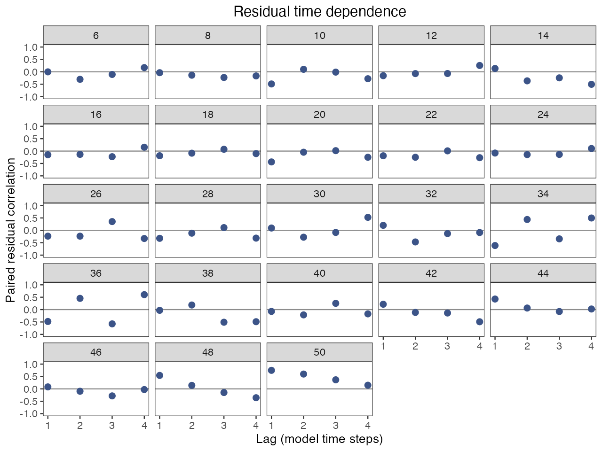

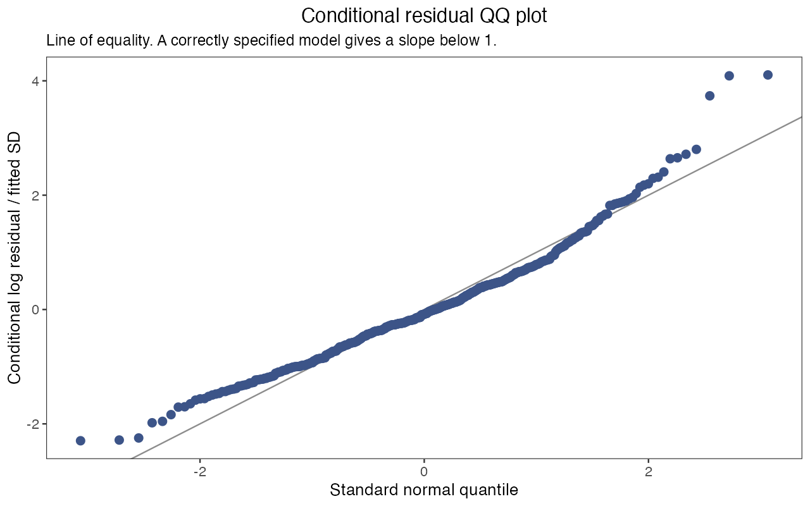

## 4. 区分假设敏感性与参数剖面 · 4. Separate sensitivity scenarios from parameter profiles

`fit_scenarios()` 保持相同三张观测输入表，只应用具名设置变化。这里使用 ACL 缩短示例运行时间；改为 `model = "alscl"` 即选取相应 ALSCL 设置，参数名和 map 必须与模型匹配。M = 0.15 只是围绕 YTF 输入的示例扰动，不是生物学建议。

三套 ACL 配置使用相同调查表、生长输入、提供的初值和 map，仅改变下表列出的设置。`YTF_example` 的 M 为每年度时间步 0.20，默认 F 结构为 `"group_year"`。

| 情景 ID | 每时间步 M | F 结构 | 相对参考配置的改变 |
|---|---:|---|---|
| `reference` | 0.20 | `group_year`：年龄 × 时间 | 无 |
| `low_M` | 0.15 | `group_year`：年龄 × 时间 | 外部提供的自然死亡率 |
| `shared_F` | 0.20 | `year`：每时间步内各年龄共用 F | F 结构；不使用的年龄相关参数变为 inactive |

季度数据的 `"year"` 仍表示每模型时间步一个 F，即每季度一个，并非每日历年一个。后面的两套 ALSCL 未来情景另比较每时间步 F = 0.10 和 F = 0.25，补充量、体重、成熟比例及 M 均相同。

比较轨迹前先检查 `status` 的每一行，包括警告和失败拟合；函数不自动排名。`F_summary = "mean"` 是未加权组间均值，`"apical"` 是最大值，两者含义不同，也都不把季度 F 转为年率。`ncores` 并行运行独立情景；内层拟合和标准误使用单个 worker，并保留指定的 `nstarts`。列表覆盖整体替换，map 也不逐项深度合并。

`fit_scenarios()` keeps the same three observation tables and applies explicitly named setting changes. Here ACL is used to keep the example short. Set `model = "alscl"` to use the matching ALSCL configuration; parameter and map names must belong to that model. M = 0.15 is an illustrative perturbation around the YTF value, not a biological recommendation.

The three ACL configurations use the same survey tables, growth inputs, supplied starting values and maps, except for the stated change below. In `YTF_example`, M = 0.20 per annual step and the default F structure is `"group_year"`.

| Scenario ID | M per model step | F structure | Change from the reference |
|---|---:|---|---|
| `reference` | 0.20 | `group_year`: age × time | None |
| `low_M` | 0.15 | `group_year`: age × time | Supplied natural mortality |
| `shared_F` | 0.20 | `year`: shared across ages within each step | F structure; unused age correlation becomes inactive |

For quarterly data, `"year"` still means one F per model step (one per quarter), not one per calendar year. The two future ALSCL projections separately compare F = 0.10 and F = 0.25 per step with identical recruitment, weights, maturity and M.

Inspect every row of `status`, including warnings and failed fits, before comparing trajectories. There is no automatic ranking. `F_summary = "mean"` requests an unweighted group mean; `"apical"` requests the maximum. These meanings differ and neither annualizes subannual F. `ncores` parallelizes independent scenarios; inner fits and standard errors use one worker while preserving the chosen `nstarts`. List-valued overrides replace entire lists, including map; they are not deep merges.

```r
scenarios <- fit_scenarios(x, list(
  reference = list(),
  low_M = list(M = 0.15),
  shared_F = list(F_structure = "year")
), model = "acl", ncores = 1, nstarts = 1,
   F_summary = "mean", silent = TRUE)
scenarios$status
head(scenarios$estimates)

scenario_ssb <- subset(scenarios$estimates, quantity == "SSB")
ggplot(scenario_ssb, aes(year, estimate, color = scenario)) +
  geom_line() + labs(x = "Year", y = "SSB") +
  theme_bw() + theme(panel.grid = element_blank())
```


## 对实际参与估计的参数做剖面 · Profile a parameter that was actually estimated

参数剖面将一个自由标量依次固定在网格值上，重新估计其他自由标量与随机效应。YTF 示例固定了 `log_Linf`，因此这里不能对它做剖面。`mean_log_F` 参与估计，下面三个点演示自然基准尺度的接口；有科学意义的剖面通常需要更密、理由明确的范围及各点成功拟合。

`delta_nll` 相对于原始拟合计算。负值表示网格拟合找到更低的目标函数，应重新检查原始最优点；不会截成零。失败点保留。函数不自动推导置信区间或似然比阈值。M 和调查可捕性等外部输入应使用敏感性情景，而不是标量参数剖面。

A parameter profile fixes one free scalar at successive values and refits the other free scalars and random effects. The YTF example fixes `log_Linf`, so it is not an eligible target here. `mean_log_F` is free, and the following three points illustrate how the API works on its natural baseline scale. A useful scientific profile usually needs a denser, justified range and successful fits across the grid.

`delta_nll` is measured relative to the original fit. A negative value means a grid refit found a lower objective and the original optimum should be investigated; it is not clipped to zero. Failed points remain visible. The function does not infer confidence intervals or automatic likelihood-ratio cutoffs. External inputs such as M and survey catchability belong in sensitivity scenarios, not this scalar profile.

```r
profile_values <- exp(a$opt$par[["mean_log_F"]]) * c(0.9, 1, 1.1)
profile_F <- profile_model(a, "mean_log_F", profile_values,
                           scale = "natural", ncores = 1)
profile_F$grid
ggplot(profile_F$grid, aes(value, delta_nll)) +
  geom_line() + geom_point() +
  labs(x = "F process baseline", y = "Change in negative log likelihood") +
  theme_bw() + theme(panel.grid = element_blank())
```


## 5. 投影假设明确的未来情景 · 5. Project explicitly defined future scenarios

`project_model()` 根据提供的未来 F、补充量、体重和成熟比例推进保存的种群状态。下面**明确选择**将末次观测的体重／成熟比例及末期拟合补充量延续四期；这是示例假设，不是函数自动决定的默认值。生长保持拟合的年龄—体长键，ALSCL 还保持拟合的生长转移矩阵。未来 M 默认使用原始记录输入，也可显式指定。

状态、B 和 SSB 表示每个未来时期的**期初**。第一未来状态先经历末期拟合 F 与原始 M，再加入第一期补充；未来 F[t] 影响当期渔获及存活到 t+1 的数量。因此两个情景的第一期未来 SSB 相同，但第一期渔获不同，后续 SSB 才出现响应。M 和 F 均为每个模型时间步的瞬时率，季度模型也一样。

这只是确定性的条件情景，没有不确定性区间、估计的亲体补充关系、MSY 或 TAC 计算。结果用于检视明确假设，不能表示确定的预测或管理建议。

`project_model()` advances saved population states under supplied future fishing mortality, recruitment, weights and maturity. The code below **explicitly chooses** to carry forward the last observed weight/maturity columns and terminal fitted recruitment for four periods. Those are example assumptions, not defaults selected by the function. Growth remains at the fitted key and, for ALSCL, fitted transition matrix. Future M defaults to the original recorded input; it can also be supplied explicitly.

States, B and SSB describe the **start** of each future period. The first future state uses the terminal fitted F and original M, followed by the first supplied recruitment. Future F[t] affects catch[t] and survival into t+1. The two scenarios therefore have the same first future SSB, but different first-period catches; their SSB responses appear subsequently. M and F are instantaneous rates per model step, including quarters.

These are deterministic conditional scenarios. They include no uncertainty intervals, estimated stock–recruitment function, MSY or TAC calculation. Use the output to examine stated assumptions, not to imply forecast certainty or a management recommendation.

```r
h <- 4L
w <- as.matrix(x$data.wgt[-1L])
mat <- as.matrix(x$data.mat[-1L])
future_w <- matrix(w[, ncol(w)], nrow(w), h)
future_mat <- matrix(mat[, ncol(mat)], nrow(mat), h)
future_rec <- rep(tail(b$report$Rec, 1), h)

low_F <- project_model(b, F = rep(0.10, h), recruitment = future_rec,
                       weight = future_w, maturity = future_mat)
higher_F <- project_model(b, F = rep(0.25, h), recruitment = future_rec,
                          weight = future_w, maturity = future_mat)
low_F$summary
higher_F$summary
low_F$assumptions
projection_ssb <- rbind(
  transform(low_F$summary, scenario = "F = 0.10"),
  transform(higher_F$summary, scenario = "F = 0.25"))
ggplot(projection_ssb, aes(year, SSB, color = scenario)) +
  geom_line() + geom_point() + labs(x = "Year", y = "Start-of-period SSB") +
  theme_bw() + theme(panel.grid = element_blank())
```


明确未通过数值检查的拟合默认拒绝投影。allow_failed_fit = TRUE 可在警告后进行探索性投影；旧结果缺少诊断时记为 unknown，不视为通过。assumptions 保存状态及是否覆盖。

Fits explicitly failing the numerical screen are rejected by default. allow_failed_fit = TRUE permits exploratory projection with a warning. Missing legacy diagnostics are recorded as unknown, not passed; assumptions retain the status and override.

## 6. 拟合模拟重复，并报告失败率 · 6. Fit simulation replicates and report their failure rate

`sim_model()` 可选择 ACL 或 ALSCL 拟合 `sim_data()` 生成的文件；`sim_acl()` 保留原有 ACL 接口，`sim_alscl()` 是对应的 ALSCL 入口。这里用两次重复演示文件对齐，并不足以精确估计模拟性能。初值和 map 必须采用所选模型的名称；教学预设是条件模拟设置，不是正式数据应固定这些参数的证据。

每个输入文件 `sim_rep<i>` 含 `sim.data`；拟合记录命名并保存为 `result_rep_<i>`，失败也保存。真值必须以这些结果名称为键，使用模拟记录的时间坐标；不能把单个返回重复的真值复用于所有拟合。下面逐个读取模拟文件并显式对齐。

`sim_model()` selects ACL or ALSCL for files produced by `sim_data()`. `sim_acl()` retains the original ACL interface; `sim_alscl()` is its ALSCL counterpart. This short example uses two replicates to demonstrate file alignment, not to estimate simulation performance precisely. Use the matching model's starts and map. The teaching presets are conditional simulation settings, not evidence for fixing those parameters with real data.

Each input file `sim_rep<i>` contains `sim.data`. Each fitted record is named and saved as `result_rep_<i>`, including failures. Truth must be keyed to those exact result names and use the recorded simulation time coordinates. Do not reuse one returned replicate's truth for every fit. Below, truth is read from each separate simulation file and aligned explicitly.

```r
pa <- x$parameters
bio <- sim_cal(pa)
iterations <- 1:2
simulation_dir <- tempfile("assessment-sim-")
sm <- sim_data(bio, pa, iter_range = iterations,
               return_iter = iterations[1], output_dir = simulation_dir)

cfg <- x$fit_config$alscl
simulation_fits <- sim_model(iterations, simulation_dir,
  file.path(simulation_dir, "fits_alscl"), model = "alscl", ncores = 1,
  parameters = cfg$parameters, parameters.L = cfg$parameters.L,
  parameters.U = cfg$parameters.U, map = cfg$map, M = pa$M)

simulation_truth <- setNames(lapply(iterations, function(i) {
  e <- new.env(parent = emptyenv())
  load(file.path(simulation_dir, paste0("sim_rep", i)), envir = e)
  s <- e$sim.data
  list(year = s$years, SSB = as.numeric(s$SSB), Rec = as.numeric(s$Rec))
}), paste0("result_rep_", iterations))
stopifnot(identical(names(simulation_fits), names(simulation_truth)))
performance <- summarize_simulations(simulation_fits, simulation_truth,
                                     quantities = c("SSB", "Rec"))
performance$replicates
performance$summary
head(performance$estimates)
```

## 解释模拟统计的分母，并保留记录 · Interpret the simulation denominators and retain the record

偏差和 RMSE 使用通过数值检查的估计—真值配对；覆盖率还要求可用的报告标准误。请同时报告 `failure_rate`、`n_replicates`、`n_valid_fits`、`n_valid_pairs` 和 `n_intervals`。缺少标准误不算作未覆盖；相对偏差排除零真值。F 不在该汇总内，因为需要另外明确组间汇总及其不确定性。

这是操作模型实验，不自动等于围绕拟合模型的参数自助法。两次重复不能证明覆盖率或模型优越性；正式实验应预先定义情景和足够重复。保存配置、全部失败及生成真值，不只保存成功估计。

Bias and RMSE use numerically valid estimate–truth pairs; coverage additionally requires usable reported standard errors. Always report `failure_rate`, `n_replicates`, `n_valid_fits`, `n_valid_pairs` and `n_intervals` alongside the performance statistics. Missing standard errors are not counted as coverage failures; relative bias excludes zero truth. F is intentionally excluded because its group summary and uncertainty must be defined separately.

These are operating-model experiments, not automatically a fitted parametric bootstrap. Two replicates cannot establish coverage or model superiority. For a real experiment, specify scenarios and sufficient replication before interpreting results. Save the configuration, all failures and the generating truth, rather than only successful estimates.

```r
record_dir <- tempfile("assessment-record-")
dir.create(record_dir)
write.csv(scenarios$status, file.path(record_dir, "scenario_status.csv"), row.names = FALSE)
write.csv(profile_F$grid, file.path(record_dir, "profile_F.csv"), row.names = FALSE)
write.csv(performance$summary, file.path(record_dir, "simulation_summary.csv"), row.names = FALSE)
saveRDS(list(input = x, scenarios = scenarios, profile = profile_F,
  projections = list(low_F = low_F, higher_F = higher_F),
  simulation_truth = simulation_truth, performance = performance),
  file.path(record_dir, "workflow_record.rds"))
writeLines(capture.output(sessionInfo()), file.path(record_dir, "session.txt"))
```


## 7. 模型生成与预测验证 · Model generation and prediction checks

`simulate_fit()` 从拟合模型生成数据，`hindcast_model()` 检验按时间留出的调查指数。完整可执行示例见[模型验证](https://github.com/FanZhang-LAB-SHOU/ALSCL/blob/main/docs/MODEL_VALIDATION.md)。

`simulate_fit()` generates observations from the fitted model; `hindcast_model()` tests time-held-out survey predictions. See the complete executable [model-validation case](https://github.com/FanZhang-LAB-SHOU/ALSCL/blob/main/docs/MODEL_VALIDATION.md).

<a id="chapter-17"></a>
## 17 模型模拟与预测验证 · Model simulation and prediction checks

## 简体中文


本案例用两种互补方法检查模型：`simulate_fit()` 从已拟合的 ACL 或 ALSCL 生成观测；`hindcast_model()` 只拟合较早时期，再预测留出的后续调查指数。这些开发功能需要更新后的源码，2.2.9 发布标签不包含它们。

| 问题 | 函数与设计 | 含义 |
|---|---|---|
| 给定拟合种群状态，重复调查会是什么样？ | `simulate_fit(process = "conditional")` | 只改变观测误差，拟合状态保持不变。 |
| 拟合的过程与观测模型会生成什么数据？ | `simulate_fit(process = "resample")` | 重新抽取补充、F 和初始种群偏差；标量参数保持拟合值。 |
| 较早观测能否预测后续观测？ | `hindcast_model()` | 每次训练在验证期之前结束，对实际留出的指数评分。 |

## 1. 拟合并检查源评估结果

示例使用模拟的 `YTF_example` 数据。其教学 map 固定了部分生物学参数；正式评估应使用有依据的生物学输入和参数映射。数值检查通过表示优化结果可用于这些计算，不代表模型已充分描述真实种群。

使用本地开发源码时，请先在仓库根目录运行 `pkgload::load_all(".")`，再执行下文。若已安装包含这些函数的版本，可直接用 `library(ALSCL)`。

```r
library(ALSCL)
data("YTF_example")
x <- YTF_example
a <- run_acl(x, silent = TRUE)
b <- run_alscl(x, silent = TRUE)
stopifnot(a$diagnostics$numerical_ok, b$diagnostics$numerical_ok)
```

## 2. 从拟合模型模拟观测

```r
conditional <- simulate_fit(b, nsim = 3, seed = 20261101,
  process = "conditional")
resampled <- simulate_fit(b, nsim = 3, seed = 20261101,
  process = "resample")
conditional$metadata
resampled$simulations[[1]]$truth$SSB
simulated_x <- resampled$simulations[[1]]$x
# 两个模型均可直接读取各自模拟得到的输入列表。
simulated_fit <- run_alscl(simulated_x, nstarts = 2, ncores = 1,
  silent = TRUE)
simulated_fit$diagnostics
```

两种模式均使用拟合的对数正态观测模型：对数观测的均值为 `Elog_index`，标准差为拟合观测标准差。因此，`exp(Elog_index)` 是观测中位数。默认保留原始缺失和零值位置；设置 `preserve_missing = FALSE` 可生成完整的正值调查数据。显式提供种子可复现抽样，并在结束后恢复调用者的随机数状态。

`"resample"` 模式按拟合的平稳 AR(1) 分布生成补充偏差。F 使用可分离的组别／时间 AR(1) 场；`F_structure = "year"` 时使用单个时间过程。这些过程标准差是边际标准差，时间创新标准差等于边际标准差乘以 `sqrt(1 - phi^2)`。初始丰度偏差来自独立正态分布。已有 C++ 模型使用这些抽样计算种群状态，保留末龄加组及 ALSCL 生长转移。该模式不支持固定或绑定随机效应的 map，会明确报错；条件观测模拟仍可使用。

两种模式都固定标量参数，不包含参数估计不确定性。它们也不同于 `sim_data()` 生成的独立操作模型模拟，后者有自己的补充量假设。明确失败的源拟合默认被拒绝；`allow_failed_fit = TRUE` 可在警告后用于探索。


图中为若干体长组在两种模式下各生成的三条调查序列。参考线是原拟合的对数观测中位数。条件模拟围绕相同拟合状态变化，过程重抽样还改变种群轨迹。这些曲线是模拟实现，不是置信带。

## 3. 重新拟合重复数据，并与生成真值比较

每个重复保留输入列表与生成的种群真值。计算性能统计前，应保留失败拟合记录。

```r
replicate_fits <- lapply(resampled$simulations, function(s) {
  tryCatch(run_alscl(s$x, nstarts = 2, ncores = 1, silent = TRUE),
    error = function(e) list(error = conditionMessage(e)))
})
truth <- lapply(resampled$simulations, function(s) s$truth)
performance <- summarize_simulations(replicate_fits, truth,
  quantities = c("SSB", "Rec"))
performance$summary
```

三个重复用于演示接口，不足以确定偏差或区间覆盖率。正式实验应使用足够的重复，并报告失败拟合数及可用区间数。参数自助法还需要明确的重抽样设计、重新拟合协议及区间构造方法；`simulate_fit()` 提供生成步骤，不会自动计算自助法区间。

对于已有磁盘操作模型批次，`sim_model(..., nstarts = 3, ncores = 2)` 每个重复使用三个初值，最多同时运行两个重复。初值和标准误在每个工作进程内依次计算。`train_times` 控制每个初值的优化轮数，每个结果保留 `start_diagnostics`。

## 4. 预测未参与拟合的时期

```r
acl_validation <- hindcast_model(x, model = "acl", horizon = 1,
  nfolds = 2, min_train = 8, nstarts = 1, ncores = 2)
alscl_validation <- hindcast_model(x, model = "alscl", horizon = 1,
  nfolds = 2, min_train = 8, nstarts = 1, ncores = 2)
acl_validation$diagnostics
alscl_validation$diagnostics
acl_validation$scores
alscl_validation$scores
head(alscl_validation$predictions)
```

`min_train` 是最少训练时期数，`horizon` 按模型时间步计数；季度数据的一步为一季度。使用最后 `nfolds` 个合格预测起点。每折截短三张输入表及支持的时间映射，从提供的拟合配置开始；不会拿完整序列的拟合估计作为初值。比较模型时，起点、预测期距和观测必须相同。生物学假设、固定参数及手动提供的初值也应在不参照留出数据调参的前提下确定。

未来对数补充量及对数 F 偏差沿训练末期出发的 AR(1) 条件均值路径延伸，再由种群方程推进丰度，并用给定调查可捕性转为指数。这是沿对数过程路径的代入式点预测，不是边际预测均值或预测分布；不抽取未来随机扰动或参数，也不提供预测区间。计算中沿用训练末期体重与成熟比例，不读取未来实际生物学资料。

固定或绑定随时间变化的补充／F 偏差的非恒等 map 会被拒绝，因为这些约束未定义当前支持的未来无约束 AR(1) 预测。失败或数值状态无法确认的训练拟合保留在诊断表中，不产生预测或参与评分。


图中比较留出期的对数调查指数、模型预测及“沿用最近一次正训练观测”的基准。本例是模拟 YTF 数据上的方法演示，不证明任一模型普遍更好。

## 5. 解读评分并保留复现记录

评分使用自然对数调查指数，并报告分母。验证数据中的零值与缺失值按拟合约定排除。持平基准使用相同体长组最近一次正训练观测；与基准比较时，两种方法使用相同的合格观测。

对数尺度 MASE 将每个绝对预测误差除以该体长组训练期内相邻正观测的平均绝对对数差。缺失时期不会被压缩。尺度分母为零或不可用时，缩放评分记为 `NA`，不会记成零误差；请检查可用缩放观测数。短期验证上的较低分数不构成普遍排名。Mohn rho 和条件残差图回答其他问题，可与此检查配合使用。

实际执行本例时，两个模型使用相同的 2018–2019 年共 46 个正观测，四个训练拟合均通过数值检查；两次比较使用同一个持平基准。

| 预测方法 | 评分观测数 | 对数 RMSE | 对数 MAE | 对数 MASE |
|---|---:|---:|---:|---:|
| ACL | 46 | 0.0963 | 0.0802 | 0.4213 |
| ALSCL | 46 | 0.2583 | 0.1951 | 1.0655 |
| 持平基准 | 46 | 0.1722 | 0.1467 | 0.7356 |

在这份模拟数据、教学 map 和两个起点的设计下，ACL 优于持平基准，ALSCL 没有优于基准。即使两者优化均收敛，这个差异也值得研究。两个验证时期不能确立普遍排名。三组过程模拟数据的重新拟合也都通过数值检查，但三个重复不足以确定覆盖率。

```r
archive <- tempfile(fileext = ".rds")
save_assessment(b, archive)
saved <- read_assessment(archive)
saved$recipe$implementation
# 模拟不依赖序列化的活跃 TMB 指针。
again <- simulate_fit(saved, nsim = 1, seed = 20261101,
  process = "conditional")
```

评估配方保存可取得的源码提交、核心／R 源码摘要与运行环境。源码 HEAD 本身不能证明工作区没有修改。`refit_model()` 会提示已知实现或依赖变化，旧结果无法恢复的来源保持未知。请同时保存模拟元数据、真值和验证诊断，以便核对输入、排除位置及拟合协议。


从仓库根目录运行 `scripts/model_validation.R` 可重新生成这些图及 CSV 结果；绘图辅助程序在保存前逐面板检查网格线。

```r
pkgload::load_all(".")
source("scripts/model_validation.R")
run_model_validation_guide()
```


## English


This case uses two complementary checks. `simulate_fit()` generates observations from a fitted ACL or ALSCL model; `hindcast_model()` fits earlier periods and predicts survey indices in withheld later periods. These development functions require the updated source and are not part of the 2.2.9 release tag.

| Question | Function and design | Interpretation |
|---|---|---|
| What would repeated observations look like at the fitted population states? | `simulate_fit(process = "conditional")` | Observation error varies; fitted states stay fixed. |
| What data would the fitted process and observation model generate? | `simulate_fit(process = "resample")` | Recruitment, F and initial-population deviations are redrawn; scalar parameters stay at their fitted values. |
| How well do earlier observations predict later observations? | `hindcast_model()` | Each training period ends before its validation period; score predictions against actual withheld indices. |

## 1. Fit and check the source assessment

The example uses synthetic `YTF_example` data. Its teaching maps fix several biological parameters; choose your own supported biology and parameter map for a real assessment. Successful numerical checks establish that the optimizer result is usable for these calculations, not that the model adequately describes a stock.

When working from this development checkout, run `pkgload::load_all(".")` from the repository root before the following blocks. An installation containing these functions can use `library(ALSCL)` directly.

```r
library(ALSCL)
data("YTF_example")
x <- YTF_example
a <- run_acl(x, silent = TRUE)
b <- run_alscl(x, silent = TRUE)
stopifnot(a$diagnostics$numerical_ok, b$diagnostics$numerical_ok)
```

## 2. Simulate observations from the fitted model

```r
conditional <- simulate_fit(b, nsim = 3, seed = 20261101,
  process = "conditional")
resampled <- simulate_fit(b, nsim = 3, seed = 20261101,
  process = "resample")
conditional$metadata
resampled$simulations[[1]]$truth$SSB
simulated_x <- resampled$simulations[[1]]$x
# Both models accept their corresponding simulated input bundle directly.
simulated_fit <- run_alscl(simulated_x, nstarts = 2, ncores = 1,
  silent = TRUE)
simulated_fit$diagnostics
```

Both modes use the fitted lognormal observation model: log observations have mean `Elog_index` and the fitted observation standard deviation. Consequently, `exp(Elog_index)` is an observation median. Original missing and zero cells are preserved by default; set `preserve_missing = FALSE` to generate a complete positive survey. A supplied seed gives reproducible draws while restoring the caller's random-number state.

In `"resample"` mode, recruitment follows the fitted stationary AR(1) distribution. The F field follows its separable group/time AR(1) distribution, or a single time process when `F_structure = "year"`. These process SDs are marginal SDs: the temporal innovation SD equals the marginal SD multiplied by `sqrt(1 - phi^2)`. Initial-abundance deviations are independent normals. The existing C++ model calculates population states from these draws, including the plus group and ALSCL growth transitions. Fixed or tied random-effect maps are unsupported for this resampling mode and are rejected explicitly; conditional observation simulation remains available.

Scalar parameters remain fixed in both modes. These draws contain no parameter-estimation uncertainty. They also differ from the separate operating-model simulations generated by `sim_data()`, which have their own recruitment assumptions. A known failed source fit is rejected by default; `allow_failed_fit = TRUE` gives an explicit warning for exploratory use.


The figure shows three generated survey series in each mode for selected length groups. The reference curve is the original fit's log observation median. The conditional simulations vary around the same fitted states; resampling also changes the population trajectory. These are simulation draws, not confidence bands.

## 3. Refit replicates and compare estimates with their generating values

Every simulation retains its input bundle and generating population quantities. Record failed fits rather than removing them before calculating performance statistics.

```r
replicate_fits <- lapply(resampled$simulations, function(s) {
  tryCatch(run_alscl(s$x, nstarts = 2, ncores = 1, silent = TRUE),
    error = function(e) list(error = conditionMessage(e)))
})
truth <- lapply(resampled$simulations, function(s) s$truth)
performance <- summarize_simulations(replicate_fits, truth,
  quantities = c("SSB", "Rec"))
performance$summary
```

Three replicates demonstrate the interface; they do not establish bias or interval coverage. Design a larger experiment with adequate repetitions and report failed-fit and usable-interval counts. A parametric bootstrap additionally requires a stated resampling design, refitting protocol and interval construction. `simulate_fit()` supplies the generating step; it does not automatically calculate bootstrap intervals.

For existing on-disk operating-model batches, `sim_model(..., nstarts = 3, ncores = 2)` uses three starts per replicate and at most two replicate workers. Starts and standard errors run sequentially inside each worker. `train_times` controls optimization passes per start, and each result retains `start_diagnostics`.

## 4. Predict periods that were not used for fitting

```r
acl_validation <- hindcast_model(x, model = "acl", horizon = 1,
  nfolds = 2, min_train = 8, nstarts = 1, ncores = 2)
alscl_validation <- hindcast_model(x, model = "alscl", horizon = 1,
  nfolds = 2, min_train = 8, nstarts = 1, ncores = 2)
acl_validation$diagnostics
alscl_validation$diagnostics
acl_validation$scores
alscl_validation$scores
head(alscl_validation$predictions)
```

`min_train` is a minimum number of model periods, and `horizon` counts model steps: one step means one quarter for quarterly data. The last `nfolds` eligible origins are used. Each fold truncates all three input tables and any supported time maps, then starts from the supplied fitting configuration. It never takes starting estimates from a fit to the complete series. Each model comparison must use the same origins, horizons and observations. Biological assumptions, fixed parameters and manually supplied starts must also be chosen without tuning to the withheld data.

Forecast log recruitment and log F deviations follow their AR(1) conditional-mean paths from the training endpoint. The population equations then propagate abundance and transform it to survey indices using the supplied catchability. This is a plug-in point prediction along those log-process paths, not a marginal predictive mean or a predictive distribution. It includes no future random shocks or parameter draws, and provides no prediction interval. The calculation repeats training-end weights and maturity; future observed biology is not read into the prediction.

Nonidentity maps fixing or tying time-varying recruitment/F deviations are rejected because these constraints do not define the supported unconstrained future AR(1) forecast. Failed or numerically unverified training fits remain in the diagnostics and do not contribute predictions or scores.


The figure compares held-out log survey indices with model predictions and the most recent positive training observation held constant. It is an illustration on synthetic YTF data, not evidence of general superiority of either assessment model.

## 5. Read scores and retain a reproducible record

Scores use natural-log survey indices and report their denominators. Zero and missing validation observations are excluded, consistently with fitting. The persistence baseline uses the latest positive training observation in the same length bin. Comparisons with that baseline use the same eligible observations for both methods.

Log-scale MASE divides each absolute forecast error by the mean absolute difference between consecutive positive training log observations in that length bin. Missing periods are not compressed. A zero or unavailable scaling denominator gives `NA` for the scaled score, not zero error; inspect the count of usable scaled observations. A lower score on one short validation design is not a universal model ranking. Mohn's rho and conditional residual plots answer different questions and remain useful alongside this check.

For the executed example, both models used the same 46 positive observations from 2018–2019. All four training fits passed the numerical screen. The persistence baseline is identical across the two comparisons.

| Prediction | Scored observations | Log RMSE | Log MAE | Log MASE |
|---|---:|---:|---:|---:|
| ACL | 46 | 0.0963 | 0.0802 | 0.4213 |
| ALSCL | 46 | 0.2583 | 0.1951 | 1.0655 |
| Persistence | 46 | 0.1722 | 0.1467 | 0.7356 |

Under this synthetic dataset, teaching maps and two-origin design, ACL improves on the persistence baseline and ALSCL does not. The difference is worth investigating even though both optimizations converged. These two validation periods do not establish a general ranking. The three simulated-process refits also passed the numerical screen, but three replicates are insufficient to establish coverage.

```r
archive <- tempfile(fileext = ".rds")
save_assessment(b, archive)
saved <- read_assessment(archive)
saved$recipe$implementation
# Simulations do not require a serialized live TMB pointer.
again <- simulate_fit(saved, nsim = 1, seed = 20261101,
  process = "conditional")
```

Assessment recipes retain available source revision, core/R source hashes and runtime metadata. A source HEAD alone does not prove the working tree was clean. `refit_model()` warns about known implementation or dependency changes; unknown older provenance remains unknown. Save the simulation metadata, truth and validation diagnostics with your assessment so its inputs, exclusions and fitting protocol can be inspected.


Run `scripts/model_validation.R` from the repository root to regenerate these figures and CSV results. The plotting helper checks every panel for gridlines before saving.

```r
pkgload::load_all(".")
source("scripts/model_validation.R")
run_model_validation_guide()
```
