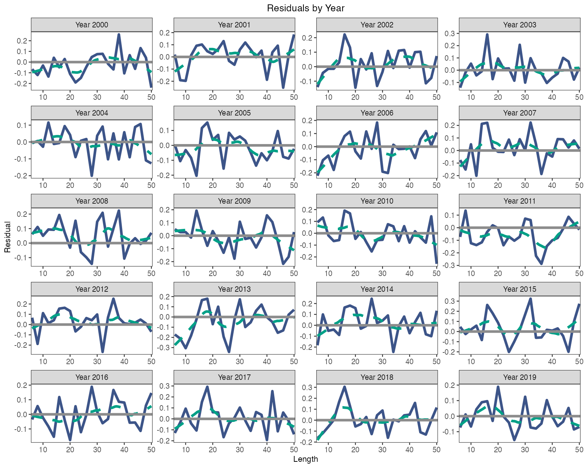
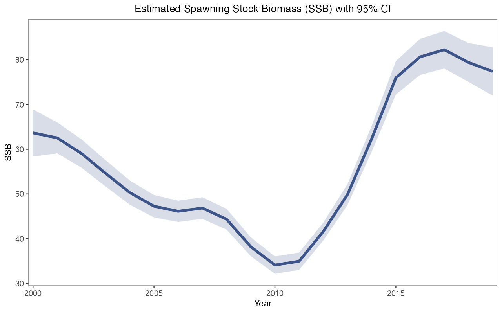

# 工作案例 / Worked cases

<!-- Generated by scripts/build_manual.py from website/content/{en,zh}/articles/. Edit the article pair, not this file. -->

[使用指南 / User guide](USER_GUIDE.md) · [首页 / Home](../README.md)

## 如何拟合自己的调查数据？ / How do I fit my own survey data?

本页带你从 CSV 或 Excel 文件中的三张调查表出发，得到 ACL 和 ALSCL 两个拟合好的模型，以及它们的数值检查、图和保存的结果。本页按照脚本 [fit_own_data_example.R](https://github.com/FanZhang-LAB-SHOU/ALSCL/blob/main/scripts/fit_own_data_example.R) 展开，该脚本用内附的教学数据完整运行一遍，然后你把其中的数值换成自己的。你需要已安装的软件包（[安装 ALSCL](USER_GUIDE.md#start)）、按[准备调查数据](USER_GUIDE.md#excel)排好的三张表，以及第 1 步列出的生物学数值。

On this page you go from three survey tables in CSV or Excel files to two fitted models, ACL and ALSCL, with their numerical checks, plots and saved results. The page follows the script [fit_own_data_example.R](https://github.com/FanZhang-LAB-SHOU/ALSCL/blob/main/scripts/fit_own_data_example.R), which runs the whole sequence on the bundled teaching data; you then replace its values with yours. You need the package installed ([Install ALSCL](USER_GUIDE.md#start)), your tables laid out as in [Prepare your survey data](USER_GUIDE.md#excel), and the biological values listed in step 1.

<a id="case-fit-survey-bundle"></a>

### 1. 准备并检查输入列表 / Prepare and check the input bundle

```r
library(ALSCL)
tables <- read_survey_csv("my_data")
x <- prepare_alscl_data(tables, fit_args = list(
  rec.age = 1, nage = 15, M = 0.2, sel_L50 = 15, sel_L95 = 20,
  growth_step = 1, len_mid = seq(6, 50, 2), len_border = seq(7, 49, 2)))
check <- check_alscl_data(x, "acl")
check$valid
check$summary
```

两个模型都读取输入列表 `x`：调查指数表 `data.CatL`、体重表 `data.wgt` 和成熟比例表 `data.mat`，行是体长组，列是时间步；再加上 `x$fit_args` 中描述你的种群和调查的设置。`read_survey_csv()` 从一个文件夹读取三个文件，`read_survey_excel()` 读取一个工作簿中的三张工作表；表格布局、时间网格以及空白和零值的处理见[准备调查数据](USER_GUIDE.md#excel)。下表中的设置是模型照原样使用的输入；请为你的种群逐项提供，并记下来源。代码中的数值是教学数据的设置。

Both models read the input bundle `x`: the survey index table `data.CatL`, the weight table `data.wgt` and the maturity table `data.mat`, with the length bins as rows and the time steps as columns, plus the settings in `x$fit_args` that describe your stock and survey. `read_survey_csv()` reads the three files from one folder and `read_survey_excel()` the three sheets of one workbook; [Prepare your survey data](USER_GUIDE.md#excel) explains the layout, the time grid and the treatment of blanks and zeros. The settings below are inputs that the models use as given; supply each one for your stock and note its source. The numbers in the code are those of the teaching data.

| 设置 / Setting | 含义 / Meaning | 数值来源 / Where the value comes from |
|---|---|---|
| `rec.age` | 最小年龄组的年龄（年） / Age of the youngest age class, in years | 鱼首次出现在调查中的年龄 / Age at which fish first appear in the survey |
| `nage` | 年龄组数；最后一组是加组 / Number of age classes; the last is a plus group | 值得追踪的最大年龄除以 `growth_step` / Oldest age worth tracking, divided by `growth_step` |
| `M` | 每个时间步的自然死亡率 / Natural mortality per time step | 文献或生活史方法；年值乘以 `growth_step` / Literature or life-history methods; annual value times `growth_step` |
| `sel_L50`、`sel_L95` / `sel_L50`, `sel_L95` | 调查可捕性达到 50% 和 95% 的体长；`sel_L95` 较大 / Lengths at 50% and 95% survey catchability; `sel_L95` is the larger | 渔具选择性研究或渔获体长分布 / Gear selectivity studies or the length distribution of the catch |
| `growth_step` | 每个时间步的年数：年度为 1，季度为 0.25 / Years per time step: 1 annual, 0.25 quarterly | 时间标签的间隔 / The spacing of your time labels |
| `len_mid` | 每个体长组的中点，每行一个 / Midpoint of each length bin, one per row | 调查设计 / Your survey design |
| `len_border` | 相邻体长组之间的内部边界，比行数少一个 / Internal boundaries between bins, one fewer than the rows | 调查设计；只有等宽体长组才取相邻中点的中间值 / Your survey design; halfway between midpoints only for equal-width bins |

`check_alscl_data()` 按拟合时的方式准备数据，但不编译任何东西。`check$valid` 应为 `TRUE`，`check$summary` 应显示你预期的体长组数和时间步数、正观测数，以及将被估计的标量参数个数 `free_fixed`。若 `check$valid` 为 `FALSE`，`check$errors` 会指出要修改的表、时间列或设置；`check$warnings` 提示没有任何观测的时间步或体长组。拟合 ALSCL 之前，用 `"alscl"` 再检查一遍。

`check_alscl_data()` prepares the data as a fit would, without compiling anything. `check$valid` should be `TRUE` and `check$summary` should show the numbers of bins and time steps you expect, the count of positive observations and `free_fixed`, the number of scalar parameters that will be estimated. When `check$valid` is `FALSE`, `check$errors` names the table, time column or setting to correct; `check$warnings` points to time steps or bins without any observation. Repeat the check with `"alscl"` before fitting that model.

<a id="case-fit-survey-map"></a>

### 2. 确定初值和 map / Decide the starting values and the map

```r
plan <- inspect_parameters(x, "acl")
plan[, c("parameter", "status", "map_source", "natural_start")]
inspect_parameters(x, "alscl")[, c("parameter", "status", "map_source", "natural_start")]
```

`inspect_parameters()` 列出一个模型的各个参数、自然尺度上的初值及其状态：`free`（估计）、`fixed`（固定）或 `tied`（共享）；`map_source` 说明固定状态来自模型默认还是你的 `map`。默认情况下，ACL 固定 `log_std_log_F`、`logit_log_F_y`、`logit_log_F_a` 和 `t0`，估计其余 10 个标量参数；ALSCL 固定 `log_sigma_log_F` 和 `log_t0`，估计 13 个。过程偏差 `dev_log_R`、`dev_log_F` 和 `dev_log_N0` 是随机效应，总是被估计。

`inspect_parameters()` lists the parameters of a model with their starting value on the natural scale and their status, `free` (estimated), `fixed` or `tied`; `map_source` says whether a fixed status comes from the model default or from your `map`. By default ACL fixes `log_std_log_F`, `logit_log_F_y`, `logit_log_F_a` and `t0` and estimates the other 10 scalar parameters; ALSCL fixes `log_sigma_log_F` and `log_t0` and estimates 13. The process deviations `dev_log_R`, `dev_log_F` and `dev_log_N0` are random effects and are always estimated.

| 含义 / Meaning | ACL 参数 / ACL parameter | ALSCL 参数 / ALSCL parameter |
|---|---|---|
| 初始总死亡率（决定初始年龄结构） / Initial total mortality (initial age structure) | `log_init_Z` | `log_init_Z` |
| 初始丰度偏差的标准差 / SD of the initial abundance deviations | `log_std_log_N0` | `log_sigma_log_N0` |
| 平均对数补充量 / Mean log recruitment | `mean_log_R` | `mean_log_R` |
| 补充量偏差的标准差 / SD of the recruitment deviations | `log_std_log_R` | `log_sigma_log_R` |
| 补充量在时间上的相关 / Correlation of recruitment across time | `logit_log_R` | `logit_log_R` |
| 平均对数捕捞死亡率 / Mean log fishing mortality | `mean_log_F` | `mean_log_F` |
| F 偏差的标准差 / SD of the F deviations | `log_std_log_F` | `log_sigma_log_F` |
| F 在时间上的相关 / Correlation of F across time | `logit_log_F_y` | `logit_log_F_y` |
| F 在年龄或体长之间的相关 / Correlation of F across ages or lengths | `logit_log_F_a` | `logit_log_F_l` |
| 渐近体长和年生长速率 / Asymptotic length and annual growth rate | `log_Linf`、`log_vbk` / `log_Linf`, `log_vbk` | `log_Linf`、`log_vbk` / `log_Linf`, `log_vbk` |
| 体长为零时的年龄 / Age at zero length | `t0`（原尺度） / `t0` (untransformed) | `log_t0`（对数尺度） / `log_t0` (log scale) |
| 年龄别体长的离散程度 / Spread of length at age | `log_cv_len` | `log_cv_len` |
| 生长增量 CV / Growth increment CV | 无 / none | `log_cv_grow` |
| 调查观测标准差 / Survey observation SD | `log_std_index` | `log_sigma_index` |

初值写在 `x$fit_config$acl$parameters` 或 `x$fit_config$alscl$parameters` 中，采用优化器尺度：渐近体长 60 cm 写 `log_Linf = log(60)`，相关系数 0.1 写 `logit_log_R = qlogis(0.1)`；ALSCL 使用 `log_t0`，因此它的 `t0` 必须在 0 和 `rec.age` 之间。填写初值不会固定参数：只有模型 `map` 中的 `factor(NA)` 才固定参数，具名 `NULL` 项则释放模型默认固定的参数。当外部研究给出的值比拟合更可靠，或第 5 步的检查表明数据无法提供某个参数的信息时，固定该参数，并记录每个固定值的来源。[拟合设置](USER_GUIDE.md#fitting)给出 `map`、边界和物种预设的规则；[估计参数清单](USER_GUIDE.md#fitting)给出全部变换方式。

Starting values go in `x$fit_config$acl$parameters` or `x$fit_config$alscl$parameters` on the optimizer scale: `log_Linf = log(60)` for an asymptotic length of 60 cm, `logit_log_R = qlogis(0.1)` for a correlation of 0.1; ALSCL uses `log_t0`, so its `t0` must lie between 0 and `rec.age`. A starting value does not fix a parameter: only `factor(NA)` in the model's `map` does, and a named `NULL` entry releases a parameter that the model fixes by default. Fix a parameter when an external study gives a better value than the fit could, or when the checks of step 5 show that the data cannot inform it, and record the source of every fixed value. [Fitting controls](USER_GUIDE.md#fitting) gives the rules for `map`, bounds and species presets; [Estimation parameter lists](USER_GUIDE.md#fitting) gives every transformation.

<a id="case-fit-survey-run"></a>

### 3. 运行完整示例 / Run the complete example

下面的脚本用教学数据完整运行每一步：读取 `docs/data` 中的三个 CSV 文件，把生物学设置收在 `bio` 中，由行标签推出体长组中点和边界，设置两个模型的初值和 map，组装并检查 `x`，拟合 ACL（`a`）和 ALSCL（`b`），打印它们的数值检查，绘制 `b` 的残差图和产卵生物量图，并把输入列表、两个拟合的可移植副本、两张图和会话信息保存到 `output/own-data-example`。请在下载的仓库根目录运行，因为脚本要加载 `scripts/plot_helpers.R` 并读取 `docs/data`：`source("scripts/fit_own_data_example.R", encoding = "UTF-8")`。

The script below runs every step on the teaching data: it reads the three CSV files in `docs/data`, collects the biology in `bio`, derives the bin midpoints and boundaries from the row labels, sets the starting values and maps of both models, builds and checks `x`, fits ACL (`a`) and ALSCL (`b`), prints their numerical checks, draws the residual and spawning biomass plots of `b`, and saves the bundle, portable copies of both fits, the two figures and the session information to `output/own-data-example`. Run it from the root of a downloaded copy of the repository, because it sources `scripts/plot_helpers.R` and reads `docs/data`: `source("scripts/fit_own_data_example.R", encoding = "UTF-8")`.

```r
# ALSCL: CSV -> x -> ACL / ALSCL -> diagnostics and saved summaries.
# 从仓库根目录运行 / Run from the repository root: / Run from the repository root:
# source("scripts/fit_own_data_example.R", encoding = "UTF-8")
# 默认读取内附模拟数据。正式分析必须修改第 1、2、3 步。 / The supplied numbers describe the synthetic YTF example, not your stock.

library(ALSCL)
source('scripts/plot_helpers.R')
stopifnot(packageVersion("ALSCL") >= "2.3.0")

# Read the three aligned tables -------------------------------
# 1. 读取三表 / Read the three aligned tables ------------------------------- / data.CatL.csv, data.wgt.csv, data.mat.csv.
data_dir <- "docs/data"
inputs <- read_survey_csv(data_dir)
# Excel alternative (requires readxl):
# inputs <- read_survey_excel("my_survey.xlsx")

# inputs <- read_survey_excel("my_survey.xlsx") / Shared biology -----------------------------------------
# M_annual and vbk are annual; lengths are cm; weights in the example are kg.
bio <- list(rec.age = 1, nage = 15, M_annual = 0.2,
            growth_step = 1, sel_L50 = 15, sel_L95 = 20,
            Linf = 60, vbk = 0.2, t0 = 1 / 60,
            cv_len = 0.2, cv_grow = 0.2)
stopifnot(bio$t0 > 0, bio$t0 < bio$rec.age)

# For labels such as "5-7", supply the actual midpoints explicitly instead.
len_mid <- as.numeric(inputs$data.CatL[[1]])
stopifnot(all(is.finite(len_mid)), all(diff(len_mid) > 0))
# This midpoint formula is only used for the equal-width demonstration bins.
stopifnot(max(abs(diff(len_mid) - diff(len_mid)[1])) < 1e-8)
len_border <- (head(len_mid, -1) + tail(len_mid, -1)) / 2

# Model-specific settings ------------------------------
# 此例为连续等宽组；非等宽组请直接填写实测的 nlen-1 个内部边界。 / Growth and most process values below are starts, not automatic fixes.
# This midpoint formula is only used for the equal-width demonstration bins. / Review starts, bounds and the documented default fixed values for your stock.
p_acl <- list(
  log_Linf = log(bio$Linf), log_vbk = log(bio$vbk), t0 = bio$t0,
  log_cv_len = log(bio$cv_len),
  log_std_log_F = log(0.2), log_std_log_N0 = log(0.2),
  logit_log_R = qlogis(0.1))
p_alscl <- list(
  log_Linf = log(bio$Linf), log_vbk = log(bio$vbk), log_t0 = log(bio$t0),
  log_cv_len = log(bio$cv_len), log_cv_grow = log(bio$cv_grow),
  log_sigma_log_F = log(0.2), log_sigma_log_N0 = log(0.2),
  logit_log_R = qlogis(0.1))
# Default maps: ACL fixes 4 and estimates 10 scalars; ALSCL fixes 2 and estimates 13.
# ACL fixes log_std_log_F, logit_log_F_y, logit_log_F_a and t0.
# ALSCL fixes log_sigma_log_F and log_t0. These values still need justification.
map_acl <- list()
map_alscl <- list()
# Optional: fix only t0; diagnose this more flexible configuration separately.
# map_acl <- list(t0 = factor(NA), log_std_log_F = NULL,
# 使用模型默认 map：ACL 固定 4 项、估计 10 项；ALSCL 固定 2 项、估计 13 项。 / logit_log_F_y = NULL, logit_log_F_a = NULL)
# Default maps: ACL fixes 4 and estimates 10 scalars; ALSCL fixes 2 and estimates 13. / map_alscl <- list(log_t0 = factor(NA), log_sigma_log_F = NULL)
# ACL fixes log_std_log_F, logit_log_F_y, logit_log_F_a and t0. / Preserve a named NULL to release a default fix; $t0 <- NULL deletes the entry.
# ALSCL fixes log_sigma_log_F and log_t0. These values still need justification. / map_acl["t0"] <- list(NULL)
# map_alscl["log_t0"] <- list(NULL)

# 可选：只固定 t0；更灵活的设置必须另做诊断，不保证可识别。 / Assemble and check the input bundle --------------------
x <- prepare_alscl_data(inputs,
  fit_args = list(
    rec.age = bio$rec.age, nage = bio$nage,
    M = bio$M_annual * bio$growth_step,
    sel_L50 = bio$sel_L50, sel_L95 = bio$sel_L95,
    growth_step = bio$growth_step,
    len_mid = len_mid, len_border = len_border,
    zero_action = "error", train_times = 2,
    nstarts = 1, ncores = 1, silent = FALSE),
  fit_config = list(
    acl = list(parameters = p_acl, map = map_acl),
    alscl = list(parameters = p_alscl, map = map_alscl)))
# Check data, time grid and settings without compiling.
for (model in c("acl", "alscl")) {
  check <- check_alscl_data(x, model)
  if (!check$valid) stop(paste(check$errors, collapse = "\n"))
  print(check$summary)
}

# Fit directly ----------------------------------------------
alscl_speed_info()
a <- run_acl(x)
b <- run_alscl(x)
# a <- run_acl(x, nstarts = 4, ncores = 2)
# b <- run_alscl(x, nstarts = 4, ncores = 2)

# Inspect, plot and save ------------------------------
checks <- list(ACL = diagnose_model(x$data.CatL, a),
               ALSCL = diagnose_model(x$data.CatL, b))
print(checks)
print(a$sd_info)
print(b$sd_info)
for (fit in list(a, b)) {
  print(fit$par_low_up) # Actual free scalars and bounds
  print(list(convergence = fit$convergence_code,
             max_gradient = fit$max_abs_gradient,
             pdHess = fit$pdHess, bound_hit = fit$bound_hit))
  print(fit$refinement)
  print(fit$diagnostics)
  if (!isTRUE(fit$convergence_code == 0L) || !isTRUE(fit$pdHess) ||
      !isTRUE(fit$diagnostics$numerical_ok))
    warning("Review fit diagnostics before interpreting this assessment.")
}
residual_plot <- plot_residuals(b, type = "year", facet_ncol = 4,
                                x_breaks = pretty(len_mid, n = 4))
# 实际自由参数及边界 / Actual free scalars and bounds / Omit SE intervals if Hessian is not positive definite.
ssb_plot <- plot_SSB(b, se = isTRUE(b$pdHess))
print(residual_plot)
print(ssb_plot)
portable <- function(fit) fit[setdiff(names(fit), "obj")]
output_dir <- "output/own-data-example"
dir.create(output_dir, recursive = TRUE, showWarnings = FALSE)
save_grid_free_plot(file.path(output_dir, "residuals.png"), residual_plot,
                width = 10, height = 8, dpi = 150)
save_grid_free_plot(file.path(output_dir, "SSB.png"), ssb_plot,
                width = 8, height = 5, dpi = 150)
saveRDS(x, file.path(output_dir, "inputs_x.rds"))
saveRDS(list(ACL = portable(a), ALSCL = portable(b), diagnostics = checks),
        file.path(output_dir, "assessment_summary.rds"))
writeLines(capture.output(sessionInfo()), file.path(output_dir, "sessionInfo.txt"))
# Refit in a new session:
# obj 是当前会话的 TMB 指针，不包含在可移植结果中。 / x <- readRDS("output/own-data-example/inputs_x.rds")
# b <- run_alscl(x)
```

脚本运行时会打印两个模型的 `check$summary`；教学数据显示 23 个体长组、20 个时间步、460 个正观测、没有零值和空白，以及 10 个（ACL）或 13 个（ALSCL）自由标量参数。随后 `diagnose_model()` 打印每个拟合的数值检查，第 5 步会解释。在记录运行（[own-data-example-checks.csv](results/own-data-example-checks.csv)）中，两个拟合的收敛码都是 0，Hessian 正定，没有参数落在边界上，最大梯度约为 3e-9。脚本保存的两张图如下：

While the script runs, `check$summary` is printed for both models; with the teaching data it shows 23 length bins, 20 time steps, 460 positive observations, no zeros or blanks, and 10 (ACL) or 13 (ALSCL) free scalar parameters. `diagnose_model()` then prints the numerical checks of each fit, which step 5 explains. In the recorded run ([own-data-example-checks.csv](results/own-data-example-checks.csv)) both fits ended with convergence code 0, a positive definite Hessian, no parameter on a bound and a maximum gradient near 3e-9. The script saved these two figures:





每一年的残差都围绕 0 散布，产卵生物量序列的区间较窄，这就是这组模拟数据上可用拟合的样子；区间以固定值为条件。若脚本停在 `stopifnot(packageVersion("ALSCL") >= "2.3.0")`，安装当前版本（[安装 ALSCL](USER_GUIDE.md#start)）；若找不到 `scripts/plot_helpers.R` 或 `docs/data`，说明工作目录不是仓库根目录；若 `check_alscl_data()` 报错，第 1 步解释了这些信息；若拟合结束时出现 "Review fit diagnostics" 警告，第 5 步说明要改什么。

Residuals scattered around zero in every year, and a spawning biomass series with a narrow interval, are what a usable fit of these synthetic data looks like; the interval is conditional on the fixed values. If the script stops at `stopifnot(packageVersion("ALSCL") >= "2.3.0")`, install the current version ([Install ALSCL](USER_GUIDE.md#start)); if it cannot find `scripts/plot_helpers.R` or `docs/data`, your working directory is not the repository root; if `check_alscl_data()` reports an error, step 1 explains the messages; if a fit ends with the warning "Review fit diagnostics", step 5 says what to change.

<a id="case-fit-survey-replace"></a>

### 4. 换成自己的观测数据 / Replace the demonstration with your observations

```r
data_dir <- "my_data"
bio <- list(rec.age = 2, nage = 12, M_annual = 0.25,
            growth_step = 1, sel_L50 = 22, sel_L95 = 30,
            Linf = 80, vbk = 0.15, t0 = 0.5,
            cv_len = 0.15, cv_grow = 0.15)
len_mid <- c(8, 11, 14, 17, 20, 24, 28, 33, 39, 46)
len_border <- c(9.5, 12.5, 15.5, 18.5, 22, 26, 30.5, 36, 42.5)
map_acl <- list(log_Linf = factor(NA), log_vbk = factor(NA))
map_alscl <- list(log_Linf = factor(NA), log_vbk = factor(NA))
# 然后运行脚本中的 prepare_alscl_data() 调用，并确认： / Then run the prepare_alscl_data() call of the script and confirm:
for (model in c("acl", "alscl")) {
  check <- check_alscl_data(x, model)
  print(check$valid); print(check$warnings); print(check$summary)
  print(inspect_parameters(x, model)[, c("parameter", "status", "map_source")])
}
```

上面的数值只是说明每一项的形式，不是任何种群的估计值。保留 `inputs`、`x`、`a` 和 `b` 这些名字，脚本的其余部分就不用改。

The values above are placeholders that show the shape of each entry, not estimates for any stock. Keep the names `inputs`, `x`, `a` and `b` so that the rest of the script runs unchanged.

| 脚本中的行 / Lines in the script | 改成 / Replace with | 注意 / Keep in mind |
|---|---|---|
| `data_dir <- "docs/data"` | 你的 CSV 文件夹，或 `inputs <- read_survey_excel("my_survey.xlsx")` / Your CSV folder, or `inputs <- read_survey_excel("my_survey.xlsx")` | 三个文件或工作表必须使用这些名称；调查缺测留空 / Three files or sheets with exactly these names; blank cells for missing survey values |
| `bio <- list(...)` | 你的种群的数值 / The values of your stock | `M_annual` 是年值，会乘以 `growth_step`；`vbk` 仍按年计；ALSCL 要求 `0 < t0 < rec.age` / `M_annual` is per year and is multiplied by `growth_step`; `vbk` stays per year; ALSCL needs `0 < t0 < rec.age` |
| `len_mid <- ...`、`len_border <- ...` / `len_mid <- ...`, `len_border <- ...` | 你的体长组中点和内部边界 / The midpoints and internal boundaries of your bins | 体长组宽度不等时，删除等宽 `stopifnot()` 和中点公式那两行 / Delete the equal-width `stopifnot()` and the midpoint formula when your bins differ in width |
| `p_acl`、`p_alscl` / `p_acl`, `p_alscl` | 优化器尺度上的初值 / Starting values on the optimizer scale | ACL 填 `t0`，ALSCL 填 `log(t0)` / ACL takes `t0`, ALSCL `log(t0)` |
| `map_acl`、`map_alscl` / `map_acl`, `map_alscl` | 你要固定或释放的参数 / The parameters you fix or release | 空列表沿用模型默认；每次都列出全部固定项 / An empty list keeps the model defaults; list every fix each time |
| `zero_action = "error"` | `"missing"`，把零值当作缺失而不是终止 / `"missing"` to treat zeros as missing values instead of stopping | 零值随后不进入似然 / Zeros then drop out of the likelihood |
| `output_dir` | 本次评估的文件夹 / A folder for this assessment | 脚本会覆盖其中的文件 / The script overwrites the files in it |

修改后，把脚本运行到检查循环。两个模型的 `check$valid` 都必须为 `TRUE`，`check$summary` 必须显示你的体长组数和时间步数，`inspect_parameters()` 中状态为 `fixed` 且 `map_source` 为 `explicit` 的参数必须恰好是你固定的那些。类似 "No positive observations in periods: 2004" 的警告表示某个时间步没有调查值，按未观测处理；`zero_action = "missing"` 且调查表含零值时，会出现零值被排除的警告。拟合之前，先想清楚每条警告对你的调查意味着什么。

After editing, run the script down to the check loop. `check$valid` must be `TRUE` for both models, `check$summary` must show your numbers of bins and time steps, and `inspect_parameters()` must show `fixed` with `map_source` equal to `explicit` for exactly the parameters you fixed. A warning such as "No positive observations in periods: 2004" means that a time step has no survey values and is treated as unobserved; the warning about excluded zeros appears when `zero_action = "missing"` and the survey table contains zeros. Decide what each warning means for your survey before you fit.

<a id="case-fit-survey-fit"></a>

### 5. 直接拟合并读结果 / Fit directly and read the results

```r
a <- run_acl(x)
b <- run_alscl(x)
diagnose_model(x$data.CatL, a)
diagnose_model(x$data.CatL, b)
b$diagnostics$issues
estimates <- extract_estimates(b)
subset(estimates, quantity == "SSB")
extract_parameters(b)
plot_CatL(b, type = "year", facet_ncol = 5)
plot_residuals(b, type = "year", facet_ncol = 5)
plot_SSB(b, se = TRUE)
```

`x` 装好你的表和设置后，每个模型的拟合就是一次调用；脚本存入 `x$fit_args` 的 `train_times = 2` 和 `nstarts = 1` 随之生效，调用中给出的参数，例如 `run_acl(x, nstarts = 4, ncores = 2)`，只在本次调用中覆盖保存的值。看任何估计值之前先读数值检查：收敛码 0、最大梯度小于 0.001、Hessian 正定、没有参数落在边界上，以及 `Numerical screen: TRUE`；`b$diagnostics$issues` 给出未通过的项目。`extract_estimates()` 返回一张表，包含 `quantity`、`year`、该量所在的 `age` 或 `length`（如有）、`estimate`、`std_error` 和区间 `conf_low` 到 `conf_high`；`extract_parameters()` 列出每个标量参数在自然尺度上的值及其状态 `estimated` 或 `fixed`。`plot_CatL()`、`plot_residuals()` 和 `plot_SSB()` 分别画出对观测的拟合、对数残差和带区间的产卵生物量，与[理解第一次拟合](USER_GUIDE.md#builtin)中相同。

Once `x` holds your tables and settings, each fit is one call; the `train_times = 2` and `nstarts = 1` that the script stores in `x$fit_args` apply, and an argument in the call, such as `run_acl(x, nstarts = 4, ncores = 2)`, overrides the stored value for that call only. Read the numerical checks before any estimate: convergence code 0, maximum gradient below 0.001, a positive definite Hessian, no parameter on a bound and `Numerical screen: TRUE`; `b$diagnostics$issues` names any check that failed. `extract_estimates()` returns one table with `quantity`, `year`, the `age` or `length` where the quantity has one, `estimate`, `std_error` and the interval `conf_low` to `conf_high`; `extract_parameters()` lists every scalar parameter on the natural scale with its status, `estimated` or `fixed`. `plot_CatL()`, `plot_residuals()` and `plot_SSB()` draw the fit to the observations, the log residuals and the spawning biomass with its interval, as in [Understand your first fit](USER_GUIDE.md#builtin).

检查未通过时，每次只改一处再重新拟合：收敛码不是 0 或梯度很大时，多用几个初值（`nstarts = 4, ncores = 2`）；Hessian 不正定时，固定 `b$diagnostics$high_correlations` 或接近 1 的相关系数所指向的参数，或用 `F_structure = "year"` 让各组共用 F（[拟合设置](USER_GUIDE.md#fitting)）。即使检查通过，相邻体长或相邻年份的残差同号成串也说明模型漏掉了数据中的某种特征；[诊断](USER_GUIDE.md#diagnostics)说明如何检查这类规律，以及对 `M` 和其他固定值的敏感性。

When a check fails, change one thing at a time and refit: more starts (`nstarts = 4, ncores = 2`) when the code is not 0 or the gradient is large; when the Hessian is not positive definite, fix the parameter that `b$diagnostics$high_correlations` or a correlation estimated near 1 points to, or share F across groups with `F_structure = "year"` ([Fitting controls](USER_GUIDE.md#fitting)). Residuals with the same sign across neighbouring lengths or years mean that the model misses a feature of the data even when the checks pass; [Diagnostics](USER_GUIDE.md#diagnostics) shows how to examine such patterns and the sensitivity to `M` and the other fixed values.

<a id="case-fit-survey-save"></a>

### 6. 保存并复用结果 / Save and reuse the results

```r
dir.create("output/my-assessment", recursive = TRUE, showWarnings = FALSE)
saveRDS(x, "output/my-assessment/inputs_x.rds")
save_assessment(a, "output/my-assessment/acl.rds")
save_assessment(b, "output/my-assessment/alscl.rds")
# 在以后的会话中 / In a later session
x <- readRDS("output/my-assessment/inputs_x.rds")
saved <- read_assessment("output/my-assessment/alscl.rds")
summary(saved)
plot_SSB(saved, se = TRUE)
b2 <- refit_model(saved)
```

`x` 是普通列表，`saveRDS()` 保存表和设置，`readRDS()` 把它们读回。`save_assessment()` 写出保存的拟合结果：拟合中除 `b$obj` 以外的全部内容（`b$obj` 是只在当前会话有效的 TMB 对象指针），加上配方（数据表、设置、map、边界和软件包版本）。`read_assessment()` 把它读回，`summary()`、提取函数和绘图函数都能直接使用；`refit_model()` 按配方重建可执行的拟合，接受 `refit_model(saved, nstarts = 4)` 这样的覆盖参数，并在软件包或 TMB 版本与记录不同时发出警告。文件夹必须已存在，已有文件只有在 `overwrite = TRUE` 时才被替换。脚本则保存 `assessment_summary.rds`，即去掉 `obj` 的两个拟合，以及两张图和 `sessionInfo.txt`。把数据文件、保存的输入列表和保存的拟合结果放在一起。

`x` is a plain list, so `saveRDS()` keeps the tables and settings and `readRDS()` brings them back. `save_assessment()` writes a saved fit: everything in the fit except the live TMB object `b$obj`, a pointer valid only in the current session, together with the recipe (tables, settings, map, bounds and package versions). `read_assessment()` reads it back, and `summary()`, the extraction functions and the plots work on it directly; `refit_model()` rebuilds a live fit from the recipe, accepts overrides such as `refit_model(saved, nstarts = 4)`, and warns when the package or TMB version differs from the recorded one. The folder must exist, and an existing file is replaced only with `overwrite = TRUE`. The script instead stores `assessment_summary.rds`, both fits without `obj`, with the two figures and `sessionInfo.txt`. Keep the data files, the saved bundle and the saved fits together.

<a id="case-fit-survey-continue"></a>

### 7. 继续比较和回溯 / Continue with comparison and retrospectives

```r
comparison <- compare_models(a, b, x$data.CatL)
comparison$fit_diagnostics
comparison$comparison
ra <- retro_acl(x, nyear = 3, train_times = 2, silent = TRUE)
rb <- retro_alscl(x, nyear = 3, train_times = 2, silent = TRUE)
rb$fit_diagnostics
rb$rho_by_peel
rb$rho_text
plot_fishing_mortality(b, type = "length", se = TRUE)
```

`compare_models()` 先核对两次拟合使用了同一张调查表，再比较 AIC、BIC 和拟合统计量。`comparison$comparison` 记录 `data_verified`、`eligible`（两次拟合都通过数值检查）、`preferred`（AIC 较低的模型，仅在两者都合格时给出）和 `issues`。AIC 较低只说明该模型在统计上更贴合这些数据；它的结构是否适合这个种群，要用生物学知识判断。[模型比较图](PLOT_GALLERY.md)绘制各种比较图。

`compare_models()` first verifies that both fits used the same survey table, then compares AIC, BIC and the fit statistics. `comparison$comparison` records `data_verified`, `eligible` (both fits passed the numerical checks), `preferred` (the model with the lower AIC, given only when both are eligible) and `issues`. A lower AIC supports a model statistically on these data; whether its structure suits the stock is a biological decision. [Model comparisons](PLOT_GALLERY.md) draws the comparison figures.

回溯分析依次去掉最后 1、2、3 个时间步后重新拟合模型（`nyear` 以时间步计，季度数据四轮等于一年）。它读取输入列表，因此保存的设置对每一轮都生效；在回溯调用中设置 `ncores` 可以并行运行各轮。`rb$fit_diagnostics` 列出完整拟合（`Peel = 0`）和每一轮的数值状态，`rb$rho_by_peel` 给出每个量、每一轮的 Mohn's rho，`rb$rho_text$Rho` 只在完整拟合和所有轮次都通过检查时报告均值，否则为 `NA` 并警告。`plot_retro(rb)` 画出各轮的轨迹（[回溯分析](USER_GUIDE.md#retrospective)）；`plot_fishing_mortality(b, type = "length")` 画出 ALSCL 估计的体长别捕捞死亡率。

The retrospective analysis refits a model after removing the last one, two and three time steps (`nyear` counts time steps, so four peels equal one year of quarterly data). It reads the bundle, so the stored settings apply to every peel; set `ncores` on the retrospective call to run peels in parallel. `rb$fit_diagnostics` lists the full fit (`Peel = 0`) and every peel with its numerical status, `rb$rho_by_peel` gives Mohn's rho per quantity and peel, and `rb$rho_text$Rho` reports the mean only when the full fit and all peels pass the checks, otherwise `NA` with a warning. `plot_retro(rb)` draws the peeled trajectories ([Run a retrospective analysis](USER_GUIDE.md#retrospective)); `plot_fishing_mortality(b, type = "length")` draws the fishing mortality at length estimated by ALSCL.

<a id="case-fit-survey-next"></a>

### 下一步 / What next

| 想做什么 / What you want to do | 阅读 / Read |
|---|---|
| 修改检查指出的设置，或更换 F 结构 / Change a setting that a check pointed to, or the F structure | [拟合设置](USER_GUIDE.md#fitting) / [Fitting controls](USER_GUIDE.md#fitting) |
| 检查残差规律和对固定值的敏感性 / Examine residual patterns and the sensitivity to the fixed values | [诊断](USER_GUIDE.md#diagnostics) / [Diagnostics](USER_GUIDE.md#diagnostics) |
| 运行回溯分析并读 Mohn's rho / Run a retrospective analysis and read Mohn's rho | [回溯分析](USER_GUIDE.md#retrospective) / [Run a retrospective analysis](USER_GUIDE.md#retrospective) |
| 做参数剖面或向前投影 / Profile a parameter or project the stock forward | [评估工作流](ASSESSMENT_WORKFLOWS.md) / [Assessment workflows](ASSESSMENT_WORKFLOWS.md) |
| 拟合季度调查 / Fit a quarterly survey | [年度与季度时间步](CASE_STUDIES.md) / [Annual and quarterly time steps](CASE_STUDIES.md) |
| 让拟合更快 / Make fits faster | [速度设置](SPEED_GUIDE.md) / [Speed settings](SPEED_GUIDE.md) |

<a id="case-compare-assessments"></a>
### ACL 与 ALSCL 的评估结果有什么不同？ / Do ACL and ALSCL give different answers?

#### 要解决的问题 / The problem

你希望判断改变种群结构是否会影响评估。对同一组模拟 YTF 观测拟合 ACL 与 ALSCL，并保留示例提供的生物设置。这是条件比较，不能证明某个模型在所有情形下更好。

You want to determine whether changing population structure changes the assessment. Fit ACL and ALSCL to the same synthetic YTF observations while preserving the supplied biological settings. This is a conditional comparison, not a test that one model is universally better.

#### 拟合同一组观测 / Fit the same observations

内置数据为模拟数据。示例配置固定了已知生长及部分过程参数，因此拟合区间不包含这些假设的不确定性。

The bundled data are simulated. Known growth and selected process parameters are fixed by the example configuration; their uncertainty is omitted from the fitted intervals.

```r
library(ALSCL)
data("YTF_example")
x <- YTF_example
inputs <- x[c("data.CatL", "data.wgt", "data.mat")]
a <- run_acl(x, train_times = 2, silent = TRUE)
b <- run_alscl(x, train_times = 2, silent = TRUE)
```

#### 检查拟合是否可解释 / Check whether the fits are interpretable

```r
diagnose_model(x$data.CatL, a)
diagnose_model(x$data.CatL, b)
comparison <- compare_models(a, b, x$data.CatL)
comparison$summary
comparison$fit_diagnostics
comparison$comparison
plot_compare_residuals(a, b, x$data.CatL)
```

比较估计轨迹前，先检查数值状态与残差结构。只有观测数据及似然定义可比较时，才比较基于似然的准则。不能仅凭目标函数值对数值不可靠的拟合排序。

Inspect numerical status and residual patterns before comparing fitted trajectories. Compare likelihood-based criteria only when the observation data and likelihood definitions are comparable. Do not rank a numerically unreliable fit by its objective value alone.


各面板对比残差分布以及随时间、体长的变化。年度误差线表示离散程度，不是置信区间。模型即使拟合出相似生物量趋势，也可能保留系统性观测残差。

The panels compare residual distributions and patterns by time and length. Annual error bars describe dispersion, not confidence intervals. A model can follow biomass trends while retaining systematic observation residuals.

`compare_models()` 会核对两个拟合与传入调查表的时间标签、体长标签及顺序、正观测值和观测掩码；确认不一致时直接报错。旧保存结果若缺少核对所需元数据，仍可读取原始统计量，但不自动给出模型偏好。任一拟合未通过数值筛查时，函数发出警告，保留原始 AIC/BIC 和拟合指标供检查，不宣布哪个模型更优。查看 `comparison$fit_diagnostics` 与 `comparison$comparison`（`data_verified`、`eligible`、`preferred`、`issues`）。通过筛查只表示可以开展条件比较，仍需审查似然可比性和生物假设。

`compare_models()` checks both fits against the supplied survey table: time labels, length-bin labels and order, positive observed values and their observation mask must agree. A known mismatch is an error. Older saved results without enough metadata remain readable, but automatic preference is withheld. If either fit fails the numerical screen, the function warns and retains raw AIC/BIC and fit statistics for inspection without declaring a preferred model. Read `comparison$fit_diagnostics` and `comparison$comparison` (`data_verified`, `eligible`, `preferred`, `issues`). A passed screen permits a conditional comparison; you must still assess likelihood comparability and biological assumptions.

#### 比较调查观测的拟合 / Compare the fitted survey observations

为两种模型选择相同年份，检查约束各次拟合的观测。

Select the same years in both models and inspect the observations that constrain each fit.

```r
plot_compare_CatL(a, b, x$data.CatL,
                  years = c(2000, 2005, 2010, 2015), ncol = 2)
```


点为观测，曲线为拟合中位数。讨论派生丰度差异前，先比较拟合形状，特别是观测稀疏的大体长组。上图使用仓库中的模拟拟合。

Points are observations and curves are fitted medians. Compare the fitted shape, especially sparse larger-length bins, before discussing differences in derived abundance. The figure uses the bundled synthetic fit.

#### 比较种群估计 / Compare population estimates

```r
plot_compare_ts(a, b, quantities = c("B", "SSB", "Rec"), se = TRUE)
```


观察时间位置、趋势与尺度的差异。上图为仓库已有示例图；新拟合结果由安装版本与数值设置决定。结果相近不证明参数可识别，单个示例也不能判断模型的普遍优劣。

Look for differences in timing, trend and scale. The displayed figure is a bundled illustration; your installed version and numerical settings determine the new fit. Agreement does not establish identifiability, and this single example cannot establish general superiority.

#### 检查捕捞死亡率的尺度 / Check the scale of fishing mortality

ACL 按年龄表示捕捞死亡率，ALSCL 按体长表示。因此面板坐标不同，不能逐单元格一一比较。

ACL represents fishing mortality by age; ALSCL represents it by length. The coordinates therefore differ, and individual cells in these panels do not correspond one to one.

```r
plot_compare_F(a, b)
```


比较时间变化时，应考虑不同的状态变量。若使用 `plot_compare_annual_F()`，不要因函数名含 annual 就认为季度值会自动年化。

Compare time patterns while accounting for the different state variables. If using `plot_compare_annual_F()`, its name does not mean that quarterly values are automatically annualized.

#### 保存可复核的比较结果 / Save a comparison that can be reviewed

```r
dir.create("my_model_comparison", showWarnings = FALSE)
write.csv(comparison$summary, "my_model_comparison/summary.csv", row.names = FALSE)
write.csv(comparison$fit_metrics, "my_model_comparison/fit_metrics.csv", row.names = FALSE)
write.csv(comparison$fit_diagnostics, "my_model_comparison/fit_diagnostics.csv", row.names = FALSE)
p_population <- plot_compare_ts(a, b, quantities = c("B", "SSB", "Rec"), se = TRUE)
ggplot2::ggsave("my_model_comparison/population.png", p_population,
               width = 10, height = 7, dpi = 300)
saveRDS(list(inputs = inputs, fit_args = x$fit_args, fit_config = x$fit_config,
             comparison = comparison, ACL_report = a$report, ALSCL_report = b$report),
        "my_model_comparison/summary.rds")
writeLines(capture.output(sessionInfo()), "my_model_comparison/session.txt")
```

| 观察 / Observation | 能支持什么 / What it supports | 不能证明什么 / What it does not establish |
|---|---|---|
| 两次数值拟合均可接受 / Both numerical fits are acceptable | 值得进一步比较拟合结果 / A comparison of fitted outputs is worth examining | 全部假设正确 / That all assumptions are correct |
| 残差结构不同 / Residual patterns differ | 模型解释观测分布的方式不同 / The models explain observed patterns differently | 某个模型普遍更好 / That one is universally better |
| 生物量或补充量不同 / Biomass or recruitment differs | 评估结论依赖种群结构或相关假设 / Assessment conclusions depend on population structure or associated assumptions | 哪个是实测种群的真值 / Which estimate is true for an empirical stock |
| 区间重叠 / Intervals overlap | 条件估计未被这些区间清楚分开 / The conditional estimates are not clearly separated by those intervals | 等价或管理后果相同 / Equivalence or identical management consequences |

处理自己的观测时，应同时替换两种模型的输入，并审查各模型的参数名。不能分别拟合不同数据，却把全部差异归因于模型结构。报告时间窗、固定生物参数、零值处理、数值诊断与敏感性结果。

For your own observations, replace both models’ inputs together and review model-specific parameter names. Do not compare an ACL fit to one dataset with an ALSCL fit to another while attributing all differences to model structure. Report time window, fixed biology, zero handling, numerical diagnostics and sensitivity results.

#### 继续追查差异 / Follow up the differences

审查固定的生物假设、残差结构以及对初值的敏感性。[模型比较绘图](PLOT_GALLERY.md) 提供调查拟合、死亡率与生长的对照；[回溯分析案例](CASES.md#case-retrospective-bias) 检查移除末端观测后估计如何修订。

Review fixed biological assumptions, residual structure and sensitivity to starting values. Use the [comparison plotting guide](PLOT_GALLERY.md) for survey fits, mortality and growth; use [retrospective analysis](CASES.md#case-retrospective-bias) to examine revisions when terminal observations are removed.

<a id="case-retrospective-bias"></a>
### 移除近期数据后，估计结果会怎样变化？ / Do estimates change when recent data are removed?

#### 要解决的问题 / The problem

新增观测后，资源评估可能修订历史生物量或补充量。回溯分析通过移除末端观测并重新拟合同一模型，检查估计的变化。它不衡量预测准确度。

An assessment may revise historical biomass or recruitment as new observations arrive. A retrospective analysis asks how estimates differ when the terminal observations are removed and the same model is refitted. It does not measure forecast accuracy.

#### 重新拟合截短序列 / Refit shorter series

以下完整设置使用模拟 YTF 示例及其条件生物假设。需要可用的编译器，并会执行多次拟合。

This complete setup uses the synthetic YTF example and its conditional biological settings. It requires a working compiler and performs multiple fits.

```r
library(ALSCL)
data("YTF_example")
x <- YTF_example
inputs <- x[c("data.CatL", "data.wgt", "data.mat")]
rb <- retro_alscl(x, nyear = 3, train_times = 2, silent = TRUE)
plot_retro(rb, facet_col = 2, rho_digits = 3)
rb$rho_text
```

#### 检查轨迹与 Mohn rho / Inspect trajectories and Mohn’s rho


在每次截短序列的最后一个时间点，将其估计与完整拟合比较。正 rho 表示截短拟合在这些末端时期往往偏高，负值则相反。方向相反的偏差可能抵消，所以应查看单条轨迹及每次拟合的数值状态。参考估计为零时，相对差异无定义。

Compare each peel with the full fit at the peel’s final period. Positive rho means shortened fits tend to be higher at those terminal periods; negative rho indicates the opposite. Opposing deviations can cancel, so inspect individual curves and the numerical status of each fit. A zero reference estimate makes its relative difference undefined.

#### 对照 ACL 的回溯结果 / Compare the ACL retrospective

使用相同观测与截短次数，同时保留 ACL 自己的参数名与 map。

Use the same observations and peel count, but keep ACL’s own parameter names and maps.

```r
ra <- retro_acl(x, nyear = 3, train_times = 2, silent = TRUE)
plot_retro(ra, facet_col = 2, rho_digits = 3)
ra$rho_text
```


两种模型的配图均为仓库已有示例。先检查各模型内部的修订，再比较同一指标与末端时期的 rho。不同纵轴尺度可能放大或掩盖视觉差异。

The two model figures are bundled examples. Compare revisions within each model before comparing rho between models; inspect the same quantity and terminal periods. Different y scales can exaggerate or hide apparent differences.

#### 检查返回表 / Inspect the returned tables

```r
head(rb$results)
rb$last_points
rb$rho_text
names(rb)
```

`fit_diagnostics` 保存完整拟合（`Peel = 0`）和每个请求的截短拟合，包含耗时、原始优化状态、梯度、Hessian、边界与错误。`rho_by_peel` 包含筛查后的 `Rho`、诊断用的 `RawRho` 及 `Valid`。只有完整拟合和所有请求的截短拟合都通过数值筛查，且所有末端比较有限、参考值非零时，才在 `rho_text$Rho` 中报告该指标的 rho；否则返回 `NA` 并警告，不会悄悄删除失败的截短结果。`raw_rho_text` 是未经筛查的诊断汇总，不能替代正式报告值；若任一末端比较缺失，它仍为 `NA`。可用轨迹保留在 `results` 中供检查。

`fit_diagnostics` includes the full fit (`Peel = 0`) and every requested peel, with elapsed time, raw optimizer status, gradient, Hessian, boundaries and errors. `rho_by_peel` contains screened `Rho`, diagnostic `RawRho` and `Valid`. A quantity receives a reported value in `rho_text$Rho` only if the full fit and all requested peels pass the numerical screen and all terminal comparisons are finite with a nonzero reference. Otherwise it is `NA`, with a warning; failed peels are never silently dropped. `raw_rho_text` is an unscreened diagnostic summary, not a replacement for the screened result. It remains `NA` when a terminal comparison is missing. Available trajectories remain in `results` for inspection.

##### 直接检查每次拟合，无须重复计算 / Inspect every fit without repeating the analysis

```r
rb$fit_diagnostics
rb$rho_by_peel
rb$rho_text
rb$raw_rho_text
rb$errors
```

`retro_acl(x, nyear = 3)` 和 `retro_alscl(x, nyear = 3)` 直接使用与拟合函数相同的输入列表。通用写法为 `retro_model(data.CatL = x, model_type = "alscl", nyear = 3)`。各次拟合依次使用共用设置、模型专用设置及调用时显式覆盖值；显式 `map`、`parameters` 和 `control` 会整体替换对应列表。`zero_action`、`control`、`nstarts`、`F_structure` 和 `polish` 都传给每次拟合。`x` 内用于拟合的 `ncores` 不用于回溯：请在回溯调用中显式设置 `ncores`，控制同时运行的截短拟合数。每个截短拟合内部依序运行 `nstarts` 个起点。

`retro_acl(x, nyear = 3)` and `retro_alscl(x, nyear = 3)` accept the same input bundle as the fitting functions. The general form is `retro_model(data.CatL = x, model_type = "alscl", nyear = 3)`. Shared settings, then model-specific settings, then explicit call arguments determine each fit; explicit `map`, `parameters` and `control` replace their complete stored lists. `zero_action`, `control`, `nstarts`, `F_structure` and `polish` reach every fit. A fitting `ncores` stored in `x` is ignored: set `ncores` on the retrospective call for parallel peels. Within each peel, optimization starts run sequentially, with their number controlled by `nstarts`.

#### 应用于自己的评估 / Adapt the analysis to your assessment

将输入与生物参数替换为完整数据拟合时使用的同一套配置。固定参数、观测处理和时间单位应保持一致。`nyear` 计算移除的末端时间步：三个季度步并不是三年。每次截短后应保留足够观测，详见 [函数使用说明](USER_GUIDE.md#retrospective)。

Replace the inputs and biology with the same configuration used for your full-data fit. Keep fixed parameters, observation handling and time units consistent. `nyear` counts removed terminal steps: three quarterly steps are not three years. Retain sufficient observations in each peel; see [the function guide](USER_GUIDE.md#retrospective).

#### 导出回溯记录 / Export the retrospective record

```r
dir.create("my_retrospective", showWarnings = FALSE)
write.csv(rb$results, "my_retrospective/alscl_trajectories.csv", row.names = FALSE)
write.csv(rb$rho_text, "my_retrospective/alscl_rho.csv", row.names = FALSE)
write.csv(rb$fit_diagnostics, "my_retrospective/fit_diagnostics.csv", row.names = FALSE)
write.csv(rb$rho_by_peel, "my_retrospective/rho_by_peel.csv", row.names = FALSE)
write.csv(ra$rho_text, "my_retrospective/acl_rho.csv", row.names = FALSE)
p_retro <- plot_retro(rb, facet_col = 2, rho_digits = 3)
ggplot2::ggsave("my_retrospective/alscl.png", p_retro,
               width = 10, height = 7, dpi = 300)
saveRDS(list(ACL = ra, ALSCL = rb, fit_args = x$fit_args,
             fit_config = x$fit_config), "my_retrospective/results.rds")
writeLines(capture.output(sessionInfo()), "my_retrospective/session.txt")
```

| 现象 / Symptom | 解释或检查 / Interpretation or check |
|---|---|
| 截短后时间步太少 / Too few time steps after peeling | 减少截短次数，每次拟合至少保留两个时间步 / Reduce peel count; every fit must retain at least two time steps |
| 末端偏差正负交替 / Opposite-signed terminal deviations | 查看各次截短，平均 rho 可能掩盖抵消 / Inspect individual peels; average rho can hide cancellation |
| 将季度分析理解为年度分析 / Quarterly analysis interpreted as years | 用 `growth_step` 将移除步数转换为时长 / Convert removed steps to duration using `growth_step` |
| 需要自定义 `zero_action` / A custom `zero_action` is required | 在 `x$fit_args` 中设置，或显式传给 `retro_alscl(x, ...)`；各次拟合使用同一设置 / Set `zero_action` in `x$fit_args` or pass it explicitly to `retro_alscl(x, ...)`; every fit uses the same setting |
| 短序列拟合不稳定 / A short fit is unstable | 先检查诊断，再解释末端修订 / Inspect its diagnostics before interpreting its terminal revision |

#### 决定下一步检查什么 / Decide what to investigate next

持续同向的修订提示需要检查输入变化、模型假设和参数敏感性。rho 本身不能确定成因，也不能直接作为修正系数。作出结论前，应记录完整拟合、各次截短的诊断及末端时间。

A repeated directional revision motivates checks of input changes, model assumptions and parameter sensitivity. Rho alone does not identify a cause or supply a correction factor. Record the full fit, each peel’s diagnostics and its terminal period before drawing conclusions.

#### 全部拟合失败时保留诊断 / Retaining diagnostics when every fit fails

当全部回溯拟合失败或没有有限轨迹时，`plot = TRUE` 会警告并返回 `plot = NULL`，同时保留 `fit_diagnostics`、`errors` 及不可用的 rho。应根据这些字段修正输入或拟合设置。请求绘图不再阻止读取失败记录。

When all retrospective fits fail or no finite trajectories remain, `plot = TRUE` now warns and returns `plot = NULL` while preserving `fit_diagnostics`, `errors` and the unavailable rho values. Inspect those fields to correct the input or fitting problem. Requesting a plot must not prevent access to the failure record.

<a id="case-sensitivity-projection"></a>
### 评估对假设有多敏感，未来 F 情景会怎样改变结果？ / How sensitive is an assessment, and what happens under future F scenarios?

#### 要回答的问题 / The question

改变外部输入 M、改变 F 结构、指定未来 F，回答的是不同问题。本案例对同一份模拟 YTF 数据分别检查：相同观测下的假设敏感性、自由 F 参数的信息，以及条件未来轨迹。下列代码完整，可按顺序运行。

Changing an externally supplied M, changing the F structure, and prescribing future F answer different questions. This case uses one synthetic YTF dataset to keep those questions separate: fit sensitivity on the same observations, inspect the information about a free F parameter, then project conditional future paths. The calculations below are complete and can be run in order.

内置生物学输入与固定参数 map 是教学假设。使用真实种群时，按[评估工作流](ASSESSMENT_WORKFLOWS.md)整理三张表，并提供独立依据的生物学输入；不要只为促使收敛而复制 YTF 固定规则。

The bundled biology and fixed-parameter maps are teaching assumptions. For your own stock, prepare its three tables and independently supported biology with the [assessment workflow](ASSESSMENT_WORKFLOWS.md). Do not copy the YTF fixed map merely to force convergence.

#### 拟合同一份数据 / Fit the common data

```r
library(ALSCL)
library(ggplot2)
data("YTF_example")
x <- YTF_example
acl_theme_set(palette = "npg", base_theme = "theme_bw")

check_alscl_data(x, "acl")$summary
check_alscl_data(x, "alscl")$summary
a <- run_acl(x, silent = TRUE)
b <- run_alscl(x, silent = TRUE)
summary(a)
summary(b)
```

#### 区分假设敏感性与参数剖面 / Separate sensitivity scenarios from parameter profiles

`fit_scenarios()` 保持相同三张观测输入表，只应用具名设置变化。这里使用 ACL 缩短示例运行时间；改为 `model = "alscl"` 即选取相应 ALSCL 设置，参数名和 map 必须与模型匹配。M = 0.15 只是围绕 YTF 输入的示例扰动，不是生物学建议。

`fit_scenarios()` keeps the same three observation tables and applies explicitly named setting changes. Here ACL is used to keep the example short. Set `model = "alscl"` to use the matching ALSCL configuration; parameter and map names must belong to that model. M = 0.15 is an illustrative perturbation around the YTF value, not a biological recommendation.

三套 ACL 配置使用相同调查表、生长输入、提供的初值和 map，仅改变下表列出的设置。`YTF_example` 的 M 为每年度时间步 0.20，默认 F 结构为 `"group_year"`。

The three ACL configurations use the same survey tables, growth inputs, supplied starting values and maps, except for the stated change below. In `YTF_example`, M = 0.20 per annual step and the default F structure is `"group_year"`.

| 情景 ID / Scenario ID | 每时间步 M / M per model step | F 结构 / F structure | 相对参考配置的改变 / Change from the reference |
|---|---:|---|---|
| `reference` | 0.20 | `group_year`：年龄 × 时间 / `group_year`: age × time | 无 / None |
| `low_M` | 0.15 | `group_year`：年龄 × 时间 / `group_year`: age × time | 外部提供的自然死亡率 / Supplied natural mortality |
| `shared_F` | 0.20 | `year`：每时间步内各年龄共用 F / `year`: shared across ages within each step | F 结构；不使用的年龄相关参数变为 inactive / F structure; unused age correlation becomes inactive |

季度数据的 `"year"` 仍表示每模型时间步一个 F，即每季度一个，并非每日历年一个。后面的两套 ALSCL 未来情景另比较每时间步 F = 0.10 和 F = 0.25，补充量、体重、成熟比例及 M 均相同。

For quarterly data, `"year"` still means one F per model step (one per quarter), not one per calendar year. The two future ALSCL projections separately compare F = 0.10 and F = 0.25 per step with identical recruitment, weights, maturity and M.

比较轨迹前先检查 `status` 的每一行，包括警告和失败拟合；函数不自动排名。`F_summary = "mean"` 是未加权组间均值，`"apical"` 是最大值，两者含义不同，也都不把季度 F 转为年率。`ncores` 并行运行独立情景；内层拟合和标准误使用单个 worker，并保留指定的 `nstarts`。列表覆盖整体替换，map 也不逐项深度合并。

Inspect every row of `status`, including warnings and failed fits, before comparing trajectories. There is no automatic ranking. `F_summary = "mean"` requests an unweighted group mean; `"apical"` requests the maximum. These meanings differ and neither annualizes subannual F. `ncores` parallelizes independent scenarios; inner fits and standard errors use one worker while preserving the chosen `nstarts`. List-valued overrides replace entire lists, including map; they are not deep merges.

```r
scenarios <- fit_scenarios(x, list(
  reference = list(),
  low_M = list(M = 0.15),
  shared_F = list(F_structure = "year")
), model = "acl", ncores = 1, nstarts = 1,
   F_summary = "mean", silent = TRUE)
scenarios$status
head(scenarios$estimates)

scenario_ssb <- subset(scenarios$estimates, quantity == "SSB")
ggplot(scenario_ssb, aes(year, estimate, color = scenario)) +
  geom_line() + labs(x = "Year", y = "SSB") +
  theme_bw() + theme(panel.grid = element_blank())
```


#### 对实际参与估计的参数做剖面 / Profile a parameter that was actually estimated

参数剖面将一个自由标量依次固定在网格值上，重新估计其他自由标量与随机效应。YTF 示例固定了 `log_Linf`，因此这里不能对它做剖面。`mean_log_F` 参与估计，下面三个点演示自然基准尺度的接口；有科学意义的剖面通常需要更密、理由明确的范围及各点成功拟合。

A parameter profile fixes one free scalar at successive values and refits the other free scalars and random effects. The YTF example fixes `log_Linf`, so it is not an eligible target here. `mean_log_F` is free, and the following three points illustrate how the API works on its natural baseline scale. A useful scientific profile usually needs a denser, justified range and successful fits across the grid.

`delta_nll` 相对于原始拟合计算。负值表示网格拟合找到更低的目标函数，应重新检查原始最优点；不会截成零。失败点保留。函数不自动推导置信区间或似然比阈值。M 和调查可捕性等外部输入应使用敏感性情景，而不是标量参数剖面。

`delta_nll` is measured relative to the original fit. A negative value means a grid refit found a lower objective and the original optimum should be investigated; it is not clipped to zero. Failed points remain visible. The function does not infer confidence intervals or automatic likelihood-ratio cutoffs. External inputs such as M and survey catchability belong in sensitivity scenarios, not this scalar profile.

```r
profile_values <- exp(a$opt$par[["mean_log_F"]]) * c(0.9, 1, 1.1)
profile_F <- profile_model(a, "mean_log_F", profile_values,
                           scale = "natural", ncores = 1)
profile_F$grid
ggplot(profile_F$grid, aes(value, delta_nll)) +
  geom_line() + geom_point() +
  labs(x = "F process baseline", y = "Change in negative log likelihood") +
  theme_bw() + theme(panel.grid = element_blank())
```


#### 投影假设明确的未来情景 / Project explicitly defined future scenarios

`project_model()` 根据提供的未来 F、补充量、体重和成熟比例推进保存的种群状态。下面**明确选择**将末次观测的体重／成熟比例及末期拟合补充量延续四期；这是示例假设，不是函数自动决定的默认值。生长保持拟合的年龄—体长键，ALSCL 还保持拟合的生长转移矩阵。未来 M 默认使用原始记录输入，也可显式指定。

`project_model()` advances saved population states under supplied future fishing mortality, recruitment, weights and maturity. The code below **explicitly chooses** to carry forward the last observed weight/maturity columns and terminal fitted recruitment for four periods. Those are example assumptions, not defaults selected by the function. Growth remains at the fitted key and, for ALSCL, fitted transition matrix. Future M defaults to the original recorded input; it can also be supplied explicitly.

状态、B 和 SSB 表示每个未来时期的**期初**。第一未来状态先经历末期拟合 F 与原始 M，再加入第一期补充；未来 F[t] 影响当期渔获及存活到 t+1 的数量。因此两个情景的第一期未来 SSB 相同，但第一期渔获不同，后续 SSB 才出现响应。M 和 F 均为每个模型时间步的瞬时率，季度模型也一样。

States, B and SSB describe the **start** of each future period. The first future state uses the terminal fitted F and original M, followed by the first supplied recruitment. Future F[t] affects catch[t] and survival into t+1. The two scenarios therefore have the same first future SSB, but different first-period catches; their SSB responses appear subsequently. M and F are instantaneous rates per model step, including quarters.

这只是确定性的条件情景，没有不确定性区间、估计的亲体补充关系、MSY 或 TAC 计算。结果用于检视明确假设，不能表示确定的预测或管理建议。

These are deterministic conditional scenarios. They include no uncertainty intervals, estimated stock-recruitment function, MSY or TAC calculation. Use the output to examine stated assumptions, not to imply forecast certainty or a management recommendation.

```r
h <- 4L
w <- as.matrix(x$data.wgt[-1L])
mat <- as.matrix(x$data.mat[-1L])
future_w <- matrix(w[, ncol(w)], nrow(w), h)
future_mat <- matrix(mat[, ncol(mat)], nrow(mat), h)
future_rec <- rep(tail(b$report$Rec, 1), h)

low_F <- project_model(b, F = rep(0.10, h), recruitment = future_rec,
                       weight = future_w, maturity = future_mat)
higher_F <- project_model(b, F = rep(0.25, h), recruitment = future_rec,
                          weight = future_w, maturity = future_mat)
low_F$summary
higher_F$summary
low_F$assumptions
projection_ssb <- rbind(
  transform(low_F$summary, scenario = "F = 0.10"),
  transform(higher_F$summary, scenario = "F = 0.25"))
ggplot(projection_ssb, aes(year, SSB, color = scenario)) +
  geom_line() + geom_point() + labs(x = "Year", y = "Start-of-period SSB") +
  theme_bw() + theme(panel.grid = element_blank())
```


#### 本次实际运行显示什么 / What this executed example shows

记录中的基准、低 M、共享 F 三个 ACL 拟合，以及三个剖面点，都通过数值检查。最后拟合时期（2019 年）的结果为：

The reference, low-M and shared-F ACL fits and all three profile points passed their numerical screens in the recorded run. At the last fitted period (2019):

| 情景 / Scenario | SSB | 每模型时间步的平均 F / Mean F per model step |
|---|---:|---:|
| 基准 / Reference | 75.655 | 0.3184 |
| M = 0.15 | 75.579 | 0.3694 |
| 共享 F / Shared F | 74.292 | 0.3308 |

本例降低输入 M 后，估计 F 增加，末期 SSB 变化很小。这只是同一模拟数据及其条件生物假设下的敏感性，不是一般可辨识结论，也不证明哪个结构更优。表中 F 是未加权的年龄组均值。

Reducing the supplied M produces a higher estimated F here while terminal SSB changes little. This is sensitivity within one synthetic dataset and its conditional biological assumptions, not a general identification result or evidence that one structure is superior. F is the unweighted age-group mean in this table.

F 基准水平的剖面点约为 0.2811、0.3123、0.3436，负对数似然变化分别为 0.9321、接近零、0.7623。中点约 −7.7e−11 的微小负值是数值舍入差异。三个点只演示方法，并不定义置信区间。

The F-baseline profile points are approximately 0.2811, 0.3123 and 0.3436, with changes in negative log likelihood of 0.9321, approximately zero and 0.7623. The tiny negative middle change (about −7.7e−11) is numerical roundoff. Three points illustrate the method; they do not define a confidence interval.

两个 ALSCL 投影在 2020 年均从 SSB 65.032 开始，因为第一未来状态由末期拟合死亡率产生。在显式固定的未来补充量和生物学输入下，2023 年 SSB 在 F = 0.10 时为 114.631，在 F = 0.25 时为 73.311；首期渔获已经不同。单位由示例重量决定，不能把这些数值当作真实种群预测。

Both ALSCL projections start at SSB 65.032 in 2020, because the terminal fitted mortality produces that first future state. In 2023, SSB is 114.631 under F = 0.10 and 73.311 under F = 0.25, conditional on the supplied fixed recruitment and biology. The first-period catches already differ. These numbers are in the units implied by the example's weights; they are not forecasts for a real stock.

完整记录表：[情景状态](results/workflows/scenario-status.csv)、[情景估计](results/workflows/scenario-estimates.csv)、[参数剖面](results/workflows/profile-F.csv)、[未来投影](results/workflows/projections.csv)。

Full recorded tables: [scenario status](results/workflows/scenario-status.csv), [scenario estimates](results/workflows/scenario-estimates.csv), [profile](results/workflows/profile-F.csv), [projections](results/workflows/projections.csv).

#### 保留诊断与假设 / Retain diagnostics and assumptions

逐个检查警告、错误、梯度、Hessian 和边界。通过数值检查不代表残差没有结构，也不证明模型适当。[完整工作流](ASSESSMENT_WORKFLOWS.md)还介绍条件残差诊断、可移植记录及模拟失败率／覆盖率汇总。

Review warnings, errors, gradients, Hessians and boundaries for every fit. A numerical pass does not remove residual structure or prove adequacy. See the [complete workflow](ASSESSMENT_WORKFLOWS.md) for conditional residual diagnostics, portable records and simulation failure/coverage summaries.

明确未通过数值检查的拟合默认拒绝投影。allow_failed_fit = TRUE 可在警告后进行探索性投影；旧结果缺少诊断时记为 unknown，不视为通过。assumptions 保存状态及是否覆盖。

Fits explicitly failing the numerical screen are rejected by default. allow_failed_fit = TRUE permits exploratory projection with a warning. Missing legacy diagnostics are recorded as unknown, not passed; assumptions retain the status and override.

<a id="case-simulate-survey"></a>
### 如何模拟调查数据？ / How do I simulate survey data?

#### 要解决的问题 / The problem

你需要可控的调查观测来测试分析流程，或研究模型表现。本案例区分“快速检查输入表”和“保留生成真值的模拟实验”两条路径。两条路径均不提供实测渔业数据。

You need controlled survey observations to test a workflow or investigate model performance. This case separates a quick input-table check from a simulation experiment that retains generating truth. Neither pathway provides empirical fishery data.

#### 先明确模拟实验的问题 / Choose the experiment before generating data

| 问题 / Question | 路径 / Pathway | 应保留的内容 / What to retain |
|---|---|---|
| 导入或绘图能否正常工作？ / Does import or plotting work? | 快速年度表 / Quick annual tables | 种子、设置及三张输入表 / Seed, settings and three input tables |
| 估计与生成真值有何差异？ / How do estimation and generating truth differ? | 完整操作模型 / Full operating model | 参数、生物数组、真值、观测及全部拟合结果 / Parameters, biological arrays, truth, observations and all fit outcomes |
| 年度与季度设置有何差异？ / Do annual and quarterly settings behave differently? | 显式指定时间步的完整预设 / Full presets with an explicit time step | 时间单位及所有改变的生物假设 / Time units and all changed biological assumptions |

本案例配图来自仓库的完整 flatfish 预设、第 4 次重复，对应下文完整流程，不是快速输入表模拟器的结果。flatfish 在 80 年预热后保留 20 个年度观测；tuna 在 95 年预热后保留 20 个季度观测。

The figures in this case come from the repository’s full flatfish preset, replicate 4. They illustrate the full pathway below, not the quick-table simulator. The flatfish case has 20 retained annual observations after an 80-year burn-in; the tuna preset has 20 retained quarterly observations after a 95-year burn-in.

#### 准备会话 / Prepare the session

安装 ALSCL，下载或克隆仓库，并从仓库根目录运行 R。下面的辅助脚本随仓库提供，不属于已安装软件包的公开函数。

Install ALSCL, download or clone the repository, and run R from its root directory. The helper script below is distributed in the repository, not exported by the installed package.

```r
library(ALSCL)
source("scripts/simulation_workflow.R", encoding = "UTF-8")
```

#### 路径一：生成年度输入表 / Path 1: create annual input tables

用这条路径测试导入、验证与绘图。若要保留以前的文件，请使用新的输出目录。

Use this path to test import, validation and plotting. Choose a new output directory if you want to preserve previous files.

```r
quick <- simulate_example_data(
  years = 2000:2019, seed = 42, bin_breaks = seq(5, 51, 2),
  Linf = 60, vbk = 0.2, t0 = 1/60, M = 0.2, nage = 15,
  L50_sel = 15, L95_sel = 20, L50_mat = 35, L95_mat = 40,
  wgt_a = exp(-12), wgt_b = 3, mean_F = 0.3,
  cv_catch = 0.2, rec_sigma = 0.3,
  save_csv = TRUE, output_dir = "my_annual_simulation")
str(quick)
```

检查返回的表和导出的 CSV 文件。这个简化年度模拟器与完整操作模型不同；把年份标签改成季度，并不会产生季度动态。

Inspect the returned tables and exported CSV files. This simplified annual simulator differs from the full operating model. Relabeling years as quarters does not create quarterly dynamics.

#### 路径二：保留真值与模拟重复 / Path 2: retain truth and simulation replicates

当问题涉及偏差、不确定性或操作模型与估计模型的差异时，使用这条路径。

Use this path when the question concerns bias, uncertainty or differences between an operating model and an estimator.

```r
pa <- initialize_params(species = "flatfish", first.year = 2000,
                        observation_error = "independent")
bio <- sim_cal(pa)
sm <- sim_data(bio, pa, iter_range = 4:5, return_iter = 4,
               output_dir = "my_full_simulation")
inputs <- simulation_to_tables(sm, pa)
saveRDS(list(parameters = pa, truth = sm, inputs = inputs),
        "my_full_simulation/truth_and_inputs.rds")
str(inputs)
```

`iter_range` 指定重复编号与随机种子；`return_iter` 选择返回内存的重复。`simulation_to_tables()` 转置调查数量，并根据 `growth_step` 构造时间表头。保存的 `sim_rep*` 文件用 `load()` 读取，不是 `readRDS()`。

`iter_range` controls replicate IDs and seeds; `return_iter` selects the in-memory replicate. `simulation_to_tables()` transposes survey numbers and constructs time headers from `growth_step`. The saved `sim_rep*` files use `load()`, not `readRDS()`.

#### 验证并展示模拟观测 / Validate and visualize the simulated observations

转换器返回三张数据框，第一列为体长组标签。将其交给估计模型前先做验证。热图使用完整预设中的实际体长中点。

The converter returns three data frames with length-bin labels in the first column. Validate them before passing them to an estimator. Use the full preset’s actual length midpoints when drawing the heatmap.

```r
inputs <- prepare_alscl_data(inputs)  # 检查对齐与数值；生物参数之后再加入 / checks alignment and values; biology is added later
library(ggplot2)
years <- as.numeric(names(inputs$data.CatL)[-1])
observations <- data.frame(
  Year = rep(years, each = length(pa$len_mid)),
  Length = rep(pa$len_mid, length(years)),
  Index = as.vector(as.matrix(inputs$data.CatL[-1])))
p_data <- ggplot(observations, aes(Year, Length, fill = log10(Index))) +
  geom_tile() + scale_fill_gradient(low = "white", high = "steelblue") +
  labs(fill = "log10 index") + theme_bw() +
  theme(panel.grid.major = element_blank(), panel.grid.minor = element_blank())
p_data
ggsave("my_full_simulation/survey.png", p_data, width = 10, height = 4, dpi = 160)
```


**读图：**颜色为调查指数的 log10。体长组间移动的条带反映队列推进，同时受可捕性和噪声影响。这是观测分布，不是总丰度；调查可捕性变化可使其改变，而种群规模不一定按同样幅度改变。

**Read the figure:** color is the log10 survey index. Bands moving through length classes reflect cohort progression modified by catchability and noise. This is an observation surface, not total abundance; a change in survey catchability can change it without the same change in population size.


上图将年龄与平均体长联系起来；下图的成熟比例与调查可捕性承担不同作用，不能混用各自的 L50/L95。这些生物值属于 flatfish 预设，不应直接作为未知种群的假设。

The upper panel links age to mean length. The lower curves represent maturity and survey catchability, which have different roles. Keep their L50/L95 settings separate. The figure’s biological values are the flatfish preset, not assumptions for an unknown stock.

#### 对同一次重复拟合两种模型 / Fit both structures to one replicate

作为条件估计演示，按照仓库案例脚本固定已知生长及部分过程参数。ACL 与 ALSCL 使用不同的参数名与变换。下面代码使用刚生成的 `pa` 与 `inputs`。

For a conditional demonstration, fix the known growth and selected process parameters as in the repository’s case-study script. ACL and ALSCL use different parameter names and transformations. The following block uses the `pa` and `inputs` just generated.

```r
pA <- list(log_Linf = log(pa$Linf), log_vbk = log(pa$vbk), t0 = pa$t0,
           log_cv_len = log(pa$cv_L), log_std_log_F = log(pa$F_sd),
           log_std_log_N0 = log(pa$std_logN0), logit_log_R = qlogis(pa$R_ar))
pB <- list(log_Linf = log(pa$Linf), log_vbk = log(pa$vbk), log_t0 = log(pa$t0),
           log_cv_len = log(pa$cv_L), log_cv_grow = log(pa$cv_inc),
           log_sigma_log_F = log(pa$F_sd), log_sigma_log_N0 = log(pa$std_logN0),
           logit_log_R = qlogis(pa$R_ar))
mA <- lapply(pA, function(value) factor(NA))
mB <- lapply(pB, function(value) factor(NA))
mB$logit_log_F_l <- mB$logit_log_F_y <- factor(NA)
common <- c(inputs, list(
  rec.age = pa$rec.age, nage = pa$nage, M = pa$M,
  sel_L50 = pa$q_surv_L50, sel_L95 = pa$q_surv_L95,
  len_mid = pa$len_mid, len_border = pa$len_border[-c(1, length(pa$len_border))],
  growth_step = pa$growth_step, train_times = 2, ncores = 1, silent = TRUE))
a <- run_acl(common, parameters = pA, map = mA)
b <- run_alscl(common, parameters = pB, map = mB)
checks <- list(ACL = diagnose_model(inputs$data.CatL, a),
               ALSCL = diagnose_model(inputs$data.CatL, b))
```

#### 将估计与生成真值比较 / Compare estimates with generating truth

模拟器的总生物量名为 `TB`，拟合报告中为 `B`。在计算差值或比值前，先对齐相同时间段和指标。

Here `TB` is the simulator’s total biomass and `B` is the fitted report’s biomass. Align the same periods and quantities before subtracting or dividing values.

```r
truth <- data.frame(Year = rep(years, 3),
  Quantity = rep(c("B", "SSB", "Rec"), each = length(years)),
  Truth = c(sm$TB, sm$SSB, sm$Rec))
estimates <- rbind(
  data.frame(Year = rep(years, 3), Quantity = truth$Quantity,
    Value = c(a$report$B, a$report$SSB, a$report$Rec), Model = "ACL"),
  data.frame(Year = rep(years, 3), Quantity = truth$Quantity,
    Value = c(b$report$B, b$report$SSB, b$report$Rec), Model = "ALSCL"))
p_truth <- ggplot(estimates, aes(Year, Value, color = Model)) + geom_line() +
  geom_line(data = truth, aes(Year, Truth), inherit.aes = FALSE, linetype = 2) +
  facet_wrap(~ Quantity, scales = "free_y", ncol = 1) + theme_bw() +
  theme(panel.grid.major = element_blank(), panel.grid.minor = element_blank())
p_truth
ggsave("my_full_simulation/truth_comparison.png", p_truth,
       width = 10, height = 6, dpi = 160)
saveRDS(list(parameters = pa, truth = sm, inputs = inputs, checks = checks,
             ACL_report = a$report, ALSCL_report = b$report),
        "my_full_simulation/assessment_summary.rds")
```


虚线为生成真值，彩色线为仓库案例中的条件估计。在同一面板内比较方向与幅度；各指标的纵轴自由缩放，不能跨面板比较视觉振幅。该例采用年龄结构生成模型，且只展示一次重复，不能据此判断模型普遍优劣。

Dashed lines are generating truth; colored lines are conditional estimates from the bundled case. Compare direction and magnitude within each panel; free y scales prevent comparisons of apparent amplitude across quantities. Because the generator here is age-based and only one replicate is shown, the plot does not rank the models in general.

#### 扩展到季度或更多重复 / Extend to quarters or more replicates

季度模拟从 `initialize_params(species = "tuna")` 开始，重新生成生物数组、观测与匹配的拟合设置，不要仅修改年度表头。多次模拟可用 `sim_model(model = "acl")`、`sim_model(model = "alscl")`，或专用入口 `sim_acl()`、`sim_alscl()`；保留每次重复的种子、真值与失败记录，自写循环仍可选。完整用法见[批量拟合与模拟汇总示例](ASSESSMENT_WORKFLOWS.md)。

For quarters, start with `initialize_params(species = "tuna")` and regenerate biology, observations and matching fit settings. Do not only relabel the annual columns. For repeated simulations, use `sim_model(model = "acl")` or `sim_model(model = "alscl")`, or the model-specific `sim_acl()` and `sim_alscl()` interfaces. Keep replicate-specific seeds, truth and failures; a custom loop remains optional. See the [batch fitting and simulation summary example](ASSESSMENT_WORKFLOWS.md).

| 现象 / Symptom | 优先检查 / Check first |
|---|---|
| 时间表头与 `growth_step` 不一致 / Time headers and `growth_step` disagree | 转换时使用生成该重复的同一参数列表 / Use the converter with the same parameter list used to generate the replicate |
| 轨迹不合理 / Unreasonable trajectories | 单位、预热时长、生长、补充年龄与调查可捕性 / Check units, burn-in, growth, recruitment age and survey catchability |
| 拟合失败 / A fit fails | 保留错误和种子，先检查数值诊断再汇总成功拟合 / Keep its error and seed; inspect numerical diagnostics before summarizing successful fits |
| 无法读取文件 / Files cannot be read | `sim_rep*` 用 `load()`；`saveRDS()` 保存的文件用 `readRDS()` / Use `load()` for `sim_rep*` and `readRDS()` for files saved with `saveRDS()` |

#### 应检查与报告什么 / What to check and report

拟合前确认三表对齐、时间单位、保留时长、生成生物参数与观测误差。两个重复只能演示文件处理，不能确定模型表现。正式模拟研究应有目的地改变目标假设，并在汇总偏差、RMSE 与区间覆盖率时同时保留拟合失败记录。

Confirm table alignment, time units, retained duration, generating biology and observation error before fitting. Two replicates demonstrate file handling; they do not establish performance. For a simulation study, vary the target assumption deliberately and retain failed fits alongside bias, RMSE and interval coverage.

继续阅读 [模拟函数说明](USER_GUIDE.md#simulation)、[年度与季度设置](CASE_STUDIES.md)，或 [数据表拟合与生物参数设置](CASES.md)。

Continue with the [simulation function guide](USER_GUIDE.md#simulation), [annual and quarterly settings](CASE_STUDIES.md), or [fitting tables and specifying biology](CASES.md).
