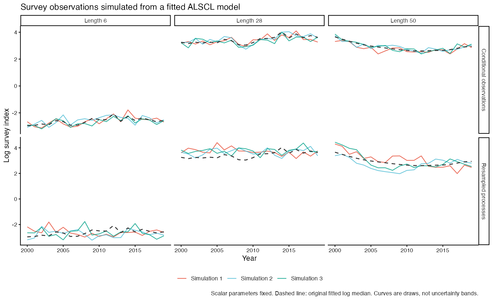
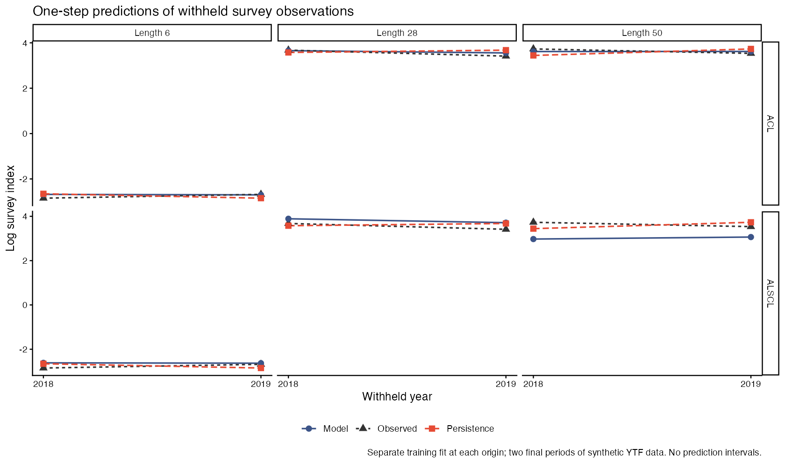

# 模型模拟与预测验证 / Model simulation and prediction checks

<!-- Generated by scripts/build_manual.py from website/content/{en,zh}/articles/. Edit the article pair, not this file. -->

[使用指南 / User guide](USER_GUIDE.md) · [首页 / Home](../README.md)

## 模型能重现观测并预测留出时期吗？ / Can the fitted model reproduce observations and predict withheld periods?

本案例带你从已拟合模型生成调查数据、将重新估计的结果与模拟真值比较，并检验模型能否预测未参与拟合的后续观测。

Use this case to generate survey data from a fitted model, check estimates against known simulated values, or test predictions against observations withheld from fitting.

**开始前：**这些函数需要 ALSCL 2.3.0 或更高版本。请安装该版本，或在下载的仓库根目录运行 `pkgload::load_all(".")`。

**Before you start:** these functions require ALSCL 2.3.0 or later. Install that version, or run `pkgload::load_all(".")` from the downloaded repository root.

| 你想检查什么？ / What would you like to check? | 从哪里开始 / Where to start |
|---|---|
| 相同拟合种群状态下，重复调查会有什么变化？ / Repeated observations at the same fitted population states | [第 2 步：条件模拟](#case-model-validation-section-2) / [Step 2: conditional simulation](#case-model-validation-section-2) |
| 生成新的种群轨迹后，模型能否估计出对应真值？ / New population trajectories and how well they can be estimated | [第 2–3 步：重抽过程并重新拟合](#case-model-validation-section-2) / [Steps 2-3: resample processes and refit](#case-model-validation-section-2) |
| 模型能否预测后续调查观测？ / Predictions of later survey observations | [第 4 步：留出未来时期](#case-model-validation-section-4) / [Step 4: leave out future periods](#case-model-validation-section-4) |

先在第 1 步读取 `x`。若要做模拟，再拟合 `b` 并继续第 2–3 步；若只检查预测，可从 `x` 直接进入第 4 步。第 5 步解释预测评分与结果保存。

Start with step 1 to load `x`. For simulation, also fit `b` and continue through steps 2-3. For prediction checks only, go from `x` directly to step 4. Step 5 explains the prediction scores and saved records.

<a id="case-model-validation-section-1"></a>

### 1. 准备示例并检查拟合 / Prepare the example and check its fit

本案例使用**模拟的** `YTF_example` 数据。先读取一次，得到输入列表 `x`：

The case uses the **synthetic** `YTF_example` dataset. Load it once as the input bundle `x`:

```r
library(ALSCL)
data("YTF_example")
x <- YTF_example
```

若要做模拟，用下面的代码拟合源模型 `b`。若已拟合同一示例，可复用结果并检查诊断。若只检查预测，可以跳过这次拟合，直接进入[第 4 步](#case-model-validation-section-4)，由函数自行建立训练拟合。

For simulation, fit the source model as `b` below. If you already fitted this same example, reuse that result and inspect its diagnostics. For prediction checks only, skip this fit and go to [step 4](#case-model-validation-section-4), which creates its own training fits.

```r
b <- run_alscl(x, silent = TRUE)
b$diagnostics
stopifnot(b$diagnostics$numerical_ok)
```

`numerical_ok` 为 `TRUE` 时继续。若为 `FALSE`，先根据诊断处理问题，再生成模拟；参见[拟合诊断](USER_GUIDE.md#diagnostics)。这一步检查数值拟合，残差与假设敏感性仍需另外评估。

Continue when `numerical_ok` is `TRUE`. If it is `FALSE`, investigate the reported issues before generating simulations; see [fitting diagnostics](USER_GUIDE.md#diagnostics). This screen checks the numerical fit. Residuals and sensitivity to assumptions still need assessment.

教学示例通过 `map` 固定了部分生物学参数。正式评估应采用有依据的种群生物学设置，并用[数据与参数检查](ASSESSMENT_WORKFLOWS.md)确认哪些参数固定、哪些参与估计。若在模拟实验中固定 `mean_log_R`，请在 `parameters` 中明确提供数值，避免依据每份模拟数据重新计算固定值。

The teaching example fixes several biological parameters through `map`. For your own assessment, choose supported stock-specific biology and inspect which parameters are fixed or estimated using [data and parameter checks](ASSESSMENT_WORKFLOWS.md). When fixing `mean_log_R` for a simulation study, supply its numeric value explicitly in `parameters` so that a data-derived value is not recalculated from each simulated dataset.

<a id="case-model-validation-section-2"></a>

### 2. 生成调查观测 / Generate survey observations

<a id="case-model-validation-conditional-draws"></a>

#### 保留拟合的种群状态 / Keep the fitted population states

`process = "conditional"` 保持拟合种群不变，只改变观测误差。想先看看相同状态下的重复调查，可以从这里开始。

`process = "conditional"` changes observation error while retaining the fitted population. This is the shortest way to inspect repeated surveys under the same fitted states.

```r
conditional <- simulate_fit(b, nsim = 3, seed = 20261101,
  process = "conditional")
conditional$metadata
conditional$simulations[[1]]$observations[1:3, 1:3]
```

<a id="case-model-validation-process-draws"></a>

#### 生成新的种群轨迹 / Generate new population trajectories

`process = "resample"` 在拟合标量参数值下，重新抽取补充量、捕捞死亡率及初始种群偏差。第 3 步用这些重复数据进行重新拟合。

`process = "resample"` redraws recruitment, fishing-mortality and initial-population deviations at the fitted scalar parameter values. Use these replicates for the refitting exercise in step 3.

```r
resampled <- simulate_fit(b, nsim = 3, seed = 20261101,
  process = "resample")
resampled$simulations[[1]]$truth$SSB
simulated_x <- resampled$simulations[[1]]$x
```

`$simulations` 中的每个重复都包含：

Each element of `$simulations` contains:

| 字段 / Field | 内容 / What it contains |
|---|---|
| `$observations` | 模拟调查数值，行为体长组、列为时间 / Simulated survey values, with length in rows and time in columns |
| `$x` | 可直接交给对应 `run_acl()` 或 `run_alscl()` 的输入列表 / An input bundle for the corresponding `run_acl()` or `run_alscl()` function |
| `$truth` | 生成数据时的种群量、标量参数与预期调查指数 / Generating population quantities, scalar parameters and expected survey indices |

默认保留原始缺失和零值位置。设置 `preserve_missing = FALSE` 可生成完整的正值调查数据。显式提供种子可复现抽样，函数结束后会恢复调用者的随机数状态。

Original missing and zero cells are preserved by default. Set `preserve_missing = FALSE` for a complete positive survey. A supplied seed reproduces the draws and restores the caller's random-number state afterward.



图中为若干体长组在两种模式下各生成的三条调查序列。虚线是原拟合的对数观测中位数。条件模拟围绕相同拟合状态变化，过程重抽样还改变种群轨迹。曲线表示单次模拟实现，不是置信带。

The figure shows three generated survey series in each mode for selected length groups. The dashed reference is the original fit's log observation median. Conditional simulations vary around the same fitted states; resampling also changes the population trajectory. The curves are individual draws, not confidence bands.

<a id="case-model-validation-simulation-assumptions"></a>

#### 理解模拟假设 / Understand what is being simulated

两种模式均使用拟合的对数正态观测模型：对数观测的均值为 `Elog_index`，标准差为拟合观测标准差。因此，`exp(Elog_index)` 是观测中位数。两种模式都保持标量参数固定，不包含参数估计不确定性。

Both modes use the fitted lognormal observation model: log observations have mean `Elog_index` and the fitted observation standard deviation. Thus `exp(Elog_index)` is the observation median. Scalar parameters remain fixed, so neither mode includes parameter-estimation uncertainty.

重抽过程时，补充量遵循平稳 AR(1) 过程；F 使用可分离的组别／时间 AR(1) 场，`F_structure = "year"` 时使用单个时间过程。过程标准差为边际标准差，时间创新标准差等于边际标准差乘以 `sqrt(1 - phi^2)`。初始丰度偏差来自独立正态分布。C++ 种群模型利用这些抽样计算种群状态，保留末龄加组和 ALSCL 生长转移。

In resample mode, recruitment follows a stationary AR(1) process. F follows a separable group/time AR(1) field, or a single time process for `F_structure = "year"`. Process SDs are marginal SDs; the temporal innovation SD is the marginal SD multiplied by `sqrt(1 - phi^2)`. Initial-abundance deviations are independent normals. The C++ population model uses these draws with the plus group and ALSCL growth transitions.

重抽过程模式不支持固定或绑定随机效应的 map，会明确报错；条件模拟仍可使用。明确失败的源拟合默认被拒绝，`allow_failed_fit = TRUE` 可在警告后用于探索。若需要采用另有补充量假设的独立操作模型，参见[操作模型模拟流程](USER_GUIDE.md#simulation)。

Fixed or tied random-effect maps are rejected in resample mode; conditional simulation remains available. A known failed source fit is rejected by default. `allow_failed_fit = TRUE` permits exploratory use with a warning. For a separate operating model with its own recruitment assumptions, use [the operating-model simulation workflow](USER_GUIDE.md#simulation).

<a id="case-model-validation-section-3"></a>

### 3. 重新拟合并与真值比较 / Refit the replicates and compare with truth

本步为三份重抽过程数据分别使用两个初值进行拟合，比生成观测更耗时。若只想检查预测表现，可直接进入[第 4 步](#case-model-validation-section-4)。

This step fits the three resampled datasets with two starts each. It is more time-consuming than drawing observations. To examine prediction performance only, go directly to [step 4](#case-model-validation-section-4).

每个重复都支持直接输入：本例 ALSCL 模拟使用 `run_alscl(s$x)`；来自 ACL 拟合的模拟使用 `run_acl(s$x)`。下面的循环保留报错记录，使失败重复也进入汇总。

The same direct-input syntax applies to each replicate: `run_alscl(s$x)` for this ALSCL example, or `run_acl(s$x)` for simulations from an ACL fit. The loop keeps error records so that failed replicates remain in the summary.

```r
replicate_fits <- lapply(resampled$simulations, function(s) {
  tryCatch(run_alscl(s$x, nstarts = 2, ncores = 1, silent = TRUE),
    error = function(e) list(error = conditionMessage(e)))
})
truth <- lapply(resampled$simulations, function(s) s$truth)
performance <- summarize_simulations(replicate_fits, truth,
  quantities = c("SSB", "Rec"))
performance$replicates
performance$summary
```

先读 `$replicates` 检查拟合状态，再读 `$summary` 中的偏差、RMSE、覆盖率及分母。三个重复用于演示接口；研究偏差或区间覆盖率需要足够的重复，并报告失败拟合数与可用区间数。参数自助法还需明确重抽样设计、重新拟合协议和区间构造方法；`simulate_fit()` 提供数据生成步骤。

Read `$replicates` first to check fitting status. Then read `$summary` for bias, RMSE, coverage and their denominators. Three replicates demonstrate the interface; a study of bias or interval coverage needs adequate repetitions and explicit failed-fit and usable-interval counts. A parametric bootstrap also needs a stated resampling design, refitting protocol and interval construction; `simulate_fit()` supplies the generating step.

**如果已有磁盘上的模拟批次：**`sim_model(..., nstarts = 3, ncores = 2)` 每个重复使用三个初值，最多同时运行两个重复。初值和标准误在各工作进程内顺序计算；`train_times` 控制每个初值的优化轮数，各拟合保留 `start_diagnostics`。这一批量流程另见[模拟与批量实验](USER_GUIDE.md#simulation)。

**If your simulations are already on disk:** `sim_model(..., nstarts = 3, ncores = 2)` uses three starts per replicate and at most two replicate workers. Starts and standard errors run sequentially inside each worker. `train_times` controls optimization passes per start; each fit retains `start_diagnostics`. This is a separate batch workflow, described in [simulation and batch experiments](USER_GUIDE.md#simulation).

<a id="case-model-validation-section-4"></a>

### 4. 预测未参与拟合的时期 / Predict periods withheld from fitting

`hindcast_model()` 读取 `x` 并自行建立训练拟合，不复用 `b` 或模拟数据。本例中，每个模型先用截至 2017 年的数据预测 2018 年，再用截至 2018 年的数据预测 2019 年。

`hindcast_model()` takes `x` and creates its own training fits. It does not reuse `b` or the simulated datasets. Here, each model is fitted through 2017 to predict 2018, and through 2018 to predict 2019.

| 设置 / Setting | 在本年度示例中的含义 / Meaning in this annual example |
|---|---|
| `horizon = 1` | 向前预测一个模型时期 / Predict one model period ahead |
| `nfolds = 2` | 使用最后两个合格的训练终点 / Use the last two eligible training endpoints |
| `min_train = 8` | 要求至少保留八个训练时期 / Require at least eight training periods |
| `ncores = 2` | 最多并行运行两个训练折 / Run at most two training folds in parallel |

```r
acl_validation <- hindcast_model(x, model = "acl", horizon = 1,
  nfolds = 2, min_train = 8, nstarts = 1, ncores = 2)
alscl_validation <- hindcast_model(x, model = "alscl", horizon = 1,
  nfolds = 2, min_train = 8, nstarts = 1, ncores = 2)
acl_validation$diagnostics
alscl_validation$diagnostics
```

逐折查看 `numerical_ok`、`prediction_ok`、警告与报错。失败或数值状态无法确认的训练拟合保留在 `$diagnostics` 中，不产生预测或参与评分。理解这些记录后，再看评分与逐个观测单元的预测：

Check every fold's `numerical_ok`, `prediction_ok`, warnings and errors. Failed or numerically unverified training fits remain in `$diagnostics` and contribute no predictions or scores. Once these rows are understood, inspect the scores and individual prediction cells:

```r
acl_validation$scores
alscl_validation$scores
head(alscl_validation$predictions)
```



图中比较留出期的对数调查指数、模型预测及持平基准。持平基准将相同体长组最近一次正训练观测保持不变。第 5 步在相同合格观测单元上比较两种预测的误差。

The figure compares withheld log survey indices with the model prediction and a persistence baseline: the latest positive training observation in the same length bin, held constant. Step 5 compares their errors on the same eligible observation cells.

<a id="case-model-validation-forecast-design"></a>

#### 调整验证设计 / Adapt the validation design

`horizon` 与 `min_train` 都按模型时期计数；季度数据的一步为一季度。函数使用最后 `nfolds` 个合格起点，每折截短三张输入表和支持的时间映射，再使用提供的拟合配置。初值不会取自完整序列的拟合结果。生物学假设、固定值和手动初值都应在不参照留出数据调参的前提下确定；比较模型时，使用相同起点、期距与观测单元。

`horizon` and `min_train` count model periods; one step is one quarter for quarterly inputs. The last `nfolds` eligible origins are used. Each fold truncates all three input tables and supported time maps, then uses the supplied fitting configuration. Starting estimates never come from a fit to the complete series. Choose biological assumptions, fixed values and manual starts without tuning to withheld data; compare models using the same origins, horizons and observation cells.

<a id="case-model-validation-forecast-assumptions"></a>

#### 理解预测规则 / Understand the prediction rule

未来对数补充量及对数 F 偏差沿训练末期出发的 AR(1) 条件均值路径延伸。种群方程推进丰度，再用给定调查可捕性转为指数。计算中沿用训练末期的体重与成熟比例，不读取未来实际生物学资料。

Forecast log recruitment and log F deviations follow their AR(1) conditional-mean paths from the training endpoint. Population equations propagate abundance, and supplied catchability converts it to survey indices. Training-end weights and maturity are carried forward; future observed biology is not read into the prediction.

这是沿条件对数过程路径的代入式点预测，不抽取未来随机扰动或参数，也不提供预测分布或区间。固定或绑定随时间变化的补充／F 偏差的非恒等 map 会被拒绝，因为其未来约束尚未定义。

These are plug-in point predictions along conditional log-process paths. They include no future random shocks or parameter draws and provide no predictive distribution or intervals. Nonidentity maps fixing or tying time-varying recruitment/F deviations are rejected because their future constraints are unspecified.

<a id="case-model-validation-section-5"></a>

### 5. 解读评分并保存分析 / Interpret scores and save the analysis

<a id="case-model-validation-prediction-scores"></a>

#### 同时查看误差与样本数 / Read the scores and their sample sizes together

评分使用自然对数调查指数，排除验证数据中的零值与缺失值。模型与持平基准都只对两种预测均可取得的相同单元计算误差。

Scores use natural-log survey indices. Zero and missing validation observations are excluded. Model and persistence errors use the same cells with both predictions available.

| 输出 / Output | 读法 / How to read it |
|---|---|
| `n_positive`、`n_prediction`、`n` / `n_positive`, `n_prediction`, `n` | 正的留出观测数、其中有模型预测的数量，以及模型和持平基准共同评分的数量 / Positive held-out observations, those with model predictions, and cells scored for both model and persistence |
| `log_RMSE`、`log_MAE` / `log_RMSE`, `log_MAE` | 对数指数尺度上的预测误差；对这些单元而言，越小表示误差越小 / Prediction error on the log-index scale; smaller values mean smaller errors on those cells |
| `naive_log_RMSE`、`naive_log_MAE` / `naive_log_RMSE`, `naive_log_MAE` | 同一批单元上持平基准的对应误差 / Corresponding persistence errors on the same cells |
| `log_MASE`、`naive_log_MASE`、`n_scaled` / `log_MASE`, `naive_log_MASE`, `n_scaled` | 缩放后的绝对误差，以及训练期尺度可用的单元数 / Scaled absolute errors and the number of cells with a usable training scale |

MASE 将每个绝对对数误差除以该体长组训练期内相邻正观测的平均绝对对数差。缺失时期不会被压缩。尺度为零或不可用时，该单元不进入缩放评分；没有合格单元时评分为 `NA`。解释结果前应查看 `n_scaled`。

For MASE, each absolute log error is divided by that length bin's mean absolute difference between consecutive positive training log observations. Missing periods are not compressed. A zero or unavailable scale excludes that cell from the scaled score; when no eligible cells remain, the score is `NA`. Check `n_scaled` before interpreting it.

实际执行本例时，两个模型对相同的 2018–2019 年共 46 个正观测评分。四个训练拟合均通过数值检查，两次比较使用同一个持平基准。

In the executed example, both models scored the same 46 positive observations from 2018-2019. All four training fits passed the numerical screen, and both comparisons used the same persistence baseline.

| 预测方法 / Prediction | 评分观测数 / Scored observations | 对数 RMSE / Log RMSE | 对数 MAE / Log MAE | 对数 MASE / Log MASE |
|---|---:|---:|---:|---:|
| ACL | 46 | 0.0963 | 0.0802 | 0.4213 |
| ALSCL | 46 | 0.2583 | 0.1951 | 1.0655 |
| 持平基准 / Persistence | 46 | 0.1722 | 0.1467 | 0.7356 |

在这份模拟数据、教学 map 和两个起点的设计下，ACL 优于持平基准，ALSCL 没有优于基准。即使两者优化均收敛，这个差异也值得研究。两个验证时期不能确立普遍模型排名。三组过程模拟数据的重新拟合也都通过数值检查，但三个重复不足以确定覆盖率。

Under this synthetic dataset, teaching maps and two-origin design, ACL improves on persistence and ALSCL does not. The difference deserves investigation even though both optimizations converged. Two validation periods do not establish a general model ranking. The three simulated-process refits also passed the numerical screen, but three replicates are insufficient to establish coverage.

<a id="case-model-validation-save-record"></a>

#### 保存可移植的拟合结果 / Save a portable fit

若已完成模拟步骤，可用下面的代码保存源拟合 `b`。保存的评估文件可在新的 R 会话中读取，并在没有活跃 TMB 指针的情况下用于模拟：

If you completed the simulation steps, save the source fit `b` with the following block. The archive can be read in a new R session and used for simulation without a live TMB pointer:

```r
archive <- tempfile(fileext = ".rds")
save_assessment(b, archive)
saved <- read_assessment(archive)
saved$recipe$implementation
again <- simulate_fit(saved, nsim = 1, seed = 20261101,
  process = "conditional")
```

正式分析时，将临时路径换成永久文件名，并在拟合结果旁保存模拟对象和真值。第 4 步的验证结果可将两个模型一起保存：

Replace the temporary path with a permanent filename for your analysis. Save the simulation objects and truth alongside the fit. To save the validation results from step 4, retain both models together:

```r
validation_file <- tempfile(fileext = ".rds")
saveRDS(list(acl = acl_validation, alscl = alscl_validation),
  validation_file)
```

正式分析时，同样将这里的临时路径换成永久文件名。评估配方保留可取得的源码提交、核心／R 源码摘要及运行环境。源码 HEAD 本身不能证明工作区没有修改；`refit_model()` 会提示已知实现或依赖变化，旧结果无法恢复的来源保持未知。

Use a permanent path here too for your own analysis. Recipes retain available source revision, core/R source hashes and runtime metadata. A source HEAD alone does not establish a clean working tree; `refit_model()` warns about known implementation or dependency changes, while unknown older provenance remains unknown.

<a id="case-model-validation-next-steps"></a>

#### 选择下一项检查 / Choose the next check

用[残差诊断](USER_GUIDE.md#diagnostics)查看观测模式，用[回溯分析](USER_GUIDE.md#retrospective)检查历史估计的修订，或用[敏感性场景](CASES.md#case-sensitivity-projection)检查给定假设的影响。这些检查回答的问题与留出预测不同。

Use [residual diagnostics](USER_GUIDE.md#diagnostics) to examine observation patterns, [retrospective analysis](USER_GUIDE.md#retrospective) to examine revisions to historical estimates, or [sensitivity scenarios](CASES.md#case-sensitivity-projection) to examine supplied assumptions. These answer different questions from held-out prediction.

要重新生成本案例的图和 CSV 结果，请在下载的仓库根目录运行下面的代码。这会重新执行完整拟合流程；绘图辅助程序在保存前逐面板检查网格线。

To regenerate this case's figures and CSV results, run the following from the downloaded repository root. It performs the full fitting exercise again; the plotting helper checks every panel for gridlines before saving.

```r
pkgload::load_all(".")
source("scripts/model_validation.R")
run_model_validation_guide()
```
