# YTF 绘图图谱 · YTF plot gallery

**44 张图，覆盖 22 个公开绘图函数及主要类型。44 figures covering all 22 public plotting functions and major variants.**

全部 44 张图使用当前绘图函数从内置教学拟合生成，默认不显示网格线；BL/SBL 图包含可用的标准误区间。 / All 44 figures are drawn with the current plotting functions from the built-in teaching fits; the defaults show no gridlines, and the BL/SBL figures include the available standard-error intervals.

[使用指南 / Guide](USER_GUIDE.md) · [完整参数 / API](FUNCTION_REFERENCE.md) · [可运行脚本 / R workflow](../scripts/ytf_workflow.R)

先运行指南第 2 节，定义 `a`、`b`、`x`、`inputs`、`dat <- x$data.CatL`，并加载 `ggplot2`、`patchwork`。回溯图使用指南第 9 节的 `ra` 和 `rb`。全部图来自同一个模拟 YTF 数据和固定部分生物参数的条件拟合。

Run section 2 of the guide, define `dat <- x$data.CatL`, and load ggplot2/patchwork. Retrospective plots use `ra/rb` from section 9. Every fit uses the same synthetic YTF data and conditional fixed-biology settings.

代码中的额外主题、刻度及组合布局仅调整显示。图像可点击放大；保存时建议宽 11 英寸、多分面高 8.5 英寸。 / Extra theme, scale and layout calls affect presentation only. Click figures to enlarge; use wide output for multi-panel figures.

```r
# 全图共用主题 / Shared gallery theme
acl_theme_set(base_theme="bw", font_family="sans", title_size=12,
  axis_title_size=10, axis_text_size=9, strip_text_size=9,
  palette="npg")
```

## 图目录 / Figure index

- [1. 调查拟合 length 对数尺度 / Survey fit length log scale](#CatL_length_FALSE)
- [2. 调查拟合 length 原尺度 / Survey fit length original scale](#CatL_length_TRUE)
- [3. 调查拟合 year 对数尺度 / Survey fit year log scale](#CatL_year_FALSE)
- [4. 调查拟合 year 原尺度 / Survey fit year original scale](#CatL_year_TRUE)
- [5. 丰度 N / Abundance N](#plot_abundance_N)
- [6. 丰度 NA / Abundance NA](#plot_abundance_NA)
- [7. 丰度 NL / Abundance NL](#plot_abundance_NL)
- [8. 生物量 B / Biomass B](#plot_biomass_B)
- [9. 生物量 BA / Biomass BA](#plot_biomass_BA)
- [10. 生物量 BL / Biomass BL](#plot_biomass_BL)
- [11. 产卵生物量 SSB / Spawning biomass SSB](#plot_SSB_SSB)
- [12. 产卵生物量 SBA / Spawning biomass SBA](#plot_SSB_SBA)
- [13. 产卵生物量 SBL / Spawning biomass SBL](#plot_SSB_SBL)
- [14. 捕获尾数 CN / Catch numbers CN](#plot_catch_CN)
- [15. 捕获尾数 CNA / Catch numbers CNA](#plot_catch_CNA)
- [16. 捕获尾数 CNL / Catch numbers CNL](#plot_catch_CNL)
- [17. 补充量 / Recruitment](#recruitment)
- [18. 亲体与补充关系 / Spawning biomass and recruitment](#SSB_Rec)
- [19. 生长曲线与区间 / Growth curve and interval](#VB)
- [20. 年龄—体长概率矩阵 / Age–length probability matrix](#pla)
- [21. ACL 捕捞死亡率 year / ACL fishing mortality year](#F_ACL_year)
- [22. ACL 捕捞死亡率 age / ACL fishing mortality age](#F_ACL_age)
- [23. ALSCL 捕捞死亡率 year / ALSCL fishing mortality year](#F_ALSCL_year)
- [24. ALSCL 捕捞死亡率 age / ALSCL fishing mortality age](#F_ALSCL_age)
- [25. ALSCL 捕捞死亡率 length / ALSCL fishing mortality length](#F_ALSCL_length)
- [26. 对数残差 length / Log residuals length](#residuals_length)
- [27. 对数残差 year / Log residuals year](#residuals_year)
- [28. 对数过程偏差 R / Log process deviations R](#deviation_R_TRUE)
- [29. 过程乘数 R / Process multipliers R](#deviation_R_FALSE)
- [30. 对数过程偏差 F / Log process deviations F](#deviation_F_TRUE)
- [31. 过程乘数 F / Process multipliers F](#deviation_F_FALSE)
- [32. 长度组成山脊图 / Length composition ridges](#ridges)
- [33. 种群时间序列比较 / Population time series comparison](#compare_ts)
- [34. 死亡率矩阵比较 / Fishing mortality matrices](#compare_F)
- [35. 残差联合诊断 / Combined residual diagnostics](#compare_residuals)
- [36. 生长与外部参照接口 / Growth and reference-data interface](#compare_growth)
- [37. 两模型调查拟合 / Survey fits from both models](#compare_CatL)
- [38. 拟合指标比较 / Fit metric comparison](#compare_metrics)
- [39. 固定调查可捕性 / Fixed survey catchability](#compare_selectivity)
- [40. 总体 F 比较 apical / Summary F comparison apical](#compare_F_apical)
- [41. 总体 F 比较 mean / Summary F comparison mean](#compare_F_mean)
- [42. ACL 回溯分析 / ACL retrospective analysis](#retro_ACL)
- [43. ALSCL 回溯分析 / ALSCL retrospective analysis](#retro_ALSCL)
- [44. 模拟真值与条件估计 / Simulation truth and conditional estimates](#truth)

<a id="plot_CatL"></a>

<a id="CatL_length_FALSE"></a>
## 1. 调查拟合 length 对数尺度 / Survey fit length log scale

```r
# 绘制本图 / Draw this figure
plot_CatL(b, facet_by = "length", exp_transform = FALSE, facet_ncol = 4,
  point_size = 1, line_size = 0.6,
  x_breaks = c(2000, 2010, 2015),
  ylab = "Log survey index")
```

[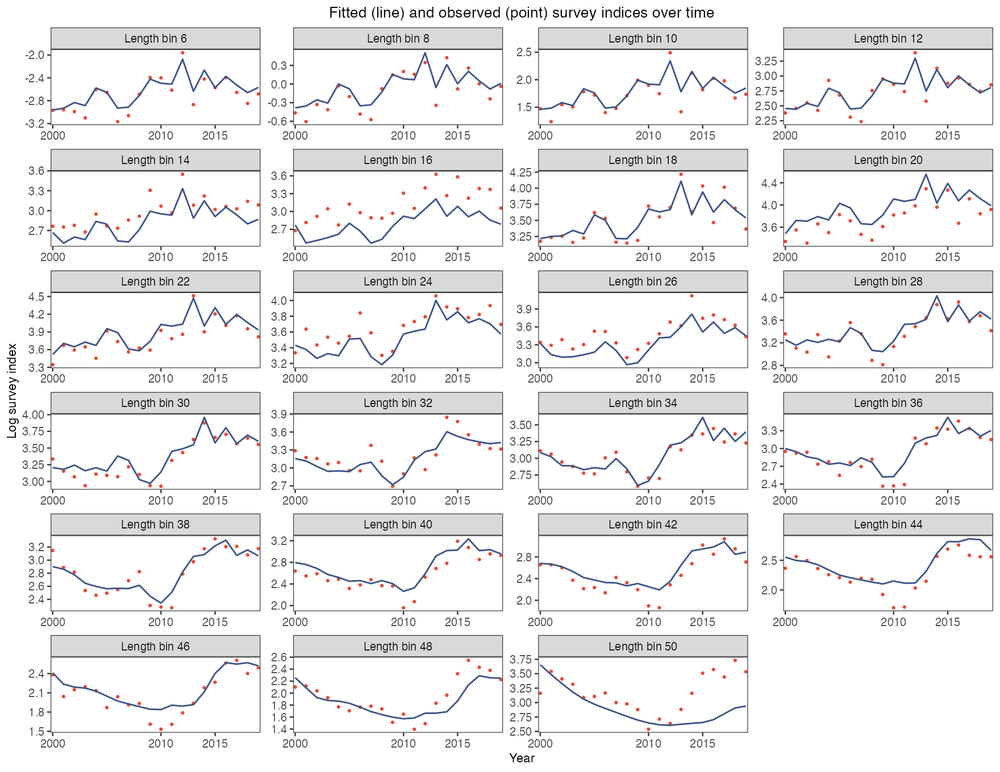](figures/ytf/CatL_length_FALSE.png)

每个体长组一个面板，横轴为时间，纵轴为对数调查指数：朱红色点为观测的对数指数，深蓝色曲线为拟合的 `Elog_index`。用它逐组检查拟合；点连续偏在曲线一侧（如本例的 16 组和 50 组）说明该组被系统低估或高估，对数尺度让大小体长组的偏离同样可读。

One panel per length bin, time on the horizontal axis and the log survey index on the vertical axis: vermilion points are the observed log index and the navy curve is the fitted `Elog_index`. Use it to judge the fit bin by bin; a run of points on one side of the curve, as in bins 16 and 50 here, marks a bin the model under- or over-predicts, and the log scale shows this equally well in small and large bins.

[参数及默认值 / Arguments and defaults](FUNCTION_REFERENCE.md#plot_CatL)

<a id="CatL_length_TRUE"></a>
## 2. 调查拟合 length 原尺度 / Survey fit length original scale

```r
# 绘制本图 / Draw this figure
plot_CatL(b, facet_by = "length", exp_transform = TRUE, facet_ncol = 4,
  point_size = 1, line_size = 0.6,
  x_breaks = c(2000, 2010, 2015),
  ylab = "Survey index")
```

[](figures/ytf/CatL_length_TRUE.png)

同样的面板改为原尺度：深蓝色曲线为 `exp(Elog_index)`，即拟合对数正态分布的中位数，朱红色点为观测指数。用它按指数单位读取偏差；误差是乘性的，高值处看似很大的差距与低值处的小差距可能是相同的相对偏差。

The same panels on the original scale: the navy curve is `exp(Elog_index)`, the median of the fitted lognormal distribution, and the vermilion points are the observed index. Use it to read the misfit in index units; the error is multiplicative, so a gap that looks large at high values can be the same relative misfit as a small gap at low values.

[参数及默认值 / Arguments and defaults](FUNCTION_REFERENCE.md#plot_CatL)

<a id="CatL_year_FALSE"></a>
## 3. 调查拟合 year 对数尺度 / Survey fit year log scale

```r
# 绘制本图 / Draw this figure
plot_CatL(b, facet_by = "year", exp_transform = FALSE, facet_ncol = 4,
  line_size1 = 0.6, line_size2 = 0.4,
  x_breaks = c(10, 30, 50),
  ylab = "Log survey index")
```

[](figures/ytf/CatL_year_FALSE.png)

`line_size1 = 0.6` 控制拟合线，`line_size2 = 0.4` 控制观测线；年份模式不使用 `line_size` 和 `point_size`。 / `line_size1 = 0.6` controls fitted curves and `line_size2 = 0.4` controls observations; year mode does not use `line_size` or `point_size`.

每个时间步一个面板，横轴为体长，纵轴为对数调查指数：细朱红线为观测对数指数随体长的变化，粗深蓝线为拟合的 `Elog_index`。用它检查同一时间步内的拟合形状；深蓝线没有跟上的突起（如本例后几年最大体长组处）就是拟合未能解释的体长结构。

One panel per time step, length on the horizontal axis and the log survey index on the vertical axis: the thin vermilion curve is the observed log index across lengths and the thick navy curve is the fitted `Elog_index`. Use it to check the shape of the fit within a time step; a bump the navy curve misses, as at the largest bin in the later years here, is length structure the fit leaves unexplained.

[参数及默认值 / Arguments and defaults](FUNCTION_REFERENCE.md#plot_CatL)

<a id="CatL_year_TRUE"></a>
## 4. 调查拟合 year 原尺度 / Survey fit year original scale

```r
# 绘制本图 / Draw this figure
plot_CatL(b, facet_by = "year", exp_transform = TRUE, facet_ncol = 4,
  line_size1 = 0.6, line_size2 = 0.4,
  x_breaks = c(10, 30, 50),
  ylab = "Survey index")
```

[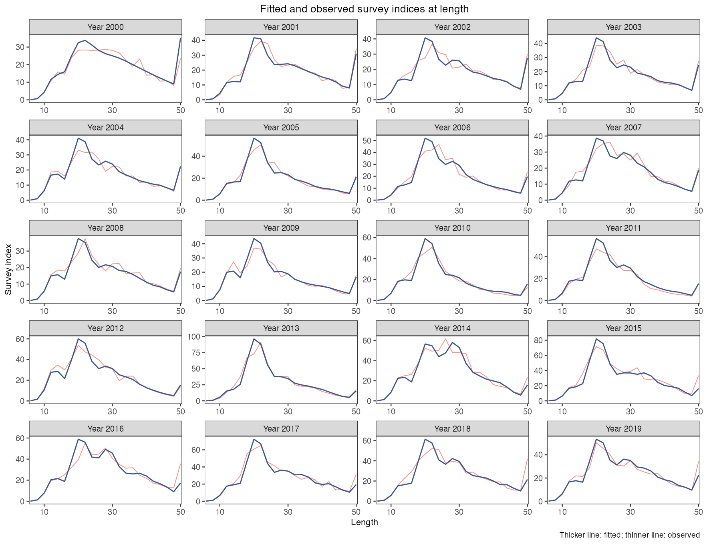](figures/ytf/CatL_year_TRUE.png)

`line_size1 = 0.6` 控制拟合线，`line_size2 = 0.4` 控制观测线；年份模式不使用 `line_size` 和 `point_size`。 / `line_size1 = 0.6` controls fitted curves and `line_size2 = 0.4` controls observations; year mode does not use `line_size` or `point_size`.

同样的面板改为原尺度，曲线为 `exp(Elog_index)` 中位数与观测指数。用它看每个时间步的指数主要来自哪些体长；峰的位置和高度显示调查捕到的主要体长，观测峰偏离深蓝线的时间步值得再看残差图。

The same panels on the original scale, with the curves as `exp(Elog_index)` medians and the observed index. Use it to see which lengths carry the index in each time step; the position and height of the peak show where the survey catches most fish, and a time step whose observed peak sits off the navy curve is worth checking in the residual figures.

[参数及默认值 / Arguments and defaults](FUNCTION_REFERENCE.md#plot_CatL)

<a id="plot_abundance"></a>

<a id="plot_abundance_N"></a>
## 5. 丰度 N / Abundance N

```r
# 绘制本图 / Draw this figure
plot_abundance(b, type = "N", se = TRUE, facet_ncol = 3,
  line_size = 0.6)
```

[](figures/ytf/plot_abundance_N.png)

各组之和的总丰度随时间步变化；阴影为近似 95% 区间，即估计值加减 1.96 倍标准误。用它看全种群的趋势及其精度；本例 2012 年的跳升是同年的强补充量进入最小年龄组。

Total abundance, summed over all groups, by time step; the shaded band is the approximate 95% interval, the estimate plus or minus 1.96 standard errors. Use it for the stock-wide trend and its precision; the jump in 2012 here is the strong 2012 recruitment entering the youngest age class.

[参数及默认值 / Arguments and defaults](FUNCTION_REFERENCE.md#plot_abundance)

<a id="plot_abundance_NA"></a>
## 6. 丰度 NA / Abundance NA

```r
# 绘制本图 / Draw this figure
plot_abundance(b, type = "NA", se = TRUE, facet_ncol = 3,
  line_size = 0.6)
```

[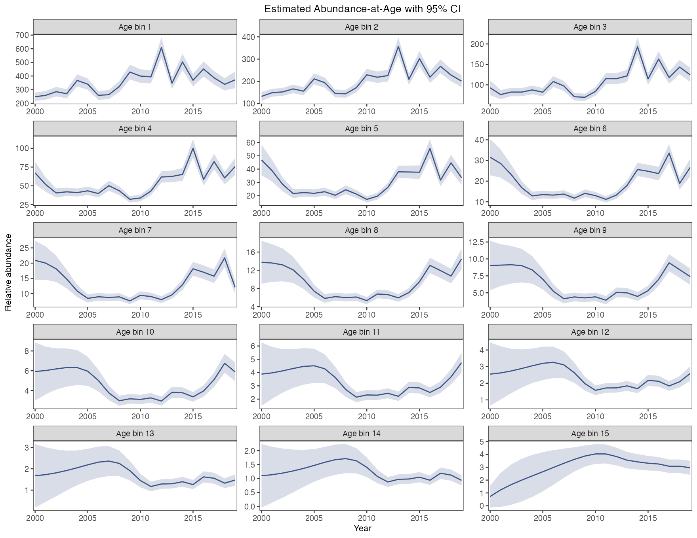](figures/ytf/plot_abundance_NA.png)

年龄别丰度，每个年龄组一个面板，纵轴各自取值，均带 95% 区间。用它追踪年级群：强年级群表现为每个时间步向右移一个面板的峰；年龄越大区间越宽，因为老龄组数量少，调查对它们的信息也少。

Abundance at age, one panel per age class with its own vertical scale, each with the 95% band. Use it to follow cohorts: a strong year class appears as a peak that moves one panel to the right at each time step, and the bands widen with age because the old classes are small and the survey says little about them.

[参数及默认值 / Arguments and defaults](FUNCTION_REFERENCE.md#plot_abundance)

<a id="plot_abundance_NL"></a>
## 7. 丰度 NL / Abundance NL

```r
# 绘制本图 / Draw this figure
plot_abundance(b, type = "NL", se = TRUE, facet_ncol = 3,
  line_size = 0.6)
```

[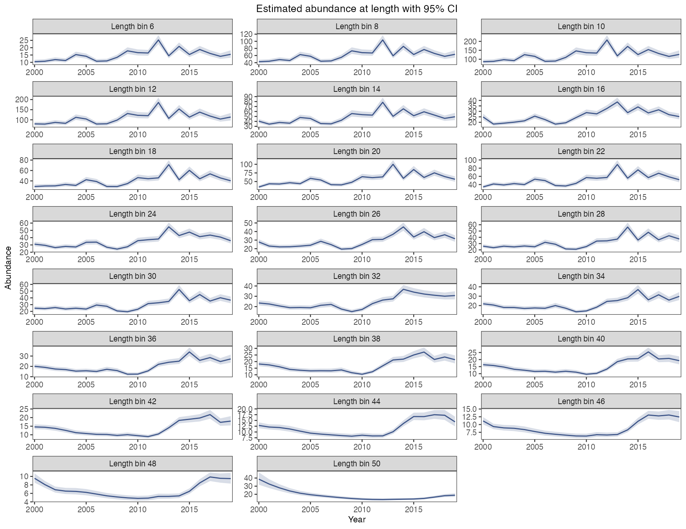](figures/ytf/plot_abundance_NL.png)

体长别丰度，每个体长组一个面板，均带 95% 区间。用它看数量集中在哪些体长；本例 2012 年的峰先出现在小体长组，随年级群生长再出现在较大的组，最大的组变化平缓，因为鱼在此累积。

Abundance at length, one panel per length bin, each with the 95% band. Use it to see which lengths hold the numbers; the 2012 peak here appears first in the small bins and later in the larger ones as the cohort grows, while the largest bin changes slowly because fish accumulate there.

[参数及默认值 / Arguments and defaults](FUNCTION_REFERENCE.md#plot_abundance)

<a id="plot_biomass"></a>

### 模型、输出与区间支持范围

`se = TRUE` 绘制逐点近似 95% 区间，即估计值加减 1.96 倍标准误；下表列出每个模型哪些量带标准误。数量或标准误不可用时报错，只需要估计线时用 `se = FALSE`；解读区间前先通过数值检查。

| 函数 | 类型 | ACL | ALSCL |
|---|---|---|---|
| `plot_biomass()` | `B` | 估计 + 区间 | 估计 + 区间 |
| `plot_biomass()` | `BL` | 仅估计 | 估计 + 区间 |
| `plot_biomass()` | `BA` | 不可用 | 估计 + 区间 |
| `plot_SSB()` | `SSB` | 估计 + 区间 | 估计 + 区间 |
| `plot_SSB()` | `SBL` | 仅估计 | 估计 + 区间 |
| `plot_SSB()` | `SBA` | 不可用 | 估计 + 区间 |
| `plot_catch()` | `CN` | 估计 + 区间 | 估计 + 区间 |
| `plot_catch()` | `CNA` | 仅估计 | 估计 + 区间 |
| `plot_catch()` | `CNL` | 不可用 | 估计 + 区间 |

```r
plot_biomass(b, type = "BL", se = TRUE)
plot_SSB(b, type = "SBL", se = TRUE)
plot_catch(a, type = "CNA", se = FALSE)
```

### Model, output and interval support

`se = TRUE` draws pointwise approximate 95% intervals, the estimate plus or minus 1.96 standard errors; the table lists which quantities each model reports with standard errors. An unavailable quantity or standard error is an error, and `se = FALSE` draws the estimate alone; pass the numerical checks before reading an interval.

| Function | Type | ACL | ALSCL |
|---|---|---|---|
| `plot_biomass()` | `B` | Estimate + interval | Estimate + interval |
| `plot_biomass()` | `BL` | Estimate only | Estimate + interval |
| `plot_biomass()` | `BA` | Unavailable | Estimate + interval |
| `plot_SSB()` | `SSB` | Estimate + interval | Estimate + interval |
| `plot_SSB()` | `SBL` | Estimate only | Estimate + interval |
| `plot_SSB()` | `SBA` | Unavailable | Estimate + interval |
| `plot_catch()` | `CN` | Estimate + interval | Estimate + interval |
| `plot_catch()` | `CNA` | Estimate only | Estimate + interval |
| `plot_catch()` | `CNL` | Unavailable | Estimate + interval |

```r
plot_biomass(b, type = "BL", se = TRUE)
plot_SSB(b, type = "SBL", se = TRUE)
plot_catch(a, type = "CNA", se = FALSE)
```

<a id="plot_biomass_B"></a>
## 8. 生物量 B / Biomass B

```r
# 绘制本图 / Draw this figure
plot_biomass(b, type = "B", se = TRUE, facet_ncol = 3,
  line_size = 0.6)
```

[](figures/ytf/plot_biomass_B.png)

总生物量随时间步变化，带 95% 区间。与总丰度对照：小鱼体重小，所以生物量比丰度平滑，补充量脉冲要等年级群长大后才在生物量中显现。

Total biomass by time step with the 95% band. Read it next to total abundance: small fish weigh little, so biomass is smoother than abundance and a recruitment pulse appears in biomass only once the cohort has grown.

[参数及默认值 / Arguments and defaults](FUNCTION_REFERENCE.md#plot_biomass)

<a id="plot_biomass_BA"></a>
## 9. 生物量 BA / Biomass BA

```r
# 绘制本图 / Draw this figure
plot_biomass(b, type = "BA", se = TRUE, facet_ncol = 3,
  line_size = 0.6)
```

[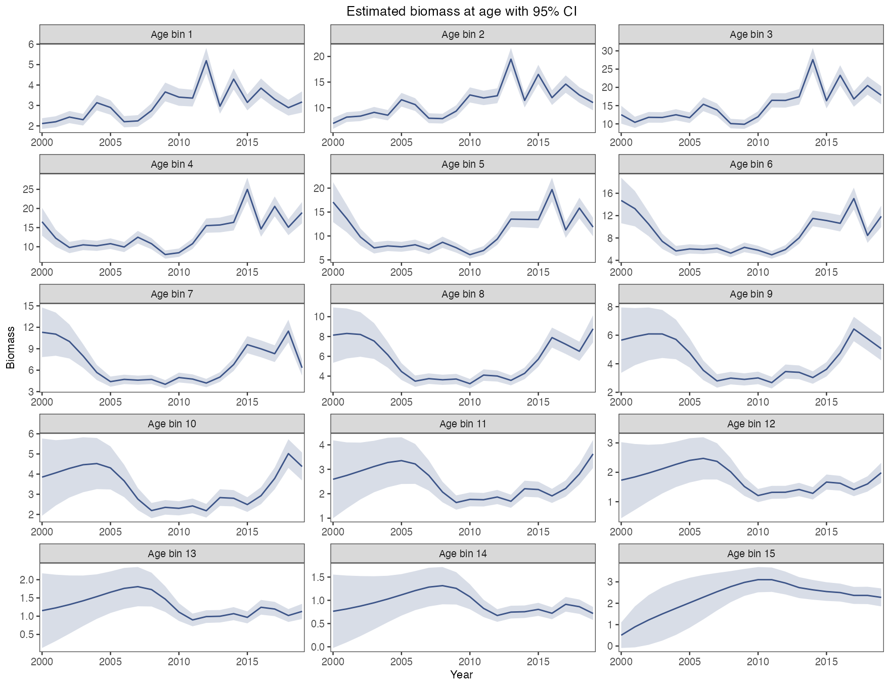](figures/ytf/plot_biomass_BA.png)

年龄别生物量，每个年龄组一个面板，纵轴各自取值，带 95% 区间。用它看生物量集中在哪些年龄；注意各面板的纵轴刻度，自由刻度会让数量很小的老龄组看起来和大的年轻组一样多变。

Biomass at age, one panel per age class with free vertical scales and the 95% band. Use it to see which ages hold the biomass; read the axis of each panel, because the free scales make a small old class look as variable as a large young one.

[参数及默认值 / Arguments and defaults](FUNCTION_REFERENCE.md#plot_biomass)

<a id="plot_biomass_BL"></a>
## 10. 生物量 BL / Biomass BL

```r
# 绘制本图 / Draw this figure
plot_biomass(b, type = "BL", se = TRUE, facet_ncol = 3,
  line_size = 0.6)
```

[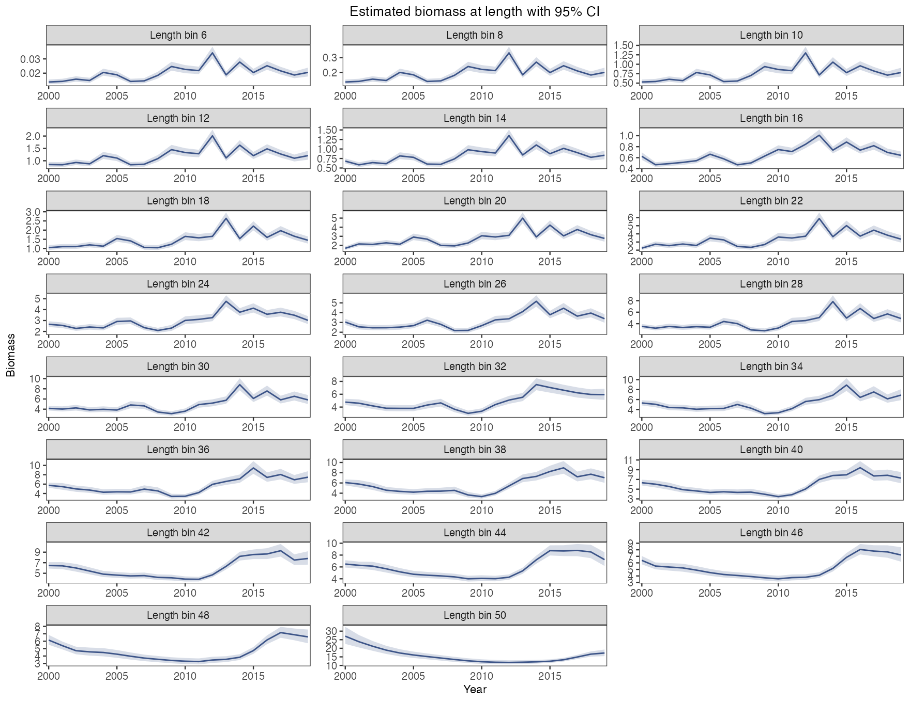](figures/ytf/plot_biomass_BL.png)

体长别生物量，每个体长组一个面板，带 95% 区间。用它看生物量集中在哪些体长；本例 36 以上各组占大部分，它们在 2013 年后的上升是 2012 年级群长入大体长组。

Biomass at length, one panel per length bin with the 95% band. Use it to see which lengths hold the biomass; here the bins above 36 carry most of it, and their rise after 2013 is the 2012 cohort growing into the large bins.

[参数及默认值 / Arguments and defaults](FUNCTION_REFERENCE.md#plot_biomass)

<a id="plot_SSB"></a>

<a id="plot_SSB_SSB"></a>
## 11. 产卵生物量 SSB / Spawning biomass SSB

```r
# 绘制本图 / Draw this figure
plot_SSB(b, type = "SSB", se = TRUE, facet_ncol = 3,
  line_size = 0.6)
```

[](figures/ytf/plot_SSB_SSB.png)

产卵生物量随时间步变化，带 95% 区间。用它作为资源状态序列：只有成熟鱼计入，所以它滞后于总生物量；本例 2010 年前后的低点之后才出现回升。

Spawning biomass by time step with the 95% band. Use it as the stock status series: only mature fish count, so it lags total biomass, and its low point around 2010 here comes before the recovery of the later years.

[参数及默认值 / Arguments and defaults](FUNCTION_REFERENCE.md#plot_SSB)

<a id="plot_SSB_SBA"></a>
## 12. 产卵生物量 SBA / Spawning biomass SBA

```r
# 绘制本图 / Draw this figure
plot_SSB(b, type = "SBA", se = TRUE, facet_ncol = 3,
  line_size = 0.6)
```

[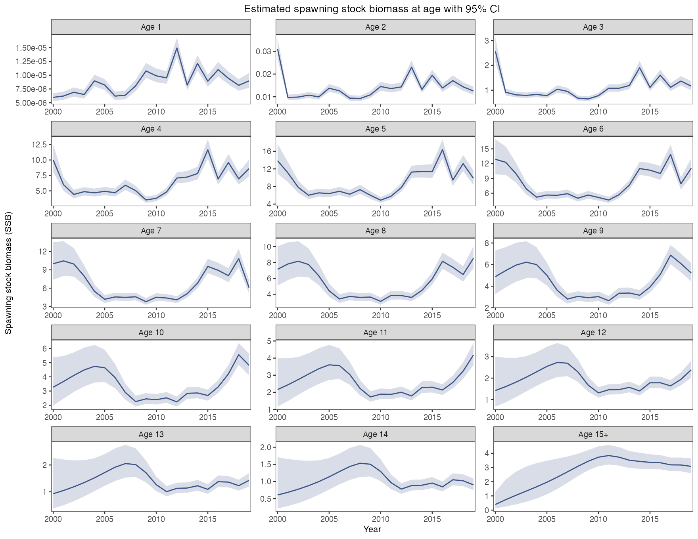](figures/ytf/plot_SSB_SBA.png)

年龄别产卵生物量，每个年龄组一个面板，带 95% 区间。用它看产卵来自哪些年龄；最小的几个年龄组接近零，因为成熟比例表几乎不给它们成熟个体，比较面板时看纵轴数值而不是曲线形状。

Spawning biomass at age, one panel per age class with the 95% band. Use it to see which ages spawn; the youngest classes sit near zero because the maturity table gives them almost no mature fish, so compare panels by their axis values rather than by the shape of the curves.

[参数及默认值 / Arguments and defaults](FUNCTION_REFERENCE.md#plot_SSB)

<a id="plot_SSB_SBL"></a>
## 13. 产卵生物量 SBL / Spawning biomass SBL

```r
# 绘制本图 / Draw this figure
plot_SSB(b, type = "SBL", se = TRUE, facet_ncol = 3,
  line_size = 0.6)
```

[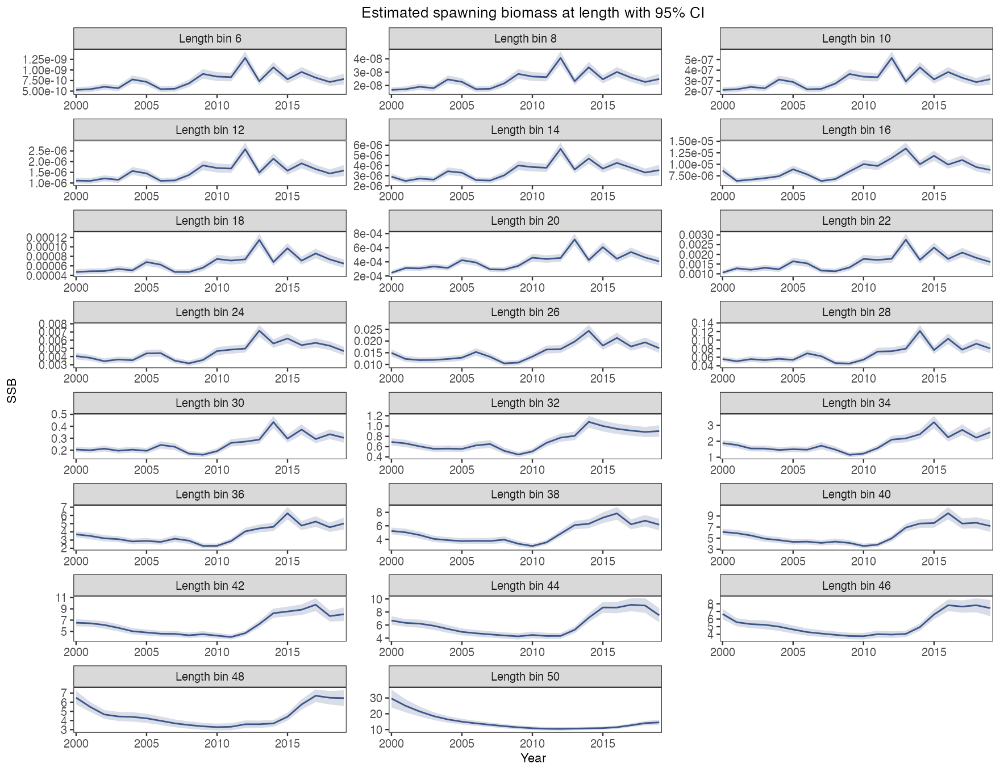](figures/ytf/plot_SSB_SBL.png)

体长别产卵生物量，每个体长组一个面板，带 95% 区间。用它看产卵来自哪些体长；小体长组同样接近零，30 以上的成熟组走势与总产卵生物量一致。

Spawning biomass at length, one panel per length bin with the 95% band. Use it to see which lengths spawn; the small bins sit near zero for the same reason, and the mature bins above 30 follow the total spawning biomass.

[参数及默认值 / Arguments and defaults](FUNCTION_REFERENCE.md#plot_SSB)

<a id="plot_catch"></a>

<a id="plot_catch_CN"></a>
## 14. 捕获尾数 CN / Catch numbers CN

```r
# 绘制本图 / Draw this figure
plot_catch(b, type = "CN", se = TRUE, facet_ncol = 3,
  line_size = 0.6)
```

[](figures/ytf/plot_catch_CN.png)

捕获尾数随时间步变化，带 95% 区间。捕获量由模型根据丰度和捕捞死亡率推算，YTF 数据没有渔获观测；用它与已知的渔获量对照，宽区间说明仅凭调查对捕获量的约束较弱。

Catch in numbers by time step with the 95% band. The model derives catch from abundance and fishing mortality, and the YTF data contain no catch observations; use it as a plausibility check against known landings, and read the wide band as the weak constraint the survey alone puts on catch.

[参数及默认值 / Arguments and defaults](FUNCTION_REFERENCE.md#plot_catch)

<a id="plot_catch_CNA"></a>
## 15. 捕获尾数 CNA / Catch numbers CNA

```r
# 绘制本图 / Draw this figure
plot_catch(b, type = "CNA", se = TRUE, facet_ncol = 3,
  line_size = 0.6)
```

[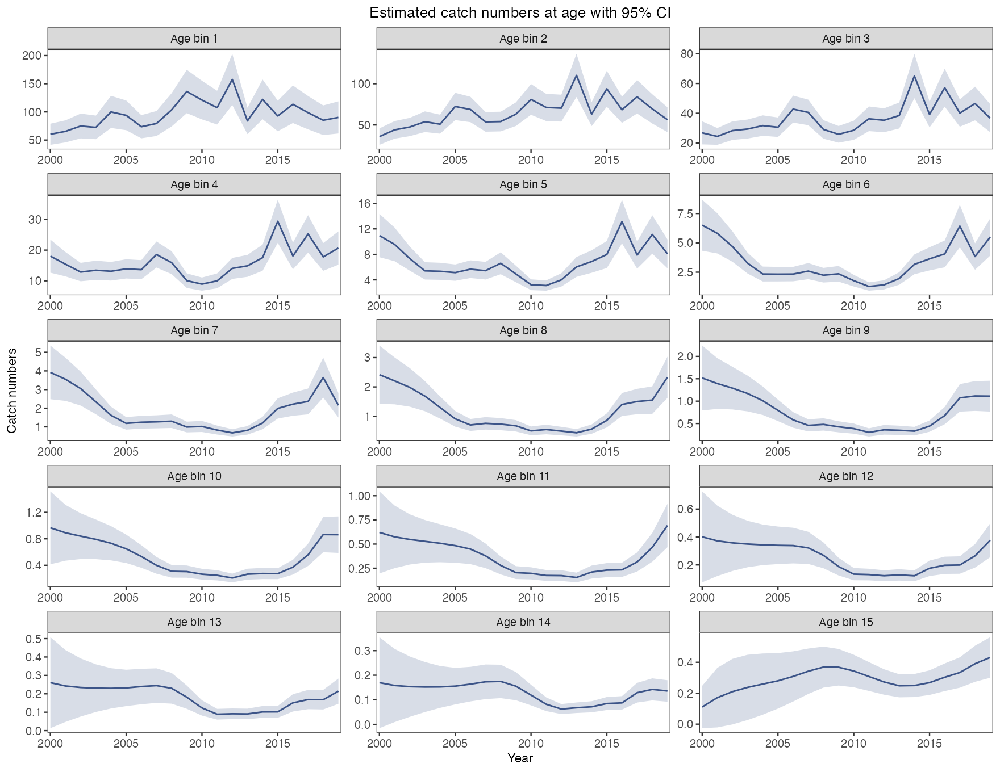](figures/ytf/plot_catch_CNA.png)

年龄别捕获尾数，每个年龄组一个面板，带 95% 区间。用它看渔业主要移除哪些年龄；本例捕获集中在 1 至 3 龄，因为小鱼数量多，老龄组的区间更宽。

Catch in numbers at age, one panel per age class with the 95% band. Use it to see which ages the fishery removes; the catch peaks at ages 1 to 3 here because the small fish are numerous, and the bands widen in the old ages.

[参数及默认值 / Arguments and defaults](FUNCTION_REFERENCE.md#plot_catch)

<a id="plot_catch_CNL"></a>
## 16. 捕获尾数 CNL / Catch numbers CNL

```r
# 绘制本图 / Draw this figure
plot_catch(b, type = "CNL", se = TRUE, facet_ncol = 3,
  line_size = 0.6)
```

[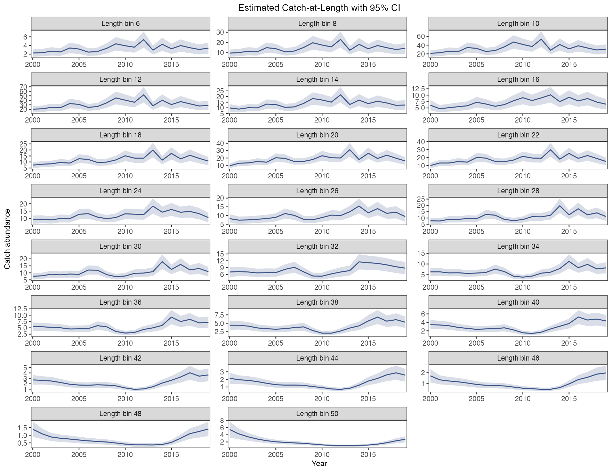](figures/ytf/plot_catch_CNL.png)

体长别捕获尾数，每个体长组一个面板，带 95% 区间。与体长别捕捞死亡率对照：某组的捕获等于该组丰度与捕捞死亡率的乘积，F 高但捕获少的组只是鱼少。

Catch in numbers at length, one panel per length bin with the 95% band. Read it with the fishing mortality at length: catch in a bin is the product of abundance and fishing mortality there, so a bin with high F but little catch is one with few fish.

[参数及默认值 / Arguments and defaults](FUNCTION_REFERENCE.md#plot_catch)

<a id="plot_recruitment"></a>

<a id="recruitment"></a>
## 17. 补充量 / Recruitment

```r
# 绘制本图 / Draw this figure
plot_recruitment(b, se = TRUE)
```

[](figures/ytf/recruitment.png)

各时间步进入最小年龄组的补充量，带 95% 区间；纵轴标签为 `ylab$rec`。用它找强弱年级群：本例 2012 年的峰就是之后丰度和生物量上升的来源，它对应的日历时间取决于 `rec.age` 和时间步长。

Recruitment, the number entering the youngest age class at each time step, with the 95% band; the vertical label is `ylab$rec`. Use it to find strong and weak year classes: the 2012 peak here is the cohort behind the later rise in abundance and biomass, and its calendar position depends on `rec.age` and the time step.

[参数及默认值 / Arguments and defaults](FUNCTION_REFERENCE.md#plot_recruitment)

<a id="plot_SSB_Rec"></a>

<a id="SSB_Rec"></a>
## 18. 亲体与补充关系 / Spawning biomass and recruitment

`age_at_recruitment` 的单位是年。`plot_SSB_Rec()` 除以拟合的 `growth_step`，要求在规则时间网格上对应整数个时间步。季度数据中，0.25 表示滞后一季度，1 表示四季度。允许零滞后；拒绝负值、非有限值及非整数步滞后。没有 `growth_step` 的结果使用规则年份间隔；两类时间元数据都没有时沿用年度步长。

`age_at_recruitment` is in years. `plot_SSB_Rec()` divides it by the fit's `growth_step` and requires an integer lag on a regular time grid. With quarterly data, 0.25 means one step and 1 means four steps. Zero lag is allowed; negative, nonfinite and fractional-step lags are rejected. Results without `growth_step` use their regular time spacing, or an annual step when `year` is missing as well.

```r
# 绘制本图 / Draw this figure
plot_SSB_Rec(b, age_at_recruitment = 1)
```

[](figures/ytf/SSB_Rec.png)

横轴为某时间步的产卵生物量，纵轴为 `age_at_recruitment` 年后的补充量，每对一点，不拟合曲线。用它看补充量是否随产卵生物量变化；本例各点没有关系，这在意料之中，因为模型逐时间步自由估计补充量，而不用亲体补充函数。

A scatter of spawning biomass at one time step (horizontal) against recruitment `age_at_recruitment` years later (vertical), one point per pair and no fitted curve. Use it to see whether recruitment follows spawning biomass; the points here show no relation, which is expected because the model estimates recruitment freely at each time step instead of through a stock recruitment function.

[参数及默认值 / Arguments and defaults](FUNCTION_REFERENCE.md#plot_SSB_Rec)

<a id="plot_VB"></a>

<a id="VB"></a>
## 19. 生长曲线与区间 / Growth curve and interval

```r
# 绘制本图 / Draw this figure
plot_VB(b, se = TRUE)
```

[](figures/ytf/VB.png)

由拟合的 `Linf`、`k`、`t0`（角上标注）得到的 von Bertalanffy 体长随年龄曲线；`se = TRUE` 时按参数协方差加上 95% 区间。本例生长参数固定，区间宽度为零；估计生长时区间表示年龄别平均体长的参数不确定性，不是个体体长的分布，老龄处区间很宽说明 `Linf` 难以确定。

The von Bertalanffy curve of length against age from the fitted `Linf`, `k` and `t0` (printed in the corner); `se = TRUE` adds a 95% band from the parameter covariance. Growth is fixed in this example, so the band has zero width; with estimated growth the band is parameter uncertainty about the mean length at age, not the spread of individual lengths, and a wide band at old ages means `Linf` is poorly determined.

`age_range = NULL` 时绘制拟合的年龄范围，起点不早于 `t0`；显式 `age_range` 必须是两个递增的有限年龄，且不早于 `t0`。若 `se = TRUE` 但参数协方差不可用，函数会警告并只画曲线，保留传入的标签、字号、刻度和主题。

`age_range = NULL` draws the fitted age range, starting no earlier than `t0`; an explicit `age_range` must be two increasing finite ages at or after `t0`. If `se = TRUE` but the parameter covariance is unavailable, the function warns and draws the curve alone, keeping the labels, text sizes, breaks and theme you passed.

[参数及默认值 / Arguments and defaults](FUNCTION_REFERENCE.md#plot_VB)

<a id="plot_pla"></a>

<a id="pla"></a>
## 20. 年龄—体长概率矩阵 / Age–length probability matrix

```r
# 绘制本图 / Draw this figure
plot_pla(b) + scale_x_discrete(labels = as.character(1:15))
```

[](figures/ytf/pla.png)

年龄体长概率矩阵 `pla` 的热图：每列一个年龄组，每行一个体长组，颜色为该年龄的鱼落入该体长组的概率，每列之和为 1；代码把横轴改标为年龄组序号 1 至 15。用它看体长对年龄的区分度；对角带随年龄变宽是因为生长放慢、体长重叠，老龄在最大体长组的深色格是聚集所有老鱼的加和组。

A heat map of the age length probability matrix `pla`: one column per age class, one row per length bin, and the fill is the probability that a fish of that age falls in that bin, so each column sums to one; the code relabels the age axis with the class index 1 to 15. Use it to see how well length identifies age; the diagonal band widens with age because growth slows and lengths overlap, and the dark cells in the largest bin at old ages are the plus group collecting all old fish.

[参数及默认值 / Arguments and defaults](FUNCTION_REFERENCE.md#plot_pla)

<a id="plot_fishing_mortality"></a>

<a id="F_ACL_year"></a>
## 21. ACL 捕捞死亡率 year / ACL fishing mortality year

`plot_fishing_mortality()` 从 `acl_theme_set()` 取标题、坐标轴标签、`x_breaks` 和 `x_expand`：标题键为 `F_year`、`F_age`、`F_length`，区间图加 `_se`；标签为 `xlab$year`、`xlab$age` 或 `xlab$length` 以及 `ylab$F`。年龄模式的横坐标是年龄组的位置，所以未设置 `xlab$age` 时默认标签为 Age group；调用中给出的标签和刻度优先。`base_theme` 接受 `"theme_bw"`、`"bw"` 等主题名、ggplot2 主题对象或 `NULL`（全局设置），各种情况下都不显示网格线。

`plot_fishing_mortality()` takes its title, axis labels, `x_breaks` and `x_expand` from `acl_theme_set()`: title keys `F_year`, `F_age` and `F_length`, with `_se` added for interval plots, and labels `xlab$year`, `xlab$age` or `xlab$length` and `ylab$F`. In age mode the horizontal coordinate is the position of the age class, so the default label reads Age group unless you set `xlab$age`; labels and breaks given in the call take precedence. `base_theme` accepts a theme name such as `"theme_bw"` or `"bw"`, a ggplot2 theme object, or `NULL` for the global setting, and gridlines stay hidden in every case.

```r
# 绘制本图 / Draw this figure
plot_fishing_mortality(a, type = "year",
  se = TRUE, facet_ncol = 4, line_size = 0.6)
```

[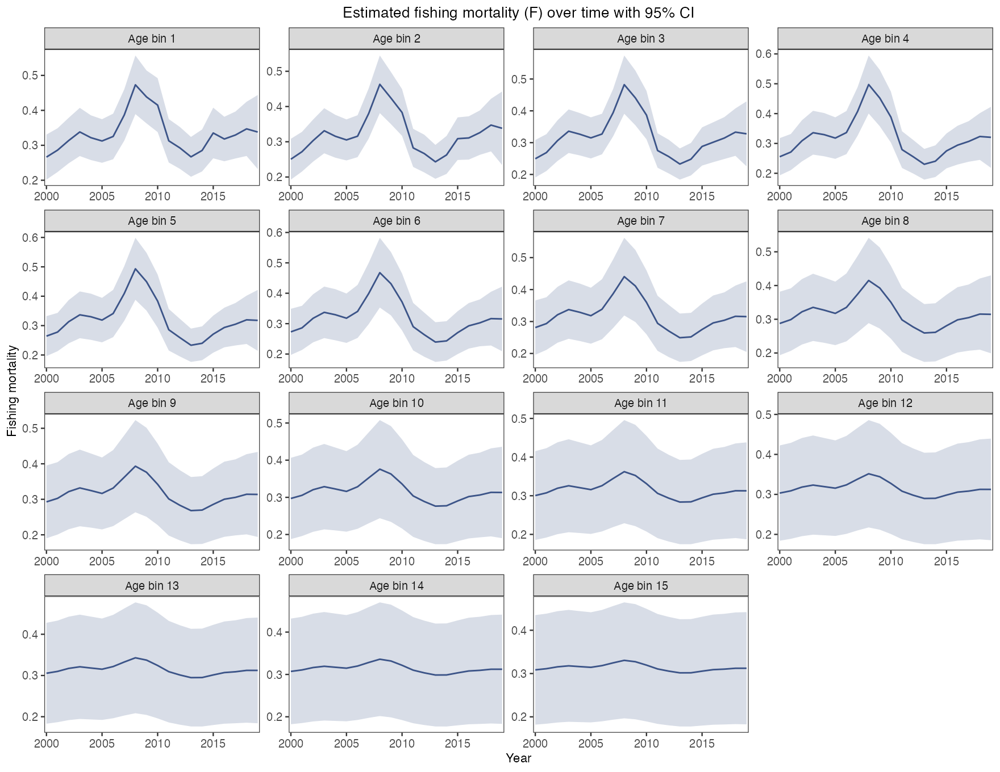](figures/ytf/F_ACL_year.png)

ACL 拟合的捕捞死亡率 `F`，每个年龄组一个面板，横轴为时间，带 95% 区间（`se = TRUE`）；`F` 是每个时间步的瞬时率，季度拟合显示的是季度率。用它看捕捞压力何时变化：本例 2008 年的峰出现在大多数年龄组，13 至 15 龄的宽区间说明调查对老龄鱼的信息很少。

Fishing mortality `F` of the ACL fit, one panel per age class, time on the horizontal axis and the 95% band (`se = TRUE`); `F` is an instantaneous rate per time step, so a quarterly fit shows quarterly rates. Use it to see when fishing pressure changed: the 2008 peak here appears in most age classes, and the wide bands at ages 13 to 15 show how little the survey says about old fish.

[参数及默认值 / Arguments and defaults](FUNCTION_REFERENCE.md#plot_fishing_mortality)

<a id="F_ACL_age"></a>
## 22. ACL 捕捞死亡率 age / ACL fishing mortality age

```r
# 绘制本图 / Draw this figure
plot_fishing_mortality(a, type = "age",
  se = TRUE, facet_ncol = 4, line_size = 0.6)
```

[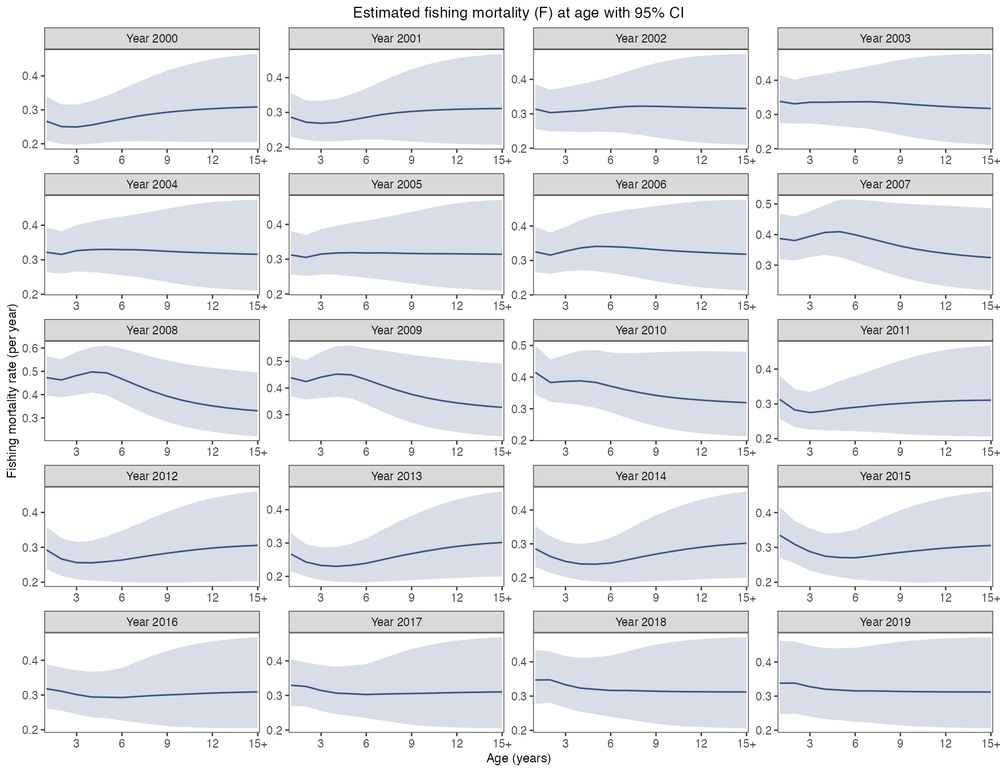](figures/ytf/F_ACL_age.png)

同一组 `F` 按年龄排列：每个时间步一个面板，横轴为年龄组序号（标为 Age group，因为坐标是组的位置），带 95% 区间。用它读每个时间步渔业的选择模式；本例近乎水平的线说明 ACL 拟合对各年龄施加相近的死亡率，若呈穹形或斜坡则显示渔具主要捕哪些年龄。

The same `F` values arranged by age: one panel per time step, the age class index on the horizontal axis (labelled Age group because the coordinate is the class position), with the 95% band. Use it to read the selection pattern of the fishery at each time step; a flat line, as here, means the ACL fit applies similar mortality to all ages, and a dome or ramp would show which ages the gear takes.

[参数及默认值 / Arguments and defaults](FUNCTION_REFERENCE.md#plot_fishing_mortality)

<a id="F_ALSCL_year"></a>
## 23. ALSCL 捕捞死亡率 year / ALSCL fishing mortality year

```r
# 绘制本图 / Draw this figure
plot_fishing_mortality(b, type = "year",
  se = TRUE, facet_ncol = 4, line_size = 0.6)
```

[](figures/ytf/F_ALSCL_year.png)

ALSCL 拟合的体长别捕捞死亡率 `FL`，每个体长组一个面板，横轴为时间，带 95% 区间。用它看各体长组的捕捞压力何时变化；本例 2008 年的峰在 20 至 34 组最强，44 以上各组的 F 最低，因为该体长的鱼很少被捕。

Fishing mortality at length `FL` of the ALSCL fit, one panel per length bin, time on the horizontal axis and the 95% band. Use it to see when pressure changed in each length bin; the 2008 peak is strongest in bins 20 to 34 here, and the bins above 44 have the lowest F because few fish of that size are taken.

[参数及默认值 / Arguments and defaults](FUNCTION_REFERENCE.md#plot_fishing_mortality)

<a id="F_ALSCL_age"></a>
## 24. ALSCL 捕捞死亡率 age / ALSCL fishing mortality age

```r
# 绘制本图 / Draw this figure
plot_fishing_mortality(b, type = "age",
  se = TRUE, facet_ncol = 4, line_size = 0.6)
```

[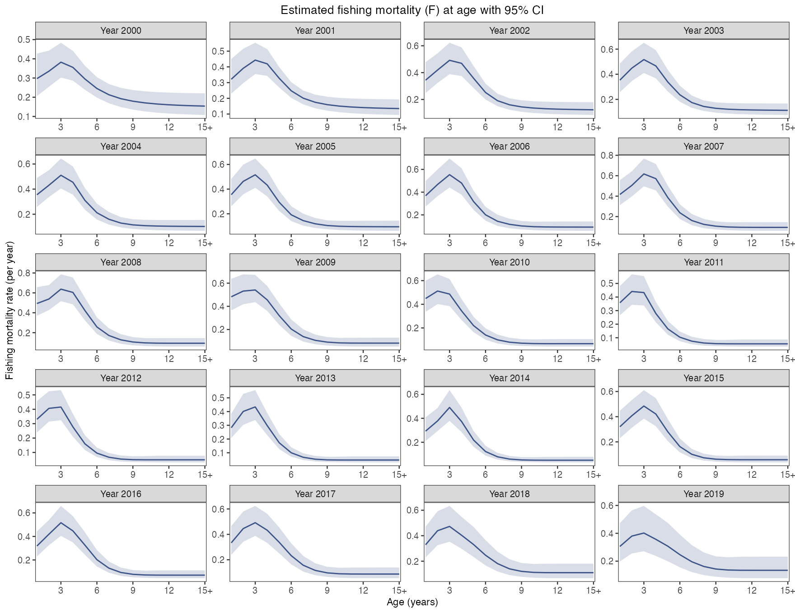](figures/ytf/F_ALSCL_age.png)

ALSCL 拟合的年龄别捕捞死亡率 `FA`，由 `FL` 经年龄体长矩阵换算：每个时间步一个面板，横轴为年龄组序号，带 95% 区间；`FA` 在相邻时间步之间计算，所以比体长图少一个时间步和一个年龄。用它与 ACL 的年龄图比较选择模式；本例在 3 龄达到峰值的穹形，就是体长别 F 映射到对应年龄后的结果。

Fishing mortality at age `FA` of the ALSCL fit, derived from `FL` through the age length matrix: one panel per time step, the age class index on the horizontal axis, with the 95% band; there is one time step and one age fewer than in the length figures because `FA` is computed between consecutive steps. Use it to compare the ALSCL selection with the ACL age figure; the dome peaking at age 3 here is the length-based F mapped onto the ages that have those lengths.

[参数及默认值 / Arguments and defaults](FUNCTION_REFERENCE.md#plot_fishing_mortality)

<a id="F_ALSCL_length"></a>
## 25. ALSCL 捕捞死亡率 length / ALSCL fishing mortality length

```r
# 绘制本图 / Draw this figure
plot_fishing_mortality(b, type = "length",
  se = TRUE, facet_ncol = 4, line_size = 0.6)
```

[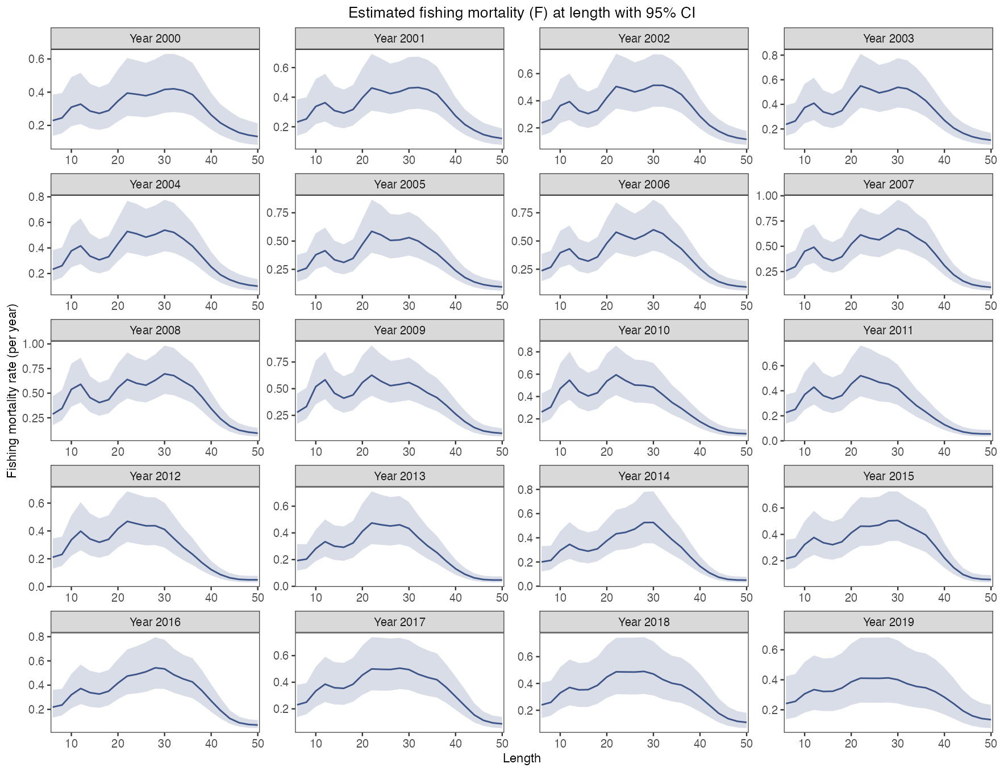](figures/ytf/F_ALSCL_length.png)

同一组 `FL` 按体长排列：每个时间步一个面板，横轴为体长组中点 `len_mid`（不等宽组表现为不等间距），带 95% 区间。用它读每个时间步渔业的体长选择；本例 20 至 35 之间的穹形是渔具捕捞的体长范围，各面板穹形的高低就是时间效应。

The same `FL` values arranged by length: one panel per time step, the length bin midpoints `len_mid` on the horizontal axis (unequal bins show as unequal spacing), with the 95% band. Use it to read the length selection of the fishery at each time step; the dome between lengths 20 and 35 here is the size the gear takes, and its height from panel to panel is the time effect.

[参数及默认值 / Arguments and defaults](FUNCTION_REFERENCE.md#plot_fishing_mortality)

<a id="plot_residuals"></a>

<a id="residuals_length"></a>
## 26. 对数残差 length / Log residuals length

```r
# 绘制本图 / Draw this figure
plot_residuals(b, facet_by = "length", facet_ncol = 4, line_size = 0.6,
  x_breaks = c(2000, 2010, 2015))
```

[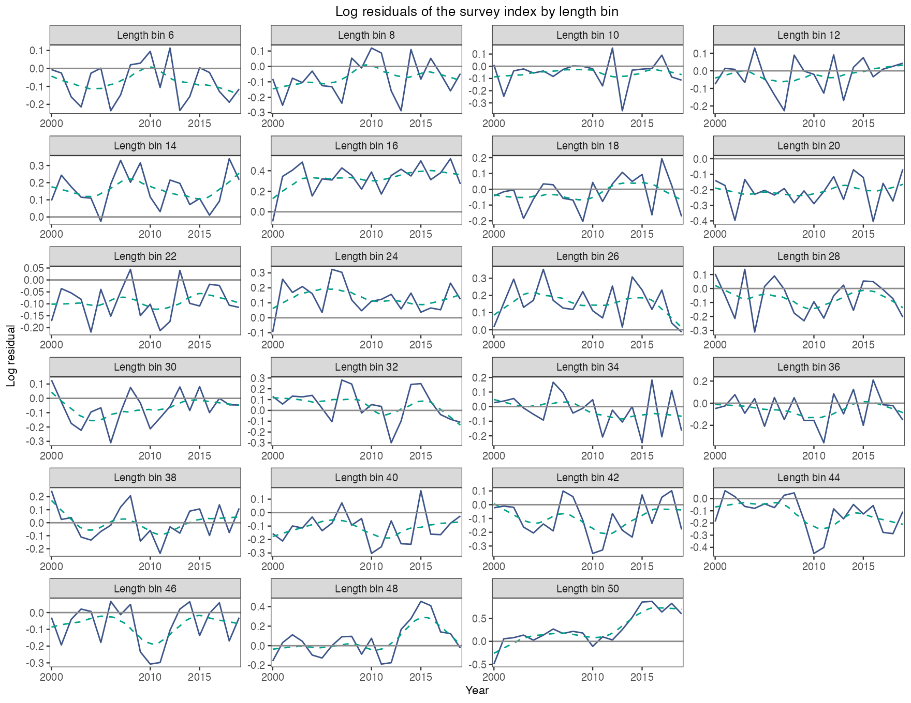](figures/ytf/residuals_length.png)

对数残差，即观测对数调查指数减拟合值，每个体长组一个面板，横轴为时间：深蓝线连接残差，灰线为零，青绿色虚线为平滑线（有观测的时间步少于 6 个时用线性，否则用 loess）。用它找模型拟合不好的体长组（零值和缺失观测没有残差）；多年同号的残差（如本例 16 组为正、20 组为负）说明系统性偏差，序列末端的趋势（如 50 组）提示模型没有跟上的变化。

Log residuals, the observed minus the fitted log survey index, one panel per length bin with time on the horizontal axis: the navy line joins the residuals, the grey line is zero and the dashed teal curve is a smoother (linear with fewer than six observed time steps, loess otherwise). Use it to find bins the model misfits (zero and missing observations have no residual); residuals of one sign over many years, as in bins 16 (positive) and 20 (negative) here, mean a systematic misfit, and a trend at the end of the series, as in bin 50, points to a change the model misses.

[参数及默认值 / Arguments and defaults](FUNCTION_REFERENCE.md#plot_residuals)

<a id="residuals_year"></a>
## 27. 对数残差 year / Log residuals year

```r
# 绘制本图 / Draw this figure
plot_residuals(b, facet_by = "year", facet_ncol = 4, line_size = 0.6,
  x_breaks = c(10, 30, 50))
```

[](figures/ytf/residuals_year.png)

同一组残差按体长排列：每个时间步一个面板，横轴为体长，带零线和平滑线。用它看一个时间步内的偏差是否随体长变化；本例 2015 年起最大体长组的正尖峰说明那几年调查看到的大鱼多于拟合，平滑线每年在同一体长穿过零线则是模型系统性放错的体长。

The same residuals arranged by length: one panel per time step, length on the horizontal axis, with the zero line and the smoother. Use it to see whether misfit has a length pattern within a time step; the positive spike at the largest bin from 2015 on here means the survey saw more large fish than the fit in those years, and a smoother that crosses zero at the same length every year marks a length the model systematically misplaces.

[参数及默认值 / Arguments and defaults](FUNCTION_REFERENCE.md#plot_residuals)

<a id="plot_deviance"></a>

<a id="deviation_R_TRUE"></a>
## 28. 对数过程偏差 R / Log process deviations R

```r
# 绘制本图 / Draw this figure
plot_deviance(b, type = "R", log = TRUE, se = TRUE,
  facet_ncol = 3, point_size = 1.2, line_size = 0.5) +
  scale_x_continuous(breaks = c(2000, 2010, 2019), expand = expansion(mult = 0.04))
```

[](figures/ytf/deviation_R_TRUE.png)

补充量的对数过程偏差（模型的随机效应，不是似然偏差）随时间步变化：点为估计值，误差棒为 95% 区间，零对应平均补充量。用它看调查支持的年级群信号；本例 2000 至 2008 年的连续负值是低于平均的补充量，若误差棒都跨过零线，说明调查几乎没有补充量信息。

Log process deviations of recruitment (the random effects of the model, not a likelihood deviance) by time step: points are the estimates, the error bars their 95% intervals, and zero is mean recruitment. Use it to see the year-class signal the survey supports; the negative run from 2000 to 2008 here is below-average recruitment, and error bars that all cross zero would mean the survey carries little recruitment information.

[参数及默认值 / Arguments and defaults](FUNCTION_REFERENCE.md#plot_deviance)

<a id="deviation_R_FALSE"></a>
## 29. 过程乘数 R / Process multipliers R

```r
# 绘制本图 / Draw this figure
plot_deviance(b, type = "R", log = FALSE, se = TRUE,
  facet_ncol = 3, point_size = 1.2, line_size = 0.5) +
  scale_x_continuous(breaks = c(2000, 2010, 2019), expand = expansion(mult = 0.04))
```

[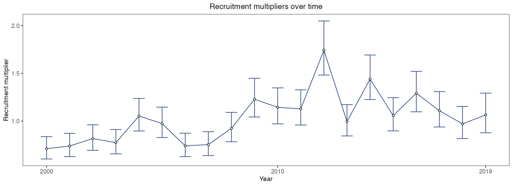](figures/ytf/deviation_R_FALSE.png)

同一组偏差取指数（`log = FALSE`）：纵轴为补充量乘数，1 对应平均值，区间不对称，因为它们是对数区间取指数的结果。用它把偏差读成倍数；本例 2012 年约 1.7 表示补充量高于平均 70%，它与对数图是同一拟合过程，按读者要读取的量选择尺度。

The same deviations exponentiated (`log = FALSE`): the vertical axis is the recruitment multiplier, one is the mean, and the intervals are asymmetric because they are exponentiated log intervals. Use it to read a deviation as a factor; the 2012 value of about 1.7 here means recruitment 70% above the mean, and it is the same fitted process as the log figure, so choose the scale by what the reader needs to read off.

[参数及默认值 / Arguments and defaults](FUNCTION_REFERENCE.md#plot_deviance)

<a id="deviation_F_TRUE"></a>
## 30. 对数过程偏差 F / Log process deviations F

```r
# 绘制本图 / Draw this figure
plot_deviance(b, type = "F", log = TRUE, se = TRUE,
  facet_ncol = 3, point_size = 1.2, line_size = 0.5) +
  scale_x_continuous(breaks = c(2000, 2010, 2019), expand = expansion(mult = 0.04))
```

[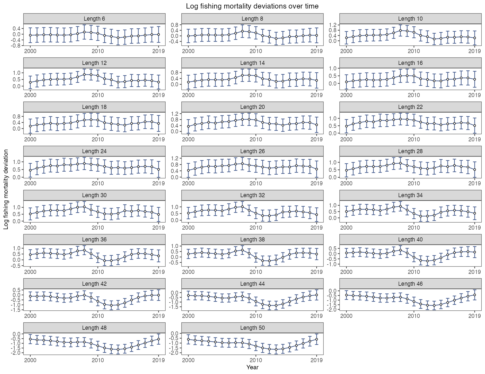](figures/ytf/deviation_F_TRUE.png)

捕捞死亡率的对数过程偏差，每个体长组一个面板（ACL 为每个年龄组，共享 F 时只有一个面板），点、95% 误差棒和作为平均值的零线。用它看拟合的 F 在各组、各时间步偏离平均的程度；本例小、中体长组为正，40 以上为负，即模型抬高了 40 以下的 F、压低了 40 以上的 F，36 至 50 组在 2012 年前后的下陷与 F 图中该处的低值一致。

Log process deviations of fishing mortality, one panel per length bin (per age class for ACL, a single panel for a shared F), with points, 95% error bars and zero as the mean. Use it to see how the fitted F departs from its mean in each bin and time step; here the deviations are positive in the small and middle bins and negative above length 40, so the model raises F below 40 and lowers it above, and the dip around 2012 in bins 36 to 50 matches the low F there in the F figures.

[参数及默认值 / Arguments and defaults](FUNCTION_REFERENCE.md#plot_deviance)

<a id="deviation_F_FALSE"></a>
## 31. 过程乘数 F / Process multipliers F

```r
# 绘制本图 / Draw this figure
plot_deviance(b, type = "F", log = FALSE, se = TRUE,
  facet_ncol = 3, point_size = 1.2, line_size = 0.5) +
  scale_x_continuous(breaks = c(2000, 2010, 2019), expand = expansion(mult = 0.04))
```

[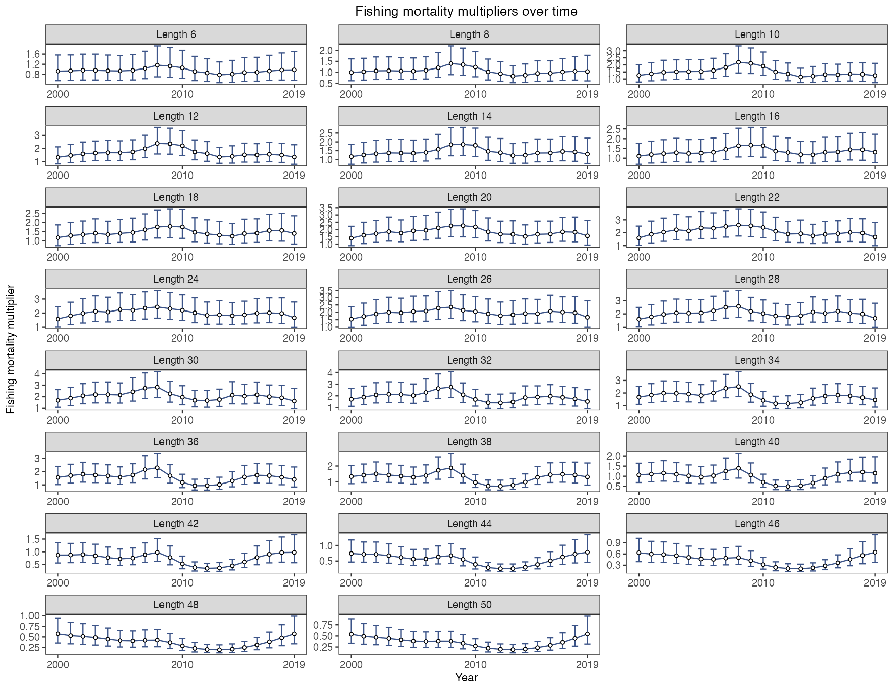](figures/ytf/deviation_F_FALSE.png)

同一组 F 偏差改为乘数（`log = FALSE`），1 为平均值，区间不对称。用它把偏离读成 F 的倍数；本例 48 组 2012 年前后约 0.5 表示 F 为平均值的一半，区间宽窄与对数尺度对应，两张图对哪些格不确定的判断一致。

The same F deviations as multipliers (`log = FALSE`), with one as the mean and asymmetric intervals. Use it to read the departure as a factor on F; a value of 0.5 in bin 48 around 2012 here means F at half its mean, and the interval widths carry over from the log scale, so the two figures agree on which cells are uncertain.

[参数及默认值 / Arguments and defaults](FUNCTION_REFERENCE.md#plot_deviance)

<a id="plot_ridges"></a>

<a id="ridges"></a>
## 32. 长度组成山脊图 / Length composition ridges

```r
# 绘制本图 / Draw this figure
plot_ridges(b) # 默认 viridis 渐变 / Default viridis gradient
```

[](figures/ytf/ridges.png)

调查指数的体长组成，每个时间步一条山脊（最早在底部，颜色按时间步取 viridis 渐变），横轴为体长：左图为观测，右图为拟合，每条山脊归一化为和为 1，所以高度只比较形状。用它检查拟合是否再现每个时间步的峰位和展布；本例 2012 年后峰从 20 向 25 移动是强年级群在生长，没有调查数据的时间步没有观测山脊，部分观测的时间步只在有观测的体长组内归一化。

Length compositions of the survey index, one ridge per time step (earliest at the bottom, colour by time step from the viridis gradient) with length on the horizontal axis: the left panel is observed, the right panel fitted, and each ridge is normalized to sum to one, so ridge height compares shape only. Use it to check that the fit reproduces the mode and spread of each time step; the mode moving from length 20 toward 25 after 2012 here is the strong cohort growing, a time step without survey data has no observed ridge, and a partly observed time step is normalized over the observed bins only.

[参数及默认值 / Arguments and defaults](FUNCTION_REFERENCE.md#plot_ridges)

<a id="plot_compare_ts"></a>

<a id="compare_ts"></a>
## 33. 种群时间序列比较 / Population time series comparison

```r
# 绘制本图 / Draw this figure
plot_compare_ts(a, b, se = TRUE, facet_ncol = 2)
```

[](figures/ytf/compare_ts.png)

两组拟合的产卵生物量、补充量、总生物量、总丰度和捕获尾数时间序列，每个量一个面板，纵轴各自取值：ACL 为深蓝实线，ALSCL 为朱红虚线（`compare_colors`、`compare_linetypes`），`se = TRUE` 时加上各自的 95% 区间。用它看两个模型在哪里分歧；本例生物量和产卵生物量在 2014 年后分开，自由纵轴使振幅只能在面板内比较，不能跨面板比较。

Time series of spawning biomass, recruitment, total biomass, total abundance and catch in numbers from two fits, one panel per quantity with its own vertical scale: ACL is the navy solid line and ALSCL the vermilion dashed line (`compare_colors`, `compare_linetypes`), and `se = TRUE` adds each fit's 95% band. Use it to see where the two models disagree; the ACL and ALSCL series separate after 2014 in biomass and spawning biomass here, and the free vertical scales make amplitudes comparable within a panel but not across panels.

[参数及默认值 / Arguments and defaults](FUNCTION_REFERENCE.md#plot_compare_ts)

<a id="plot_compare_F"></a>

<a id="compare_F"></a>
## 34. 死亡率矩阵比较 / Fishing mortality matrices

```r
# 绘制本图 / Draw this figure
plot_compare_F(a, b) + scale_x_continuous(breaks = c(2000, 2010, 2019))
```

[](figures/ytf/compare_F.png)

两组拟合各一张捕捞死亡率热图，横轴为时间，纵轴为各自的组（ACL 为年龄组，ALSCL 为体长组），共用一个 `F` 色标。用它看每个模型中捕捞在何时、哪些组最重；两图的行是不同维度，所以比较深色列的时间（本例 2007 至 2010 年）而不是逐格比较，一对一的比较用总体 F 图。

Heat maps of fishing mortality, one per fit, time on the horizontal axis and the fit's own groups on the vertical axis (age classes for ACL, length bins for ALSCL) with one colour scale for `F`. Use it to see when and in which groups fishing was heaviest in each model; the rows are different dimensions, so compare the timing of the dark columns (2007 to 2010 here) rather than single cells, and use the summary F figures for a one-to-one comparison.

[参数及默认值 / Arguments and defaults](FUNCTION_REFERENCE.md#plot_compare_F)

<a id="plot_compare_residuals"></a>

<a id="compare_residuals"></a>
## 35. 残差联合诊断 / Combined residual diagnostics

```r
# 绘制本图 / Draw this figure
plot_compare_residuals(a, b, dat)
```

[](figures/ytf/compare_residuals.png)

两组拟合的样本内对数残差四联图：直方图、对正态分布的 QQ 图、各时间步的平均残差及加减一个标准差的误差棒（不是置信区间）、各体长组绝对残差的箱线图；ACL 为深蓝，ALSCL 为朱红。用它判断哪组拟合留下的结构更少：直方图更宽、QQ 点偏离直线表示残差更大（本例的 ALSCL），高箱体标出该拟合偏差大的体长组（本例 ALSCL 的 16 组和 50 组）。

Four panels of the in-sample log residuals of both fits: a histogram, a QQ plot against the normal distribution, the mean residual by time step with bars of plus or minus one standard deviation (not a confidence interval), and box plots of absolute residuals by length bin; ACL is navy and ALSCL vermilion. Use it to judge which fit leaves less structure: a wider histogram and QQ points off the line mean larger residuals, as for ALSCL here, and a tall box marks a bin that fit misfits, as bins 16 and 50 for ALSCL.

[参数及默认值 / Arguments and defaults](FUNCTION_REFERENCE.md#plot_compare_residuals)

<a id="plot_compare_growth"></a>

<a id="compare_growth"></a>
## 36. 生长与外部参照接口 / Growth and reference-data interface

参考数据与排版辅助函数 / Reference data and layout helper:

```r
# 模拟参考生长点，并非论文实测 / Synthetic reference points, not paper observations
set.seed(42)
ref <- data.frame(Age = rep(1:15, each = 5))
ref$Length <- VB_func(60, .2, 1/60, ref$Age) + rnorm(nrow(ref), 0, 2)
growth_display <- function(p) {
  p[[1]] <- p[[1]] + labs(subtitle = paste(strsplit(
    p[[1]]$labels$subtitle, " | ", fixed=TRUE)[[1]], collapse="\n")) +
    theme(legend.text=element_text(size=7))
  p[[2]] <- p[[2]] + scale_x_continuous(breaks=c(1,5,10,15))
  p
}
```

```r
# 绘制本图 / Draw this figure
growth_display(plot_compare_growth(a, b, age_range = c(1, 15), ref_data = ref, ref_name = "Synthetic reference",
    nls_start = list(Linf = 60, k = 0.2, t0 = 1/60)))
```

[](figures/ytf/compare_growth.png)

左图：两组拟合的 von Bertalanffy 曲线（ACL 深蓝实线，ALSCL 朱红虚线），副标题给出各自的 `Linf` 和 `k`，另有 `nls()` 对 `ref_data` 拟合的灰色参照曲线及该数据的灰点；右图：两组拟合的年龄体长矩阵热图，纵轴为体长组序号。用它看两个模型是否假设相同的生长，以及它们与独立年龄体长数据的差距；本例两条曲线重合，因为生长固定为相同值，参照数据由上面的代码生成，是模拟值而非实测。

Left: the von Bertalanffy curves of both fits (ACL navy solid, ALSCL vermilion dashed) with their `Linf` and `k` in the subtitle, the grey reference curve that `nls()` fits to `ref_data`, and the grey points of that data; right: the age length matrices of both fits as heat maps, with the length bin index on the vertical axis. Use it to see whether the two models assume the same growth and how they differ from independent age length data; the curves coincide here because growth is fixed at the same values, and the reference data come from the code above, so they are simulated values rather than measurements.

[参数及默认值 / Arguments and defaults](FUNCTION_REFERENCE.md#plot_compare_growth)

<a id="plot_compare_CatL"></a>

<a id="compare_CatL"></a>
## 37. 两模型调查拟合 / Survey fits from both models

```r
# 绘制本图 / Draw this figure
plot_compare_CatL(a, b, dat, years = c(2000, 2005, 2010, 2015), facet_ncol = 2)
```

[](figures/ytf/compare_CatL.png)

所选时间步（`years`，省略则显示全部）的调查指数随体长变化，每个时间步一个面板：灰点为观测指数，深蓝实线为 ACL 拟合，朱红虚线为 ALSCL 拟合，均为 `exp(Elog_index)` 中位数，零值和缺失观测不画点。用它看哪个模型跟得上观测的体长组成；本例两者都跟上 20 附近的峰，ALSCL 曲线起伏更多，因为它的 F 按体长组变化。

Survey index against length for the selected time steps (`years`; omit it for all), one panel per time step: grey points are the observed index, the navy solid curve the ACL fit and the vermilion dashed curve the ALSCL fit, both as `exp(Elog_index)` medians, and zero and missing observations are left out of the points. Use it to see which model follows the observed length composition; both follow the mode near length 20 here, and the ALSCL curve wiggles more because its F varies by length bin.

纵轴标签来自 `ylab$survey`，默认为 Survey index；用 `acl_theme_set(ylab = list(survey = "Survey index (relative units)"))` 可一次改好所有调查拟合图的标签，单模型对数图会加上前缀 Log。`ylab$catch` 只用于捕获量图。

The vertical label comes from `ylab$survey` and reads Survey index by default; set `acl_theme_set(ylab = list(survey = "Survey index (relative units)"))` to relabel every survey-fit plot at once, and single-model log-scale plots add the prefix Log. `ylab$catch` labels the catch plots only.

[参数及默认值 / Arguments and defaults](FUNCTION_REFERENCE.md#plot_compare_CatL)

<a id="plot_compare_metrics"></a>

<a id="compare_metrics"></a>
## 38. 拟合指标比较 / Fit metric comparison

```r
# 绘制本图 / Draw this figure
plot_compare_metrics(a, b, dat, facet_ncol = 2) & scale_y_continuous(expand = expansion(mult = c(0,
    0.3)))
```

[](figures/ytf/compare_metrics.png)

两组拟合由 `diagnostic_metrics()` 得到的拟合指标柱图：RMSE 与 MAE、R 平方、MAPE、AIC、BIC 与负对数似然、标量参数个数，柱上标数值；ACL 深蓝，ALSCL 朱红。用它概括拟合质量：误差指标和信息准则越低、R 平方越高越好，本例 ACL 更好在意料之中，因为数据由年龄模型生成；信息准则只能在同一数据、同一似然的拟合之间比较。

Bars of the fit metrics of both fits from `diagnostic_metrics()`: RMSE and MAE, R-squared, MAPE, AIC, BIC and the negative log-likelihood, and the number of scalar parameters, with the value printed on each bar; ACL navy, ALSCL vermilion. Use it to summarize fit quality: lower error metrics and information criteria and a higher R-squared are better, so ACL fits better here, which is expected because the data were generated by an age-based model, and information criteria are comparable only between fits of the same data with the same likelihood.

柱图与 `diagnostic_metrics()` 使用同一计算：只纳入有限的正观测，观测单元处的非有限预测或维度不一致会报错，常数观测的 R 平方等无定义指标显示为 `NA`。先运行 `compare_models()` 核对两组拟合是否可比。

The bars use the same calculation as `diagnostic_metrics()`: only finite positive observations enter, a nonfinite prediction at an observed cell or a dimension mismatch is an error, and an undefined measure such as R-squared for constant observations is shown as `NA`. Run `compare_models()` first to check that the two fits are comparable.

[参数及默认值 / Arguments and defaults](FUNCTION_REFERENCE.md#plot_compare_metrics)

<a id="plot_compare_selectivity"></a>

<a id="compare_selectivity"></a>
## 39. 固定调查可捕性 / Fixed survey catchability

```r
# 绘制本图 / Draw this figure
plot_compare_selectivity(a, b)
```

[](figures/ytf/compare_selectivity.png)

各拟合输入的体长别调查可捕性 `q`（`sel_L50`、`sel_L95`），ACL 为深蓝实线加点，ALSCL 为朱红虚线加点。用它确认每组拟合用的可捕性曲线；本例两条曲线重合，因为输入相同；这些值是固定输入而不是估计的选择性，两组拟合若不同，只说明输入不同。

Survey catchability `q` at length from the input of each fit (`sel_L50`, `sel_L95`), as lines with points for ACL (navy solid) and ALSCL (vermilion dashed). Use it to confirm which catchability curve each fit used; the curves coincide here because both fits took the same input, and the values are fixed inputs, not an estimated selectivity, so a difference between two fits means different inputs.

[参数及默认值 / Arguments and defaults](FUNCTION_REFERENCE.md#plot_compare_selectivity)

<a id="plot_compare_F_ts"></a>

<a id="compare_F_apical"></a>
## 40. 总体 F 比较 apical / Summary F comparison apical

```r
# 绘制本图 / Draw this figure
plot_compare_F_ts(a, b, method = "apical") +
  labs(title = "Apical fishing mortality")
```

[](figures/ytf/compare_F_apical.png)

两组拟合的顶点捕捞死亡率，即每个时间步各组 `F` 的最大值（ACL 深蓝实线，ALSCL 朱红虚线，每个时间步一点）；`labs(title = ...)` 替换默认标题。用它在同一坐标上比较年龄模型与体长模型的总体捕捞压力；本例 ALSCL 更高，因为它的最大值落在选择性最强的体长组；函数名虽含 annual，但汇总在每个时间步内进行，季度拟合显示的仍是季度率。

Apical fishing mortality, the maximum of `F` over the groups at each time step, for both fits (ACL navy solid, ALSCL vermilion dashed, a point at each time step); the `labs(title = ...)` call replaces the default title. Use it to compare overall fishing pressure between an age-based and a length-based fit on one axis; ALSCL is higher here because its maximum sits in the most selected length bins, and despite the function name a quarterly fit keeps quarterly rates, because the summary is taken within each time step.

[参数及默认值 / Arguments and defaults](FUNCTION_REFERENCE.md#plot_compare_F_ts)

<a id="compare_F_mean"></a>
## 41. 总体 F 比较 mean / Summary F comparison mean

```r
# 绘制本图 / Draw this figure
plot_compare_F_ts(a, b, method = "mean") +
  labs(title = "Mean fishing mortality")
```

[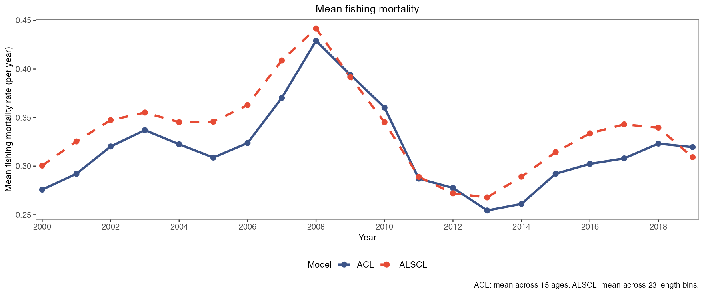](figures/ytf/compare_F_mean.png)

两组拟合的平均捕捞死亡率，即每个时间步各组 `F` 的非加权平均，样式同上。当关心整个选择模式而不是其峰值时用它；平均值取决于模型有多少低 F 的组（本例 15 个年龄组对 23 个体长组），所以看时间模式（两者都在 2008 年达峰）而不是水平高低。

Mean fishing mortality, the unweighted average of `F` over the groups at each time step, for both fits in the same styling. Use it when the whole selection pattern matters more than its peak; the mean depends on how many low-F groups a model has (15 ages against 23 length bins here), so read the time pattern, which both fits share with a 2008 peak, rather than the level.

[参数及默认值 / Arguments and defaults](FUNCTION_REFERENCE.md#plot_compare_F_ts)

<a id="plot_retro"></a>

<a id="retro_ACL"></a>
## 42. ACL 回溯分析 / ACL retrospective analysis

```r
# 绘制本图 / Draw this figure
plot_retro(ra, facet_ncol = 2, rho_digits = 3, rho_size = 3, point_size = 1, line_size = 0.6)
```

[](figures/ytf/retro_ACL.png)

ACL 拟合的回溯分析：每个量（`B`、`N`、`Rec`、`SSB`）一个面板，横轴为时间，每次拟合一条线，颜色按其最后时间步区分（图例 Retrospective Year：完整拟合与各轮截短），空心点为各拟合的末端估计，每个面板按 `rho_digits` 位小数标出 Mohn's rho。用它看去掉时间步后末端估计移动多少；各线贴合完整拟合、只在末尾几年分开，且 rho 很小（本例绝对值不超过 0.01），说明修正很小；若各量、各轮符号相同，则提示存在回溯模式。

Retrospective analysis of the ACL fit: one panel per quantity (`B`, `N`, `Rec`, `SSB`), time on the horizontal axis, one line per fit coloured by its last time step (legend Retrospective Year: the full fit and the peels), an open point at each fit's terminal estimate, and Mohn's rho printed in each panel with `rho_digits` decimals. Use it to see how far the terminal estimates move when time steps are removed; lines that lie on the full fit and split only in the last years, with rho no larger than 0.01 in size as here, show small revisions, while the same sign across quantities and peels would point to a retrospective pattern.

[参数及默认值 / Arguments and defaults](FUNCTION_REFERENCE.md#plot_retro)

<a id="retro_ALSCL"></a>
## 43. ALSCL 回溯分析 / ALSCL retrospective analysis

```r
# 绘制本图 / Draw this figure
plot_retro(rb, facet_ncol = 2, rho_digits = 3, rho_size = 3, point_size = 1, line_size = 0.6)
```

[](figures/ytf/retro_ALSCL.png)

ALSCL 拟合的同一回溯分析，布局与颜色相同。用它比较两个模型的稳定性；本例 rho 更大（生物量 0.033，丰度 0.027）且全为正，说明较短的 ALSCL 拟合在末端高于完整拟合，这种轻微的向上修正在正式评估中值得关注。

The same retrospective analysis for the ALSCL fit, with the same layout and colours. Use it to compare the stability of the two models; the rho values are larger here (0.033 for biomass, 0.027 for abundance) and all positive, so the shorter ALSCL fits end above the full fit, a mild upward revision that would deserve attention in a real assessment.

[参数及默认值 / Arguments and defaults](FUNCTION_REFERENCE.md#plot_retro)

<a id="truth"></a>
## 44. 模拟真值与条件估计 / Simulation truth and conditional estimates

```r
# 将生成真值与报告中的估计对齐 / Align truth and fitted reports
years <- a$year
truth <- data.frame(Year=rep(years,3),
  Quantity=rep(c("B","SSB","Rec"),each=length(years)),
  Truth=c(x$truth$TB,x$truth$SSB,x$truth$Rec))
estimates <- rbind(
  data.frame(Year=rep(years,3),Quantity=truth$Quantity,
    Value=c(a$report$B,a$report$SSB,a$report$Rec),Model="ACL"),
  data.frame(Year=rep(years,3),Quantity=truth$Quantity,
    Value=c(b$report$B,b$report$SSB,b$report$Rec),Model="ALSCL"))
```

```r
# 绘制本图 / Draw this figure
ggplot(estimates, aes(Year, Value, color = Model)) + geom_line() + scale_color_manual(values = setNames(acl_theme("compare_colors"),
    c("ACL", "ALSCL"))) + geom_line(data = truth, aes(Year, Truth), inherit.aes = FALSE, linetype = 2) +
    facet_wrap(~Quantity, scales = "free_y", ncol = 1) + theme_bw() + theme(panel.grid.major = element_blank(), panel.grid.minor = element_blank()) + labs(y = NULL)
```

[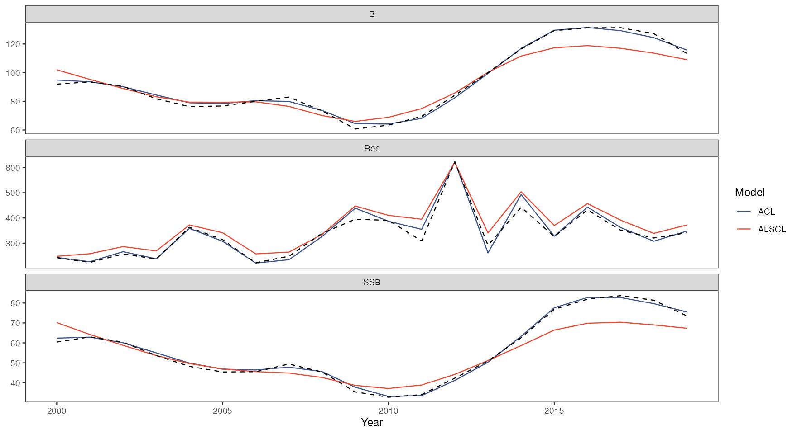](figures/ytf/truth.png)

生成模拟的生物量、补充量和产卵生物量（黑色虚线）与 ACL（深蓝）、ALSCL（朱红）拟合的对照，每个量一个面板；上面的代码由 `x$truth` 和两份报告构造 `truth` 与 `estimates`。只在模拟数据上用它看哪组拟合更接近真值；本例 ACL 紧贴虚线，因为数据来自同样固定生物参数的年龄模型，ALSCL 的生物量和产卵生物量在 2012 年后低于真值，与时间序列比较图中的差距相同。

Biomass, recruitment and spawning biomass of the generating simulation (black dashed) against the ACL (navy) and ALSCL (vermilion) fits, one panel per quantity; the code above builds `truth` and `estimates` from `x$truth` and the two reports. Use it, with simulated data only, to see which fit recovers the truth; ACL tracks the dashed line closely because the data came from an age-based model with the same fixed biology, and ALSCL falls below it after 2012 in biomass and spawning biomass, the same gap as in the time series comparison.

