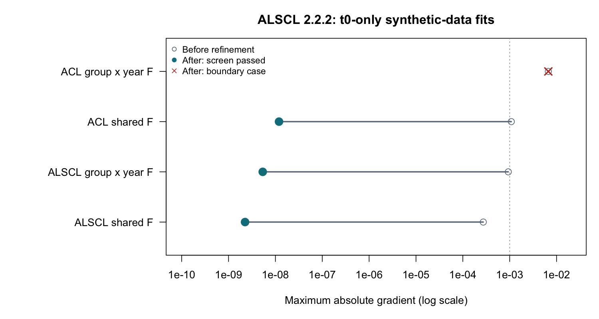

# ALSCL 2.2.2: refinement and shared-F validation

This release preserves the existing group-by-time likelihood as the default and adds an explicit one-dimensional shared-F alternative. Both direct bundles (`run_acl(x)`, `run_alscl(x)`) and separate arguments remain supported. Safeguarded Newton refinement is on by default; `polish = FALSE` skips it. See the [bilingual guide](USER_GUIDE.md#fitting) for the complete settings and map examples.

## Reproducible numerical checks

Run date: 2026-10-13. Environment: macOS arm64, R 4.6.0, TMB 1.9.21, CppAD; four cores for standard errors. Inputs are the repository's synthetic YTF CSVs (23 length bins, 20 years, 15 ages), imported through the own-data workflow. This is not an empirical stock assessment. Only t0 is fixed among active scalar parameters in the table below; mean recruitment, initial mortality, growth, observation error, process SDs and active correlations are free.

|Model / F structure|Free scalars|F random effects|Raw code|Gradient before|Gradient after|Positive-definite Hessian|Natural boundary|Numerical screen|
|---|---:|---:|---:|---:|---:|---|---|---|
|ACL / group × year|13|300|1|6.68e-3|6.68e-3|No|Yes|Fail|
|ACL / shared yearly|12|20|0|1.08e-3|1.19e-8|Yes|No|Pass|
|ALSCL / group × year|14|460|0|9.34e-4|5.37e-9|Yes|No|Pass|
|ALSCL / shared yearly|13|20|0|2.73e-4|2.25e-9|Yes|No|Pass|

Each successful alternative accepted one Newton step. See [unrounded results](results/convergence-2.2.2.csv). The original ACL boundary case produces non-finite standard errors and may emit `NaNs produced`; the release deliberately retains that failure rather than converting it to success. In this case the age correlation is about 0.999999997, even though the transformed parameter does not meet the old numeric-bound threshold. Numerical Hessian definiteness near this boundary is sensitive to platform and differencing details; the natural-boundary diagnostic is the more direct evidence.



The default-map CSV example also passes in both models (10 ACL / 13 ALSCL free scalars), with final gradients 2.62e-9 and 2.59e-9 and positive-definite Hessians. Its [diagnostics](results/own-data-example-checks.csv) and [figures](figures/own-data-example/) were regenerated.

## Why the changes are distinct

1. Repeated `nlminb()` calls could report false convergence at exactly the same parameters and objective after an earlier successful pass. The selected raw result now retains the earlier success; all pass results and failures remain in `optimizer_history`. Raw codes are never relabelled by refinement.
2. Refinement requires a positive-definite Hessian, in-bounds trial parameters, a smaller maximum gradient and objective increase at most 1e-8 (roundoff allowance). It stops safely for nonfinite evaluations, unusable curvature or no acceptable step. It does not make unidentified parameters estimable.
3. The synthetic ACL generating F is identical across ages within each year. A fitted age correlation approaching 1 therefore motivates testing a shared-F structure. `F_structure = "year"` uses Y deviations and one correctly normalized 1D AR(1) density in C++, with marginal SD sigma_F. It does not tie cells inside the original 2D density. The unused group correlation is excluded. For quarterly data, sharing is per quarter.
4. The numerical screen separates gradient, Hessian/covariance and boundaries from the optimizer return code. Strong correlations are reported for investigation, not treated as automatic proof of non-identifiability. Passing this screen is not a model-adequacy test.

The ALSCL length-transition model differs from the age-based generator. A numerically converged fit, or its objective value, does not demonstrate unbiased parameter recovery. Choosing shared F in real data requires support for its age/length-invariant fishing mortality assumption, sensitivity analysis, residual checks and appropriate comparison of model structures. No new speedup factor is claimed for this release: shared F changes the model, while refinement adds computational work. Existing parallel SE calculations remain enabled at the final fitted parameters.

## Validation status

The local full suite passed 575 assertions across 55 test blocks with no failures, warnings or skips. The bilingual site built 140 pages with all 45 functions and arguments covered; its checker passed 490 parsed R blocks, local links, assets, anchors and language counterparts. Package checks on all three CI operating systems are required before release.

## Reproduction

From the repository root after installing 2.2.2:

```r
options(ALSCL.tmb.cache = file.path(tempdir(), "ALSCL-cache"))
ALSCL::alscl_speed(framework = "CppAD", sd_cores = 4)
source("scripts/check_convergence_222.R", encoding = "UTF-8")
source("scripts/plot_convergence_222.R")
```

The script rebuilds the default-map example, fits all four t0-only alternatives and saves diagnostics and portable results under `output/release-222`. Exact small gradients and raw messages can vary with compiler/platform. The original 2D ACL case is expected to remain flagged.

```sh
Rscript -e 'testthat::test_local()'
python3 scripts/build_wiki.py
python3 website/build.py
python3 website/check.py
```

Tests cover unchanged failed restarts, later-pass errors, positive/negative curvature, objective and boundary safeguards, natural-scale flags, the shared-F density against the analytical stationary Gaussian AR(1), group-invariant predictions, plotting, direct/legacy calls and serial/socket multistart parity for both models. Existing parallel-SE tests continue to exercise CppAD and TMBad without masking fallback as parallel success.

The numerical method follows [R's nlminb interface](https://www.stat.ethz.ch/R-manual/R-devel/library/stats/html/nlminb.html) and [TMB's AR1/SCALE conventions](https://kaskr.github.io/adcomp/Introduction.html).

## 简体中文说明

本次将优化收尾与诊断接入核心，默认 F 结构不变。`F_structure = "year"` 是每时间步所有年龄／体长共用 F 的可选模型，一维 AR(1) 密度已进入 C++，不只是外层参数开关。`polish = FALSE` 可关闭收尾，原始优化代码与每轮结果仍保留。

只固定 t0 的 ALSCL 原结构及两个共用 F 拟合通过数值筛查；原二维 ACL 仍被正确标记为边界问题。这里验证的是仓库模拟数据，不代表正式数据一定能识别全部参数。正式分析仍应检查多起点、残差、似然剖面与生物假设。详见[中文正式数据案例](https://linbojun99.github.io/ALSCL/zh/articles/case-fit-survey.html)。
