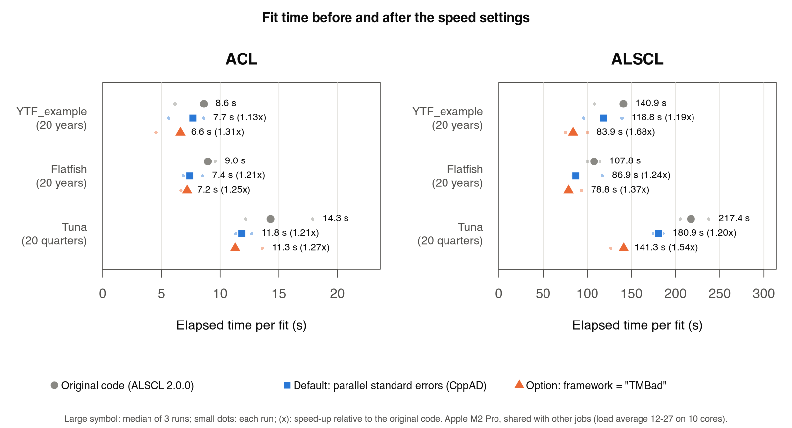
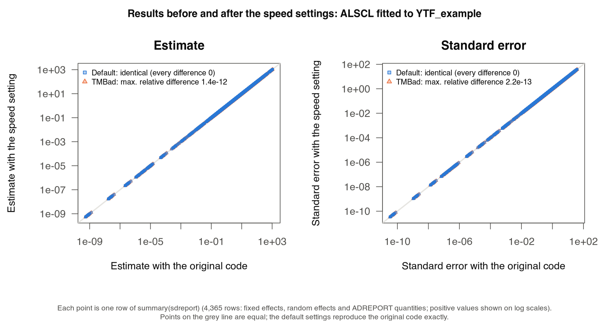

# Speed settings and how the results were checked

This page records the changes that make `run_acl()` and `run_alscl()` faster, how each change was checked against the original code (ALSCL 2.0.0, commit [`4dc1fc3`](https://github.com/Linbojun99/ALSCL/commit/4dc1fc3)), and which candidate changes were rejected. The changes come from the speed-up scheme developed for the tuna version of the model (ALSCLtuna). ALSCL estimates three sets of random effects with the Laplace approximation, which ALSCLtuna does not, so each part of the scheme was tested again here; the parts that were not kept are listed in section 4.

The work had four steps:

1. Profile one ALSCL fit to find where the time goes (section 2).
2. Implement each candidate change and compare its results with the original code (sections 3 and 4).
3. Make the default the change that leaves results identical; offer the change that alters them slightly as an option; reject the rest (section 4).
4. Benchmark the original code against both changes on six model and data combinations (section 5), and check fits that estimate more fixed effects.

With the default settings (parallel standard errors, CppAD), results are identical to ALSCL 2.0.0 and fits were 1.13-1.24 times faster in the benchmark. With `framework = "TMBad"` fits were 1.25-1.68 times faster, but results are not identical: estimates differed from the original code by up to 2.3e-11 (relative) when 5 fixed effects were estimated and by up to 2.7e-8 when 10 were estimated. Both changes are set with `alscl_speed()`:

```r
library(ALSCL)
alscl_speed()                      # defaults: sd_cores = "auto", framework = "CppAD"
alscl_speed(framework = "TMBad")   # faster; results not identical to ALSCL 2.0.0
alscl_speed(sd_cores = 1)          # sequential standard errors
alscl_speed_info()                 # what the settings mean on this computer
```

The [speed guide](SPEED_GUIDE.md) explains the settings for users; this page records how they were developed and checked.

An external review of the first version (12 October 2026) found four problems, all confirmed and fixed (section 6): a failure to start forked processes left fits without standard errors, `sd_cores = Inf` was accepted, the documentation website did not build, and TMBad, then the default, differed from CppAD by up to 2.7e-8 in a fit with 10 fixed effects.

## 1. When results count as unchanged

The rule carried over from ALSCLtuna is that a speed change may alter how quantities are computed but not the results:

- A change that can give identical results must give identical results, checked with `identical()` on the estimates, the objective function and every row of `summary(sdreport)`.
- A change that alters the order of floating-point operations can be the default only if the differences in the estimates and the objective function are far below the convergence tolerances of `nlminb()` (relative tolerance 1e-10 for the objective function and 1.5e-8 for the parameters) in every case tested, and the standard errors differ by less than 1e-7 (relative). The standard errors use a Hessian from finite differences of the gradient, which magnifies rounding error. In ALSCLtuna, which has no random effects, such changes gave relative differences of about 1e-12; in ALSCL the rounding differences also pass through the inner Newton optimisation over the random effects. TMBad met this condition in the six benchmark combinations but not in a fit with 10 fixed effects (section 3.2), so it is an option rather than the default.
- Changes that alter the model or the optimisation (for example, fewer random effects or looser inner-optimisation tolerances) are not considered.

## 2. Where the time goes

In single runs, with fewer other jobs on the computer than during the benchmark in section 5, a conditional fit of ALSCL to the 20 annual years of `YTF_example` (23 length classes, 15 ages; 5 estimated fixed effects and 494 random effects; `train_times = 2`) took 100-111 s with the original code. Of this, about 88 s was the outer optimisation (`nlminb()`, each call of the objective function or its gradient running the inner Newton optimisation over the random effects), 11.4 s was the fixed-effect Hessian for the standard errors (`stats::optimHess()`, 10 gradient evaluations), and 10.6 s was the delta method for the 3,866 ADREPORT quantities (one calculation per quantity). At the optimum, one objective evaluation took 0.21 s and one gradient evaluation 0.65 s.

## 3. Changes kept

### 3.1 Standard errors on several cores (`sd_cores`)

`TMB::sdreport(..., getReportCovariance = FALSE)`, which `run_acl()` and `run_alscl()` call after the optimisation, does two expensive things in sequence:

- It computes the fixed-effect Hessian with `stats::optimHess()`: for each fixed effect, the gradient with that parameter increased and decreased by 0.001. The columns do not depend on each other.
- It applies the delta method to each ADREPORT quantity separately. TMB records the operations of the model once (the tape) and obtains derivatives by sweeping through the tape; each quantity needs one reverse sweep of the ADREPORT tape, one sparse solve with the random-effect Hessian and one reverse sweep of the gradient tape. The quantities do not depend on each other.

`.acl_sdreport()` (in `R/speed.R`) computes the Hessian columns and the delta method for groups of quantities in forked processes, and leaves every other step to `TMB::sdreport()` itself (called with `hessian.fixed` and `skip.delta.method = TRUE`). The returned object is identical to that of the sequential `TMB::sdreport()`: in the tests every component (`value`, `sd`, `cov.fixed`, `gradient.fixed`, `par.random`, `diag.cov.random` and `summary()`) passes `identical()` for both models.

Two details make the results identical rather than nearly equal:

- `optimHess()` (R's C routine `optimhess`) reuses one parameter vector and, after each column j, resets coordinate j to ((p + 0.001) - 0.002) + 0.001, which can differ from p in the last bit. Later columns are evaluated at that value, so the parallel version reproduces it.
- With random effects, each gradient call starts the inner Newton optimisation from `obj$env$last.par.best`. Only calls of the objective function update it, never gradient calls, so in the sequential `optimHess()` every column starts from the same point, and each forked process starts from that point too.

On the 20-year ALSCL fit compiled with CppAD, the standard errors took 9.0 s on four cores instead of 23.4 s; on an ACL fit with 10 fixed effects, 1.58 s instead of 3.70 s.

Forked processes are used only where they are safe (macOS and Linux outside GUI front-ends); elsewhere socket workers share out the delta method (section 3.3). The sequential `TMB::sdreport()` is used in these cases:

- one core (`sd_cores = 1`, or fits inside `retro_model()` and `sim_acl()` workers);
- TMB versions other than those the parallel delta method was checked against (`.acl_tmb_checked`, currently 1.9.21). The test that compares the two with `identical()` runs the parallel code with any installed TMB, for both AD libraries, and fails if the parallel code falls back to the sequential calculation, so a new version can be added after the tests pass with it;
- any failure of the parallel calculation, including a failure to start forked processes or socket workers, with a warning.

### 3.2 TMBad automatic differentiation (`framework`)

TMB can compile a model with one of two automatic-differentiation (AD) libraries: CppAD, its default, and TMBad, its newer library. ALSCL 2.0.0 used CppAD, and CppAD remains the default; `alscl_speed(framework = "TMBad")` selects TMBad. The model code is the same for both; only the compiler setting (`TMB::compile(..., framework = "TMBad")`) changes. On the 20-year ALSCL fit at the optimum, TMBad evaluated the objective function in 0.010 s instead of 0.21 s, and the gradient in 0.20 s instead of 0.65 s. The whole fit became faster by a smaller factor (section 5).

TMBad computes the same derivatives with a different order of floating-point operations. In the six benchmark combinations, which estimate 5 fixed effects, results differed from CppAD by at most 2.3e-11 (relative; section 5). In an ACL fit to `YTF_example` that estimates 10 fixed effects (`log_Linf`, `log_vbk`, `log_cv_len`, `log_std_log_N0` and `logit_log_R` freed from the bundled configuration), the estimates differed by up to 4.1e-8 (absolute; 2.7e-8 relative, for `logit_log_R`) and the standard errors by up to 3.5e-8 (relative), while the objective function differed by 1.7e-11. With more free parameters the likelihood surface is flatter, and the small differences between the libraries move the point at which `nlminb()` stops by an amount comparable to its parameter tolerance (1.5e-8). Both fits converged with a positive definite Hessian. The AD library is part of the key of the compiled-model cache, so models compiled with each library are kept apart. With CppAD, any `sd_cores` reproduces the results of ALSCL 2.0.0 bit for bit (checked in section 5).

### 3.3 Socket workers for Windows and GUI front-ends

Forking is unavailable on Windows, and `?parallel::mclapply` discourages it in GUI or embedded front-ends (R.app, RGui, RStudio, Positron) and with multithreaded libraries such as Apple's Accelerate BLAS. The first version therefore computed standard errors on one core in these sessions. They now use socket workers (new R processes started with `parallel::makePSOCKcluster()`), which rebuild the model from the same data and parameters with `TMB::MakeADFun()`.

A prototype that computed the Hessian columns on socket workers gave identical results but was slower than the sequential calculation: a newly built TMB object spends a long time on its first gradient, building the sparse Hessian tape of the random effects (for the 20-year ALSCL example, 13.7 s with CppAD and 42 s with TMBad, against 1.0 s and 0.4 s for later gradients). Each worker would pay this cost before computing its first column. So with socket workers:

- the Hessian is computed in the main session, as in `stats::optimHess()`;
- the delta method runs on the workers. They need only the gradient tape of the objective (`type = "ADGrad"`, built by `MakeADFun()` in about 0.1 s) and the ADREPORT object, and they receive the joint mode, the fixed-effect covariance and the random-effect Hessian (with the Cholesky factor that `TMB::sdreport()` attaches) from the main session, so they build no sparse Hessian tape. Each worker checks that its ADREPORT values are identical to those of the main session;
- the main session first computes ADREPORT quantities itself for about 0.5 s (at least 5, at most 200) to measure the time per quantity, and starts workers only if the remaining quantities would take more than 3 s (`options(ALSCL.sd_socket_min_seconds)`). Small models, such as most ACL fits, never start workers.

The worker functions use only base R, TMB and Matrix, so the workers do not need ALSCL itself, and they keep their state in `options()`. For the 20-year ALSCL example the delta method took 6.5 s on four socket workers instead of 13.9 s (0.3 s to start the workers and 0.9 s to rebuild the model), with standard errors identical to `TMB::sdreport()`. In a simulated RStudio session (`RSTUDIO=1`), the standard errors of the whole fit took 25.4 s instead of 28.3 s and the fit 114.9 s instead of 120.4 s, with identical results; the Hessian, computed in the main session, takes about half of the standard-error time. On macOS and Linux, `options(ALSCL.sd_backend = "fork")` selects forked processes in a GUI front-end at the user's own risk.

### 3.4 Reporting how standard errors were computed

Each fit records in `fit$sd_info` how its standard errors were computed: `method` (`"forked processes"`, `"socket workers (delta method)"` or `"sequential"`), `cores`, elapsed `seconds` and a `note` explaining a sequential calculation (one core, an unchecked TMB version, too little work for socket workers, or a failure of the parallel calculation). With `silent = FALSE` a fit prints this as one line, for example `Standard errors: forked processes on 4 cores, 9.0 s.` `alscl_speed_info()` reports before a fit what the settings mean in the current session: the cores, the method and the reason, the AD library and whether results are identical to ALSCL 2.0.0. The user guide [SPEED_GUIDE.md](SPEED_GUIDE.md) explains every setting.

## 4. Changes tested and not kept

| Candidate change | Result in ALSCL | Decision |
|---|---|---|
| Growth transition product `G * survival` with TMB's atomic matrix product (`atomic::matmul`) | Under CppAD the fit took 168 s instead of 100 s (gradient 1.19 s instead of 0.65 s). Under TMBad it was faster (55 s instead of 71 s) but moved the estimates by up to 1.4e-8 and the reported quantities by up to 5e-6 (relative), because the optimiser took a different path. | Not kept: slower, or results changed beyond rounding |
| Leave quantities that do not enter the likelihood (biomass, catch and F-at-age arrays) out of the tape during the optimisation | The gradient took 0.155 s instead of 0.172 s, within run-to-run variation; TMB already removes operations that do not affect the objective function when it optimises the tape. | Not kept: no measurable gain |
| Newton steps with the AD Hessian after `nlminb()` | Not applicable: with random effects the fixed-effect AD Hessian (`obj$he()`) is not available. | Not applicable |
| Report fewer ADREPORT quantities | With parallel standard errors the delta method takes a few seconds, and the plotting functions use all reported quantities. | Not added |
| TMBad's compressed sparse Hessian (`TMB::config(tmbad.sparse_hessian_compress = 1)`), not part of the ALSCLtuna scheme | The gradient took 1.8 s instead of 0.3 s and the fit about twice as long; results were not identical. | Not kept: slower |

## 5. Benchmark

The benchmark measured the gain of each setting on fits like those of the case studies, and repeated the result checks of section 1 on more data. ACL and ALSCL were fitted to three data sets: `YTF_example` (20 annual years), and the flatfish (20 annual years) and tuna (20 quarters) cases in `docs/data/cases`. The fits used the conditional configurations of `scripts/case_studies.R` and the bundled `fit_config`: 5 estimated fixed effects, 334-499 random effects and `train_times = 2`. Five settings were compared: the original code (ALSCL 2.0.0) and the new code with CppAD or TMBad, each with one core or `sd_cores = "auto"` (four cores on this computer) for the standard errors. Each fit ran three times in a fresh R process, with the order of the settings rotated; compilation was excluded. The computer was an Apple M2 Pro (10 cores, 32 GiB) with R 4.6.0, TMB 1.9.21 and Matrix 1.7.5.

Other users' jobs ran on the computer throughout (one-minute load average 12-27 on 10 cores, median 16), so elapsed times are longer than on an idle computer and varied by up to a factor of 1.7 between repeats; the gain from several cores is also smaller than without other jobs. Table 1 gives medians; CPU time, which other jobs affect less, is in `docs/results/speed/summary.csv`. Without parallel standard errors, TMBad reduced the CPU time of the ALSCL fits by a factor of 1.35-1.42 and of the ACL fits by 1.06-1.16.

**Table 1.** Median elapsed time of one fit, including standard errors, and speed-up relative to the original code (in parentheses).

| Data | Model | Random effects | ADREPORT quantities | Original | CppAD, 4 cores (default) | TMBad, 1 core | TMBad, 4 cores |
|---|---|---:|---:|---:|---:|---:|---:|
| YTF_example | ACL | 334 | 1,160 | 8.6 s | 7.7 s (1.13) | 7.3 s (1.18) | 6.6 s (1.31) |
| YTF_example | ALSCL | 494 | 3,866 | 140.9 s | 118.8 s (1.19) | 97.3 s (1.45) | 83.9 s (1.68) |
| flatfish | ACL | 334 | 1,160 | 9.0 s | 7.4 s (1.21) | 7.9 s (1.13) | 7.2 s (1.25) |
| flatfish | ALSCL | 494 | 3,866 | 107.8 s | 86.9 s (1.24) | 85.6 s (1.26) | 78.8 s (1.37) |
| tuna | ACL | 439 | 1,360 | 14.3 s | 11.8 s (1.21) | 13.1 s (1.09) | 11.3 s (1.27) |
| tuna | ALSCL | 499 | 4,361 | 217.4 s | 180.9 s (1.20) | 153.9 s (1.41) | 141.3 s (1.54) |



With CppAD, on one core or four, the estimates, the objective function and every row of `summary(sdreport)` were identical to those of the original code in all six combinations. With TMBad, the results differed by at most 2.3e-11 in these six combinations (Table 2), which estimate 5 fixed effects; with 10 fixed effects the differences were larger (section 3.2). The differences were the same with one and four cores, because the parallel standard errors are identical to the sequential ones. All 90 fits converged (`nlminb()` code 0) with a positive definite Hessian and a maximum absolute gradient below 2e-4.

**Table 2.** Largest difference between TMBad and the original code. Estimates and standard errors: relative difference. Objective function: absolute difference in the negative log-likelihood. Reported values: difference in the estimates of the random effects and ADREPORT quantities, divided by the largest absolute value of the same quantity, so that values near zero (for example random effects) do not inflate the relative difference.

| Data | Model | Estimates | Objective function | Reported values | Standard errors |
|---|---|---:|---:|---:|---:|
| YTF_example | ACL | 4.2e-12 | 5.7e-12 | 7.6e-12 | 7.6e-12 |
| YTF_example | ALSCL | 3.1e-15 | 1.0e-11 | 6.7e-15 | 2.2e-13 |
| flatfish | ACL | 5.2e-13 | 3.0e-12 | 7.7e-13 | 7.8e-13 |
| flatfish | ALSCL | 1.1e-14 | 1.6e-12 | 2.3e-14 | 3.3e-13 |
| tuna | ACL | 6.1e-15 | 3.4e-13 | 6.1e-15 | 4.4e-13 |
| tuna | ALSCL | 2.2e-11 | 1.5e-11 | 2.2e-11 | 2.3e-11 |

The figure below compares every row of `summary(sdreport)` from one fit (ALSCL fitted to `YTF_example`) between the original code and the two settings: the default settings lie exactly on the line of equality, and TMBad differs only in the last digits. The values are in `docs/results/speed/agreement_YTF_ALSCL.csv`.



To repeat the benchmark (about 90 minutes), from the repository root:

```bash
git archive 4dc1fc3 | (mkdir -p /tmp/alscl-original && tar -x -C /tmp/alscl-original)
Rscript scripts/benchmark_speed.R /tmp/alscl-original docs/results/speed 3
```

`Rscript scripts/plot_speed_benchmark.R` redraws both figures from the saved results without refitting. The benchmark script writes every fit to `runs.csv` (elapsed and CPU time, load average, convergence) and the comparison with the original code to `summary.csv`, in which `n_report` counts all rows of `summary(sdreport)` (fixed effects, random effects and ADREPORT quantities).

## 6. Implementation notes

- Inside the package namespace, `solve()` on the sparse random-effect Hessian must be `Matrix::solve()`. Base R's `solve()` converts the matrix to dense and uses LAPACK, which changed the standard errors by about 1e-16 (relative) and broke `identical()`. TMB itself calls the Matrix method, which uses a sparse Cholesky factorisation.
- `TMB::sdreport(obj, hessian.fixed = optimHess(...))` evaluates the Hessian lazily inside `sdreport()`, after it has stored the random effects that maximise the joint likelihood at the estimates (the joint mode), and leaves `obj$env$last.par` at the last finite-difference point. `.acl_sdreport()` therefore computes the Hessian first, and checks that `obj$env$last.par` holds the estimates and the joint mode before the delta method starts.
- Socket workers that fit models themselves (`retro_model()`, `sim_acl()`) receive the AD library of the main process and use one core for standard errors, so the number of processes does not multiply. Fits run in a user's own parallel loop should use `alscl_speed(sd_cores = 1)`.
- Benchmarks were run on frozen copies of the code (`git archive`), because `pkgload::load_all()` reads the source when each process starts.

Fixes after the external review of the first version (commit `54f1350`):

- **Failure to fork.** `parallel::mclapply()` signals an ordinary error when it cannot start the forked processes. Only errors inside the workers were converted to the class that triggers the sequential fallback, so a failure to fork reached `run_acl()`/`run_alscl()`, which then returned `est_std = NULL`, `vcov = NULL` and `pdHess = NA` with a warning. Any error from `mclapply()` now triggers the sequential `TMB::sdreport()`; a test replaces `mclapply()` with a function that fails and checks that the standard errors are identical to the sequential ones.
- **Core count.** `alscl_speed(sd_cores = Inf)` was accepted and later became `NA`. The check now requires a finite whole number between 1 and `.Machine$integer.max`.
- **Documentation website.** `website/build.py` requires every exported function to have an entry in `docs/FUNCTION_REFERENCE.md`, bilingual notes in `website/reference-notes.json` and a place in a function group. These were added for `alscl_speed()`; the site builds and `website/check.py` passes (136 pages, 44 functions per language).
- **Default AD library.** TMBad was the default in the first version; it is now an option (section 3.2).
- **TMB versions and environments.** The parallel delta method was allowed for all TMB 1.9.x versions; it is now limited to the versions it was checked against. `sd_cores = "auto"` no longer forks in GUI or embedded front-ends or with Apple's Accelerate BLAS (section 3.1).

Fixes after a second review (commit `2b7d418`), both in the tests:

- **Fork-failure test with an unchecked TMB version.** With a TMB version outside `.acl_tmb_checked`, standard errors are computed sequentially without forking, so the test that expected a fallback warning failed. The test now treats the installed TMB as checked, and a separate test checks that an unchecked version computes the standard errors sequentially without calling `mclapply()`.
- **Identity test hid failures of the parallel code.** It muffled all warnings, so if the parallel code failed and fell back, it compared `TMB::sdreport()` with itself and passed. `.acl_sdreport()` has an argument `fallback = FALSE`, used only by the tests, that turns a parallel failure into an error; the test muffles only "NaNs produced" warnings and runs for both CppAD and TMBad. A further test makes the parallel delta method fail on purpose and checks that this gives an error.
