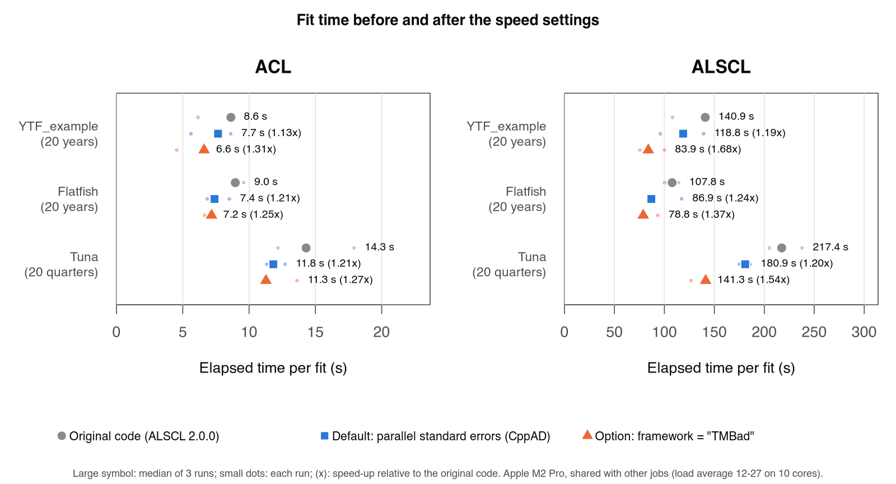
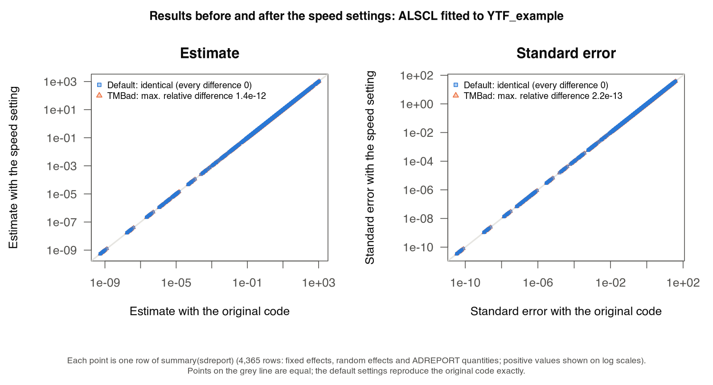

# 速度设置 / Speed settings

<!-- Generated by scripts/build_manual.py from website/content/{en,zh}/articles/. Edit the article pair, not this file. -->

[使用指南 / User guide](USER_GUIDE.md) · [首页 / Home](../README.md)

## 速度设置 / Speed settings

本页带你确认本会话如何计算标准误、选择核数、决定是否用 TMBad 库编译模型，并了解实测的提速幅度。你需要已安装的软件包和[安装 ALSCL 并完成第一次拟合](USER_GUIDE.md#start)中的输入列表 `x`；第 1 步的 ALSCL 拟合需要一到两分钟。[技术记录](SPEED.md)（英文）说明每项改动的测试方法，[改动报告](SPEED_REPORT.md)（英文）汇总审查结果。

On this page you check how your session computes standard errors, choose the number of cores, decide whether to compile the models with the TMBad library, and read the measured gains. You need the package installed and the input bundle `x` from [Install ALSCL and run a first fit](USER_GUIDE.md#start); the ALSCL fit in step 1 takes one to two minutes. The [technical record](SPEED.md) explains how each change was tested, and the [change report](SPEED_REPORT.md) summarizes the review.

默认设置适合日常使用：在支持的会话中，拟合用多个核计算标准误，并行标准误与相同拟合参数处的顺序计算逐位相同。这由两项设置控制，均通过 `alscl_speed()` 设定：

The defaults suit normal use: fits use several cores for the standard errors where the session supports it, and the parallel standard errors are identical to the sequential calculation at the same fitted parameters. Two settings, both set with `alscl_speed()`, control this:

| 设置 / Setting | 默认值 / Default | 结果 / Results | 速度 / Speed | 何时修改 / When to change it |
|---|---|---|---|---|
| `sd_cores` | `"auto"`：最多 4 核 / `"auto"`: up to four cores | 与顺序计算逐位相同 / Identical to the sequential calculation | 基准测试中拟合快 1.13-1.24 倍（macOS 终端） / Fits 1.13-1.24 times faster in the benchmark (macOS, terminal) | 在自己的并行循环中设为 `1`；需要固定核数时设为一个数 / Set `1` inside your own parallel loops; set a number to use a fixed number of cores |
| `framework` | `"CppAD"`，TMB 的默认库 / `"CppAD"`, TMB's default library | 基准 / Baseline | 基准 / Baseline | `"TMBad"` 使拟合快 1.25-1.68 倍，但结果末位不同（第 3 步） / `"TMBad"` makes fits 1.25-1.68 times faster, but results differ in the last digits (step 3) |

<a id="speed-check"></a>

### 1. 确认本会话的实际情况 / Check what your session does

```r
library(ALSCL)
alscl_speed_info()   # 当前设置在本机上的实际效果 / what the current settings mean on this computer
x <- YTF_example
fit <- run_alscl(x, silent = FALSE)
fit$sd_info          # 标准误的计算方式与耗时 / how the standard errors were computed and how long they took
```

`alscl_speed_info()` 打印设置值、将使用的核数与方式、原因、自动微分库和 TMB 版本。`silent = FALSE` 时拟合会打印一行关于标准误的信息，`fit$sd_info` 保存同样的内容：`method`（`"forked processes"`、`"socket workers (delta method)"` 或 `"sequential"`）、`cores`、`seconds`，以及说明为何顺序计算的 `note`。在 macOS 终端中你应看到：

`alscl_speed_info()` prints the setting, the cores and method that will be used, the reason, the AD library and the TMB version. With `silent = FALSE` the fit prints one line about the standard errors, and `fit$sd_info` stores the same information: `method` (`"forked processes"`, `"socket workers (delta method)"` or `"sequential"`), `cores`, `seconds` and a `note` that explains a sequential calculation. On macOS in a terminal you should see:

```r
#> Standard errors: forked processes on 4 cores, 9.0 s.
alscl_speed_info()
#> ALSCL speed settings
#>   sd_cores setting:                  auto
#>   cores for standard errors:         4
#>   standard errors computed by:       forked processes on 4 cores: Hessian and delta method
#>   reason:                            forked processes are safe here (macOS or Linux outside a GUI front-end)
#>   framework:                         CppAD
#>   cross-version numerical identity:  not guaranteed across package versions (the optimizer finishing step can change estimates at numerical precision)
#>   TMB version:                       1.9.21 (checked)
```

一次拟合分两部分。优化部分由 `nlminb()` 在固定效应上搜索，每次计算都对随机效应做一次内层牛顿优化（拉普拉斯近似），只在一个核上运行：每一步都依赖上一步，分到多个核会改变优化路径和结果。标准误随后由 `TMB::sdreport()` 计算：固定效应的 Hessian（每个固定效应两次梯度计算）和每个 ADREPORT 量的 delta 方法标准误（各年份、年龄与体长的补充量、丰度、生物量、产卵生物量、渔获量与捕捞死亡率；20 年 ALSCL 示例共 3,866 个量）。Hessian 的各列互不依赖，各 ADREPORT 量也互不依赖，因此都可以在多个核上计算，结果逐位相同。基准测试中，ALSCL 拟合 `YTF_example` 的 20 年数据时，速度改动之前优化约 88 秒，Hessian 11.4 秒，delta 方法 10.6 秒。

A fit has two parts. The optimization, `nlminb()` searching over the fixed effects with an inner Newton optimization of the random effects (the Laplace approximation) at every evaluation, runs on one core: each step depends on the previous one, and sharing it out would change the optimizer's path and the results. The standard errors come afterwards from `TMB::sdreport()`: the Hessian of the fixed effects, from two gradient evaluations per fixed effect, and the delta-method standard error of every ADREPORT quantity (recruitment, abundance, biomass, spawning biomass, catch and fishing mortality by year, age and length; 3,866 quantities for the 20-year ALSCL example). The Hessian columns are independent of each other, and so are the ADREPORT quantities, so both can be computed on several cores with identical results. In the benchmark, the ALSCL fit to the 20 years of `YTF_example` spent about 88 s in the optimization, 11.4 s on the Hessian and 10.6 s on the delta method before the speed changes.

在可以安全分叉的环境（macOS 或 Linux 终端中的 R 或 `Rscript`，以及计算集群），ALSCL 用 `parallel::mclapply()` 启动 R 会话的副本。每个副本已经包含拟合好的模型，因此 Hessian 的各列和 delta 方法几乎零开销地分配出去：20 年 ALSCL 示例的标准误在 4 个核上用 9.0 秒，顺序计算需 23.4 秒。Windows 没有分叉；R 的文档（`?parallel::mclapply`）也不建议在图形界面（R.app、RGui、RStudio、Positron）中或搭配多线程库（如 Apple 的 Accelerate BLAS）时分叉。在这些会话中 ALSCL 改用 socket 进程，即新启动的 R 进程，它们接收数据并重建模型。新进程在第一次计算梯度之前必须重建 TMB 的导数计算带，20 年 ALSCL 示例中这一步在 CppAD 下需 14 秒（TMBad 下 42 秒），比整个 Hessian 还长。因此使用 socket 进程时，Hessian 在主会话中计算；delta 方法分给 socket 进程，它们只需要目标函数的梯度计算带（约 0.1 秒建好），并从主会话接收随机效应 Hessian；ALSCL 先在主会话中计算几个 ADREPORT 量以测出每个量的耗时，只有当剩余的量预计超过约 3 秒时才启动进程。因此小模型（如大多数 ACL 拟合）在主会话中计算标准误。20 年 ALSCL 示例中，delta 方法在 4 个 socket 进程上用 6.5 秒，顺序计算需 13.9 秒（其中启动进程 0.3 秒，在进程中重建模型 0.9 秒）。

Where forked processes are safe (R or `Rscript` in a terminal on macOS or Linux, and computing clusters), ALSCL starts copies of the R session with `parallel::mclapply()`. Each copy already holds the fitted model, so the Hessian columns and the delta method are shared out with almost no start-up cost: the standard errors of the 20-year ALSCL example took 9.0 s on four cores instead of 23.4 s. Forking is unavailable on Windows, and R's documentation (`?parallel::mclapply`) discourages it in GUI front-ends (R.app, RGui, RStudio, Positron) and with multithreaded libraries such as Apple's Accelerate BLAS. In these sessions ALSCL uses socket workers, new R processes that receive the data and rebuild the model. A new process must rebuild TMB's derivative tapes before its first gradient, which took 14 s with CppAD (42 s with TMBad) for the 20-year ALSCL example, more than the whole Hessian. So with socket workers the Hessian is computed in the main session; the delta method is shared out among workers that need only the objective's gradient tape (built in about 0.1 s) and receive the random-effect Hessian from the main session; and ALSCL first computes a few ADREPORT quantities itself to measure the time per quantity, and starts workers only if the remaining quantities would take more than about 3 seconds. Small models, such as most ACL fits, therefore compute the standard errors in the main session. For the 20-year ALSCL example the delta method took 6.5 s on four socket workers instead of 13.9 s (0.3 s to start the workers and 0.9 s to rebuild the model in them).

| 情况 / Situation | 处理方式 / What happens |
|---|---|
| `sd_cores = 1`，或只有 1 个核可用 / `sd_cores = 1`, or one core available | 顺序计算的 `TMB::sdreport()` / Sequential `TMB::sdreport()` |
| `retro_model()` 或 `sim_acl()` 中在并行进程里运行的拟合 / Fits inside `retro_model()` or `sim_acl()` running on parallel workers | 每个拟合用 1 核，进程数保持有限 / One core per fit, which keeps the number of processes bounded |
| 已安装的 TMB 版本不在核对过的版本之列（1.9.21 和 1.9.25） / The installed TMB version is outside the checked ones (1.9.21 and 1.9.25) | 顺序计算的 `TMB::sdreport()`；`fit$sd_info$note` 会注明 / Sequential `TMB::sdreport()`; `fit$sd_info$note` says so |
| 启动 socket 进程省不下时间（计算量小） / Socket workers would save no time (little work) | 在主会话中计算 / Computed in the main session |
| 并行计算失败（例如进程启动失败） / The parallel calculation fails (for example, processes fail to start) | 给出警告，然后顺序计算 `TMB::sdreport()`；结果不受影响 / A warning, then the sequential `TMB::sdreport()`; results are unaffected |

并行代码与 `TMB::sdreport()` 执行完全相同的算术运算，每个量内部的运算顺序也相同；不同的只是各量的计算先后，而它们互不依赖。Hessian 复现了 `stats::optimHess()` 遍历参数的方式；存在随机效应时，每次梯度计算都从同一个起点开始内层优化。测试用 `identical()` 将结果的每个分量与 `TMB::sdreport()` 比较，覆盖 ACL 与 ALSCL、CppAD 与 TMBad、分叉进程与 socket 进程，并在 Linux、macOS 和 Windows 上通过。报告结果时，请与 `sessionInfo()` 一起记录 `alscl_speed_info()`；默认设置下，结果在任何核数和任一计算方式下都相同。

The parallel code performs exactly the same arithmetic as `TMB::sdreport()`, in the same order for each quantity; only the order in which quantities are computed differs, and they are independent. The Hessian reproduces the way `stats::optimHess()` moves through the parameters, and with random effects every gradient starts the inner optimization from the same point. The test suite compares every component of the result with `TMB::sdreport()` using `identical()`, for ACL and ALSCL, CppAD and TMBad, forked processes and socket workers, on Linux, macOS and Windows. When you report results, record `alscl_speed_info()` with `sessionInfo()`; with the default settings the results are the same for any number of cores and either method.

<a id="speed-cores"></a>

### 2. 选择核数 / Choose the number of cores

```r
alscl_speed(sd_cores = 2)        # 为标准误指定固定的核数 / a fixed number of cores for the standard errors
alscl_speed_info()
alscl_speed(sd_cores = "auto")   # 恢复默认 / back to the default
```

- `"auto"`（默认）最多使用 4 个物理核，并为电脑的其他工作保留 1 个。测试中超过 4 个核提升很小，因为优化本身只在一个核上运行。
- 指定一个数即使用这么多核。在计算集群上，请使用作业实际分配到的核数；`parallel::detectCores()` 可能报告整个节点的核数。
- 内存：分叉进程与 R 会话共享内存，直到内容被修改。每个 socket 进程都保存一份模型和数据；模型很大时，减少进程数可以节省内存。
- 初值：`run_acl()` 与 `run_alscl()` 中的 `ncores` 决定同时运行多少个初值；标准误在之后用 `sd_cores` 计算一次。
- 自己的并行循环：如果你自己并行运行许多拟合（例如用 `parallel::mclapply()`、`foreach` 或 `future`），请在工作进程中设置 `alscl_speed(sd_cores = 1)`，让每个拟合只用 1 个核。`retro_model()` 与 `sim_acl()` 会自动为其工作进程这样设置。
- macOS 或 Linux 上的 RStudio：`options(ALSCL.sd_backend = "fork")` 改用分叉进程，获得完整的加速。这是 R 文档不建议的做法，只有在你的会话运行拟合没有问题时才使用。

- `"auto"` (default) uses up to four physical cores and keeps one free for the rest of the computer. More than four cores shortened fits little in tests, because the optimization itself runs on one core.
- A number uses that many cores. On a computing cluster, use the number of cores your job was given; `parallel::detectCores()` may report all cores of the node.
- Memory: forked processes share the memory of the R session until they change it. Each socket worker holds its own copy of the model and its data; with large models, fewer workers use less memory.
- Starts: `ncores` in `run_acl()` and `run_alscl()` sets how many starts run at once; the standard errors are computed afterwards, once, with `sd_cores`.
- Your own parallel loops: if you run many fits in parallel yourself (for example with `parallel::mclapply()`, `foreach` or `future`), set `alscl_speed(sd_cores = 1)` inside the workers, so that each fit uses one core. `retro_model()` and `sim_acl()` do this for their workers automatically.
- RStudio on macOS or Linux: `options(ALSCL.sd_backend = "fork")` uses forked processes for the full speed-up. R's documentation advises against it, so use it only if your session runs fits without problems.

`alscl_speed_info()` 可确认选择。多核时内存不足就减少核数，例如 `alscl_speed(sd_cores = 2)`。

`alscl_speed_info()` confirms the choice. Memory errors with many cores mean fewer cores, for example `alscl_speed(sd_cores = 2)`.

<a id="speed-tmbad"></a>

### 3. 选择自动微分库 / Choose the AD library

```r
alscl_speed(framework = "TMBad")   # 下一次拟合会用 TMBad 编译一次模型 / the next fit compiles the model with TMBad once
args <- x  # YTF_example
alscl_speed(framework = "CppAD"); a <- run_alscl(args)
alscl_speed(framework = "TMBad"); b <- run_alscl(args)
max(abs(b$opt$par - a$opt$par) / abs(a$opt$par))   # 估计值的最大相对差 / largest relative difference in estimates
max(abs(b$est_std[, 2] - a$est_std[, 2]) / a$est_std[, 2], na.rm = TRUE)  # 标准误 / standard errors
```

TMB 可以用两种自动微分库之一编译模型。CppAD 是 TMB 的默认库，也是 ALSCL 的默认库。TMBad 计算拉普拉斯近似及其梯度要快几倍，因此优化和标准误的时间都会缩短，但它以不同的顺序计算同样的导数，结果的最后几位不同。基准测试中估计 5 个固定效应时，估计值的相对差最大 2.3e-11。在一个估计 10 个固定效应的 ACL 拟合中，相对差最大 2.7e-8（目标函数相差 1.7e-11）：自由参数越多，似然面越平，微小差异会在 `nlminb()` 的容差范围内改变它停止的位置。

TMB can compile a model with one of two automatic-differentiation libraries. CppAD is TMB's default and the ALSCL default. TMBad evaluates the Laplace approximation and its gradient several times faster, so it shortens the optimization as well as the standard errors, but it computes the same derivatives in a different order, so results differ in the last digits. In the benchmark, with 5 estimated fixed effects, estimates differed by at most 2.3e-11 (relative). In an ACL fit with 10 estimated fixed effects they differed by up to 2.7e-8 (relative; the objective function by 1.7e-11): with more free parameters the likelihood is flatter, and small differences move the point at which `nlminb()` stops within its tolerance.

TMBad 适合探索性拟合、大量拟合（模拟研究、敏感性分析）等可以接受这种量级差异的场合。需要与用 CppAD 得到的结果（例如已发表的评估）完全一致时，请用 CppAD，并注明所用的库。上面的代码在你自己的数据上显示两者的差异；`args` 是你传给 `run_alscl()` 的参数列表。设置 `alscl_speed(framework = "TMBad")` 后第一次拟合较慢，因为模型要用 TMBad 编译一次；同一会话中之后的拟合会重复使用。

Use TMBad for exploratory fits, many fits (simulation studies, sensitivity runs) and wherever differences of this size are acceptable. Use CppAD when a result must match one computed with CppAD, such as a published assessment, and state which library was used. The code above shows the differences on your own data; `args` is the list of arguments you pass to `run_alscl()`. The first fit after `alscl_speed(framework = "TMBad")` is slow because the model is compiled once for TMBad; later fits in the session reuse it.

<a id="speed-measured"></a>

### 实测加速效果 / Measured speed-up

基准测试共 90 次拟合（ACL 与 ALSCL 分别拟合 `YTF_example`、flatfish 与 tuna 案例，各运行 3 次，Apple M2 Pro，测试期间有其他任务，在 macOS 终端中运行，因此使用分叉进程）：

In a benchmark of 90 fits (ACL and ALSCL fitted to `YTF_example` and the flatfish and tuna cases, three runs each, Apple M2 Pro shared with other jobs, macOS terminal so forked processes):

| 模型、数据 / Model, data | 速度改动之前 / Before the speed changes | 默认 / Default | TMBad |
|---|---:|---:|---:|
| ACL，YTF_example / ACL, YTF_example | 8.6 秒 / 8.6 s | 7.7 秒（1.13 倍） / 7.7 s (1.13x) | 6.6 秒（1.31 倍） / 6.6 s (1.31x) |
| ALSCL，YTF_example / ALSCL, YTF_example | 140.9 秒 / 140.9 s | 118.8 秒（1.19 倍） / 118.8 s (1.19x) | 83.9 秒（1.68 倍） / 83.9 s (1.68x) |
| ALSCL，flatfish / ALSCL, flatfish | 107.8 秒 / 107.8 s | 86.9 秒（1.24 倍） / 86.9 s (1.24x) | 78.8 秒（1.37 倍） / 78.8 s (1.37x) |
| ALSCL，tuna（季度） / ALSCL, tuna (quarterly) | 217.4 秒 / 217.4 s | 180.9 秒（1.20 倍） / 180.9 s (1.20x) | 141.3 秒（1.54 倍） / 141.3 s (1.54x) |



该基准中速度改动前后的所有结果逐位相同；下图显示 ALSCL 拟合 `YTF_example` 时 `summary(sdreport)` 的全部 4,365 行。基准测试在没有优化收尾步骤（`polish = TRUE`）的情况下进行，该步骤可能在数值精度上改变估计值。

Every result in that benchmark was identical before and after the speed changes; the figure below shows all 4,365 rows of `summary(sdreport)` for the ALSCL `YTF_example` fit. The benchmark ran without the optimizer finishing step (`polish = TRUE`), which can move estimates at numerical precision.



在模拟的 RStudio 会话中（macOS，设置 `RSTUDIO=1`，因此使用 socket 进程；10 核机器的负载约为 12），20 年 ALSCL 拟合的标准误在 4 个 socket 进程上用 25.4 秒，顺序计算需 28.3 秒；整个拟合用 114.9 秒，顺序计算需 120.4 秒；结果逐位相同。使用 socket 进程时，提升只来自 delta 方法；在主会话中计算的 Hessian 约占标准误时间的一半。固定效应越多（Hessian 的列越多）、ADREPORT 量越多（时间序列越长、体长组越多），提升越大：一个估计 10 个固定效应的 ACL 拟合，标准误在 4 个分叉进程上用 1.6 秒，顺序计算需 3.7 秒。

In a simulated RStudio session (macOS with `RSTUDIO=1`, so socket workers; load average about 12 on 10 cores), the standard errors of the 20-year ALSCL fit took 25.4 s on four socket workers instead of 28.3 s sequentially, and the whole fit 114.9 s instead of 120.4 s, with identical results. With socket workers the gain comes from the delta method only; the Hessian, computed in the main session, takes about half of the standard-error time. The gain grows with the number of estimated fixed effects (more Hessian columns) and ADREPORT quantities (longer time series, more length classes): for an ACL fit with 10 fixed effects, the standard errors took 1.6 s on four forked processes instead of 3.7 s.

<a id="speed-troubleshoot"></a>

### 故障排查 / Troubleshooting

| 信息或现象 / Message or symptom | 含义与处理 / Meaning and what to do |
|---|---|
| `Parallel standard errors failed (...); computing them sequentially.` | 无法启动进程或某个进程出错。标准误已改为顺序计算，结果正确。若经常出现，请设置 `alscl_speed(sd_cores = 1)`。 / Processes could not be started or a worker failed. The standard errors were computed sequentially and are correct. If it happens often, set `alscl_speed(sd_cores = 1)`. |
| `Standard errors: sequential (TMB x.y.z was not checked)` | 并行代码只复现核对过的 TMB 版本的 `TMB::sdreport()`。结果正确；要在其他 TMB 版本上并行计算，请用该版本运行包的测试（`tests/testthat/test-speed.R`），再把版本号加入 `R/speed.R` 中的清单。 / The parallel code reproduces `TMB::sdreport()` of the checked TMB versions only. Results are correct; to use another TMB version in parallel, run the package tests with it (`tests/testthat/test-speed.R`) and add it to the list in `R/speed.R`. |
| `Standard errors: sequential (too little work to start socket workers)` | 在图形界面或 Windows 中，模型较小，启动进程省不下时间。 / In a GUI front-end or on Windows, the model was small enough that starting workers would save no time. |
| RStudio 中没有加速 / No speed-up in RStudio | 查看 `alscl_speed_info()`。使用 socket 进程时只有 delta 方法被分配出去；在 macOS 或 Linux 上，`options(ALSCL.sd_backend = "fork")` 可获得完整加速，风险自负。 / See `alscl_speed_info()`. With socket workers only the delta method is shared out; on macOS or Linux, `options(ALSCL.sd_backend = "fork")` gives the full speed-up at your own risk. |

<a id="speed-options"></a>

### 高级选项 / Advanced options

这些选项用于测试和特殊情况；默认值适合日常使用。恢复默认用例如 `options(ALSCL.sd_backend = NULL)`。

These options are for testing and special cases; the defaults suit normal use. Reset an option with, for example, `options(ALSCL.sd_backend = NULL)`.

| 选项 / Option | 作用 / Effect |
|---|---|
| `options(ALSCL.sd_backend = "fork")` | 即使 R 不建议，也使用分叉进程（Windows 上总是使用 socket 进程） / Use forked processes even where R advises against it (Windows always uses socket workers) |
| `options(ALSCL.sd_backend = "socket")` | 即使可以安全分叉，也使用 socket 进程 / Use socket workers even where forking is safe |
| `options(ALSCL.sd_socket_min_seconds = 3)` | 启动 socket 进程前 delta 方法的最短预计耗时（秒）；设为 `0` 时总是启动 / Minimum estimated time of the delta method, in seconds, before socket workers are started; `0` always starts them |
| `options(ALSCL.tmb.cache = path)` | 存放已编译模型的文件夹 / Folder for compiled models |

<a id="speed-next"></a>

### 下一步 / What next

| 想做什么 / What you want to do | 阅读 / Read |
|---|---|
| 在工作进程上运行多个初值或多次拟合 / Run several starts or several fits on worker processes | [复现结果与排除故障](ADVANCED_WORKFLOWS.md#reproducibility-parallel) / [Reproduce results and fix problems](ADVANCED_WORKFLOWS.md#reproducibility-parallel) |
| 在会话之间保留编译好的模型 / Keep the compiled models between sessions | [复现结果与排除故障](ADVANCED_WORKFLOWS.md#reproducibility-compile) / [Reproduce results and fix problems](ADVANCED_WORKFLOWS.md#reproducibility-compile) |
| 用多个核运行回溯分析的各轮 / Run retrospective peels on several cores | [运行回溯分析](USER_GUIDE.md#retrospective) / [Run a retrospective analysis](USER_GUIDE.md#retrospective) |
| 拟合大量模拟重复 / Fit many simulation replicates | [模拟调查数据](USER_GUIDE.md#simulation) / [Simulate survey data](USER_GUIDE.md#simulation) |
