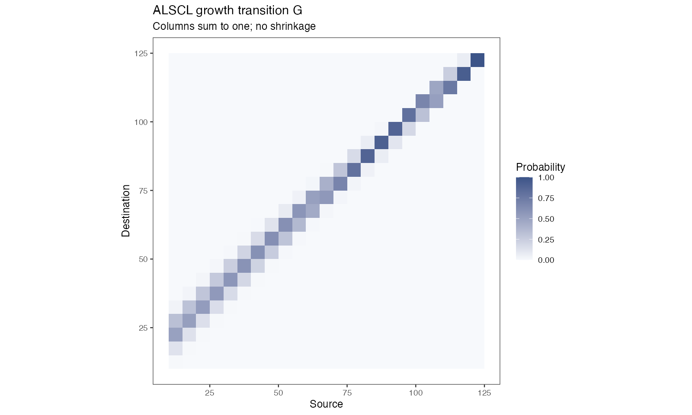

# ALSCL 使用指南 / User guide

<!-- Generated by scripts/build_manual.py from website/content/{en,zh}/articles/. Edit the article pair, not this file. -->

**ALSCL 2.4.3.9000 · 简体中文 / English**

本指南按任务组织，每节先说明目的，再给出要运行的代码、应看到的结果和出错时的处理。网站提供单一语言的连续阅读：[English](https://fanzhang-lab-shou.github.io/ALSCL/) · [简体中文](https://fanzhang-lab-shou.github.io/ALSCL/zh/)。

This guide is organized by task. Each section states its purpose, the code to run, what to expect and what to do when it fails. The website offers continuous reading in one language: [English](https://fanzhang-lab-shou.github.io/ALSCL/) · [简体中文](https://fanzhang-lab-shou.github.io/ALSCL/zh/).

[首页 / Home](../README.md) · [函数参考 / Function reference](FUNCTION_REFERENCE.md) · [图谱 / Gallery](PLOT_GALLERY.md) · [评估工作流 / Assessment workflows](ASSESSMENT_WORKFLOWS.md) · [模型验证 / Model validation](MODEL_VALIDATION.md) · [应用案例 / Worked cases](CASES.md)

## 目录 / Contents

1. [安装 ALSCL 并完成第一次拟合 / Install ALSCL and run a first fit](#start)
2. [模型原理与时间尺度 / Model principles](#theory)
3. [准备调查数据 / Prepare your survey data](#excel)
4. [理解第一次拟合 / Understand your first fit](#builtin)
5. [模拟调查数据 / Simulate survey data](#simulation)
6. [选择拟合设置 / Choose the fitting settings](#fitting)
7. [判断拟合是否可用 / Judge whether a fit can be used](#diagnostics)
8. [运行回溯分析 / Run a retrospective analysis](#retrospective)

<a id="start"></a>
## 1. 安装 ALSCL 并完成第一次拟合 / Install ALSCL and run a first fit

本页带你安装软件包、确认它能加载，并用内置示例拟合一个模型。你需要 R 4.1 或更高版本和网络连接；示例数据随包附带。整个过程约十五分钟，其中大部分是第 4 步只需一次的模型编译。

On this page you install the package, confirm that it loads, and fit one model to the bundled example. You need R 4.1 or later and an internet connection; the example data are included. Allow about fifteen minutes, most of it for the one-time compilation in step 4.

| 步骤 / Step | 完成后得到什么 / What you will have afterwards |
|---|---|
| 1. 安装编译器 / 1. Install the compiler | 在本机构建两个模型所需的工具 / The tools that build the two models on your computer |
| 2. 安装软件包 / 2. Install the package | 从 GitHub 安装的 ALSCL 及其依赖包 / ALSCL and its dependencies installed from GitHub |
| 3. 加载并检查 / 3. Load and check | 已加载的软件包和示例数据 / The package and the example data loaded in your session |
| 4. 拟合示例 / 4. Fit the example | 一个拟合好的 ACL 模型及其数值检查 / A fitted ACL model and its numerical checks |

<a id="getting-started-compiler"></a>

### 1. 安装编译器 / Install the compiler

两个模型用 C++ 编写，由 Template Model Builder（TMB）调用。第一次拟合时会在你的电脑上编译模型，之后的拟合直接使用编译结果。第一次拟合前，先按系统安装编译器。

The two models are written in C++ for Template Model Builder (TMB). The first fit compiles them on your computer; later fits reuse the compiled files. Install the compiler for your system before the first fit.

| 系统 / System | 需要安装 / What to install |
|---|---|
| Windows | 与 R 版本对应的 [Rtools](https://cran.r-project.org/bin/windows/Rtools/) / [Rtools](https://cran.r-project.org/bin/windows/Rtools/) for your R version |
| macOS | Xcode Command Line Tools（在终端运行 `xcode-select --install`） / The Xcode Command Line Tools (`xcode-select --install` in Terminal) |
| Linux | C++ 编译器和 `make`，例如 Debian、Ubuntu 上的 `build-essential` / A C++ compiler and `make`, for example `build-essential` on Debian and Ubuntu |

如果没有编译器，第 4 步的第一次拟合会报错，错误信息中会出现编译器或 `TMB::compile` 字样。安装工具后重启 R，再运行一次拟合。

If the compiler is missing, the first fit in step 4 stops with an error that mentions the compiler or `TMB::compile`. Install the tools, restart R and run the fit again.

<a id="getting-started-install"></a>

### 2. 安装软件包 / Install the package

```r
install.packages("remotes")
remotes::install_github("FanZhang-LAB-SHOU/ALSCL")
```

ALSCL 发布在 GitHub 而不是 CRAN，因此用 `remotes` 安装，它会一并安装依赖包（TMB、ggplot2 等）。有新版本时重新运行这两行即可；[更新日志](../NEWS.md)列出每个版本的变化。

ALSCL is published on GitHub, not on CRAN, so `remotes` installs it together with the packages it depends on (TMB, ggplot2 and others). Run the same two lines again when a new release appears; the [changelog](../NEWS.md) lists what changed.

如果安装在某个依赖包上停止，用 `install.packages()` 安装该包，再运行第二行。如果错误信息提到编译器，回到第 1 步。

If the installation stops on a dependency, install that package with `install.packages()` and run the second line again. If it stops with a compiler message, go back to step 1.

<a id="getting-started-load"></a>

### 3. 加载软件包和示例数据 / Load the package and the example data

```r
library(ALSCL)
packageVersion("ALSCL")
data("YTF_example")
str(YTF_example[c("data.CatL", "data.wgt", "data.mat")])
```

每个会话都从 `library(ALSCL)` 开始。`YTF_example` 是采用 `YTF` 中 yellowtail flounder（*Limanda ferruginea*）生物学设置生成的模拟教学数据。它包含调查指数表 `data.CatL`、体重表 `data.wgt` 和成熟比例表 `data.mat`，每张表有 23 个体长组为行、20 个年份为列。第一列是体长组标签，其余各列是年份。[物种资料](https://www.fisheries.noaa.gov/species/yellowtail-flounder)。

Start every session with `library(ALSCL)`. `YTF_example` is a simulated teaching dataset generated using the yellowtail flounder (*Limanda ferruginea*) biological settings in `YTF`. It contains a survey-index table `data.CatL`, a weight table `data.wgt` and a maturity table `data.mat`, each with 23 length-bin rows and 20 year columns. The first column contains length-bin labels; the remaining columns contain years. [Species identity](https://www.fisheries.noaa.gov/species/yellowtail-flounder).

你应看到 2.4.0 或更高的版本号，以及三张大小相同的数据框。这一步不编译任何东西，只确认安装可用。

You should see version 2.4.0 or later and three data frames of the same size. Nothing is compiled yet; this step only confirms that the installation works.

<a id="getting-started-first-fit"></a>

### 4. 拟合示例 / Fit the example

```r
x <- YTF_example
a <- run_acl(x, silent = TRUE)
diagnose_model(x$data.CatL, a)
```

`run_acl()` 用 `x` 中保存的生物学设置和初值，把年龄结构模型 ACL 拟合到三张表。第一次调用会编译模型，需要一到三分钟；拟合本身约二十秒。`silent = TRUE` 不显示进度信息。

`run_acl()` fits the age-structured model, ACL, to the three tables using the biological settings and starting values stored in `x`. The first call compiles the model, which takes one to three minutes; the fit itself takes about twenty seconds. `silent = TRUE` hides the progress messages.

`diagnose_model()` 打印优化器原始收敛码、最大绝对梯度、Hessian 状态及参数边界检查。`Numerical checks: TRUE` 保存在 `a$diagnostics$numerical_ok` 中，表示梯度、Hessian、协方差和边界准则通过。优化器原始收敛码和强参数相关须另行检查。即使该筛查通过，也要阅读 `a$diagnostics$issues`；[理解第一次拟合](USER_GUIDE.md#builtin)解释各项检查及提示问题的处理方法。

`diagnose_model()` prints the raw optimizer code, maximum absolute gradient, Hessian status and parameter-boundary checks. `Numerical checks: TRUE`, stored as `a$diagnostics$numerical_ok`, means the gradient, Hessian, covariance and boundary criteria passed. The raw optimizer code and strong parameter correlations require separate review. Read `a$diagnostics$issues` even when this screen passes; [Understand your first fit](USER_GUIDE.md#builtin) explains the checks and how to investigate a flagged result.

本网站的内容都可以在安装好的软件包中直接运行。只有调用 `source("scripts/...")` 或读取 `docs/data/...` 路径的示例，才需要下载[仓库](https://github.com/FanZhang-LAB-SHOU/ALSCL)，并把仓库根目录设为 R 工作目录。

Everything on this website works from an installed package. Only examples that call `source("scripts/...")` or read a `docs/data/...` path need a downloaded copy of the [repository](https://github.com/FanZhang-LAB-SHOU/ALSCL), opened as the R working directory.

<a id="getting-started-next"></a>

### 下一步 / What next

| 想做什么 / What you want to do | 阅读 / Read |
|---|---|
| 了解拟合结果包含什么、如何判断它可用 / See what the fitted object contains and how to judge it | [理解第一次拟合](USER_GUIDE.md#builtin) / [Understand your first fit](USER_GUIDE.md#builtin) |
| 拟合自己的调查数据 / Fit your own survey tables | [准备调查数据](USER_GUIDE.md#excel) / [Prepare your survey data](USER_GUIDE.md#excel) |
| 解决安装或编译问题 / Fix an installation or compilation problem | [复现与故障处理](ADVANCED_WORKFLOWS.md) / [Reproducibility and troubleshooting](ADVANCED_WORKFLOWS.md) |

<a id="theory"></a>
## 2. 模型原理与时间尺度 / Model principles

本页带你阅读 ACL 和 ALSCL 背后的方程（采用本包的时间单位和随机效应参数化）、检查一次拟合中的两种概率矩阵，并把年率换算到模型时间步。第 1 步需要[理解第一次拟合](USER_GUIDE.md#builtin)中的 ALSCL 拟合 `b`；方程采用 [Zhang & Cadigan (2022)](https://doi.org/10.1111/faf.12673) 的模型框架。

On this page you read the equations behind ACL and ALSCL in the package's time units and parameterization, check the two probability matrices of a fit, and convert annual rates to the model time step. Step 1 needs the ALSCL fit `b` from [Understand your first fit](USER_GUIDE.md#builtin); the equations follow [Zhang & Cadigan (2022)](https://doi.org/10.1111/faf.12673).

<a id="model-theory-equations"></a>

### 方程 / The equations

<a id="model-theory-dynamics"></a>

#### 种群动态 / Population dynamics

令 $`i=1,\ldots,A`$ 为年龄组索引，$`a_i=a_{rec}+(i-1)\Delta t`$ 为实际年龄，$`t`$ 为时间步。ACL 将补充量计入最小年龄组，并将存活个体推进至下一年龄组。最高年龄组（plus group）包括达到或超过该组起始年龄的个体。

Let $`i=1,\ldots,A`$ index age classes, with actual age $`a_i=a_{rec}+(i-1)\Delta t`$, and let $`t`$ index time steps. ACL advances survivors by age, introduces recruitment in the first class, and retains survivors in the oldest plus group:

```math
N_{1,t}=R_t,\qquad Z_{i,t}=M+F_{i,t},
```

```math
N_{i+1,t+1}=N_{i,t}\exp(-Z_{i,t}),\qquad i=1,\ldots,A-2,
```

```math
N_{A,t+1}=N_{A-1,t}\exp(-Z_{A-1,t})+N_{A,t}\exp(-Z_{A,t}).
```

M 和 F 是每个时间步的瞬时死亡率；季度模型的 `growth_step=0.25`，M 和 F 也须使用季度率。生长参数 $`k`$ 按年定义。

M and F are instantaneous rates per time step. A quarterly model uses `growth_step=0.25` and quarterly mortality rates; the growth parameter $`k`$ is annual.

<a id="model-theory-fishing"></a>

#### 捕捞死亡率 / Fishing mortality

ACL 按年龄估计 F，ALSCL 按体长估计 F。以 $`s`$ 表示相应的年龄或体长组，两个模型均使用可分离的 AR(1) × AR(1) 对数 F 偏差：

ACL estimates F by age, whereas ALSCL estimates F by length. With $`s`$ denoting the age or length class, both use separable AR(1) × AR(1) deviations in log F:

```math
F_{s,t}=\exp(\mu_F+d_{s,t}),\qquad
\mathrm{Cov}(d_{s,t},d_{s-h,t-j})=\sigma_F^2\phi_S^{|h|}\phi_T^{|j|}.
```

这里 $`\sigma_F`$ 是 TMB 可分离 AR(1) 密度经缩放后的边际标准差；相关参数描述组间和时间上的相关性。该式已经包含边际方差，无需再除以 $`1-\phi^2`$ 因子，那是创新方差参数化的写法。自然死亡率 M 作为已知输入。

Here $`\sigma_F`$ is the marginal SD in TMB's scaled, separable AR(1) density, and the correlation parameters describe dependence across groups and time. The expression already contains the marginal variance, so it needs no further division by $`1-\phi^2`$ factors, which belong to innovation-variance parameterizations. Natural mortality M is supplied as known.

<a id="model-theory-recruitment"></a>

#### 补充量 / Recruitment

拟合模型用 AR(1) 对数偏差描述补充量。与边际标准差 $`\sigma_R`$ 一致的平稳形式为：

The fitted models use AR(1) log recruitment deviations. The stationary representation with marginal SD $`\sigma_R`$ is:

```math
R_t=\exp(\mu_R+r_t),\qquad
r_1\sim N(0,\sigma_R^2),\qquad
r_{t+1}=\phi_R r_t+\eta_t,\quad
\eta_t\sim N\!\left(0,\sigma_R^2(1-\phi_R^2)\right).
```

$`\exp(\mu_R)`$ 是补充量的中位数；算术均值还包含 $`r_t`$ 的方差。完整模拟器 `sim_data()` 使用 Beverton-Holt 亲体补充关系及随机偏差，是另一套补充过程。

$`\exp(\mu_R)`$ is the median recruitment; the arithmetic mean also includes the variance of $`r_t`$. The full `sim_data()` operating model uses Beverton-Holt stock-recruitment with random deviations, a recruitment process of its own.

<a id="model-theory-initial"></a>

#### 初始条件 / Initial conditions

第一期最小年龄组由 $`R_1`$ 给定，其余年龄组按初始死亡率与逐组扰动递推：

Initial recruitment defines the youngest class; the other classes follow a recursive decline with an initial mortality rate and class-to-class deviations:

```math
\log N_{1,1}=\log R_1,\qquad
\log N_{i,1}=\log N_{i-1,1}-Z_{init}+u_{i-1},\quad
u_{i-1}\sim N(0,\sigma_{N0}^2).
```

因此 $`\log N_{i,1}=\log R_1-(i-1)Z_{init}+\sum_{j=1}^{i-1}u_j`$：扰动沿年龄组累积，相邻年龄组的总扰动相互相关。ALSCL 再用初始年龄-体长概率分配这些个体。在这一已发表的结构中，第一个时间步的末组（plus group）只含一个世代。`structure` 参数提供平衡状态的末组，对 ALSCL 还提供由生长转移推算的初始年龄别体长分布（[选择拟合设置](USER_GUIDE.md#fitting-controls-structure)）。

The initial log abundance of a class therefore contains the cumulative sum of the deviations of the younger classes, so the total deviations of neighbouring classes are correlated. ALSCL allocates these initial numbers across length using age-length probabilities. In this published structure the plus group of the first time step holds one cohort. The `structure` argument offers an equilibrium plus group and, for ALSCL, initial lengths at age built from the growth transition ([Choose the fitting settings](USER_GUIDE.md#fitting-controls-structure)).

<a id="model-theory-pla"></a>

#### 年龄-体长转换（ACL） / Age-to-length conversion (ACL)

给定年龄的长度服从均值由 von Bertalanffy 曲线决定的正态分布：

Length conditional on age follows a normal distribution whose mean is defined by the von Bertalanffy curve:

```math
\mu_i=L_\infty\left[1-e^{-k(a_i-t_0)}\right],\qquad
\sigma_i=CV_L\mu_i,
```

```math
p_{l|i}=\Phi\!\left(\frac{UB_l-\mu_i}{\sigma_i}\right)
       -\Phi\!\left(\frac{LB_l-\mu_i}{\sigma_i}\right),\qquad
N_{l,t}=\sum_i p_{l|i}N_{i,t}.
```

`pla` 表示这个年龄-体长概率矩阵，`plot_pla()` 用热图展示。实现使用支持自动微分的正态 CDF 差，并通过右尾对称计算和归一化处理数值稳定性，以此代替论文 Appendix S1 的固定阶 Taylor 近似；长度边界必须与调查分组一致。

`pla` is the age-length probability matrix shown by `plot_pla()`. The implementation uses differentiable normal CDF differences with symmetric right-tail calculations and normalization, in place of the fixed-order Taylor approximation of Appendix S1; boundaries must match the survey bins.

<a id="model-theory-growth"></a>

#### 生长转移矩阵（ALSCL） / Growth transition matrix (ALSCL)

ALSCL 保留 $`N_{l,i,t}`$ 的体长、年龄、时间三个维度。$`G_{j,l}`$ 表示从源体长组 $`l`$ 转入目的体长组 $`j`$ 的概率。普通年龄组的存活与增长为：

ALSCL retains length, age and time in $`N_{l,i,t}`$. Entry $`G_{j,l}`$ is the probability of moving from source length bin $`l`$ to destination bin $`j`$. Survival and growth for ordinary age classes follow:

```math
N_{j,i+1,t+1}=\sum_l G_{j,l}N_{l,i,t}\exp[-(M+F_{l,t})].
```

最高年龄组同时接收前一年龄组新进入的存活个体和本组继续存活的个体，两者均按生长矩阵在体长组间转移。补充个体按最小年龄的体长分布进入第一年龄组。G 的各列和为 1，不允许缩短，最大体长组吸收右尾概率。

The plus group combines survivors and growth from the preceding and oldest age classes. Recruitment enters the youngest class with its length distribution. Columns of G sum to one, shrinkage is excluded, and the largest bin absorbs the right-tail probability.

生长增量使用下面的平滑下降函数，标准差为 $`CV_G\mu_{\Delta L}`$：

Growth increments use the following smooth decreasing mean, with SD $`CV_G\mu_{\Delta L}`$:

```math
\mu_{\Delta L}(L)=\frac{\Delta t(1-e^{-k})L_\infty}
{1+\exp\!\left(-\log(19)\frac{L-0.5L_\infty}{0.05L_\infty-0.5L_\infty}\right)}.
```

此函数与精确的任意时间步 VB 增量 $`(L_\infty-L)(1-e^{-k\Delta t})`$ 不同，并且体长组内所有个体都从组中点开始生长。使用 `structure = list(growth_increment = "von_bertalanffy", growth_transition = "bin")` 时，ALSCL 采用 VB 增量，起始体长在组内均匀分布（[选择拟合设置](USER_GUIDE.md#fitting-controls-structure)）。`pla` 是给定年龄的长度分布，G 是给定源长度的一步转移概率，各模型使用各自的矩阵。`FL` 是长度别 F，`FA` 则由同一世代在相应时间步的存活比例推导。报告中的 `FA` 和对应的年龄别总死亡率 `ZA` 覆盖每个年龄（包括末组）和每个时间步。

This curve differs from the exact von Bertalanffy increment $`(L_\infty-L)(1-e^{-k\Delta t})`$, and every fish in a length bin grows from the bin midpoint. With `structure = list(growth_increment = "von_bertalanffy", growth_transition = "bin")`, ALSCL uses the von Bertalanffy increment and starting lengths that are uniform within the bin ([Choose the fitting settings](USER_GUIDE.md#fitting-controls-structure)). `pla` describes length given age, while G describes a one-step transition given source length; each model uses its own. `FL` is length-specific F; `FA` is derived from the survival proportion of the same cohort over the model time step. The report holds `FA` and the matching total mortality at age `ZA` for every age, including the plus group, and for every time step.

<a id="model-theory-derived"></a>

#### 派生量 / Derived quantities

输入的平均个体重量 $`w_{l,t}`$ 和成熟比例 $`m_{l,t}`$ 用于计算体长别生物量、成熟生物量及总量：

Mean individual weight $`w_{l,t}`$ and maturity proportion $`m_{l,t}`$ convert abundance into length-specific biomass, spawning biomass and totals:

```math
b_{l,t}=N_{l,t}w_{l,t},\qquad sb_{l,t}=b_{l,t}m_{l,t},\qquad
B_t=\sum_l b_{l,t},\qquad SSB_t=\sum_l sb_{l,t}.
```

`CN`、`CB` 是模型推算的渔业捕获尾数与重量，区别于输入的调查数量指数。生物量单位由个体重量单位和丰度尺度共同决定。丰度尺度就是调查指数的尺度，因为调查可捕性的最大值固定为 1（见下一节）。只有当指数是绝对丰度估计时，丰度、生物量、产卵生物量、补充量、`CN` 和 `CB` 才是绝对量；使用相对指数时，它们是相对值。

`CN` and `CB` are derived fishery catch numbers and biomass, distinct from the input survey number index. Biomass units depend on the weight units and the abundance scale. The abundance scale is the scale of the survey index, because survey catchability has a fixed maximum of 1 (next section). Abundance, biomass, spawning biomass, recruitment, `CN` and `CB` are absolute only when the index is an absolute abundance estimate; with a relative index they are relative values.

<a id="model-theory-survey"></a>

#### 调查观测 / Survey observations

令 $`I_{l,t}`$ 为调查数量指数，$`N_{l,t}`$ 为种群尾数。调查观测使用对数正态模型：

Let $`I_{l,t}`$ denote the survey number index and $`N_{l,t}`$ population abundance. Survey observations follow a lognormal model:

```math
\log I_{l,t}=\log q_l+\log N_{l,t}+\epsilon_{l,t},\qquad
\epsilon_{l,t}\sim N(0,\sigma_I^2),
```

```math
q_l=\left[1+\exp\!\left(-\log(19)\frac{L_l-L_{50}}{L_{95}-L_{50}}\right)\right]^{-1}.
```

`sel_L50`、`sel_L95` 固定调查可捕性 q，在两个指定体长处分别取 0.5 和 0.95，对大个体 q 趋近于 1；它们描述的是调查，渔业选择性是另一个量。模型不估计可捕性的比例系数：把指数乘以一个常数，丰度、生物量、补充量和捕获量的估计也乘以同一常数，捕捞死亡率不变。`exp(report$Elog_index)` 给出原尺度的中位数，算术均值还需乘以 $`\exp(\sigma_I^2/2)`$。

`sel_L50` and `sel_L95` fix survey catchability at 0.5 and 0.95 at the specified lengths, and catchability approaches 1 for large fish; they describe the survey, and fishery selectivity is a separate quantity. No catchability scale is estimated: multiplying the index by a constant multiplies the abundance, biomass, recruitment and catch estimates by the same constant and leaves fishing mortality unchanged. `exp(report$Elog_index)` is the original-scale median; the arithmetic mean also includes $`\exp(\sigma_I^2/2)`$.

<a id="model-theory-estimation"></a>

#### 估计与区间 / Estimation and uncertainty

TMB 用自动微分计算目标函数及导数，对随机效应采用 Laplace 近似；R 的 `nlminb()` 优化固定效应。`sdreport()` 使用局部曲率及 delta 方法给出近似标准误。绘图中的 95% 区间是逐点区间，只有被估计的参数对它有贡献：`YTF_example` 固定了生长和部分过程参数，因此生长区间退化为一条线，其余区间以这些固定值为条件。生长区间描述平均曲线的不确定性，单尾鱼按 $`CV_L`$ 散布在曲线周围。解读任何区间之前，先读 Hessian、边界和梯度检查。

TMB uses automatic differentiation and a Laplace approximation for the random effects; R's `nlminb()` optimizes the fixed effects. `sdreport()` obtains approximate standard errors from local curvature and the delta method. Plotted 95% intervals are pointwise, and only the estimated parameters contribute to them: `YTF_example` fixes growth and some process parameters, so its growth interval collapses to a line and the other intervals are conditional on the fixed values. Growth intervals describe the uncertainty of the mean curve; individual fish scatter around it with $`CV_L`$. Read the Hessian, bound and gradient checks before interpreting any interval.

<a id="model-theory-matrices"></a>

### 1. 检查两种概率矩阵 / Check the two probability matrices

```r
# b 为 ALSCL 拟合对象 / b is an ALSCL fit
G <- b$report$G
range(colSums(G))
stopifnot(all(G >= 0), max(abs(colSums(G) - 1)) < 1e-8)
```

| 矩阵 / Matrix | 含义 / Meaning | 检查 / Check |
|---|---|---|
| `pla` | 给定年龄的长度分布；模拟器中的方向随模型而异 / Length given age; simulator orientation varies | 先检查方向 / Check orientation |
| `G` | 给定源长度列的目的长度行 / Destination row conditional on source column | 非负、列和为 1、不缩短 / Nonnegative, normalized, no shrinkage |

`range(colSums(G))` 应打印两个在舍入误差内等于 1 的值，`stopifnot()` 静默返回。若它停止，说明保存的矩阵不满足这些性质；使用 `b` 之前先读它的数值检查。`plot_pla()` 画的是年龄-体长概率。下面是 tuna 条件 ALSCL 拟合的生长转移矩阵，显示留在原组和进入较大组的概率：

`range(colSums(G))` should print two values equal to 1 within rounding, and `stopifnot()` returns silently. A stop means the stored matrix fails these properties; read the numerical checks of `b` before using it. `plot_pla()` shows the age-length probabilities. The tuna ALSCL growth matrix below shows the probabilities of staying in a bin or advancing to larger bins:



生长可以留在同一组内：鱼长大了，而分组是离散的。最后一组承接右尾概率。改变体长组边界会改变两个矩阵和状态的含义。

Growth can remain within the same bin: the fish grew, and the bins are discrete. The largest bin absorbs the right tail. Changing the bin boundaries changes both matrices and the meaning of the states.

<a id="model-theory-units"></a>

### 2. 把年率换算到模型时间步 / Convert annual rates to the model time step

```r
rec.age <- .25; nage <- 20; growth_step <- .25
ages <- rec.age + (seq_len(nage) - 1) * growth_step
range(ages) # 年 / years
M_quarter <- .8 * growth_step
# 四个季度的累计瞬时率 / Sum four quarterly instantaneous rates
F_quarter <- c(.1, .15, .2, .15)
F_annual <- sum(F_quarter)
```

年龄按设定的步长排列。生长参数 k 按年；M 和 F 是每个时间步的瞬时率，所以年 M = 0.8 对应季度 M = 0.2，一个时间步内的存活概率是 $`\exp[-(M+F)]`$。`range(ages)` 打印 0.25 和 5。`plot_compare_F_ts()` 不会把季度值年化；`method = "apical"` 是每个时间步的组间最大值，`"mean"` 是非加权平均，两个模型的原生 F 维度不同。

Ages use the stated step. Growth k is annual; M and F are instantaneous rates per time step, so an annual M of 0.8 becomes a quarterly M of 0.2, and survival over a step is $`\exp[-(M+F)]`$. `range(ages)` prints 0.25 and 5. `plot_compare_F_ts()` does not annualize quarterly values; `method = "apical"` is the within-step group maximum and `"mean"` the unweighted mean, and the native F dimensions differ between the models.

<a id="model-theory-next"></a>

### 下一步 / What next

| 想做什么 / What you want to do | 阅读 / Read |
|---|---|
| 查看各模型估计哪些参数及其变换 / See which parameters each model estimates and their transformations | [估计参数清单](USER_GUIDE.md#fitting) / [Estimation parameter lists](USER_GUIDE.md#fitting) |
| 固定或释放参数，选择 F 结构 / Fix or release parameters, choose the F structure | [选择拟合设置](USER_GUIDE.md#fitting) / [Choose the fitting settings](USER_GUIDE.md#fitting) |
| 拟合季度调查 / Fit a quarterly survey | [年度与季度时间步](CASE_STUDIES.md) / [Annual and quarterly time steps](CASE_STUDIES.md) |

<a id="excel"></a>
## 3. 准备调查数据 / Prepare your survey data

本页把你的调查观测整理成 `run_acl(x)` 和 `run_alscl(x)` 可以接受的输入列表 `x`，并在第一次拟合前检查它。你需要已安装的软件包（[安装 ALSCL](USER_GUIDE.md#start)）、按年或按季度的体长别调查尾数、体长别平均体重和成熟比例，以及第 4 步列出的本种群生物学数值。

On this page you turn your survey observations into an input bundle `x` that `run_acl(x)` and `run_alscl(x)` accept, and you check it before the first fit. You need the package installed ([Install ALSCL](USER_GUIDE.md#start)), your survey numbers at length by year or quarter, mean weight and maturity at length, and the biological values of your stock listed in step 4.

| 步骤 / Step | 完成后得到什么 / What you will have afterwards |
|---|---|
| 1. 排好三张表 / 1. Lay out three tables | 行列完全一致的工作簿或三个 CSV 文件 / A workbook or three CSV files with identical rows and columns |
| 2. 确定时间步 / 2. Choose the time step | 没有隐藏缺口的时间网格，以及零值的处理决定 / A time grid without hidden gaps and a decision about zeros |
| 3. 读入文件 / 3. Read the files | R 中已检查对齐的三张表列表 / The three tables as a list in R, already checked for alignment |
| 4. 加入生物学设置 / 4. Add the biology | 带有本种群设置的输入列表 `x` / The input bundle `x` with your stock's settings |
| 5. 检查输入列表 / 5. Check the bundle | 确认 `x` 可以拟合，并得到将被估计的参数清单 / A confirmation that `x` can be fitted, and the list of parameters that will be estimated |

<a id="data-preparation-table-layout"></a>

### 1. 排好三张匹配的表 / Lay out three matching tables

两个模型读取布局相同的三张表：调查指数表 `data.CatL`（每个体长组、每个时间步调查捕到的尾数）、体重表 `data.wgt`（每个体长组、每个时间步一尾鱼的平均体重）和成熟比例表 `data.mat`（成熟个体比例）。行是体长组，列是时间步，三张表顺序相同。下载[示例工作簿](data/ALSCL_Data_Entry_Example.xlsx)，留一份副本，再把其中的数值换成你的数据。

Both models read three tables with the same layout: the survey index table `data.CatL` (numbers of fish caught by the survey in each length bin and time step), the weight table `data.wgt` (mean weight of one fish in each bin and time step) and the maturity table `data.mat` (proportion mature). The rows are the length bins and the columns are the time steps, in the same order in all three tables. Download the [example workbook](data/ALSCL_Data_Entry_Example.xlsx), keep a copy, and replace its values with yours.

| 位置 / Location | 规则 / Rule |
|---|---|
| 工作表名 / Sheet names | 必须是 `data.CatL`、`data.wgt` 和 `data.mat`（或三个同名的 CSV 文件） / Exactly `data.CatL`, `data.wgt` and `data.mat` (or three CSV files with these names) |
| A1 单元格 / Cell A1 | `LengthBin`；表头上方不要有标题行 / `LengthBin`; no title rows above the header |
| A 列 / Column A | 每行一个体长组；示例用中点 6、8、...、50 cm / One length bin per row; the example uses the midpoints 6, 8, ..., 50 cm |
| 第 1 行 / Row 1 | 递增的数值时间标签：年度为 2000、2001、...；季度为 2000、2000.25、2000.5、... / Increasing numeric time labels: 2000, 2001, ... for years; 2000, 2000.25, 2000.5, ... for quarters |
| 其他单元格 / Other cells | 每个体长组和时间步一个数字；表格内不放其他内容 / One number per bin and time step; nothing else inside the grid |
| 三张表 / All three tables | 体长组、时间标签和顺序完全相同 / Identical bins, time labels and order |

<a id="data-preparation-survey-table"></a>

#### 调查指数表 data.CatL / Survey index table data.CatL

填入体长别调查尾数，或经一致标准化的指数（例如每网次尾数），可以有小数。模型输出的尺度就是这个指数的尺度。调查可捕性对大个体上升到固定的最大值 1，模型不估计可捕性的比例系数。因此，只有当指数本身是体长别绝对丰度估计（例如按扫海面积扩展到种群分布区的尾数）时，丰度、生物量、产卵生物量、补充量和捕获量才是绝对估计。使用每网次尾数这类相对指数时，这些量是以指数单位表示的相对值，坐标轴也应这样标注。捕捞死亡率不受指数尺度影响。某个体长组在某个时间步没有观测时，单元格留空或写 `NA`；不要用 0、短横线或 `<1` 表示未知。0 表示调查在该体长组确实没有捕到。

Enter the survey numbers at length, or a consistently standardized index of them (for example numbers per tow). Decimals are fine. The model outputs are on the scale of this index. Survey catchability rises to a fixed maximum of 1 for large fish, and no catchability scale is estimated. Abundance, biomass, spawning biomass, recruitment and catch are therefore absolute estimates only when the index is an absolute abundance estimate at length, such as swept-area numbers expanded to the stock area. With a relative index such as numbers per tow, read them as relative values in the units of the index and label the axes accordingly. Fishing mortality rates do not depend on the scale of the index. Leave a cell blank, or write `NA`, when that bin was not observed in that time step; do not write 0, a dash or `<1` for an unknown value. A 0 means the survey observed nothing in that bin.


<a id="data-preparation-weight-table"></a>

#### 体重表 data.wgt / Weight table data.wgt

填入每个体长组、每个时间步一尾鱼的平均体重，全表使用同一单位（示例为 kg）。每个单元格都要有值，因为模型用尾数乘体重得到生物量。如果只有体长-体重关系而没有逐年测量值，就用关系式的结果填满所有时间步，并在报告评估时说明。

Enter the mean weight of one fish in each bin and time step, in one unit throughout (the example uses kg). Every cell needs a value, because the model multiplies numbers by weight to obtain biomass. If you have a length-weight relationship instead of yearly measurements, fill all time steps with its values and say so when you report the assessment.


<a id="data-preparation-maturity-table"></a>

#### 成熟比例表 data.mat / Maturity table data.mat

填入 0 到 1 之间的成熟比例（60% 写 0.6）。每个单元格都要有值，0 和 1 都可以。产卵生物量等于尾数乘体重乘成熟比例，这张表决定哪些体长组算作亲体。

Enter the proportion mature as a number between 0 and 1 (0.6 for 60%). Every cell needs a value; 0 and 1 are valid. Spawning biomass is numbers times weight times maturity, so this table decides which bins count as spawners.


<a id="data-preparation-time-and-bins"></a>

### 2. 确定时间步并处理缺口 / Choose the time step and handle gaps

模型逐个时间步推进种群，`growth_step` 是一个时间步的长度（年）：年度调查为 1，季度调查为 0.25。相邻列标签之差必须恰好等于 `growth_step`，模型才知道两列之间过了多长时间。没有调查的时间步仍要保留为一列，调查单元格留空，体重和成熟比例照常填写；模型会把这一步当作未观测。

The models advance the population one time step at a time, and `growth_step` is the length of that step in years: 1 for annual surveys, 0.25 for quarterly surveys. Consecutive column labels must differ by exactly `growth_step`, so the models know how much time passed between two columns. A time step without a survey stays in the table as a column of blank survey cells with its weight and maturity filled in; the models then treat that step as unobserved.

| 情况 / Situation | 如何填写 / What to enter |
|---|---|
| 年度调查，2002 年没有调查 / Annual survey, no survey in 2002 | 保留 2002 列；调查单元格留空；填写体重和成熟比例 / Keep a 2002 column; leave its survey cells blank; fill weight and maturity |
| 季度调查 / Quarterly survey | 标签 2000、2000.25、2000.5、2000.75、...；第 4 步设 `growth_step = 0.25` / Labels 2000, 2000.25, 2000.5, 2000.75, ...; `growth_step = 0.25` in step 4 |
| 某个体长组在某个时间步没有观测 / One bin not observed in one time step | 该调查单元格留空 / Leave that survey cell blank |
| 记录到的零值 / A recorded zero | 保留 0；在第 4 步决定零值按缺失处理（默认 `zero_action = "missing"`）还是终止拟合（`"error"`） / Keep the 0; decide in step 4 whether zeros are treated as missing (`zero_action = "missing"`, the default) or stop the fit (`"error"`) |

提供体长组中点（`len_mid`，每行一个）和组间内部边界（`len_border`，比行数少一个）。计算年龄–体长概率时，首组和末组分别吸收正态分布的下尾和上尾，数学边界为负无穷和正无穷。该分布不在零处截断；这是分配概率的约定，不表示观测到负体长。等宽组的中点可用行标签，内部边界位于相邻中点之间；不等宽组则填写调查设计使用的边界：行标签是间距不等的单个数值而又没有提供 `len_border` 时，拟合把边界设在相邻标签的中点并给出警告。

Supply length-bin midpoints (`len_mid`, one per row) and internal boundaries (`len_border`, one fewer than the rows). In the age-length probability calculation, the first and last bins absorb the normal distribution's lower and upper tails, with mathematical bounds of negative and positive infinity. The distribution is not truncated at zero; this is a probability-allocation convention, not a negative observed length. For equal-width bins, midpoints are the row labels and internal boundaries are halfway between them. Otherwise supply the boundaries used in your survey design: when the labels are single numbers with unequal spacing and `len_border` is missing, the fit sets the boundaries halfway between adjacent labels and gives a warning.

<a id="data-preparation-import"></a>

### 3. 把文件读入 R / Read the files into R

两个读取函数任选其一。两者都返回包含三张表的列表，把数字文本转换为数值，并在表格不一致时停止并给出提示。

Use one of the two readers. Both return a list with the three tables, convert numeric text to numbers, and stop with a message when the tables differ.

其他时间列含数字文本或因子时，原有数值列仍保留精度。直接向 `run_acl()` 或 `run_alscl()` 传入表格也遵循此规则，诊断使用相同数值。单元格不能包含复数。

Native numeric columns retain their precision when other time columns contain numeric text or factors. This also applies when you pass tables directly to `run_acl()` or `run_alscl()`; diagnostics read the same values. Complex-valued cells are invalid.

```r
library(ALSCL)
install.packages("readxl") # 只需一次；仅读取 Excel 文件时需要 / once; only needed for Excel files
tables <- read_survey_excel("my_survey.xlsx")
str(tables)
```

```r
# 同一文件夹中的三个文件 data.CatL.csv、data.wgt.csv 和 data.mat.csv / Three files data.CatL.csv, data.wgt.csv and data.mat.csv in one folder
tables <- read_survey_csv("my_data")
str(tables)
```

`str(tables)` 应显示三张行列数相同的数据框，每张表第一列是体长标签。提示“nonnumeric cell in time column 2003”说明表格里有文本；“must match data.CatL length labels and time columns”说明某张表的行或列与其他表不同。单元格含 `#DIV/0!` 或 `#N/A` 这样的 Excel 错误值时，`read_survey_excel()` 也会停止，并指出工作表和单元格；只有空单元格和 `NA` 表示缺失。修改文件后重新读取。

`str(tables)` should show three data frames with the same number of rows and columns, the first column of each being the length labels. A message such as "nonnumeric cell in time column 2003" points to a text entry in the grid; "must match data.CatL length labels and time columns" means the rows or columns of one table differ from the others. `read_survey_excel()` also stops when a cell holds an Excel error value such as `#DIV/0!` or `#N/A`, and names the sheet and the cells; only blank cells and `NA` denote missing values. Fix the file and read it again.

<a id="data-preparation-bundle"></a>

### 4. 加入生物学设置，组成输入列表 / Add the biology and build the input bundle

`prepare_alscl_data()` 把三张表和两个模型共用的设置 `fit_args` 组合成输入列表 `x`。这些设置描述你的种群和调查，模型把它们当作已知值。

`prepare_alscl_data()` combines the three tables with the settings both models share, `fit_args`, into the input bundle `x`. The settings describe your stock and your survey; the models take them as given.

| 设置 / Setting | 含义 / Meaning | 数值来源 / Where the value comes from |
|---|---|---|
| `rec.age` | 模型中最小年龄组的年龄（年） / Age of the youngest age class in the model, in years | 鱼首次出现在调查中的年龄 / Age at which fish first appear in the survey |
| `nage` | 年龄组数，最后一组包括达到或超过该组起始年龄的个体 / Number of age classes, including the oldest (plus) group | 在年龄网格上选定末组起始年龄 A（年），取 `nage = 1 + (A - rec.age) / growth_step` / Choose the starting age A of the plus group on the age grid, in years. Set `nage = 1 + (A - rec.age) / growth_step` |
| `M` | 每个时间步的自然死亡率 / Natural mortality per time step | 文献或生活史方法；季度时间步时把年值除以 4 / Literature or life-history methods; divide an annual value by 4 for quarterly steps |
| `sel_L50`、`sel_L95` / `sel_L50`, `sel_L95` | 调查可捕性达到其最大值的 50% 和 95% 时的体长；最大值固定为 1 / Lengths at which survey catchability reaches 50% and 95% of its maximum, which is fixed at 1 | 调查渔具的校准资料或对比捕捞试验。借用外部曲线时，说明假设并检验结果对该曲线的敏感性。 / Calibration or comparative fishing trials for the survey gear. If borrowing a curve, document the assumption and test sensitivity to it. |
| `growth_step` | 每个时间步的年数 / Years per time step | 第 2 步 / Step 2 |
| `len_mid`、`len_border` / `len_mid`, `len_border` | 体长组中点和内部边界 / Bin midpoints and internal boundaries | 第 2 步 / Step 2 |
| `zero_action` | 调查表中 0 的处理方式 / How a 0 in the survey table is treated | `"missing"`（默认）或 `"error"` / `"missing"` (default) or `"error"` |

```r
x <- prepare_alscl_data(tables, fit_args = list(
  rec.age = 1, nage = 15, M = 0.2, sel_L50 = 15, sel_L95 = 20,
  growth_step = 1, len_mid = seq(6, 50, 2), len_border = seq(7, 49, 2)))
saveRDS(x, "my_bundle.rds")
```

上面的数值是模拟示例的设置，请换成你的种群的值。`x` 是普通列表，用 `saveRDS()` 保存后可在以后的会话中用 `readRDS()` 读回。各模型的初值和 `map` 可以之后以 `fit_config` 的形式加入；没有时模型使用默认初值，并固定[拟合设置](USER_GUIDE.md#fitting)中列出的参数。

The numbers above are the settings of the synthetic example; replace them with the values for your stock. `x` is a plain list, so `saveRDS()` keeps it for later sessions and `readRDS()` brings it back. Starting values and a `map` for each model can be added later as `fit_config`; without them the models use their default starting values and fix the parameters listed in [Fitting controls](USER_GUIDE.md#fitting).

<a id="data-preparation-check"></a>

### 5. 拟合前检查输入列表 / Check the bundle before fitting

```r
check <- check_alscl_data(x, "acl")
check$valid
check$errors
check$warnings
check$summary
plan <- inspect_parameters(x, "acl")
plan[, c("parameter", "status", "natural_start", "n_free")]
```

`check_alscl_data()` 按拟合时的方式准备数据，但不编译任何东西，然后报告输入列表能否拟合。`check$summary` 统计体长组数、时间步数、正观测数、零值数、空白数、没有任何观测的时间步和体长组，以及将被估计的标量参数（`free_fixed`）和随机效应（`free_random`）数量。`inspect_parameters()` 列出每个参数在自然尺度上的初值及其状态：`free`（估计）、`fixed`（固定）或 `tied`（共享）。打算拟合 ALSCL 时，用 `"alscl"` 再运行一遍这两个函数。

`check_alscl_data()` prepares the data exactly as a fit would, without compiling anything, and reports whether the bundle can be fitted. `check$summary` counts the bins, time steps, positive observations, zeros, blanks, time steps and bins without any observation, and the numbers of scalar (`free_fixed`) and random-effect (`free_random`) parameters that will be estimated. `inspect_parameters()` lists every parameter with its starting value on the natural scale and its status: `free` (estimated), `fixed` or `tied`. Run both again with `"alscl"` when you intend to fit that model.

若 `check$valid` 为 `FALSE`，`check$errors` 中的信息会指出要修改的表、列或设置；警告提示值得查看的情况，例如零值很多或某个时间步没有观测。检查通过后，用 `run_acl(x)` 或 `run_alscl(x)` 拟合，并按[理解第一次拟合](USER_GUIDE.md#builtin)继续。

If `check$valid` is `FALSE`, the messages in `check$errors` name the table, column or setting to correct; warnings point to things worth a look, such as many zeros or an unobserved time step. When the check passes, fit with `run_acl(x)` or `run_alscl(x)` and continue as in [Understand your first fit](USER_GUIDE.md#builtin).

<a id="data-preparation-legacy"></a>

### 仓库脚本和兼容数据 / Repository script and compatibility data

调用仓库中 `scripts/real_data_workflow.R` 的 `validate_survey_tables()` 或 `fit_survey_tables()` 的脚本仍可使用，该脚本的读取函数直接调用上面的包函数。软件包还附带 `example_data`，是三张 ALSCL 数据表（9 个体长组，2001-2021），物种、单位和体长组边界都没有记录；只用它试运行函数。

Scripts that call `validate_survey_tables()` or `fit_survey_tables()` from `scripts/real_data_workflow.R` in the repository still work; the script's readers call the package functions above. The package also ships `example_data`, three ALSCL tables with 9 bins and the years 2001-2021 whose species, units and bin boundaries are undocumented; use it only to try the functions.

<a id="data-preparation-next"></a>

### 下一步 / What next

| 想做什么 / What you want to do | 阅读 / Read |
|---|---|
| 拟合输入列表并判断结果 / Fit the bundle and judge the result | [理解第一次拟合](USER_GUIDE.md#builtin) / [Understand your first fit](USER_GUIDE.md#builtin) |
| 决定哪些参数固定、哪些估计，选择 F 结构 / Decide which parameters to fix or estimate, choose the F structure | [拟合设置](USER_GUIDE.md#fitting) / [Fitting controls](USER_GUIDE.md#fitting) |
| 跟着完整的实测数据示例从 CSV 做到保存结果 / Follow a complete own-data example from CSV to saved results | [如何拟合自己的调查数据？](CASES.md) / [How do I fit my own survey data?](CASES.md) |
| 检查季度调查的时间网格 / Check the time grid of a quarterly survey | [年度与季度时间步](CASE_STUDIES.md) / [Annual and quarterly time steps](CASE_STUDIES.md) |

<a id="builtin"></a>
## 4. 理解第一次拟合 / Understand your first fit

[安装软件包](USER_GUIDE.md#start)之后，你已经有了输入列表 `x` 和拟合好的 ACL 模型 `a`。本页说明拟合结果包含什么、怎样判断它可用、怎样读估计值，以及第二个模型 ALSCL 与它有何不同。请在同一个 R 会话中按步骤运行；后面的页面会继续使用 `x`、`a` 和 `b`。

After [installing the package](USER_GUIDE.md#start) you have the input bundle `x` and a fitted ACL model `a`. On this page you learn what a fitted object contains, how to judge whether a fit can be used, how to read its estimates, and how the second model, ALSCL, compares with it. Run the steps in one R session; later pages reuse `x`, `a` and `b`.

`YTF_example` 是模拟数据：23 个体长组、20 个年份，由一个已知的种群生成。它保存的设置固定了生长参数和部分过程参数，因此你看到的不确定性区间是在这些固定值之下得到的。先用它熟悉流程，再为自己的种群选择假设。

`YTF_example` is synthetic: 23 length bins and 20 years generated from a known population. Its stored settings fix growth and some process parameters, so the uncertainty intervals you will see are conditional on those fixed values. Learn the workflow on it before choosing assumptions for your own stock.

<a id="first-model-fit"></a>

### 1. 拟合两个模型 / Fit the two models

```r
library(ALSCL)
data("YTF_example")
x <- YTF_example
a <- run_acl(x, silent = TRUE)
b <- run_alscl(x, silent = TRUE)
```

ALSCL 为同一套调查数据提供两个模型。ACL（`run_acl()`）追踪每个年龄的尾数，用年龄-体长概率矩阵把年龄换算成体长。ALSCL（`run_alscl()`）追踪每个体长和年龄的尾数，用生长转移矩阵把存活个体在体长组之间推进，适合难以鉴定年龄的种群。本例 ACL 拟合约二十秒，ALSCL 约两分钟，不含每个模型只做一次的编译。

ALSCL offers two models of the same data. ACL (`run_acl()`) follows the number of fish at each age and converts ages to lengths with an age-length probability matrix. ALSCL (`run_alscl()`) follows the number of fish at each length and age and moves survivors between length bins with a growth transition matrix, which suits stocks that are hard to age. The ACL fit takes about twenty seconds for this example and the ALSCL fit about two minutes, after the one-time compilation of each model.

两次调用读取同一个 `x`：三张表、`x$fit_args` 中两个模型共用的生物学设置（补充年龄、年龄组数、自然死亡率 `M`、调查可捕性 `sel_L50` 和 `sel_L95`、体长组和时间步），以及 `x$fit_config$acl` 或 `x$fit_config$alscl` 中各模型自己的初值和 `map`。[输入列表一节](#first-model-bundle)详细说明 `x`。

Both calls read the same `x`: the three tables, the shared biology in `x$fit_args` (recruitment age, number of ages, natural mortality `M`, survey catchability `sel_L50` and `sel_L95`, length bins and time step) and the model's own starting values and `map` in `x$fit_config$acl` or `x$fit_config$alscl`. The [bundle section](#first-model-bundle) explains `x` in detail.

<a id="first-model-checks"></a>

### 2. 读数值检查 / Read the numerical checks

```r
diagnose_model(x$data.CatL, a)
a$diagnostics$numerical_ok
a$diagnostics$issues
```

解释估计值之前先读数值检查。`diagnose_model()` 打印优化器原始收敛码（0 表示正常结束）、最大绝对梯度、Hessian 和协方差状态，以及参数边界检查。`Numerical checks` 与 `a$diagnostics$numerical_ok` 相同，要求梯度小于 0.001、Hessian 和协方差矩阵正定，且没有标记出的参数边界问题。该筛查不包括优化器原始收敛码和强参数相关；须在 `a$diagnostics$issues` 中另行检查。通过筛查后仍需评估拟合，不能据此确认唯一解或全局最优解。

Read the numerical checks before interpreting estimates. `diagnose_model()` prints the raw optimizer convergence code (0 means normal termination), the maximum absolute gradient, Hessian and covariance status, and parameter-boundary checks. `Numerical checks`, also stored as `a$diagnostics$numerical_ok`, requires a gradient below 0.001, a positive-definite Hessian and covariance matrix, and no flagged parameter boundaries. This numerical screen does not include the raw optimizer code or strong parameter correlations; inspect those separately in `a$diagnostics$issues`. Passing the screen supports further examination of the fit but does not establish a unique or global optimum.

| 未通过的检查 / Failed check | 可能原因 / Possible causes | 可以尝试 / What to try |
|---|---|---|
| 收敛码不是 0，或梯度很大 / Convergence code is not 0, or the gradient is large | 优化器提前停止，或目标函数面很平 / The optimizer stopped early or the surface is flat | 多用几个初值，`run_acl(x, nstarts = 4, ncores = 2)`，在 `a$start_diagnostics` 中比较各初值的目标函数值 / Run more starts, `run_acl(x, nstarts = 4, ncores = 2)`, and compare their objectives in `a$start_diagnostics` |
| Hessian 不正定 / Hessian not positive definite | 拟合尚未到达极小值、参数尺度造成数值困难，或部分参数识别较弱 / The fit is away from a minimum, parameter scales cause numerical difficulty, or some parameters are weakly identified | 先检查梯度、尺度和其他初值；结合剖面或敏感性分析，再决定固定参数或简化 F（[拟合设置](USER_GUIDE.md#fitting)） / Check gradients, scales and additional starts; use profiles or sensitivity analyses before fixing parameters or simplifying F ([Fitting controls](USER_GUIDE.md#fitting)) |
| 参数落在边界上 / Parameter on a bound | 约束下的最优点位于边界，或拟合尚未达到稳定解 / The constrained optimum is at a bound, or the fit has not reached a stable solution | 检查边界及其生物学依据，尝试其他初值，并结合剖面判断是否调整 / Inspect the bound and its biological basis, try other starts, and examine a profile before changing it |
| 自然尺度边界 / Natural-scale boundary | 标准差接近 0，或相关系数接近 0 或 1（`correlation_range = "symmetric"` 时为接近 -1 或 1） / A standard deviation near 0, or a correlation near 0 or 1 (near -1 or 1 with `correlation_range = "symmetric"`) | 检查梯度、边界、其他初值和剖面；相关系数接近 0 时，改用 -1 到 1 之间的相关系数重新拟合（[拟合设置](USER_GUIDE.md#fitting-controls-correlation-range)）；结合生物学依据，再决定固定取值或简化 F / Check gradients, bounds, alternative starts and profiles; for a correlation near 0, refit with correlations between -1 and 1 ([Fitting controls](USER_GUIDE.md#fitting-controls-correlation-range)); assess biological support before fixing a value or simplifying F |
| 检查通过但残差有规律 / Checks pass but residuals show patterns | 模型漏掉了数据中的某种特征 / The model misses a feature of the data | 继续阅读[诊断](USER_GUIDE.md#diagnostics) / Continue with [Diagnostics](USER_GUIDE.md#diagnostics) |

<a id="first-model-estimates"></a>

### 3. 读估计值 / Read the estimates

```r
estimates <- extract_estimates(a)
head(estimates)
subset(estimates, quantity == "SSB")
extract_parameters(a)
plot_SSB(a, se = TRUE)
```

`extract_estimates()` 把种群量整理成一张表：产卵生物量 `SSB`、补充量 `Rec`、总生物量 `B`、丰度 `N`、捕获尾数 `CN` 和捕捞死亡率 `F`，每行有年份、该量所在的年龄或体长（如有）、估计值、标准误和 95% 区间。最后一列 `extrapolated` 在最后一个时间步的捕捞死亡率和渔获量上为 `TRUE`：没有观测为它们提供信息，它们是由 F 过程得到的预测。最后几个时间步没有正的调查观测时，从最后一个有观测的时间步起的各行也会被标记。`extract_parameters()` 列出标量参数的状态（`estimated`、`fixed` 或 `inactive`）和自然尺度上的估计值。`plot_SSB()` 画出产卵生物量及其区间，其他绘图函数用法相同。

`extract_estimates()` returns one table for the population quantities: spawning biomass `SSB`, recruitment `Rec`, total biomass `B`, abundance `N`, catch numbers `CN` and fishing mortality `F`, with the year, the age or length where the quantity has one, the estimate, its standard error and a 95% interval. The last column, `extrapolated`, is `TRUE` for the fishing mortality and catch of the last time step: no observation informs them, so they are predictions from the F process. When the last time steps have no positive survey observation, the rows from the last time step with an observation onwards are marked as well. `extract_parameters()` lists the scalar parameters with their status (`estimated`, `fixed` or `inactive`) and estimates on the natural scale. `plot_SSB()` draws spawning biomass with its interval; the other plot functions follow the same pattern.

区间只来自被估计参数的标准误；`x$fit_config` 中固定的值不贡献不确定性。表格背后的原始数组在 `a$report` 中（例如 `a$report$SSB`），`a$sd_info` 记录标准误的计算方式。

The intervals come from the standard errors of the estimated parameters only; the fixed values in `x$fit_config` contribute no uncertainty. The raw arrays behind the table are in `a$report` (for example `a$report$SSB`), and `a$sd_info` records how the standard errors were computed.

<a id="first-model-fit-to-data"></a>

### 4. 检查对观测的拟合 / Check the fit to the observations

```r
plot_CatL(a, facet_by = "year", facet_ncol = 5)
plot_residuals(a, facet_by = "year", facet_ncol = 5)
```

`plot_CatL()` 按年份分面显示各体长组的观测与拟合调查指数。`plot_residuals()` 显示相应面板中对数尺度的观测值减去拟合值。检查残差是否以零附近为中心，以及是否沿体长或时间持续同号。这些规律可提示检查生长、世代动态或调查可捕性，但不能唯一确定原因；[诊断](USER_GUIDE.md#diagnostics)说明如何进一步检查。

`plot_CatL()` shows the observed and fitted survey indices across length bins, one panel per year. `plot_residuals()` shows observed minus fitted values on the log scale for those panels. Look for residuals centred near zero and for persistent signs across lengths or time. Such patterns can motivate checks of growth, cohort dynamics or survey catchability, but do not identify a unique cause; [Diagnostics](USER_GUIDE.md#diagnostics) explains how to investigate them.

<a id="first-model-compare"></a>

### 5. 比较 ACL 与 ALSCL / Compare ACL and ALSCL

```r
plot_compare_ts(a, b, quantities = c("B", "SSB", "Rec"), se = TRUE)
comparison <- compare_models(a, b, x$data.CatL)
comparison$comparison
comparison$fit_diagnostics
```


图中是两个模型的总生物量、产卵生物量和补充量及其区间。轨迹相似说明两种种群结构对趋势的判断一致；若估计尺度持续不同，应进一步比较两种结构的生长、死亡率和年龄–体长转换假设。

The figure shows both models' total biomass, spawning biomass and recruitment with intervals. Similar trajectories mean the two population structures agree on the trend; a persistent difference in scale calls for closer comparison of growth, mortality and age-length conversion assumptions.

`compare_models()` 先核对两次拟合使用的观测相同，再打印 AIC、BIC 和拟合统计量。`comparison$comparison` 记录 `data_verified`、`eligible`（两次拟合都通过数值检查）、`preferred`（AIC 较低的模型，仅在两者都合格且 AIC 相差至少 2 时给出）和 `issues`。AIC 在似然拟合与参数数量之间作权衡；对同一观测和相容似然，AIC 较低表示该准则更支持该候选模型。它的假设是否适合这个种群，是另一个需要用生物学知识回答的问题。

`compare_models()` first verifies that both fits used the same observations, then prints AIC, BIC and fit statistics. `comparison$comparison` records `data_verified`, `eligible` (both fits passed the numerical checks), `preferred` (the model with the lower AIC, given only when both are eligible and the AIC values differ by at least 2) and any `issues`. AIC balances likelihood fit against parameter count; among compatible fits to the same observations, a lower value supports that candidate under this criterion. Whether its assumptions suit the stock is a separate, biological decision.

<a id="first-model-save"></a>

### 6. 保存拟合结果 / Save the fit

```r
save_assessment(a, "ytf_acl.rds")
saved <- read_assessment("ytf_acl.rds")
plot_SSB(saved, se = TRUE)
```

`save_assessment()` 保存拟合结果中除 `a$obj` 以外的全部内容（`a$obj` 是只在当前会话有效的 TMB 对象指针），并保存重新拟合所需的信息（数据表、设置和软件包版本），以后可用 `refit_model(saved)` 重建可执行对象。绘图和提取函数都能直接使用保存的拟合结果。文件已存在时调用会停止；传入 `overwrite = TRUE` 即可覆盖。

`save_assessment()` writes everything in the fit except the live TMB object `a$obj`, a pointer valid only in the current session, and stores the recipe (the tables, settings and package version) so that `refit_model(saved)` can rebuild the live object later. Plots and extraction functions work directly on the saved fit. The call stops when the file exists; pass `overwrite = TRUE` to replace it.

<a id="first-model-bundle"></a>

### run_acl(x) 如何读取输入列表 / How run_acl(x) reads the input bundle

输入列表 `x` 是一个命名列表。三张表 `data.CatL`、`data.wgt` 和 `data.mat` 存放观测。`x$fit_args` 存放两个模型共用的设置：`rec.age`、`nage`、`M`、`sel_L50`、`sel_L95`、`len_mid`、`len_border` 和 `growth_step`。`x$fit_config$acl` 和 `x$fit_config$alscl` 存放各模型的初值（`parameters`）和 `map`。其他元素，例如 `YTF_example` 中的模拟真值 `truth` 和来源 `provenance`，拟合函数不会读取。

The input bundle `x` is a named list. Its three tables `data.CatL`, `data.wgt` and `data.mat` hold the observations. `x$fit_args` holds the settings both models share: `rec.age`, `nage`, `M`, `sel_L50`, `sel_L95`, `len_mid`, `len_border` and `growth_step`. `x$fit_config$acl` and `x$fit_config$alscl` hold the starting values (`parameters`) and the `map` of each model. The fitting functions ignore other elements, such as the simulation `truth` and `provenance` of `YTF_example`.

设置按这个顺序读取：数据表，然后 `fit_args`，然后所选模型的 `fit_config`，最后是调用时给出的参数。因此调用中的参数会覆盖保存的值，而 `map` 这类列表参数会整体替换保存的列表。

Settings are read in this order: the tables, then `fit_args`, then the `fit_config` entry of the chosen model, then the arguments of the call. An argument in the call therefore overrides the stored value, and a list argument such as `map` replaces the stored list completely.

```r
# 两个工作进程运行四个初值；保存的 M 仅在本次调用中换成 0.25 / Four starts on two workers; the stored M is replaced by 0.25 for this call only
a4 <- run_acl(x, nstarts = 4, ncores = 2, M = 0.25)
```

也可以把每张表和每项设置作为单独参数传入，如 `do.call(run_acl, args)`；两种写法使用同一套拟合代码。只包含三张表和 `rec.age`、`nage`、`M`、`sel_L50`、`sel_L95` 的扁平命名列表同样可以作为输入列表。

Every table and setting can also be passed as a separate argument, as in `do.call(run_acl, args)`; both forms use the same fitting code. A flat named list with the three tables, `rec.age`, `nage`, `M`, `sel_L50` and `sel_L95` is accepted as a bundle too.

<a id="first-model-data-provenance"></a>

### 内置数据说明 / About the bundled data

| 对象 / Object | 内容 / Contents |
|---|---|
| `YTF_example` | 三张表（23 个体长组、20 个年份）、`fit_args`、`fit_config`、生成真值 `truth` 和来源 `provenance` / The three tables (23 bins by 20 years), `fit_args`, `fit_config`, the generating `truth` and `provenance` |
| `YTF` | 原有的 26 项生物参数列表，不含调查表 / The original list of 26 biological parameters, without survey tables |
| `example_data` | 三张 ALSCL 数据表（9 个体长组，2001-2021），来源未核实，只用于试运行函数 / Three ALSCL tables (9 bins, 2001-2021) of unverified origin, for trying the functions only |

`YTF_example` 由 ALSCL 2.0.0 的模拟器生成（种子 4，预热 80 年，保留 20 年，调查对数 SD 0.1），不是论文的实测数据。它的 `fit_config` 把两个模型对数 F 偏差的标准差都固定在 0.302。这是生成数据的 AR(1) 过程的边际标准差 `F_sd / sqrt(1 - F_ar^2)`，其中 `F_sd` = 0.2，`F_ar` = 0.75；2.4.3 及之前的版本保存的是 0.2，所以示例的拟合结果与这些版本不同。数据表没有变化。[生成脚本](https://github.com/FanZhang-LAB-SHOU/ALSCL/blob/main/data-raw/YTF_example.R)会用当前安装的模拟器运行同一组设置，并记录版本。复现本说明书中的数值时，请读取包内随附的数据。

`YTF_example` was generated with ALSCL 2.0.0 (seed 4, 80 burn-in years, 20 retained years, survey log SD 0.1) and is not the empirical dataset of the paper. Its `fit_config` fixes the standard deviation of the log F deviations at 0.302 for both models. This is the marginal SD of the generating AR(1) process, `F_sd / sqrt(1 - F_ar^2)` with `F_sd` = 0.2 and `F_ar` = 0.75; releases up to 2.4.3 stored 0.2, so fits of the example differ from those releases. The data tables are unchanged. The [generation script](https://github.com/FanZhang-LAB-SHOU/ALSCL/blob/main/data-raw/YTF_example.R) runs the same settings with the installed simulator and records its version. Load the bundled dataset to reproduce the values used in this guide.

<a id="first-model-next"></a>

### 下一步 / What next

| 想做什么 / What you want to do | 阅读 / Read |
|---|---|
| 把示例换成自己的数据表 / Replace the example with your own tables | [准备调查数据](USER_GUIDE.md#excel) / [Prepare your survey data](USER_GUIDE.md#excel) |
| 决定哪些参数固定、哪些估计 / Decide which parameters to fix or estimate | [拟合设置](USER_GUIDE.md#fitting) / [Fitting controls](USER_GUIDE.md#fitting) |
| 检查残差、比较不同设置 / Examine residuals and compare configurations | [诊断](USER_GUIDE.md#diagnostics) / [Diagnostics](USER_GUIDE.md#diagnostics) |
| 绘制某个种群量 / Plot a particular quantity | [调查与种群图](PLOT_GALLERY.md) / [Survey and population plots](PLOT_GALLERY.md) |
| 做敏感性分析、参数剖面和投影 / Test sensitivity, profile a parameter, project forward | [评估工作流](ASSESSMENT_WORKFLOWS.md) / [Assessment workflows](ASSESSMENT_WORKFLOWS.md) |
| 从拟合模型模拟调查数据，或检验对未来年份的预测 / Simulate from the fit or test predictions of future years | [模型验证](MODEL_VALIDATION.md) / [Model validation](MODEL_VALIDATION.md) |

<a id="simulation"></a>
## 5. 模拟调查数据 / Simulate survey data

读完本页，你会得到拟合函数可以直接使用的模拟调查表、重复文件（每个文件是一套模拟数据集，连同生成它的种群一起保存），以及对这些重复的拟合结果的偏差、RMSE 和区间覆盖率表。你需要已安装的软件包；每一步都使用软件包中的函数。

At the end of this page you have simulated survey tables that the fitting functions accept, replicate files (one simulated dataset each, saved with its generating population) and a table of bias, RMSE and interval coverage for fits to those replicates. You need the package installed; every step uses package functions.

<a id="simulation-choose"></a>

### 1. 选择模拟器 / Choose a simulator

```r
library(ALSCL)
quick <- simulate_example_data(
  years = 2000:2019, seed = 42, bin_breaks = seq(5, 51, 2),
  Linf = 60, vbk = 0.2, t0 = 1/60, M = 0.2, nage = 15,
  L50_sel = 15, L95_sel = 20, L50_mat = 35, L95_mat = 40,
  wgt_a = exp(-12), wgt_b = 3, mean_F = 0.3,
  cv_catch = 0.2, rec_sigma = 0.3,
  save_csv = TRUE, output_dir = "my_simulation")
str(quick, max.level = 1)
initialize_params(species = "?")
```

`simulate_example_data()` 是快速模拟器，用于测试导入、拟合和绘图：一次调用返回调查指数表 `data.CatL`、体重表 `data.wgt` 和成熟比例表 `data.mat`，生成时使用的真值放在 `true_params` 中，`save_csv = TRUE` 还会把它们写成 CSV 文件保存到 `output_dir`。它对所有年龄使用同一个捕捞死亡率，体长 CV 固定为 0.1。`years` 必须是连续的日历年；把列名改成季度并不会产生季度动态。

`simulate_example_data()` is the quick simulator for testing import, fitting and plotting: one call returns the survey index table `data.CatL`, the weight table `data.wgt` and the maturity table `data.mat` with the generating values in `true_params`, and `save_csv = TRUE` writes them as CSV files to `output_dir`. It applies one fishing mortality to all ages and fixes the length CV at 0.1. `years` must be consecutive calendar years; relabeling columns as quarters does not create quarterly dynamics.

完整操作模型用于对照已知种群的实验，需要三次调用：`initialize_params()` 由预设生成参数列表，`sim_cal()` 据此推导生物学数组，`sim_data()` 让种群经过预热期（最初被丢弃的年份）向前演进，并为每次重复写一个文件；补充量服从 Beverton-Holt 曲线，补充量和捕捞死亡率都带有 AR(1) 过程偏差。下表比较两个预设；[`initialize_params()` 的函数参考](FUNCTION_REFERENCE.md#initialize_params)列出全部设置。

The full operating model, for experiments against a known population, takes three calls: `initialize_params()` builds the parameter list from a preset, `sim_cal()` derives the biological arrays, and `sim_data()` runs the population through a burn-in (discarded first years) and writes one file per replicate, with Beverton-Holt recruitment and AR(1) process deviations in recruitment and fishing mortality. The table compares the two presets; the [reference of `initialize_params()`](FUNCTION_REFERENCE.md#initialize_params) lists every setting.

| 设置 / Setting | flatfish | tuna |
|---|---|---|
| 操作模型 / Operating model | 年龄结构 / Age-based | 年龄与体长联合 / Joint age-length |
| `growth_step` | 1 年 / 1 year | 0.25 年 / 0.25 year |
| `nyear`、`burn_in` / `nyear`, `burn_in` | 100、80 年 / 100, 80 years | 100、95 年 / 100, 95 years |
| 保留的观测 / Retained observations | 20 个年度时间步 / 20 annual steps | 20 个季度时间步 / 20 quarterly steps |
| `nage`、`rec.age` / `nage`, `rec.age` | 15 个年龄组、1 年 / 15 classes, 1 year | 20 个年龄组、0.25 年 / 20 classes, 0.25 year |
| `Linf`、`vbk` / `Linf`, `vbk` | 60、每年 0.2 / 60, 0.2 per year | 152、每年 0.38 / 152, 0.38 per year |
| `M`、`F_mean` / `M`, `F_mean` | 0.2、0.3（每个年度时间步） / 0.2, 0.3 per annual step | 0.2、0.2（每个季度时间步） / 0.2, 0.2 per quarterly step |

`str()` 显示三张表和 `true_params`；`initialize_params(species = "?")` 列出各预设。无效输入，例如 `L95_sel` 小于 `L50_sel`，会在写任何文件之前停止调用。

`str()` shows the three tables and `true_params`; `initialize_params(species = "?")` lists the presets. Invalid inputs, such as `L95_sel` below `L50_sel`, stop the call before any file is written.

<a id="simulation-generate"></a>

### 2. 生成重复并转换成输入表 / Generate replicates and convert them to input tables

```r
pa <- initialize_params(species = "flatfish", first.year = 2000,
                        observation_error = "independent")
bio <- sim_cal(pa)
sm <- sim_data(bio, pa, iter_range = 4:5, return_iter = 4,
               output_dir = "simulation_examples/flatfish")
inputs <- simulation_to_tables(sm, pa)
tuna_pa <- initialize_params(species = "tuna", first.year = 2000)
tuna <- sim_data(sim_cal(tuna_pa), tuna_pa, iter_range = 4:5,
                 return_iter = 4, output_dir = "simulation_examples/tuna")
tuna_inputs <- simulation_to_tables(tuna, tuna_pa)
sm$years
tuna$years
str(inputs)
```

`iter_range` 给出互不重复的非负整数编号，同时也是随机种子；`sim_data()`、`sim_model()`、`sim_acl()` 和 `sim_alscl()` 均接受编号 0；`sim_data()` 用 `save()` 把每次重复保存为 `output_dir` 中的 `sim_rep<id>` 文件，读取时用 `load()`，`return_iter` 选择返回到内存的那一次。每次重复自行设定种子和随机数发生器，并连同软件包版本记录在 `provenance` 中，因此同一编号在任何会话中给出相同数据，调用结束后你会话中的随机数流保持不变。默认情况下，一次重复的所有过程从同一个随机数流中抽取，所以改变某个过程的设置（例如补充量的相关系数 `R_ar`）也会改变其他过程的抽样。使用 `initialize_params(random_numbers = "by_process")` 时，补充量、F、初始尾数和调查误差各有自己的随机数流，抽取次数固定，因此只在一个过程上不同的情景在其他过程上使用相同的随机数。两种设置对同一编号给出不同的数据，每次重复把所用设置记录在 `provenance$random_numbers` 中。在 `sm` 中，`SN_at_len` 是按时间乘体长排列的调查尾数矩阵，`weight` 和 `mat` 按体长乘时间排列，`years` 是保留时间步的日历，`nyear` 是它们的个数，`SSB`、`Rec`、`TB` 和 `N_at_age` 是生成真值。

`iter_range` gives distinct nonnegative integer replicate IDs, which are also the seeds; ID 0 is accepted by `sim_data()`, `sim_model()`, `sim_acl()` and `sim_alscl()`; `sim_data()` saves each replicate as `sim_rep<id>` in `output_dir` with `save()`, read back with `load()`, and `return_iter` selects the one returned in memory. Each replicate sets its own seed and random-number generator and records them with the package version in `provenance`, so an ID gives the same data in any session and the random-number stream of your session is unchanged after the call. By default all processes of a replicate draw from one stream, so a change in one process, for example in the recruitment correlation `R_ar`, also changes the draws of the other processes. With `initialize_params(random_numbers = "by_process")`, recruitment, F, the initial numbers and the survey errors each have their own stream with a fixed number of draws, so scenarios that differ in one process share the random numbers of the others. The two settings give different data for the same ID, and each replicate records its setting in `provenance$random_numbers`. In `sm`, `SN_at_len` is a time by length matrix of survey numbers, `weight` and `mat` are length by time, `years` is the calendar of retained time steps and `nyear` their count, and `SSB`, `Rec`, `TB` and `N_at_age` are the generating truth.

`simulation_to_tables(sm, pa)` 转置 `SN_at_len`，用体长中点作为行标签、用 `sm$years` 作为列名，并把三张表作为一个列表返回；[模拟调查数据案例](CASES.md#case-simulate-survey)从 `pa` 加入生物学设置并拟合一次重复。在仓库副本中，`scripts/simulation_workflow.R` 的 `run_simulation_examples(out = "simulation_examples")` 为两个预设完成本步骤，把表写成 CSV 文件并在旁边保存 `truth.rds`；两个预设的第 4 次重复已保存在仓库中，见[下载和读取说明](data/cases/README.md)。

`simulation_to_tables(sm, pa)` transposes `SN_at_len`, labels rows with the length midpoints and columns with `sm$years`, and returns the three tables as a list; the [simulate survey case](CASES.md#case-simulate-survey) adds the biology from `pa` and fits one replicate. In a copy of the repository, `run_simulation_examples(out = "simulation_examples")` from `scripts/simulation_workflow.R` runs this step for both presets and writes CSV tables with `truth.rds` beside them; the seed-4 replicate of both presets is in the repository with [download and reading instructions](data/cases/README.md).

如果 `simulation_to_tables()` 因参数列表中的 `len_mid` 与重复文件记录的坐标不同而停止，请传入生成该文件的参数列表。把 `sim_rep` 文件、参数列表和软件包版本与实验一起保存。

If `simulation_to_tables()` stops because `len_mid` differs from the coordinates recorded in the replicate, pass the parameter list that generated the file. Keep the `sim_rep` files, the parameter list and the package version with an experiment.

`sim_data()` 在抽样或写文件前核对生物学数组及其来源参数是否与 `pa` 一致。修改生长、年龄、时间步、体长组、重量、成熟、调查可捕性或选择性后，应重新运行 `bio <- sim_cal(pa)`，不要手动修改数组。只修改死亡率、补充量、误差、时长或日期，无须重算生物学数组。要用可选的模型结构模拟，在 `sim_cal(pa)` 之前把拟合函数 `structure` 参数接受的同一列表赋给 `pa$structure`，例如 `pa$structure <- list(initial_plus_group = "equilibrium")`（[选择拟合设置](USER_GUIDE.md#fitting-controls-structure)）。没有来源记录但内容一致的旧对象仍可使用。拟合已保存重复时，调查可捕性与元数据不一致会生成错误记录，应使用一致的输入重新生成模拟。

`sim_data()` checks that the biological arrays and their recorded inputs match `pa` before drawing data or writing files. After changing growth, ages, the time step, length bins, weight, maturity, catchability or selectivity, run `bio <- sim_cal(pa)` again; do not edit the arrays by hand. Changes only to mortality, recruitment, error, duration or dates do not require rebuilding biology. To simulate with an optional model structure, set the same list that the fitting functions take as `structure`, for example `pa$structure <- list(initial_plus_group = "equilibrium")`, before `sim_cal(pa)` ([Choose the fitting settings](USER_GUIDE.md#fitting-controls-structure)). Matching older objects without recorded inputs still work. When fitting saved replicates, inconsistent survey-catchability metadata produces an error record: regenerate the simulation with matching inputs.

年龄别体长分布的尾部体长组仍可具有很小的正概率，这些组的模拟调查指数会保留相应的正值。自定义穹顶形渔业选择性时，将 `pa$sel_type` 设为 `"dome"` 并提供上升段和下降段的参数。年龄结构模拟用各年龄的体长分布对体长别选择性加权，得到年龄别选择性。体长结构模拟直接使用体长别曲线。

Length bins in the tails of the length-at-age distribution can have very small positive probabilities. The simulator carries those probabilities into the survey observations. For custom dome-shaped fishery selectivity, set `pa$sel_type` to `"dome"` and supply both logistic limbs. In an age-based simulation, selectivity at each age is the length-specific curve averaged over the distribution of length at that age. The length-based simulation uses the curve directly.

<a id="simulation-rates"></a>

### 3. 设置死亡率、变异和时间单位 / Set rates, variation and time units

```r
mean(quick$true_params$F_trend)
pa$F_sd / sqrt(1 - pa$F_ar^2)
short_pa <- initialize_params(species = "flatfish", nyear = 5, burn_in = 2,
                              first.year = 2024)
short <- sim_data(sim_cal(short_pa), short_pa, iter_range = 4:5,
                  return_iter = 4, output_dir = "simulation_examples/short")
short$years
short$nyear
```

快速模拟器的 `mean_F` 是生成的年度 F 的算术平均值。完整模拟器的 `F_mean` 是 `F[t] = F_mean * exp(d[t])` 中的基准水平，其中 `d[t]` 是均值为零的 AR(1) 过程，系数为 `F_ar`，创新标准差为 `F_sd`，所以生成的 F 的平均值与 `F_mean` 不同；与拟合所得对数 F 标准差比较时，应使用边际标准差 `F_sd / sqrt(1 - F_ar^2)`，而不是 `F_sd`。`std_logR` 和 `R_ar` 对补充量起同样作用，`std_SN` 是对数调查误差的标准差，`M` 和 `F_mean` 是每个时间步的速率，因此 tuna 的取值按季度计。

In the quick simulator `mean_F` is the arithmetic mean of the generated annual F. In the full simulator `F_mean` is the baseline of `F[t] = F_mean * exp(d[t])`, where `d[t]` is a zero-mean AR(1) process with coefficient `F_ar` and innovation SD `F_sd`, so the mean of the generated F differs from `F_mean`; compare the marginal SD `F_sd / sqrt(1 - F_ar^2)`, not `F_sd`, with a fitted log-F SD. `std_logR` and `R_ar` do the same for recruitment, `std_SN` is the SD of the log survey error, and `M` and `F_mean` are rates per time step, so the tuna values are per quarter.

`nyear` 和 `burn_in` 都是以年为单位的时长；`growth_step` 必须能整除一年，`burn_in` 必须是 `growth_step` 的整数倍且小于 `nyear`，并且至少要保留两个时间步才能拟合。`first.year` 标记第一个保留的时间步，`sm$nyear` 是保留的时间步数。如果调用因 `burn_in` 不是 `growth_step` 的整数倍而停止，年度时间步请用整年，季度时间步请用整季度。

`nyear` and `burn_in` are durations in years; `growth_step` must divide one year, `burn_in` must be an exact multiple of `growth_step` and smaller than `nyear`, and at least two time steps must be retained for fitting. `first.year` labels the first retained step, and `sm$nyear` counts retained steps. If the call stops because `burn_in` is not an exact multiple of `growth_step`, use whole years for annual steps and quarter years for quarterly steps.

<a id="simulation-fit"></a>

### 4. 拟合重复并汇总 / Fit the replicates and summarize

```r
data("YTF_example")
cfg <- YTF_example$fit_config$acl
cfg$parameters$log_std_log_F <- log(pa$F_sd / sqrt(1 - pa$F_ar^2))
fits <- sim_acl(iter_range = 4:5, sim_data_path = "simulation_examples/flatfish",
                output_dir = "simulation_examples/fits_acl",
                parameters = cfg$parameters, map = cfg$map,
                nstarts = 2, ncores = 2)
truth <- setNames(lapply(4:5, function(i) {
  e <- new.env(parent = emptyenv())
  load(file.path("simulation_examples/flatfish", paste0("sim_rep", i)), envir = e)
  s <- e$sim.data
  list(year = s$years, SSB = as.numeric(s$SSB), Rec = as.numeric(s$Rec))
}), paste0("result_rep_", 4:5))
performance <- summarize_simulations(fits, truth, quantities = c("SSB", "Rec"))
performance$replicates
performance$summary
performance$summary_converged
performance$failures
```

`sim_acl()` 读取 `sim_data_path` 中的每个 `sim_rep<id>` 文件，从文件构造三张表和生物学设置，再用你传入的初值和 `map` 以及文件中记录的自然死亡率拟合 ACL；`sim_alscl()` 用 ALSCL 的参数名做同样的事。早期版本以 `sim_rep1e+05` 这类名称写出的文件也能读取。给定的 `M` 必须等于记录值。要研究自然死亡率设定有误的情形，传入 `M` 并设 `allow_M_mismatch = TRUE`。

`sim_acl()` reads each `sim_rep<id>` in `sim_data_path`, builds the tables and the biology from the file and fits ACL with the starting values and `map` you pass and with the natural mortality rate recorded in the file; `sim_alscl()` does the same with ALSCL parameter names. Files that earlier versions wrote under names such as `sim_rep1e+05` are read as well. A supplied `M` must equal the recorded rate. To study a misspecified natural mortality, pass `M` with `allow_M_mismatch = TRUE`.

本例使用 `YTF_example` 中的鲽鱼生长设置，将对数 F 的边际标准差固定为根据 `pa` 换算的 0.3023716。`YTF_example` 保存的配置中也是这个值，因为随包数据就是用这一预设生成的；修改 `pa` 中的 `F_sd` 或 `F_ar` 时，设置 `log_std_log_F` 的那一行使拟合的标准差与操作模型保持一致。操作模型用共用时间序列和选择性生成 F，ACL 拟合采用年龄与时间可分离的 F 过程。两者都在对数尺度上加入独立扰动，逐龄递推初始尾数。要调整拟合假设，见[选择拟合设置](USER_GUIDE.md#fitting)。

This example uses the flatfish growth settings in `YTF_example` and fixes the marginal SD of log F at 0.3023716, calculated from `pa`. The configuration stored in `YTF_example` holds the same value, because the bundled data were generated with this preset; the line that sets `log_std_log_F` keeps the fitted SD equal to that of the operating model when you change `F_sd` or `F_ar` in `pa`. The operating model generates F from one shared time series and selectivity. The ACL fit uses a separable age-by-time F process. Both models initialize numbers at age recursively with independent increments on the log scale. To change the fitting assumptions, see [Choose the fitting settings](USER_GUIDE.md#fitting).

每次重复在一个工作进程中拟合，它的 `nstarts` 个初值依次运行；`ncores` 决定同时运行多少次重复。每次重复的结果，包括带有 `converge = "FAILED"` 和 `error` 信息的失败，都会返回并保存为 `output_dir` 下的 `result_rep_<id>`。结果不含 TMB 对象 `obj`；需要时对结果调用 `refit_model()`。

Each replicate is fitted on one worker with its `nstarts` starts run one after the other, and `ncores` sets how many replicates run at the same time. Every result, including a failure with `converge = "FAILED"` and an `error` message, is returned and saved as `result_rep_<id>` in `output_dir`. The results do not hold the TMB object `obj`; call `refit_model()` on a result when you need one.

`summarize_simulations()` 需要真值列表与拟合列表同名，每个元素包含 `year` 和每个量的一个向量，这里从重复文件读取，使时间坐标一致。`performance$replicates` 给出每次重复的数值检查和错误信息；`performance$summary` 按量给出失败率、偏差、相对偏差、RMSE 和区间覆盖率，以及各自的计数。偏差和 RMSE 只使用通过数值检查的拟合，覆盖率还需要有限的标准误，所以报告统计量时要一并报告 `failure_rate`。`performance$summary_converged` 对全部收敛的拟合给出同样的统计量，不论是否通过数值检查；`performance$failures` 按原因统计失败的重复。比较这两张汇总表，看被数值检查排除的拟合是否改变偏差、RMSE 或覆盖率。如果调用停止并提示“identical unique replicate names”或“time coordinates differ”，说明真值不是从拟合所用的同一批文件读取的。

`summarize_simulations()` needs the truth as a list with the same names as the fits, each with `year` and one vector per quantity, read here from the replicate files so that the time coordinates match. `performance$replicates` gives the numerical checks and error of each replicate; `performance$summary` gives, per quantity, failure rate, bias, relative bias, RMSE and interval coverage with their counts. Bias and RMSE use fits that passed the numerical checks and coverage also needs finite standard errors, so report `failure_rate` with the statistics. `performance$summary_converged` repeats the statistics for all converged fits, whether or not they passed the numerical checks, and `performance$failures` counts the failed replicates by reason. Compare the two summaries to see whether the fits excluded by the numerical checks change bias, RMSE or coverage. If the call stops with "identical unique replicate names" or "time coordinates differ", the truth was not read from the same files as the fits.

时间坐标和每个量必须是一维实数数值向量。矩阵和数组即使总长度与时间步数相同也会被拒绝。先将年龄别或体长别数量按所需定义汇总为时间序列，不要把分组数据直接展平当作时间。

Both the time coordinates and each quantity must be one-dimensional real numeric vectors. Matrices and arrays are rejected even when their total length matches the number of periods. Aggregate age- or length-specific quantities to the intended time series before calling; do not flatten grouped values into time.

<a id="simulation-fitted"></a>

### 5. 从拟合模型模拟调查数据 / Simulate from a fitted model

```r
fit <- run_acl(YTF_example, silent = TRUE)
simulated <- simulate_fit(fit, nsim = 3, seed = 42, process = "resample")
names(simulated$simulations[[1]])
simulated$simulations[[1]]$truth$SSB
```

`simulate_fit()` 从拟合好的 ACL 或 ALSCL 模型模拟新的调查数据。`process = "conditional"` 保留拟合的种群，只重新抽取观测误差；`process = "resample"` 还在拟合的标量参数值下重新抽取补充量、捕捞死亡率和初始丰度的过程偏差。`simulated$simulations` 的每个元素包含 `x`（`run_acl(x)` 可用的输入列表）、`observations` 和 `truth`，所以可以用 `lapply(simulated$simulations, function(s) s$truth)` 作为真值，对再拟合结果运行 `summarize_simulations()`。未通过数值检查的拟合会被拒绝，除非设置 `allow_failed_fit = TRUE`；[模型验证案例](MODEL_VALIDATION.md)再拟合这些重复，并继续做预测检验。

`simulate_fit()` generates datasets from a fitted ACL or ALSCL model: fitted-model simulation. `process = "conditional"` keeps the fitted population and redraws only the observation error; `process = "resample"` also draws new recruitment, fishing mortality and initial-abundance process deviations at the fitted scalar parameter values. Each element of `simulated$simulations` has `x`, an input bundle for `run_acl(x)`, `observations` and `truth`, so `summarize_simulations()` applies to the refits with `lapply(simulated$simulations, function(s) s$truth)` as the truth. A fit that failed the numerical checks is rejected unless `allow_failed_fit = TRUE`; the [model validation case](MODEL_VALIDATION.md) refits the replicates and continues with hindcast validation.

<a id="simulation-next"></a>

### 下一步 / What next

| 想做什么 / What you want to do | 阅读 / Read |
|---|---|
| 绘制一次重复，用两个模型拟合并与真值比较 / Plot one replicate, fit both models and compare with the truth | [如何模拟调查数据？](CASES.md#case-simulate-survey) / [How do I simulate survey data?](CASES.md#case-simulate-survey) |
| 用模拟调查数据重新拟合，并预测留出的年份 / Refit fitted-model simulations and predict withheld years | [模型验证](MODEL_VALIDATION.md) / [Model validation](MODEL_VALIDATION.md) |
| 用更少的时间运行更多重复 / Run more replicates in less time | [速度设置](SPEED_GUIDE.md) / [Speed settings](SPEED_GUIDE.md) |
| 保存种子、设置和版本以便重复实验 / Keep seeds, settings and versions for a repeatable experiment | [复现结果](ADVANCED_WORKFLOWS.md) / [Reproducibility](ADVANCED_WORKFLOWS.md) |
| 比较年度和季度设置 / Compare annual and quarterly settings | [年度与季度时间步](CASE_STUDIES.md) / [Annual and quarterly time steps](CASE_STUDIES.md) |
| 拟合自己的表 / Fit your own tables | [准备调查数据](USER_GUIDE.md#excel) / [Prepare your survey data](USER_GUIDE.md#excel) |

<a id="fitting"></a>
## 6. 选择拟合设置 / Choose the fitting settings

本页帮你决定模型估计哪些参数、固定哪些参数、捕捞死亡率采用什么结构，以及优化器如何运行。你需要一个输入列表 `x`（[准备调查数据](USER_GUIDE.md#excel)），并且最好已读过[理解第一次拟合](USER_GUIDE.md#builtin)，其中的检查会告诉你哪项设置需要调整。

On this page you decide which parameters the models estimate, which are fixed, how fishing mortality is structured, and how the optimizer runs. You need an input bundle `x` ([Prepare your survey data](USER_GUIDE.md#excel)) and you should have read [Understand your first fit](USER_GUIDE.md#builtin), whose checks tell you whether a setting needs changing.

设置分三组：`x$fit_args` 中的生物学和数据设置，见[准备调查数据](USER_GUIDE.md#excel)；模型配置（初值、边界、`map`、F 结构和可选的模型结构），ACL 和 ALSCL 分别设置；优化器设置（初值个数、工作进程、优化轮数），它们改变求解方式，模型本身保持不变。

The settings fall into three groups: the biology and data settings in `x$fit_args`, which [Prepare your survey data](USER_GUIDE.md#excel) explains; the model configuration (starting values, bounds, `map`, F structure and optional model structures), chosen separately for ACL and ALSCL; and the optimizer settings (starts, workers, passes), which change how the answer is found and leave the model unchanged.

<a id="fitting-controls-settings"></a>

### 1. 了解各项设置及其位置 / Know the settings and where they live

| 设置 / Setting | 含义 / Meaning | 放在哪里 / Where to put it |
|---|---|---|
| `rec.age`、`nage`、`M`、`sel_L50`、`sel_L95`、`growth_step`、`len_mid`、`len_border` / `rec.age`, `nage`, `M`, `sel_L50`, `sel_L95`, `growth_step`, `len_mid`, `len_border` | 生物学、调查可捕性和时间步 / Biology, survey catchability and time step | `x$fit_args`，两个模型共用 / `x$fit_args`, shared by both models |
| `zero_action` | 调查零值按缺失处理（默认 `"missing"`）或终止拟合（`"error"`） / Treat survey zeros as missing (`"missing"`, default) or stop (`"error"`) | `x$fit_args` |
| `parameters`、`parameters.L`、`parameters.U` / `parameters`, `parameters.L`, `parameters.U` | 标量参数在优化器尺度上的初值和边界 / Starting values and bounds of the scalar parameters, on the optimizer scale | `x$fit_config$acl` 或 `x$fit_config$alscl` / `x$fit_config$acl` or `x$fit_config$alscl` |
| `map` | 哪些参数固定在初值、哪些默认固定的参数被释放 / Which parameters are fixed at their starting value and which default fixes are released | `x$fit_config$acl` 或 `x$fit_config$alscl` / `x$fit_config$acl` or `x$fit_config$alscl` |
| `F_structure` | `"group_year"`（默认）：F 随年龄或体长及时间步变化；`"year"`：每个时间步一个 F / `"group_year"` (default): F varies by age or length and by time step; `"year"`: one F per time step | `x$fit_args` 或调用 / `x$fit_args` or the call |
| `structure` | 可选的模型结构，包括 AR(1) 相关系数的取值范围；默认是 Zhang 和 Cadigan (2022) 已发表的结构 / Optional model structures, including the range of the AR(1) correlations; the default is the published structure of Zhang and Cadigan (2022) | `x$fit_config$acl` 或 `x$fit_config$alscl`，或调用 / `x$fit_config$acl` or `x$fit_config$alscl`, or the call |
| `t0_lower` | ALSCL 生长参数 `t0` 的下限，单位为年（默认 0）；取负值时允许 `t0` 为负 / Lower limit of the ALSCL growth parameter `t0` in years (default 0); a negative value allows a negative `t0` | `x$fit_config$alscl`，或 `run_alscl()` 的调用 / `x$fit_config$alscl` or the call to `run_alscl()` |
| `nstarts`、`ncores` / `nstarts`, `ncores` | 独立初值的个数和运行它们的工作进程数 / Number of independent optimizer starts and of worker processes running them | 调用 / The call |
| `start_spread` | 第二个及之后的初值围绕第一个初值的离散程度（默认 0.15） / Spread of the second and later starts around the first (default 0.15) | 调用 / The call |
| `train_times` | 每个初值连续优化的轮数（默认 1） / Successive optimizer passes from each start (default 1) | 调用 / The call |
| `polish` | 对最佳初值做带检查的 Newton 收尾（默认 `TRUE`） / Finish the best start with checked Newton steps (default `TRUE`) | 调用 / The call |
| `control` | `nlminb()` 的控制参数，如 `iter.max` / `nlminb()` controls such as `iter.max` | 调用 / The call |
| `silent`、`output` / `silent`, `output` | 不显示进度信息；把诊断和图写入 `output/` / Hide progress messages; write diagnostics and plots to `output/` | 调用 / The call |

调用中给出的值只在本次调用中覆盖保存的值。希望之后的每项分析（回溯分析、情景、预测检验）都使用某个选择时，把它存入 `x`，做法见第 8 步。

Values in the call override the stored ones for that call only. Store a choice in `x` when every later analysis (retrospectives, scenarios, hindcast validation) should use it; step 8 shows how.

<a id="fitting-controls-parameters"></a>

### 2. 查看哪些参数会被估计 / See which parameters are estimated

```r
plan <- inspect_parameters(x, "acl")
plan[, c("parameter", "kind", "status", "map_source", "natural_start")]
inspect_parameters(x, "alscl")[, c("parameter", "status", "natural_start")]
```

`inspect_parameters()` 列出所选模型的标量参数和过程偏差块、初值及状态，例如 `free`（估计）、`fixed`（固定）或 `tied`（共享）。`map_source` 说明固定状态来自模型默认还是你的 `map`。下面每做一次修改都可以再运行它；它只读取输入列表，既不编译也不拟合。

`inspect_parameters()` lists the scalar parameters and process-deviation blocks of the chosen model, with their starting values and status, including `free` (estimated), `fixed` or `tied`. `map_source` tells whether a fixed status comes from the model default or from your `map`. Run it after every change below; it compiles and fits nothing.

| 含义 / Meaning | ACL 参数 / ACL parameter | ALSCL 参数 / ALSCL parameter |
|---|---|---|
| 生长（von Bertalanffy） / Growth (von Bertalanffy) | `log_Linf`、`log_vbk`、`t0` / `log_Linf`, `log_vbk`, `t0` | `log_Linf`、`log_vbk`、`log_t0` / `log_Linf`, `log_vbk`, `log_t0` |
| 年龄别体长的离散程度；生长增量 CV / Spread of length at age; growth increment CV | `log_cv_len` | `log_cv_len`、`log_cv_grow` / `log_cv_len`, `log_cv_grow` |
| 平均补充量和平均 F（对数尺度） / Mean recruitment and mean F (log scale) | `mean_log_R`、`mean_log_F` / `mean_log_R`, `mean_log_F` | `mean_log_R`、`mean_log_F` / `mean_log_R`, `mean_log_F` |
| 过程偏差的标准差 / Standard deviations of the process deviations | `log_std_log_R`、`log_std_log_F`、`log_std_log_N0` / `log_std_log_R`, `log_std_log_F`, `log_std_log_N0` | `log_sigma_log_R`、`log_sigma_log_F`、`log_sigma_log_N0` / `log_sigma_log_R`, `log_sigma_log_F`, `log_sigma_log_N0` |
| F 在时间上的相关；在年龄或体长上的相关 / Correlation of F across time; across ages or lengths | `logit_log_F_y`、`logit_log_F_a` / `logit_log_F_y`, `logit_log_F_a` | `logit_log_F_y`、`logit_log_F_l` / `logit_log_F_y`, `logit_log_F_l` |
| 补充量在时间上的相关 / Correlation of recruitment across time | `logit_log_R` | `logit_log_R` |
| 初始总死亡率；调查观测 SD / Initial total mortality; survey observation SD | `log_init_Z`、`log_std_index` / `log_init_Z`, `log_std_index` | `log_init_Z`、`log_sigma_index` / `log_init_Z`, `log_sigma_index` |

默认情况下，ACL 固定 `log_std_log_F`、`logit_log_F_y`、`logit_log_F_a` 和 `t0`，ALSCL 固定 `log_sigma_log_F` 和 `log_t0`，其余都估计。`YTF_example` 固定得更多，因为它的教学配置以运行快为目标：生长参数（`log_Linf`、`log_vbk`、`t0` 或 `log_t0`、`log_cv_len`，ALSCL 还有 `log_cv_grow`）、F 偏差的标准差（0.302，即生成数据的 AR(1) 过程的边际标准差 `F_sd / sqrt(1 - F_ar^2)`）、初始丰度偏差的标准差，以及全部 AR(1) 相关系数（`logit_log_R`、`logit_log_F_y`，以及 `logit_log_F_a` 或 `logit_log_F_l`）。于是每个模型只估计五个标量参数：`log_init_Z`、`mean_log_R`、`mean_log_F`、补充量偏差的标准差和调查观测标准差。示例的区间以所有这些固定值为条件。你自己的输入列表从默认设置开始。过程偏差 `dev_log_R`、`dev_log_F` 和 `dev_log_N0` 按数据维度生成，作为随机效应估计；第 3 步说明为什么它们的 `map` 应保持默认。`n_free`、`n_fixed` 和 `n_tied` 列给出每个块中被估计的偏差数量。

By default ACL fixes `log_std_log_F`, `logit_log_F_y`, `logit_log_F_a` and `t0`, and ALSCL fixes `log_sigma_log_F` and `log_t0`; everything else is estimated. `YTF_example` fixes more so that its teaching configuration runs quickly: the growth parameters (`log_Linf`, `log_vbk`, `t0` or `log_t0`, `log_cv_len` and, for ALSCL, `log_cv_grow`), the standard deviation of the F deviations (0.302, the marginal SD `F_sd / sqrt(1 - F_ar^2)` of the AR(1) process that generated the data), the standard deviation of the initial-numbers deviations, and every AR(1) correlation (`logit_log_R`, `logit_log_F_y`, and `logit_log_F_a` or `logit_log_F_l`). Each model then estimates five scalar parameters: `log_init_Z`, `mean_log_R`, `mean_log_F`, the recruitment SD and the survey observation SD. The intervals of the example are conditional on all of these fixed values. Your own bundle starts from the defaults. The process deviations `dev_log_R`, `dev_log_F` and `dev_log_N0` are created from the data dimensions and estimated as random effects; step 3 explains why their `map` entries should stay at the default. The `n_free`, `n_fixed` and `n_tied` columns show how many entries of each block are estimated.

<a id="fitting-controls-map"></a>

### 3. 用 map 固定或释放参数 / Fix or release parameters with map

```r
# 把生长参数固定在初值，并估计 F 在时间上的相关 / Fix growth at the starting values and estimate the F correlation across time
my_map <- list(log_Linf = factor(NA), log_vbk = factor(NA), logit_log_F_y = NULL)
a_map <- run_acl(x, map = my_map, silent = TRUE)
extract_parameters(a_map)
# 把选择存入输入列表，供之后的分析使用 / Keep the choice in the bundle for later analyses
x$fit_config$acl$map <- my_map
```

`factor(NA)` 把参数固定在初值；具名 `NULL` 释放一个模型默认固定的参数。调用中或 `x$fit_config` 中给出的 `map` 会整体替换保存的 map，所以每次都要列出全部想固定的项。Hessian 不正定或相关系数接近边界时，先检查梯度、参数尺度、边界、其他初值和剖面。在这些检查支持固定参数，且外部估计或生物学假设能提供合理取值时，再固定该参数；每个固定值的依据都要随评估一起记录。`generate_map()` 把列表与 ACL 默认设置合并，但会丢掉 `NULL` 项，所以释放参数的列表要直接作为 `map` 传入。输入列表没有保存的配置时，这次赋值会建立 `x$fit_config$acl`。`x$fit_config` 中没有条目的模型使用共用的 `x$fit_args` 和模型默认设置，所以只为 ACL 保存了配置的输入列表仍然可以用 ALSCL 拟合。

`factor(NA)` fixes a parameter at its starting value; a named `NULL` releases a parameter that the model fixes by default. A `map` given in the call or stored in `x$fit_config` replaces the stored map completely, so list every fix you want each time. Investigate a non-positive-definite Hessian or a correlation near a boundary by checking gradients, parameter scales, bounds, additional starts and profiles. Fix a parameter when these checks support doing so and an external estimate or biological assumption provides a defensible value; record that basis with the assessment. `generate_map()` merges a list with the ACL defaults but drops `NULL` entries, so pass release lists directly as `map`. The assignment creates `x$fit_config$acl` when the bundle has no stored configuration. A model without an entry in `x$fit_config` uses the shared `x$fit_args` and the model defaults, so a bundle that stores a configuration for ACL only can still be fitted with ALSCL.

不要把过程偏差块 `dev_log_R`、`dev_log_F` 和 `dev_log_N0` 写进 `map`。模型对每个块的全部偏差计算过程似然。因此，用 `NA` 固定其中一些偏差，或让多个偏差使用同一个因子水平，得到的并不是偏差更少的模型的似然。除非该过程的标准差和 AR(1) 相关系数也都固定，否则这样的 map 会被拒绝，因为这些参数的估计会有偏。即使固定了，目标函数也不能与对这些偏差使用其他 map 的拟合比较，不要用 AIC 比较；拟合结果在 `restricted_random` 中列出涉及的偏差块。要让所有年龄组或体长组在每个时间步共用一个捕捞死亡率，使用 `F_structure = "year"`（第 5 步），它有自己的一维 AR(1) 似然。`simulate_fit(process = "resample")` 要求过程偏差不受限制，`hindcast_model()` 要求 `dev_log_R` 和 `dev_log_F` 不受限制。见[模拟调查数据并检验预测](MODEL_VALIDATION.md)。

Leave the process-deviation blocks `dev_log_R`, `dev_log_F` and `dev_log_N0` out of `map`. The models evaluate the process likelihood for every entry of a block. Fixing entries with `NA`, or giving several entries the same factor level, therefore does not give the likelihood of a model with fewer deviations. Such a map is rejected unless the standard deviation and the AR(1) correlations of that process are fixed as well, because their estimates would otherwise be biased. Even then the objective is not comparable with that of fits that use another map for these deviations, so do not compare it by AIC; the fit lists the blocks concerned in `restricted_random`. To let all ages or lengths share one fishing mortality rate in each time step, use `F_structure = "year"` (step 5), which has its own one-dimensional AR(1) likelihood. `simulate_fit(process = "resample")` requires unrestricted process deviations, and `hindcast_model()` requires unrestricted `dev_log_R` and `dev_log_F`. See [Simulate and validate a fitted model](MODEL_VALIDATION.md).

用具名 `NULL` 释放参数时，从 `inspect_parameters(x, model)` 复制该模型的参数名。名称有误会报错。截取映射因子的子集后，程序会去掉未使用的水平，其余单元保持原来的固定或估计状态。

For a named `NULL` release, copy the exact parameter name from `inspect_parameters(x, model)`. An unknown name stops the fit. When you subset a map factor, unused levels are discarded and the remaining entries keep their fixed or estimated status.

<a id="fitting-controls-starts"></a>

### 4. 设置初值和边界 / Set starting values and bounds

```r
p <- create_parameters(model_type = "acl", species = "flatfish")
p$parameters$log_Linf <- log(65)
p$parameters.U$log_Linf <- log(90)
x$fit_config$acl$parameters <- p$parameters
x$fit_config$acl$parameters.U <- p$parameters.U
inspect_parameters(x, "acl")[, c("parameter", "natural_start", "lower", "upper")]
```

初值和边界在优化器尺度上填写：渐近体长 65 cm 写 `log_Linf = log(65)`，相关系数 0.5 写 `logit_log_R = qlogis(0.5)`（相关系数取默认范围时；取值在 -1 和 1 之间时的写法见第 6 步）。`create_parameters()` 按物种预设（`"flatfish"`、`"tuna"`、`"krill"` 或不指定）返回完整的初值（`parameters`）、下界（`parameters.L`）和上界（`parameters.U`）列表；有信息的项目改掉即可。这些预设是取自模拟操作模型的初始配置，不是针对某个种群验证过的设置。例如 `"tuna"` 预设对应模拟研究中的类金枪鱼操作模型 M6：20 个季度年龄组，末组从 5 龄起，渐近体长 152 cm，自然死亡率恒定。ACL 直接使用 `t0`，ALSCL 使用 `log_t0`，`t0 = t0_lower + exp(log_t0)`，因此默认 `t0_lower = 0` 时 ALSCL 的 `t0` 必须在 0 和 `rec.age` 之间；允许 `t0` 为负的做法见第 6 步。超出边界的初值会在拟合前移到最近的边界：你给定的初值给出警告，默认初值给出提示，拟合结果在 `clamped_starts` 中列出这些初值。ACL 中 `Linf` 的默认值（初值 60，边界 10 到 100）采用黄尾鲽示例的体长单位。默认值不适合你的体长组时（例如以 cm 计的金枪鱼体长），`run_acl()` 按数据设置你没有给定的初值和边界。初值是这样一个体长的 1.1 倍：调查指数合计值的 99% 位于该体长以下。上界为最大体长组中点的 2 倍。下界取默认值（10）与该 99% 体长的一半两者中较小的一个，因此体长组延伸到最大个体以上时，真实的 `Linf` 不会被排除在外。`run_alscl()` 对你没有给定的值总是按数据设置：初值为最大体长组中点的 1.1 倍，边界为该中点的 0.7 倍和 2 倍，所以体长组远超最大个体时请给出 `parameters.L$log_Linf`。[估计参数清单](USER_GUIDE.md#fitting)给出完整列表和变换方式。

Starting values and bounds are entered on the optimizer scale: `log_Linf = log(65)` for an asymptotic length of 65 cm, `logit_log_R = qlogis(0.5)` for a correlation of 0.5 (with the default range of the correlations; step 6 gives the value for correlations between -1 and 1). `create_parameters()` returns complete lists of starts (`parameters`), lower bounds (`parameters.L`) and upper bounds (`parameters.U`) for a species preset (`"flatfish"`, `"tuna"`, `"krill"` or none); change the entries you have information about. The presets are starting configurations taken from simulation operating models, not validated settings for a stock. The `"tuna"` preset, for example, is the tuna-like operating model M6 of the simulation study: 20 quarterly age classes with a plus group at 5 years, an asymptotic length of 152 cm and constant natural mortality. ACL uses `t0` directly, while ALSCL uses `log_t0` with `t0 = t0_lower + exp(log_t0)`, so with the default `t0_lower = 0` an ALSCL `t0` must lie between 0 and `rec.age`; step 6 shows how to allow a negative `t0`. A starting value outside its bounds is moved to the nearest bound before fitting, with a warning when you supplied the start and with a message for a default start; the fit lists these values in `clamped_starts`. The ACL defaults for `Linf` (start 60, bounds 10 to 100) are in the length units of the yellowtail flounder example. When they do not suit your length bins, for example tuna lengths in cm, `run_acl()` sets the start and bounds that you did not supply from the data. The start is 1.1 times the length below which 99 percent of the summed survey index lies. The upper bound is 2 times the largest length-bin midpoint. The lower bound is the smaller of the default (10) and half of that 99 percent length, so that length bins extending beyond the largest fish do not exclude the true `Linf`. `run_alscl()` always sets the values you did not supply from the data: the start is 1.1 times the largest length-bin midpoint and the bounds are 0.7 and 2 times that midpoint, so supply `parameters.L$log_Linf` when the bins extend well beyond the largest fish. [Estimation parameter lists](USER_GUIDE.md#fitting) gives the full list with transformations.

<a id="fitting-controls-f-structure"></a>

### 5. 选择 F 结构 / Choose the F structure

默认 `F_structure = "group_year"` 时，捕捞死亡率在每个时间步对每个年龄（ACL）或体长组（ALSCL）各有一个值，偏差在时间上以及年龄或体长之间相关。`F_structure = "year"` 时，每个时间步所有年龄或体长共用一个 F，季度数据就是每季度一个值。各组 F 相同具有合理依据，或诊断提示数据对组间变化提供的信息较少时，可考虑 `"year"`。组间相关接近 1 或 Hessian 不正定都需要调查，但不能单凭其中一项选择 F 结构。应比较两种结构的拟合、残差和敏感性。

With the default `F_structure = "group_year"`, fishing mortality has one value for every age (ACL) or length bin (ALSCL) in every time step, with deviations correlated across time and across ages or lengths. With `F_structure = "year"`, all ages or lengths share one F in each time step: one value per quarter for quarterly data. Consider `"year"` when equal F across groups is a defensible assumption or diagnostics suggest that the data provide little information about group-specific variation. A group correlation near 1 or a non-positive-definite Hessian warrants investigation, but neither alone selects the F structure. Compare the fits, residuals and sensitivity under both structures.

```r
a_year <- run_acl(x, F_structure = "year", silent = TRUE)
diagnose_model(x$data.CatL, a_year)
plot_fishing_mortality(a_year, se = TRUE)
plot_deviance(a_year, type = "F", se = TRUE)
```

选 `"year"` 后，组间相关参数（`logit_log_F_a` 或 `logit_log_F_l`）被排除在拟合之外；`report$dev_log_F` 只有一行，`report$F` 保持年龄（或体长）乘时间的形状，各行相同。同一输入列表之后的每项分析（包括回溯）都要用同一种结构。

With `"year"` the correlation across groups (`logit_log_F_a` or `logit_log_F_l`) is unused and left out of the fit, `report$dev_log_F` has one row, and `report$F` keeps its age (or length) by time shape with identical rows. Use the same structure in every later analysis of the same bundle, including retrospectives.

<a id="fitting-controls-structure"></a>

### 6. 选择可选的模型结构 / Choose an optional model structure

```r
b_structure <- run_alscl(x, structure = list(
  growth_increment = "von_bertalanffy", growth_transition = "bin",
  initial_length = "growth", initial_plus_group = "equilibrium"),
  silent = TRUE)
b_structure$structure
a_structure <- run_acl(x, structure = list(initial_plus_group = "equilibrium"),
                       silent = TRUE)
a_structure$structure
```

`structure` 参数选择可选的模型结构。默认值（空列表）是 Zhang 和 Cadigan (2022) 已发表的结构，所以不带 `structure` 的调用拟合的模型与以前相同。每项设置替换该结构的一个部分，可以逐项选择。ACL 有表中的第一项和最后一项设置，ALSCL 五项都有。

The `structure` argument selects optional model structures. The default, an empty list, is the published structure of Zhang and Cadigan (2022), so a call without `structure` fits the same model as before. Each setting replaces one part of that structure, and you can choose the settings one at a time. ACL has the first and the last setting of the table; ALSCL has all five.

| 设置 / Setting | 已发表的结构（默认） / Published structure (default) | 可选的结构 / Optional structure |
|---|---|---|
| `initial_plus_group`（ACL 和 ALSCL） / `initial_plus_group` (ACL and ALSCL) | `"single_cohort"`：第一个时间步的末组（plus group）只含一个世代 / `"single_cohort"`: the plus group of the first time step holds one cohort | `"equilibrium"`：末组等于在初始总死亡率 `init_Z` 下所有更老世代之和 / `"equilibrium"`: it holds the sum of all older cohorts at the initial total mortality rate `init_Z` |
| `initial_length`（ALSCL） / `initial_length` (ALSCL) | `"length_at_age"`：第一个时间步每个年龄都采用变异系数为 `cv_len` 的年龄别体长分布 / `"length_at_age"`: in the first time step every age has the length-at-age distribution with coefficient of variation `cv_len` | `"growth"`：第一个年龄采用该分布，其后每个年龄由前一年龄按 `init_Z` 存活并生长一步得到，与之后各时间步相同 / `"growth"`: the first age has that distribution, and each older age is the previous age after survival at `init_Z` and one growth step, as in all later time steps |
| `growth_increment`（ALSCL） / `growth_increment` (ALSCL) | `"logistic"`：期望生长增量是体长的递减 logistic 函数，再乘以 `growth_step` / `"logistic"`: the expected growth increment is a decreasing logistic function of length, multiplied by `growth_step` | `"von_bertalanffy"`：体长 `L` 低于 `Linf` 时，一个时间步的期望增量为 `(Linf - L) * (1 - exp(-vbk * growth_step))`，高于 `Linf` 时平滑降到零，因此 `Linf` 和 `vbk` 的含义与年龄别体长曲线中相同。这时个体长到 `Linf` 附近就停止生长，`Linf` 在第一个时间步之后相当于体长的上限：数据中有许多个体大于平均渐近体长时拟合较差，`Linf` 的标准误可能非常小。logistic 增量在 `Linf` 以上仍为正 / `"von_bertalanffy"`: the expected increment over one time step is `(Linf - L) * (1 - exp(-vbk * growth_step))` for a length `L` below `Linf` and declines smoothly to zero above `Linf`, so `Linf` and `vbk` have the same meaning as in the length-at-age curve. Fish then stop growing at about `Linf`, so `Linf` acts as an upper limit of length after the first time step: data with many fish larger than the mean asymptotic length fit poorly, and the standard error of `Linf` can be very small. The logistic increment stays positive above `Linf` |
| `growth_transition`（ALSCL） / `growth_transition` (ALSCL) | `"midpoint"`：体长组内所有个体都从组中点开始生长 / `"midpoint"`: every fish in a length bin grows from the bin midpoint | `"bin"`：起始体长在组内均匀分布，转移概率在整个体长组上积分，因此每个时间步的生长增量相对组宽较小时，个体仍会进入下一个体长组 / `"bin"`: starting lengths are uniform within the bin and the transition is integrated over the bin, so fish keep moving to the next bin when the growth increment per time step is small relative to the bin width |
| `correlation_range`（ACL 和 ALSCL） / `correlation_range` (ACL and ALSCL) | `"positive"`：补充量和 F 的 AR(1) 相关系数在 0 和 1 之间，是 `logit_*` 参数的 logistic 变换 / `"positive"`: the AR(1) correlations of recruitment and of F lie between 0 and 1, as the logistic transform of the `logit_*` parameters | `"symmetric"`：相关系数在 -1 和 1 之间，等于 logistic 变换的 2 倍减 1，因此相关系数为零不在边界上，也可以估计负相关 / `"symmetric"`: they lie between -1 and 1, as 2 times the logistic transform minus 1, so a correlation of zero is an interior value and a negative correlation can be estimated |

有两对设置具有已发表的结构所没有的性质。`initial_length = "growth"` 与 `initial_plus_group = "equilibrium"` 同时使用时，补充量恒定、没有捕捞且 `init_Z` 等于 `M` 的种群保持不变。`growth_increment = "von_bertalanffy"` 与 `growth_transition = "bin"` 同时使用时，组宽为每个时间步生长增量的几倍时，世代的平均体长与 von Bertalanffy 曲线接近。组宽大得多时仍是近似，因为每个时间步之后个体都在所在体长组内均匀分布。在已发表的结构下，每个时间步的增量相对组宽较小时（例如季度时间步配较宽的体长组），平均体长明显低于该曲线。举一个例子：一个世代从最接近 40 cm 的体长组开始，时间步为季度，`Linf` 为 152 cm，`vbk` 为每年 0.38，生长增量的变异系数为 0.3。10 年后 von Bertalanffy 曲线给出 149.5 cm。使用 `"von_bertalanffy"` 和 `"bin"` 时，组宽 1 cm 的平均体长为 149.6 cm，组宽 5 cm 为 148.3 cm，组宽 10 cm 为 146.6 cm。在已发表的结构下，组宽 1 cm 为 143.0 cm，组宽 5 cm 为 121.7 cm，组宽 10 cm 为 105.3 cm。

Two pairs of settings give a property that the published structure does not have. With `initial_length = "growth"` and `initial_plus_group = "equilibrium"`, a population with constant recruitment, no fishing and `init_Z` equal to `M` stays constant over time. With `growth_increment = "von_bertalanffy"` and `growth_transition = "bin"`, the mean length of a cohort follows the von Bertalanffy curve closely when the length bins are a few times wider than the growth increment per time step. With much wider bins it remains approximate, because fish are spread evenly over their bin after every time step. Under the published structure the mean length falls well below the curve when the increment per time step is small relative to the bin width, as with quarterly time steps and wide length bins. As an example, take a cohort that starts in the length bin nearest 40 cm, with quarterly time steps, `Linf` of 152 cm, `vbk` of 0.38 per year and a coefficient of variation of the growth increment of 0.3. After 10 years the von Bertalanffy curve gives 149.5 cm. With `"von_bertalanffy"` and `"bin"` the mean length is 149.6 cm with 1-cm bins, 148.3 cm with 5-cm bins and 146.6 cm with 10-cm bins. With the published structure it is 143.0 cm with 1-cm bins, 121.7 cm with 5-cm bins and 105.3 cm with 10-cm bins.

`b_structure$structure` 和 `a_structure$structure` 列出每项设置实际采用的取值，保存的拟合结果也保留它们。采用可选结构的拟合是另一个模型，选用之前先把它的数值检查、残差和估计值与默认拟合比较（[诊断](USER_GUIDE.md#diagnostics)）。如果 `run_acl()` 因某项设置“applies to ALSCL only”而停止，请从 ACL 的调用中去掉生长和初始体长的设置：ACL 没有生长转移矩阵。把选择存在所属模型之下，例如 `x$fit_config$alscl$structure`，这样该输入列表之后的拟合（包括回溯分析的每一轮）都会使用它。要用同样的结构模拟数据，见[模拟调查数据](USER_GUIDE.md#simulation-generate)。

`b_structure$structure` and `a_structure$structure` list the value used for every setting, and a saved fit keeps them. A fit with an optional structure is a different model, so compare its numerical checks, residuals and estimates with those of the default fit before you choose it ([Diagnostics](USER_GUIDE.md#diagnostics)). If `run_acl()` stops because a setting "applies to ALSCL only", remove the growth and initial-length settings from the ACL call: ACL has no growth transition matrix. Store the choice under the model it belongs to, for example in `x$fit_config$alscl$structure`, so that later fits of the bundle, including the retrospective peels, use it. To simulate data with the same structure, see [Simulate survey data](USER_GUIDE.md#simulation-generate).

<a id="fitting-controls-correlation-range"></a>

#### 允许 AR(1) 相关系数为负 / Allow negative AR(1) correlations

```r
# 从 YTF_example 保存的配置开始 / Start from the stored configuration of YTF_example
cfg <- YTF_example$fit_config$acl
cfg$parameters$logit_log_R <- qlogis((0.1 + 1) / 2)  # 相关系数 0.1 / a correlation of 0.1
cfg$map$logit_log_R <- NULL                          # 估计补充量的相关系数 / estimate the recruitment correlation
a_sym <- run_acl(YTF_example, parameters = cfg$parameters, map = cfg$map,
                 structure = list(correlation_range = "symmetric"), silent = TRUE)
a_sym$structure$correlation_range
subset(extract_parameters(a_sym), parameter == "logit_log_R")
```

默认 `correlation_range = "positive"` 时，每个 AR(1) 相关系数（补充量在时间上的相关；F 在时间上以及在年龄或体长之间的相关）都在 0 和 1 之间，因为相关系数是对应 `logit_*` 参数的 logistic 变换。如果某个种群的补充量偏差没有自相关或呈负自相关，估计值会落到下限，拟合报告自然尺度边界，无法通过数值检查。`correlation_range = "symmetric"` 时，相关系数在 -1 和 1 之间。此时相关系数为零对应 `logit_*` 等于 0，不在边界上；负相关可以估计；数值检查只在相关系数接近 -1 或 1 时给出标记。上面的代码估计示例数据的补充量相关系数：估计值为 0.18，标准误为 0.23，95% 区间为 -0.27 到 0.57，包含零和负值。

With the default `correlation_range = "positive"`, every AR(1) correlation (recruitment over time; F over time and over ages or lengths) lies between 0 and 1, because the correlation is the logistic transform of its `logit_*` parameter. When the recruitment deviations of a stock have no autocorrelation or a negative one, the estimate then runs to the lower limit, the fit reports a natural-scale boundary and it fails the numerical checks. With `correlation_range = "symmetric"` the correlations lie between -1 and 1. A correlation of zero is then an interior value, at a `logit_*` value of 0, a negative correlation can be estimated, and the numerical checks flag a correlation only when it is close to -1 or 1. The block estimates the recruitment correlation of the example: the estimate is 0.18 with a standard error of 0.23, and the 95% interval from -0.27 to 0.57 includes zero and negative values.

`logit_*` 的初值或固定值在两种设置下含义不同：相关系数 `rho` 在 `"positive"` 下写 `qlogis(rho)`，在 `"symmetric"` 下写 `qlogis((rho + 1) / 2)`。你自己给出的每个 `logit_*` 值都要换算，如代码中设置 `logit_log_R` 的那一行所示。没有给出的初值在两种设置下保持原来的自然尺度取值；本例中 F 的两个相关系数仍固定在 0.75。`inspect_parameters()`、`extract_parameters()`、`profile_model()` 和 `simulate_fit()` 使用输入列表或拟合结果的变换，因此它们在自然尺度上显示或接受的值在两种设置下都是相关系数。把这项选择和换算后的值一起保存，例如存入 `x$fit_config$acl$structure` 和 `x$fit_config$acl$parameters`，这样该输入列表之后的拟合会同时使用两者。

A `logit_*` starting value or fixed value has a different meaning under the two settings: a correlation `rho` is `qlogis(rho)` under `"positive"` and `qlogis((rho + 1) / 2)` under `"symmetric"`. Convert every `logit_*` value that you supply, as the line of the block that sets `logit_log_R` does. Starting values that you do not supply keep their natural value under either setting; the two F correlations of this fit stay fixed at 0.75. `inspect_parameters()`, `extract_parameters()`, `profile_model()` and `simulate_fit()` use the transform of the bundle or fit, so the values they show or take on the natural scale are correlations under both settings. Store the choice with the converted values, for example in `x$fit_config$acl$structure` and `x$fit_config$acl$parameters`, so that later fits of the bundle use both.

<a id="fitting-controls-t0-lower"></a>

#### 在 ALSCL 中允许 t0 为负 / Allow a negative t0 in ALSCL

```r
x_t0 <- YTF_example
x_t0$fit_config$alscl$t0_lower <- -1
x_t0$fit_config$alscl$parameters$log_t0 <- log(-0.2 + 1)  # t0 = -0.2 年 / t0 = -0.2 years
plan_t0 <- inspect_parameters(x_t0, "alscl")
plan_t0[plan_t0$parameter == "log_t0", c("parameter", "natural_start", "transform", "status")]
b_t0 <- run_alscl(x_t0, silent = TRUE)
subset(extract_parameters(b_t0), parameter == "log_t0")
b_t0$t0_lower
```

ALSCL 在对数尺度上保存 von Bertalanffy 参数 `t0`：`t0 = t0_lower + exp(log_t0)`。默认 `t0_lower = 0` 是已发表的参数化，此时 `t0` 为正。种群的 `t0` 为负时，把 `t0_lower` 设为低于你所考虑的最小 `t0` 的值，例如 -1，并把 `t0` 写成 `log_t0 = log(t0 - t0_lower)`：上面的代码用 `log(-0.2 + 1)` 把 `t0` 固定在 -0.2 年。`t0_lower` 必须小于补充年龄，`t0` 本身也始终小于补充年龄。`inspect_parameters()` 显示自然尺度上的初值 -0.2 和变换 `t0_lower+exp`。`extract_parameters()`、`plot_VB()`、`profile_model()` 和 `b_t0$report$t0` 给出或接受的 `t0` 都以年为单位，拟合结果把下限保存在 `b_t0$t0_lower` 中。要估计 `t0` 而不是固定它，在 `map` 中用具名 `NULL` 释放（第 3 步）。

ALSCL holds the von Bertalanffy parameter `t0` on the log scale, as `t0 = t0_lower + exp(log_t0)`. The default `t0_lower = 0` is the published parameterization, in which `t0` is positive. For a stock with a negative `t0`, set `t0_lower` to a value below the smallest `t0` you consider, for example -1, and supply `t0` as `log_t0 = log(t0 - t0_lower)`: the block fixes `t0` at -0.2 years with `log(-0.2 + 1)`. `t0_lower` must be below the recruitment age, and `t0` itself stays below the recruitment age. `inspect_parameters()` shows the natural starting value -0.2 with the transform `t0_lower+exp`. `extract_parameters()`, `plot_VB()`, `profile_model()` and `b_t0$report$t0` give or take `t0` in years, and the fit keeps the limit in `b_t0$t0_lower`. To estimate `t0` in place of fixing it, release it with a named `NULL` in `map` (step 3).

-0.2 这个值只用来说明参数的用法。`YTF_example` 是用 1/60 年的 `t0` 生成的，所以这次拟合的目标函数值高于默认拟合。ACL 不需要这个参数：它的 `t0` 在自然尺度上，可以为负，`run_acl()` 不接受 `t0_lower`。请按上面的代码把 `t0_lower` 存在 `x$fit_config$alscl` 之下，不要存入两个模型都读取的 `x$fit_args`；这样该输入列表之后的 ALSCL 拟合（包括回溯分析的每一轮）都会使用它。`retro_alscl()` 和 `retro_model()` 也可以在调用中给出 `t0_lower`。

The value -0.2 only shows how the argument works. `YTF_example` was generated with a `t0` of 1/60 years, so this fit has a higher objective than the default fit. ACL needs no such argument: its parameter `t0` is on the natural scale and can be negative, and `run_acl()` does not accept `t0_lower`. Store `t0_lower` under `x$fit_config$alscl`, as in the block, and not in `x$fit_args`, which both models read; later ALSCL fits of the bundle, including the retrospective peels, then use it. `retro_alscl()` and `retro_model()` also take `t0_lower` in the call.

<a id="fitting-controls-optimizer"></a>

### 7. 控制优化器 / Control the optimizer

```r
a4 <- run_acl(x, nstarts = 4, ncores = 2, silent = TRUE)
a4$start_diagnostics
a4$start_summary
a4$refinement$status
# 用于报告的结果：增加初值个数，并加大初值的离散程度 / For results that will be reported: more starts, spread more widely
a5 <- run_acl(x, nstarts = 5, start_spread = 0.5, ncores = 2, silent = TRUE)
a5$start_summary
```

`nstarts` 运行多个独立初值：第一个使用给定的初值，之后的初值由确定性扰动得到，最终保留目标函数值最低的拟合。扰动是优化器尺度上标准差为 `start_spread`（默认 0.15）的正态偏差。`start_diagnostics` 列出每个初值的目标函数值和收敛码，`start_summary` 给出收敛的初值个数、它们目标函数值的范围以及与最优值一致的个数；范围超过 2 时写入 `diagnostics$issues`。如果各次优化的目标函数终值不同，先检查收敛情况，比较终点梯度和参数估计，再判断是否存在多个局部极小值。`ncores` 设定同时运行初值的工作进程数（`nstarts` 默认等于 `ncores`，比较耗时时两者都要设定）。`train_times` 从每个初值的终点再次运行优化器；`polish = TRUE` 对最佳初值做最多五步 Newton 收尾，只在梯度减小且 Hessian 保持正定时接受，`a4$refinement` 记录结果。`control = list(iter.max = 3000)` 把限制传给 `nlminb()`。

`nstarts` runs independent starts: the first from the supplied starting values, the later ones from deterministic perturbations of them, and the lowest objective is kept. The perturbations are normal deviates with standard deviation `start_spread` (default 0.15) on the optimizer scale. `start_diagnostics` lists every start with its objective and convergence code, and `start_summary` gives the number of converged starts, the range of their objectives and the number that agree with the best one; a range above 2 is added to `diagnostics$issues`. If the final objectives differ, check convergence and compare the final gradients and parameter estimates before interpreting the difference as evidence for multiple local minima. `ncores` sets how many worker processes run the starts at the same time (`nstarts` defaults to `ncores`, so set both when you compare timings). `train_times` repeats the optimizer from each start's end point; `polish = TRUE` finishes the best start with up to five Newton steps that are accepted only when the gradient decreases and the Hessian stays positive definite, and `a4$refinement` records what happened. `control = list(iter.max = 3000)` passes limits to `nlminb()`.

单个初值可能停在通过全部数值检查的局部最优，ALSCL 的生长参数尤其如此。数值检查只针对所得到的解，不能说明是否存在更好的解。用于报告的结果请使用多个初值（例如 `nstarts = 5`）和更大的 `start_spread`（例如 0.5），如代码块最后两行所示，并比较 `start_diagnostics` 中的目标函数值。

A single start can stop at a local optimum that passes every numerical check, particularly for the growth parameters of ALSCL. The numerical checks are local: they describe the solution that was found and do not show whether a better one exists. For results that will be reported, use several starts (for example `nstarts = 5`) with a wider `start_spread` (for example 0.5), as in the last two lines of the block, and compare the objectives in `start_diagnostics`.

如果目标函数值之差不超过 `1e-8`，且每个参数之差不超过 `1e-6 * max(1, abs(p1), abs(p2))`，失败重启不会覆盖实际返回成功的轮次。这些容差只用于识别数值上等价的重复轮次；目标函数有实质改善或参数向量相距较远时，仍选择较低的目标函数值。全部原始退出码和消息保留在 `optimizer_history`，`raw_opt$selected_pass` 指出所保留轮次。最终梯度、Hessian 和边界检查仍独立于优化器退出码。

A failed restart does not replace an actual successful pass when the objective values differ by at most `1e-8` and every parameter differs by at most `1e-6 * max(1, abs(p1), abs(p2))`. These tolerances identify numerically equivalent repeated passes; meaningful objective improvements or separated parameter vectors still compete by the lower objective. All raw codes and messages remain in `optimizer_history`, and `raw_opt$selected_pass` identifies the retained pass. The final gradient, Hessian and boundary checks remain separate from the optimizer code.

`nlminb()` 的每个控制项只按名称提供一次，例如 `control = list(iter.max = 3000L)`。预检和拟合都会在优化前校验名称和值。

Supply each `nlminb()` option once by name, for example `control = list(iter.max = 3000L)`. Both preflight and fitting check the names and values before optimization.

<a id="fitting-controls-record"></a>

### 8. 记录你的选择 / Record your choices

```r
x$fit_args$F_structure <- "year"
x$fit_config$acl$map <- my_map
saveRDS(x, "my_bundle.rds")
a <- run_acl(x, silent = TRUE)
save_assessment(a, "my_acl.rds")
```

所有工作流函数都读取输入列表，因此存入 `x` 的选择会被 `retro_acl(x)`、`fit_scenarios(x, ...)`、`hindcast_model(x)` 和模拟函数一致地使用。`save_assessment()` 同时保存拟合结果及重新拟合所需的输入和设置，读者可以看到哪些值被固定，并用 `refit_model()` 重新拟合。

Every workflow function reads the bundle, so a choice stored in `x` is applied consistently by `retro_acl(x)`, `fit_scenarios(x, ...)`, `hindcast_model(x)` and the simulation functions. `save_assessment()` keeps the complete recipe with the fit, so a reader can see which values were fixed and refit the model with `refit_model()`.

<a id="fitting-controls-next"></a>

### 下一步 / What next

| 想做什么 / What you want to do | 阅读 / Read |
|---|---|
| 判断拟合并寻找残差规律 / Judge the fit and look for residual patterns | [诊断](USER_GUIDE.md#diagnostics) / [Diagnostics](USER_GUIDE.md#diagnostics) |
| 查看参数和变换的完整列表 / See the full list of parameters and transformations | [估计参数清单](USER_GUIDE.md#fitting) / [Estimation parameter lists](USER_GUIDE.md#fitting) |
| 检验固定值对结果的影响 / Test how fixed values change the answer | [评估工作流](ASSESSMENT_WORKFLOWS.md) / [Assessment workflows](ASSESSMENT_WORKFLOWS.md) |
| 让拟合更快 / Make fits faster | [速度设置](SPEED_GUIDE.md) / [Speed settings](SPEED_GUIDE.md) |

<a id="estimation-parameters"></a>
### 估计参数列表 / Estimation parameter lists

本页列出两个模型的全部标量参数、它们到自然尺度的变换，以及一个预设的初值和边界。表中的键名就是 `parameters`、`parameters.L` 和 `parameters.U` 的条目名，都在优化尺度上填写。

On this page you see every scalar parameter of both models, its transformation to the natural scale, and the starts and bounds of a preset. The keys are the entries of `parameters`, `parameters.L` and `parameters.U`, on the optimizer scale.

| ACL 键名 / ACL key | ALSCL 键名 / ALSCL key | 变换 / Transform to natural scale | 含义 / Meaning |
|---|---|---|---|
| `log_init_Z` | `log_init_Z` | exp | 用于构造初始年龄结构的总死亡率参数 / Total mortality parameter used to construct the initial age structure |
| `log_std_log_N0` | `log_sigma_log_N0` | exp | 初始年龄结构中逐龄独立对数增量的标准差 / SD of independent log-number increments between initial age classes |
| `mean_log_R` | `mean_log_R` | exp | 对数补充量过程的均值；exp 后为自然尺度的中位数 / Log recruitment process mean; exp gives its natural-scale median |
| `log_std_log_R` | `log_sigma_log_R` | exp | 对数补充量偏差的边际标准差 / Marginal SD of log recruitment deviations |
| `logit_log_R` | `logit_log_R` | plogis；`correlation_range = "symmetric"` 时为 2 * plogis - 1 / plogis; 2 * plogis - 1 with `correlation_range = "symmetric"` | 补充 AR(1) 相关，默认在 0 和 1 之间，对称范围下在 -1 和 1 之间 / Recruitment correlation, between 0 and 1 by default and between -1 and 1 with the symmetric range |
| `mean_log_F` | `mean_log_F` | exp | 对数 F 过程的均值；exp 后为自然尺度的中位数 / Log F process mean; exp gives its natural-scale median |
| `log_std_log_F` | `log_sigma_log_F` | exp | 对数 F 偏差的边际标准差 / Marginal SD of log F deviations |
| `logit_log_F_y` | `logit_log_F_y` | 同 `logit_log_R` / As `logit_log_R` | F 的时间相关 / Temporal F correlation |
| `logit_log_F_a` | `logit_log_F_l` | 同 `logit_log_R` / As `logit_log_R` | F 的年龄/体长相关 / Age/length F correlation |
| `log_vbk` | `log_vbk` | exp | VB k，单位为每年 / Annual VB k |
| `log_Linf` | `log_Linf` | exp | 渐近体长 / Asymptotic length |
| `t0` | `log_t0` | ACL 原值；ALSCL 为 `t0_lower` + exp / Identity (ACL); `t0_lower` + exp (ALSCL) | VB t0；ALSCL 中它大于 `t0_lower`（默认 0），因此除非把 `t0_lower` 设为负值，否则为正 / VB t0; in ALSCL it lies above `t0_lower`, which is 0 by default, so it is positive unless you set a negative `t0_lower` |
| `log_cv_len` | `log_cv_len` | exp | 同龄个体体长的变异系数 / Coefficient of variation of length among fish of the same age |
| 无 / none | `log_cv_grow` | exp | 生长增量的变异系数 / Coefficient of variation of growth increments |
| `log_std_index` | `log_sigma_index` | exp | 对数调查观测 SD / Log survey observation SD |

<a id="estimation-parameters-inspect"></a>

#### 1. 查看一个预设 / Inspect a preset

```r
p <- create_parameters(model_type = "alscl", species = "flatfish")
keys <- names(p$parameters)
parameter_table <- data.frame(
  Parameter = keys,
  Start = unlist(p$parameters[keys]),
  Lower = unlist(p$parameters.L[keys]),
  Upper = unlist(p$parameters.U[keys]))
parameter_table
p$parameters$log_sigma_index <- log(0.15)
p$parameters.U$log_sigma_index <- log(0.5)
fixed_index <- list(log_sigma_index = factor(NA))
```

`create_parameters()` 返回所选模型和预设的三个列表。改初值或边界后参数仍然自由；只有 `fixed_index` 这样的 `map` 条目才会固定它。随机效应 `dev_log_R`、`dev_log_F` 和 `dev_log_N0` 在上表中没有键名。`correlation_range` 和 `t0_lower` 的说明见[选择拟合设置](USER_GUIDE.md#fitting-controls-correlation-range)。

`create_parameters()` returns the three lists for the model and preset. A changed start or bound leaves the parameter free; only a `map` entry such as `fixed_index` fixes it. The random effects `dev_log_R`, `dev_log_F` and `dev_log_N0` have no key above. [Choose the fitting settings](USER_GUIDE.md#fitting-controls-correlation-range) explains `correlation_range` and `t0_lower`.

<a id="estimation-parameters-next"></a>

#### 下一步 / What next

| 想做什么 / What you want to do | 阅读 / Read |
|---|---|
| 在输入列表中固定或释放参数 / Fix or release parameters in the bundle | [选择拟合设置](USER_GUIDE.md#fitting) / [Choose the fitting settings](USER_GUIDE.md#fitting) |
| 在完整脚本中查看默认固定项和解除方法 / See the default fixes and releases in a complete script | [如何拟合自己的调查数据？](CASES.md) / [How do I fit my own survey data?](CASES.md) |

<a id="diagnostics"></a>
## 7. 判断拟合是否可用 / Judge whether a fit can be used

本页从四个方面检查一次拟合：优化器的数值检查、残差规律、与其他设置的比较，以及对固定值的敏感性。你需要[理解第一次拟合](USER_GUIDE.md#builtin)中的对象：输入列表 `x`、ACL 拟合 `a` 和 ALSCL 拟合 `b`。代码以 `b` 为例，对 `a` 用法相同。

On this page you check a fit from four sides: the numerical checks of the optimizer, the residual patterns, the comparison with other configurations, and the sensitivity to the fixed values. You need the objects of [Understand your first fit](USER_GUIDE.md#builtin): the bundle `x`, the ACL fit `a` and the ALSCL fit `b`. The code uses `b`; it works the same for `a`.

<a id="diagnostics-numerical"></a>

### 1. 数值检查 / Numerical checks

```r
diagnose_model(x$data.CatL, b)
b$diagnostics$issues
b$diagnostics$high_correlations
b$refinement$status
b$start_diagnostics
```

`diagnose_model()` 打印优化器原始收敛码、最大绝对梯度、Hessian 和协方差状态，以及参数边界检查。数值筛查使用 0.001 的梯度阈值、Hessian 和协方差矩阵的正定性及边界检查；优化器原始收敛码另行报告。`b$diagnostics$issues` 列出全部诊断提示。`high_correlations` 列出估计相关系数绝对值至少为 0.95 的参数对，包括负相关；应结合剖面、其他初值或敏感性分析检查这些参数的可辨识性。`b$refinement` 记录收尾的 Newton 步（满足梯度准则时 `status = "gradient_tolerance"`），`b$start_diagnostics` 记录每个初值的目标函数值。

`diagnose_model()` prints the raw optimizer code, maximum absolute gradient, Hessian and covariance status, and parameter-boundary checks. The numerical screen uses a gradient threshold of 0.001, positive-definite Hessian and covariance matrices, and the boundary checks; the raw optimizer code is reported separately. `b$diagnostics$issues` lists all diagnostic flags. `high_correlations` lists parameter pairs with an absolute estimated correlation of at least 0.95, including negative correlations. These pairs warrant checking parameter identifiability with profiles, additional starts or sensitivity analyses. `b$refinement` records the finishing Newton steps (`status = "gradient_tolerance"` when that criterion was met), and `b$start_diagnostics` records the objective for each start.

检查未通过时，每次只改一处：增加初值（`nstarts = 4`），检查参数尺度和边界，并用剖面调查难以确定的参数。有依据时再固定某个参数，或让各组共用 F（`F_structure = "year"`），方法见[拟合设置](USER_GUIDE.md#fitting)。在第 3 步比较修改后的拟合与原拟合。通过数值筛查不能确认唯一解、全局最优解、参数可辨识性或模型适用性。单个初值可能停在通过全部检查的局部最优，所以用于报告的结果请运行多个初值并加大 `start_spread`，再读 `b$start_summary`（[选择拟合设置](USER_GUIDE.md#fitting-controls-optimizer)）。[Carvalho 等（2021）第 2.1 节](https://repository.library.noaa.gov/view/noaa/32687/noaa_32687_DS1.pdf)解释了为何需要结合多项诊断。

When a check fails, change one thing at a time: run more starts (`nstarts = 4`), inspect parameter scales and bounds, and use profiles to investigate poorly determined parameters. If the evidence supports it, fix a parameter or share F across groups (`F_structure = "year"`), as described in [Fitting controls](USER_GUIDE.md#fitting). Compare the revised fit with the original in step 3. Passing the numerical screen does not establish a unique or global optimum, parameter identifiability or an adequate model. A single start can stop at a local optimum that passes every check, so for results that will be reported run several starts with a wider `start_spread` and read `b$start_summary` ([Choose the fitting settings](USER_GUIDE.md#fitting-controls-optimizer)). [Carvalho et al. (2021), section 2.1](https://repository.library.noaa.gov/view/noaa/32687/noaa_32687_DS1.pdf) explains why several diagnostics are needed.

<a id="diagnostics-residuals"></a>

### 2. 残差规律 / Residual patterns

```r
plot_residuals(b, facet_by = "year", facet_ncol = 5)
plot_residuals(b, facet_by = "length", facet_ncol = 4)
checks <- check_fit(b, max_lag = 4)
checks$plots$heatmap
checks$plots$lag
checks$plots$qq
checks$lag_correlations
```

残差是观测的对数调查指数减去拟合值。`facet_by = "year"` 按年份分面画残差随体长的变化；`facet_by = "length"` 按体长组分面画残差随时间的变化。`check_fit()` 用标准化残差绘制三种视图：时间乘体长的热图，用于寻找持续同号或有规律的偏差；滞后 1 到 `max_lag` 个模型时间步的相关系数，用于检查时间依赖；QQ 图，用于将残差分布与正态参照分布比较。QQ 图的参考线是标准正态分布 N(0,1)。即使模型设定正确，标准化条件残差的标准差也小于 1，因为拟合的过程偏差吸收了一部分观测误差。在模型设定正确的模拟检验中，这一标准差约为 0.91 到 0.96。因此两端的点会略微落在参考线内侧，不要把这一斜率解读为误差分布尾部偏轻或离散不足。偏斜或单侧重尾仍值得检查。

The residual is the observed log survey index minus the fitted one. `facet_by = "year"` plots residuals against length within each year; `facet_by = "length"` plots them against time within each length bin. `check_fit()` uses standardized residuals in three views: a time-by-length heatmap to locate persistent signs or patterns, correlations at lags from one to `max_lag` model time steps to examine temporal dependence, and a QQ plot to compare the residual distribution with a normal reference. The reference line of the QQ plot is the standard normal distribution, N(0,1). Standardized conditional residuals have a standard deviation below 1 even when the model is correct, because the fitted process deviations absorb part of the observation error. In simulation checks with correctly specified models this standard deviation was about 0.91 to 0.96. Expect the points to lie slightly inside the line at both tails, and do not read that slope as evidence of a light-tailed or under-dispersed error distribution. Skewness or a single heavy tail remains worth examining.

根据这些规律选择需要检验的假设。最小体长组中的规律可提示检查调查可捕性（`sel_L50`、`sel_L95`）的敏感性；斜向规律可提示检查生长与世代动态。两种图形都不能唯一确定原因，短滞后相关本身也不能证明缺少年份效应。残差以拟合的过程偏差为条件，这些图没有校准的显著性阈值。解释生物学原因前，应比较不同假设。

Use these patterns to choose hypotheses to examine. A pattern in the smallest bins may motivate a sensitivity analysis of survey catchability (`sel_L50`, `sel_L95`); a diagonal pattern may motivate checks of growth and cohort dynamics. Neither pattern identifies a unique cause, and short-lag correlation alone does not identify a missing year effect. The residuals condition on fitted process deviations, so these plots have no calibrated significance threshold. Compare alternative assumptions before assigning a biological explanation.

<a id="diagnostics-compare"></a>

### 3. 比较设置和模型 / Compare configurations and models

```r
comparison <- compare_models(a, b, x$data.CatL)
comparison$comparison
comparison$fit_metrics
plot_compare_residuals(a, b, x$data.CatL)
plot_compare_ts(a, b, quantities = c("SSB", "Rec"), se = TRUE)
```

`compare_models()` 适用于同一观测的任意两次拟合：ACL 对 ALSCL，或同一模型的两种设置，例如某个参数固定与释放。它先核对两次拟合使用了同一张调查表（`data_verified`），再比较 AIC、BIC 和 `fit_metrics` 中的拟合统计量。`preferred` 只在两次拟合都通过数值检查（`eligible`）且两个 AIC 相差至少 2 时给出 AIC 较低的模型。某次拟合未通过检查时，`preferred` 留空，`issues` 说明原因。两次拟合都合格但 AIC 之差小于 2 时，`preferred` 同样留空，而 `issues` 为空：函数会打印 AIC 差别很小的提示，差值见 `comparison$summary` 的 `Delta AIC` 行。`comparison$comparison` 还记录 `delta_aic`（第二个模型的 AIC 减去第一个模型的 AIC）、`aic_threshold`（2）和 `reason`，后者说明没有给出优选的原因。差值小于 2 并不说明两个模型等价。用比较结果在统计上可比的设置之间做选择；AIC 较低并不能让固定值或结构不适合该种群的模型变得可用。

`compare_models()` works for any two fits of the same observations: ACL against ALSCL, or two configurations of one model, such as a parameter fixed and released. It first verifies that both fits used the same survey table (`data_verified`), then compares AIC, BIC and the fit statistics in `fit_metrics`. The `preferred` entry names the model with the lower AIC only when both fits passed the numerical checks (`eligible`) and the two AIC values differ by at least 2. When a fit failed a check, `preferred` stays empty and `issues` says why. When the fits are eligible but the AIC difference is below 2, `preferred` also stays empty and `issues` is empty: the function prints that the AIC values show little separation, and the `Delta AIC` row of `comparison$summary` gives the difference. `comparison$comparison` also records `delta_aic` (the AIC of the second model minus that of the first), `aic_threshold` (2) and `reason`, which states why no preference was given. A difference below 2 does not show that the models are equivalent. Use the comparison to choose between statistically comparable configurations; a lower AIC does not make a model with unsuitable fixed values or structure usable.

比较时请提供两次拟合共同使用的调查表。程序逐格按该正观测自身的大小核对，相对容差为 `1e-12`。例如，把 `1e-13` 改成 `1e-20` 会使对数观测相差约 16，程序会在选择模型前报错。

Use the original survey table for both fits. Each positive index is checked at its own scale, with a relative tolerance of `1e-12`. For example, replacing `1e-13` with `1e-20` changes the log observation by about 16 units. The comparison stops before calculating a preference.

<a id="diagnostics-sensitivity"></a>

### 4. 对固定值的敏感性 / Sensitivity to the fixed values

```r
scenarios <- fit_scenarios(x, list(reference = list(), low_M = list(M = 0.15), high_M = list(M = 0.25)),
                           model = "acl", ncores = 2)
scenarios$status
subset(scenarios$estimates, quantity == "SSB" & year == max(year))
```

固定输入（自然死亡率 `M`、调查可捕性、固定的生长参数）决定估计值的尺度。`fit_scenarios()` 在具名的改动下重新拟合同一观测，返回每次拟合的状态和按情景整理的估计值表，可以看出 `M` 在有依据的范围内变化时，最后一年的产卵生物量变动多少。先看 `status`：未通过数值检查的情景保留在表中并加以标记。[评估工作流](ASSESSMENT_WORKFLOWS.md)继续介绍似然剖面和投影。

The fixed inputs (natural mortality `M`, survey catchability, fixed growth parameters) set the scale of the estimates. `fit_scenarios()` refits the same observations under named changes and returns every fit's status and a table of estimates by scenario, so you can see how much the spawning biomass in the last year moves when `M` varies over its supported range. Read `status` first: a scenario that failed the numerical checks stays in the table, flagged. [Assessment workflows](ASSESSMENT_WORKFLOWS.md) continues with likelihood profiles and projections.

<a id="diagnostics-stability"></a>

### 5. 随时间的稳定性 / Stability over time

另外两项检查针对时间维度。回溯分析依次去掉最后 1、2、3 个时间步后重新拟合，报告末端估计值的变化幅度（Mohn's rho），见[回溯分析](USER_GUIDE.md#retrospective)。预测检验用较早的时间步拟合，再用留出的观测给之后时间步的预测评分，见[模型验证](MODEL_VALIDATION.md)。

Two further checks look at the time dimension. A retrospective analysis refits the model after removing the last one, two and three time steps and reports how much the terminal estimates change (Mohn's rho); see [Retrospectives](USER_GUIDE.md#retrospective). Hindcast validation fits on the earlier time steps and scores the predictions of later ones against the withheld observations; see [Model validation](MODEL_VALIDATION.md).

<a id="diagnostics-next"></a>

### 下一步 / What next

| 想做什么 / What you want to do | 阅读 / Read |
|---|---|
| 修改检查指出的设置 / Change a setting that a check pointed to | [拟合设置](USER_GUIDE.md#fitting) / [Fitting controls](USER_GUIDE.md#fitting) |
| 运行回溯分析 / Run retrospectives | [回溯分析](USER_GUIDE.md#retrospective) / [Retrospectives](USER_GUIDE.md#retrospective) |
| 做参数剖面或向前投影 / Profile a parameter or project the stock forward | [评估工作流](ASSESSMENT_WORKFLOWS.md) / [Assessment workflows](ASSESSMENT_WORKFLOWS.md) |
| 检验对未来时间步的预测 / Check predictions of future time steps | [模型验证](MODEL_VALIDATION.md) / [Model validation](MODEL_VALIDATION.md) |
| 绘制其他比较图 / Draw other comparison figures | [模型比较图](PLOT_GALLERY.md) / [Model comparison plots](PLOT_GALLERY.md) |

<a id="retrospective"></a>
## 8. 运行回溯分析 / Run a retrospective analysis

读完本页，你会得到每个模型的 Mohn rho（生物量、产卵生物量、补充量和丰度）、重拟合序列的图和每次重拟合的数值检查。你需要[理解第一次拟合](USER_GUIDE.md#builtin)中的输入列表 `x` 和 ALSCL 拟合结果 `b`。

At the end of this page you have, for each model, Mohn's rho for biomass, spawning biomass, recruitment and abundance, a plot of the refitted series and the numerical checks of every refit. You need the input bundle `x` and the ALSCL fit `b` from [Understand your first fit](USER_GUIDE.md#builtin).

回溯分析从三张表中去掉最后一个时间步并重拟合模型，再去掉一个，再拟合，依此类推；每次截短重拟合称为一轮。把各轮与完整拟合比较，就能看出加入后来的观测后近期估计改变了多少；各轮修订方向一致时，应进一步调查这种系统性变化的原因。

A retrospective analysis removes the last time step from the three tables, refits the model, removes one more, refits again, and so on; each refit is a peel. Comparing the peels with the full fit shows how much the recent estimates change when later observations are added; revisions in the same direction across peels indicate a retrospective pattern whose causes warrant investigation.

<a id="retrospectives-run"></a>

### 1. 运行分析 / Run the analysis

```r
ra <- retro_acl(x, nyear = 3, silent = TRUE)
rb <- retro_alscl(x, nyear = 3, silent = TRUE)
```

`retro_acl()` 使用 ACL 模型，`retro_alscl()` 使用 ALSCL 模型。每次调用先用完整的数据表拟合模型，再运行 `nyear` 轮：第 1 轮去掉最后一个时间步并重拟合，第 2 轮去掉最后两个，依此类推。`nyear` 是回溯的轮数。每一轮比上一轮多去掉 `peel_step` 个时间步（默认 1），所以季度数据每轮去掉一个季度；第 5 步说明季度模型怎样按年回溯。

`retro_acl()` uses the ACL model and `retro_alscl()` the ALSCL model. Each call fits the model to the full tables, then runs `nyear` peels: peel 1 drops the last time step and refits, peel 2 drops the last two, and so on. `nyear` is the number of peels. Each peel removes `peel_step` further time steps (default 1), so one peel of quarterly data removes one quarter; step 5 shows annual peels of a quarterly model.

每次拟合都使用输入列表中保存的设置，与 `run_acl(x)` 相同，初值个数为列表中显式保存的 `nstarts`，没有保存时为一个；调用时给出的参数会对每次拟合覆盖保存的值。`ncores` 让完整拟合和各轮在工作进程上运行；输入列表中保存的拟合用 `ncores` 会被忽略，一次拟合内部的多个初值依次运行。`silent = FALSE` 时控制台每次拟合打印一行。

Every fit uses the settings stored in the bundle, as `run_acl(x)` does, with the bundle's explicit `nstarts` starts or one start when it stores none; arguments in the call override them for every fit. `ncores` runs the full fit and the peels on worker processes; a fitting `ncores` stored in the bundle is ignored, and the starts inside one fit run one after another. With `silent = FALSE` the console prints one line per fit.

有两种错误会在任何拟合开始之前终止调用：调查指数表的时间列必须带有递增的数字标签（[准备调查数据](USER_GUIDE.md#excel)），并且每一轮都必须至少保留两个时间步，所以 `nyear * peel_step` 最多为时间步数减二。某一轮在优化器内部失败时会记录在下一步的表中，分析继续进行。

Two errors stop the call before any fit: the time columns of the survey index table must carry increasing numeric labels ([Prepare your survey data](USER_GUIDE.md#excel)), and every peel must keep at least two time steps, so `nyear * peel_step` is at most the number of time steps minus two. A peel that fails inside the optimizer is recorded in the next step's tables while the analysis continues.

<a id="retrospectives-tables"></a>

### 2. 读返回的表 / Read the returned tables

```r
rb$fit_diagnostics
rb$rho_by_peel
rb$rho_text
rb$raw_rho_text
rb$errors
```

返回值是一个由表组成的列表，`ra` 的元素与 `rb` 相同：

The result is a list of tables, and `ra` has the same elements as `rb`:

| 元素 / Element | 每行对应 / One row per | 内容 / Contents |
|---|---|---|
| `fit_diagnostics` | 一次拟合 / fit | `Peel`（0 是完整拟合）、`RetrospectiveYear`（保留的最后一个时间步）、`elapsed`、数值检查及其汇总 `numerical_ok` 和未通过的项目 `issues`，拟合中止时的错误信息 `error`，以及该次拟合产生的警告 `warnings` / `Peel` (0 is the full fit), `RetrospectiveYear` (last time step kept), `elapsed`, the numerical checks with their summary `numerical_ok` and failed items `issues`, the message of a fit that stopped in `error`, and the warnings raised by the fit in `warnings` |
| `rho_by_peel` | 一轮和一个量 / peel and quantity | `RawRho`，该轮末端估计与完整拟合在该时间步估计的相对差；`Rho`，两次拟合都通过数值检查且参考值有限、非零时等于 `RawRho`，否则为 `NA`；`Valid` / `RawRho`, the relative difference between the peel's terminal estimate and the full fit's estimate for that time step; `Rho`, the same when both fits passed the numerical checks and the reference is finite and nonzero, otherwise `NA`; `Valid` |
| `rho_text` | 一个量 / quantity | Mohn rho，即各轮 `Rho` 的平均值，附 `Valid`、`ValidPeels` 和 `RequestedPeels`；`Year` 只是标签位置 / Mohn's rho, the mean of `Rho` over the peels, with `Valid`, `ValidPeels` and `RequestedPeels`; `Year` is only a label position |
| `raw_rho_text` | 一个量 / quantity | 不经检查的 `RawRho` 平均值，仅供诊断；任一比较缺失时为 `NA` / the mean of `RawRho` without the checks, for diagnosis only; `NA` when any comparison is missing |
| `errors` | 一次失败的拟合 / failed fit | `Peel`、`RetrospectiveYear` 和错误信息；所有拟合都运行完成时为零行 / `Peel`, `RetrospectiveYear` and the message; zero rows when every fit ran |

这些量是总生物量 `B`、补充量 `Rec`、产卵生物量 `SSB` 和丰度 `N`；完整序列在 `rb$results` 中。当完整拟合或任一轮未通过数值检查，或某个末端比较缺失时，`rho_text$Rho` 为 `NA` 并发出警告，以便报告的均值只使用两次拟合均通过数值检查的比较。请在 `fit_diagnostics$issues` 和 `errors` 中找到失败的拟合，按[判断拟合是否可用](USER_GUIDE.md#diagnostics)修复它并重新运行；`raw_rho_text` 只用来看可用差值的大小。

The quantities are total biomass `B`, recruitment `Rec`, spawning biomass `SSB` and abundance `N`; the full series are in `rb$results`. `rho_text$Rho` is `NA`, with a warning, when the full fit or any peel failed the numerical checks or a terminal comparison is missing, so the reported mean uses only comparisons for which both fits passed the numerical checks. Find the failed fit in `fit_diagnostics$issues` and `errors`, repair it as on [Judge whether a fit can be used](USER_GUIDE.md#diagnostics) and rerun; `raw_rho_text` only shows the size of the available differences.

<a id="retrospectives-plot"></a>

### 3. 绘制重拟合序列 / Plot the refitted series

```r
plot_retro(rb, facet_ncol = 2, rho_digits = 3)
```


`plot_retro()` 直接绘制保存的序列，无需重拟合，每个量一个面板，`facet_ncol = 2` 把它们排成两列。每条线是一次拟合，颜色按它的最后一个时间步区分：完整拟合止于 2019 年，各轮止于 2018、2017 和 2016 年。年度时间步的图例标题为“Terminal year”，更短的时间步为“Terminal period”，季度标为“2019 Q4”这样的形式，`peel_step` 大于 1 时也是如此。未通过数值检查的拟合用虚线绘制，没有估计值的拟合仍留在图例中，标为“(no estimates)”。空心点标出每次拟合的末端估计，也就是 rho 与完整拟合比较的那个值；面板标签给出保留 `rho_digits` 位小数的 Mohn rho。本页的图另加了 `rho_size = 3`、`point_size = 1` 和 `line_size = 0.6`。

`plot_retro()` draws the stored series without refitting, one panel per quantity in the two columns set by `facet_ncol = 2`. Each line is one fit, colored by its last time step: the full fit ends in 2019, the peels in 2018, 2017 and 2016. The legend is titled "Terminal year" for annual time steps and "Terminal period" for shorter ones, where quarters are labelled as in "2019 Q4", also when `peel_step` is above 1. A fit that failed the numerical checks is drawn with a dashed line, and a fit without estimates stays in the legend marked "(no estimates)". The open point marks each fit's terminal estimate, the value rho compares with the full fit, and the panel label gives Mohn's rho with `rho_digits` decimals. The figures on this page add `rho_size = 3`, `point_size = 1` and `line_size = 0.6`.


两张图中，截短拟合与完整拟合之间较明显的差异集中在序列末期。其他时间步的修订幅度可通过保存的估计值计算。rho 为 `NA` 时，面板显示 `rho unavailable: check diagnostics`；若没有任何拟合给出估计值，`plot_retro()` 会停止并提示读 `fit_diagnostics` 和 `errors`。标题、标签、字号和各次拟合的颜色（`palette`、`colors`）见 [ggsci 配色与导出](PLOT_STYLE.md)；全部参数见 [plot_retro 参考](FUNCTION_REFERENCE.md#plot_retro)。

In both figures, the largest visible differences between the peeled and full fits occur near the end of the series. Compare the stored estimates to quantify revisions at other time steps. When rho is `NA` the panel reads `rho unavailable: check diagnostics`; if no fit produced estimates, `plot_retro()` stops and asks you to read `fit_diagnostics` and `errors`. Titles, labels, font sizes and the colors of the fits (`palette`, `colors`) follow [Colors and export](PLOT_STYLE.md); every argument is in the [plot_retro reference](FUNCTION_REFERENCE.md#plot_retro).

`plot` 和 `silent` 都必须是单个 `TRUE` 或 `FALSE`，无效值会在任何拟合开始前报错。如果没有一行同时包含有限时间和有限估计值，`plot_retro()` 会停止并提示检查诊断；存在有效估计时，序列内部的缺失值继续保留为断点，不跨缺失处连接。

`plot` and `silent` must each be a single `TRUE` or `FALSE`; invalid values stop before any fitting. If no stored row has both a finite time and a finite estimate, `plot_retro()` stops with a diagnostic message. With some valid estimates, missing interior values stay as gaps rather than being joined across.

<a id="retrospectives-rho"></a>

### 4. 解释 Mohn rho / Interpret Mohn's rho

Mohn rho 把每一轮的末端估计与完整拟合在同一时间步的估计之间的相对差，对各轮取平均：

Mohn's rho averages, over the peels, the relative difference between the terminal estimate of each peel and the full fit's estimate for the same time step:

```math
\rho=\frac{1}{K}\sum_{k=1}^{K}\frac{\hat\theta^{(-k)}_{T-k}-\hat\theta^{(0)}_{T-k}}{\hat\theta^{(0)}_{T-k}}.
```

`K` 是 `nyear`，`T` 是完整拟合的最后一个时间步；默认 `peel_step = 1` 时第 `k` 轮止于 `T-k`，否则止于 `T` 减去 `k` 乘 `peel_step`。ρ 为 +0.03 表示截短拟合的末期估计平均比完整拟合对同一期的估计高 3%。ρ 为负表示平均偏低。符号相反的项会抵消，所以也要读 `rho_by_peel`；完整拟合的估计为零时该项没有定义。Mohn rho 衡量的是加入后来的观测后末端估计被修订的程度；预测准确度由[预测检验](MODEL_VALIDATION.md)来回答。按评估量分别报告修订的方向和幅度。

`K` is `nyear` and `T` the last time step of the full fit; peel `k` ends at `T-k` with the default `peel_step = 1`, and at `T` minus `k` times `peel_step` otherwise. A rho of +0.03 means that the terminal estimates from shorter fits were on average 3% above the corresponding full-fit estimates. A negative rho means they were lower on average. Terms of opposite sign cancel, so read `rho_by_peel` as well; a full-fit estimate of zero leaves its term undefined. Mohn's rho measures the revision of terminal estimates when later observations are added; forecast accuracy is the question of [hindcast validation](MODEL_VALIDATION.md). Report the direction and magnitude of the revisions for each quantity.

<a id="retrospectives-adapt"></a>

### 5. 用于自己的评估 / Adapt the analysis to your assessment

```r
rb2 <- retro_alscl(x, nyear = 3, nstarts = 2, ncores = 3, silent = TRUE)
rb2$fit_diagnostics
```

用你报告的那次拟合的设置运行分析，这样各轮之间的差异只来自去掉的观测。调用中的参数会传给每次拟合：`nstarts = 2` 让每次拟合运行两个初值并保留目标函数值较低的那个，`ncores = 3` 让完整拟合和三轮在三个工作进程上运行（工作进程最多 `nyear + 1` 个），`map`、`parameters` 或 `control` 参数会整体替换保存的列表（[选择拟合设置](USER_GUIDE.md#fitting)）。输入列表中保存的或调用中给出的可选模型结构、`start_spread` 和 ALSCL 的 `t0_lower` 也会传给每次拟合。对自己的输入列表有四条规则：

Run the analysis with the settings of the fit you report, so that differences between peels come from the removed observations only. Arguments in the call reach every fit: `nstarts = 2` runs two starts per fit and keeps the lower objective, `ncores = 3` runs the full fit and the three peels on three worker processes (at most `nyear + 1` workers), and a `map`, `parameters` or `control` argument replaces the whole stored list ([Choose the fitting settings](USER_GUIDE.md#fitting)). An optional model structure, `start_spread` and the ALSCL `t0_lower` stored in the bundle or given in the call also reach every fit. Four rules apply to your own bundle:

- `dev_log_R` 和 `dev_log_F`（补充量和捕捞死亡率的过程偏差）的 map 必须覆盖完整数据表的全部时间步，先排一个时间步的所有组再排下一个（`F_structure = "year"` 时只有一组）；每一轮保留其时间步对应的 map 项，长度不符的 map 会终止分析。[选择拟合设置](USER_GUIDE.md#fitting-controls-map)中对固定项和重复水平的限制适用于每一轮。
- 使用与主拟合相同的 F 结构：保存的 `F_structure` 会被使用，调用中显式给出的则作用于每次拟合。
- 最短的一轮至少保留两个观测时间步，序列较短时要保留更多，因为较短的一轮要用更少的观测估计同样多的参数。
- 用 `peel_step` 选择每轮的长度：季度数据默认每轮去掉一个季度，`retro_alscl(x, nyear = 3, peel_step = 4)` 每轮去掉一年，第 `k` 轮止于最后一个时间步之前 `k` 年，Mohn rho 是对按年回溯求均值。`RetrospectiveYear` 显示保留的最后一个时间步。

- Maps for `dev_log_R` and `dev_log_F`, the process deviations of recruitment and fishing mortality, must cover the complete time grid of the full tables, all groups of one time step before the next (one group when `F_structure = "year"`); each peel keeps the map entries of its retained time steps, and a map of another length stops the analysis. The restriction on fixed or repeated entries in [Choose the fitting settings](USER_GUIDE.md#fitting-controls-map) applies to every peel.
- Use the same F structure as the main fit: the stored `F_structure` is used, and an explicit one in the call applies to every fit.
- Keep at least two observed time steps in the shortest peel, and more when the series is short, because a short peel estimates the same parameters from fewer observations.
- Choose the length of a peel with `peel_step`: with quarterly data the default removes one quarter per peel, and `retro_alscl(x, nyear = 3, peel_step = 4)` removes one year per peel, so that peel `k` ends `k` years before the last time step and Mohn's rho is a mean over annual peels. `RetrospectiveYear` shows the last time step kept.

<a id="retrospectives-record"></a>

### 6. 记录结果 / Record the result

```r
save_assessment(b, "ytf_alscl.rds")
saveRDS(rb, "ytf_alscl_retro.rds")
plot_retro(readRDS("ytf_alscl_retro.rds"), facet_ncol = 2, rho_digits = 3)
```

回溯结果只包含表，没有只在当前会话有效的 TMB 对象，所以 `saveRDS()` 能完整保存它，`plot_retro()` 能在新会话中绘制重新读入的对象。`save_assessment()` 用于拟合结果：它将 `b` 连同重新拟合所需的输入和设置一起保存，供 `refit_model()` 使用；传入回溯结果时以 `A complete fit recipe is required` 停止。把这两个文件放在一起；[进阶、复现与故障处理](ADVANCED_WORKFLOWS.md)说明如何记录软件包版本和会话。

The retrospective result holds tables only, with no live TMB object, so `saveRDS()` keeps all of it and `plot_retro()` draws the reloaded object in a new session. `save_assessment()` is for fits: it stores `b` as a saved fit with its recipe for `refit_model()` and stops with `A complete fit recipe is required` when given the retrospective result. Keep the two files together; [Reproducibility](ADVANCED_WORKFLOWS.md) shows how to record the package versions and the session.

<a id="retrospectives-next"></a>

### 下一步 / What next

| 想做什么 / What you want to do | 阅读 / Read |
|---|---|
| 完整做一遍案例 / Work through the case | [移除近期数据后，估计结果会怎样变化？](CASES.md#case-retrospective-bias) / [Do estimates change when recent data are removed?](CASES.md#case-retrospective-bias) |
| 修复失败的一轮 / Repair a failed peel | [判断拟合是否可用](USER_GUIDE.md#diagnostics) / [Judge whether a fit can be used](USER_GUIDE.md#diagnostics) |
| 更改 map、F 结构或初值 / Change the map, F structure or starts | [选择拟合设置](USER_GUIDE.md#fitting) / [Choose the fitting settings](USER_GUIDE.md#fitting) |
| 检验对后来时间步的预测 / Test predictions of later time steps | [模型验证](MODEL_VALIDATION.md) / [Model validation](MODEL_VALIDATION.md) |
| 用更多核心运行各轮 / Run the peels on more cores | [速度设置](SPEED_GUIDE.md) / [Speed settings](SPEED_GUIDE.md) |
| 更改颜色和标签 / Change colors and labels | [ggsci 配色与导出](PLOT_STYLE.md) / [Colors and export](PLOT_STYLE.md) |
| 查阅全部参数 / Read every argument | [retro_model](FUNCTION_REFERENCE.md#retro_model)、[retro_acl](FUNCTION_REFERENCE.md#retro_acl)、[retro_alscl](FUNCTION_REFERENCE.md#retro_alscl)、[plot_retro](FUNCTION_REFERENCE.md#plot_retro) / [retro_model](FUNCTION_REFERENCE.md#retro_model), [retro_acl](FUNCTION_REFERENCE.md#retro_acl), [retro_alscl](FUNCTION_REFERENCE.md#retro_alscl), [plot_retro](FUNCTION_REFERENCE.md#plot_retro) |
