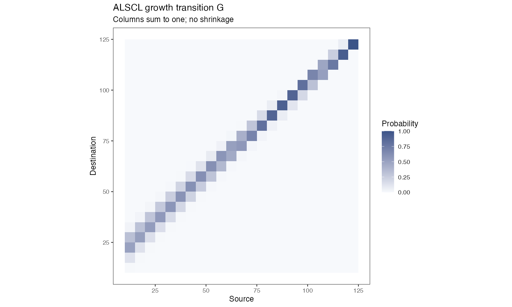

# 02 模型原理与时间尺度 · Model principles

[← 上一章 · Previous](https://github.com/FanZhang-LAB-SHOU/ALSCL/wiki/01-Start) · [目录 · Contents](https://github.com/FanZhang-LAB-SHOU/ALSCL/wiki) · [下一章 · Next →](https://github.com/FanZhang-LAB-SHOU/ALSCL/wiki/03-Data-and-Excel)

**ALSCL 2.4.3 · 简体中文 / English**

本页带你阅读 ACL 和 ALSCL 背后的方程（采用本包的时间单位和随机效应参数化）、检查一次拟合中的两种概率矩阵，并把年率换算到模型时间步。第 1 步需要[理解第一次拟合](https://github.com/FanZhang-LAB-SHOU/ALSCL/blob/main/docs/USER_GUIDE.md#builtin)中的 ALSCL 拟合 `b`；方程采用 [Zhang & Cadigan (2022)](https://doi.org/10.1111/faf.12673) 的模型框架。

On this page you read the equations behind ACL and ALSCL in the package's time units and parameterization, check the two probability matrices of a fit, and convert annual rates to the model time step. Step 1 needs the ALSCL fit `b` from [Understand your first fit](https://github.com/FanZhang-LAB-SHOU/ALSCL/blob/main/docs/USER_GUIDE.md#builtin); the equations follow [Zhang & Cadigan (2022)](https://doi.org/10.1111/faf.12673).

<a id="model-theory-equations"></a>

### 方程 / The equations

<a id="model-theory-dynamics"></a>

#### 种群动态 / Population dynamics

令 $`i=1,\ldots,A`$ 为年龄组索引，$`a_i=a_{rec}+(i-1)\Delta t`$ 为实际年龄，$`t`$ 为时间步。ACL 将补充量计入最小年龄组，并将存活个体推进至下一年龄组。最高年龄组（plus group）包括达到或超过该组起始年龄的个体。

Let $`i=1,\ldots,A`$ index age classes, with actual age $`a_i=a_{rec}+(i-1)\Delta t`$, and let $`t`$ index time steps. ACL advances survivors by age, introduces recruitment in the first class, and retains survivors in the oldest plus group:

```math
N_{1,t}=R_t,\qquad Z_{i,t}=M+F_{i,t},
```

```math
N_{i+1,t+1}=N_{i,t}\exp(-Z_{i,t}),\qquad i=1,\ldots,A-2,
```

```math
N_{A,t+1}=N_{A-1,t}\exp(-Z_{A-1,t})+N_{A,t}\exp(-Z_{A,t}).
```

M 和 F 是每个时间步的瞬时死亡率；季度模型的 `growth_step=0.25`，M 和 F 也须使用季度率。生长参数 $`k`$ 按年定义。

M and F are instantaneous rates per time step. A quarterly model uses `growth_step=0.25` and quarterly mortality rates; the growth parameter $`k`$ is annual.

<a id="model-theory-fishing"></a>

#### 捕捞死亡率 / Fishing mortality

ACL 按年龄估计 F，ALSCL 按体长估计 F。以 $`s`$ 表示相应的年龄或体长组，两个模型均使用可分离的 AR(1) × AR(1) 对数 F 偏差：

ACL estimates F by age, whereas ALSCL estimates F by length. With $`s`$ denoting the age or length class, both use separable AR(1) × AR(1) deviations in log F:

```math
F_{s,t}=\exp(\mu_F+d_{s,t}),\qquad
\mathrm{Cov}(d_{s,t},d_{s-h,t-j})=\sigma_F^2\phi_S^{|h|}\phi_T^{|j|}.
```

这里 $`\sigma_F`$ 是 TMB 可分离 AR(1) 密度经缩放后的边际标准差；相关参数描述组间和时间上的相关性。该式已经包含边际方差，无需再除以 $`1-\phi^2`$ 因子，那是创新方差参数化的写法。自然死亡率 M 作为已知输入。

Here $`\sigma_F`$ is the marginal SD in TMB's scaled, separable AR(1) density, and the correlation parameters describe dependence across groups and time. The expression already contains the marginal variance, so it needs no further division by $`1-\phi^2`$ factors, which belong to innovation-variance parameterizations. Natural mortality M is supplied as known.

<a id="model-theory-recruitment"></a>

#### 补充量 / Recruitment

拟合模型用 AR(1) 对数偏差描述补充量。与边际标准差 $`\sigma_R`$ 一致的平稳形式为：

The fitted models use AR(1) log recruitment deviations. The stationary representation with marginal SD $`\sigma_R`$ is:

```math
R_t=\exp(\mu_R+r_t),\qquad
r_1\sim N(0,\sigma_R^2),\qquad
r_{t+1}=\phi_R r_t+\eta_t,\quad
\eta_t\sim N\!\left(0,\sigma_R^2(1-\phi_R^2)\right).
```

$`\exp(\mu_R)`$ 是补充量的中位数；算术均值还包含 $`r_t`$ 的方差。完整模拟器 `sim_data()` 使用 Beverton-Holt 亲体补充关系及随机偏差，是另一套补充过程。

$`\exp(\mu_R)`$ is the median recruitment; the arithmetic mean also includes the variance of $`r_t`$. The full `sim_data()` operating model uses Beverton-Holt stock-recruitment with random deviations, a recruitment process of its own.

<a id="model-theory-initial"></a>

#### 初始条件 / Initial conditions

第一期最小年龄组由 $`R_1`$ 给定，其余年龄组按初始死亡率与逐组扰动递推：

Initial recruitment defines the youngest class; the other classes follow a recursive decline with an initial mortality rate and class-to-class deviations:

```math
\log N_{1,1}=\log R_1,\qquad
\log N_{i,1}=\log N_{i-1,1}-Z_{init}+u_{i-1},\quad
u_{i-1}\sim N(0,\sigma_{N0}^2).
```

因此 $`\log N_{i,1}=\log R_1-(i-1)Z_{init}+\sum_{j=1}^{i-1}u_j`$：扰动沿年龄组累积，相邻年龄组的总扰动相互相关。ALSCL 再用初始年龄-体长概率分配这些个体。

The initial log abundance of a class therefore contains the cumulative sum of the deviations of the younger classes, so the total deviations of neighbouring classes are correlated. ALSCL allocates these initial numbers across length using age-length probabilities.

<a id="model-theory-pla"></a>

#### 年龄-体长转换（ACL） / Age-to-length conversion (ACL)

给定年龄的长度服从均值由 von Bertalanffy 曲线决定的正态分布：

Length conditional on age follows a normal distribution whose mean is defined by the von Bertalanffy curve:

```math
\mu_i=L_\infty\left[1-e^{-k(a_i-t_0)}\right],\qquad
\sigma_i=CV_L\mu_i,
```

```math
p_{l|i}=\Phi\!\left(\frac{UB_l-\mu_i}{\sigma_i}\right)
       -\Phi\!\left(\frac{LB_l-\mu_i}{\sigma_i}\right),\qquad
N_{l,t}=\sum_i p_{l|i}N_{i,t}.
```

`pla` 表示这个年龄-体长概率矩阵，`plot_pla()` 用热图展示。实现使用支持自动微分的正态 CDF 差，并通过右尾对称计算和归一化处理数值稳定性，以此代替论文 Appendix S1 的固定阶 Taylor 近似；长度边界必须与调查分组一致。

`pla` is the age-length probability matrix shown by `plot_pla()`. The implementation uses differentiable normal CDF differences with symmetric right-tail calculations and normalization, in place of the fixed-order Taylor approximation of Appendix S1; boundaries must match the survey bins.

<a id="model-theory-growth"></a>

#### 生长转移矩阵（ALSCL） / Growth transition matrix (ALSCL)

ALSCL 保留 $`N_{l,i,t}`$ 的体长、年龄、时间三个维度。$`G_{j,l}`$ 表示从源体长组 $`l`$ 转入目的体长组 $`j`$ 的概率。普通年龄组的存活与增长为：

ALSCL retains length, age and time in $`N_{l,i,t}`$. Entry $`G_{j,l}`$ is the probability of moving from source length bin $`l`$ to destination bin $`j`$. Survival and growth for ordinary age classes follow:

```math
N_{j,i+1,t+1}=\sum_l G_{j,l}N_{l,i,t}\exp[-(M+F_{l,t})].
```

最高年龄组同时接收前一年龄组新进入的存活个体和本组继续存活的个体，两者均按生长矩阵在体长组间转移。补充个体按最小年龄的体长分布进入第一年龄组。G 的各列和为 1，不允许缩短，最大体长组吸收右尾概率。

The plus group combines survivors and growth from the preceding and oldest age classes. Recruitment enters the youngest class with its length distribution. Columns of G sum to one, shrinkage is excluded, and the largest bin absorbs the right-tail probability.

增长增量使用下面的平滑下降函数，标准差为 $`CV_G\mu_{\Delta L}`$：

Growth increments use the following smooth decreasing mean, with SD $`CV_G\mu_{\Delta L}`$:

```math
\mu_{\Delta L}(L)=\frac{\Delta t(1-e^{-k})L_\infty}
{1+\exp\!\left(-\log(19)\frac{L-0.5L_\infty}{0.05L_\infty-0.5L_\infty}\right)}.
```

此函数与精确的任意时间步 VB 增量 $`(L_\infty-L)(1-e^{-k\Delta t})`$ 不同。`pla` 是给定年龄的长度分布，G 是给定源长度的一步转移概率，各模型使用各自的矩阵。`FL` 是长度别 F，`FA` 则由原队列的存活率推导。

This curve differs from the exact von Bertalanffy increment $`(L_\infty-L)(1-e^{-k\Delta t})`$. `pla` describes length given age, while G describes a one-step transition given source length; each model uses its own. `FL` is length-specific F; `FA` is derived from original-cohort survival.

<a id="model-theory-derived"></a>

#### 派生量 / Derived quantities

输入的平均个体重量 $`w_{l,t}`$ 和成熟比例 $`m_{l,t}`$ 用于计算体长别生物量、成熟生物量及总量：

Mean individual weight $`w_{l,t}`$ and maturity proportion $`m_{l,t}`$ convert abundance into length-specific biomass, spawning biomass and totals:

```math
b_{l,t}=N_{l,t}w_{l,t},\qquad sb_{l,t}=b_{l,t}m_{l,t},\qquad
B_t=\sum_l b_{l,t},\qquad SSB_t=\sum_l sb_{l,t}.
```

`CN`、`CB` 是模型推算的渔业捕获尾数与重量，区别于输入的调查数量指数。生物量单位由个体重量单位和丰度尺度共同决定。

`CN` and `CB` are derived fishery catch numbers and biomass, distinct from the input survey number index. Biomass units depend on the weight units and the abundance scale.

<a id="model-theory-survey"></a>

#### 调查观测 / Survey observations

令 $`I_{l,t}`$ 为调查数量指数，$`N_{l,t}`$ 为种群尾数。调查观测使用对数正态模型：

Let $`I_{l,t}`$ denote the survey number index and $`N_{l,t}`$ population abundance. Survey observations follow a lognormal model:

```math
\log I_{l,t}=\log q_l+\log N_{l,t}+\epsilon_{l,t},\qquad
\epsilon_{l,t}\sim N(0,\sigma_I^2),
```

```math
q_l=\left[1+\exp\!\left(-\log(19)\frac{L_l-L_{50}}{L_{95}-L_{50}}\right)\right]^{-1}.
```

`sel_L50`、`sel_L95` 固定调查可捕性 q，在两个指定体长处分别取 0.5 和 0.95；它们描述的是调查，渔业选择性是另一个量。`exp(report$Elog_index)` 给出原尺度的中位数，算术均值还需乘以 $`\exp(\sigma_I^2/2)`$。

`sel_L50` and `sel_L95` fix survey catchability at 0.5 and 0.95 at the specified lengths; they describe the survey, and fishery selectivity is a separate quantity. `exp(report$Elog_index)` is the original-scale median; the arithmetic mean also includes $`\exp(\sigma_I^2/2)`$.

<a id="model-theory-estimation"></a>

#### 估计与区间 / Estimation and uncertainty

TMB 用自动微分计算目标函数及导数，对随机效应采用 Laplace 近似；R 的 `nlminb()` 优化固定效应。`sdreport()` 使用局部曲率及 delta 方法给出近似标准误。绘图中的 95% 区间是逐点区间，只有被估计的参数对它有贡献：`YTF_example` 固定了生长和部分过程参数，因此生长区间退化为一条线，其余区间以这些固定值为条件。生长区间描述平均曲线的不确定性，单尾鱼按 $`CV_L`$ 散布在曲线周围。解读任何区间之前，先读 Hessian、边界和梯度检查。

TMB uses automatic differentiation and a Laplace approximation for the random effects; R's `nlminb()` optimizes the fixed effects. `sdreport()` obtains approximate standard errors from local curvature and the delta method. Plotted 95% intervals are pointwise, and only the estimated parameters contribute to them: `YTF_example` fixes growth and some process parameters, so its growth interval collapses to a line and the other intervals are conditional on the fixed values. Growth intervals describe the uncertainty of the mean curve; individual fish scatter around it with $`CV_L`$. Read the Hessian, bound and gradient checks before interpreting any interval.

<a id="model-theory-matrices"></a>

### 2. 检查两种概率矩阵 / Check the two probability matrices

```r
# b 为 ALSCL 拟合对象 / b is an ALSCL fit
G <- b$report$G
range(colSums(G))
stopifnot(all(G >= 0), max(abs(colSums(G) - 1)) < 1e-8)
```

| 矩阵 / Matrix | 含义 / Meaning | 检查 / Check |
|---|---|---|
| `pla` | 给定年龄的长度分布；模拟器中的方向随模型而异 / Length given age; simulator orientation varies | 先检查方向 / Check orientation |
| `G` | 给定源长度列的目的长度行 / Destination row conditional on source column | 非负、列和为 1、不缩短 / Nonnegative, normalized, no shrinkage |

`range(colSums(G))` 应打印两个在舍入误差内等于 1 的值，`stopifnot()` 静默返回。若它停止，说明保存的矩阵不满足这些性质；使用 `b` 之前先读它的数值检查。`plot_pla()` 画的是年龄-体长概率。下面是 tuna 条件 ALSCL 拟合的生长转移矩阵，显示留在原组和进入较大组的概率：

`range(colSums(G))` should print two values equal to 1 within rounding, and `stopifnot()` returns silently. A stop means the stored matrix fails these properties; read the numerical checks of `b` before using it. `plot_pla()` shows the age-length probabilities. The tuna ALSCL growth matrix below shows the probabilities of staying in a bin or advancing to larger bins:



生长可以留在同一组内：鱼长大了，而分组是离散的。最后一组承接右尾概率。改变体长组边界会改变两个矩阵和状态的含义。

Growth can remain within the same bin: the fish grew, and the bins are discrete. The largest bin absorbs the right tail. Changing the bin boundaries changes both matrices and the meaning of the states.

<a id="model-theory-units"></a>

### 2. 把年率换算到模型时间步 / Convert annual rates to the model time step

```r
rec.age <- .25; nage <- 20; growth_step <- .25
ages <- rec.age + (seq_len(nage) - 1) * growth_step
range(ages) # 年 / years
M_quarter <- .8 * growth_step
# 四个季度的累计瞬时率 / Sum four quarterly instantaneous rates
F_quarter <- c(.1, .15, .2, .15)
F_annual <- sum(F_quarter)
```

年龄按设定的步长排列。生长参数 k 按年；M 和 F 是每个时间步的瞬时率，所以年 M = 0.8 对应季度 M = 0.2，一个时间步内的存活概率是 $`\exp[-(M+F)]`$。`range(ages)` 打印 0.25 和 5。`plot_compare_F_ts()` 不会把季度值年化；`method = "apical"` 是每个时间步的组间最大值，`"mean"` 是非加权平均，两个模型的原生 F 维度不同。

Ages use the stated step. Growth k is annual; M and F are instantaneous rates per time step, so an annual M of 0.8 becomes a quarterly M of 0.2, and survival over a step is $`\exp[-(M+F)]`$. `range(ages)` prints 0.25 and 5. `plot_compare_F_ts()` does not annualize quarterly values; `method = "apical"` is the within-step group maximum and `"mean"` the unweighted mean, and the native F dimensions differ between the models.

<a id="model-theory-next"></a>

### 下一步 / What next

| 想做什么 / What you want to do | 阅读 / Read |
|---|---|
| 查看各模型估计哪些参数及其变换 / See which parameters each model estimates and their transformations | [估计参数清单](https://github.com/FanZhang-LAB-SHOU/ALSCL/blob/main/docs/USER_GUIDE.md#fitting) / [Estimation parameter lists](https://github.com/FanZhang-LAB-SHOU/ALSCL/blob/main/docs/USER_GUIDE.md#fitting) |
| 固定或释放参数，选择 F 结构 / Fix or release parameters, choose the F structure | [选择拟合设置](https://github.com/FanZhang-LAB-SHOU/ALSCL/blob/main/docs/USER_GUIDE.md#fitting) / [Choose the fitting settings](https://github.com/FanZhang-LAB-SHOU/ALSCL/blob/main/docs/USER_GUIDE.md#fitting) |
| 拟合季度调查 / Fit a quarterly survey | [年度与季度时间步](https://github.com/FanZhang-LAB-SHOU/ALSCL/blob/main/docs/CASE_STUDIES.md) / [Annual and quarterly time steps](https://github.com/FanZhang-LAB-SHOU/ALSCL/blob/main/docs/CASE_STUDIES.md) |

---

[← 上一章 · Previous](https://github.com/FanZhang-LAB-SHOU/ALSCL/wiki/01-Start) · [目录 · Contents](https://github.com/FanZhang-LAB-SHOU/ALSCL/wiki) · [下一章 · Next →](https://github.com/FanZhang-LAB-SHOU/ALSCL/wiki/03-Data-and-Excel)
