# 08 调查与种群图 · Survey and population plots

<!-- Generated by scripts/build_wiki.py. Edit docs/PLOT_GALLERY.md, then rebuild; do not edit this file. -->

[← 上一章 · Previous](https://github.com/FanZhang-LAB-SHOU/ALSCL/wiki/07-Diagnostics) · [目录 · Contents](https://github.com/FanZhang-LAB-SHOU/ALSCL/wiki) · [下一章 · Next →](https://github.com/FanZhang-LAB-SHOU/ALSCL/wiki/09-Growth-and-Mortality)

**ALSCL 2.4.3.9000 · 简体中文 / English**

先完成第 04 章的 YTF 拟合，得到输入列表 `x` 和拟合结果 `a`、`b`，并设置 `dat <- x$data.CatL`。加载 ggplot2 和 patchwork。第 11 章建立回溯对象 `ra` 和 `rb`。
First complete chapter 04 to create the input bundle `x` and the fits `a` and `b`. Define `dat <- x$data.CatL`, and load ggplot2 and patchwork. Chapter 11 creates the retrospective objects `ra` and `rb`.

```r
library(ggplot2)
library(patchwork)
acl_theme_set(palette="npg", base_theme="theme_bw")
```

## 1. 各体长组的调查指数（对数尺度） / Survey index by length bin (log scale)

```r
# 绘制本图 / Draw this figure
plot_CatL(b, facet_by = "length", exp_transform = FALSE, facet_ncol = 4,
  point_size = 1, line_size = 0.6,
  x_breaks = c(2000, 2010, 2015),
  ylab = "Log survey index")
```

[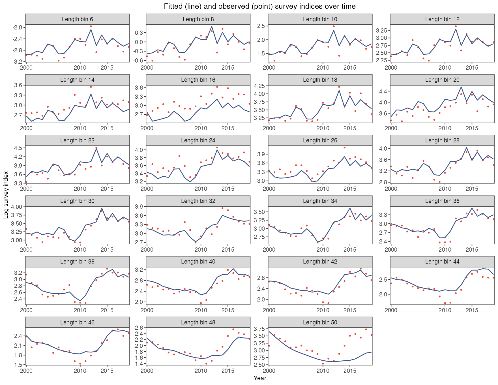](https://github.com/FanZhang-LAB-SHOU/ALSCL/blob/main/docs/figures/ytf/CatL_length_FALSE.png?raw=true&v=e6b8dbe36a50)

每个体长组一个面板，横轴为时间，纵轴为对数调查指数：朱红色点为观测的对数指数，深蓝色曲线为拟合的 `Elog_index`。用它逐组检查拟合；点连续偏在曲线一侧（如本例的 16 组和 50 组）说明该组被系统低估或高估，对数尺度让大小体长组的偏离同样可读。

One panel per length bin, time on the horizontal axis and the log survey index on the vertical axis: vermilion points are the observed log index and the navy curve is the fitted `Elog_index`. Use it to judge the fit bin by bin; a run of points on one side of the curve, as in bins 16 and 50 here, marks a bin the model under- or over-predicts, and the log scale shows this equally well in small and large bins.

[参数及默认值 / Arguments and defaults](https://github.com/FanZhang-LAB-SHOU/ALSCL/blob/main/docs/FUNCTION_REFERENCE.md#plot_CatL)


## 2. 各体长组的调查指数（原尺度） / Survey index by length bin (original scale)

```r
# 绘制本图 / Draw this figure
plot_CatL(b, facet_by = "length", exp_transform = TRUE, facet_ncol = 4,
  point_size = 1, line_size = 0.6,
  x_breaks = c(2000, 2010, 2015),
  ylab = "Survey index")
```

[](https://github.com/FanZhang-LAB-SHOU/ALSCL/blob/main/docs/figures/ytf/CatL_length_TRUE.png?raw=true&v=53481c619f4b)

同样的面板改为原尺度：深蓝色曲线为 `exp(Elog_index)`，即拟合对数正态分布的中位数，朱红色点为观测指数。用它按指数单位读取偏差；误差是乘性的，高值处看似很大的差距与低值处的小差距可能是相同的相对偏差。

The same panels on the original scale: the navy curve is `exp(Elog_index)`, the median of the fitted lognormal distribution, and the vermilion points are the observed index. Use it to read the misfit in index units; the error is multiplicative, so a gap that looks large at high values can be the same relative misfit as a small gap at low values.

[参数及默认值 / Arguments and defaults](https://github.com/FanZhang-LAB-SHOU/ALSCL/blob/main/docs/FUNCTION_REFERENCE.md#plot_CatL)


## 3. 各时间步的调查指数（对数尺度） / Survey index by time step (log scale)

```r
# 绘制本图 / Draw this figure
plot_CatL(b, facet_by = "year", exp_transform = FALSE, facet_ncol = 4,
  line_size1 = 0.6, line_size2 = 0.4,
  x_breaks = c(10, 30, 50),
  ylab = "Log survey index")
```

[](https://github.com/FanZhang-LAB-SHOU/ALSCL/blob/main/docs/figures/ytf/CatL_year_FALSE.png?raw=true&v=0f142752eea3)

按年份分面时，`line_size1` 设置拟合线宽，`line_size2` 设置观测线宽。遇到缺测会断开观测线，孤立的观测以点显示，大小由 `point_size` 控制。 / In year facets, `line_size1` sets the fitted line width and `line_size2` the observed line width. Gaps split the observed line. An isolated observation appears as a point sized by `point_size`.

每个时间步一个面板，横轴为体长，纵轴为对数调查指数：细朱红线为观测对数指数随体长的变化，粗深蓝线为拟合的 `Elog_index`。用它检查同一时间步内的拟合形状；深蓝线没有跟上的突起（如本例后几年最大体长组处）就是拟合未能解释的体长结构。

One panel per time step, length on the horizontal axis and the log survey index on the vertical axis: the thin vermilion curve is the observed log index across lengths and the thick navy curve is the fitted `Elog_index`. Use it to check the shape of the fit within a time step; a bump the navy curve misses, as at the largest bin in the later years here, is length structure the fit leaves unexplained.

[参数及默认值 / Arguments and defaults](https://github.com/FanZhang-LAB-SHOU/ALSCL/blob/main/docs/FUNCTION_REFERENCE.md#plot_CatL)


## 4. 各时间步的调查指数（原尺度） / Survey index by time step (original scale)

```r
# 绘制本图 / Draw this figure
plot_CatL(b, facet_by = "year", exp_transform = TRUE, facet_ncol = 4,
  line_size1 = 0.6, line_size2 = 0.4,
  x_breaks = c(10, 30, 50),
  ylab = "Survey index")
```

[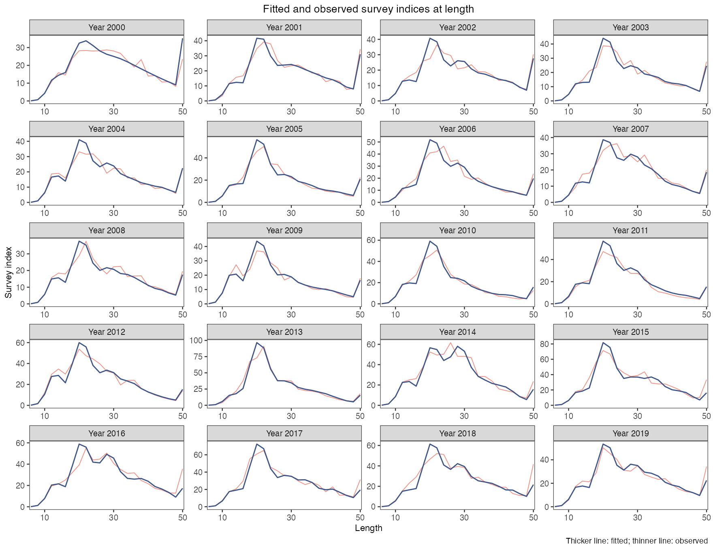](https://github.com/FanZhang-LAB-SHOU/ALSCL/blob/main/docs/figures/ytf/CatL_year_TRUE.png?raw=true&v=172c264ce2ac)

按年份分面时，`line_size1` 设置拟合线宽，`line_size2` 设置观测线宽。遇到缺测会断开观测线，孤立的观测以点显示，大小由 `point_size` 控制。 / In year facets, `line_size1` sets the fitted line width and `line_size2` the observed line width. Gaps split the observed line. An isolated observation appears as a point sized by `point_size`.

曲线表示调查指数在原尺度上的拟合中位数 `exp(Elog_index)`，观测值按体长组显示。比较观测指数和拟合指数峰值所在的体长组，再查看这些体长组的残差。

The curves show fitted survey-index medians on the original scale, `exp(Elog_index)`, with the observed index in each length bin. Compare the lengths at which the observed and fitted indices peak, then examine the residuals for those bins.

[参数及默认值 / Arguments and defaults](https://github.com/FanZhang-LAB-SHOU/ALSCL/blob/main/docs/FUNCTION_REFERENCE.md#plot_CatL)


## 5. 丰度 N / Abundance N

面板或模型组只有一个估计值时显示为点。设置 `se = TRUE` 后，以误差棒显示 95% 区间（默认为对数正态区间，见 `interval` 参数），因为只有一个点的带状区间没有可见宽度。该规则适用于种群与捕捞死亡率图，也分别适用于 `plot_compare_ts()` 中的每个模型。点大小继承 `point_size`；单模型图的点继承 `line_color`，区间继承 `se_color`。所有面板仍不显示网格线。

A panel or model group containing only one estimate is shown as a point. With `se = TRUE`, an error bar shows the 95% interval (lognormal by default; see the `interval` argument) because a one-point ribbon has no visible width. This applies to population and fishing-mortality plots and to each model separately in `plot_compare_ts()`. Point size follows `point_size`; single-model points retain `line_color` and intervals retain `se_color`. Panels remain free of gridlines.

```r
# 绘制本图 / Draw this figure
plot_abundance(b, type = "N", se = TRUE, facet_ncol = 3,
  line_size = 0.6)
```

[](https://github.com/FanZhang-LAB-SHOU/ALSCL/blob/main/docs/figures/ytf/plot_abundance_N.png?raw=true&v=64c2a350a0c9)

总丰度是每个时间步各组估计尾数之和。阴影为近似 95% 区间，默认是对数正态区间 `exp(log(estimate) +/- 1.96 * SE / estimate)`，其中 SE 是估计值的标准误。该区间不会低于零；`interval = "wald"` 绘制早期版本使用的对称区间 `estimate +/- 1.96 * SE`。本例总丰度在 2012 年上升，同年估计补充量达到峰值。

Total abundance sums the estimated numbers across all groups in each time step. Shading shows the approximate 95% interval, which is lognormal by default: `exp(log(estimate) +/- 1.96 * SE / estimate)`, where SE is the standard error of the estimate. This interval cannot fall below zero; `interval = "wald"` draws the symmetric interval `estimate +/- 1.96 * SE` used by earlier versions. The rise in abundance in 2012 coincides with a peak in estimated recruitment.

[参数及默认值 / Arguments and defaults](https://github.com/FanZhang-LAB-SHOU/ALSCL/blob/main/docs/FUNCTION_REFERENCE.md#plot_abundance)


## 6. 丰度 NA / Abundance NA

```r
# 绘制本图 / Draw this figure
plot_abundance(b, type = "NA", se = TRUE, facet_ncol = 3,
  line_size = 0.6)
```

[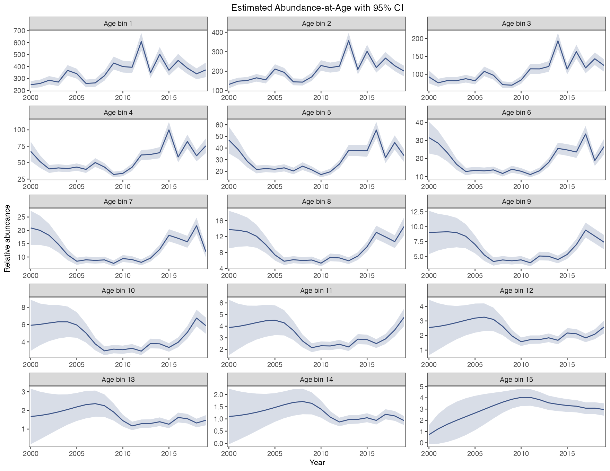](https://github.com/FanZhang-LAB-SHOU/ALSCL/blob/main/docs/figures/ytf/plot_abundance_NA.png?raw=true&v=04e2fa6130fd)

每个面板显示一个年龄组的估计尾数和近似 95% 区间。面板用拟合年龄标注，最大的年龄组是末组（plus group），用加号标出（“Age 15+”）。追踪同一世代时，将某期该年龄组的尾数与下一期相邻较高年龄组的尾数对照。各面板使用各自的纵轴尺度。

Each panel shows numbers at one age with an approximate 95% interval. Panels are labelled with the fitted ages, and the oldest age class, a plus group, is marked with a plus sign ("Age 15+"). To follow a cohort, compare its abundance in one age class with abundance one time step later in the next age class. Read the vertical scales separately.

[参数及默认值 / Arguments and defaults](https://github.com/FanZhang-LAB-SHOU/ALSCL/blob/main/docs/FUNCTION_REFERENCE.md#plot_abundance)


## 7. 丰度 NL / Abundance NL

```r
# 绘制本图 / Draw this figure
plot_abundance(b, type = "NL", se = TRUE, facet_ncol = 3,
  line_size = 0.6)
```

[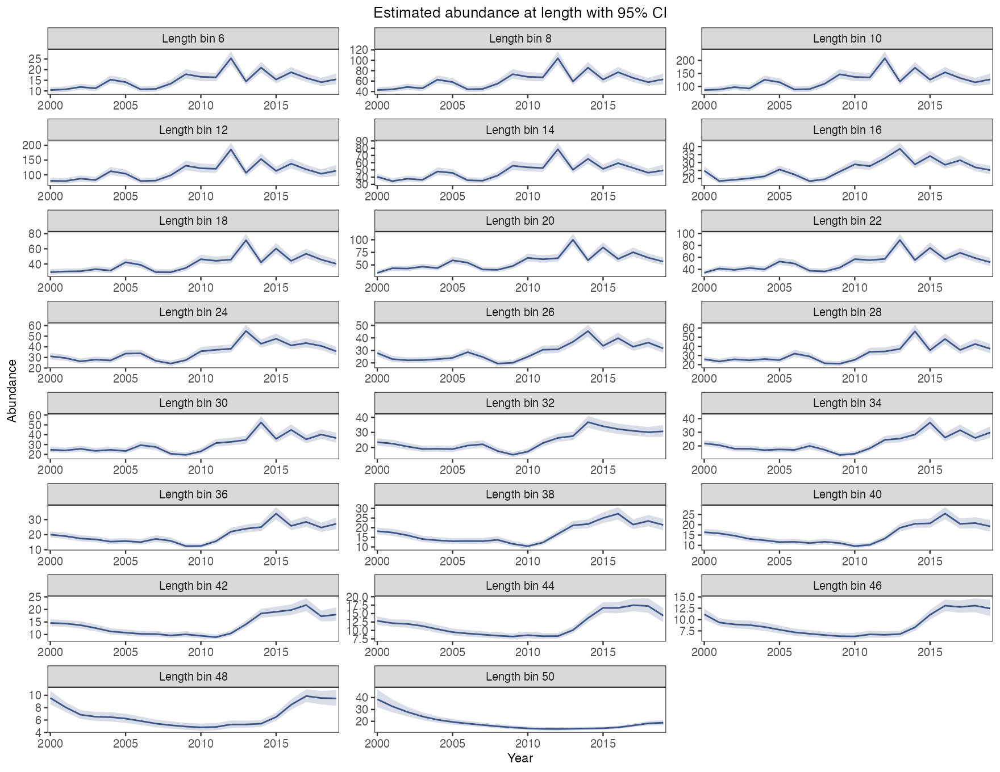](https://github.com/FanZhang-LAB-SHOU/ALSCL/blob/main/docs/figures/ytf/plot_abundance_NL.png?raw=true&v=f5f4dbc0aa72)

每个面板显示一个体长组的估计尾数和近似 95% 区间。本例中，小体长组在 2012 年前后先出现峰值，大体长组的峰值出现得较晚。一个体长组可包含多个年龄组的个体。

Each panel shows estimated numbers in one length bin with an approximate 95% interval. In this example the peak in smaller bins around 2012 precedes the peaks in larger bins. Several age classes can contribute to a length bin.

[参数及默认值 / Arguments and defaults](https://github.com/FanZhang-LAB-SHOU/ALSCL/blob/main/docs/FUNCTION_REFERENCE.md#plot_abundance)

### 模型、输出与区间支持范围

`se = TRUE` 绘制逐点近似 95% 区间，默认为对数正态区间（见 `interval` 参数）；下表列出每个模型哪些量带标准误。数量或标准误不可用时报错，只需要估计线时用 `se = FALSE`；解读区间前先通过数值检查。

| 函数 | 类型 | ACL | ALSCL |
|---|---|---|---|
| `plot_biomass()` | `B` | 估计 + 区间 | 估计 + 区间 |
| `plot_biomass()` | `BL` | 仅估计 | 估计 + 区间 |
| `plot_biomass()` | `BA` | 不可用 | 估计 + 区间 |
| `plot_SSB()` | `SSB` | 估计 + 区间 | 估计 + 区间 |
| `plot_SSB()` | `SBL` | 仅估计 | 估计 + 区间 |
| `plot_SSB()` | `SBA` | 不可用 | 估计 + 区间 |
| `plot_catch()` | `CN` | 估计 + 区间 | 估计 + 区间 |
| `plot_catch()` | `CNA` | 仅估计 | 估计 + 区间 |
| `plot_catch()` | `CNL` | 不可用 | 估计 + 区间 |

```r
plot_biomass(b, type = "BL", se = TRUE)
plot_SSB(b, type = "SBL", se = TRUE)
plot_catch(a, type = "CNA", se = FALSE)
```

### Model, output and interval support

`se = TRUE` draws pointwise approximate 95% intervals, lognormal by default (see the `interval` argument); the table lists which quantities each model reports with standard errors. An unavailable quantity or standard error is an error, and `se = FALSE` draws the estimate alone; pass the numerical checks before reading an interval.

| Function | Type | ACL | ALSCL |
|---|---|---|---|
| `plot_biomass()` | `B` | Estimate + interval | Estimate + interval |
| `plot_biomass()` | `BL` | Estimate only | Estimate + interval |
| `plot_biomass()` | `BA` | Unavailable | Estimate + interval |
| `plot_SSB()` | `SSB` | Estimate + interval | Estimate + interval |
| `plot_SSB()` | `SBL` | Estimate only | Estimate + interval |
| `plot_SSB()` | `SBA` | Unavailable | Estimate + interval |
| `plot_catch()` | `CN` | Estimate + interval | Estimate + interval |
| `plot_catch()` | `CNA` | Estimate only | Estimate + interval |
| `plot_catch()` | `CNL` | Unavailable | Estimate + interval |

```r
plot_biomass(b, type = "BL", se = TRUE)
plot_SSB(b, type = "SBL", se = TRUE)
plot_catch(a, type = "CNA", se = FALSE)
```


## 8. 生物量 B / Biomass B

```r
# 绘制本图 / Draw this figure
plot_biomass(b, type = "B", se = TRUE, facet_ncol = 3,
  line_size = 0.6)
```

[](https://github.com/FanZhang-LAB-SHOU/ALSCL/blob/main/docs/figures/ytf/plot_biomass_B.png?raw=true&v=7a81d55f8558)

总生物量随时间步变化，带近似 95% 区间。与总丰度对照，可看出平均个体体重如何影响生物量估计。补充个体从进入模型的第一个时间步就贡献生物量，其贡献可随生长增加。生物量不一定比丰度更平滑。

Total biomass by time step with an approximate 95% interval. Compare it with total abundance to see how mean individual weight affects the estimated biomass. Recruits contribute biomass from their first modelled time step; their contribution can increase as they grow. Biomass need not be smoother than abundance.

[参数及默认值 / Arguments and defaults](https://github.com/FanZhang-LAB-SHOU/ALSCL/blob/main/docs/FUNCTION_REFERENCE.md#plot_biomass)


## 9. 生物量 BA / Biomass BA

```r
# 绘制本图 / Draw this figure
plot_biomass(b, type = "BA", se = TRUE, facet_ncol = 3,
  line_size = 0.6)
```

[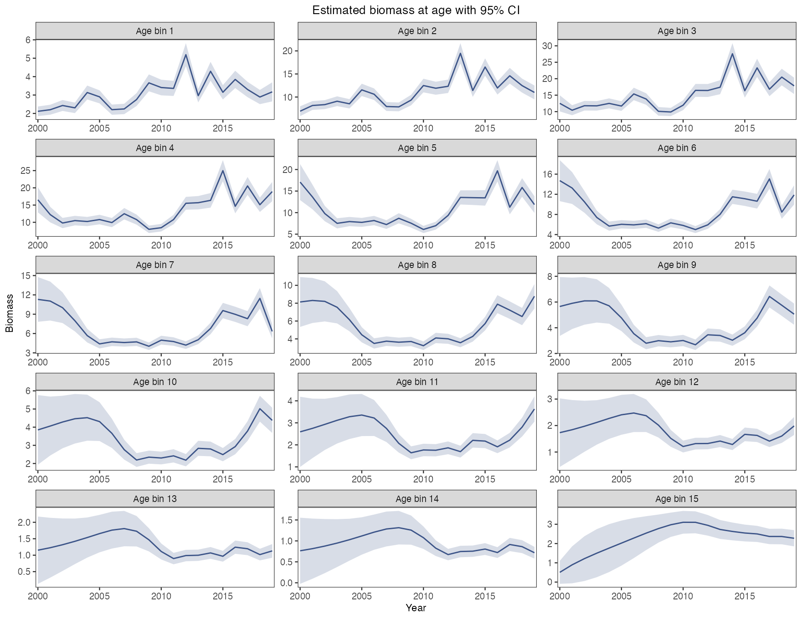](https://github.com/FanZhang-LAB-SHOU/ALSCL/blob/main/docs/figures/ytf/plot_biomass_BA.png?raw=true&v=93dab9e34b49)

年龄别生物量，每个年龄组一个面板，纵轴各自取值，带 95% 区间。用它看生物量集中在哪些年龄；注意各面板的纵轴刻度，自由刻度会让数量很小的老龄组看起来和大的年轻组一样多变。

Biomass at age, one panel per age class with free vertical scales and the 95% band. Use it to see which ages hold the biomass; read the axis of each panel, because the free scales make a small old class look as variable as a large young one.

[参数及默认值 / Arguments and defaults](https://github.com/FanZhang-LAB-SHOU/ALSCL/blob/main/docs/FUNCTION_REFERENCE.md#plot_biomass)


## 10. 生物量 BL / Biomass BL

```r
# 绘制本图 / Draw this figure
plot_biomass(b, type = "BL", se = TRUE, facet_ncol = 3,
  line_size = 0.6)
```

[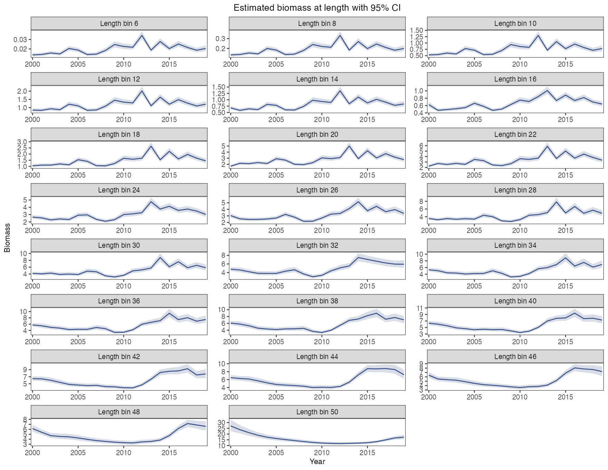](https://github.com/FanZhang-LAB-SHOU/ALSCL/blob/main/docs/figures/ytf/plot_biomass_BL.png?raw=true&v=4ea7eb353987)

每个面板显示一个体长组的生物量和近似 95% 区间。按各面板纵轴的数值比较体长组对总生物量的贡献。本例中，多个较大体长组的生物量在 2013 年后上升。

Each panel shows biomass in one length bin and its approximate 95% interval. Compare axis values across panels to identify the bins contributing most biomass. Several of the larger bins show an increase after 2013.

[参数及默认值 / Arguments and defaults](https://github.com/FanZhang-LAB-SHOU/ALSCL/blob/main/docs/FUNCTION_REFERENCE.md#plot_biomass)


## 11. 产卵生物量 SSB / Spawning biomass SSB

```r
# 绘制本图 / Draw this figure
plot_SSB(b, type = "SSB", se = TRUE, facet_ncol = 3,
  line_size = 0.6)
```

[](https://github.com/FanZhang-LAB-SHOU/ALSCL/blob/main/docs/figures/ytf/plot_SSB_SSB.png?raw=true&v=099551937add)

产卵群体生物量（SSB）由各组尾数乘以平均体重和成熟比例后求和得到，阴影为近似 95% 区间。本次拟合的 SSB 在 2010 年达到低点，随后回升。用 SSB 判断资源状态时，还需说明所采用的参考点。SSB 的水平取决于拟合时给定的调查可捕性。要与使用年龄别成熟比例的评估比较趋势，请用 `ssb_at_age()` 按年龄别成熟比例计算产卵生物量。

Spawning stock biomass (SSB) sums numbers multiplied by mean weight and the proportion mature across groups. The shading gives an approximate 95% interval. In this fit, SSB reached a low in 2010 and subsequently increased. Assessing stock status also requires a stated reference point. The level of SSB depends on the survey catchability supplied to the fit. To compare the trend with an assessment that uses maturity at age, compute spawning biomass from a maturity ogive by age with `ssb_at_age()`.

`plot_SSB(b, maturity_at_age = ogive)` 把按年龄别成熟比例算出的 SSB（`ssb_at_age()`）加画为虚线，与模型按体长别成熟比例算出的 SSB 并列；`ogive` 给出每个年龄组的成熟比例（[评估工作流](https://github.com/FanZhang-LAB-SHOU/ALSCL/blob/main/docs/ASSESSMENT_WORKFLOWS.md#assessment-workflows-outputs)）。不给这个参数时图形不变。

`plot_SSB(b, maturity_at_age = ogive)` adds the SSB calculated from a maturity ogive by age (`ssb_at_age()`) as a dashed line next to the SSB of the model, which uses maturity at length; `ogive` holds one proportion mature per age class ([Assessment workflows](https://github.com/FanZhang-LAB-SHOU/ALSCL/blob/main/docs/ASSESSMENT_WORKFLOWS.md#assessment-workflows-outputs)). Without this argument the figure is unchanged.

[参数及默认值 / Arguments and defaults](https://github.com/FanZhang-LAB-SHOU/ALSCL/blob/main/docs/FUNCTION_REFERENCE.md#plot_SSB)


### 显示一个已保存的估计值 / Displaying a single saved estimate

此列表仅用于显示 `b` 最后一期的产卵群体生物量及其标准误，不表示只用一个观测拟合了模型，也不能作为模拟或预测的输入。点与近似 95% 区间均保持可见，不改变原估计值。

This display-only list contains the final spawning-biomass estimate from `b` and its standard error. It is not a model fitted to one observation and is not an input for simulation or forecasting. The point and approximate 95% interval remain visible without changing the estimate.

```r
# Display one saved estimate without refitting.
ssb_rows <- which(rownames(b$est_std) == "SSB")
one_period <- list(
  model_type = b$model_type,
  year = tail(b$year, 1L),
  report = list(SSB = tail(b$report$SSB, 1L)),
  est_std = b$est_std[tail(ssb_rows, 1L), , drop = FALSE]
)
plot_SSB(one_period, se = TRUE, x_breaks = one_period$year) +
  ggplot2::coord_cartesian(xlim = one_period$year + c(-0.5, 0.5))
```

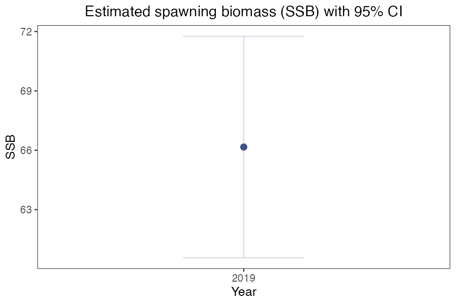


## 12. 产卵生物量 SBA / Spawning biomass SBA

```r
# 绘制本图 / Draw this figure
plot_SSB(b, type = "SBA", se = TRUE, facet_ncol = 3,
  line_size = 0.6)
```

[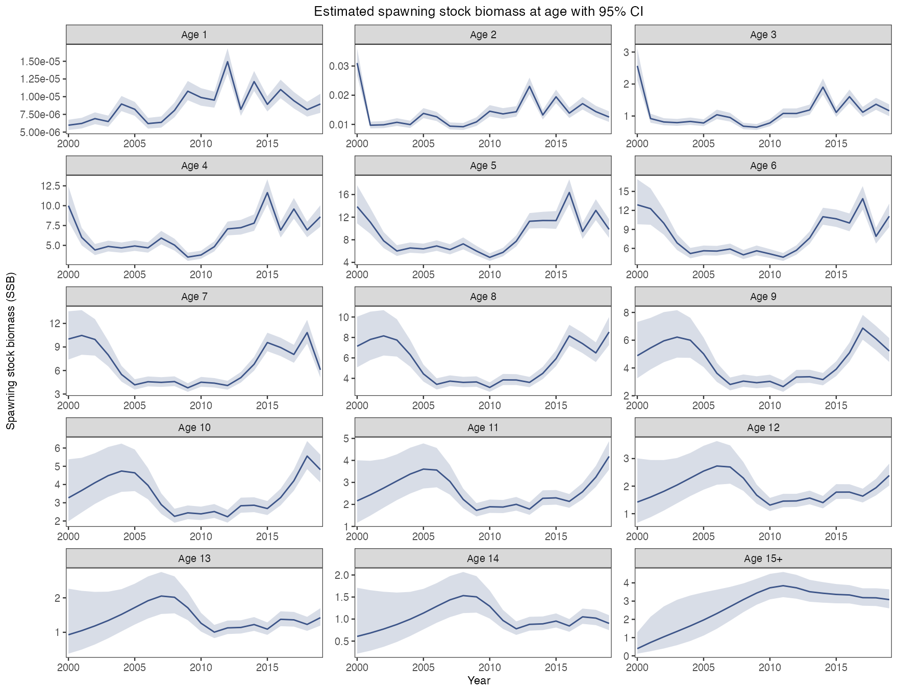](https://github.com/FanZhang-LAB-SHOU/ALSCL/blob/main/docs/figures/ytf/plot_SSB_SBA.png?raw=true&v=3eeb8e281278)

年龄别产卵生物量，每个年龄组一个面板，带 95% 区间。用它看产卵来自哪些年龄；最小的几个年龄组接近零，因为成熟比例表几乎不给它们成熟个体，比较面板时看纵轴数值而不是曲线形状。

Spawning biomass at age, one panel per age class with the 95% band. Use it to see which ages spawn; the youngest classes sit near zero because the maturity table gives them almost no mature fish, so compare panels by their axis values rather than by the shape of the curves.

[参数及默认值 / Arguments and defaults](https://github.com/FanZhang-LAB-SHOU/ALSCL/blob/main/docs/FUNCTION_REFERENCE.md#plot_SSB)


## 13. 产卵生物量 SBL / Spawning biomass SBL

```r
# 绘制本图 / Draw this figure
plot_SSB(b, type = "SBL", se = TRUE, facet_ncol = 3,
  line_size = 0.6)
```

[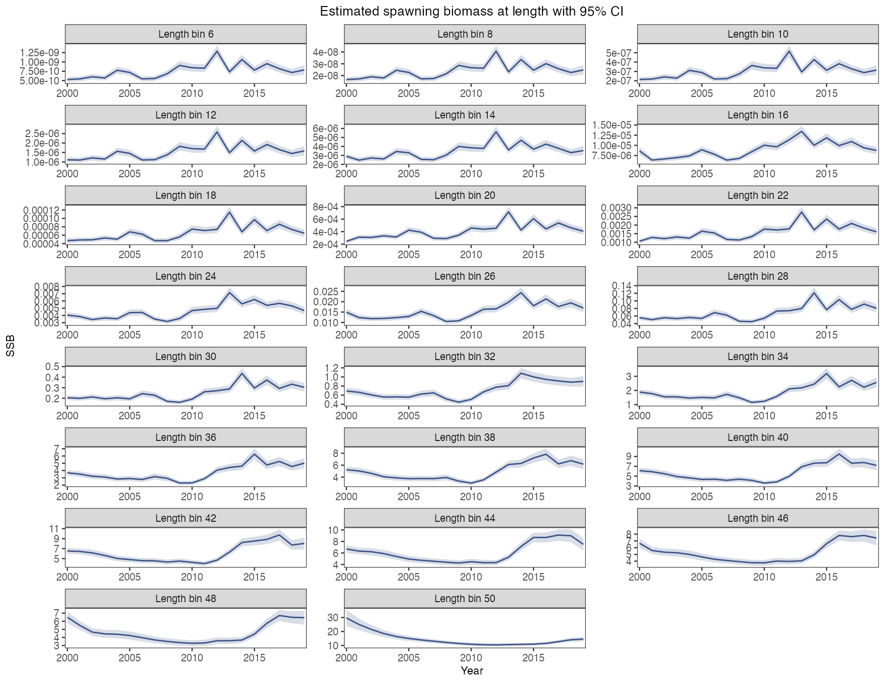](https://github.com/FanZhang-LAB-SHOU/ALSCL/blob/main/docs/figures/ytf/plot_SSB_SBL.png?raw=true&v=b706a47c1e3c)

体长别产卵生物量，每个体长组一个面板，带 95% 区间。用它看产卵来自哪些体长；小体长组同样接近零，30 以上的成熟组走势与总产卵生物量一致。

Spawning biomass at length, one panel per length bin with the 95% band. Use it to see which lengths spawn; the small bins sit near zero for the same reason, and the mature bins above 30 follow the total spawning biomass.

[参数及默认值 / Arguments and defaults](https://github.com/FanZhang-LAB-SHOU/ALSCL/blob/main/docs/FUNCTION_REFERENCE.md#plot_SSB)


## 14. 捕获尾数 CN / Catch numbers CN

```r
# 绘制本图 / Draw this figure
plot_catch(b, type = "CN", se = TRUE, facet_ncol = 3,
  line_size = 0.6)
```

[](https://github.com/FanZhang-LAB-SHOU/ALSCL/blob/main/docs/figures/ytf/plot_catch_CN.png?raw=true&v=b14892161d94)

模型推导的捕捞尾数（`CN`）随时间步变化，带近似 95% 区间。它根据丰度和捕捞死亡率计算；YTF 教学数据不含实测渔获量。与独立渔获资料比较前，须统一数量定义、单位、丰度尺度、时期和区域。登陆量可能不包括弃捕，还需核对其涵盖的捕捞移除量（[FAO 定义](https://www.fao.org/4/x8923e/X8923E03.htm)）。区间较宽表示给定拟合假设下不确定性较大；仅凭宽度不能确定其原因。只拟合调查指数时渔获量的水平无法确定，它取决于给定的自然死亡率和调查可捕性。`relative_catch()` 返回渔获量除以其在各时间步上的均值，用于与上报渔获量比较趋势。

Model-derived catch in numbers (`CN`) by time step with an approximate 95% interval. It is computed from abundance and fishing mortality; the YTF teaching data include no observed fishery catch. Compare it with independent catch data only after matching the quantity, units, abundance scale, period and area. Landings may omit discarded fish, so their coverage of fishing removals also needs checking ([FAO definitions](https://www.fao.org/4/x8923e/X8923E03.htm)). A wide interval indicates substantial uncertainty under the fitted assumptions; its width alone does not identify the cause. A fit to a survey index alone does not determine the level of catch, which depends on the supplied natural mortality rate and survey catchability. `relative_catch()` returns catch divided by its mean over the time steps, for a comparison of trends with reported catch.

[参数及默认值 / Arguments and defaults](https://github.com/FanZhang-LAB-SHOU/ALSCL/blob/main/docs/FUNCTION_REFERENCE.md#plot_catch)


## 15. 捕获尾数 CNA / Catch numbers CNA

```r
# 绘制本图 / Draw this figure
plot_catch(b, type = "CNA", se = TRUE, facet_ncol = 3,
  line_size = 0.6)
```

[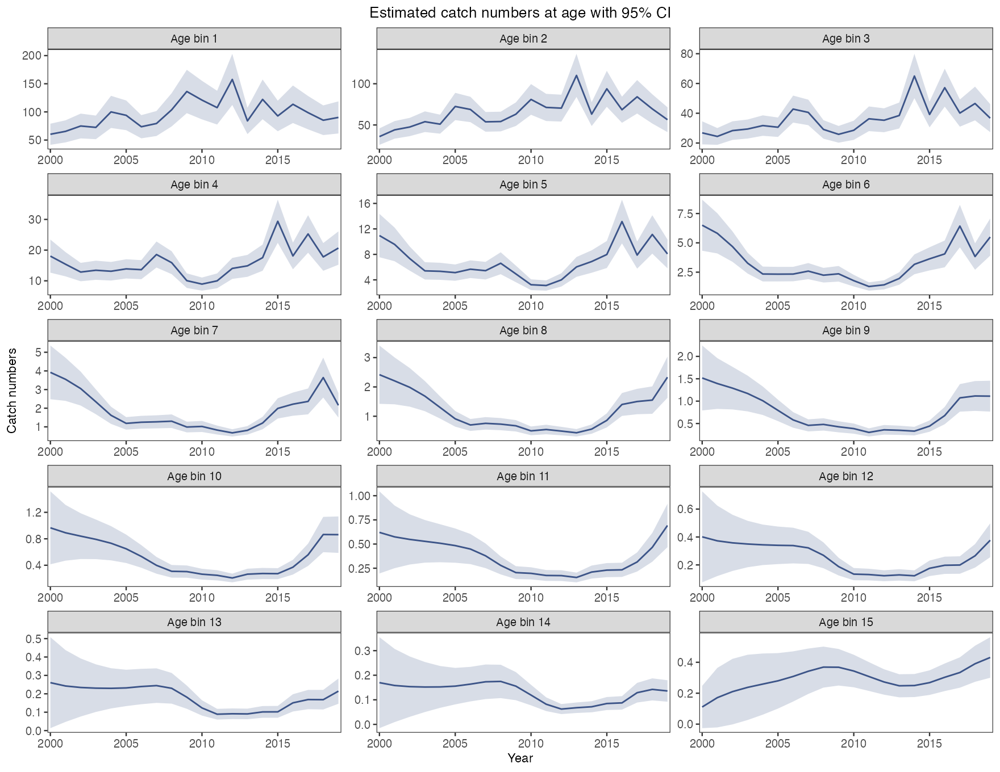](https://github.com/FanZhang-LAB-SHOU/ALSCL/blob/main/docs/figures/ytf/plot_catch_CNA.png?raw=true&v=2644a3bb7c52)

每个面板显示一个年龄组的估计渔获尾数和近似 95% 区间。本例中，较年轻的年龄组渔获尾数较高。比较时请看各面板纵轴的数值。

Each panel shows estimated catch in numbers for one age class, with an approximate 95% interval. In this example, catches are largest in the younger age classes. Read the values against the vertical scale of each panel.

[参数及默认值 / Arguments and defaults](https://github.com/FanZhang-LAB-SHOU/ALSCL/blob/main/docs/FUNCTION_REFERENCE.md#plot_catch)


## 16. 捕获尾数 CNL / Catch numbers CNL

```r
# 绘制本图 / Draw this figure
plot_catch(b, type = "CNL", se = TRUE, facet_ncol = 3,
  line_size = 0.6)
```

[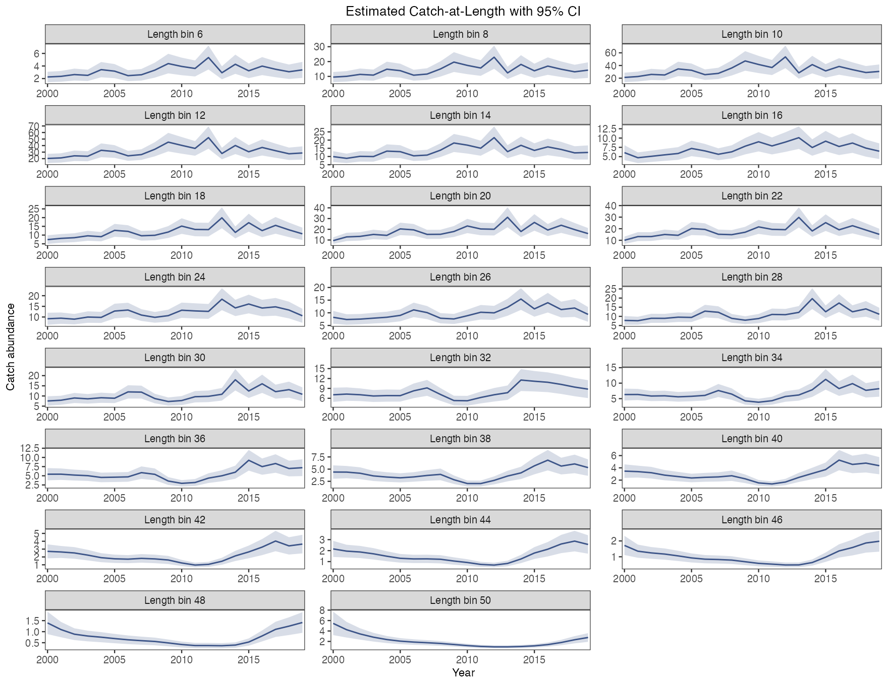](https://github.com/FanZhang-LAB-SHOU/ALSCL/blob/main/docs/figures/ytf/plot_catch_CNL.png?raw=true&v=9ddcd52719a1)

每个面板显示一个体长组的预期渔获尾数和近似 95% 区间。设组内期初尾数为 N，F 和 M 分别为每个时间步的瞬时捕捞死亡率和自然死亡率。按 Baranov 渔获方程，`C = N × (F/Z) × (1 − exp(−Z))`，其中 `Z = F + M`。ALSCL 将同一体长组各年龄的渔获尾数相加。[Baranov 渔获方程，式（15）](https://repository.library.noaa.gov/view/noaa/4847/noaa_4847_DS1.pdf#page=11)。

Each panel shows the expected catch in numbers for one length bin, with an approximate 95% interval. For a group with starting abundance N and instantaneous mortality rates F and M per time step, the Baranov catch equation gives `C = N × (F/Z) × (1 − exp(−Z))`, where `Z = F + M`. ALSCL sums these catches across ages within each length bin. [Baranov catch equation, eq. 15](https://repository.library.noaa.gov/view/noaa/4847/noaa_4847_DS1.pdf#page=11).

[参数及默认值 / Arguments and defaults](https://github.com/FanZhang-LAB-SHOU/ALSCL/blob/main/docs/FUNCTION_REFERENCE.md#plot_catch)


## 17. 相对渔获量 / Relative catch

```r
# 绘制本图 / Draw this figure
plot_relative_catch(b,
  observed = data.frame(year = b$year, catch = x$truth$CB),
  type = "weight", observed_name = "Simulated catch")
```

[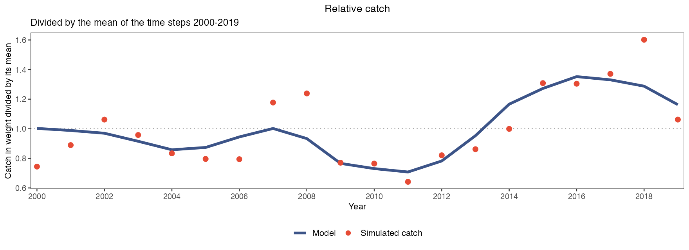](https://github.com/FanZhang-LAB-SHOU/ALSCL/blob/main/docs/figures/ytf/relative_catch.png?raw=true&v=05ee2a8256dc)

线是模型渔获重量除以它在各时间步上的均值，数值来自 `relative_catch()`。点是生成 `YTF_example` 的模拟中的渔获重量，除以它在同样时间步上的均值。用自己的数据时，把上报渔获量作为 `observed` 传入，它是含 `year` 和 `catch` 两列的数据框，单位不限。只拟合调查指数时，渔获量的绝对水平无法确定，它取决于假定的自然死亡率和调查可捕性，所以本图只比较趋势：纵轴标签写明数值是相对值，点线标出均值。上报序列只覆盖部分时间步时，均值取两条序列共有的时间步，`years` 可进一步限定。最后一个时间步的渔获量是预测值，因为该时间步的 F 没有观测提供信息。

The line is the model catch in weight divided by its mean over the time steps, from `relative_catch()`. The points are the catch in weight of the simulation that generated `YTF_example`, divided by its mean over the same time steps. With your own data, pass the reported catch as `observed`, a data frame with the columns `year` and `catch` in any unit. A fit to a survey index alone has no information on the absolute level of catch, which depends on the assumed natural mortality rate and survey catchability, so the figure compares trends only: the y-axis label states that the values are relative, and the dotted line marks the mean. When the reported series covers part of the time steps, the mean is taken over the time steps that both series have, and `years` restricts it further. The catch in the last time step is a prediction, because no observation informs F in that time step.

[参数及默认值 / Arguments and defaults](https://github.com/FanZhang-LAB-SHOU/ALSCL/blob/main/docs/FUNCTION_REFERENCE.md#plot_relative_catch)


## 18. 补充量 / Recruitment

```r
# 绘制本图 / Draw this figure
plot_recruitment(b, se = TRUE)
```

[](https://github.com/FanZhang-LAB-SHOU/ALSCL/blob/main/docs/figures/ytf/recruitment.png?raw=true&v=47a314e4a713)

补充量表示每个时间步进入最小年龄组的估计尾数，阴影为近似 95% 区间。本例估计补充量在 2012 年达到峰值。`rec.age` 指定个体进入模型的年龄。

Recruitment is the estimated number entering the youngest age class per time step. The shaded band gives the approximate 95% interval. Estimated recruitment peaks in 2012 in this example. The age at entry is set by `rec.age`.

[参数及默认值 / Arguments and defaults](https://github.com/FanZhang-LAB-SHOU/ALSCL/blob/main/docs/FUNCTION_REFERENCE.md#plot_recruitment)


## 19. 亲体与补充关系 / Spawning biomass and recruitment

`age_at_recruitment` 的单位是年，默认 NULL 取最小拟合年龄（没有年龄元数据的结果用 1 年）。`plot_SSB_Rec()` 把给定的值除以拟合的 `growth_step`，要求在规则时间网格上对应整数个时间步。季度数据中，0.25 表示滞后一季度，1 表示四季度。允许零滞后；拒绝负值、非有限值及非整数步滞后。没有 `growth_step` 的结果使用规则年份间隔；两类时间元数据都没有时沿用年度步长。

`age_at_recruitment` is in years, and the default NULL uses the youngest fitted age (1 year for a result saved without age metadata). `plot_SSB_Rec()` divides a supplied value by the fit's `growth_step` and requires an integer lag on a regular time grid. With quarterly data, 0.25 means one step and 1 means four steps. Zero lag is allowed; negative, nonfinite and fractional-step lags are rejected. Results without `growth_step` use their regular time spacing, or an annual step when `year` is missing as well.

```r
# 绘制本图 / Draw this figure
plot_SSB_Rec(b, age_at_recruitment = 1)
```

[](https://github.com/FanZhang-LAB-SHOU/ALSCL/blob/main/docs/figures/ytf/SSB_Rec.png?raw=true&v=53681501f48b)

每个点把某期的产卵群体生物量与 `age_at_recruitment` 年后的补充量配对，可用来查看两组估计值的关系。默认 `age_at_recruitment = NULL` 使用最小拟合年龄：本例的年度拟合为 1 年，`rec.age = 0.25` 的季度拟合为一个季度。评估模型用 AR(1) 过程描述补充量的对数偏差。绘图函数只绘制配对值。

Each point pairs spawning stock biomass with recruitment `age_at_recruitment` years later. The default, `age_at_recruitment = NULL`, uses the youngest fitted age: 1 year for this annual fit and one quarter for a quarterly fit with `rec.age = 0.25`. The scatter shows the association in the fitted series. The assessment models log recruitment deviations as an AR(1) process, and the plotting function draws the pairs without fitting a stock–recruitment curve.

[参数及默认值 / Arguments and defaults](https://github.com/FanZhang-LAB-SHOU/ALSCL/blob/main/docs/FUNCTION_REFERENCE.md#plot_SSB_Rec)


---

[← 上一章 · Previous](https://github.com/FanZhang-LAB-SHOU/ALSCL/wiki/07-Diagnostics) · [目录 · Contents](https://github.com/FanZhang-LAB-SHOU/ALSCL/wiki) · [下一章 · Next →](https://github.com/FanZhang-LAB-SHOU/ALSCL/wiki/09-Growth-and-Mortality)
