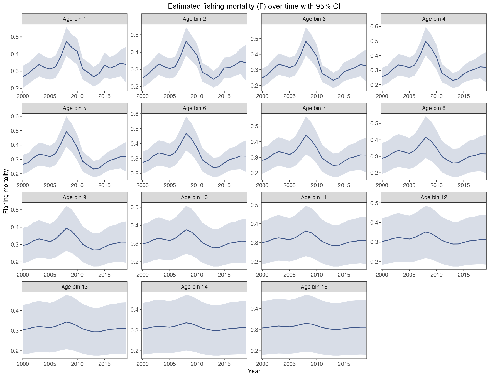
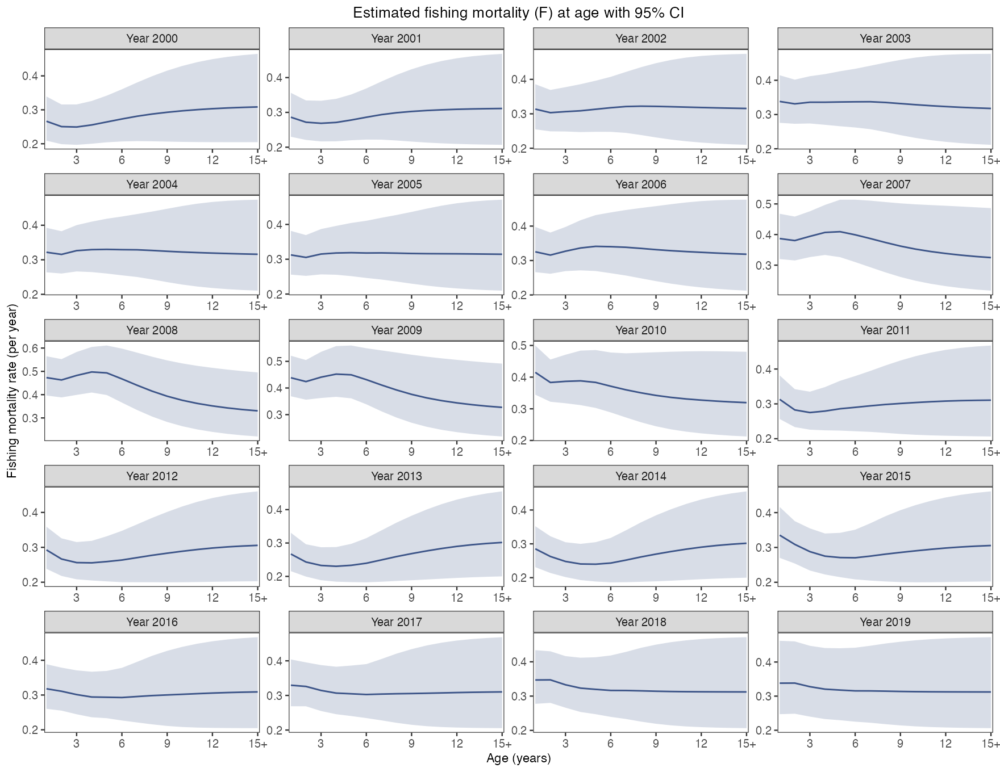
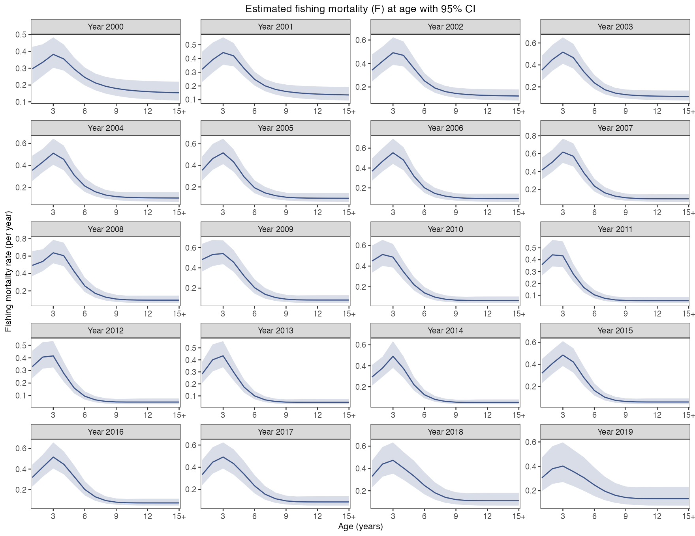
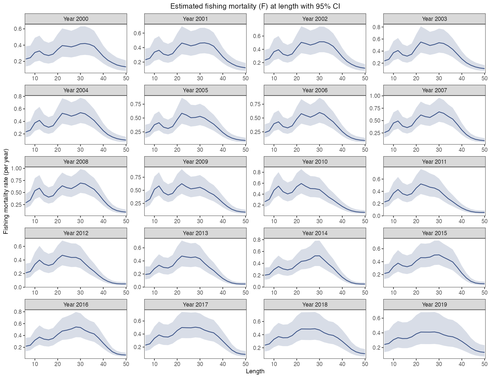
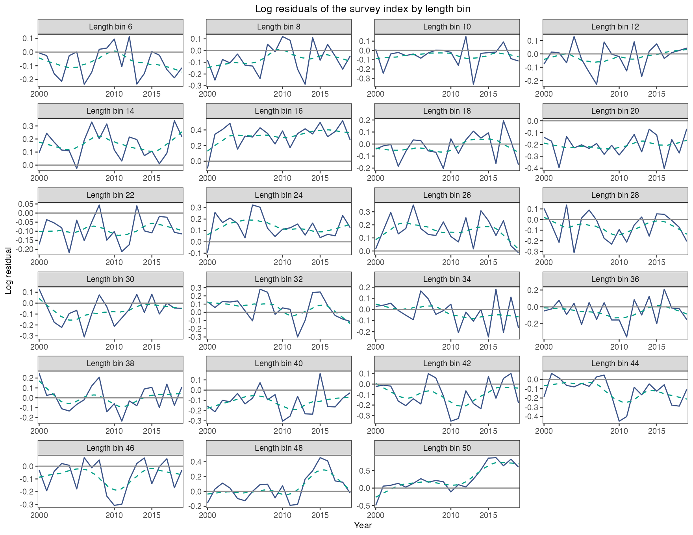
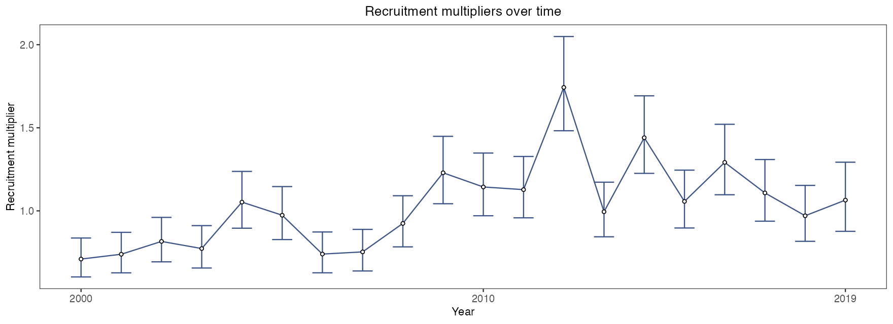
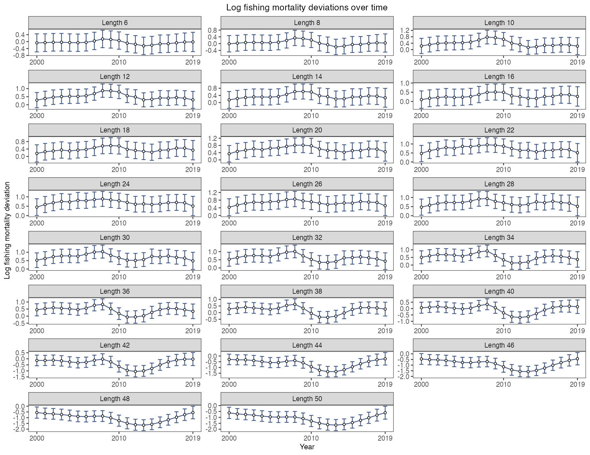
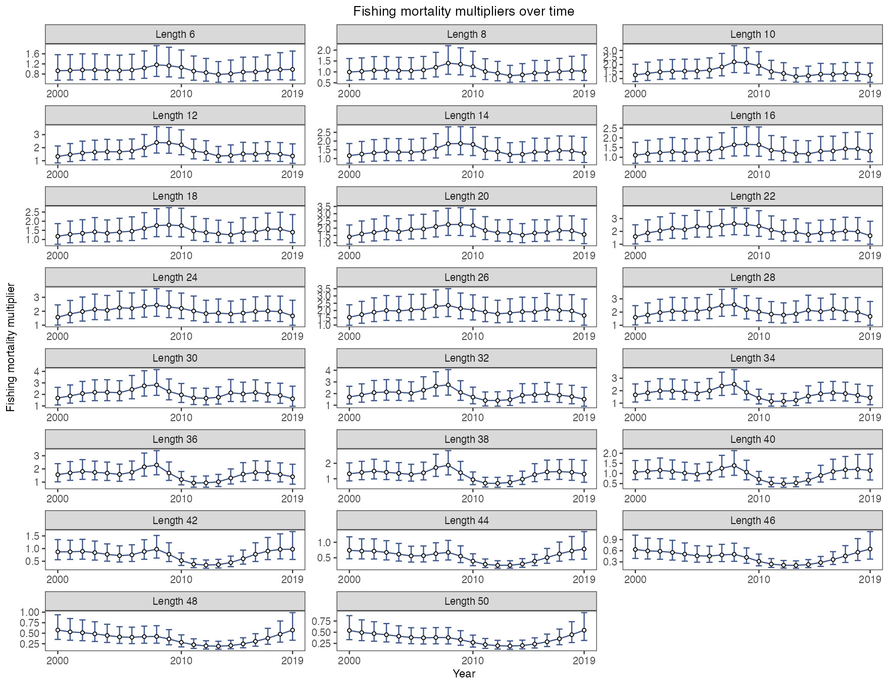

# 09 生长、死亡与残差图 · Growth, mortality and residuals

[← 上一章 · Previous](https://github.com/FanZhang-LAB-SHOU/ALSCL/wiki/08-Population-Plots) · [目录 · Contents](https://github.com/FanZhang-LAB-SHOU/ALSCL/wiki) · [下一章 · Next →](https://github.com/FanZhang-LAB-SHOU/ALSCL/wiki/10-Model-Comparisons)

**ALSCL 2.3.0 · 简体中文 / English**

先完成第 04 章的 YTF 拟合，得到 `a`、`b`、`x`、`inputs`，并设置 `dat <- x$data.CatL`。加载 ggplot2 和 patchwork。第 11 章建立回溯对象 `ra/rb`。
First complete chapter 04, define `dat <- x$data.CatL`, and load ggplot2 and patchwork. Chapter 11 defines retrospective objects.

```r
library(ggplot2)
library(patchwork)
acl_theme_set(palette="npg", base_theme="theme_bw")
```

## 19. 生长曲线与区间 / Growth curve and interval

```r
# 绘制本图 / Draw this figure
plot_VB(b, se = TRUE)
```

[](https://github.com/FanZhang-LAB-SHOU/ALSCL/blob/main/docs/figures/ytf/VB.png?raw=true&v=6dcfc65cbadd)

生长参数在本例中固定，区间退化为曲线；释放参数后区间才反映估计不确定性，不是个体长度分布。省略 age_range 时使用拟合年龄范围，并避开 t0 之前的年龄；显示区间时仍保留 Linf/k 标注。

Growth is fixed in this example, so its interval collapses. With estimated growth, intervals reflect parameter uncertainty, not individual length variation. Omitting age_range uses the fitted age range and avoids ages before t0. Linf/k annotations remain visible with intervals.

[参数及默认值 / Arguments and defaults](https://github.com/FanZhang-LAB-SHOU/ALSCL/blob/main/docs/FUNCTION_REFERENCE.md#plot_VB)


## 20. 年龄—体长概率矩阵 / Age–length probability matrix

```r
# 绘制本图 / Draw this figure
plot_pla(b) + scale_x_discrete(labels = as.character(1:15))
```

[](https://github.com/FanZhang-LAB-SHOU/ALSCL/blob/main/docs/figures/ytf/pla.png?raw=true&v=ef5002aab224)

色值是长度组给定年龄的概率；不是增长转移矩阵 G。年龄标签为组序号。

Cells are length-bin probabilities conditional on age, not the growth transition matrix G. Age labels are class indices.

[参数及默认值 / Arguments and defaults](https://github.com/FanZhang-LAB-SHOU/ALSCL/blob/main/docs/FUNCTION_REFERENCE.md#plot_pla)


## 21. ACL 捕捞死亡率 year / ACL fishing mortality year

```r
# 绘制本图 / Draw this figure
plot_fishing_mortality(a, type = "year",
  se = TRUE, facet_ncol = 4, line_size = 0.6)
```

[](https://github.com/FanZhang-LAB-SHOU/ALSCL/blob/main/docs/figures/ytf/F_ACL_year.png?raw=true&v=6459bbc874c9)

年度示例的 F 为每年瞬时率；季度数据得到每季度率。不同模型的原生 F 维度不同。

F is an instantaneous rate per model step. Native F dimensions differ between the models.

[参数及默认值 / Arguments and defaults](https://github.com/FanZhang-LAB-SHOU/ALSCL/blob/main/docs/FUNCTION_REFERENCE.md#plot_fishing_mortality)


## 22. ACL 捕捞死亡率 age / ACL fishing mortality age

```r
# 绘制本图 / Draw this figure
plot_fishing_mortality(a, type = "age",
  se = TRUE, facet_ncol = 4, line_size = 0.6)
```

[](https://github.com/FanZhang-LAB-SHOU/ALSCL/blob/main/docs/figures/ytf/F_ACL_age.png?raw=true&v=fdd297ac4b33)

年度示例的 F 为每年瞬时率；季度数据得到每季度率。不同模型的原生 F 维度不同。

F is an instantaneous rate per model step. Native F dimensions differ between the models.

[参数及默认值 / Arguments and defaults](https://github.com/FanZhang-LAB-SHOU/ALSCL/blob/main/docs/FUNCTION_REFERENCE.md#plot_fishing_mortality)


## 23. ALSCL 捕捞死亡率 year / ALSCL fishing mortality year

```r
# 绘制本图 / Draw this figure
plot_fishing_mortality(b, type = "year",
  se = TRUE, facet_ncol = 4, line_size = 0.6)
```

[](https://github.com/FanZhang-LAB-SHOU/ALSCL/blob/main/docs/figures/ytf/F_ALSCL_year.png?raw=true&v=8cc56a095b67)

年度示例的 F 为每年瞬时率；季度数据得到每季度率。不同模型的原生 F 维度不同。

F is an instantaneous rate per model step. Native F dimensions differ between the models.

[参数及默认值 / Arguments and defaults](https://github.com/FanZhang-LAB-SHOU/ALSCL/blob/main/docs/FUNCTION_REFERENCE.md#plot_fishing_mortality)


## 24. ALSCL 捕捞死亡率 age / ALSCL fishing mortality age

```r
# 绘制本图 / Draw this figure
plot_fishing_mortality(b, type = "age",
  se = TRUE, facet_ncol = 4, line_size = 0.6)
```

[](https://github.com/FanZhang-LAB-SHOU/ALSCL/blob/main/docs/figures/ytf/F_ALSCL_age.png?raw=true&v=0c7d455f97cc)

年度示例的 F 为每年瞬时率；季度数据得到每季度率。不同模型的原生 F 维度不同。

F is an instantaneous rate per model step. Native F dimensions differ between the models.

[参数及默认值 / Arguments and defaults](https://github.com/FanZhang-LAB-SHOU/ALSCL/blob/main/docs/FUNCTION_REFERENCE.md#plot_fishing_mortality)


## 25. ALSCL 捕捞死亡率 length / ALSCL fishing mortality length

```r
# 绘制本图 / Draw this figure
plot_fishing_mortality(b, type = "length",
  se = TRUE, facet_ncol = 4, line_size = 0.6)
```

[](https://github.com/FanZhang-LAB-SHOU/ALSCL/blob/main/docs/figures/ytf/F_ALSCL_length.png?raw=true&v=3e7b72988619)

2.2.3 起，横轴为真实体长中点，按年份分面，阴影为近似 95% 区间。F 的单位为每模型时间步瞬时率。

Since 2.2.3, the horizontal axis uses actual length midpoints, with one panel per year and approximate 95% intervals. F is an instantaneous rate per model step.

[参数及默认值 / Arguments and defaults](https://github.com/FanZhang-LAB-SHOU/ALSCL/blob/main/docs/FUNCTION_REFERENCE.md#plot_fishing_mortality)


## 26. 对数残差 length / Log residuals length

`plot_ridges()` 和 `plot_residuals()` 使用保存的 `observations`，保留与拟合一致的正观测掩码；旧结果可读取 TMB 数据。NA 和拟合时排除的零值不会变成人造观测或零残差。整期缺测不绘制观测山脊；部分缺测时，观测比例只在有效正观测中归一化，预测比例则覆盖全部体长组，不能把它解释为未观测组也拟合良好。保留 `observations` 的拟合结果移除 `obj` 后仍可使用这两个绘图函数。

`plot_ridges()` and `plot_residuals()` use saved `observations` to preserve the same positive-observation mask as fitting; legacy fits can use their TMB data. NA and excluded zero cells are never converted to artificial observations or zero residuals. A wholly unobserved period has no observed ridge. With partial coverage, the observed ridge is normalized over observed positive cells, whereas predictions cover all bins: do not interpret this as agreement over unobserved bins. These plots work after removing `obj` from a fit that retains `observations`.

```r
# 绘制本图 / Draw this figure
plot_residuals(b, type = "length", facet_ncol = 4, line_size = 0.6,
  x_breaks = c(2000, 2010, 2015))
```

[](https://github.com/FanZhang-LAB-SHOU/ALSCL/blob/main/docs/figures/ytf/residuals_length.png?raw=true&v=b5821541998b)

观测对数减预测对数；未经标准差标准化。平滑线用于发现结构，不是显著性检验。每个分面按自身有效观测的不同横坐标数量选择趋势：少于 2 个不画平滑线，2–5 个使用线性趋势，至少 6 个使用 loess；需要时仅增加该分面的 span，以包含至少 5 个邻近点。稀疏尾部体长组不会删除或改变其他分面的趋势。

Observed minus fitted log index, without standardization. Smooth curves reveal structure, not significance. Each facet chooses its smoother independently using the number of distinct observed x values: fewer than two omit smoothing, two to five use a linear trend, and six or more use loess. The loess span is enlarged within that facet when needed for at least five neighbors. A sparse tail bin does not remove or change trends in other panels.

[参数及默认值 / Arguments and defaults](https://github.com/FanZhang-LAB-SHOU/ALSCL/blob/main/docs/FUNCTION_REFERENCE.md#plot_residuals)


## 27. 对数残差 year / Log residuals year

```r
# 绘制本图 / Draw this figure
plot_residuals(b, type = "year", facet_ncol = 4, line_size = 0.6,
  x_breaks = c(10, 30, 50))
```

[](https://github.com/FanZhang-LAB-SHOU/ALSCL/blob/main/docs/figures/ytf/residuals_year.png?raw=true&v=33d40c01318a)

观测对数减预测对数；未经标准差标准化。平滑线用于发现结构，不是显著性检验。每个分面按自身有效观测的不同横坐标数量选择趋势：少于 2 个不画平滑线，2–5 个使用线性趋势，至少 6 个使用 loess；需要时仅增加该分面的 span，以包含至少 5 个邻近点。稀疏尾部体长组不会删除或改变其他分面的趋势。

Observed minus fitted log index, without standardization. Smooth curves reveal structure, not significance. Each facet chooses its smoother independently using the number of distinct observed x values: fewer than two omit smoothing, two to five use a linear trend, and six or more use loess. The loess span is enlarged within that facet when needed for at least five neighbors. A sparse tail bin does not remove or change trends in other panels.

[参数及默认值 / Arguments and defaults](https://github.com/FanZhang-LAB-SHOU/ALSCL/blob/main/docs/FUNCTION_REFERENCE.md#plot_residuals)


## 28. 对数过程偏差 R / Log process deviations R

```r
# 绘制本图 / Draw this figure
plot_deviance(b, type = "R", log = TRUE, se = TRUE,
  facet_ncol = 3, point_size = 1.2, line_size = 0.5) +
  scale_x_continuous(breaks = c(2000, 2010, 2019), expand = expansion(mult = 0.04))
```

[](https://github.com/FanZhang-LAB-SHOU/ALSCL/blob/main/docs/figures/ytf/deviation_R_TRUE.png?raw=true&v=a9db81d17a07)

对数过程偏差以 0 为参照。这不是似然偏差统计量。

Log process deviations use zero as reference; these are not likelihood deviance statistics.

[参数及默认值 / Arguments and defaults](https://github.com/FanZhang-LAB-SHOU/ALSCL/blob/main/docs/FUNCTION_REFERENCE.md#plot_deviance)


## 29. 过程乘数 R / Process multipliers R

```r
# 绘制本图 / Draw this figure
plot_deviance(b, type = "R", log = FALSE, se = TRUE,
  facet_ncol = 3, point_size = 1.2, line_size = 0.5) +
  scale_x_continuous(breaks = c(2000, 2010, 2019), expand = expansion(mult = 0.04))
```

[](https://github.com/FanZhang-LAB-SHOU/ALSCL/blob/main/docs/figures/ytf/deviation_R_FALSE.png?raw=true&v=59993ea53790)

指数转换后以 1 为参照，区间不对称。这不是原尺度残差。

Exponentiated deviations use one as reference and asymmetric intervals; these are not original-scale residuals.

[参数及默认值 / Arguments and defaults](https://github.com/FanZhang-LAB-SHOU/ALSCL/blob/main/docs/FUNCTION_REFERENCE.md#plot_deviance)


## 30. 对数过程偏差 F / Log process deviations F

```r
# 绘制本图 / Draw this figure
plot_deviance(b, type = "F", log = TRUE, se = TRUE,
  facet_ncol = 3, point_size = 1.2, line_size = 0.5) +
  scale_x_continuous(breaks = c(2000, 2010, 2019), expand = expansion(mult = 0.04))
```

[](https://github.com/FanZhang-LAB-SHOU/ALSCL/blob/main/docs/figures/ytf/deviation_F_TRUE.png?raw=true&v=da77cce5c3aa)

对数过程偏差以 0 为参照。这不是似然偏差统计量。

Log process deviations use zero as reference; these are not likelihood deviance statistics.

[参数及默认值 / Arguments and defaults](https://github.com/FanZhang-LAB-SHOU/ALSCL/blob/main/docs/FUNCTION_REFERENCE.md#plot_deviance)


## 31. 过程乘数 F / Process multipliers F

```r
# 绘制本图 / Draw this figure
plot_deviance(b, type = "F", log = FALSE, se = TRUE,
  facet_ncol = 3, point_size = 1.2, line_size = 0.5) +
  scale_x_continuous(breaks = c(2000, 2010, 2019), expand = expansion(mult = 0.04))
```

[](https://github.com/FanZhang-LAB-SHOU/ALSCL/blob/main/docs/figures/ytf/deviation_F_FALSE.png?raw=true&v=069999ae5a7e)

指数转换后以 1 为参照，区间不对称。这不是原尺度残差。

Exponentiated deviations use one as reference and asymmetric intervals; these are not original-scale residuals.

[参数及默认值 / Arguments and defaults](https://github.com/FanZhang-LAB-SHOU/ALSCL/blob/main/docs/FUNCTION_REFERENCE.md#plot_deviance)


## 32. 长度组成山脊图 / Length composition ridges

`plot_ridges()` 和 `plot_residuals()` 使用保存的 `observations`，保留与拟合一致的正观测掩码；旧结果可读取 TMB 数据。NA 和拟合时排除的零值不会变成人造观测或零残差。整期缺测不绘制观测山脊；部分缺测时，观测比例只在有效正观测中归一化，预测比例则覆盖全部体长组，不能把它解释为未观测组也拟合良好。保留 `observations` 的拟合结果移除 `obj` 后仍可使用这两个绘图函数。

`plot_ridges()` and `plot_residuals()` use saved `observations` to preserve the same positive-observation mask as fitting; legacy fits can use their TMB data. NA and excluded zero cells are never converted to artificial observations or zero residuals. A wholly unobserved period has no observed ridge. With partial coverage, the observed ridge is normalized over observed positive cells, whereas predictions cover all bins: do not interpret this as agreement over unobserved bins. These plots work after removing `obj` from a fit that retains `observations`.

```r
# 绘制本图 / Draw this figure
plot_ridges(b) # 默认 viridis 渐变 / Default viridis gradient
```

[](https://github.com/FanZhang-LAB-SHOU/ALSCL/blob/main/docs/figures/ytf/ridges.png?raw=true&v=0e54771c9642)

每期分别归一化；左为观测，右为拟合。不能由此读出总丰度趋势。保留 observations 的保存结果无需活跃 obj。

Each period is normalized separately: observations left, fit right. This does not show total abundance trends. Saved results retaining observations do not require a live obj.

[参数及默认值 / Arguments and defaults](https://github.com/FanZhang-LAB-SHOU/ALSCL/blob/main/docs/FUNCTION_REFERENCE.md#plot_ridges)


---

[← 上一章 · Previous](https://github.com/FanZhang-LAB-SHOU/ALSCL/wiki/08-Population-Plots) · [目录 · Contents](https://github.com/FanZhang-LAB-SHOU/ALSCL/wiki) · [下一章 · Next →](https://github.com/FanZhang-LAB-SHOU/ALSCL/wiki/10-Model-Comparisons)
