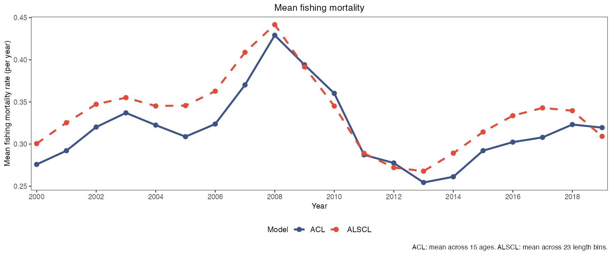
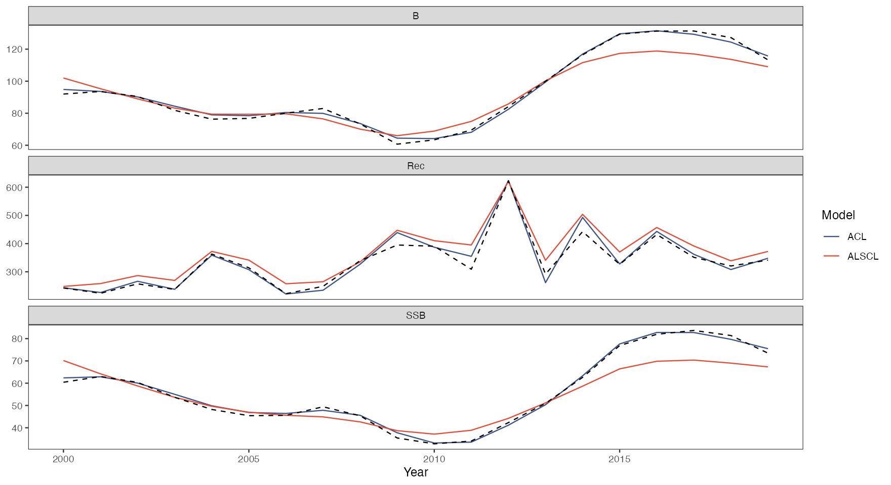

# 10 模型比较与真值 · Model comparisons

[← 上一章 · Previous](https://github.com/FanZhang-LAB-SHOU/ALSCL/wiki/09-Growth-and-Mortality) · [目录 · Contents](https://github.com/FanZhang-LAB-SHOU/ALSCL/wiki) · [下一章 · Next →](https://github.com/FanZhang-LAB-SHOU/ALSCL/wiki/11-Retrospectives)

**ALSCL 2.2.9 · 简体中文 / English**

先完成第 04 章的 YTF 拟合，得到 `a`、`b`、`x`、`inputs`，并设置 `dat <- x$data.CatL`。加载 ggplot2 和 patchwork。第 11 章建立回溯对象 `ra/rb`。
First complete chapter 04, define `dat <- x$data.CatL`, and load ggplot2 and patchwork. Chapter 11 defines retrospective objects.

```r
library(ggplot2)
library(patchwork)
acl_theme_set(palette="npg", base_theme="theme_bw")
```

## 34. 种群时间序列比较 / Population time series comparison

同一模型的两份结果会自动使用不同图例，例如 `ACL (group_year)` 和 `ACL (year)`，仍支持显式指定不同的 `model1_name`、`model2_name`。时间序列与 F 图保留每份结果自己的真实年份，可以显示不同时间范围。与 `data.CatL` 配对的图会核对已知时间和体长元数据，再匹配观测与预测；网格不一致时明确报错。图形比较不代表似然或生物假设具有可比性。

Comparison plots give distinct default labels to two fits of the same model: for example, `ACL (group_year)` and `ACL (year)`. Explicit distinct `model1_name` and `model2_name` remain supported. Time-series and F plots retain each fit's own calendar, including different time spans. Plots paired with `data.CatL` check known time and length metadata before matching observations to predictions; inconsistent grids are errors. A visual comparison does not establish that likelihoods or biological assumptions are comparable.

```r
# 绘制本图 / Draw this figure
plot_compare_ts(a, b, se = TRUE, ncol = 2)
```

[](https://github.com/FanZhang-LAB-SHOU/ALSCL/blob/main/docs/figures/ytf/compare_ts.png?raw=true&v=92c7a56eb1fb)

只比较共同输出与相同时间窗；自由纵轴不能直接比较不同量的振幅。

Compare common quantities over the same time window. Free y axes preclude amplitude comparisons across quantities.

[参数及默认值 / Arguments and defaults](https://github.com/FanZhang-LAB-SHOU/ALSCL/blob/main/docs/FUNCTION_REFERENCE.md#plot_compare_ts)


## 35. 死亡率矩阵比较 / Fishing mortality matrices

```r
# 绘制本图 / Draw this figure
plot_compare_F(a, b) + scale_x_continuous(breaks = c(2000, 2010, 2019))
```

[](https://github.com/FanZhang-LAB-SHOU/ALSCL/blob/main/docs/figures/ytf/compare_F.png?raw=true&v=3a1e2b27586b)

ACL 纵轴是年龄，ALSCL 纵轴是长度；颜色可辅助观察，但两行不逐格对应。

ACL uses age and ALSCL length on the vertical axis; cells do not correspond one to one.

[参数及默认值 / Arguments and defaults](https://github.com/FanZhang-LAB-SHOU/ALSCL/blob/main/docs/FUNCTION_REFERENCE.md#plot_compare_F)


## 36. 残差联合诊断 / Combined residual diagnostics

**2.2.9 修订 / Changes in 2.2.9.** `plot_compare_residuals()` 和 `plot_compare_CatL()` 除时间及体长元数据外，也核对已知观测值及正观测掩码。请传原始拟合表；修改数值或将缺失单元改为观测会报错。没有保存观测的旧结果仍可使用，但无法完整核验观测匹配。比较图的观测点排除零值和 NA，与拟合约定一致；这些位置仍可显示预测曲线。

`plot_compare_residuals()` and `plot_compare_CatL()` verify known observations and their positive-observation mask as well as time and length metadata. Pass the original fitting table; changing its values or turning a missing cell into an observation is an error. Older fits without stored observations remain usable, but their observation alignment cannot be fully verified. Zero and NA observations are omitted from the comparison points, consistently with fitting; prediction curves remain available at those positions.

```r
# 绘制本图 / Draw this figure
plot_compare_residuals(a, b, dat)
```

[](https://github.com/FanZhang-LAB-SHOU/ALSCL/blob/main/docs/figures/ytf/compare_residuals.png?raw=true&v=fa4a3b4f8912)

包括直方图、QQ 图、年度残差和长度组箱线图。年度误差棒是标准差，不是置信区间。

Includes histograms, QQ plots, annual residuals and length-bin boxplots. Annual error bars represent SD, not confidence intervals.

[参数及默认值 / Arguments and defaults](https://github.com/FanZhang-LAB-SHOU/ALSCL/blob/main/docs/FUNCTION_REFERENCE.md#plot_compare_residuals)


## 37. 生长与外部参照接口 / Growth and reference-data interface

参考数据与排版辅助函数 / Reference data and layout helper:

```r
# 模拟参考生长点，并非论文实测 / Synthetic reference points, not paper observations
set.seed(42)
ref <- data.frame(Age = rep(1:15, each = 5))
ref$Length <- VB_func(60, .2, 1/60, ref$Age) + rnorm(nrow(ref), 0, 2)
growth_display <- function(p) {
  p[[1]] <- p[[1]] + labs(subtitle = paste(strsplit(
    p[[1]]$labels$subtitle, " | ", fixed=TRUE)[[1]], collapse="\n")) +
    theme(legend.text=element_text(size=7))
  p[[2]] <- p[[2]] + scale_x_continuous(breaks=c(1,5,10,15))
  p
}
```

```r
# 绘制本图 / Draw this figure
growth_display(plot_compare_growth(a, b, age_range = c(1, 15), ref_data = ref, ref_name = "Synthetic reference",
    nls_start = list(Linf = 60, k = 0.2, t0 = 1/60)))
```

[](https://github.com/FanZhang-LAB-SHOU/ALSCL/blob/main/docs/figures/ytf/compare_growth.png?raw=true&v=8415934e346c)

灰色参照曲线来自模拟 Age 与 Length；不代表论文实测生长。提供 `ref_data` 时，`ref_name` 必须是一个非空字符串，且不能与任一模型名称相同。名称用于标识独立的参照曲线；重复名称会在拟合参照曲线前报错。

The reference curve uses synthetic Age and Length data, not empirical measurements from the paper. When `ref_data` is supplied, `ref_name` must be one nonempty string and differ from both model names. The name identifies a separate reference curve; duplicate names are rejected before fitting the reference.

[参数及默认值 / Arguments and defaults](https://github.com/FanZhang-LAB-SHOU/ALSCL/blob/main/docs/FUNCTION_REFERENCE.md#plot_compare_growth)


## 38. 两模型调查拟合 / Survey fits from both models

**2.2.9 修订 / Changes in 2.2.9.** `plot_compare_residuals()` 和 `plot_compare_CatL()` 除时间及体长元数据外，也核对已知观测值及正观测掩码。请传原始拟合表；修改数值或将缺失单元改为观测会报错。没有保存观测的旧结果仍可使用，但无法完整核验观测匹配。比较图的观测点排除零值和 NA，与拟合约定一致；这些位置仍可显示预测曲线。

`plot_compare_residuals()` and `plot_compare_CatL()` verify known observations and their positive-observation mask as well as time and length metadata. Pass the original fitting table; changing its values or turning a missing cell into an observation is an error. Older fits without stored observations remain usable, but their observation alignment cannot be fully verified. Zero and NA observations are omitted from the comparison points, consistently with fitting; prediction curves remain available at those positions.

```r
# 绘制本图 / Draw this figure
plot_compare_CatL(a, b, dat, years = c(2000, 2005, 2010, 2015), ncol = 2)
```

[](https://github.com/FanZhang-LAB-SHOU/ALSCL/blob/main/docs/figures/ytf/compare_CatL.png?raw=true&v=20206096e520)

显示 4 个指定年份；省略 years 将显示全部年份。点为调查数据，线为拟合中位数。纵轴为调查指数，不是捕获量；自定义标签使用 ylab$survey。

Four selected years are shown. Omit years to show all periods. Points are observations and curves fitted medians. The vertical axis is a survey index, not catch abundance; use ylab$survey for a custom label.

[参数及默认值 / Arguments and defaults](https://github.com/FanZhang-LAB-SHOU/ALSCL/blob/main/docs/FUNCTION_REFERENCE.md#plot_compare_CatL)


## 39. 拟合指标比较 / Fit metric comparison

```r
# 绘制本图 / Draw this figure
plot_compare_metrics(a, b, dat, ncol = 2) & scale_y_continuous(expand = expansion(mult = c(0,
    0.3)))
```

[](https://github.com/FanZhang-LAB-SHOU/ALSCL/blob/main/docs/figures/ytf/compare_metrics.png?raw=true&v=1dd25e70ecf3)

当前数据由年龄模型生成。图示差异不能证明任一模型普遍较优；IC 还需要相同数据与似然口径。

The generating model is age based. This comparison cannot establish universal superiority; information criteria also require comparable data and likelihoods.

[参数及默认值 / Arguments and defaults](https://github.com/FanZhang-LAB-SHOU/ALSCL/blob/main/docs/FUNCTION_REFERENCE.md#plot_compare_metrics)


## 40. 固定调查可捕性 / Fixed survey catchability

```r
# 绘制本图 / Draw this figure
plot_compare_selectivity(a, b)
```

[](https://github.com/FanZhang-LAB-SHOU/ALSCL/blob/main/docs/figures/ytf/compare_selectivity.png?raw=true&v=95e7157ec17b)

当前函数展示输入 q 的连接线，不是估计的渔业选择性。两模型使用同一输入，曲线重合。

This function connects the input survey q; it does not estimate fishery selectivity. Identical inputs produce overlapping curves.

[参数及默认值 / Arguments and defaults](https://github.com/FanZhang-LAB-SHOU/ALSCL/blob/main/docs/FUNCTION_REFERENCE.md#plot_compare_selectivity)


## 41. 总体 F 比较 apical / Summary F comparison apical

```r
# 绘制本图 / Draw this figure
plot_compare_annual_F(a, b, method = "apical") +
  labs(title = "Apical fishing mortality")
```

[](https://github.com/FanZhang-LAB-SHOU/ALSCL/blob/main/docs/figures/ytf/compare_F_apical.png?raw=true&v=a22655e57f3c)

apical 取最大值，mean 取组间算术平均，均非丰度加权。函数名称含 annual，但不会自动把季度率年化。

Apical is the maximum; mean is an unweighted group average. Despite its name, the function does not annualize quarterly rates.

[参数及默认值 / Arguments and defaults](https://github.com/FanZhang-LAB-SHOU/ALSCL/blob/main/docs/FUNCTION_REFERENCE.md#plot_compare_annual_F)


## 42. 总体 F 比较 mean / Summary F comparison mean

```r
# 绘制本图 / Draw this figure
plot_compare_annual_F(a, b, method = "mean") +
  labs(title = "Mean fishing mortality")
```

[](https://github.com/FanZhang-LAB-SHOU/ALSCL/blob/main/docs/figures/ytf/compare_F_mean.png?raw=true&v=7ebefc35c147)

apical 取最大值，mean 取组间算术平均，均非丰度加权。函数名称含 annual，但不会自动把季度率年化。

Apical is the maximum; mean is an unweighted group average. Despite its name, the function does not annualize quarterly rates.

[参数及默认值 / Arguments and defaults](https://github.com/FanZhang-LAB-SHOU/ALSCL/blob/main/docs/FUNCTION_REFERENCE.md#plot_compare_annual_F)


## 45. 模拟真值与条件估计 / Simulation truth and conditional estimates

```r
# 将生成真值与报告中的估计对齐 / Align truth and fitted reports
years <- a$year
truth <- data.frame(Year=rep(years,3),
  Quantity=rep(c("B","SSB","Rec"),each=length(years)),
  Truth=c(x$truth$TB,x$truth$SSB,x$truth$Rec))
estimates <- rbind(
  data.frame(Year=rep(years,3),Quantity=truth$Quantity,
    Value=c(a$report$B,a$report$SSB,a$report$Rec),Model="ACL"),
  data.frame(Year=rep(years,3),Quantity=truth$Quantity,
    Value=c(b$report$B,b$report$SSB,b$report$Rec),Model="ALSCL"))
```

```r
# 绘制本图 / Draw this figure
ggplot(estimates, aes(Year, Value, color = Model)) + geom_line() + scale_color_manual(values = setNames(acl_theme("compare_colors"),
    c("ACL", "ALSCL"))) + geom_line(data = truth, aes(Year, Truth), inherit.aes = FALSE, linetype = 2) +
    facet_wrap(~Quantity, scales = "free_y", ncol = 1) + theme_bw() + theme(panel.grid.major = element_blank(), panel.grid.minor = element_blank()) + labs(y = NULL)
```

[](https://github.com/FanZhang-LAB-SHOU/ALSCL/blob/main/docs/figures/ytf/truth.png?raw=true&v=a10cc16cca33)

黑虚线为生成真值；固定生物参数，且模拟与拟合的补充过程不同。

Black dashed curves are generating truth. Biology is fixed; recruitment processes differ.

调查拟合图标题表示调查指数，山脊图标题表示调查体长组成，两者都不是渔业捕获量估计。过程偏差图在 `log = TRUE` 时标为对数偏差（参照值 0），在 `log = FALSE` 时标为乘数（参照值 1）。取指数只改变尺度，不改变已拟合的过程；两者都不是似然偏差统计量。

Survey-fit titles refer to survey indices, and ridge titles refer to survey length compositions; neither is a fishery catch estimate. In process-deviation plots, `log = TRUE` labels log deviations (reference value 0), while `log = FALSE` labels multiplicative factors (reference value 1). Exponentiation changes the scale, not the underlying fitted process; neither quantity is a likelihood deviance statistic.


---

[← 上一章 · Previous](https://github.com/FanZhang-LAB-SHOU/ALSCL/wiki/09-Growth-and-Mortality) · [目录 · Contents](https://github.com/FanZhang-LAB-SHOU/ALSCL/wiki) · [下一章 · Next →](https://github.com/FanZhang-LAB-SHOU/ALSCL/wiki/11-Retrospectives)
