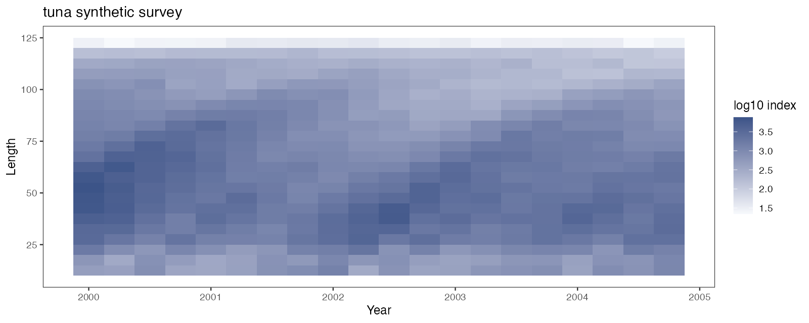
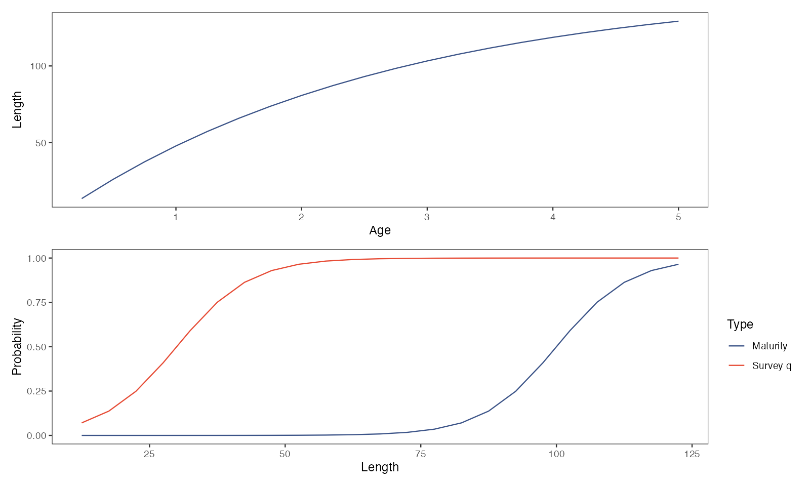
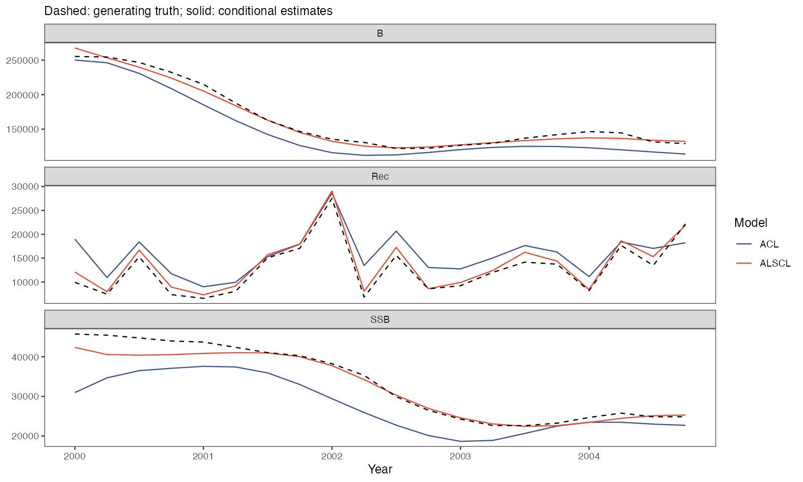

# 12 年度与季度案例 · Annual and quarterly cases

<!-- Generated by scripts/build_wiki.py. Edit website/content/{en,zh}/articles/case-studies.md, then rebuild; do not edit this file. -->

[← 上一章 · Previous](https://github.com/FanZhang-LAB-SHOU/ALSCL/wiki/11-Retrospectives) · [目录 · Contents](https://github.com/FanZhang-LAB-SHOU/ALSCL/wiki) · [下一章 · Next →](https://github.com/FanZhang-LAB-SHOU/ALSCL/wiki/13-Colors-and-Export)

**ALSCL 2.4.4 · 简体中文 / English**

[使用指南 / User guide](https://github.com/FanZhang-LAB-SHOU/ALSCL/blob/main/docs/USER_GUIDE.md) · [首页 / Home](https://github.com/FanZhang-LAB-SHOU/ALSCL/blob/main/README.md)

## 年度与季度时间步 / Annual and quarterly time steps

学完本页，你已经用 ACL 和 ALSCL 拟合了两个附带案例，一个年度鲽鱼调查和一个季度金枪鱼调查，并知道时间步改为季度时哪些设置的含义会改变。两个案例都是模拟数据（由 `scripts/simulation_workflow.R` 以种子 4 生成，各有 23 个体长组和 20 个时间步）；它们不是论文的数据。你需要安装好的软件包和一份仓库副本；请在同一个 R 会话中从仓库根目录运行各步骤。[理解第一次拟合](https://github.com/FanZhang-LAB-SHOU/ALSCL/blob/main/docs/USER_GUIDE.md#builtin)说明了输入列表和数值检查。

At the end of this page you have fitted ACL and ALSCL to two supplied cases, an annual flatfish survey and a quarterly tuna survey, and you know which settings change their meaning when the time step is a quarter. Both cases are synthetic (`scripts/simulation_workflow.R`, seed 4, 23 length bins and 20 time steps each); they are not the paper's data. You need the package and a copy of the repository; run the steps in one R session from the repository root. [Understand your first fit](https://github.com/FanZhang-LAB-SHOU/ALSCL/blob/main/docs/USER_GUIDE.md#builtin) explains the input bundle and the numerical checks.

<a id="case-studies-read"></a>

### 1. 读取两个案例 / Read the two cases

```r
library(ALSCL)
flatfish_inputs <- read_survey_csv("docs/data/cases/flatfish")
tuna_inputs <- read_survey_csv("docs/data/cases/tuna")
pa <- readRDS("docs/data/cases/tuna/truth.rds")$parameters
pa[c("growth_step", "rec.age", "nage", "M", "Linf", "vbk")]
names(tuna_inputs$data.CatL)[1:5]
```

每个案例文件夹包含三张表 `data.CatL.csv`、`data.wgt.csv` 和 `data.mat.csv`（一列 `LengthBin` 标签，之后每个时间步一列），以及保存生成设置 `parameters` 和模拟种群 `truth` 的 `truth.rds`。`read_survey_csv()` 检查三张表的标签和维度一致、时间标签递增、体重有限且非负、成熟比例在 0 到 1 之间；它不添加生物学设置。生物学设置在后两步输入：

Each case folder holds the three tables `data.CatL.csv`, `data.wgt.csv` and `data.mat.csv` (a `LengthBin` column, then one column per time step) and `truth.rds` with the generator settings `parameters` and the simulated population `truth`. `read_survey_csv()` checks that the tables share labels and dimensions, that the time labels increase, that weights are finite and nonnegative and that maturity lies between 0 and 1; it adds no biology. You enter the biology in the next two steps:

| 设置 / Setting | 鲽鱼 / Flatfish | 金枪鱼 / Tuna |
|---|---|---|
| 生成器，时间步 / Generator, time step | 年龄型，1 年 / age-based, 1 year | 体长型，0.25 年 / length-based, 0.25 year |
| 时间标签 / Time labels | 2000 至 2019，每年一列 / 2000 to 2019, one per year | 2000 至 2004.75，每季一列 / 2000 to 2004.75, one per quarter |
| `rec.age`、`nage` / `rec.age`, `nage` | 1、15 / 1, 15 | 0.25、20 / 0.25, 20 |
| `Linf`、每年的 `vbk`、`t0` / `Linf`, `vbk` per year, `t0` | 60、0.20、1/60 / 60, 0.20, 1/60 | 152、0.38、1/152 / 152, 0.38, 1/152 |
| 每个时间步的 `M` / `M` per time step | 0.20 | 0.20（每年 0.80） / 0.20 (0.80 per year) |
| 成熟 L50、L95 / Maturity L50, L95 | 35、40 / 35, 40 | 100、120 / 100, 120 |
| 调查可捕性 `sel_L50`、`sel_L95` / Survey catchability `sel_L50`, `sel_L95` | 15、20 / 15, 20 | 30、50 / 30, 50 |
| 体长组中点；调查对数 SD / Bin midpoints; survey log SD | 6 至 50，间隔 2；0.20 / 6 to 50 in steps of 2; 0.20 | 12.5 至 122.5，间隔 5；0.10 / 12.5 to 122.5 in steps of 5; 0.10 |

`pa` 打印出 `growth_step` 0.25、`rec.age` 0.25、`nage` 20、`M` 0.2、`Linf` 152 和 `vbk` 0.38；金枪鱼的列名是 `LengthBin`、`2000`、`2000.25`、`2000.5`、`2000.75`。如果 `read_survey_csv()` 停在 `folder must name an existing directory`，说明 R 不在仓库根目录；如果报错信息点名某张表，按[准备调查数据](https://github.com/FanZhang-LAB-SHOU/ALSCL/blob/main/docs/USER_GUIDE.md#excel)修正该文件。

`pa` prints `growth_step` 0.25, `rec.age` 0.25, `nage` 20, `M` 0.2, `Linf` 152 and `vbk` 0.38; the tuna column names are `LengthBin`, `2000`, `2000.25`, `2000.5`, `2000.75`. If `read_survey_csv()` stops with `folder must name an existing directory`, R is not in the repository root; if the message names a table, correct that file as in [Prepare your survey data](https://github.com/FanZhang-LAB-SHOU/ALSCL/blob/main/docs/USER_GUIDE.md#excel).

<a id="case-studies-annual"></a>

### 2. 拟合年度鲽鱼案例 / Fit the annual flatfish case

```r
fix <- function(p) lapply(p, function(v) factor(NA))
F_marginal_sd <- 0.2 / sqrt(1 - 0.75^2)
known <- list(log_Linf = log(60), log_vbk = log(0.2), log_cv_len = log(0.2),
  logit_log_R = qlogis(0.1))
acl_known <- c(known, list(t0 = 1/60, log_std_log_F = log(F_marginal_sd), log_std_log_N0 = log(0.2)))
alscl_known <- c(known, list(log_t0 = log(1/60), log_cv_grow = log(0.2),
  log_sigma_log_F = log(F_marginal_sd), log_sigma_log_N0 = log(0.2)))
x <- prepare_alscl_data(flatfish_inputs,
  fit_args = list(rec.age = 1, nage = 15, M = 0.2, sel_L50 = 15, sel_L95 = 20,
    growth_step = 1, train_times = 2, ncores = 1, silent = TRUE),
  fit_config = list(acl = list(parameters = acl_known, map = fix(acl_known)),
    alscl = list(parameters = alscl_known, map = c(fix(alscl_known),
      list(logit_log_F_l = factor(NA), logit_log_F_y = factor(NA))))))
a <- run_acl(x)
b <- run_alscl(x)
c(a$diagnostics$numerical_ok, b$diagnostics$numerical_ok)
plot_compare_ts(a, b, quantities = c("B", "SSB", "Rec"), se = TRUE)
```

`prepare_alscl_data()` 用三张表和 `fit_args` 中两个模型共用的生物学设置构建输入列表 `x`；体长组来自行标签（中点为 6 至 50、间隔 2，边界取相邻中点的中间值）。`fit_config` 存放各模型的初值和 `map`。平均生长参数和同龄体长 CV 用 `factor(NA)` 固定在预设值上。ALSCL 的生长增量 CV 也固定在预设值上；体长型生成器会使用它，年龄型 flatfish 生成器则不使用。F 的标准差先从操作模型的创新 SD 换算为拟合模型使用的边际 SD：`0.2 / sqrt(1 - 0.75^2)`，即 0.3023716。初始数量 SD、补充量相关系数和 F 相关系数也按指定的拟合假设固定，每个模型留下五个自由标量参数。

`prepare_alscl_data()` builds the input bundle `x` from the three tables and the shared biology in `fit_args`; the length bins come from the row labels (midpoints 6 to 50 in steps of 2, borders halfway between). `fit_config` holds each model's starting values and `map`. The mean growth parameters and CV of length at age are fixed to the preset values with `factor(NA)`. ALSCL's growth-increment CV is also fixed to its preset value; this parameter is used by the length-based generator, but not by the age-based flatfish generator. The F SD is converted from the operating model's innovation SD to the marginal SD used by the fitted models: `0.2 / sqrt(1 - 0.75^2)`, or 0.3023716. The initial-abundance SD, recruitment correlation and F correlations are also fixed as specified fitting assumptions, leaving five free scalar parameters in each model.

操作模型用一个共用的 F 时间序列乘以选择性，生成各组捕捞死亡率。评估模型则估计各组和各期的 F，本例将组间和时间相关系数均固定为 0.75。初始化时，两类模型都逐龄递推尾数，每一步在对数尺度上加入独立扰动。模拟从预热期开始，评估从保留的第一个调查时间步开始。设置和作图代码见[案例脚本](https://github.com/FanZhang-LAB-SHOU/ALSCL/blob/main/scripts/case_studies.R)。

The operating model generates F by multiplying a shared time series by selectivity. The assessment models estimate F across groups and time, with both correlations fixed at 0.75 in these fits. At initialization, both the operating and assessment models calculate numbers at age recursively, with an independent log-scale deviation at each age increment. The simulation starts before the burn-in period. The assessment starts at the first retained survey time step. See the [script for these cases](https://github.com/FanZhang-LAB-SHOU/ALSCL/blob/main/scripts/case_studies.R).

第一次拟合还需编译模型；之后的耗时取决于机器和优化路径。数值检查应打印 `TRUE TRUE`，与脚本的[收敛记录](https://github.com/FanZhang-LAB-SHOU/ALSCL/blob/main/docs/results/case_convergence.csv)一致。若某项检查未通过，按[理解第一次拟合](https://github.com/FanZhang-LAB-SHOU/ALSCL/blob/main/docs/USER_GUIDE.md#first-model-checks)运行 `diagnose_model(x$data.CatL, a)`，并用 `nstarts` 增加初值。

The first fit also compiles the model; later fitting times depend on the machine and optimization path. Expect `TRUE TRUE` from the numerical checks, as in the script's [convergence record](https://github.com/FanZhang-LAB-SHOU/ALSCL/blob/main/docs/results/case_convergence.csv). If a check fails, run `diagnose_model(x$data.CatL, a)` as on [Understand your first fit](https://github.com/FanZhang-LAB-SHOU/ALSCL/blob/main/docs/USER_GUIDE.md#first-model-checks) and add starts with `nstarts`.


热图按年份和体长组显示 log10 调查指数：10 cm 以下很小，因为那里的调查可捕性低于 0.1；15-30 cm 最大。

The heat map shows the log10 survey index by year and length bin: small below 10 cm, where survey catchability is under 0.1, and largest at 15-30 cm.


生长曲线从 1 龄的 11 cm 到 15 龄的 57 cm。成熟（L50 为 35 cm，来自 `data.mat`）和调查可捕性（L50 为 15 cm，由 `sel_L50` 和 `sel_L95` 设定）是两条不同的曲线。

Growth runs from 11 cm at age 1 to 57 cm at age 15. Maturity (L50 35 cm), read from `data.mat`, and survey catchability (L50 15 cm), set by `sel_L50` and `sel_L95`, are different curves.


虚线是生成真值，实线是两个模型的条件估计。对于生物量和产卵生物量，两个模型都跟上了 2010 年之前的下降和之后的回升；2014 年以后 ALSCL 的生物量和产卵生物量低于真值。`plot_compare_ts()` 画出的是同样的轨迹，并附有区间。

Dashed lines are the generating truth, solid lines the two conditional estimates. For biomass and spawning biomass, both models follow the decline to 2010 and the rise after it; ALSCL sits below the truth for biomass and spawning biomass after 2014. `plot_compare_ts()` shows the same trajectories with intervals.

<a id="case-studies-quarterly"></a>

### 3. 拟合季度金枪鱼案例 / Fit the quarterly tuna case

```r
known <- list(log_Linf = log(152), log_vbk = log(0.38), log_cv_len = log(0.2),
  logit_log_R = qlogis(0.1))
acl_known <- c(known, list(t0 = 1/152, log_std_log_F = log(F_marginal_sd), log_std_log_N0 = log(0.3)))
alscl_known <- c(known, list(log_t0 = log(1/152), log_cv_grow = log(0.3),
  log_sigma_log_F = log(F_marginal_sd), log_sigma_log_N0 = log(0.3)))
xq <- prepare_alscl_data(tuna_inputs,
  fit_args = list(rec.age = 0.25, nage = 20, M = 0.2, sel_L50 = 30, sel_L95 = 50,
    growth_step = 0.25, train_times = 2, ncores = 1, silent = TRUE),
  fit_config = list(acl = list(parameters = acl_known, map = fix(acl_known)),
    alscl = list(parameters = alscl_known, map = c(fix(alscl_known),
      list(logit_log_F_l = factor(NA), logit_log_F_y = factor(NA))))))
check_alscl_data(xq, "alscl")$time
aq <- run_acl(xq)
bq <- run_alscl(xq)
c(aq$diagnostics$numerical_ok, bq$diagnostics$numerical_ok)
plot_compare_ts(aq, bq, quantities = c("B", "SSB", "Rec"), se = TRUE)
```

代码相同，但四项设置的含义变了。`growth_step = 0.25` 使每一列代表一个季度，因此时间标签必须相隔 0.25。`M` 和捕捞死亡率都按时间步计：年 M 为 0.8 要输入 `M = 0.2`，而 `vbk` 仍按年计。`rec.age` 以年为单位，0.25 表示一个季度龄补充；`nage = 20` 数的是季度龄组，从 0.25 龄到 5 龄，最后一组包括 5 龄及以上个体；`t0` 必须小于 `rec.age`。

The code is the same; four settings change their meaning. `growth_step = 0.25` makes each column one quarter, so the time labels must be spaced 0.25 apart. `M` and fishing mortality are per time step: an annual M of 0.8 is entered as `M = 0.2`, while `vbk` stays per year. `rec.age` is in years, so 0.25 means recruitment at one quarter, and `nage = 20` counts quarter-age classes from 0.25 to 5 years, the last one the plus group; `t0` must stay below `rec.age`.

`check_alscl_data()$time` 打印 2000 到 2004.75 的 20 个季度：这里的二十个时间步是五年。重新生成的案例中，两次拟合都通过数值检查；可用每份结果的 `elapsed` 字段记录本机耗时。如果标签的间隔不等于 `growth_step`，拟合会停在 `Time column spacing must equal growth_step`；请保留每个季度一列，没有调查的季度填 `NA`，体重和成熟比例则要完整。

`check_alscl_data()$time` prints the 20 quarters from 2000 to 2004.75: twenty time steps are five years here. Both fits pass the numerical checks in the regenerated case; use each result's `elapsed` field to record fitting time on your machine. If the label spacing differs from `growth_step`, fitting stops with `Time column spacing must equal growth_step`; keep every quarter as a column, with `NA` survey values for quarters without a survey and complete weights and maturity.



热图每年有四列。指数在 30-70 cm 最大，在 122.5 cm 组最小，生长曲线要到 4 龄以后才到达这个体长。

The heat map has four columns per year. The index is largest at 30-70 cm and smallest in the 122.5 cm bin, which the growth curve reaches only after age 4.



生长曲线从 0.25 龄的 13 cm 到 5 龄的 129 cm（`vbk` 为每年 0.38）；成熟（L50 为 100 cm）远高于调查可捕性（L50 为 30 cm）。

Growth runs from 13 cm at age 0.25 to 129 cm at age 5 (`vbk` 0.38 per year); maturity (L50 100 cm) lies far above survey catchability (L50 30 cm).



补充量按季度计。ALSCL 的生物量和产卵生物量跟随真值，估计值与真值相差约 11% 以内。ACL 的生物量和产卵生物量在每个季度都低于真值。它的产卵生物量相对真值在 2000 年初以及 2002-2003 年最低（约为真值的 0.68 到 0.77），到 2003 年末才接近真值。两个模型都在 20 个季度中的 19 个高估了补充量，ALSCL 平均高估 9%，ACL 平均高估 31%。该案例使用体长生长转移；拟合过程的假设仍与操作模型不同，因此单个重复不能给两个模型排名。

Recruitment is per quarter. ALSCL follows the truth for biomass and spawning biomass, with estimates within about 11% of the truth. ACL lies below the truth for biomass and spawning biomass in every quarter. Its spawning biomass is lowest relative to the truth at the start of 2000 and again in 2002-2003 (about 0.68 to 0.77 of the truth) and comes close to the truth only from late 2003. Both models overestimate recruitment in 19 of the 20 quarters, on average by 9% for ALSCL and by 31% for ACL. The case uses length-based growth transitions; the fitted process assumptions still differ from the operating model, so one replicate cannot rank the two models.

<a id="case-studies-simulation"></a>

### 4. 扩展为模拟实验 / Extend to a simulation study

```r
source("scripts/simulation_workflow.R", encoding = "UTF-8")
simulations <- run_simulation_examples(out = "my_cases/data/cases", fit_batch = FALSE)
source("scripts/case_studies.R", encoding = "UTF-8")
case_status <- run_case_studies(out = "my_cases")
```

`run_simulation_examples()` 在 `out` 下重新生成两个案例：每个预设物种的三个 CSV 文件、`truth.rds` 和重复文件；`fit_batch = TRUE` 会再对鲽鱼的重复批量拟合 ACL，并写出保留失败拟合的 `batch_checks.csv`。`run_case_studies()` 用第 2 步和第 3 步的设置重新拟合两个案例，在 `out` 下写出七张案例图和 `results/case_convergence.csv`；它从 `out/data/cases` 读取真值，因此本例先直接在 `my_cases/data/cases` 生成案例，再把拟合输出放到 `my_cases`。

`run_simulation_examples()` regenerates both cases under `out`: the three CSV files, `truth.rds` and the replicate files of each preset; `fit_batch = TRUE` adds batch ACL fits of the flatfish replicates and writes `batch_checks.csv`, which keeps the failed fits. `run_case_studies()` refits both cases with the settings of steps 2 and 3 and writes the seven case figures and `results/case_convergence.csv` under `out`; it reads the truth from `out/data/cases`, so the example generates the cases directly under `my_cases/data/cases` before fitting them under `my_cases`.

开展模拟研究时，增大 `iter_range` 以增加重复次数，每次改变一项设置，例如调查观测误差或自然死亡率。用全部拟合计算失败率。偏差和 RMSE 只使用通过数值检查且估计值与真值均有限的配对，区间覆盖率只使用可计算的区间。报告指标时分别列出配对数和区间数。见[模拟调查数据](https://github.com/FanZhang-LAB-SHOU/ALSCL/blob/main/docs/USER_GUIDE.md#simulation)。

Increase `iter_range` for a simulation study and vary one setting at a time, such as survey observation error or natural mortality. Report the failure rate across all attempted fits. Bias and RMSE use finite estimate–truth pairs from fits that passed the numerical checks. Interval coverage uses the subset with usable intervals. Report the number of pairs and intervals alongside the respective statistics. See [Simulate survey data](https://github.com/FanZhang-LAB-SHOU/ALSCL/blob/main/docs/USER_GUIDE.md#simulation).

<a id="case-studies-next"></a>

### 下一步 / What next

| 想做什么 / What you want to do | 阅读 / Read |
|---|---|
| 整理自己的数据表并选择时间步 / Lay out your own tables and choose the time step | [准备调查数据](https://github.com/FanZhang-LAB-SHOU/ALSCL/blob/main/docs/USER_GUIDE.md#excel) / [Prepare your survey data](https://github.com/FanZhang-LAB-SHOU/ALSCL/blob/main/docs/USER_GUIDE.md#excel) |
| 读拟合结果的数值检查、估计值和残差 / Read the numerical checks, estimates and residuals of a fit | [理解第一次拟合](https://github.com/FanZhang-LAB-SHOU/ALSCL/blob/main/docs/USER_GUIDE.md#builtin) / [Understand your first fit](https://github.com/FanZhang-LAB-SHOU/ALSCL/blob/main/docs/USER_GUIDE.md#builtin) |
| 决定哪些参数固定、哪些估计 / Decide which parameters to fix or estimate | [拟合设置](https://github.com/FanZhang-LAB-SHOU/ALSCL/blob/main/docs/USER_GUIDE.md#fitting) / [Fitting controls](https://github.com/FanZhang-LAB-SHOU/ALSCL/blob/main/docs/USER_GUIDE.md#fitting) |
| 生成调查数据并批量拟合重复 / Generate survey data and fit replicates in batch | [模拟与批量实验](https://github.com/FanZhang-LAB-SHOU/ALSCL/blob/main/docs/USER_GUIDE.md#simulation) / [Simulation](https://github.com/FanZhang-LAB-SHOU/ALSCL/blob/main/docs/USER_GUIDE.md#simulation) |
| 从拟合模型模拟调查数据，或预测留出的年份 / Simulate from a fitted model or predict withheld years | [模型验证](https://github.com/FanZhang-LAB-SHOU/ALSCL/blob/main/docs/MODEL_VALIDATION.md) / [Model validation](https://github.com/FanZhang-LAB-SHOU/ALSCL/blob/main/docs/MODEL_VALIDATION.md) |
| 拟合真实的调查指数，并与年龄判读结果和资源评估对比 / Fit a real survey index and compare the fit with age readings and an assessment | [真实调查数据的拟合结果，哪些可以用？](https://github.com/FanZhang-LAB-SHOU/ALSCL/blob/main/docs/CASES.md#case-north-sea-whiting) / [What can a fit to a real survey be used for?](https://github.com/FanZhang-LAB-SHOU/ALSCL/blob/main/docs/CASES.md#case-north-sea-whiting) |

---

[← 上一章 · Previous](https://github.com/FanZhang-LAB-SHOU/ALSCL/wiki/11-Retrospectives) · [目录 · Contents](https://github.com/FanZhang-LAB-SHOU/ALSCL/wiki) · [下一章 · Next →](https://github.com/FanZhang-LAB-SHOU/ALSCL/wiki/13-Colors-and-Export)
