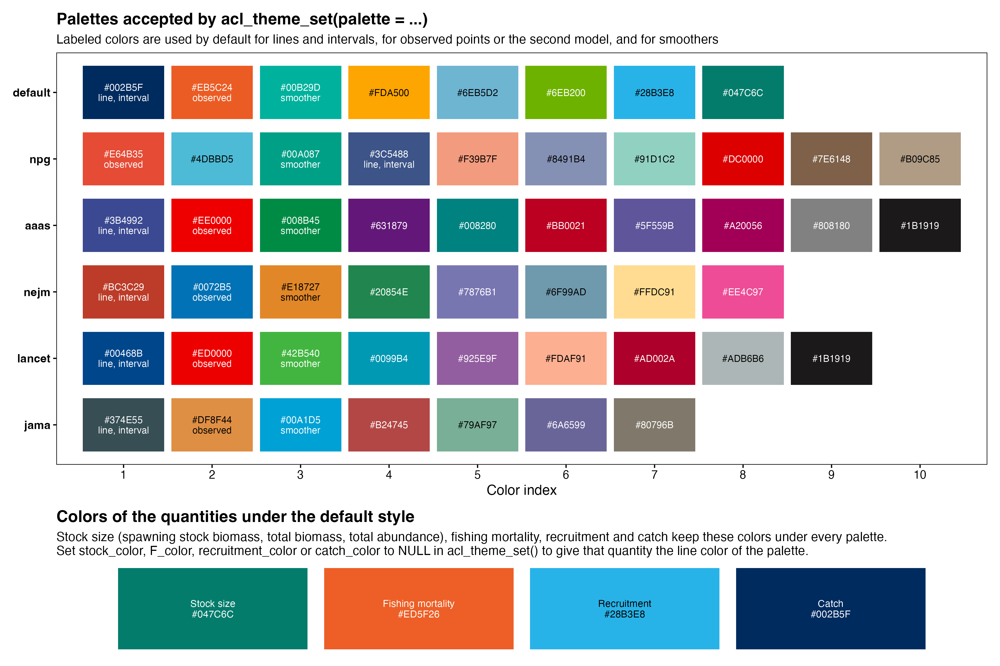
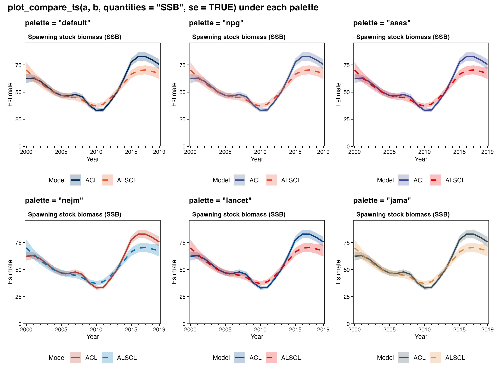

# 13 配色与导出 · Colors and export

<!-- Generated by scripts/build_wiki.py. Edit website/content/{en,zh}/articles/plot-customization.md, then rebuild; do not edit this file. -->

[← 上一章 · Previous](https://github.com/FanZhang-LAB-SHOU/ALSCL/wiki/12-Case-Studies) · [目录 · Contents](https://github.com/FanZhang-LAB-SHOU/ALSCL/wiki) · [下一章 · Next →](https://github.com/FanZhang-LAB-SHOU/ALSCL/wiki/14-Function-Reference)

**ALSCL 2.5.2 · 简体中文 / English**

[使用指南 / User guide](https://github.com/FanZhang-LAB-SHOU/ALSCL/blob/main/docs/USER_GUIDE.md) · [首页 / Home](https://github.com/FanZhang-LAB-SHOU/ALSCL/blob/main/README.md)

## 配色与导出 / Colors and export

本页带你为所有 ALSCL 图选择样式、修改单项设置或单张图的颜色、让你自己画的 ggplot 具有同样的外观、导出图形，以及设置生长图和种群图的标签和坐标轴。你需要[理解第一次拟合](https://github.com/FanZhang-LAB-SHOU/ALSCL/blob/main/docs/USER_GUIDE.md#builtin)中的 `a`、`b` 和 `x`；第 1 步还会拟合一个回溯分析结果 `rb`（[运行回溯分析](https://github.com/FanZhang-LAB-SHOU/ALSCL/blob/main/docs/USER_GUIDE.md#retrospective)）。

On this page you choose the style of every ALSCL plot, change one setting or the colors of one plot, give your own ggplots the same look, export a figure, and set the labels and axes of the growth and population plots. You need `a`, `b` and `x` from [Understand your first fit](https://github.com/FanZhang-LAB-SHOU/ALSCL/blob/main/docs/USER_GUIDE.md#builtin); step 1 also fits a retrospective analysis `rb` ([Run a retrospective analysis](https://github.com/FanZhang-LAB-SHOU/ALSCL/blob/main/docs/USER_GUIDE.md#retrospective)).

<a id="plot-customization-theme"></a>

### 1. 一次设置主题 / Set the theme once

```r
# 先建立回溯结果，再调整绘图样式 / Create the retrospective result before styling it
rb <- retro_alscl(x, nyear = 3, train_times = 2, ncores = 1, silent = TRUE)

# 默认样式 "default" / The default style, "default"
plot_retro(rb, facet_ncol = 2, rho_digits = 3)
plot_recruitment(b, se = TRUE)                 # 柱和误差线 / bars with error bars
plot_recruitment(b, se = TRUE, geom = "line")  # 线和区间带 / a line with a band

# 一次调用恢复 ALSCL 2.4.5 的外观，再回到默认样式 / The look of ALSCL 2.4.5 in one call, then back to the default
acl_theme_set(style = "classic")
plot_compare_ts(a, b, se = TRUE)
acl_theme_set(style = "default")

# 只改一项设置，保留样式的其余部分 / Change one setting and keep the rest of the style
acl_theme_set(font_family = "sans")
acl_theme_set(palette = "jama") # default, npg, aaas, nejm, lancet, jama
plot_abundance(b, type = "NL", facet_ncol = 3)
```

默认样式 `style = "default"` 让每个数量有自己的颜色。产卵生物量、生物量和丰度是带阴影 95% 区间带的青绿色线，捕捞死亡率是带区间带的橙色线，总补充量画成浅蓝色柱，总渔获量画成深蓝色柱，两者都带浅色描边的细深灰色误差线；按年龄或按体长分面板的图是该数量颜色的线。这些图的纵轴从零开始。标题为黑色粗体、左对齐，不画网格线，分面标签是不带框的粗体文字，图例在图的下方。其他图用深蓝色画估计值、橙色画观测值；比较图中第一个拟合为深蓝色、第二个为橙色；`plot_retro()` 中完整拟合为橙色，较早的拟合为灰色。

The default style, `style = "default"`, gives each quantity its own color. Spawning stock biomass, biomass and abundance are teal lines with a shaded 95% band, fishing mortality is an orange line with a band, total recruitment is drawn as light-blue bars and total catch as dark-blue bars, both with thin dark-grey error bars that have a light outline, and panels at age or at length are lines in the color of their quantity. The y axis of these plots starts at zero. Titles are bold, left aligned and black, no grid lines are drawn, facet labels are bold text without a box, and legends are below the plot. The other plots draw estimates in dark blue and observations in orange; in comparisons the first fit is dark blue and the second orange, and in `plot_retro()` the full fit is orange and the earlier fits are grey.

`acl_theme_set(style = "classic")` 一次调用即恢复 ALSCL 2.4.5 的外观，即 npg 颜色、所有序列画成线、居中的常规字体标题、带框的灰色分面标签以及随数据变化的纵轴。它不恢复以前的图中文字（标题、坐标轴标题和面板名称）、以前的分面列数，也不恢复以前的年份标签和图形尺寸，因为这些规则在两种样式下相同。`acl_theme_set(style = "default")` 或 `acl_theme_reset()` 回到默认样式。样式设定下表中的取值以及由其调色板派生的颜色；字体、标签、`interval`、`show_title`、`x_angle` 和其他设置保持不变，同一调用中的其他参数在样式之后生效。设置单项只改变该项，所以两种样式可以混合。`bars = FALSE` 把补充量和渔获量画成线，`y_zero = FALSE` 让纵轴随数据变化，`grid = "y"` 加上水平网格线，`title_color = "quantity"` 让每个标题取其数量的颜色，`palette = "npg"` 让线、观测值、比较图和热图使用 npg 颜色，而四个数量的颜色保持不变。`plot_recruitment()` 和 `plot_catch()` 中的 `geom = "bar"` 或 `geom = "line"` 只对一张图起作用；按年龄和按体长的渔获量始终画成线。`acl_theme_set()` 只影响之后创建的图；要改已有的图，就重新创建它。

`acl_theme_set(style = "classic")` restores the look of ALSCL 2.4.5 in one call, with the npg colors, lines for every series, plain centered titles, grey boxed facet labels and y axes that follow the data. It does not restore the former figure texts (titles, axis titles and panel names), the former number of facet columns or the former year labels and figure sizes, because these rules apply under both styles. `acl_theme_set(style = "default")` or `acl_theme_reset()` returns to the default style. A style sets the values in the table below and the colors derived from its palette; fonts, labels, `interval`, `show_title`, `x_angle` and the other settings are kept, and arguments of the same call are applied after the style. Setting one key changes that key only, so the two styles can be mixed. `bars = FALSE` draws recruitment and catch as lines, `y_zero = FALSE` lets the y axes follow the data, `grid = "y"` adds horizontal grid lines, `title_color = "quantity"` gives each title the color of its quantity, and `palette = "npg"` uses the npg colors for lines, observations, comparisons and heat maps while the four quantity colors stay. `geom = "bar"` or `geom = "line"` in `plot_recruitment()` and `plot_catch()` chooses for one plot; catch at age and at length are always lines. `acl_theme_set()` changes the plots created afterwards; recreate an existing plot to restyle it.

| 设置 / Setting | `style = "default"` | `style = "classic"`（ALSCL 2.4.5） / `style = "classic"` (ALSCL 2.4.5) |
|---|---|---|
| `palette` | `"default"` | `"npg"` |
| `grid` | `"none"`：无网格线（`"y"` 加上水平主网格线） / `"none"`: no grid lines (`"y"` adds horizontal major grid lines) | `"none"` |
| `title_face`、`title_hjust` / `title_face`, `title_hjust` | `"bold"`、0（左对齐） / `"bold"`, 0 (left) | `"plain"`、0.5（居中） / `"plain"`, 0.5 (centered) |
| `title_color` | `"black"`（`"quantity"` 取数量的颜色） / `"black"` (`"quantity"` gives the color of the quantity) | `"black"` |
| `stock_color`、`F_color`、`recruitment_color`、`catch_color` / `stock_color`, `F_color`, `recruitment_color`, `catch_color` | `"#047c6c"`、`"#ed5f26"`、`"#28b3e8"`、`"#002b5f"` / `"#047c6c"`, `"#ed5f26"`, `"#28b3e8"`, `"#002b5f"` | `NULL`：使用 `line_color` / `NULL`: `line_color` |
| `bars` | `TRUE`：总补充量和总渔获量画成柱 / `TRUE`: total recruitment and catch as bars | `FALSE`：画成线 / `FALSE`: lines |
| `y_zero` | `TRUE`：种群大小、补充量、渔获量和捕捞死亡率图的纵轴从零开始 / `TRUE`: y axes of stock size, recruitment, catch and fishing mortality plots start at zero | `FALSE`：随数据变化 / `FALSE`: they follow the data |
| `line_size`、`compare_line_size` / `line_size`, `compare_line_size` | 1、0.9 / 1, 0.9 | 1.5、1.2 / 1.5, 1.2 |
| `se_alpha`、`compare_se_alpha` / `se_alpha`, `compare_se_alpha` | 0.3、0.25 / 0.3, 0.25 | 0.2、0.15 / 0.2, 0.15 |
| `strip` | `"plain"`：不带框的粗体分面标签 / `"plain"`: bold facet labels without a box | `"box"`：基础主题的灰色标签条 / `"box"`: grey strips of the base theme |
| `legend_position` | `"bottom"` | `NULL`：各图保持自己的位置 / `NULL`: each plot keeps its own |
| `axis_color` | `"black"`：面板边框、坐标轴文字和刻度 / `"black"`: panel border, axis text and ticks | `NULL`：采用基础主题的设置 / `NULL`: those of the base theme |

可选调色板为 `default`（8 色）、`npg`（10）、`aaas`（10）、`nejm`（8）、`lancet`（9）和 `jama`（7）。默认调色板的前两种颜色是用于估计值的深蓝色 `#002b5f` 和用于观测值及第二个模型的橙色 `#eb5c24`，它的热图从白色过渡到同一种深蓝色。

The palettes are `default` (8 colors), `npg` (10), `aaas` (10), `nejm` (8), `lancet` (9) and `jama` (7). The default palette starts with dark blue `#002b5f` for estimates and orange `#eb5c24` for observations and the second model, and its heat maps run from white to the same dark blue.



图中是 `acl_theme_set()` 接受的六种调色板，以及默认样式下四个数量的颜色。每一行里，标注为“line, interval”的颜色用于单模型图的线、区间和点，标注为“observed”的颜色用于观测和比较图中的第二个模型，标注为“smoother”的颜色用于平滑线；其余颜色按顺序供需要更多分组的图使用，例如 ggsci 调色板下回溯图的各轮。下一张图把同一张比较图在每种调色板下画出来，便于按视觉效果挑选；仓库中的 `docs/figures/palettes/ssb_by_palette.png` 以同样方式展示单模型图。

The figure shows the six palettes `acl_theme_set()` accepts and the four quantity colors of the default style. In each row the color labelled "line, interval" draws lines, intervals and points of single-model plots, the color labelled "observed" draws observations and the second model in comparisons, and the color labelled "smoother" draws smoothers; the remaining colors are used in order when a plot needs more groups, for example the peels of a retrospective under a ggsci palette. The next figure shows the same comparison plot under every palette, so you can pick one by eye; `docs/figures/palettes/ssb_by_palette.png` in the repository shows a single-model plot in the same way.



| 设置 / Setting | 范围与优先级 / Scope and precedence |
|---|---|
| `style` | 上表各项设置的预设 / Preset of the settings in the table above |
| `palette` | 切换时重设由它派生的颜色 / Switching resets the colors derived from it |
| `line_color`、`se_color`、`point_color` / `line_color`, `se_color`, `point_color` | 单模型的线、区间和散点 / Single-model lines, intervals and scatter |
| `stock_color`、`F_color`、`recruitment_color`、`catch_color` / `stock_color`, `F_color`, `recruitment_color`, `catch_color` | 各数量的线和柱；设为 `NULL` 时使用 `line_color` / Lines and bars of each quantity; `NULL` hands them to `line_color` |
| `observed_color`、`smooth_color`、`hline_color` / `observed_color`, `smooth_color`, `hline_color` | 观测、残差平滑线和参考线 / Observation, residual smoother and reference line |
| `compare_colors` | 模型对，可按模型名称匹配 / Model pair, optionally matched by name |
| `low_col`、`high_col` / `low_col`, `high_col` | 连续热图的端点 / Sequential heatmap endpoints |
| `font_family`、`title_size`、`axis_text_size`、`strip_text_size` / `font_family`, `title_size`, `axis_text_size`, `strip_text_size` | 字体与字号 / Typography |
| `line_size`、`point_size` / `line_size`, `point_size` | 单模型图的线宽（面板超过 4 个时变细，除非在调用中给出）和所有图的默认点大小（2.5）；比较图线宽使用 `compare_line_size` / Single-model line width (thinner in figures with more than 4 panels unless set in the call) and the default point size for all plots (2.5); comparison line widths use `compare_line_size` |
| `compare_point_size` | 可选的比较图点大小；设为 `NULL` 清除覆盖，恢复继承全局 `point_size` / Optional comparison-only point size; `NULL` clears it and restores global `point_size` inheritance |
| `facet_ncol`、`facet_nrow`、`facet_scales` / `facet_ncol`, `facet_nrow`, `facet_scales` | 分面布局，所有图使用相同的参数名；默认列数随面板数确定 / Facet layout, with the same argument names in every plot; by default the number of columns follows the number of panels |
| `show_title`、`x_angle`、`x_breaks` / `show_title`, `x_angle`, `x_breaks` | 默认标题和时间轴标签（[第 5 步](#plot-customization-labels)） / Default titles and the labels of time axes ([section 5](#plot-customization-labels)) |

<a id="plot-customization-override"></a>

### 2. 为单张图覆盖颜色 / Override colors for one plot

```r
# 单图覆盖优先于全局设置 / Per-call overrides take precedence
plot_retro(rb, palette = "nejm", rho_position = "top_left")
plot_retro(rb, colors = c("2019" = "#3C5488", "2018" = "#E64B35",
                         "2017" = "#00A087", "2016" = "#4DBBD5"))
plot_SSB(b, line_color = "#00A087", se = TRUE, se_color = "#00A087")
plot_compare_ts(a, b, colors = c("ACL" = "#3C5488", "ALSCL" = "#E64B35"))

# 连续量使用渐变色 / Sequential gradients encode continuous quantities
plot_pla(b)                         # 全局端点 / Global endpoints
plot_compare_F(a, b, palette = "npg")
plot_compare_F(a, b, palette = "inferno") # 其他渐变 / Another gradient
plot_ridges(b)                      # 默认年份渐变 / Default time gradient
plot_ridges(b, palette = "cividis")
acl_theme_set(ylab = list(year = "Survey year")) # 山脊图时间轴 / Ridge time axis
plot_ridges(b, palette = c("#E8F1FA", "#3C5488"))

# 自己画的 ggplot，采用包内绘图的外观和颜色 / Your own ggplot with the look and colors of the package plots
ssb <- extract_estimates(b, "SSB")
ggplot2::ggplot(ssb, ggplot2::aes(year, estimate)) +
  ggplot2::geom_ribbon(ggplot2::aes(ymin = conf_low, ymax = conf_high),
                       fill = acl_palette(role = "stock"), alpha = 0.3) +
  ggplot2::geom_line(color = acl_palette(role = "stock"), linewidth = 1) +
  ggplot2::labs(title = "Spawning stock biomass", x = "Year",
                y = "Spawning stock biomass (SSB)") +
  theme_acl(quantity = "stock")
acl_palette(role = c("stock", "F", "recruitment", "catch"))

# 恢复默认 / Restore defaults
acl_theme_reset()
```

设置 `acl_theme_set(point_size = 3)` 可统一单模型图和比较图的点大小。调用中的 `point_size` 优先级最高。在 `plot_compare_CatL()` 中，其次是显式传入的旧参数 `obs_size`，再是显式设置的主题 `compare_point_size`，最后是全局 `point_size`。其他含点的比较图遵守相同顺序，但不使用 `obs_size`。用 `acl_theme_set(compare_point_size = NULL)` 清除仅针对比较图的覆盖。

Set `acl_theme_set(point_size = 3)` to change points across single-model and comparison plots. A per-call `point_size` has highest priority. In `plot_compare_CatL()`, an explicit legacy `obs_size` comes next, followed by an explicit `compare_point_size` theme setting and then the global `point_size`. The other point-drawing comparison plots follow the same order without `obs_size`. Use `acl_theme_set(compare_point_size = NULL)` to remove a comparison-only override.

调用中显式给出的颜色优先于主题，也优先于同时传入的 `palette`；`NULL` 继承主题。在默认样式下，种群大小、F、补充量或渔获量图的区间取其线的颜色，所以只给 `line_color` 就会同时改变两者；在 `"classic"` 样式下，`se_color` 要与 `line_color` 一起指定，否则它仍取主题值。柱上的误差线为带浅色描边的深灰色，除非调用中给出 `se_color`。回溯图的命名颜色必须覆盖每个末端时间步；无名称的颜色按同样的顺序对应。轮数超过调色板颜色数时，颜色由插值得到。山脊图使用按输入年份顺序取色的渐变，观测与拟合两侧共用。默认 `palette = NULL` 在默认调色板下为由浅蓝到深蓝的渐变，在其他调色板下为 viridis，可改为 `viridis`、`cividis`、`plasma`、`ocean` 或一组颜色。

Explicit colors in a call override the theme and a palette passed with them; `NULL` inherits the theme. Under the default style the interval of a stock size, F, recruitment or catch plot takes the color of its line, so `line_color` alone recolors both; under `"classic"`, set `se_color` together with `line_color`, because it stays at the theme value otherwise. Error bars on bars are dark grey with a light outline unless the call gives `se_color`. Named retrospective colors must cover every terminal time step; unnamed colors follow the same order. With more peels than palette colors, the colors are interpolated. Ridges use a sequential gradient in input-year order, shared by the observed and fitted panels. The default `palette = NULL` gives a ramp from light to dark blue under the default palette and viridis under any other palette, and `viridis`, `cividis`, `plasma`, `ocean` or a vector of colors replace it.

`theme_acl()` 返回当前设置下包内绘图所用的主题图层（基础主题、文字大小、网格线、标题、分面标签和图例位置），把它加到任何 ggplot 上，该图就具有包内绘图的外观；给出 `quantity = "stock"`、`"F"`、`"recruitment"` 或 `"catch"` 并设置 `title_color = "quantity"` 时，标题取该数量的颜色。`acl_palette()` 返回当前调色板的颜色，`acl_palette(n)` 返回其中 `n` 种，`acl_palette(palette = "npg")` 返回另一种调色板的颜色，`acl_palette(role = ...)` 返回绘图中 `"stock"`、`"F"`、`"recruitment"`、`"catch"`、`"primary"`（线和点）、`"accent"`（观测值）、`"smooth"` 和 `"reference"` 所用的颜色。两个函数再次调用时采用之后 `acl_theme_set()` 的设置。在默认样式下，包内绘图的纵轴还从零开始；要让自己的图包含零，加上 `ggplot2::expand_limits(y = 0)`。

`theme_acl()` returns the theme layers of the package plots under the current settings (base theme, text sizes, grid lines, title, facet labels and legend position), so that adding it to any ggplot gives the figure the look of the package plots; with `quantity = "stock"`, `"F"`, `"recruitment"` or `"catch"` and `title_color = "quantity"`, the title takes the color of that quantity. `acl_palette()` returns the colors of the active palette, `acl_palette(n)` gives `n` of them, `acl_palette(palette = "npg")` those of another palette, and `acl_palette(role = ...)` the colors that the plots use for `"stock"`, `"F"`, `"recruitment"`, `"catch"`, `"primary"` (lines and points), `"accent"` (observations), `"smooth"` and `"reference"`. Both follow later calls to `acl_theme_set()` when they are called again. Under the default style the package plots also start the y axis at zero; add `ggplot2::expand_limits(y = 0)` to include zero in a figure of your own.

<a id="plot-customization-export"></a>

### 3. 设置文字并导出 / Set typography and export

```r
# 调整文字与布局 / Typography and layout
acl_theme_set(title_size=16, axis_title_size=12,
              axis_text_size=10, strip_text_size=10, title_hjust=0,
              compare_legend_pos="bottom", compare_linetypes=c("solid","dashed"))
p <- plot_retro(rb, facet_ncol = 2, point_size=1.8, line_size=.8)
acl_figure_size(p)                     # 推荐的宽和高（英寸） / recommended width and height in inches
acl_save_plot(p, "retrospective.png")  # 按该尺寸、300 dpi 保存 / at that size and 300 dpi
acl_save_plot(p, "retrospective.pdf", width = 7)
# 显式保存并恢复设置 / Preserve settings explicitly
old <- acl_theme()
acl_theme_set(palette="aaas", x_breaks=c(2000, 2010),
              ylab=list(survey="Survey index"))
do.call(acl_theme_set, old)
acl_theme_reset()
```

`acl_figure_size(p)` 返回根据图的布局计算的推荐尺寸 `c(width = , height = )`（英寸），单条时间序列约为 8 x 4.5 英寸，分面图约宽 10 英寸、每行面板高 1.5 到 1.9 英寸。`acl_save_plot()` 按该尺寸、白色背景、300 dpi 保存图形；只给 `width` 时取相应的高度，也可以加入 `ggplot2::ggsave()` 的其他参数。`acl_theme()` 返回当前设置，供 `do.call(acl_theme_set, old)` 恢复，包括自动坐标刻度和原来为 `NULL` 的标签；`acl_theme_reset()` 回到默认值。设置 `x_breaks = NULL` 可恢复自动刻度，`ylab = list(survey = NULL)` 可清除调查标签覆盖值。所选字体也应用于 `plot_retro()` 的 Mohn's rho 标注和 `plot_compare_metrics()` 的数值标注。`default` 以外的五种调色板来自 [ggsci](https://nanx.me/ggsci/)。

`acl_figure_size(p)` returns the recommended `c(width = , height = )` in inches, computed from the layout of the plot, which is about 8 x 4.5 inches for a single time series and about 10 inches wide with 1.5 to 1.9 inches for each row of panels for faceted plots. `acl_save_plot()` saves the plot at that size on a white background at 300 dpi; a given `width` gets the matching height, and other arguments of `ggplot2::ggsave()` can be added. `acl_theme()` returns the current settings for `do.call(acl_theme_set, old)` to restore, including automatic axis breaks and labels previously set to `NULL`; `acl_theme_reset()` returns to the defaults. Set `x_breaks = NULL` to restore automatic breaks or `ylab = list(survey = NULL)` to clear a survey-label override. The chosen font also applies to the Mohn's rho labels of `plot_retro()` and the value labels of `plot_compare_metrics()`. The five palettes other than `default` come from [ggsci](https://nanx.me/ggsci/).

<a id="plot-customization-growth"></a>

### 4. 设置生长图的范围和文字 / Set the growth-plot range and text

```r
plot_VB(b, parameter_curve = TRUE, ylab = "Mean length (cm)",
        axis_text_size = 12, x_breaks = c(1, 5, 10, 15),
        age_range = c(1, 15), text_size = 4)
```

对 ALSCL 拟合，`plot_VB()` 在拟合的年龄组上画由拟合尾数算出的各年龄平均体长：`age_range` 选取其中的年龄组，`parameter_curve = TRUE` 加画由 `Linf`、`k` 和 `t0` 计算的曲线及其标注，标注遵守 `text_size` 和 `text_color`。对 ACL 拟合的 von Bertalanffy 曲线，`age_range = NULL` 使用拟合结果中的年龄范围（没有年龄元数据的结果用 1-25 岁），起点不早于 `t0`；没有正跨度时报错。显式范围必须是两个有限、递增的年龄，且起点不早于 `t0`，以避免在理论零体长年龄之前出现负的预测体长。这是 [von Bertalanffy 方程](https://www.fao.org/4/x5685e/x5685e03.htm)中 `t0` 的含义。线、曲线和区间都继承 `ylab$growth` 和所选字体，显式 `ylab` 覆盖全局标签；包中没有体长单位，请在标签中给出。`observed` 的点使用 `observed_color` 和 `point_size`。`se = TRUE` 的区间属于由参数计算的曲线；协方差不可用时，函数给出警告并只画估计值。

For an ALSCL fit, `plot_VB()` draws mean length at age from the fitted numbers at the fitted age classes: `age_range` selects the age classes within it, and `parameter_curve = TRUE` adds the curve computed from `Linf`, `k` and `t0` with its annotation, which honors `text_size` and `text_color`. For the von Bertalanffy curve of an ACL fit, `age_range = NULL` uses the fitted age range (1-25 years for a result without age metadata), starting no earlier than `t0`; a range with no positive span produces an error. An explicit range must contain two finite increasing ages and start at or after `t0`, which avoids negative predicted lengths below the theoretical age at zero length. This is the meaning of `t0` in the [von Bertalanffy equation](https://www.fao.org/4/x5685e/x5685e03.htm). Lines, curves and intervals inherit `ylab$growth` and the selected font, and an explicit `ylab` overrides the global label; the package holds no unit for length, so give it in the label. The points of `observed` take `observed_color` and `point_size`. With `se = TRUE` the interval belongs to the curve computed from the parameters; if the covariance is unavailable, the function warns and draws only the estimate.

<a id="plot-customization-labels"></a>

### 5. 设置全局标签与坐标轴 / Set global labels and axes

```r
acl_theme_set(
  titles = list(SSB = "Spawning stock biomass",
                SSB_se = "Spawning stock biomass with 95% intervals"),
  xlab = list(year = "Survey year"),
  ylab = list(ssb = "Spawning stock biomass"),
  x_breaks = c(2000, 2009, 2019), x_expand = c(0, 0)
)
plot_SSB(b, se = TRUE)
acl_theme_reset()
```

```r
plot_SSB(b, se = TRUE, title = FALSE)            # 这张图不画标题 / no title in this plot
acl_theme_set(show_title = FALSE, x_angle = 0)   # 不画默认标题；年份标签水平 / no default titles; horizontal year labels
plot_abundance(b, type = "NL")
acl_theme_reset()
```

`plot_SSB()`、`plot_biomass()`、`plot_abundance()` 和 `plot_catch()` 的总量、年龄和体长模式，无论是否显示区间，都继承全局 `titles`、`xlab`、`ylab`、`x_breaks` 和 `x_expand`。SSB 的纵轴使用 `ylab$ssb`；标题使用数量键，区间版本加 `_se`。这些设置只改变标签和显示范围；网格线由 `grid` 决定。`acl_theme_set(interval = "wald")` 把丰度、生物量、产卵生物量、补充量、渔获量和捕捞死亡率图的 95% 区间从默认的对数正态区间改为对称区间 `estimate +/- 1.96 * SE`；`interval` 参数只对单次调用起同样的作用。误差线不透明，除非调用中给出 `se_alpha`。调用中给出的 `title`、`xlab`、`ylab` 替换主题标签，`title = FALSE`（或 `NA`、`""`）不画标题，`acl_theme_set(show_title = FALSE)` 去掉所有图的默认标题，但保留调用中给出的标题。字体参数（`font_family`、`title_size`、`axis_title_size`、`axis_text_size`、`strip_text_size`、`legend_text_size`、`base_theme`、`title_hjust`）替换对应的主题设置，与其他单模型图一致；`plot_deviance()` 也接受这些参数。

The total, age and length modes of `plot_SSB()`, `plot_biomass()`, `plot_abundance()` and `plot_catch()` inherit the global `titles`, `xlab`, `ylab`, `x_breaks` and `x_expand`, with or without intervals. For SSB, use `ylab$ssb`; titles use the quantity key, with `_se` for interval variants. These settings change labels and display ranges only; the grid lines follow `grid`. `acl_theme_set(interval = "wald")` changes the 95% interval of the abundance, biomass, spawning stock biomass, recruitment, catch and fishing mortality plots from the default lognormal interval to the symmetric interval `estimate +/- 1.96 * SE`; the `interval` argument does the same for one call. Error bars are opaque unless the call gives `se_alpha`. A `title`, `xlab` or `ylab` given in the call replaces the theme label, `title = FALSE` (also `NA` or `""`) draws no title, and `acl_theme_set(show_title = FALSE)` removes the default titles of all plots while keeping titles given in a call. The typography arguments (`font_family`, `title_size`, `axis_title_size`, `axis_text_size`, `strip_text_size`, `legend_text_size`, `base_theme`, `title_hjust`) replace the corresponding settings, as in every other single-model plot; `plot_deviance()` takes the same arguments.

所有图的时间轴遵循同一规则。单个面板在 12 年以内标出每一年，30 年以内每 2 年标一次，60 年以内每 5 年标一次，更长时每 10 年标一次，其余年份只画不带标签的刻度。第一年和最后一年总会标出。多面板图中标签间隔随面板宽度确定，会相互接触的标签倾斜 45 度，而不是被删去。`x_angle = 0` 让标签保持水平并减少标出的年份，其他数值固定倾斜角度。调用或主题中的 `x_breaks` 设定标出的数值；全局设置同时用于时间、年龄和体长坐标轴，只有至少一个刻度落在某张图的横轴范围内时，该图才使用它，所以按年份设置的刻度不会清空年龄轴或体长轴。

Time axes follow one rule in every plot. A single panel labels every year up to 12 years, every second year up to 30, every fifth up to 60 and every tenth beyond, with unlabelled ticks at the other years. The first and the last year always carry a label. In figures with several panels the step follows the width of the panels, and labels that would touch are slanted by 45 degrees instead of being dropped. `x_angle = 0` keeps them horizontal and labels fewer years, and another number fixes the angle. `x_breaks`, in a call or in the theme, sets the labelled values; one global value serves time, age and length axes, and a plot uses it only when at least one break lies within its horizontal axis, so calendar-year breaks do not blank an age or length axis.

`plot_fishing_mortality()` 继承同样的设置，标题键为 `F_year`、`F_age` 和 `F_length`（区间版本加 `_se`），横轴使用 `xlab$year`、`xlab$age` 或 `xlab$length`，纵轴使用 `ylab$F`。年龄模式按拟合年龄绘制。保存时没有年龄元数据的结果按编号的年龄组绘制，在你设置 `xlab$age` 之前默认标签是“Age bin”；ACL 的 `type = "length"` 别名使用年龄模式的设置。单次调用中指定的标签和刻度优先。`base_theme` 接受 `"theme_bw"`、`"bw"` 等名称、`ggplot2::theme_bw()` 等主题对象，或 `NULL` 表示全局设置。

`plot_fishing_mortality()` inherits the same settings with the title keys `F_year`, `F_age` and `F_length` (plus `_se`), the horizontal label `xlab$year`, `xlab$age` or `xlab$length` and the vertical label `ylab$F`. Age mode plots the fitted ages. A result saved without age metadata is plotted against numbered age bins, and its default label is "Age bin" until you set `xlab$age`; the ACL `type = "length"` alias uses the age settings. Per-call labels and breaks take precedence. `base_theme` accepts a name such as `"theme_bw"` or `"bw"`, a theme object such as `ggplot2::theme_bw()`, or `NULL` for the global setting.

单模型与比较的调查拟合图使用 `ylab$survey`；未设置时，自定义的 `ylab$abundance` 生效，否则为“Survey index”。对数图加“Log”前缀，显式 `ylab` 优先，`ylab$catch` 只用于渔获量图。

Survey-fit plots, single-model and comparison, use `ylab$survey`; when it is unset, a customized `ylab$abundance` applies, otherwise "Survey index". Log plots add a "Log" prefix, an explicit `ylab` wins, and `ylab$catch` labels the catch plots only.

<a id="plot-customization-next"></a>

### 下一步 / What next

| 想做什么 / What you want to do | 阅读 / Read |
|---|---|
| 选择要画的种群图 / Choose which population plot to draw | [调查与种群图](https://github.com/FanZhang-LAB-SHOU/ALSCL/blob/main/docs/PLOT_GALLERY.md) / [Survey and population plots](https://github.com/FanZhang-LAB-SHOU/ALSCL/blob/main/docs/PLOT_GALLERY.md) |
| 在一张图中比较两次拟合 / Compare two fits in one figure | [模型比较](https://github.com/FanZhang-LAB-SHOU/ALSCL/blob/main/docs/PLOT_GALLERY.md) / [Model comparisons](https://github.com/FanZhang-LAB-SHOU/ALSCL/blob/main/docs/PLOT_GALLERY.md) |

---

[← 上一章 · Previous](https://github.com/FanZhang-LAB-SHOU/ALSCL/wiki/12-Case-Studies) · [目录 · Contents](https://github.com/FanZhang-LAB-SHOU/ALSCL/wiki) · [下一章 · Next →](https://github.com/FanZhang-LAB-SHOU/ALSCL/wiki/14-Function-Reference)
