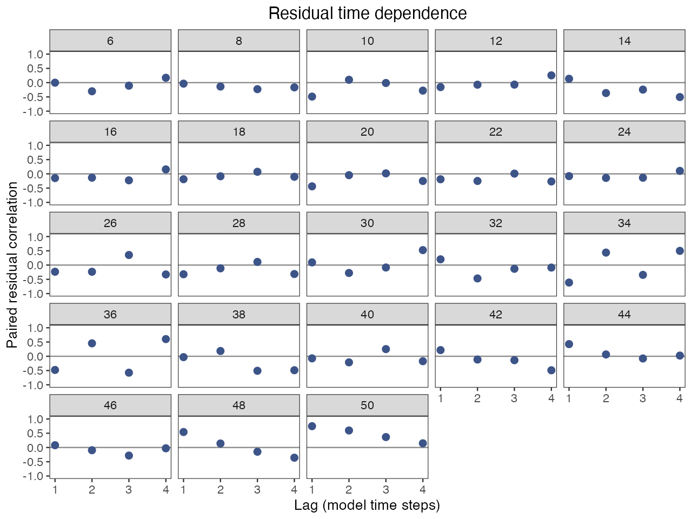
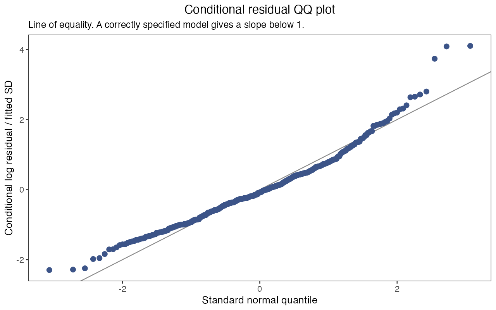

# 16 评估工作流 · Assessment workflows

[← 上一章 · Previous](https://github.com/FanZhang-LAB-SHOU/ALSCL/wiki/15-Reproducibility) · [目录 · Contents](https://github.com/FanZhang-LAB-SHOU/ALSCL/wiki) · [下一章 · Next →](https://github.com/FanZhang-LAB-SHOU/ALSCL/wiki/17-Model-Validation)

**ALSCL 2.3.0 · 简体中文 / English**

[English](#assessment-en) · [简体中文](#assessment-zh)

<a id="assessment-en"></a>

## English

Use this guide to prepare an assessment, inspect its results and choose follow-up analyses. The examples share one input bundle, `x`, and two fitted objects: `a` for ACL and `b` for ALSCL.

### Choose your starting point

| Your task | Where to start |
|---|---|
| Learn with the bundled example | Load `YTF_example` below, then [fit the teaching models](#assessment-en-fit). You can try the CSV exercise later. |
| Use your own observations | Complete the [own-data case](https://github.com/FanZhang-LAB-SHOU/ALSCL/blob/main/docs/USER_GUIDE.md#excel), then return here with your input bundle and fitted results. |
| Continue from an existing assessment | Use the fitted object that matches your own `x`; go to [results](#assessment-en-results) and [diagnostics](#assessment-en-diagnostics). |

After fitting, choose the task you need: [save results](#assessment-en-results), [check residuals](#assessment-en-diagnostics), [test assumptions](#assessment-en-sensitivity), [project a scenario](#assessment-en-projections), [evaluate simulation replicates](#assessment-en-simulations), or [validate predictions](#assessment-en-validation). Sensitivity, profiles and simulation batches perform additional fits; they are optional analyses.

**Version and setup.** These workflows require ALSCL 2.3.0 or later. Install the package and prepare a working TMB compiler before fitting. All example plots use grid-free panels.

#### Load the teaching data

```r
library(ALSCL)
library(ggplot2)
data("YTF_example")
x <- YTF_example
acl_theme_set(palette = "npg", base_theme = "theme_bw")
```

This setup only loads data. It does not fit either model. Keep `x` unchanged when reproducing the figures on this page.

The examples below start from the **synthetic** `YTF_example`. Its model-specific maps deliberately condition on several biological values to make a reproducible teaching example. Those maps are not a recommendation to fix the same parameters in your own stock assessment. For real observations, use supported stock-specific biology, inspect the effective map, and investigate weakly identified parameters rather than fixing them merely to obtain a successful optimizer code.

<a id="assessment-en-inputs"></a>
### 1. Prepare your own tables and inspect what will be estimated

For a real assessment, prepare the three aligned survey tables and review the effective parameter map before fitting. The optional exercise below writes and reads the bundled tables; first run the teaching-data setup above to create its input, `x`.

The three tables have length-bin labels in the first column and numeric time headers thereafter. `data.CatL` contains survey numbers or indices, `data.wgt` mean individual weights, and `data.mat` mature proportions. Their bins, periods and order must agree. Missing survey periods remain explicit columns of `NA`; weights and maturity must be supplied for every period. Zeros are retained on import, then excluded by `zero_action = "missing"` or rejected by `"error"`.

```r
folder <- tempfile("survey-csv-")
dir.create(folder)
for (nm in c("data.CatL", "data.wgt", "data.mat")) {
  write.csv(x[[nm]], file.path(folder, paste0(nm, ".csv")), row.names = FALSE)
}
tables <- read_survey_csv(folder)
survey_x <- prepare_alscl_data(tables, fit_args = x$fit_args)
input_check <- check_alscl_data(survey_x, "acl")
input_check$valid
input_check$errors
input_check$warnings
input_check$summary

parameter_plan <- inspect_parameters(survey_x, "acl")
parameter_plan[, c("parameter", "status", "map_source", "start",
                    "natural_start", "lower", "upper", "n_free")]
# For Excel, use read_survey_excel("survey.xlsx") instead.
# Required sheets: data.CatL, data.wgt, data.mat; optional dependency: readxl.
```

**Read the output:** `input_check$valid` reports whether the configuration is usable by the fitting functions. Resolve `errors` and review `warnings`; then use `parameter_plan` to see the effective starts, bounds and fixed/free choices.

#### Read the parameter plan before changing map

This executable CSV round-trip demonstrates the new public readers. It uses YTF biology only because the tables are YTF data. **No `fit_config` is copied into `survey_x`**, so the ordinary fitting defaults apply: ACL fixes its four documented default scalars, ALSCL fixes its two; the remaining scalar parameters are estimated. For your own files, replace both the input tables and `fit_args` with your stock-specific settings. The package does not estimate M, catchability, weights, maturity, recruitment age or bin definitions automatically.

In the table, `kind = "fixed_effect"` means an outer-model scalar, not that its value is fixed. `status` distinguishes free, fixed, tied, mixed and inactive entries; `map_source` distinguishes default rules, explicit settings and `F_structure`. `n_free` counts independent mapped values. A shared-F model has one random F value per model step, and its unused group correlation is inactive.

`check_alscl_data()` and `inspect_parameters()` share the fitting preparation and do not compile or optimize. They include data-derived starts, the recruitment-age constraint on t0, bounds, random-effect dimensions and the shared-F restriction. A valid input check establishes consistency, not identifiability or convergence.

Starting values are not fixed values. A whole `map = NULL` restores defaults; a named NULL releases one default fix. Use single-bracket assignment to retain that NULL. Releasing a variance or correlation is a scientific choice requiring sufficient information; the following code only inspects that choice.

```r
released_x <- survey_x
released_x$fit_args$map <- list(log_std_log_F = NULL)
inspect_parameters(released_x, "acl")
shared_x <- survey_x
shared_x$fit_args$F_structure <- "year"
inspect_parameters(shared_x, "alscl")
# After reviewing inputs and assumptions:
# own_acl <- run_acl(survey_x)
# own_alscl <- run_alscl(survey_x)
```

<a id="assessment-en-fit"></a>
#### Fit once and retain the objects used below

For the teaching route, fit the original `x` here. The separate `survey_x` above demonstrates import and default-map inspection; it does not replace `x` in the examples below.

```r
check_alscl_data(x, "acl")$summary
check_alscl_data(x, "alscl")$summary
a <- run_acl(x, silent = TRUE)
b <- run_alscl(x, silent = TRUE)
summary(a)
summary(b)
```

Continue with `a`, `b` and the same `x`. Review each summary before interpreting estimates. With your own data, first complete the import and fitting steps in the [own-data case](https://github.com/FanZhang-LAB-SHOU/ALSCL/blob/main/docs/USER_GUIDE.md#excel), then apply the result and diagnostic tools to those fits. The operating-model simulation in section 6 specifically uses the extra simulation settings stored in `YTF_example`.

<a id="assessment-en-results"></a>
### 2. Extract results and keep a portable assessment record

Start by extracting parameter and time-series tables from `b`, then save a portable copy. The saved object can be summarized and plotted in a fresh R session.

```r
parameter_estimates <- extract_parameters(b)
parameter_estimates
estimates <- extract_estimates(b, quantities = c("SSB", "Rec", "F"))
head(estimates)

archive <- tempfile(fileext = ".rds")
save_assessment(b, archive)
saved <- read_assessment(archive)
summary(saved)
saved$recipe$implementation
plot_SSB(saved)
# Refit when a live objective is needed:
# b_again <- refit_model(saved, silent = TRUE)
```

#### Read estimates and uncertainty

`summary()` reports numerical status alongside parameter estimates. `extract_parameters()` gives natural-scale estimates by default, with internal-scale names retained so each transformation is explicit. Fixed values have `NA` uncertainty. Exponentiating `mean_log_F` or `mean_log_R` gives the process baseline, not an arithmetic average over years.

`extract_estimates()` returns long tables with actual time, age or length coordinates. F retains native age groups for ACL and length groups for ALSCL; it is neither silently averaged nor annualized. Missing uncertainty remains `NA`; a finite standard error alone does not establish that a failed fit is suitable for inference.

`conf_level` is a nominal confidence level (default 0.95). The reported Wald intervals are pointwise and conditional on the fitted model and fixed inputs. It is not a probability assigned to a fixed parameter, and the simulation `coverage` statistic measures the observed fraction of usable intervals containing their generating truth.

#### What the archive keeps

A portable archive stores inputs, maps, bounds, reports, versions and recorded fitting settings, and removes the session-specific TMB pointer. Summaries, extraction and report-based plots work after reading. `refit_model()` reruns the saved recipe when a live model or a changed assumption is needed; it is not a claim of identical results across software versions.

The archive also retains available source revision, core-template/header and R source hashes, and runtime metadata in `recipe$implementation`. A source HEAD alone does not establish a clean working tree. Older archives remain readable when provenance is unknown; `refit_model()` warns about known implementation or dependency changes.

<a id="assessment-en-diagnostics"></a>
### 3. Diagnose observation residuals on the model time grid

Use `check_fit()` after reviewing the numerical summary. Start with the heatmap to locate length/time patterns, then inspect the lag and QQ plots.

```r
checks <- check_fit(b, max_lag = 4)
head(residuals(b, type = "standardized"))
checks$lag_correlations
checks$plots$heatmap
checks$plots$lag
checks$plots$qq
```






In the YTF example shown here, the QQ plot has a heavier positive tail and the heatmap shows positive residuals in the largest length group during later periods. These patterns warrant investigation even though the fitted models pass the numerical screen; successful optimization does not establish adequate observation structure.

#### How to interpret these checks

Standardized residuals are `(log(observation) - fitted_log_index) / fitted_observation_SD`. The table retains original observations and marks excluded zero/missing cells, whose residuals are `NA`. The heatmap locates systematic length/time patterns; the lag table uses actual model-step separations and does not compress missing periods. Correlations need at least three nonconstant paired observations. The QQ plot compares pooled standardized residuals with standard-normal quantiles.

These residuals condition on fitted latent effects. Standardization does not make them independent or turn the plots into calibrated goodness-of-fit tests. Interpret numerical status, residual patterns, biological assumptions and sensitivity together. All three plots are grid-free.

<a id="assessment-en-sensitivity"></a>
### 4. Separate sensitivity scenarios from parameter profiles

`fit_scenarios()` keeps the same three observation tables and applies explicitly named setting changes. Here ACL is used to keep the example short. Set `model = "alscl"` to use the matching ALSCL configuration; parameter and map names must belong to that model. M = 0.15 is an illustrative perturbation around the YTF value, not a biological recommendation.

The three ACL configurations use the same survey tables, growth inputs, supplied starting values and maps, except for the stated change below. In `YTF_example`, M = 0.20 per annual step and the default F structure is `"group_year"`.

| Scenario ID | M per model step | F structure | Change from the reference |
|---|---:|---|---|
| `reference` | 0.20 | `group_year`: age × time | None |
| `low_M` | 0.15 | `group_year`: age × time | Supplied natural mortality |
| `shared_F` | 0.20 | `year`: shared across ages within each step | F structure; unused age correlation becomes inactive |

```r
scenarios <- fit_scenarios(x, list(
  reference = list(),
  low_M = list(M = 0.15),
  shared_F = list(F_structure = "year")
), model = "acl", ncores = 1, nstarts = 1,
   F_summary = "mean", silent = TRUE)
scenarios$status
head(scenarios$estimates)

scenario_ssb <- subset(scenarios$estimates, quantity == "SSB")
ggplot(scenario_ssb, aes(year, estimate, color = scenario)) +
  geom_line() + labs(x = "Year", y = "SSB") +
  theme_bw() + theme(panel.grid = element_blank())
```


#### Read scenario status before comparing curves

Inspect every row of `status`, including warnings and failed fits, before comparing trajectories. There is no automatic ranking. `F_summary = "mean"` requests an unweighted group mean; `"apical"` requests the maximum. These meanings differ and neither annualizes subannual F. `ncores` parallelizes independent scenarios; inner fits and standard errors use one worker while preserving the chosen `nstarts`. List-valued overrides replace entire lists, including map; they are not deep merges.

For quarterly data, `"year"` still means one F per model step (one per quarter), not one per calendar year.

#### Profile a parameter that was actually estimated

A parameter profile fixes one free scalar at successive values and refits the other free scalars and random effects. The YTF example fixes `log_Linf`, so it is not an eligible target here. `mean_log_F` is free, and the following three points illustrate how the API works on its natural baseline scale. A useful scientific profile usually needs a denser, justified range and successful fits across the grid.

```r
profile_values <- exp(a$opt$par[["mean_log_F"]]) * c(0.9, 1, 1.1)
profile_F <- profile_model(a, "mean_log_F", profile_values,
                           scale = "natural", ncores = 1)
profile_F$grid
ggplot(profile_F$grid, aes(value, delta_nll)) +
  geom_line() + geom_point() +
  labs(x = "F process baseline", y = "Change in negative log likelihood") +
  theme_bw() + theme(panel.grid = element_blank())
```


`delta_nll` is measured relative to the original fit. A negative value means a grid refit found a lower objective and the original optimum should be investigated; it is not clipped to zero. Failed points remain visible. The function does not infer confidence intervals or automatic likelihood-ratio cutoffs. External inputs such as M and survey catchability belong in sensitivity scenarios, not this scalar profile.

<a id="assessment-en-projections"></a>
### 5. Project explicitly defined future scenarios

`project_model()` advances saved population states under supplied future fishing mortality, recruitment, weights and maturity. The code below **explicitly chooses** to carry forward the last observed weight/maturity columns and terminal fitted recruitment for four periods. Those are example assumptions, not defaults selected by the function. Growth remains at the fitted age–length key and, for ALSCL, fitted transition matrix. Future M defaults to the original recorded input; it can also be supplied explicitly.

The two scenarios compare F = 0.10 and F = 0.25 per step with identical recruitment, weights, maturity and M.

```r
h <- 4L
w <- as.matrix(x$data.wgt[-1L])
mat <- as.matrix(x$data.mat[-1L])
future_w <- matrix(w[, ncol(w)], nrow(w), h)
future_mat <- matrix(mat[, ncol(mat)], nrow(mat), h)
future_rec <- rep(tail(b$report$Rec, 1), h)

low_F <- project_model(b, F = rep(0.10, h), recruitment = future_rec,
                       weight = future_w, maturity = future_mat)
higher_F <- project_model(b, F = rep(0.25, h), recruitment = future_rec,
                          weight = future_w, maturity = future_mat)
low_F$summary
higher_F$summary
low_F$assumptions
projection_ssb <- rbind(
  transform(low_F$summary, scenario = "F = 0.10"),
  transform(higher_F$summary, scenario = "F = 0.25"))
ggplot(projection_ssb, aes(year, SSB, color = scenario)) +
  geom_line() + geom_point() + labs(x = "Year", y = "Start-of-period SSB") +
  theme_bw() + theme(panel.grid = element_blank())
```


#### Read the timing of the response

States, B and SSB describe the **start** of each future period. The first future state uses the terminal fitted F and original M, followed by the first supplied recruitment. Future F[t] affects catch[t] and survival into t+1. The two scenarios therefore have the same first future SSB, but different first-period catches; their SSB responses appear subsequently. M and F are instantaneous rates per model step, including quarters.

#### Assumptions and numerical status

These are deterministic conditional scenarios. They include no uncertainty intervals, estimated stock–recruitment function, MSY or TAC calculation. Use the output to examine stated assumptions, not to imply forecast certainty or a management recommendation.

Fits explicitly failing the numerical screen are rejected by default. `allow_failed_fit = TRUE` permits exploratory projection with a warning. Missing legacy diagnostics are recorded as unknown, not passed; assumptions retain the status and override.

<a id="assessment-en-simulations"></a>
### 6. Fit simulation replicates and report their failure rate

`sim_model()` selects ACL or ALSCL for files produced by `sim_data()`. `sim_acl()` retains the original ACL interface; `sim_alscl()` is its ALSCL counterpart. This short example uses two replicates to demonstrate file alignment, not to estimate simulation performance precisely. Use the matching model's starts and map. The teaching presets are conditional simulation settings, not evidence for fixing those parameters with real data.

Each input file `sim_rep<i>` contains `sim.data`. Each fitted record is named and saved as `result_rep_<i>`, including failures. Truth must be keyed to those exact result names and use the recorded simulation time coordinates. Do not reuse one returned replicate's truth for every fit. Below, truth is read from each separate simulation file and aligned explicitly.

```r
pa <- x$parameters
bio <- sim_cal(pa)
iterations <- 1:2
simulation_dir <- tempfile("assessment-sim-")
sm <- sim_data(bio, pa, iter_range = iterations,
               return_iter = iterations[1], output_dir = simulation_dir)

cfg <- x$fit_config$alscl
simulation_fits <- sim_model(iterations, simulation_dir,
  file.path(simulation_dir, "fits_alscl"), model = "alscl", ncores = 1,
  parameters = cfg$parameters, parameters.L = cfg$parameters.L,
  parameters.U = cfg$parameters.U, map = cfg$map, M = pa$M)

simulation_truth <- setNames(lapply(iterations, function(i) {
  e <- new.env(parent = emptyenv())
  load(file.path(simulation_dir, paste0("sim_rep", i)), envir = e)
  s <- e$sim.data
  list(year = s$years, SSB = as.numeric(s$SSB), Rec = as.numeric(s$Rec))
}), paste0("result_rep_", iterations))
stopifnot(identical(names(simulation_fits), names(simulation_truth)))
performance <- summarize_simulations(simulation_fits, simulation_truth,
                                     quantities = c("SSB", "Rec"))
performance$replicates
performance$summary
head(performance$estimates)
```

#### Read the simulation denominators

Bias and RMSE use numerically valid estimate–truth pairs; coverage additionally requires usable reported standard errors. Always report `failure_rate`, `n_replicates`, `n_valid_fits`, `n_valid_pairs` and `n_intervals` alongside the performance statistics. Missing standard errors are not counted as coverage failures; relative bias excludes zero truth. F is intentionally excluded because its group summary and uncertainty must be defined separately.

These are operating-model experiments, not automatically a fitted parametric bootstrap. Two replicates cannot establish coverage or model superiority. For a real experiment, specify scenarios and sufficient replication before interpreting results. Save the configuration, all failures and the generating truth, rather than only successful estimates.

#### Save the completed workflow

The following block collects outputs from sections 4–6. Run it after those sections; if you only used one analysis, save that analysis object separately.

```r
record_dir <- tempfile("assessment-record-")
dir.create(record_dir)
write.csv(scenarios$status, file.path(record_dir, "scenario_status.csv"), row.names = FALSE)
write.csv(profile_F$grid, file.path(record_dir, "profile_F.csv"), row.names = FALSE)
write.csv(performance$summary, file.path(record_dir, "simulation_summary.csv"), row.names = FALSE)
saveRDS(list(input = x, scenarios = scenarios, profile = profile_F,
  projections = list(low_F = low_F, higher_F = higher_F),
  simulation_truth = simulation_truth, performance = performance),
  file.path(record_dir, "workflow_record.rds"))
writeLines(capture.output(sessionInfo()), file.path(record_dir, "session.txt"))
```

<a id="assessment-en-validation"></a>
### 7. Simulate the fitted model and validate future-period predictions

Use `simulate_fit()` to generate data from the fitted process and observation model, and `hindcast_model()` to predict periods excluded from each training fit. The [complete model-validation case](https://github.com/FanZhang-LAB-SHOU/ALSCL/blob/main/docs/MODEL_VALIDATION.md) covers conditional versus process simulations, retained truth, replicate refitting, time-held-out forecasts and paired log-scale scores.

<a id="assessment-zh"></a>

## 简体中文

本指南说明如何准备评估、检查结果并选择后续分析。示例共用一个输入列表 `x` 和两个拟合对象：`a` 是 ACL，`b` 是 ALSCL。

### 选择适合你的起点

| 你要做什么 | 从哪里开始 |
|---|---|
| 先用内置数据熟悉操作 | 加载下面的 `YTF_example`，再[拟合教学模型](#assessment-zh-fit)。CSV 练习可以稍后再做。 |
| 分析自己的调查观测 | 先完成[正式数据拟合案例](https://github.com/FanZhang-LAB-SHOU/ALSCL/blob/main/docs/USER_GUIDE.md#excel)，再带着自己的输入列表和拟合结果返回本页。 |
| 已经有拟合结果 | 使用与你的 `x` 对应的拟合对象，直接查看[结果提取](#assessment-zh-results)和[诊断](#assessment-zh-diagnostics)。 |

完成拟合后，可按需要选择：[保存结果](#assessment-zh-results)、[检查残差](#assessment-zh-diagnostics)、[检验假设敏感性](#assessment-zh-sensitivity)、[投影未来情景](#assessment-zh-projections)、[汇总模拟重复](#assessment-zh-simulations)或[验证预测](#assessment-zh-validation)。敏感性、参数剖面和模拟批次会进行额外拟合，可按分析目的选做。

**版本与环境。** 这些工作流需要 ALSCL 2.3.0 或更高版本。拟合前请安装软件包，并准备可用的 TMB 编译工具。所有示例图均保持无网格样式。

#### 加载教学数据

```r
library(ALSCL)
library(ggplot2)
data("YTF_example")
x <- YTF_example
acl_theme_set(palette = "npg", base_theme = "theme_bw")
```

这一步只加载数据，不拟合模型。若要复现本页配图，请保留原来的 `x`。

下面从**模拟数据** `YTF_example` 开始。其模型专属 map 为了形成可复现教学案例，条件固定了若干生物学参数；这不意味着正式资源评估也应固定同样的参数。使用真实观测时，请提供有依据的种群生物学输入，检查实际生效的 map，并研究信息不足的参数，不要只为获得优化成功代码而随意固定。

<a id="assessment-zh-inputs"></a>
### 1. 整理自己的数据，并检查实际待估参数

使用正式数据时，先整理三张对齐的调查表，再检查实际生效的参数映射。下面的可选练习将内置表写入 CSV 后重新读取；先运行上方的教学数据准备代码，建立所需的 `x`。

三张表的第一列为体长组标签，后续列名为数值时间。`data.CatL` 是调查数量或指数，`data.wgt` 是平均个体重量，`data.mat` 是成熟比例；体长组、时期及顺序必须一致。缺失调查时期仍须保留 `NA` 列，体重和成熟比例必须覆盖每个时期。导入保留零值，再由 `zero_action = "missing"` 排除或 `"error"` 拒绝。

```r
folder <- tempfile("survey-csv-")
dir.create(folder)
for (nm in c("data.CatL", "data.wgt", "data.mat")) {
  write.csv(x[[nm]], file.path(folder, paste0(nm, ".csv")), row.names = FALSE)
}
tables <- read_survey_csv(folder)
survey_x <- prepare_alscl_data(tables, fit_args = x$fit_args)
input_check <- check_alscl_data(survey_x, "acl")
input_check$valid
input_check$errors
input_check$warnings
input_check$summary

parameter_plan <- inspect_parameters(survey_x, "acl")
parameter_plan[, c("parameter", "status", "map_source", "start",
                    "natural_start", "lower", "upper", "n_free")]
# For Excel, use read_survey_excel("survey.xlsx") instead.
# Required sheets: data.CatL, data.wgt, data.mat; optional dependency: readxl.
```

**先看这些输出：** `input_check$valid` 表示配置能否交给拟合函数；先解决 `errors`，再查看 `warnings`。随后通过 `parameter_plan` 核对实际初值、上下界以及固定／估计的选择。

#### 修改 map 前先看参数计划

上面的 CSV 往返示例可以直接运行。只有因为示例表来自 YTF，才使用其生物学输入。**`survey_x` 不复制 `fit_config`**，因此使用核心默认 map：ACL 固定文档列明的四个默认标量，ALSCL 固定两个，其他标量参数参与估计。使用自己的文件时，数据表和 `fit_args` 都须换成研究对象的设置。M、调查可捕性、体重、成熟比例、补充年龄及体长分组不会由包自动估计。

`kind = "fixed_effect"` 表示外层标量参数，并不表示数值被固定。`status` 区分 free、fixed、tied、mixed、inactive；`map_source` 区分默认规则、显式设置及 `F_structure`。`n_free` 统计独立映射值。共享 F 模型每个模型时间步只有一个 F 随机值，不使用的组间相关系数标为 inactive。

`check_alscl_data()` 和 `inspect_parameters()` 与核心拟合共用准备逻辑，但不编译、不优化；包含数据初值、t0 的补充年龄约束、上下界、随机效应维度及共享 F 限制。输入检查通过不等于可辨识或收敛。

初值不等于固定值。整个 `map = NULL` 恢复默认规则，具名 NULL 才释放单个默认固定参数；用单方括号赋值保留 NULL。释放方差或相关参数需要足够数据支持，下面仅展示如何检查该选择。

```r
released_x <- survey_x
released_x$fit_args$map <- list(log_std_log_F = NULL)
inspect_parameters(released_x, "acl")
shared_x <- survey_x
shared_x$fit_args$F_structure <- "year"
inspect_parameters(shared_x, "alscl")
# After reviewing inputs and assumptions:
# own_acl <- run_acl(survey_x)
# own_alscl <- run_alscl(survey_x)
```

<a id="assessment-zh-fit"></a>
#### 拟合一次，保留后续共用的对象

沿教学路线操作时，在这里拟合原始 `x`。上面的 `survey_x` 专门演示导入与默认 map 检查，不会替换后续示例中的 `x`。

```r
check_alscl_data(x, "acl")$summary
check_alscl_data(x, "alscl")$summary
a <- run_acl(x, silent = TRUE)
b <- run_alscl(x, silent = TRUE)
summary(a)
summary(b)
```

接下来沿用 `a`、`b` 及同一份 `x`，解释估计前先检查两份 summary。分析自己的数据时，先完成[正式数据案例](https://github.com/FanZhang-LAB-SHOU/ALSCL/blob/main/docs/USER_GUIDE.md#excel)中的导入和拟合，再将结果提取与诊断工具用于自己的拟合。第 6 节的操作模型模拟另外使用 `YTF_example` 保存的模拟参数。

<a id="assessment-zh-results"></a>
### 2. 提取结果，保存可移植评估记录

先从 `b` 提取参数表和时间序列表，再保存可移植副本。重新打开 R 后，读取的对象仍可用于汇总和绘图。

```r
parameter_estimates <- extract_parameters(b)
parameter_estimates
estimates <- extract_estimates(b, quantities = c("SSB", "Rec", "F"))
head(estimates)

archive <- tempfile(fileext = ".rds")
save_assessment(b, archive)
saved <- read_assessment(archive)
summary(saved)
saved$recipe$implementation
plot_SSB(saved)
# Refit when a live objective is needed:
# b_again <- refit_model(saved, silent = TRUE)
```

#### 解读估计值与不确定性

`summary()` 同时报告数值状态与参数估计。`extract_parameters()` 默认返回自然尺度估计，但保留内部参数名称，使变换明确；固定参数的不确定性为 `NA`。`mean_log_F` 或 `mean_log_R` 取指数得到过程基准水平，不是多年算术平均。

`extract_estimates()` 返回带实际时间、年龄或体长坐标的长表。F 保留 ACL 的年龄组或 ALSCL 的体长组，不会静默取平均或转成年率。缺少不确定性时保留 `NA`；即使有有限标准误，也不代表数值检查失败的拟合适合推断。

`conf_level` 表示名义置信水平（默认 0.95）。报告的 Wald 区间是逐点区间，以拟合模型和固定输入为条件；它不表示固定参数落入本次区间的概率。模拟中的 `coverage` 则统计可用区间包含各自生成真值的实际比例。

#### 存档保留了什么

可移植文件保留输入、map、上下界、报告、版本及计算设置，并移除当前会话专用的 TMB 指针。读取后可汇总、提取和使用基于报告的绘图。需要活跃模型或改变假设时，用 `refit_model()` 重新运行记录；不同软件版本间不保证逐位相同。

存档的 `recipe$implementation` 还记录可取得的源码提交、核心模板／头文件和 R 源码摘要及运行环境。源码 HEAD 本身不证明工作区没有修改。旧存档来源未知时仍可读取；`refit_model()` 对已知的实现或依赖变化发出警告。

<a id="assessment-zh-diagnostics"></a>
### 3. 按模型时间轴检查观测残差

检查数值 summary 后，用 `check_fit()` 查看残差。先通过热图寻找体长和时间模式，再看滞后图与 QQ 图。

```r
checks <- check_fit(b, max_lag = 4)
head(residuals(b, type = "standardized"))
checks$lag_correlations
checks$plots$heatmap
checks$plots$lag
checks$plots$qq
```


本页 YTF 示例中，QQ 图正尾较重，热图最大体长组在后期呈现正残差模式。即使模型通过数值检查，也应调查这些模式；优化成功不能证明观测结构适当。

#### 如何解释这些检查

标准化残差为 `(log(观测) - 拟合对数指数) / 拟合观测标准差`。表格保留原始观测，标记被排除的零值／缺失单元，并将对应残差设为 `NA`。热图定位体长与时间方向的系统模式；滞后表按真实模型时间步配对，不压缩缺失时期，相关系数至少需要三对且两侧都非常数的观测。QQ 图将合并标准化残差与标准正态分位数比较。

这些残差条件于估计的潜在效应。标准化不意味着独立，也不会把图形变成校准过的拟合优度检验。请结合数值状态、残差模式、生物学假设及敏感性判断。三类图均无网格。

<a id="assessment-zh-sensitivity"></a>
### 4. 区分假设敏感性与参数剖面

`fit_scenarios()` 保持相同三张观测输入表，只应用具名设置变化。这里使用 ACL 缩短示例运行时间；改为 `model = "alscl"` 即选取相应 ALSCL 设置，参数名和 map 必须与模型匹配。M = 0.15 只是围绕 YTF 输入的示例扰动，不是生物学建议。

三套 ACL 配置使用相同调查表、生长输入、提供的初值和 map，仅改变下表列出的设置。`YTF_example` 的 M 为每年度时间步 0.20，默认 F 结构为 `"group_year"`。

| 情景 ID | 每时间步 M | F 结构 | 相对参考配置的改变 |
|---|---:|---|---|
| `reference` | 0.20 | `group_year`：年龄 × 时间 | 无 |
| `low_M` | 0.15 | `group_year`：年龄 × 时间 | 外部提供的自然死亡率 |
| `shared_F` | 0.20 | `year`：每时间步内各年龄共用 F | F 结构；不使用的年龄相关参数变为 inactive |

```r
scenarios <- fit_scenarios(x, list(
  reference = list(),
  low_M = list(M = 0.15),
  shared_F = list(F_structure = "year")
), model = "acl", ncores = 1, nstarts = 1,
   F_summary = "mean", silent = TRUE)
scenarios$status
head(scenarios$estimates)

scenario_ssb <- subset(scenarios$estimates, quantity == "SSB")
ggplot(scenario_ssb, aes(year, estimate, color = scenario)) +
  geom_line() + labs(x = "Year", y = "SSB") +
  theme_bw() + theme(panel.grid = element_blank())
```


#### 先看情景状态，再比较曲线

比较轨迹前先检查 `status` 的每一行，包括警告和失败拟合；函数不自动排名。`F_summary = "mean"` 是未加权组间均值，`"apical"` 是最大值，两者含义不同，也都不把季度 F 转为年率。`ncores` 并行运行独立情景；内层拟合和标准误使用单个 worker，并保留指定的 `nstarts`。列表覆盖整体替换，map 也不逐项深度合并。

季度数据的 `"year"` 仍表示每模型时间步一个 F，即每季度一个，并非每日历年一个。

#### 对实际参与估计的参数做剖面

参数剖面将一个自由标量依次固定在网格值上，重新估计其他自由标量与随机效应。YTF 示例固定了 `log_Linf`，因此这里不能对它做剖面。`mean_log_F` 参与估计，下面三个点演示自然基准尺度的接口；有科学意义的剖面通常需要更密、理由明确的范围及各点成功拟合。

```r
profile_values <- exp(a$opt$par[["mean_log_F"]]) * c(0.9, 1, 1.1)
profile_F <- profile_model(a, "mean_log_F", profile_values,
                           scale = "natural", ncores = 1)
profile_F$grid
ggplot(profile_F$grid, aes(value, delta_nll)) +
  geom_line() + geom_point() +
  labs(x = "F process baseline", y = "Change in negative log likelihood") +
  theme_bw() + theme(panel.grid = element_blank())
```


`delta_nll` 相对于原始拟合计算。负值表示网格拟合找到更低的目标函数，应重新检查原始最优点；不会截成零。失败点保留。函数不自动推导置信区间或似然比阈值。M 和调查可捕性等外部输入应使用敏感性情景，而不是标量参数剖面。

<a id="assessment-zh-projections"></a>
### 5. 投影假设明确的未来情景

`project_model()` 根据提供的未来 F、补充量、体重和成熟比例推进保存的种群状态。下面**明确选择**将末次观测的体重／成熟比例及末期拟合补充量延续四期；这是示例假设，不是函数自动决定的默认值。生长保持拟合的年龄—体长键，ALSCL 还保持拟合的生长转移矩阵。未来 M 默认使用原始记录输入，也可显式指定。

两套情景比较每时间步 F = 0.10 和 F = 0.25，补充量、体重、成熟比例及 M 均相同。

```r
h <- 4L
w <- as.matrix(x$data.wgt[-1L])
mat <- as.matrix(x$data.mat[-1L])
future_w <- matrix(w[, ncol(w)], nrow(w), h)
future_mat <- matrix(mat[, ncol(mat)], nrow(mat), h)
future_rec <- rep(tail(b$report$Rec, 1), h)

low_F <- project_model(b, F = rep(0.10, h), recruitment = future_rec,
                       weight = future_w, maturity = future_mat)
higher_F <- project_model(b, F = rep(0.25, h), recruitment = future_rec,
                          weight = future_w, maturity = future_mat)
low_F$summary
higher_F$summary
low_F$assumptions
projection_ssb <- rbind(
  transform(low_F$summary, scenario = "F = 0.10"),
  transform(higher_F$summary, scenario = "F = 0.25"))
ggplot(projection_ssb, aes(year, SSB, color = scenario)) +
  geom_line() + geom_point() + labs(x = "Year", y = "Start-of-period SSB") +
  theme_bw() + theme(panel.grid = element_blank())
```


#### 理解响应发生的时间

状态、B 和 SSB 表示每个未来时期的**期初**。第一未来状态先经历末期拟合 F 与原始 M，再加入第一期补充；未来 F[t] 影响当期渔获及存活到 t+1 的数量。因此两个情景的第一期未来 SSB 相同，但第一期渔获不同，后续 SSB 才出现响应。M 和 F 均为每个模型时间步的瞬时率，季度模型也一样。

#### 情景假设与数值状态

这只是确定性的条件情景，没有不确定性区间、估计的亲体补充关系、MSY 或 TAC 计算。结果用于检视明确假设，不能表示确定的预测或管理建议。

明确未通过数值检查的拟合默认拒绝投影。`allow_failed_fit = TRUE` 可在警告后进行探索性投影；旧结果缺少诊断时记为 unknown，不视为通过。assumptions 保存状态及是否覆盖。

<a id="assessment-zh-simulations"></a>
### 6. 拟合模拟重复，并报告失败率

`sim_model()` 可选择 ACL 或 ALSCL 拟合 `sim_data()` 生成的文件；`sim_acl()` 保留原有 ACL 接口，`sim_alscl()` 是对应的 ALSCL 入口。这里用两次重复演示文件对齐，并不足以精确估计模拟性能。初值和 map 必须采用所选模型的名称；教学预设是条件模拟设置，不是正式数据应固定这些参数的证据。

每个输入文件 `sim_rep<i>` 含 `sim.data`；拟合记录命名并保存为 `result_rep_<i>`，失败也保存。真值必须以这些结果名称为键，使用模拟记录的时间坐标；不能把单个返回重复的真值复用于所有拟合。下面逐个读取模拟文件并显式对齐。

```r
pa <- x$parameters
bio <- sim_cal(pa)
iterations <- 1:2
simulation_dir <- tempfile("assessment-sim-")
sm <- sim_data(bio, pa, iter_range = iterations,
               return_iter = iterations[1], output_dir = simulation_dir)

cfg <- x$fit_config$alscl
simulation_fits <- sim_model(iterations, simulation_dir,
  file.path(simulation_dir, "fits_alscl"), model = "alscl", ncores = 1,
  parameters = cfg$parameters, parameters.L = cfg$parameters.L,
  parameters.U = cfg$parameters.U, map = cfg$map, M = pa$M)

simulation_truth <- setNames(lapply(iterations, function(i) {
  e <- new.env(parent = emptyenv())
  load(file.path(simulation_dir, paste0("sim_rep", i)), envir = e)
  s <- e$sim.data
  list(year = s$years, SSB = as.numeric(s$SSB), Rec = as.numeric(s$Rec))
}), paste0("result_rep_", iterations))
stopifnot(identical(names(simulation_fits), names(simulation_truth)))
performance <- summarize_simulations(simulation_fits, simulation_truth,
                                     quantities = c("SSB", "Rec"))
performance$replicates
performance$summary
head(performance$estimates)
```

#### 解读模拟统计的分母

偏差和 RMSE 使用通过数值检查的估计—真值配对；覆盖率还要求可用的报告标准误。请同时报告 `failure_rate`、`n_replicates`、`n_valid_fits`、`n_valid_pairs` 和 `n_intervals`。缺少标准误不算作未覆盖；相对偏差排除零真值。F 不在该汇总内，因为需要另外明确组间汇总及其不确定性。

这是操作模型实验，不自动等于围绕拟合模型的参数自助法。两次重复不能证明覆盖率或模型优越性；正式实验应预先定义情景和足够重复。保存配置、全部失败及生成真值，不只保存成功估计。

#### 保存已完成的工作流

下面汇总第 4–6 节的对象，请完成这些分析后再运行；如果只做了其中一项，单独保存该分析对象即可。

```r
record_dir <- tempfile("assessment-record-")
dir.create(record_dir)
write.csv(scenarios$status, file.path(record_dir, "scenario_status.csv"), row.names = FALSE)
write.csv(profile_F$grid, file.path(record_dir, "profile_F.csv"), row.names = FALSE)
write.csv(performance$summary, file.path(record_dir, "simulation_summary.csv"), row.names = FALSE)
saveRDS(list(input = x, scenarios = scenarios, profile = profile_F,
  projections = list(low_F = low_F, higher_F = higher_F),
  simulation_truth = simulation_truth, performance = performance),
  file.path(record_dir, "workflow_record.rds"))
writeLines(capture.output(sessionInfo()), file.path(record_dir, "session.txt"))
```

<a id="assessment-zh-validation"></a>
### 7. 从拟合模型模拟，并验证未来时期预测

`simulate_fit()` 从拟合的过程与观测模型生成数据；`hindcast_model()` 预测未参与各次训练拟合的时期。[完整模型验证案例](https://github.com/FanZhang-LAB-SHOU/ALSCL/blob/main/docs/MODEL_VALIDATION.md) 说明条件／过程模拟、真值保留、重复拟合、时间留出预测及配对对数评分。

---

[← 上一章 · Previous](https://github.com/FanZhang-LAB-SHOU/ALSCL/wiki/15-Reproducibility) · [目录 · Contents](https://github.com/FanZhang-LAB-SHOU/ALSCL/wiki) · [下一章 · Next →](https://github.com/FanZhang-LAB-SHOU/ALSCL/wiki/17-Model-Validation)
