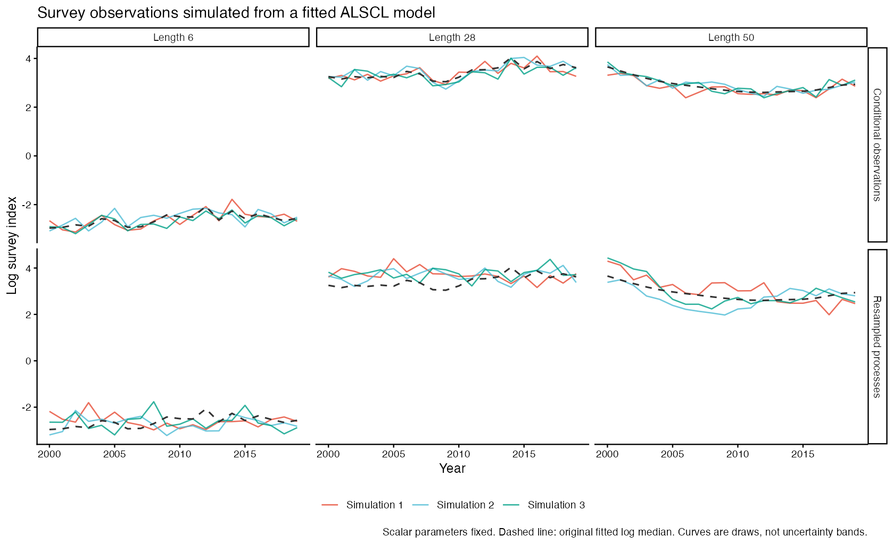
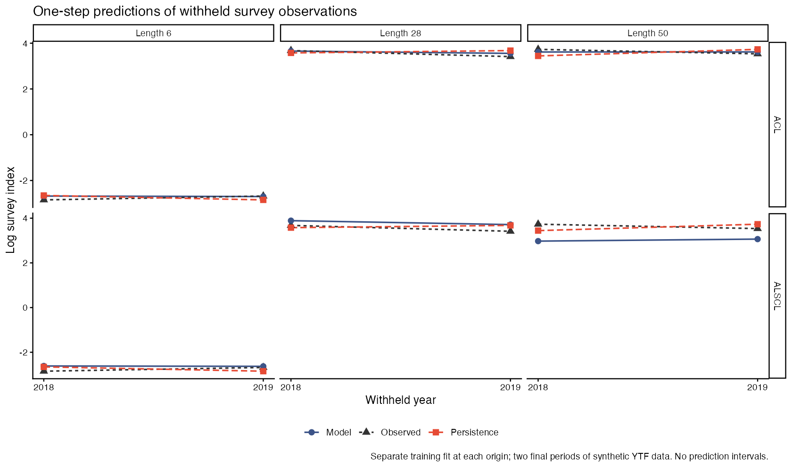

# 17 模型模拟与预测验证 · Model simulation and prediction checks

[← 上一章 · Previous](https://github.com/FanZhang-LAB-SHOU/ALSCL/wiki/16-Assessment-Workflows) · [目录 · Contents](https://github.com/FanZhang-LAB-SHOU/ALSCL/wiki) · [下一章 · Next →](https://github.com/FanZhang-LAB-SHOU/ALSCL/wiki/18-Worked-Cases)

**ALSCL 2.4.0 · 简体中文 / English**

<!-- Generated by scripts/build_manual.py from website/content/{en,zh}/articles/. Edit the article pair, not this file. -->

[使用指南 / User guide](https://github.com/FanZhang-LAB-SHOU/ALSCL/blob/main/docs/USER_GUIDE.md) · [首页 / Home](https://github.com/FanZhang-LAB-SHOU/ALSCL/blob/main/README.md)

## 模型能重现观测并预测留出时间步吗？ / Can the fitted model reproduce observations and predict withheld time steps?

本页从两个方面检验一个拟合好的模型。拟合模型模拟从拟合中生成新的调查数据并重新拟合，看估计值能否找回已知值；预测检验用较早的时间步拟合，再把留出的后续时间步的预测与观测对照打分。你需要已安装的软件包（[安装 ALSCL](https://github.com/FanZhang-LAB-SHOU/ALSCL/blob/main/docs/USER_GUIDE.md#start)）；代码使用模拟的 `YTF_example`，总共约需十五分钟，因为第 3、4 步要多次重新拟合模型。只做预测检验时，运行第 1 步后直接到第 4 步。结束时你会有带真值的模拟数据集、偏差、RMSE 和区间覆盖率表、两个模型相对于持平基准的预测评分，以及保存的拟合结果。

On this page you check a fitted model from two sides. Fitted-model simulation draws new survey data from the fit and refits them, to see whether the estimates recover the known values; hindcast validation fits on the earlier time steps and scores the predictions of the withheld later ones against the observations. You need the package installed ([Install ALSCL](https://github.com/FanZhang-LAB-SHOU/ALSCL/blob/main/docs/USER_GUIDE.md#start)); the code uses the synthetic `YTF_example` and takes about fifteen minutes in total, because steps 3 and 4 refit the models several times. For hindcast validation alone, run step 1 and go to step 4. At the end you have simulated datasets with their truth, a table of bias, RMSE and interval coverage, the prediction scores of both models against a persistence baseline, and a saved fit.

<a id="case-model-validation-section-1"></a>

### 1. 读取示例并拟合源模型 / Load the example and fit the source model

```r
library(ALSCL)
data("YTF_example")
x <- YTF_example
b <- run_alscl(x, silent = TRUE)
b$diagnostics
stopifnot(b$diagnostics$numerical_ok)
```

`x` 是输入列表，`b` 是第 2 步模拟的起点 ALSCL 拟合；第 4 步的预测检验只读取 `x`。`b$diagnostics` 的 `numerical_ok` 必须为 `TRUE`，因为除非 `allow_failed_fit = TRUE`，`simulate_fit()` 会拒绝未通过数值检查的拟合；若为 `FALSE`，先按[判断拟合是否可用](https://github.com/FanZhang-LAB-SHOU/ALSCL/blob/main/docs/USER_GUIDE.md#diagnostics)修好拟合再模拟。教学示例通过 `map` 固定了生长和若干过程参数；用自己的输入列表时，选择有依据的生物学设置（[选择拟合设置](https://github.com/FanZhang-LAB-SHOU/ALSCL/blob/main/docs/USER_GUIDE.md#fitting)），在模拟研究中固定 `mean_log_R` 时，把它的值写在 `parameters` 里，使每份模拟数据都用同一个值，而不是各自由数据推出的值。

`x` is the input bundle and `b` the ALSCL fit that the simulations of step 2 start from; hindcast validation in step 4 reads `x` only. `b$diagnostics` must show `numerical_ok` equal to `TRUE`, because `simulate_fit()` refuses a fit that failed the numerical checks unless `allow_failed_fit = TRUE`; if it is `FALSE`, repair the fit as on [Judge whether a fit can be used](https://github.com/FanZhang-LAB-SHOU/ALSCL/blob/main/docs/USER_GUIDE.md#diagnostics) before simulating. The teaching example fixes growth and several process parameters through `map`; with your own bundle choose supported biology ([Choose the fitting settings](https://github.com/FanZhang-LAB-SHOU/ALSCL/blob/main/docs/USER_GUIDE.md#fitting)), and when you fix `mean_log_R` for a simulation study give its value in `parameters`, so that every simulated dataset uses the same value instead of one derived from its own data.

<a id="case-model-validation-section-2"></a>

### 2. 从拟合生成调查观测 / Generate survey observations from the fit

<a id="case-model-validation-conditional-draws"></a>

#### 保留拟合的种群状态 / Keep the fitted population states

```r
conditional <- simulate_fit(b, nsim = 3, seed = 20261101,
  process = "conditional")
conditional$metadata
conditional$simulations[[1]]$observations[1:3, 1:3]
```

`process = "conditional"` 保持拟合的种群不变，只重新抽取观测误差，是查看同一状态下重复调查的最短路径。`metadata` 记录模型、过程、种子、原始观测掩码、源拟合的状态和假设 `parameter_uncertainty = "none"`。

`process = "conditional"` keeps the fitted population and redraws only the observation error, the shortest way to see repeated surveys of the same states. `metadata` records the model, the process, the seed, the original observation mask, the status of the source fit and the assumption `parameter_uncertainty = "none"`.

<a id="case-model-validation-process-draws"></a>

#### 生成新的种群轨迹 / Generate new population trajectories

```r
resampled <- simulate_fit(b, nsim = 3, seed = 20261101,
  process = "resample")
resampled$simulations[[1]]$truth$SSB
simulated_x <- resampled$simulations[[1]]$x
```

`process = "resample"` 还在拟合的标量参数值下重新抽取补充量、捕捞死亡率和初始丰度的过程偏差：补充量和 F 遵循拟合的平稳 AR(1) 过程（`F_structure = "year"` 时每个时间步一个 F 序列），初始丰度偏差是独立正态抽样，C++ 种群模型把这些抽样变成新的种群。两种模式都围绕拟合的 `Elog_index`、按拟合的观测标准差抽取对数观测，所以 `exp(Elog_index)` 是中位数；标量参数、生物学设置和调查可捕性保持固定，因此两种模式都没有参数不确定性。`$simulations` 的每个元素包含 `observations`（体长组 × 时间步）、`truth`（种群量、标量参数和所用的偏差）和 `x`，后者是可交给 `run_alscl()` 的输入列表，保留 `b` 的拟合配置，但 `output`、`ncores` 和 `silent` 除外，由你在拟合时指定。原始调查的缺失和零值单元保持原样，除非 `preserve_missing = FALSE`；种子让抽样可以重复，结束后恢复调用者的随机数状态。固定或绑定过程偏差的 `map` 会使重抽模式终止，条件抽样仍可使用。若要用有自己补充量假设的操作模型，见[模拟调查数据](https://github.com/FanZhang-LAB-SHOU/ALSCL/blob/main/docs/USER_GUIDE.md#simulation)。

`process = "resample"` also draws new process deviations of recruitment, fishing mortality and initial abundance at the fitted scalar parameter values: recruitment and F follow the fitted stationary AR(1) processes (one F series per time step under `F_structure = "year"`), the initial-abundance deviations are independent normals, and the C++ population model turns the draws into a new population. Both modes draw log observations around the fitted `Elog_index` with the fitted observation SD, so `exp(Elog_index)` is the median; scalar parameters, biology and survey catchability stay fixed, so neither mode carries parameter uncertainty. Each element of `$simulations` holds `observations` (length bins by time steps), `truth` (population quantities, scalar parameters and the deviations used) and `x`, an input bundle for `run_alscl()` that keeps the fitting configuration of `b` except `output`, `ncores` and `silent`, which you choose when fitting it. Missing and zero cells of the original survey stay as they are unless `preserve_missing = FALSE`; the seed makes the draws repeatable, and the caller's random-number state is restored afterwards. A `map` that fixes or ties the process deviations stops the resample mode, while conditional draws still work. For an operating model with its own recruitment assumptions, use [Simulate survey data](https://github.com/FanZhang-LAB-SHOU/ALSCL/blob/main/docs/USER_GUIDE.md#simulation).



图中为三个体长组在两种模式下各三次抽样；虚线是拟合的对数中位数。条件抽样围绕相同的拟合状态散布，重抽过程的抽样还会移动轨迹。每条曲线是一次抽样，是生成分布的一个例子。

The figure shows three draws per mode for three length bins; the dashed line is the fitted log median. Conditional draws scatter around the same fitted states, and resampled draws also move the trajectory. Each curve is one draw, an example of the generating distribution.

<a id="case-model-validation-section-3"></a>

### 3. 重新拟合重复数据并与真值比较 / Refit the replicates and compare with the truth

```r
replicate_fits <- lapply(resampled$simulations, function(s) {
  tryCatch(run_alscl(s$x, nstarts = 2, ncores = 1, silent = TRUE),
    error = function(e) list(error = conditionMessage(e)))
})
truth <- lapply(resampled$simulations, function(s) s$truth)
performance <- summarize_simulations(replicate_fits, truth,
  quantities = c("SSB", "Rec"))
performance$replicates
performance$summary
```

每次重新拟合都是对模拟输入列表的普通拟合，这里用 `run_alscl(s$x)`，来自 ACL 拟合的抽样用 `run_acl(s$x)`，各用两个初值；`tryCatch()` 保留失败重复的报错信息，使它留在汇总中。`summarize_simulations()` 按重复名和年份把拟合与真值对齐，返回 `replicates`（每次拟合的数值检查、耗时和报错）和 `summary`（每个量的失败率、偏差、相对偏差、RMSE 和区间覆盖率及其分母）；偏差和 RMSE 使用通过检查的拟合，覆盖率只使用标准误有限的区间（[模拟调查数据](https://github.com/FanZhang-LAB-SHOU/ALSCL/blob/main/docs/USER_GUIDE.md#simulation-fit)解释了这些分母）。在记录运行中三次重新拟合都通过检查，每次约需三分钟，60 对数值的覆盖率为产卵生物量 1.0、补充量 0.95（[simulation-performance.csv](https://github.com/FanZhang-LAB-SHOU/ALSCL/blob/main/docs/results/model-validation/simulation-performance.csv)）。三个重复只演示流程；研究偏差或覆盖率需要足够多的重复，失败率才有意义，参数自助法还需要写明重新拟合的规程和区间构造方法，`simulate_fit()` 只提供生成数据这一步。磁盘上已有的重复数据可用 `sim_model()` 批量拟合（[模拟调查数据](https://github.com/FanZhang-LAB-SHOU/ALSCL/blob/main/docs/USER_GUIDE.md#simulation-fit)）。

Each refit is an ordinary fit of the simulated bundle, `run_alscl(s$x)` here and `run_acl(s$x)` for draws from an ACL fit, with two starts each; `tryCatch()` keeps the error message of a failed replicate so that it stays in the summary. `summarize_simulations()` matches the fits with the truth by replicate name and year and returns `replicates` (numerical checks, time and error of each fit) and `summary` (per quantity: failure rate, bias, relative bias, RMSE and interval coverage with their denominators); bias and RMSE use the fits that passed the checks, and coverage uses only intervals with a finite standard error ([Simulate survey data](https://github.com/FanZhang-LAB-SHOU/ALSCL/blob/main/docs/USER_GUIDE.md#simulation-fit) explains the denominators). In the recorded run all three refits passed, each taking about three minutes, with coverage 1.0 for spawning biomass and 0.95 for recruitment over 60 pairs ([simulation-performance.csv](https://github.com/FanZhang-LAB-SHOU/ALSCL/blob/main/docs/results/model-validation/simulation-performance.csv)). Three replicates show the mechanics; a study of bias or coverage needs enough replicates for the failure rate to mean something, and a parametric bootstrap also needs a stated refitting protocol and interval construction, for which `simulate_fit()` supplies only the generating step. For replicates already on disk, `sim_model()` fits them in batch ([Simulate survey data](https://github.com/FanZhang-LAB-SHOU/ALSCL/blob/main/docs/USER_GUIDE.md#simulation-fit)).

<a id="case-model-validation-section-4"></a>

### 4. 预测未参与拟合的时间步 / Predict time steps withheld from fitting

```r
acl_validation <- hindcast_model(x, model = "acl", horizon = 1,
  nfolds = 2, min_train = 8, nstarts = 1, ncores = 2)
alscl_validation <- hindcast_model(x, model = "alscl", horizon = 1,
  nfolds = 2, min_train = 8, nstarts = 1, ncores = 2)
acl_validation$diagnostics
alscl_validation$diagnostics
acl_validation$scores
alscl_validation$scores
head(alscl_validation$predictions)
```

`hindcast_model()` 就是预测检验：它用截至某个训练起点的时间步拟合每个模型，预测随后 `horizon` 步的调查指数，起点取最后 `nfolds` 个合格起点，每次拟合都从 `x` 和保存的配置重新开始。本例中每个模型先用截至 2017 年的数据预测 2018 年，再用截至 2018 年的数据预测 2019 年。

`hindcast_model()` is the hindcast validation: it fits each model on the time steps up to a training origin and predicts the survey index of the next `horizon` steps, from the last `nfolds` eligible origins, every fit starting afresh from `x` with the stored configuration. Here each model is fitted through 2017 to predict 2018 and through 2018 to predict 2019.

| 设置 / Setting | 在本年度示例中的含义 / Meaning in this annual example |
|---|---|
| `horizon = 1` | 向前预测一个时间步 / Predict one time step ahead |
| `nfolds = 2` | 使用最后两个合格的训练起点 / Use the last two eligible training origins |
| `min_train = 8` | 要求至少八个训练时间步 / Require at least eight training time steps |
| `ncores = 2` | 最多并行运行两个训练折；一折内的初值依次运行 / Run at most two training folds in parallel; the starts inside a fold run one after another |

`horizon` 和 `min_train` 都按时间步计（季度数据就是季度）；每一折截短三张表和随时间变化的 map，固定或绑定过程偏差随时间变化的 `map` 会使调用终止。先读 `$diagnostics`：每折一行，含 `origin`、数值检查、`prediction_ok`、警告和报错；失败的折留在表中，但不产生预测和评分。`$predictions` 列出每个留出单元的观测、预测和持平基准的对数指数，以及是否纳入的标志。

`horizon` and `min_train` count time steps (quarters for quarterly data); each fold truncates the three tables and the time-varying maps, and a `map` that fixes or ties the process deviations over time stops the call. Read `$diagnostics` first: one row per fold with `origin`, the numerical checks, `prediction_ok`, warnings and errors; a fold that failed stays in the table and contributes no predictions or scores. `$predictions` lists every withheld cell with the observed, predicted and persistence log index and an inclusion flag.



图中比较三个体长组留出的对数调查指数、模型预测和持平基准，持平基准是同一体长组最近一次正训练观测保持不变。预测规则是：补充量和 F 的过程偏差从训练末期沿拟合的 AR(1) 条件均值延伸（最后一个偏差乘以 phi 的预测期数次方），种群方程推进丰度，拟合的调查可捕性把它变成调查指数；训练末期的体重和成熟比例只在计算生物量时重复使用。这些是沿条件过程路径的代入式点预测，没有未来扰动、参数抽样或区间。固定值和初值的选择都应在不看留出数据的前提下确定，比较模型时使用相同的起点、预测期数和单元。

The figure compares the withheld log survey indices with the model prediction and the persistence baseline, the latest positive training observation of the same length bin held constant, for three length bins. The prediction rule: the process deviations of recruitment and F continue along their fitted AR(1) conditional means from the training end (the last deviation times phi to the power of the horizon), the population equations advance abundance, and the fitted survey catchability turns it into survey indices; the last training weights and maturity are repeated for the biomass calculation only. These are plug-in point predictions along the conditional process path, without future shocks, parameter draws or intervals. Choose fixed values and starting values without looking at the withheld data, and compare models on the same origins, horizons and cells.

<a id="case-model-validation-section-5"></a>

### 5. 读评分并保存分析 / Read the scores and save the analysis

<a id="case-model-validation-prediction-scores"></a>

#### 把评分和样本数放在一起读 / Read the scores and their sample sizes together

| 输出 / Output | 读法 / How to read it |
|---|---|
| `n_positive`、`n_prediction`、`n` / `n_positive`, `n_prediction`, `n` | 正的留出观测数、其中有模型预测的数量，以及模型和持平基准共同评分的单元数 / Positive withheld observations, those with a model prediction, and cells scored for both model and persistence |
| `log_RMSE`、`log_MAE` / `log_RMSE`, `log_MAE` | 对数指数尺度上的预测误差；在这些单元上越小越好 / Prediction error on the log-index scale; smaller is better on those cells |
| `naive_log_RMSE`、`naive_log_MAE` / `naive_log_RMSE`, `naive_log_MAE` | 同一批单元上持平基准的误差 / The persistence errors on the same cells |
| `log_MASE`、`naive_log_MASE`、`n_scaled` / `log_MASE`, `naive_log_MASE`, `n_scaled` | 缩放后的绝对误差，以及训练期尺度可用的单元数 / Scaled absolute errors and the number of cells with a usable training scale |

评分使用自然对数调查指数；留出观测中的零值和缺失值被排除，模型和持平基准的误差使用相同的单元。MASE 把每个绝对对数误差除以该体长组训练期内相邻正观测的平均绝对变化；没有这样一对观测的体长组没有缩放评分，所以读它之前先看 `n_scaled`。在记录运行中，两个模型对 2018-2019 年相同的 46 个正观测评分，四个训练拟合都通过检查（[hindcast-scores.csv](https://github.com/FanZhang-LAB-SHOU/ALSCL/blob/main/docs/results/model-validation/hindcast-scores.csv)）：

Scores use natural-log survey indices; zero and missing withheld observations are excluded, and model and persistence errors use the same cells. For MASE each absolute log error is divided by the length bin's mean absolute change between consecutive positive training observations; a bin without such a pair gets no scaled score, so check `n_scaled` before reading it. In the recorded run both models scored the same 46 positive observations of 2018-2019 and all four training fits passed the checks ([hindcast-scores.csv](https://github.com/FanZhang-LAB-SHOU/ALSCL/blob/main/docs/results/model-validation/hindcast-scores.csv)):

| 预测 / Prediction | 评分观测数 / Scored observations | 对数 RMSE / Log RMSE | 对数 MAE / Log MAE | 对数 MASE / Log MASE |
|---|---:|---:|---:|---:|
| ACL | 46 | 0.096 | 0.080 | 0.42 |
| ALSCL | 46 | 0.26 | 0.20 | 1.07 |
| 持平基准 / Persistence | 46 | 0.17 | 0.15 | 0.74 |

在这份模拟数据、教学 map 和两个起点下，ACL 的预测好于持平基准，ALSCL 差于基准，尽管两者的优化都收敛了：这个差异值得追查，而两个检验时间步给不出模型的一般排序。

On this synthetic dataset, with the teaching maps and two origins, ACL predicts better than persistence and ALSCL worse, although both optimizations converged: a difference worth investigating, while two validation time steps give no general ranking of the models.

<a id="case-model-validation-save-record"></a>

#### 保存源拟合和检验结果 / Save the source fit and the validation

```r
archive <- tempfile(fileext = ".rds")
save_assessment(b, archive)
saved <- read_assessment(archive)
saved$recipe$implementation
again <- simulate_fit(saved, nsim = 1, seed = 20261101,
  process = "conditional")
validation_file <- tempfile(fileext = ".rds")
saveRDS(list(acl = acl_validation, alscl = alscl_validation),
  validation_file)
```

`save_assessment()` 写出没有活动 TMB 对象的保存的拟合结果，`simulate_fit()` 接受 `read_assessment()` 读回的对象，所以新会话可以直接模拟而无需重新拟合；相同的种子给出相同的抽样。`saved$recipe$implementation` 记录软件包版本、源码提交和模型源码的摘要，`refit_model()` 会把它们与当前安装比较，不同时发出警告。检验结果是普通列表，`saveRDS()` 可以把两个模型一起保存。把临时路径换成永久文件，并把模拟对象和真值放在拟合结果旁边。

`save_assessment()` writes the saved fit without the live TMB object, and `simulate_fit()` accepts what `read_assessment()` returns, so a new session can simulate without refitting; the same seed gives the same draws. `saved$recipe$implementation` records the package versions, the source revision and the hashes of the model source, which `refit_model()` compares with the current installation, warning on a difference. The validation results are plain lists, so `saveRDS()` keeps both models together. Replace the temporary paths with permanent files and keep the simulation objects and the truth beside the fit.

<a id="case-model-validation-next"></a>

### 下一步 / What next

| 想做什么 / What you want to do | 阅读 / Read |
|---|---|
| 检查源拟合的残差规律 / Examine residual patterns of the source fit | [判断拟合是否可用](https://github.com/FanZhang-LAB-SHOU/ALSCL/blob/main/docs/USER_GUIDE.md#diagnostics) / [Judge whether a fit can be used](https://github.com/FanZhang-LAB-SHOU/ALSCL/blob/main/docs/USER_GUIDE.md#diagnostics) |
| 看去掉近期时间步后估计如何变化 / See how the estimates change when recent time steps are removed | [移除近期数据后，估计结果会怎样变化？](https://github.com/FanZhang-LAB-SHOU/ALSCL/blob/main/docs/CASES.md#case-retrospective-bias) / [Do estimates change when recent data are removed?](https://github.com/FanZhang-LAB-SHOU/ALSCL/blob/main/docs/CASES.md#case-retrospective-bias) |
| 检验对固定值的敏感性 / Test the sensitivity to the fixed values | [评估对假设有多敏感，未来 F 情景会怎样改变结果？](https://github.com/FanZhang-LAB-SHOU/ALSCL/blob/main/docs/CASES.md#case-sensitivity-projection) / [How sensitive is the assessment, and what happens under future F?](https://github.com/FanZhang-LAB-SHOU/ALSCL/blob/main/docs/CASES.md#case-sensitivity-projection) |
| 批量拟合多次模拟重复 / Fit many simulated replicates in batch | [模拟调查数据](https://github.com/FanZhang-LAB-SHOU/ALSCL/blob/main/docs/USER_GUIDE.md#simulation-fit) / [Simulate survey data](https://github.com/FanZhang-LAB-SHOU/ALSCL/blob/main/docs/USER_GUIDE.md#simulation-fit) |
| 重新生成本页的图和表 / Regenerate the figures and tables of this page | 在仓库根目录运行 `pkgload::load_all("."); source("scripts/model_validation.R"); run_model_validation_guide()` / From the repository root: `pkgload::load_all("."); source("scripts/model_validation.R"); run_model_validation_guide()` |

---

[← 上一章 · Previous](https://github.com/FanZhang-LAB-SHOU/ALSCL/wiki/16-Assessment-Workflows) · [目录 · Contents](https://github.com/FanZhang-LAB-SHOU/ALSCL/wiki) · [下一章 · Next →](https://github.com/FanZhang-LAB-SHOU/ALSCL/wiki/18-Worked-Cases)
