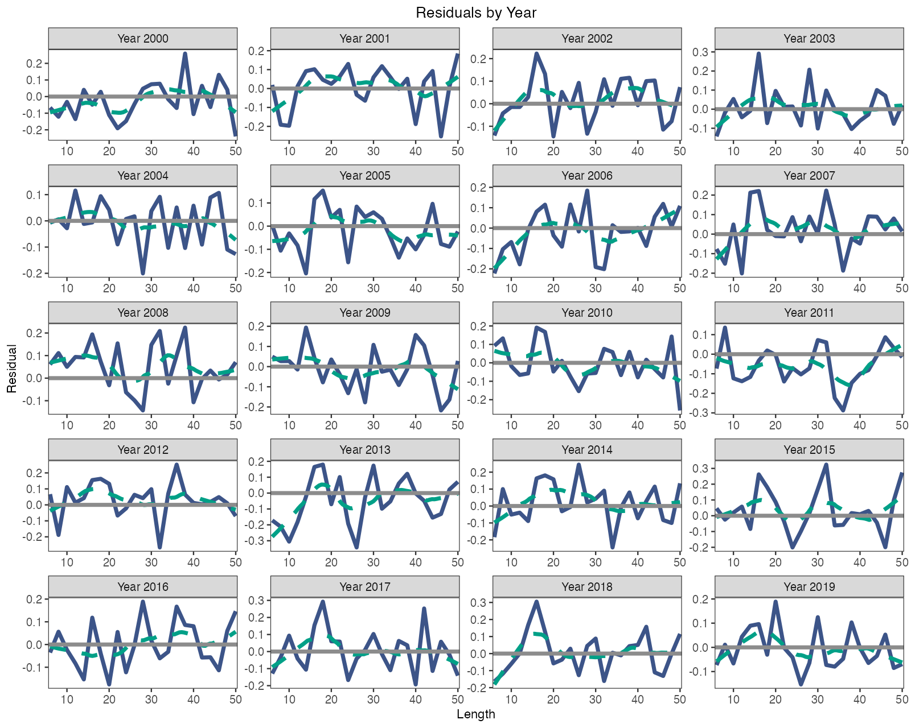
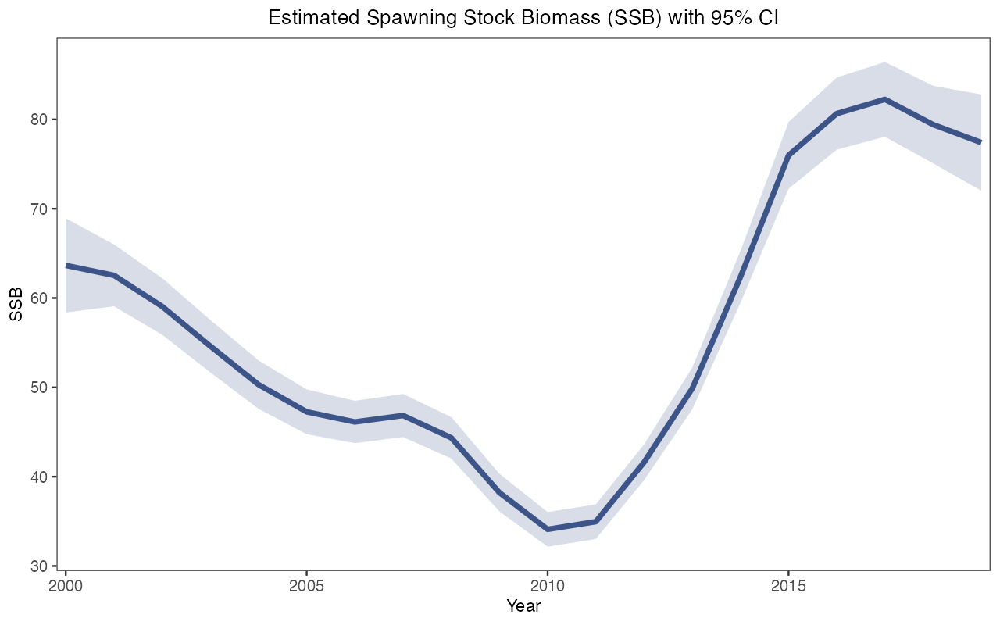
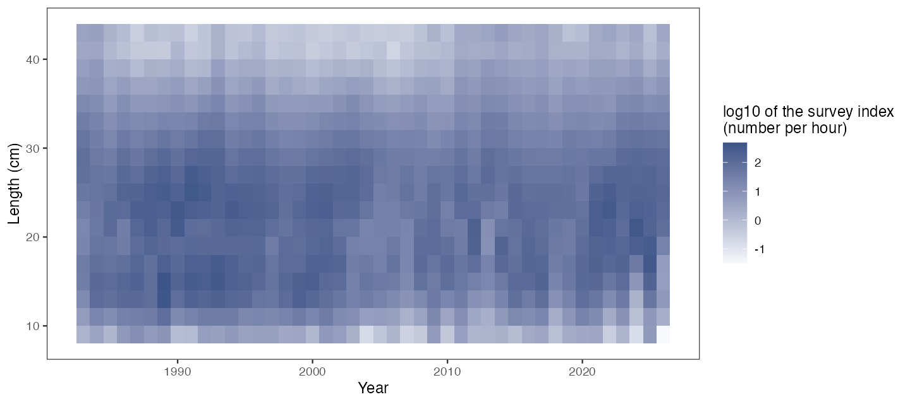
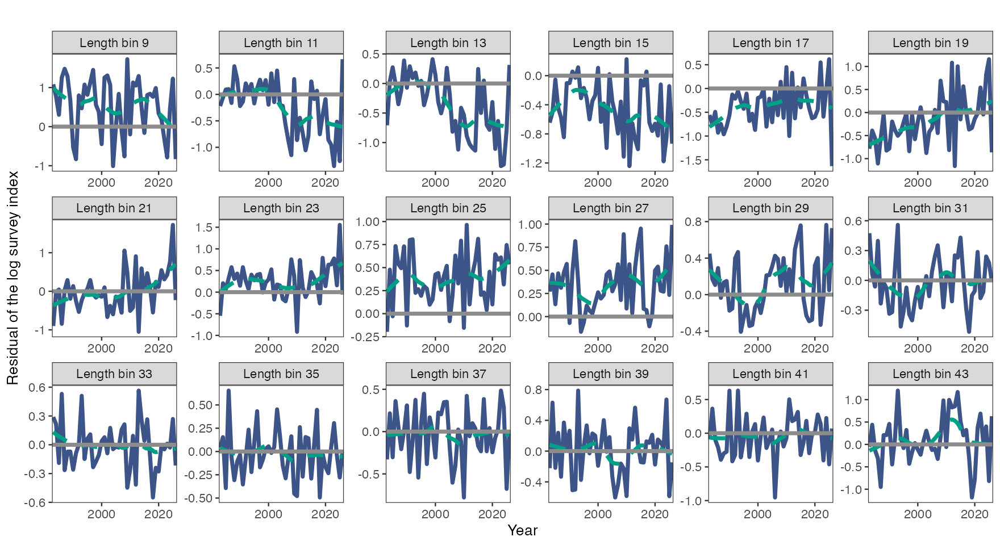
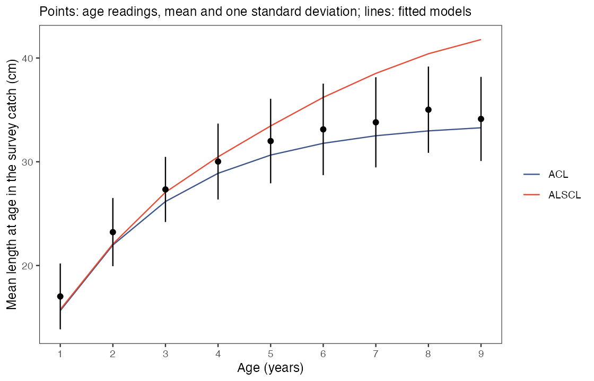
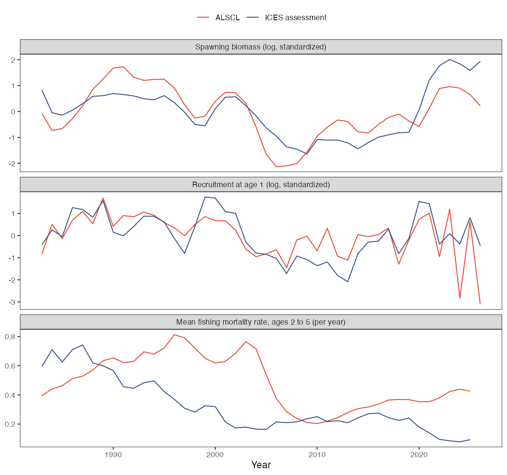
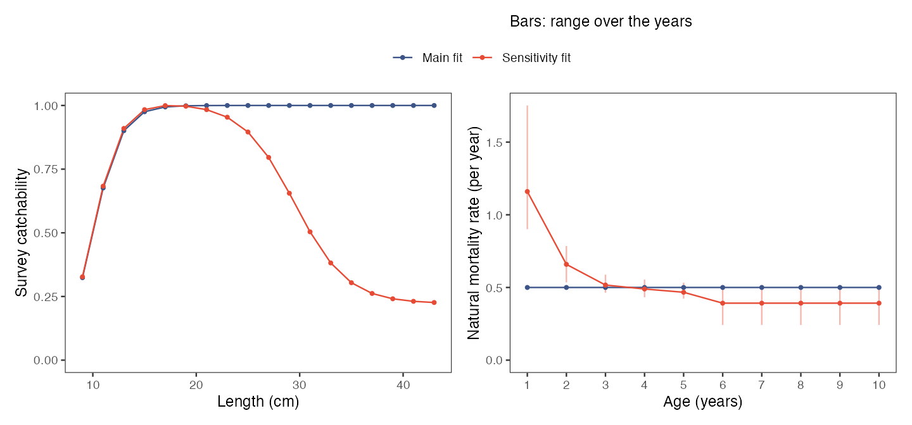
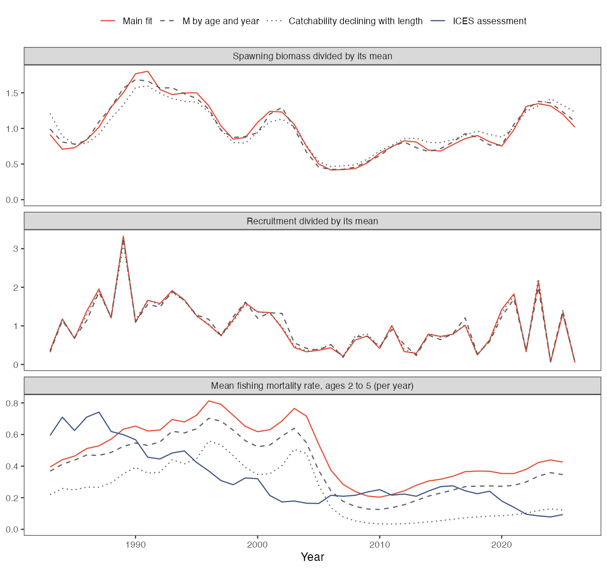

# 18 应用案例 · Worked cases

<!-- Generated by scripts/build_wiki.py. Edit website/content/{en,zh}/articles/case-fit-survey.md, website/content/{en,zh}/articles/case-north-sea-whiting.md, website/content/{en,zh}/articles/case-compare-assessments.md, website/content/{en,zh}/articles/case-retrospective-bias.md, website/content/{en,zh}/articles/case-sensitivity-projection.md, website/content/{en,zh}/articles/case-simulate-survey.md, then rebuild; do not edit this file. -->

[← 上一章 · Previous](https://github.com/FanZhang-LAB-SHOU/ALSCL/wiki/17-Model-Validation) · [目录 · Contents](https://github.com/FanZhang-LAB-SHOU/ALSCL/wiki)

**ALSCL 2.4.4 · 简体中文 / English**

[使用指南 / User guide](https://github.com/FanZhang-LAB-SHOU/ALSCL/blob/main/docs/USER_GUIDE.md) · [首页 / Home](https://github.com/FanZhang-LAB-SHOU/ALSCL/blob/main/README.md)

## 如何拟合自己的调查数据？ / How do I fit my own survey data?

本页带你从 CSV 或 Excel 文件中的三张调查表出发，得到 ACL 和 ALSCL 两个拟合好的模型，以及它们的数值检查、图和保存的结果。本页按照脚本 [fit_own_data_example.R](https://github.com/FanZhang-LAB-SHOU/ALSCL/blob/main/scripts/fit_own_data_example.R) 展开，该脚本用内附的教学数据完整运行一遍，然后你把其中的数值换成自己的。你需要已安装 ALSCL 2.4.0 或更高版本（[安装 ALSCL](https://github.com/FanZhang-LAB-SHOU/ALSCL/blob/main/docs/USER_GUIDE.md#start)）、按[准备调查数据](https://github.com/FanZhang-LAB-SHOU/ALSCL/blob/main/docs/USER_GUIDE.md#excel)排好的三张表，以及你的种群的生物学数值（`rec.age`、`nage`、`M`、`sel_L50`、`sel_L95`、`growth_step`、`len_mid`、`len_border`），[该页第 4 步](https://github.com/FanZhang-LAB-SHOU/ALSCL/blob/main/docs/USER_GUIDE.md#data-preparation-bundle)逐项解释了它们。

On this page you go from three survey tables in CSV or Excel files to two fitted models, ACL and ALSCL, with their numerical checks, plots and saved results. The page follows the script [fit_own_data_example.R](https://github.com/FanZhang-LAB-SHOU/ALSCL/blob/main/scripts/fit_own_data_example.R), which runs the whole sequence on the bundled teaching data; you then replace its values with yours. You need ALSCL 2.4.0 or later installed ([Install ALSCL](https://github.com/FanZhang-LAB-SHOU/ALSCL/blob/main/docs/USER_GUIDE.md#start)), your tables laid out as in [Prepare your survey data](https://github.com/FanZhang-LAB-SHOU/ALSCL/blob/main/docs/USER_GUIDE.md#excel), and the biological values of your stock (`rec.age`, `nage`, `M`, `sel_L50`, `sel_L95`, `growth_step`, `len_mid`, `len_border`), which [step 4 of that page](https://github.com/FanZhang-LAB-SHOU/ALSCL/blob/main/docs/USER_GUIDE.md#data-preparation-bundle) explains one by one.

<a id="case-fit-survey-bundle"></a>

### 1. 准备并检查输入列表 / Prepare and check the input bundle

```r
library(ALSCL)
tables <- read_survey_csv("my_data")
x <- prepare_alscl_data(tables, fit_args = list(
  rec.age = 1, nage = 15, M = 0.2, sel_L50 = 15, sel_L95 = 20,
  growth_step = 1, len_mid = seq(6, 50, 2), len_border = seq(7, 49, 2)))
check <- check_alscl_data(x, "acl")
check$valid
check$summary
```

两个模型都读取输入列表 `x`：调查指数表 `data.CatL`、体重表 `data.wgt` 和成熟比例表 `data.mat`，行是体长组，列是时间步；再加上 `x$fit_args` 中描述你的种群和调查的设置。`read_survey_csv()` 从一个文件夹读取三个文件，`read_survey_excel()` 读取一个工作簿中的三张工作表；表格布局、时间网格以及空白和零值的处理见[准备调查数据](https://github.com/FanZhang-LAB-SHOU/ALSCL/blob/main/docs/USER_GUIDE.md#excel)。这些设置是模型照原样使用的输入；请为你的种群逐项提供，并记下来源。代码中的数值是教学数据的设置。

Both models read the input bundle `x`: the survey index table `data.CatL`, the weight table `data.wgt` and the maturity table `data.mat`, with the length bins as rows and the time steps as columns, plus the settings in `x$fit_args` that describe your stock and survey. `read_survey_csv()` reads the three files from one folder and `read_survey_excel()` the three sheets of one workbook; [Prepare your survey data](https://github.com/FanZhang-LAB-SHOU/ALSCL/blob/main/docs/USER_GUIDE.md#excel) explains the layout, the time grid and the treatment of blanks and zeros. The settings are inputs that the models use as given; supply each one for your stock and record its source. The numbers in the code are those of the teaching data.

`check_alscl_data()` 按拟合时的方式准备数据，但不编译任何东西。`check$valid` 应为 `TRUE`，`check$summary` 应显示你预期的体长组数和时间步数、正观测数，以及将被估计的标量参数个数 `free_fixed`。若 `check$valid` 为 `FALSE`，`check$errors` 会指出要修改的表、时间列或设置；`check$warnings` 提示没有任何观测的时间步或体长组。拟合 ALSCL 之前，用 `"alscl"` 再检查一遍。

`check_alscl_data()` prepares the data as a fit would, without compiling anything. `check$valid` should be `TRUE` and `check$summary` should show the numbers of bins and time steps you expect, the count of positive observations and `free_fixed`, the number of scalar parameters that will be estimated. When `check$valid` is `FALSE`, `check$errors` names the table, time column or setting to correct; `check$warnings` points to time steps or bins without any observation. Repeat the check with `"alscl"` before fitting that model.

<a id="case-fit-survey-map"></a>

### 2. 确定初值和 map / Decide the starting values and the map

```r
plan <- inspect_parameters(x, "acl")
plan[, c("parameter", "status", "map_source", "natural_start")]
inspect_parameters(x, "alscl")[, c("parameter", "status", "map_source", "natural_start")]
```

`inspect_parameters()` 列出一个模型的各个参数、自然尺度上的初值及其状态，例如 `free`（估计）、`fixed`（固定）或 `tied`（共享）；`map_source` 说明固定状态来自模型默认还是你的 `map`。默认情况下，ACL 固定 `log_std_log_F`、`logit_log_F_y`、`logit_log_F_a` 和 `t0`，估计其余 10 个标量参数；ALSCL 固定 `log_sigma_log_F` 和 `log_t0`，估计 13 个。过程偏差 `dev_log_R`、`dev_log_F` 和 `dev_log_N0` 默认作为随机效应估计。不要把它们写进 `map`：过程似然覆盖每个块的全部偏差，所以固定其中一些偏差或重复使用因子水平的 map 会被拒绝，除非该过程的标准差和相关系数也都固定。需要所有组共用一个捕捞死亡率时，使用 `F_structure = "year"`。[选择拟合设置](https://github.com/FanZhang-LAB-SHOU/ALSCL/blob/main/docs/USER_GUIDE.md#fitting-controls-parameters)列出了两个模型的全部标量参数，并说明这一限制。

`inspect_parameters()` lists the parameters of a model with their starting value on the natural scale and their status, such as `free` (estimated), `fixed` or `tied`; `map_source` says whether a fixed status comes from the model default or from your `map`. By default ACL fixes `log_std_log_F`, `logit_log_F_y`, `logit_log_F_a` and `t0` and estimates the other 10 scalar parameters; ALSCL fixes `log_sigma_log_F` and `log_t0` and estimates 13. The process deviations `dev_log_R`, `dev_log_F` and `dev_log_N0` are estimated as random effects by default. Leave them out of `map`: the process likelihood covers every deviation of a block, so a map that fixes entries or repeats a factor level is rejected unless the process standard deviation and correlations are fixed too. Use `F_structure = "year"` when all groups should share one fishing mortality rate. [Choose the fitting settings](https://github.com/FanZhang-LAB-SHOU/ALSCL/blob/main/docs/USER_GUIDE.md#fitting-controls-parameters) names every scalar parameter of both models and explains this restriction.

初值写在 `x$fit_config$acl$parameters` 或 `x$fit_config$alscl$parameters` 中，采用优化器尺度：渐近体长 60 cm 写 `log_Linf = log(60)`，相关系数 0.1 写 `logit_log_R = qlogis(0.1)`；ALSCL 使用 `log_t0`，因此它的 `t0` 必须在 0 和 `rec.age` 之间。填写初值不会固定参数：只有模型 `map` 中的 `factor(NA)` 才固定参数，具名 `NULL` 项则释放模型默认固定的参数。当外部研究给出的值比拟合更可靠，或第 5 步的检查表明数据无法确定某个参数时，固定该参数，并记录每个固定值的来源。[选择拟合设置](https://github.com/FanZhang-LAB-SHOU/ALSCL/blob/main/docs/USER_GUIDE.md#fitting)给出 `map`、边界和物种预设的规则；[估计参数列表](https://github.com/FanZhang-LAB-SHOU/ALSCL/blob/main/docs/USER_GUIDE.md#fitting)给出全部变换方式。

Starting values go in `x$fit_config$acl$parameters` or `x$fit_config$alscl$parameters` on the optimizer scale: `log_Linf = log(60)` for an asymptotic length of 60 cm, `logit_log_R = qlogis(0.1)` for a correlation of 0.1; ALSCL uses `log_t0`, so its `t0` must lie between 0 and `rec.age`. A starting value does not fix a parameter: only `factor(NA)` in the model's `map` does, and a named `NULL` entry releases a parameter that the model fixes by default. Fix a parameter when an external study gives a better value than the fit could, or when the checks of step 5 show that the data leave it undetermined, and record the source of every fixed value. [Choose the fitting settings](https://github.com/FanZhang-LAB-SHOU/ALSCL/blob/main/docs/USER_GUIDE.md#fitting) gives the rules for `map`, bounds and species presets; [Estimation parameter lists](https://github.com/FanZhang-LAB-SHOU/ALSCL/blob/main/docs/USER_GUIDE.md#fitting) gives every transformation.

<a id="case-fit-survey-run"></a>

### 3. 运行完整示例 / Run the complete example

下面的脚本用教学数据完整运行每一步：读取 `docs/data` 中的三个 CSV 文件，把生物学设置收在 `bio` 中，由行标签推出体长组中点和边界，设置两个模型的初值和 map，组装并检查 `x`，拟合 ACL（`a`）和 ALSCL（`b`），打印它们的数值检查，绘制 `b` 的残差图和产卵生物量图，并把输入列表、去掉 TMB 对象的两个拟合、两张图和会话信息保存到 `output/own-data-example`。请在下载的仓库根目录运行，因为脚本要加载 `scripts/plot_helpers.R` 并读取 `docs/data`：`source("scripts/fit_own_data_example.R", encoding = "UTF-8")`。

The script below runs every step on the teaching data: it reads the three CSV files in `docs/data`, collects the biology in `bio`, derives the bin midpoints and boundaries from the row labels, sets the starting values and maps of both models, builds and checks `x`, fits ACL (`a`) and ALSCL (`b`), prints their numerical checks, draws the residual and spawning biomass plots of `b`, and saves the bundle, both fits without their live TMB object, the two figures and the session information to `output/own-data-example`. Run it from the root of a downloaded copy of the repository, because it sources `scripts/plot_helpers.R` and reads `docs/data`: `source("scripts/fit_own_data_example.R", encoding = "UTF-8")`.

```r

# ALSCL: CSV -> x -> ACL / ALSCL -> diagnostics and saved summaries.
# 从仓库根目录运行 / Run from the repository root:
# source("scripts/fit_own_data_example.R", encoding = "UTF-8")
# 默认读取内附模拟数据。正式分析必须修改第 1、2、3 步。
# The supplied numbers describe the synthetic YTF example, not your stock.
library(ALSCL)
if (packageVersion("ALSCL") < "2.4.0")
  stop("This example requires ALSCL >= 2.4.0. Update ALSCL before running it.", call. = FALSE)
source('scripts/plot_helpers.R')

# 1. 读取三表 / Read the three aligned tables -------------------------------
# 正式数据改成 "my_data"，其中放以下三个 CSV：
# data.CatL.csv, data.wgt.csv, data.mat.csv.
data_dir <- "docs/data"
inputs <- read_survey_csv(data_dir)

# Excel 可替换上一行 / Excel alternative (requires readxl):
# inputs <- read_survey_excel("my_survey.xlsx")
# 2. 共用生物设置 / Shared biology -----------------------------------------
# 以下是年度 YTF 教学值，正式数据必须采用自己的生物学依据。
# M_annual and vbk are annual; lengths are cm; weights in the example are kg.
bio <- list(rec.age = 1, nage = 15, M_annual = 0.2,
            growth_step = 1, sel_L50 = 15, sel_L95 = 20,
            Linf = 60, vbk = 0.2, t0 = 1 / 60,
            cv_len = 0.2, cv_grow = 0.2)
# 当前 ALSCL 使用 log_t0，故要求 0 < t0 < rec.age；不要对负 t0 取绝对值。
stopifnot(bio$t0 > 0, bio$t0 < bio$rec.age)

# 此例 LengthBin 填数值中点：6, 8, ..., 50。
# For labels such as "5-7", supply the actual midpoints explicitly instead.
len_mid <- as.numeric(inputs$data.CatL[[1]])
stopifnot(all(is.finite(len_mid)), all(diff(len_mid) > 0))
# 此例为连续等宽组；非等宽组请直接填写实测的 nlen-1 个内部边界。
# This midpoint formula is only used for the equal-width demonstration bins.
stopifnot(max(abs(diff(len_mid) - diff(len_mid)[1])) < 1e-8)
len_border <- (head(len_mid, -1) + tail(len_mid, -1)) / 2

# 3. 各模型拟合设置 / Model-specific settings ------------------------------
# 生长和多数过程参数作为初值，不再自动固定每个提供的参数。
# Growth and most process values below are starts, not automatic fixes.
# Review starts, bounds and the documented default fixed values for your stock.
p_acl <- list(
  log_Linf = log(bio$Linf), log_vbk = log(bio$vbk), t0 = bio$t0,
  log_cv_len = log(bio$cv_len),
  log_std_log_F = log(0.2), log_std_log_N0 = log(0.2),
  logit_log_R = qlogis(0.1))
p_alscl <- list(
  log_Linf = log(bio$Linf), log_vbk = log(bio$vbk), log_t0 = log(bio$t0),
  log_cv_len = log(bio$cv_len), log_cv_grow = log(bio$cv_grow),
  log_sigma_log_F = log(0.2), log_sigma_log_N0 = log(0.2),
  logit_log_R = qlogis(0.1))
# 使用模型默认 map：ACL 固定 4 项、估计 10 项；ALSCL 固定 2 项、估计 13 项。
# Default maps: ACL fixes 4 and estimates 10 scalars; ALSCL fixes 2 and estimates 13.
# ACL fixes log_std_log_F, logit_log_F_y, logit_log_F_a and t0.
# ALSCL fixes log_sigma_log_F and log_t0. These values still need justification.
map_acl <- list()
map_alscl <- list()

# 可选：只固定 t0；更灵活的设置必须另做诊断，不保证可识别。
# Optional: fix only t0; diagnose this more flexible configuration separately.
# map_acl <- list(t0 = factor(NA), log_std_log_F = NULL,
# logit_log_F_y = NULL, logit_log_F_a = NULL)
# map_alscl <- list(log_t0 = factor(NA), log_sigma_log_F = NULL)
# 解除默认固定项需保留具名 NULL；$t0 <- NULL 仅删除条目。
# Preserve a named NULL to release a default fix; $t0 <- NULL deletes the entry.
# map_acl["t0"] <- list(NULL)
# map_alscl["log_t0"] <- list(NULL)
# 4. 组装并检查 x / Assemble and check the input bundle --------------------
x <- prepare_alscl_data(inputs,
  fit_args = list(
    rec.age = bio$rec.age, nage = bio$nage,
    M = bio$M_annual * bio$growth_step,
    sel_L50 = bio$sel_L50, sel_L95 = bio$sel_L95,
    growth_step = bio$growth_step,
    len_mid = len_mid, len_border = len_border,
    zero_action = "error", train_times = 2,
    nstarts = 1, ncores = 1, silent = FALSE),
  fit_config = list(
    acl = list(parameters = p_acl, map = map_acl),
    alscl = list(parameters = p_alscl, map = map_alscl)))
# 不编译即可检查数据、时间网格和参数设置 / Check data, time grid and settings without compiling.
for (model in c("acl", "alscl")) {
  check <- check_alscl_data(x, model)
  if (!check$valid) stop(paste(check$errors, collapse = "\n"))
  print(check$summary)
}

# 5. 直接拟合 / Fit directly ----------------------------------------------
# 内置加速使用当前 alscl_speed() 设置，无需额外包装。
alscl_speed_info()
a <- run_acl(x)
b <- run_alscl(x)

# 可直接覆盖设置；固定 nstarts 才能公平比较并行数：
# a <- run_acl(x, nstarts = 4, ncores = 2)
# b <- run_alscl(x, nstarts = 4, ncores = 2)
# 6. 检查、绘图、保存 / Inspect, plot and save ------------------------------
checks <- list(ACL = diagnose_model(x$data.CatL, a),
               ALSCL = diagnose_model(x$data.CatL, b))
print(checks)
print(a$sd_info)
print(b$sd_info)
for (fit in list(a, b)) {
  print(fit$par_low_up) # 实际自由参数及边界 / Actual free scalars and bounds
  print(list(convergence = fit$convergence_code,
             max_gradient = fit$max_abs_gradient,
             pdHess = fit$pdHess, bound_hit = fit$bound_hit))
  print(fit$refinement)
  print(fit$diagnostics)
  if (!isTRUE(fit$convergence_code == 0L) || !isTRUE(fit$pdHess) ||
      !isTRUE(fit$diagnostics$numerical_ok))
    warning("Review fit diagnostics before interpreting this assessment.")
}
residual_plot <- plot_residuals(b, facet_by = "year", facet_ncol = 4,
                                x_breaks = pretty(len_mid, n = 4))
# Hessian 非正定时省略近似 95% 区间 / Omit approximate 95% intervals if Hessian is not positive definite.
ssb_plot <- plot_SSB(b, se = isTRUE(b$pdHess))
print(residual_plot)
print(ssb_plot)
# obj 是当前会话的 TMB 指针，不包含在可移植结果中。
portable <- function(fit) {
  fit$obj <- NULL
  fit
}
output_dir <- "output/own-data-example"
dir.create(output_dir, recursive = TRUE, showWarnings = FALSE)
save_grid_free_plot(file.path(output_dir, "residuals.png"), residual_plot,
                width = 10, height = 8, dpi = 150)
save_grid_free_plot(file.path(output_dir, "SSB.png"), ssb_plot,
                width = 8, height = 5, dpi = 150)
saveRDS(x, file.path(output_dir, "inputs_x.rds"))
saveRDS(list(ACL = portable(a), ALSCL = portable(b), diagnostics = checks),
        file.path(output_dir, "assessment_summary.rds"))
writeLines(capture.output(sessionInfo()), file.path(output_dir, "sessionInfo.txt"))
# 新会话可读取 x 并重新拟合 / Refit in a new session:
# x <- readRDS("output/own-data-example/inputs_x.rds")
# b <- run_alscl(x)
```

脚本运行时会打印两个模型的 `check$summary`；教学数据显示 23 个体长组、20 个时间步、460 个正观测、没有零值和空白，以及 10 个（ACL）或 13 个（ALSCL）自由标量参数。随后 `diagnose_model()` 打印每个拟合的数值检查，第 5 步会解释。在记录运行（[own-data-example-checks.csv](https://github.com/FanZhang-LAB-SHOU/ALSCL/blob/main/docs/results/own-data-example-checks.csv)）中，两个拟合的收敛码都是 0，Hessian 正定，没有参数落在边界上，最大梯度约为 3e-9。脚本保存的两张图如下：

While the script runs, `check$summary` is printed for both models; with the teaching data it shows 23 length bins, 20 time steps, 460 positive observations, no zeros or blanks, and 10 (ACL) or 13 (ALSCL) free scalar parameters. `diagnose_model()` then prints the numerical checks of each fit, which step 5 explains. In the recorded run ([own-data-example-checks.csv](https://github.com/FanZhang-LAB-SHOU/ALSCL/blob/main/docs/results/own-data-example-checks.csv)) both fits ended with convergence code 0, a positive definite Hessian, no parameter on a bound and a maximum gradient near 3e-9. The script saved these two figures:





结合数值诊断检查残差规律，并将区间宽度解释为给定假设下的条件精度。产卵生物量区间较窄本身不能证明模型适用；固定输入的不确定性没有包含在该区间中。若脚本提示 "This example requires ALSCL >= 2.4.0"，安装当前版本（[安装 ALSCL](https://github.com/FanZhang-LAB-SHOU/ALSCL/blob/main/docs/USER_GUIDE.md#start)）；若找不到 `scripts/plot_helpers.R` 或 `docs/data`，说明 R 运行在仓库根目录之外；若 `check_alscl_data()` 报错，第 1 步解释了这些信息；若拟合结束时出现 "Review fit diagnostics" 警告，第 5 步说明要改什么。

Inspect residual patterns together with the numerical diagnostics, and interpret interval widths as conditional precision under the stated assumptions. A narrow spawning-biomass interval alone does not establish model adequacy; fixed inputs do not contribute uncertainty to it. If the script reports "This example requires ALSCL >= 2.4.0", install the current version ([Install ALSCL](https://github.com/FanZhang-LAB-SHOU/ALSCL/blob/main/docs/USER_GUIDE.md#start)); if it fails to find `scripts/plot_helpers.R` or `docs/data`, R is running outside the repository root; if `check_alscl_data()` reports an error, step 1 explains the messages; if a fit ends with the warning "Review fit diagnostics", step 5 says what to change.

<a id="case-fit-survey-replace"></a>

### 4. 换成自己的观测数据 / Replace the demonstration with your observations

```r
data_dir <- "my_data"
bio <- list(rec.age = 2, nage = 12, M_annual = 0.25,
            growth_step = 1, sel_L50 = 22, sel_L95 = 30,
            Linf = 80, vbk = 0.15, t0 = 0.5,
            cv_len = 0.15, cv_grow = 0.15)
len_mid <- c(8, 11, 14, 17, 20, 24, 28, 33, 39, 46)
len_border <- c(9.5, 12.5, 15.5, 18.5, 22, 26, 30.5, 36, 42.5)
map_acl <- list(log_Linf = factor(NA), log_vbk = factor(NA))
map_alscl <- list(log_Linf = factor(NA), log_vbk = factor(NA))
# 然后运行脚本中的 prepare_alscl_data() 调用，并确认： / Then run the prepare_alscl_data() call of the script and confirm:
for (model in c("acl", "alscl")) {
  check <- check_alscl_data(x, model)
  print(check$valid); print(check$warnings); print(check$summary)
  print(inspect_parameters(x, model)[, c("parameter", "status", "map_source")])
}
```

上面的数值只是说明每一项的形式；请把每一项都换成你的种群的数值。保留 `inputs`、`x`、`a` 和 `b` 这些名字，脚本的其余部分就不用改。

The values above only show the shape of each entry; replace every one with the value for your stock. Keep the names `inputs`, `x`, `a` and `b` so that the rest of the script runs unchanged.

| 脚本中的行 / Lines in the script | 改成 / Replace with | 注意 / Keep in mind |
|---|---|---|
| `data_dir <- "docs/data"` | 你的 CSV 文件夹，或 `inputs <- read_survey_excel("my_survey.xlsx")` / Your CSV folder, or `inputs <- read_survey_excel("my_survey.xlsx")` | 三个文件或工作表必须使用这些名称；调查缺测留空 / Three files or sheets with exactly these names; blank cells for missing survey values |
| `bio <- list(...)` | 你的种群的数值 / The values of your stock | `M_annual` 是年值，会乘以 `growth_step`；`vbk` 仍按年计；ALSCL 要求 `0 < t0 < rec.age` / `M_annual` is per year and is multiplied by `growth_step`; `vbk` stays per year; ALSCL needs `0 < t0 < rec.age` |
| `len_mid <- ...`、`len_border <- ...` / `len_mid <- ...`, `len_border <- ...` | 你的体长组中点和内部边界 / The midpoints and internal boundaries of your bins | 体长组宽度不等时，删除等宽 `stopifnot()` 和中点公式那两行 / Delete the equal-width `stopifnot()` and the midpoint formula when your bins differ in width |
| `p_acl`、`p_alscl` / `p_acl`, `p_alscl` | 优化器尺度上的初值 / Starting values on the optimizer scale | ACL 填 `t0`，ALSCL 填 `log(t0)` / ACL takes `t0`, ALSCL `log(t0)` |
| `map_acl`、`map_alscl` / `map_acl`, `map_alscl` | 你要固定或释放的参数 / The parameters you fix or release | 空列表沿用模型默认；每次都列出全部固定项 / An empty list keeps the model defaults; list every fix each time |
| `zero_action = "error"` | `"missing"`，把零值当作缺失而不是终止 / `"missing"` to treat zeros as missing values instead of stopping | 零值随后不进入似然 / Zeros then drop out of the likelihood |
| `output_dir` | 本次评估的文件夹 / A folder for this assessment | 脚本会覆盖其中的文件 / The script overwrites the files in it |

修改后，把脚本运行到检查循环。两个模型的 `check$valid` 都必须为 `TRUE`，`check$summary` 必须显示你的体长组数和时间步数，`inspect_parameters()` 中状态为 `fixed` 且 `map_source` 为 `explicit` 的参数必须恰好是你固定的那些。类似 "No positive observations in periods: 2004" 的警告表示某个时间步没有调查值，按未观测处理；`zero_action = "missing"` 且调查表含零值时，会出现零值被排除的警告。拟合之前，先想清楚每条警告对你的调查意味着什么。

After editing, run the script down to the check loop. `check$valid` must be `TRUE` for both models, `check$summary` must show your numbers of bins and time steps, and `inspect_parameters()` must show `fixed` with `map_source` equal to `explicit` for exactly the parameters you fixed. A warning such as "No positive observations in periods: 2004" means that a time step has no survey values and is treated as unobserved; the warning about excluded zeros appears when `zero_action = "missing"` and the survey table contains zeros. Decide what each warning means for your survey before you fit.

<a id="case-fit-survey-fit"></a>

### 5. 直接拟合并读结果 / Fit directly and read the results

```r
a <- run_acl(x)
b <- run_alscl(x)
diagnose_model(x$data.CatL, a)
diagnose_model(x$data.CatL, b)
b$diagnostics$issues
estimates <- extract_estimates(b)
subset(estimates, quantity == "SSB")
extract_parameters(b)
plot_CatL(b, facet_by = "year", facet_ncol = 5)
plot_residuals(b, facet_by = "year", facet_ncol = 5)
plot_SSB(b, se = TRUE)
```

`x` 装好你的表和设置后，每个模型的拟合就是一次调用；脚本存入 `x$fit_args` 的 `train_times = 2` 和 `nstarts = 1` 随之生效，调用中给出的参数，例如 `run_acl(x, nstarts = 4, ncores = 2)`，只在本次调用中覆盖保存的值。看任何估计值之前先读数值检查：收敛码 0、最大梯度小于 0.001、Hessian 正定、没有参数落在边界上，以及 `numerical_ok` 为 `TRUE`；`b$diagnostics$issues` 给出未通过的项目。`extract_estimates()` 返回一张表，包含 `quantity`、`year`、该量所在的 `age` 或 `length`（如有）、`estimate`、`std_error` 和区间 `conf_low` 到 `conf_high`；`extract_parameters()` 列出每个标量参数在自然尺度上的值及其状态 `estimated`、`fixed` 或 `inactive`（共用 F 结构用不到的相关系数）。`plot_CatL()`、`plot_residuals()` 和 `plot_SSB()` 分别画出对观测的拟合、对数残差和带区间的产卵生物量，与[理解第一次拟合](https://github.com/FanZhang-LAB-SHOU/ALSCL/blob/main/docs/USER_GUIDE.md#builtin)中相同。

Once `x` holds your tables and settings, each fit is one call; the `train_times = 2` and `nstarts = 1` that the script stores in `x$fit_args` apply, and an argument in the call, such as `run_acl(x, nstarts = 4, ncores = 2)`, overrides the stored value for that call only. Read the numerical checks before any estimate: convergence code 0, maximum gradient below 0.001, a positive definite Hessian, no parameter on a bound and `numerical_ok` equal to `TRUE`; `b$diagnostics$issues` names any check that failed. `extract_estimates()` returns one table with `quantity`, `year`, the `age` or `length` where the quantity has one, `estimate`, `std_error` and the interval `conf_low` to `conf_high`; `extract_parameters()` lists every scalar parameter on the natural scale with its status, `estimated`, `fixed` or `inactive` (a correlation that the shared F structure leaves unused). `plot_CatL()`, `plot_residuals()` and `plot_SSB()` draw the fit to the observations, the log residuals and the spawning biomass with its interval, as in [Understand your first fit](https://github.com/FanZhang-LAB-SHOU/ALSCL/blob/main/docs/USER_GUIDE.md#builtin).

检查未通过时，每次只改一处再重新拟合：收敛码不是 0 或梯度很大时，多用几个初值（`nstarts = 4, ncores = 2`）；Hessian 检查未通过时，检查参数尺度、边界、其他初值和剖面。有诊断及生物学依据后，再固定参数或考虑 `F_structure = "year"`；[理解第一次拟合](https://github.com/FanZhang-LAB-SHOU/ALSCL/blob/main/docs/USER_GUIDE.md#first-model-checks)中的表把每项未通过的检查对应到常见原因。即使检查通过，相邻体长或相邻年份的残差同号成串也说明模型漏掉了数据中的某种特征；[判断拟合是否可用](https://github.com/FanZhang-LAB-SHOU/ALSCL/blob/main/docs/USER_GUIDE.md#diagnostics)说明如何检查这类规律，以及对 `M` 和其他固定值的敏感性。

When a check fails, change one thing at a time and refit: more starts (`nstarts = 4, ncores = 2`) when the code differs from 0 or the gradient is large, checks of parameter scales, bounds, alternative starts and profiles when the Hessian check fails. Fix a parameter or consider `F_structure = "year"` only with supporting diagnostic and biological evidence; the table in [Understand your first fit](https://github.com/FanZhang-LAB-SHOU/ALSCL/blob/main/docs/USER_GUIDE.md#first-model-checks) matches each failed check with its usual cause. Residuals with the same sign across neighbouring lengths or years mean that the model misses a feature of the data even when the checks pass; [Judge whether a fit can be used](https://github.com/FanZhang-LAB-SHOU/ALSCL/blob/main/docs/USER_GUIDE.md#diagnostics) shows how to examine such patterns and the sensitivity to `M` and the other fixed values.

<a id="case-fit-survey-save"></a>

### 6. 保存并复用结果 / Save and reuse the results

```r
dir.create("output/my-assessment", recursive = TRUE, showWarnings = FALSE)
saveRDS(x, "output/my-assessment/inputs_x.rds")
save_assessment(a, "output/my-assessment/acl.rds")
save_assessment(b, "output/my-assessment/alscl.rds")
# 在以后的会话中 / In a later session
x <- readRDS("output/my-assessment/inputs_x.rds")
saved <- read_assessment("output/my-assessment/alscl.rds")
summary(saved)
plot_SSB(saved, se = TRUE)
b2 <- refit_model(saved)
```

`x` 是普通列表，`saveRDS()` 保存表和设置，`readRDS()` 把它们读回。`save_assessment()` 写出保存的拟合结果：拟合中除 `b$obj` 以外的全部内容（`b$obj` 是只在当前会话有效的 TMB 对象指针），以及重新拟合所需的信息（数据表、设置、map、边界和软件包版本）。`read_assessment()` 把它读回，`summary()`、提取函数和绘图函数都能直接使用；`refit_model()` 使用保存的输入和设置重新拟合，接受 `refit_model(saved, nstarts = 4)` 这样的覆盖参数，并在软件包或 TMB 版本与记录不同时发出警告。文件夹必须已存在，已有文件只有在 `overwrite = TRUE` 时才被替换。脚本则保存 `assessment_summary.rds`，即去掉 `obj` 的两个拟合，以及两张图和 `sessionInfo.txt`。把数据文件、保存的输入列表和保存的拟合结果放在一起。

`x` is a plain list, so `saveRDS()` keeps the tables and settings and `readRDS()` brings them back. `save_assessment()` writes a saved fit: everything in the fit except the live TMB object `b$obj`, a pointer valid only in the current session, together with the recipe (tables, settings, map, bounds and package versions). `read_assessment()` reads it back, and `summary()`, the extraction functions and the plots work on it directly; `refit_model()` rebuilds a live fit from the recipe, accepts overrides such as `refit_model(saved, nstarts = 4)`, and warns when the package or TMB version differs from the recorded one. The folder must exist, and an existing file is replaced only with `overwrite = TRUE`. The script instead stores `assessment_summary.rds`, both fits without `obj`, with the two figures and `sessionInfo.txt`. Keep the data files, the saved bundle and the saved fits together.

<a id="case-fit-survey-continue"></a>

### 7. 继续比较和回溯 / Continue with comparison and retrospectives

```r
comparison <- compare_models(a, b, x$data.CatL)
comparison$fit_diagnostics
comparison$comparison
ra <- retro_acl(x, nyear = 3, train_times = 2, silent = TRUE)
rb <- retro_alscl(x, nyear = 3, train_times = 2, silent = TRUE)
rb$fit_diagnostics
rb$rho_by_peel
rb$rho_text
plot_fishing_mortality(b, type = "length", se = TRUE)
```

`compare_models()` 先核对两次拟合使用了同一张调查表，再比较 AIC、BIC 和拟合统计量。`comparison$comparison` 记录 `data_verified`、`eligible`（两次拟合都通过数值检查）、`preferred`（AIC 较低的模型，仅在两者都合格且 AIC 相差至少 2 时给出）和 `issues`。AIC 在似然拟合与参数数量之间作权衡；对同一观测和相容似然，AIC 较低表示该准则更支持该候选模型。它的结构是否适合这个种群，要用生物学知识判断。[ACL 与 ALSCL 的评估结果有什么不同？](https://github.com/FanZhang-LAB-SHOU/ALSCL/blob/main/docs/CASES.md#case-compare-assessments)用图继续这一比较。

`compare_models()` first verifies that both fits used the same survey table, then compares AIC, BIC and the fit statistics. `comparison$comparison` records `data_verified`, `eligible` (both fits passed the numerical checks), `preferred` (the model with the lower AIC, given only when both are eligible and the AIC values differ by at least 2) and `issues`. AIC balances likelihood fit against parameter count; among compatible fits to the same observations, a lower value supports that candidate under this criterion. Whether its structure suits the stock is a biological decision. [Do ACL and ALSCL give different answers?](https://github.com/FanZhang-LAB-SHOU/ALSCL/blob/main/docs/CASES.md#case-compare-assessments) continues the comparison with figures.

回溯分析依次去掉最后 1、2、3 个时间步后重新拟合模型（`nyear` 是回溯的轮数，每一轮多去掉一个时间步，所以季度数据四轮等于一年；`peel_step = 4` 则每轮去掉一年）。它读取输入列表，因此保存的设置对每一轮都生效；在回溯调用中设置 `ncores` 可以并行运行各轮。`rb$fit_diagnostics` 列出完整拟合（`Peel = 0`）和每一轮的数值检查，`rb$rho_by_peel` 给出每个量、每一轮的 Mohn's rho，`rb$rho_text$Rho` 只在完整拟合和所有轮次都通过检查时报告均值，否则为 `NA` 并警告。`plot_retro(rb)` 画出各轮的序列（[运行回溯分析](https://github.com/FanZhang-LAB-SHOU/ALSCL/blob/main/docs/USER_GUIDE.md#retrospective)）；`plot_fishing_mortality(b, type = "length")` 画出 ALSCL 估计的体长别捕捞死亡率。

The retrospective analysis refits a model after removing the last one, two and three time steps (`nyear` is the number of peels and each peel removes one more time step, so four peels equal one year of quarterly data; `peel_step = 4` removes one year per peel). It reads the bundle, so the stored settings apply to every peel; set `ncores` on the retrospective call to run peels in parallel. `rb$fit_diagnostics` lists the full fit (`Peel = 0`) and every peel with its numerical checks, `rb$rho_by_peel` gives Mohn's rho per quantity and peel, and `rb$rho_text$Rho` reports the mean only when the full fit and all peels pass the checks, otherwise `NA` with a warning. `plot_retro(rb)` draws the peeled series ([Run a retrospective analysis](https://github.com/FanZhang-LAB-SHOU/ALSCL/blob/main/docs/USER_GUIDE.md#retrospective)); `plot_fishing_mortality(b, type = "length")` draws the fishing mortality at length estimated by ALSCL.

在[2.4.3 的记录运行](https://github.com/FanZhang-LAB-SHOU/ALSCL/blob/main/docs/results/own-data-retrospective.csv)中，所有拟合均通过数值筛查，但截至 2018 年和 2016 年的 ALSCL 截断拟合保留了优化器码 1。两次拟合的第一轮实际都返回了 0；第二轮将目标函数降低了不到 `8e-10`，却报告 `false convergence (8)`。由于参数向量存在微小差异，原来的选择规则保留了第二轮。开发中的修正会在目标函数和每个参数均数值等价时保留成功轮次，再进行通常的收尾和独立数值检查。重新拟合后，两次均返回码 0，最大梯度低于 `2e-8`；SSB 和 F 相对原结果的变化小于 `1.2e-11`。

In the [recorded 2.4.3 run](https://github.com/FanZhang-LAB-SHOU/ALSCL/blob/main/docs/results/own-data-retrospective.csv), all fits passed the numerical screen, but the ALSCL peels ending in 2018 and 2016 retained optimizer code 1. Each first pass had actually returned code 0; a second pass improved the objective by less than `8e-10` and reported `false convergence (8)`. The earlier selection rule kept that second pass because the parameter vectors differed slightly. The development correction retains the successful pass when both objectives and all parameters are numerically equivalent, then applies the usual refinement and independent numerical checks. Fresh fits return code 0 for both peels, with maximum gradients below `2e-8`; SSB and F differ from the earlier results by less than `1.2e-11` in relative terms.

查看 `fit_diagnostics$optimizer_message`、`selected_pass`、`optimizer_codes` 和 `optimizer_messages`，区分所选结果与其他轮次。失败的重启仍保留在历史中，实际选中的非零码不会被改写。仅凭 `numerical_ok = TRUE` 不能断定优化器返回了 0。这份教学数据中的生长参数仍高度相关：解释评估结果前，应结合梯度、Hessian、边界、残差和不同初值的敏感性进行判断。

Read `fit_diagnostics$optimizer_message`, `selected_pass`, `optimizer_codes` and `optimizer_messages` to distinguish the selected result from the other passes. The failed restart remains in the history, and a genuinely selected nonzero code is never relabelled. `numerical_ok = TRUE` alone does not mean that the optimizer returned code 0. Strong growth-parameter correlation also remains in this teaching dataset: examine the gradient, Hessian, boundaries, residuals and sensitivity to alternative starts before interpreting an assessment.

<a id="case-fit-survey-next"></a>

### 下一步 / What next

| 想做什么 / What you want to do | 阅读 / Read |
|---|---|
| 修改检查指出的设置，或更换 F 结构 / Change a setting that a check pointed to, or the F structure | [选择拟合设置](https://github.com/FanZhang-LAB-SHOU/ALSCL/blob/main/docs/USER_GUIDE.md#fitting) / [Choose the fitting settings](https://github.com/FanZhang-LAB-SHOU/ALSCL/blob/main/docs/USER_GUIDE.md#fitting) |
| 检查残差规律和对固定值的敏感性 / Examine residual patterns and the sensitivity to the fixed values | [判断拟合是否可用](https://github.com/FanZhang-LAB-SHOU/ALSCL/blob/main/docs/USER_GUIDE.md#diagnostics) / [Judge whether a fit can be used](https://github.com/FanZhang-LAB-SHOU/ALSCL/blob/main/docs/USER_GUIDE.md#diagnostics) |
| 用图比较两个拟合 / Compare the two fits with figures | [ACL 与 ALSCL 的评估结果有什么不同？](https://github.com/FanZhang-LAB-SHOU/ALSCL/blob/main/docs/CASES.md#case-compare-assessments) / [Do ACL and ALSCL give different answers?](https://github.com/FanZhang-LAB-SHOU/ALSCL/blob/main/docs/CASES.md#case-compare-assessments) |
| 运行回溯分析并读 Mohn's rho / Run a retrospective analysis and read Mohn's rho | [运行回溯分析](https://github.com/FanZhang-LAB-SHOU/ALSCL/blob/main/docs/USER_GUIDE.md#retrospective) / [Run a retrospective analysis](https://github.com/FanZhang-LAB-SHOU/ALSCL/blob/main/docs/USER_GUIDE.md#retrospective) |
| 做参数剖面或向前投影 / Profile a parameter or project the stock forward | [评估工作流](https://github.com/FanZhang-LAB-SHOU/ALSCL/blob/main/docs/ASSESSMENT_WORKFLOWS.md) / [Assessment workflows](https://github.com/FanZhang-LAB-SHOU/ALSCL/blob/main/docs/ASSESSMENT_WORKFLOWS.md) |
| 拟合季度调查 / Fit a quarterly survey | [年度与季度时间步](https://github.com/FanZhang-LAB-SHOU/ALSCL/blob/main/docs/CASE_STUDIES.md) / [Annual and quarterly time steps](https://github.com/FanZhang-LAB-SHOU/ALSCL/blob/main/docs/CASE_STUDIES.md) |
| 让拟合更快 / Make fits faster | [速度设置](https://github.com/FanZhang-LAB-SHOU/ALSCL/blob/main/docs/SPEED_GUIDE.md) / [Speed settings](https://github.com/FanZhang-LAB-SHOU/ALSCL/blob/main/docs/SPEED_GUIDE.md) |

<a id="case-north-sea-whiting"></a>
### 真实调查数据的拟合结果，哪些可以用？ / What can a fit to a real survey be used for?

本页用一组真实的调查指数拟合 ALSCL 和 ACL，数据是 1983 至 2026 年北海牙鳕（*Merlangius merlangus*）的调查指数，然后把拟合结果与两类没有进入拟合的资料对比：同一调查的年龄判读数据，以及国际海洋考察理事会（ICES）对该种群的评估。读完本页，你会知道只用调查数据的拟合有哪些输出与这两类资料一致，哪些输出取决于固定的输入。你需要已安装 ALSCL（[安装 ALSCL](https://github.com/FanZhang-LAB-SHOU/ALSCL/blob/main/docs/USER_GUIDE.md#start)），并了解[理解第一次拟合](https://github.com/FanZhang-LAB-SHOU/ALSCL/blob/main/docs/USER_GUIDE.md#builtin)中的数值检查。完整序列每个初值约需 10 分钟，所以第 1 步先用一段较短的序列。本页按照脚本 [whiting_case.R](https://github.com/FanZhang-LAB-SHOU/ALSCL/blob/main/scripts/whiting_case.R) 和 [whiting_case_report.R](https://github.com/FanZhang-LAB-SHOU/ALSCL/blob/main/scripts/whiting_case_report.R) 展开，文中引用的每个数值都列在 [numbers.csv](https://github.com/FanZhang-LAB-SHOU/ALSCL/blob/main/docs/results/whiting-case/numbers.csv) 中。

On this page you fit ALSCL and ACL to a real survey index, that of whiting (*Merlangius merlangus*) in the North Sea from 1983 to 2026, and compare the fits with two sources that they do not use: age readings from the same survey and the assessment of the stock by the International Council for the Exploration of the Sea (ICES). At the end you know which outputs of a fit to survey data alone agree with those sources and which follow from the fixed inputs. You need ALSCL installed ([Install ALSCL](https://github.com/FanZhang-LAB-SHOU/ALSCL/blob/main/docs/USER_GUIDE.md#start)) and the numerical checks explained in [Understand your first fit](https://github.com/FanZhang-LAB-SHOU/ALSCL/blob/main/docs/USER_GUIDE.md#builtin). One start on the complete series takes about 10 minutes, so step 1 uses a short series. The page follows the scripts [whiting_case.R](https://github.com/FanZhang-LAB-SHOU/ALSCL/blob/main/scripts/whiting_case.R) and [whiting_case_report.R](https://github.com/FanZhang-LAB-SHOU/ALSCL/blob/main/scripts/whiting_case_report.R), and every number quoted here is listed in [numbers.csv](https://github.com/FanZhang-LAB-SHOU/ALSCL/blob/main/docs/results/whiting-case/numbers.csv).

<a id="case-north-sea-whiting-quick"></a>

#### 1. 先拟合一段较短的序列 / Run a short series first

```r
library(ALSCL)
x <- whiting_example
short <- x
for (tab in c("data.CatL", "data.wgt", "data.mat")) short[[tab]] <- x[[tab]][, 1:21]
check_alscl_data(short, "alscl")$summary
quick <- run_alscl(short, nstarts = 3, ncores = 3, start_spread = 0.5)
quick$start_diagnostics[, c("start_id", "objective", "convergence")]
quick$diagnostics$numerical_ok
```

`whiting_example` 是一个输入列表，包含 18 个体长组、44 年的调查指数表 `data.CatL`、体重表 `data.wgt` 和成熟比例表 `data.mat`，`fit_args` 和 `fit_config` 中的设置，以及第 5、6 步核对时用到的表。`short` 保留 `LengthBin` 列和前 20 年（1983-2002），设置不变。它只是为了节省时间而截取的子集：先用几分钟把本页的代码跑通，再开始拟合完整序列。

`whiting_example` is an input bundle. It holds the survey index table `data.CatL`, the weight table `data.wgt` and the maturity table `data.mat` for 18 length bins and 44 years, the settings in `fit_args` and `fit_config`, and the tables that steps 5 and 6 use for checks. `short` keeps the `LengthBin` column and the first 20 years, 1983-2002, with the same settings. It is a subset for speed. With it you can run the code of this page in a few minutes before you start the complete series.

`check_alscl_data()` 应显示 18 个体长组、20 个时间步、360 个正观测和 13 个自由标量参数。在记录的这次运行中，三个初值得到相同的目标函数值（负对数似然）245.56，`numerical_ok` 为 `TRUE`。三个初值在三个核上并行，共用 2.7 分钟，每个初值约 2 分钟。核数较少时减小 `ncores`，各初值依次运行。后面各步的结果来自完整序列 `x`，与 `short` 的结果不同。

`check_alscl_data()` should show 18 length bins, 20 time steps, 360 positive observations and 13 free scalar parameters. In the recorded run the three starts ended at the same objective (the negative log-likelihood), 245.56, and `numerical_ok` was `TRUE`. The fit took 2.7 minutes with three starts on three cores, about 2 minutes per start. With fewer cores, lower `ncores`; the starts then run one after another. The results in the following steps are those of the complete series `x` and differ from those of `short`.

<a id="case-north-sea-whiting-data"></a>

#### 2. 了解数据和固定输入的来源 / Read where the data and the fixed inputs come from

```r
x$provenance[c("survey", "areas", "gear", "index", "incomplete_years")]
subset(x$survey_coverage, hauls_missing > 2)
x$fit_args[c("rec.age", "nage", "M", "sel_L50", "sel_L95")]
x$provenance$settings
x$provenance$citation
```

指数来自北海国际底拖网调查（NS-IBTS）第一季度在圆鱼区 1 至 7 用 GOV（Grande Ouverture Verticale）底拖网完成的网次，数据取自 ICES 的拖网调查数据库（DATRAS）。按体长的单位努力渔获量（每拖网小时的尾数）先在每个 ICES 统计方格内平均，再在方格间平均。`x$provenance` 记录了这些规则、下载日期、引用格式和许可（CC BY 4.0），`?whiting_example` 给出同样的信息。

The index comes from the quarter 1 hauls of the North Sea International Bottom Trawl Survey (NS-IBTS) made with the GOV (Grande Ouverture Verticale) bottom trawl in roundfish areas 1 to 7, as held in the ICES Database of Trawl Surveys (DATRAS). Catch per unit effort by length, in number of fish per hour of trawling, was averaged within each ICES statistical rectangle and then across rectangles. `x$provenance` records these rules, the download dates, the citations and the licence (CC BY 4.0); `?whiting_example` gives the same information.

这组数据有一些拟合无法消除的局限。数据只来自一个调查的一个季度，没有渔获量数据进入拟合。DATRAS 的数据产品缺少 2009 年的 63 个有效网次和 2012 年的 56 个有效网次，这两年的指数由较少的网次算出（见 `x$survey_coverage` 的 `hauls_missing` 列）。该调查从 2025 年开始更换新网具，2025 和 2026 年的指数没有区分用新网具完成的网次。各体长的体重和成熟比例在所有年份都用同一条曲线。指数是各网次的简单平均，而 ICES 的评估使用基于模型的指数，并且并入了其他调查。

The data have limits that a fit cannot remove. They come from one survey in one quarter, and no catch data enter the fit. The DATRAS product lacks 63 valid hauls of 2009 and 56 of 2012, so the index of these two years rests on fewer hauls (`hauls_missing` in `x$survey_coverage`). The survey started to change to a new trawl in 2025, and the index of 2025 and 2026 does not separate the hauls made with it. Weight and maturity at length are one curve each for all years. The index is a plain mean of the hauls, whereas the ICES assessment uses a model-based index that includes other surveys.

两个模型都按给定值使用下表中的输入。只有调查数据时，按体长的调查可捕性和资源数量的尺度都无法估计，只有假定自然死亡率 M 的取值，才能把捕捞死亡率和自然死亡率分开（[Zhang & Cadigan 2022](https://doi.org/10.1111/faf.12673)）。请像 `x$provenance$settings` 那样记下每项输入的来源。

Both models use the inputs in the following table as given. With survey data alone, survey catchability at length and the scale of stock numbers cannot be estimated, and fishing mortality can be separated from natural mortality only by assuming a value of the natural mortality rate M ([Zhang & Cadigan 2022](https://doi.org/10.1111/faf.12673)). Record the source of each input, as `x$provenance$settings` does.

| 输入 / Input | 取值 / Value | 怎样确定 / How it was chosen |
|---|---|---|
| 体长组 / Length bins | 2 cm，标签 9 至 43 / 2 cm, labelled 9 to 43 | 在 1、2、5 cm 中取最小的宽度，使指数中间 98% 的范围不超过 24 组；第一组和最后一组分别包含所有更小和更大的鱼 / The smallest of 1, 2 and 5 cm with which the central 98% of the index spans at most 24 bins; the first and the last bin hold all smaller and all larger fish |
| `rec.age`、`nage` / `rec.age`, `nage` | 1、10 / 1, 10 | 1 龄是第一季度指数中最小的年龄；取 10 个年龄组时，最后一组（加群）在只有 M 的情况下约含一个世代的 1% / Age 1 is the youngest age in the quarter 1 index; with 10 age classes the last one, a plus group, holds about 1% of a cohort under M alone |
| `M` | 每年 0.50 / 0.50 per year | 4.899 × tmax^-0.916（[Then et al. 2015](https://doi.org/10.1093/icesjms/fsu136)），年龄判读数据中的最大年龄 tmax 为 12 龄 / 4.899 × tmax^-0.916 ([Then et al. 2015](https://doi.org/10.1093/icesjms/fsu136)), with a maximum age tmax of 12 years in the age readings |
| `sel_L50`、`sel_L95` / `sel_L50`, `sel_L95` | 10 cm、14 cm / 10 cm, 14 cm | 假设值：没有研究给出第一季度牙鳕的调查可捕性随体长上升的部分 / An assumption. No study gives the increase of survey catchability with length for whiting in quarter 1 |
| `cv_len`（各龄体长的变异系数） / `cv_len`, the coefficient of variation of length at age | 固定为 0.15 / fixed at 0.15 | 年龄判读数据中 1 至 3 龄体长的变异系数为 0.148 / The coefficient of variation of length at ages 1 to 3 in the age readings is 0.148 |
| 生长参数 Linf（渐近体长）、k（生长率系数）和 t0（体长为零时的年龄） / Growth parameters Linf (asymptotic length), k (growth rate coefficient) and t0 (age at zero length) | 估计 / estimated | 初值来自年龄判读数据；`t0_lower = -2` 使 ALSCL 的 t0 可以为负 / Starting values from the age readings; `t0_lower = -2` lets the t0 of ALSCL be negative |



热图显示各年、各体长组调查指数的 log10 值。各体长组指数之和最低为 2007 年的每小时 339 尾，最高为 1989 年的 2360 尾；每年的网次数在 192 至 491 之间。

The heat map shows the log10 survey index by year and length bin. The index summed over length ranges from 339 fish per hour in 2007 to 2,360 in 1989, and the number of hauls per year from 192 to 491.

<a id="case-north-sea-whiting-fit"></a>

#### 3. 用多个初值拟合完整序列 / Fit the complete series with several starts

```r
b <- run_alscl(x, nstarts = 5, ncores = 5, start_spread = 0.5)
b$start_diagnostics[, c("start_id", "objective", "convergence")]
b$start_summary[c("converged", "agree_with_best", "objective_range")]
b$diagnostics[c("numerical_ok", "issues", "advice")]
b$diagnostics$plausibility
plot_residuals(b, facet_by = "length", facet_ncol = 6)
```

`nstarts = 5` 从五组不同的初值出发各拟合一次，`ncores = 5` 让它们并行运行。`start_spread = 0.5` 是在优化器尺度上加到第二个及以后各初值上的正态随机数的标准差，默认值为 0.15。拟合保留目标函数值最低的那个初值的结果。

`nstarts = 5` runs five starts from different starting values, and `ncores = 5` runs them in parallel. `start_spread = 0.5` is the standard deviation of the normal deviates that are added to the starting values of the second and later starts, on the scale of the optimizer; the default is 0.15. The fit keeps the start with the lowest objective.

五个初值中有四个得到 722.59。另一个停在 755.72，此时生长增量的变异系数 cv_grow 位于下界 0.01。如果只用这一个初值，拟合返回的就是这个解，而单次拟合中没有任何信息提示还有更好的解。`b$diagnostics$issues` 报告 "starts converged to different optima"（各初值收敛到不同的解），被保留的初值 `numerical_ok` 为 `TRUE`。`advice` 给出检查未通过时的处理建议，`plausibility` 列出取值不合理但不会使检查失败的估计值，这里两者都为空。这次拟合在五个核上用了 12 分钟。

Four of the five starts ended at 722.59. One start stopped at 755.72, with the coefficient of variation of the growth increment, cv_grow, at its lower bound of 0.01. A fit with that start alone would have returned this solution, and nothing in a single fit shows that a better one exists. `b$diagnostics$issues` reports "starts converged to different optima", and `numerical_ok` is `TRUE` for the start that was kept. `advice`, which says what to do when a check fails, and `plausibility`, which lists estimates with implausible values that do not fail the checks, are both empty. The fit took 12 minutes on five cores.

各初值的结果不一致时，拟合保留目标函数值最低的解。请查看 `b$start_summary$agree_with_best`，确认不止一个初值到达该解；如果只有一个，就增加初值。`advice` 不为空时，按其中的建议修改并重新拟合，第 4 步对 ACL 就是这样做的。

When the starts disagree, the fit keeps the lowest objective. Check in `b$start_summary$agree_with_best` that more than one start reached it, and add starts if only one did. When `advice` is not empty, do what it says and refit, as step 4 does for ACL.



每个小图是一个体长组各年的对数指数残差。有几个体长组的残差多年保持同一符号：标签为 9 cm 的组为正（均值 0.53），23 至 29 cm 为正（均值 0.27），13 至 17 cm 为负（均值 -0.40）。同一年相邻体长组残差的平均相关系数为 0.54，而模型假定观测误差相互独立。数值检查不检验这两种情形。它们都说明模型没有反映指数的某些特征，这次拟合的标准误偏小。

Each panel shows the residuals of the log index of one length bin over the years. In several bins they keep the same sign for many years. They are positive in the bin labelled 9 cm (mean 0.53) and from 23 to 29 cm (mean 0.27), and negative from 13 to 17 cm (mean -0.40). Residuals of neighbouring length bins in the same year have a mean correlation of 0.54, whereas the model assumes independent observation errors. The numerical checks test neither pattern. Both mean that the model misses features of the index and that the standard errors of this fit are too small.

<a id="case-north-sea-whiting-acl"></a>

#### 4. 拟合 ACL 并按建议修改 / Fit ACL and follow its advice

```r
a <- run_acl(x, nstarts = 5, ncores = 5, start_spread = 0.5)
a$diagnostics[c("numerical_ok", "issues", "advice")]
a$diagnostics$plausibility$note
a2 <- run_acl(x,
  parameters = c(x$fit_config$acl$parameters, list(log_std_log_N0 = -3)),
  map = c(x$fit_config$acl$map, list(log_std_log_N0 = factor(NA))),
  nstarts = 5, ncores = 5, start_spread = 0.5)
a2$diagnostics[c("numerical_ok", "issues")]
```

ACL 的五个初值都得到相同的目标函数值 736.88，Hessian 矩阵正定，但拟合仍然没有通过数值检查。初始各龄数量偏差的标准差估计为 2e-05，实际上等于零。这样的参数没有碰到优化器的边界，但数据无法确定它。`a$diagnostics$advice` 建议用 `map` 把 `log_std_log_N0` 固定在选定的值上，然后重新拟合。

All five starts of ACL ended at the same objective, 736.88, with a positive definite Hessian, and the fit still failed the numerical checks. The standard deviation of the deviations of the initial numbers at age was estimated at 2e-05, which is zero in practice. Such a parameter has not reached a bound of the optimizer, but the data do not determine it. `a$diagnostics$advice` says to fix `log_std_log_N0` with `map` at a chosen value and to refit.

第二次调用按这一建议把标准差固定为 exp(-3) = 0.05。显式给出的 `map` 或 `parameters` 参数会替换输入列表中存储的内容，所以两处都重复了已存储的条目。目标函数值变化了 0.08，Linf、k 和 t0 的估计值前三位数字不变，`numerical_ok` 为 `TRUE`。`issues` 中还剩三项，它们不会使检查失败：k 与 t0 估计值的相关系数为 0.96，优化器的精修停在最大梯度 1e-05 处，高于其容许值，以及有一个初值停在目标函数值 1308 处。

The second call follows the advice with a standard deviation of exp(-3) = 0.05. An explicit `map` or `parameters` argument replaces the one stored in the bundle, so both calls repeat the stored entries. The objective changed by 0.08, the estimates of Linf, k and t0 stayed the same to three digits, and `numerical_ok` was `TRUE`. Three entries remained in `issues` that do not fail the checks: a correlation of 0.96 between the estimates of k and t0, a refinement of the optimizer that stopped at a largest gradient of 1e-05, above its tolerance, and one start that stopped at an objective of 1308.

两次 ACL 拟合都留有一条合理性提示：初始总死亡率估计为每年 0.34，低于假定的 M（0.5）。这意味着 1983 年各龄数量随年龄下降的速度比只有自然死亡时还慢，原因可能在假定的 M、假定的调查可捕性，或者 1983 年以前补充量在上升。这条提示不改变数值检查的结论，报告拟合结果时应一并说明。ALSCL 的估计值为每年 0.88。

One plausibility note stayed in both ACL fits. The initial total mortality rate was estimated at 0.34 per year, below the assumed M of 0.5. The numbers at age of 1983 then decline with age more slowly than natural mortality alone would give, which can come from the assumed M, from the assumed survey catchability, or from recruitment that increased before 1983. The note does not change the verdict of the checks; report it with the fit. ALSCL estimated 0.88 per year.

ALSCL 的目标函数值较低，为 722.59，ACL 为 736.96；估计的标量参数分别为 13 个和 9 个。目标函数值不能说明哪个模型对种群的描述更好。第 5、6 步用没有进入拟合的数据来对比这两次拟合。

ALSCL has the lower objective, 722.59 against 736.96, with 13 against 9 estimated scalar parameters. The objective does not show which model describes the stock better. Steps 5 and 6 compare both fits with data that they did not use.

<a id="case-north-sea-whiting-growth"></a>

#### 5. 与年龄判读数据对比各龄平均体长 / Compare mean length at age with age readings

```r
by_age <- function(fit) {
  la <- length_at_age(fit, "survey")
  tapply(la$mean_length, la$age, mean)
}
readings <- subset(x$age_readings$length_at_age, period == "1983-2026")
round(cbind(readings = readings$mean_length, ALSCL = by_age(b), ACL = by_age(a2)), 1)
```

`x$age_readings$length_at_age` 是由同一调查的年龄判读数据得到的各龄平均体长，这些数据没有进入拟合。耳石是按体长组采集的，所以读过年龄的鱼不是渔获的随机样本，直接对它们的体长按年龄求平均会偏向大鱼。因此这张表是用年龄体长键算出的：对每一年，把每个 1 cm 体长组中读过年龄的鱼的各龄比例乘以该体长组的调查指数。结果是调查所见的各龄平均体长，与之对应的模型输出是 `length_at_age(fit, "survey")`，其中各体长的数量乘以了调查可捕性。代码对各年取平均，并输出 1 至 10 龄的结果；模型的 10 龄是加群，下表没有列出。

`x$age_readings$length_at_age` holds the mean length at age from the age readings of the same survey, which do not enter the fit. Otoliths are collected by length class, so the aged fish are not a random sample of the catch, and a plain mean of their lengths at age is biased towards large fish. The table was therefore computed with an age-length key. For each year, the proportion at age among the fish aged in each 1-cm class was multiplied by the survey index of that class. The result is the mean length at age as the survey sees it, and the matching model output is `length_at_age(fit, "survey")`, in which numbers at length are multiplied by survey catchability. The code averages it over the years and prints ages 1 to 10; age 10 is a plus group in the model and is left out of the table below.

比较生长时要用各龄平均体长，不要用生长参数。在 ACL 中，Linf、k 和 t0 描述的是各龄平均体长的 von Bertalanffy 曲线。在 ALSCL 中，Linf 和 k 决定各体长的生长增量，并与 t0 一起决定补充群体的平均体长。ALSCL 估计的 Linf 为 53.1 cm、k 为每年 0.17，ACL 为 33.9 cm 和每年 0.43。

Compare growth through mean length at age and not through the growth parameters. In ACL, Linf, k and t0 describe a von Bertalanffy curve of mean length at age. In ALSCL, Linf and k set the growth increment at length and, with t0, the mean length of recruits. ALSCL estimated Linf at 53.1 cm and k at 0.17 per year, ACL at 33.9 cm and 0.43 per year.

| 年龄（龄） / Age (years) | 1 | 2 | 3 | 4 | 5 | 6 | 7 | 8 | 9 |
|---|---|---|---|---|---|---|---|---|---|
| 年龄判读数据（cm） / Age readings (cm) | 17.0 | 23.2 | 27.3 | 30.0 | 32.0 | 33.1 | 33.8 | 35.0 | 34.1 |
| ALSCL（cm） / ALSCL (cm) | 15.8 | 22.1 | 27.1 | 30.5 | 33.5 | 36.2 | 38.5 | 40.4 | 41.8 |
| ACL（cm） / ACL (cm) | 15.7 | 22.0 | 26.2 | 28.9 | 30.6 | 31.8 | 32.5 | 33.0 | 33.3 |



1 至 4 龄时，ALSCL 与年龄判读数据的差别在 1.3 cm 以内。从 5 龄起 ALSCL 偏大，5 龄偏大 1.5 cm，9 龄偏大 7.7 cm。ACL 在每个年龄都比年龄判读数据小 0.9 至 2.0 cm，曲线形状与之相同。1 龄和 2 龄时，两个模型都比年龄判读数据小 1 cm 以上。

ALSCL lies within 1.3 cm of the age readings at ages 1 to 4. From age 5 it lies above them, by 1.5 cm at age 5 and by 7.7 cm at age 9. ACL lies 0.9 to 2.0 cm below the age readings at every age and follows their shape. Both models lie more than 1 cm below the age readings at ages 1 and 2.

体长指数中只有最小的几个年龄形成分开的峰。较大年龄的体长相互重叠，指数中大鱼少，既可能是因为鱼长得慢，也可能是因为大鱼死得快。只有体长数据时，无法把大龄鱼的生长和按体长的死亡率分开。在这两次拟合中，ALSCL 让大龄鱼长到更大的体长并给它们更高的捕捞死亡率（第 6 步），ACL 则给它们较低的渐近体长；从 6 龄起，年龄判读数据与 ACL 更接近。年龄判读数据本身也随时间变化，而两个模型都不允许这种变化：5 龄的平均体长在各个年代之间为 30.2 至 33.5 cm。ALSCL 的 1 至 4 龄平均体长可以使用，不要把它的 Linf 或更大年龄的体长当作生长的估计值。

In a length index only the youngest ages form separate peaks. The lengths of older ages overlap, and few large fish in the index can mean that fish grow slowly or that large fish die fast. Length data alone do not separate the growth of older fish from mortality at length. In these fits ALSCL lets old fish grow to larger lengths and gives them a higher fishing mortality (step 6), and ACL gives them a lower asymptotic length; the age readings agree better with ACL from age 6. The age readings also change over time, which neither model allows. Mean length at age 5 ranges from 30.2 to 33.5 cm among the decades. Use the mean lengths of ALSCL at ages 1 to 4, and do not read its Linf or its lengths at older ages as estimates of growth.

<a id="case-north-sea-whiting-assessment"></a>

#### 6. 与评估对比趋势和死亡率 / Compare trends and mortality with the assessment

```r
ices <- x$ices$assessment
at <- function(v, lag = 0) v[match(b$year - lag, ices$year)]
cor(log(b$report$SSB), log(at(ices$ssb)))
cor(log(b$report$Rec), log(at(ices$recruitment_age0, lag = 1)))
maturity <- x$ices$maturity[c(1:6, 6, 6, 6, 6), as.character(pmin(pmax(b$year, 1991), 2021))]
cor(log(ssb_at_age(b, maturity)$SSB), log(at(ices$ssb)))
catch <- relative_catch(b, years = 1983:2025)
keep <- !catch$extrapolated
cor(log(catch$catch_weight[keep]), log(at(ices$catch)[keep]))
```

`x$ices$assessment` 是 ICES 2026 年评估（[ICES 2026](https://doi.org/10.17895/ices.pub.32676345)）给出的产卵生物量（SSB）、补充量、2 至 5 龄平均捕捞死亡率（F）和渔获量。该评估使用各龄渔获量、第一和第三季度的调查指数以及按年龄和年份变化的自然死亡率，所以它是外部的对照，不是真值。拟合得到的 SSB 和补充量以调查指数为单位，所以只比较趋势，这里用对数值的相关系数。拟合的补充量是第一季度的 1 龄鱼，评估的补充量是 0 龄鱼，所以代码把评估序列错开一年。`ssb_at_age()` 用评估的各龄成熟比例重新计算 SSB（6 龄及以上合为一组，1991-2021 以外的年份取最近的年份），`relative_catch()` 返回模型渔获量除以其均值后的序列。

`x$ices$assessment` holds spawning biomass (SSB), recruitment, the mean fishing mortality rate (F) at ages 2 to 5 and catch from the ICES assessment of 2026 ([ICES 2026](https://doi.org/10.17895/ices.pub.32676345)). That assessment uses catch at age, survey indices for quarters 1 and 3 and a natural mortality rate by age and year, so it is an external comparison and not a true value. SSB and recruitment of a fit are in the unit of the survey index, so compare trends, here as the correlation of the logarithms. Recruitment of the fits is at age 1 in quarter 1 and that of the assessment at age 0, so the code shifts the assessment by one year. `ssb_at_age()` recomputes SSB with the maturity at age of the assessment (ages 6 and older in one group, years outside 1991-2021 taken from the nearest year), and `relative_catch()` returns the catch of the model divided by its mean.

| 与评估的对比 / Comparison with the assessment | ALSCL | ACL | ICES |
|---|---|---|---|
| SSB 对数值的相关系数 / Correlation of log SSB | 0.74 | 0.72 |  |
| SSB 对数值的相关系数，用评估的各龄成熟比例 / Correlation of log SSB, maturity at age of the assessment | 0.74 | 0.71 |  |
| 补充量对数值的相关系数 / Correlation of log recruitment | 0.67 | 0.67 |  |
| 渔获重量对数值的相关系数 / Correlation of log catch in weight | 0.62 | 0.71 |  |
| 2 至 5 龄平均 F（每年），1983-1999 / Mean F at ages 2 to 5 (per year), 1983-1999 | 0.62 | 0.57 | 0.51 |
| 2 至 5 龄平均 F（每年），2000-2012 / Mean F at ages 2 to 5 (per year), 2000-2012 | 0.44 | 0.31 | 0.21 |
| 2 至 5 龄平均 F（每年），2013-2025 / Mean F at ages 2 to 5 (per year), 2013-2025 | 0.36 | 0.12 | 0.18 |



SSB 和补充量的趋势与评估部分一致，ALSCL 的相关系数为 0.67 至 0.74。SSB 的最低值在 ALSCL 拟合中出现在 2006 年，在评估中出现在 2009 年，此后两者都回升。两者在近期水平上不同：2017-2026 年的平均 SSB 与 1983-1992 年的平均 SSB 之比，ALSCL 为 0.87，评估为 1.22。把按体长的成熟比例换成评估的各龄成熟比例，相关系数的变化不到 0.01。

The trends of SSB and recruitment agree in part with the assessment, with correlations of 0.67 to 0.74 for ALSCL. SSB is lowest in 2006 in the ALSCL fit and in 2009 in the assessment, and rises afterwards in both. The two differ in the recent level. Mean SSB of 2017-2026 divided by that of 1983-1992 is 0.87 for ALSCL and 1.22 for the assessment. The maturity at age of the assessment in place of maturity at length changes the correlation by less than 0.01.

F 的水平不能比较。ALSCL 的 F 在三个时期都高于评估，2000 年以后约为评估的两倍，两个序列的秩相关系数为 0.31。ACL 的 F 在前两个时期更接近评估，在最后一个时期低于评估。只用调查数据拟合时，总死亡率是在假定的调查可捕性下由指数中各世代的下降估计的，F 等于总死亡率减去假定的 M。因此 F 的水平以及渔获量的水平都取决于固定的输入，第 7 步给出变化的幅度。

The level of F cannot be compared. F of ALSCL is above that of the assessment in all three periods and about twice as high after 2000, and the rank correlation between the two series is 0.31. F of ACL lies closer to that of the assessment in the first two periods and below it in the last. In a fit to survey data alone, total mortality is estimated from the decline of cohorts in the index under the assumed survey catchability, and F is total mortality minus the assumed M. The level of F, and with it the level of catch, therefore follows from the fixed inputs; step 7 shows by how much.

调查数据能够提供的，是一个世代的指数从一年到下一年的下降率，即调查所见的总死亡率。下表给出它在 2 至 5 龄上的均值：由年龄判读数据的各龄指数（`x$age_readings$index_at_age`）计算的值，由每次拟合对应的各龄指数计算的值，以及评估的 F 与 M 之和。

What the survey does inform is the rate at which the index of a cohort declines from one year to the next, the apparent total mortality rate from the survey. The table gives its mean over ages 2 to 5, calculated from the index at age of the age readings (`x$age_readings$index_at_age`) and from the index at age that each fit implies, next to the sum of F and M of the assessment.

| 时期 / Period | 年龄判读数据 / Age readings | ALSCL | ACL | 评估的 F + M / Assessment, F + M |
|---|---|---|---|---|
| 1983-1999 | 1.05 | 1.12 | 1.07 | 1.03 |
| 2000-2012 | 0.78 | 0.94 | 0.81 | 0.76 |
| 2013-2025 | 0.95 | 0.86 | 0.62 | 0.73 |

ALSCL 在每个时期与年龄判读数据的差别都在每年 0.17 以内。ACL 在前两个时期的差别在每年 0.04 以内，在最后一个时期降到 0.62，而年龄判读数据给出 0.95。只有当调查可捕性不随年龄变化时，调查所见的下降率才等于种群的总死亡率；评估对这个调查指数的每个年龄分别估计可捕性。

ALSCL stays within 0.17 per year of the age readings in every period. ACL lies within 0.04 per year in the first two periods and falls to 0.62 in the last, where the age readings give 0.95. The apparent rate equals the total mortality rate of the stock only where survey catchability does not change with age; the assessment estimates a separate catchability of this survey index for each age.

<a id="case-north-sea-whiting-sensitivity"></a>

#### 7. 改变两项固定输入 / Change two fixed inputs

```r
M_age <- x$ices$M[c(1:6, 6, 6, 6, 6), ]
M_ices <- cbind(M_age, M_age[, rep("2022", 4)])
dimnames(M_ices) <- list(age = 1:10, year = 1983:2026)
b_M <- run_alscl(x, M = M_ices, nstarts = 3, ncores = 3, start_spread = 0.5)
q_dome <- survey_catchability(x$fit_args$len_mid, "dome", L50 = 10, L95 = 14,
                              L50_desc = 29.5, L95_desc = 22, minimum = 0.22)
b_q <- run_alscl(x, survey_q = q_dome, sel_L50 = NULL, sel_L95 = NULL,
                 nstarts = 3, ncores = 3, start_spread = 0.5)
```

第一次拟合把常数 M 换成评估取自多物种模型的按年龄和年份变化的自然死亡率（`x$ices$M`，[ICES 2026](https://doi.org/10.17895/ices.pub.32676345) 的输入表）。这时 `M` 是一个矩阵，每个年龄组一行，每个时间步一列。6 至 10 龄取表中最大年龄组的值，2023-2026 年取 2022 年的值。各年的均值在 1 龄为每年 1.18，2 龄为 0.66，6 龄及以上为 0.40。

The first fit replaces the constant M by the natural mortality rate by age and year that the assessment takes from a multispecies model (`x$ices$M`, the input table of [ICES 2026](https://doi.org/10.17895/ices.pub.32676345)). `M` is then a matrix with one row per age class and one column per time step. Ages 6 to 10 take the value of the oldest group of the table and 2023-2026 take the values of 2022. The mean over the years is 1.18 per year at age 1, 0.66 at age 2 and 0.40 for ages 6 and older.

第二次拟合把 logistic 形式的调查可捕性换成对大鱼下降的曲线。[Fraser et al. (2007)](https://doi.org/10.1093/icesjms/fsm145) 估计了 GOV 拖网对牙鳕按体长的可捕性：21 cm 及以下为常数，22 至 37 cm 线性下降，38 cm 起约为该常数水平的 0.22。他们的曲线针对第三季度的调查，并且以当时的评估结果为基准，所以只能提供形状；它也不含小体长处上升段的信息，这里上升段仍取 10 和 14 cm。`survey_catchability()` 取 `"dome"` 时构造这样的曲线：下降从 `L95_desc` 附近开始，在 `L50_desc` 处降到一半，最后停在 `minimum`。`survey_q` 取代 `sel_L50` 和 `sel_L95`，这两个参数必须设为 `NULL`。

The second fit replaces the logistic survey catchability by a curve that declines for large fish. [Fraser et al. (2007)](https://doi.org/10.1093/icesjms/fsm145) estimated the catchability of the GOV trawl at length for whiting: constant up to 21 cm, a linear decline from 22 to 37 cm, and about 0.22 of the constant level from 38 cm. Their curve is for the quarter 3 survey and is scaled to the assessment of that time, so it gives the shape only, and it has no information on the increase at small lengths, which stays at 10 and 14 cm here. `survey_catchability()` with `"dome"` builds such a curve, in which the decline starts near `L95_desc`, is halfway at `L50_desc` and ends at `minimum`. `survey_q` takes the place of `sel_L50` and `sel_L95`, which must be `NULL`.



| 结果 / Result | 主拟合 / Main fit | M 按年龄和年份变化 / M by age and year | 可捕性随体长下降 / Catchability declining with length |
|---|---|---|---|
| 目标函数值 / Objective | 722.59 | 857.41 | 752.76 |
| 到达最低目标函数值的初值数 / Starts at the lowest objective | 5 个中 4 个 / 4 of 5 | 3 个中 3 个 / 3 of 3 | 3 个中 2 个 / 2 of 3 |
| 2 至 5 龄平均 F（每年），1983-1999 / Mean F at ages 2 to 5 (per year), 1983-1999 | 0.62 | 0.54 | 0.37 |
| 2 至 5 龄平均 F（每年），2000-2012 / Mean F at ages 2 to 5 (per year), 2000-2012 | 0.44 | 0.33 | 0.21 |
| 2 至 5 龄平均 F（每年），2013-2025 / Mean F at ages 2 to 5 (per year), 2013-2025 | 0.36 | 0.28 | 0.08 |
| 与主拟合的 SSB 对数值相关系数 / Correlation of log SSB with the main fit |  | 0.99 | 0.97 |
| 与主拟合的补充量对数值相关系数 / Correlation of log recruitment with the main fit |  | 0.99 | 1.00 |
| 平均 SSB 与主拟合之比 / Mean SSB divided by that of the main fit | 1 | 0.92 | 1.66 |
| 平均补充量与主拟合之比 / Mean recruitment divided by that of the main fit | 1 | 1.48 | 1.13 |
| 7 龄平均体长（cm）；年龄判读数据为 33.8 / Mean length at age 7 (cm); age readings 33.8 | 38.5 | 38.3 | 38.6 |



两次敏感性拟合都通过了数值检查。SSB 和补充量的趋势几乎不变：它们与主拟合的相关系数都不低于 0.97。水平则发生变化。M 按年龄变化时 1 龄鱼死亡更多，补充量是主拟合的 1.48 倍；可捕性随体长下降时调查捕到的大鱼比例更小，SSB 是主拟合的 1.66 倍。2013-2025 年 2 至 5 龄的平均 F 在三次拟合中分别为每年 0.36、0.28 和 0.08，评估为 0.18。7 龄平均体长仍比年龄判读数据大 4 至 5 cm：这两项输入都不能消除大龄鱼体长的差别。

Both sensitivity fits passed the numerical checks. The trends of SSB and recruitment hardly change. Their correlations with the main fit are 0.97 or higher. The levels change. Recruitment is 1.48 times that of the main fit with M by age, in which more fish of age 1 die, and SSB is 1.66 times that of the main fit with the declining catchability, in which the survey catches a smaller share of the large fish. Mean F at ages 2 to 5 in 2013-2025 is 0.36, 0.28 and 0.08 per year in the three fits, against 0.18 in the assessment. Mean length at age 7 stays 4 to 5 cm above the age readings in all three fits, so neither input removes the difference at older ages.

两次敏感性拟合的目标函数值都更高，分别高 135 和 30。不要用目标函数值来选择 M 或调查可捕性的形状。只有调查数据时，自然死亡率、渔业的选择性和调查可捕性可能相互混淆，要得到唯一的解，必须对其中一项或几项作出假设（[Cook 2013](https://doi.org/10.1016/j.fishres.2013.01.003)）。[Zhang & Cadigan (2022)](https://doi.org/10.1111/faf.12673) 把模型的 F 估计称为绝对估计，该文没有考察 M 或调查可捕性形状设错的情形。这一步的三次拟合说明，F 的水平只在所假定的 M 和调查可捕性下成立。

The objective is higher in both sensitivity fits, by 135 and by 30. Do not choose M or the shape of survey catchability by the objective. With survey data alone, the natural mortality rate, the selectivity of the fishery and survey catchability may be confounded, and a unique solution needs an assumption about one or more of them ([Cook 2013](https://doi.org/10.1016/j.fishres.2013.01.003)). [Zhang & Cadigan (2022)](https://doi.org/10.1111/faf.12673) describe the F estimates of the model as absolute, and their paper does not examine a wrong M or a wrong shape of survey catchability. The three fits of this step show that the level of F holds only for the M and the survey catchability that were assumed.

<a id="case-north-sea-whiting-use"></a>

#### 8. 决定报告哪些结果 / Decide what to report

```r
estimates <- extract_estimates(b)
subset(estimates, quantity %in% c("SSB", "Rec") & year >= 2022,
       c(quantity, year, estimate, conf_low, conf_high))
tail(relative_catch(b), 3)
save_assessment(b, "whiting_alscl.rds")
```

`extract_estimates()` 返回 SSB 和补充量及其区间；`relative_catch()` 返回模型渔获量除以其均值后的序列，最后一年没有观测提供信息，其 `extrapolated` 为 `TRUE`；`save_assessment()` 把拟合结果写入文件，供以后的会话使用。下表列出本页的核对对这组指数支持哪些用法。对你自己的数据要重新做这些核对，同样的输出未必能通过。

`extract_estimates()` returns SSB and recruitment with their intervals, `relative_catch()` the catch of the model divided by its mean, with `extrapolated = TRUE` for the last year, which no observation informs, and `save_assessment()` writes the fit to a file for later sessions. The table lists what the checks of this page support for this index. Repeat the checks for your own data; the same outputs need not pass them.

| 输出 / Output | 用法 / Use | 本页的依据 / Basis on this page |
|---|---|---|
| 各年补充量 / Recruitment by year | 趋势 / Trend | 与年龄判读数据 1 龄指数的相关系数为 0.77，与评估的相关系数为 0.67；第 7 步三次拟合之间的相关系数不低于 0.99 / Correlation of 0.77 with the index at age 1 of the age readings and of 0.67 with the assessment; correlation of 0.99 or higher among the three fits of step 7 |
| 产卵生物量 / Spawning biomass | 趋势，作为相对序列 / Trend, as a relative series | 与评估的相关系数为 0.74，三次拟合之间不低于 0.97 / Correlation of 0.74 with the assessment and of 0.97 or higher among the three fits |
| 1 至 4 龄平均体长 / Mean length at ages 1 to 4 | 调查所见的值 / As the survey sees it | 与年龄判读数据的差别在 1.3 cm 以内 / Within 1.3 cm of the age readings |
| 2 至 5 龄调查所见的总死亡率 / Apparent total mortality rate from the survey, ages 2 to 5 | 作为指数的下降率，不作为种群的总死亡率 / As a rate of decline of the index, not as the total mortality rate of the stock | 每个时期与年龄判读数据的差别都在每年 0.17 以内 / Within 0.17 per year of the age readings in each period |
| F 和渔获量的水平 / Level of F and of catch | 不要使用 / Do not use | F 等于总死亡率减去假定的 M；2013-2025 年三次拟合的 F 为每年 0.08 至 0.36 / F is total mortality minus the assumed M; 0.08 to 0.36 per year in 2013-2025 among the three fits |
| SSB 和补充量的水平 / Level of SSB and of recruitment | 不要使用 / Do not use | 以调查指数为单位；换用第 7 步的输入后分别变为 1.66 倍和 1.48 倍 / In the unit of the survey index; they change by factors of 1.66 and 1.48 with the inputs of step 7 |
| Linf 和 5 龄及以上的平均体长 / Linf and mean length at ages 5 and older | 不要当作生长的估计值 / Do not use as growth estimates | 比年龄判读数据大 1.5 至 7.7 cm / 1.5 to 7.7 cm above the age readings |
| 标准误和区间 / Standard errors and intervals | 作为不确定性的下限 / As lower limits of the uncertainty | 不包含固定输入的不确定性，相邻体长组的残差相关（0.54） / They leave out the uncertainty of the fixed inputs, and residuals of neighbouring length bins are correlated (0.54) |

<a id="case-north-sea-whiting-next"></a>

#### 下一步 / What next

| 想做什么 / What you want to do | 阅读 / Read |
|---|---|
| 整理自己的表和设置 / Lay out your own tables and settings | [如何拟合自己的调查数据？](https://github.com/FanZhang-LAB-SHOU/ALSCL/blob/main/docs/CASES.md) / [How do I fit my own survey data?](https://github.com/FanZhang-LAB-SHOU/ALSCL/blob/main/docs/CASES.md) |
| 读数值检查、建议和合理性提示 / Read the numerical checks, the advice and the plausibility notes | [判断拟合是否可用](https://github.com/FanZhang-LAB-SHOU/ALSCL/blob/main/docs/USER_GUIDE.md#diagnostics) / [Judge whether a fit can be used](https://github.com/FanZhang-LAB-SHOU/ALSCL/blob/main/docs/USER_GUIDE.md#diagnostics) |
| 选择初值、边界和要固定的参数 / Choose starts, bounds and the parameters to fix | [选择拟合设置](https://github.com/FanZhang-LAB-SHOU/ALSCL/blob/main/docs/USER_GUIDE.md#fitting) / [Choose the fitting settings](https://github.com/FanZhang-LAB-SHOU/ALSCL/blob/main/docs/USER_GUIDE.md#fitting) |
| 在真值已知的数据上比较 ACL 和 ALSCL / Compare ACL and ALSCL on data with known truth | [ACL 与 ALSCL 的评估结果有什么不同？](https://github.com/FanZhang-LAB-SHOU/ALSCL/blob/main/docs/CASES.md#case-compare-assessments) / [Do ACL and ALSCL give different answers?](https://github.com/FanZhang-LAB-SHOU/ALSCL/blob/main/docs/CASES.md#case-compare-assessments) |
| 把其他 M 取值作为情景来拟合 / Run fits with other values of M as scenarios | [评估对假设有多敏感，未来 F 会怎样改变结果？](https://github.com/FanZhang-LAB-SHOU/ALSCL/blob/main/docs/CASES.md#case-sensitivity-projection) / [How sensitive is the assessment, and what happens under future F?](https://github.com/FanZhang-LAB-SHOU/ALSCL/blob/main/docs/CASES.md#case-sensitivity-projection) |
| 去掉最后几年后重新拟合 / Refit after removing the last years | [运行回溯分析](https://github.com/FanZhang-LAB-SHOU/ALSCL/blob/main/docs/USER_GUIDE.md#retrospective) / [Run a retrospective analysis](https://github.com/FanZhang-LAB-SHOU/ALSCL/blob/main/docs/USER_GUIDE.md#retrospective) |

<a id="case-compare-assessments"></a>
### ACL 与 ALSCL 的评估结果有什么不同？ / Do ACL and ALSCL give different answers?

本页带你对同一组模拟 YTF 观测拟合 ACL 和 ALSCL，看两种种群结构在哪些方面一致、在哪些方面不同。你需要已安装的软件包（[安装 ALSCL](https://github.com/FanZhang-LAB-SHOU/ALSCL/blob/main/docs/USER_GUIDE.md#start)）；`YTF_example` 提供数据表、生物学设置和两个模型的固定参数，因此这一比较以这些教学数值为条件。结束时你会有比较表、四张图和一个保存文件夹。

On this page you fit ACL and ALSCL to the same synthetic YTF observations and see where the two population structures agree and where they differ. You need the package installed ([Install ALSCL](https://github.com/FanZhang-LAB-SHOU/ALSCL/blob/main/docs/USER_GUIDE.md#start)); `YTF_example` supplies the tables, the biology and the fixed parameters of both models, so the comparison is conditional on those teaching values. At the end you have comparison tables, four figures and a saved folder.

<a id="case-compare-assessments-fit"></a>

#### 1. 对同一组观测拟合两个模型 / Fit both models to the same observations

```r
library(ALSCL)
data("YTF_example")
x <- YTF_example
inputs <- x[c("data.CatL", "data.wgt", "data.mat")]
a <- run_acl(x, train_times = 2, silent = TRUE)
b <- run_alscl(x, train_times = 2, silent = TRUE)
```

两次拟合都读取输入列表 `x`，因此共用数据表、`M`、调查可捕性和时间网格，每个模型从 `x$fit_config` 取自己的初值和 `map`；固定的生长和过程参数值对区间没有贡献不确定性。给两个模型相同的数据表和生物学输入，并记录各自的 map、固定值、边界和数值检查结果。评估模型结构的影响时，应结合这些拟合配置解释差异。

Both fits read the input bundle `x`, so they share the tables, `M`, survey catchability and time grid, and each model takes its starting values and `map` from `x$fit_config`; the fixed growth and process values contribute no uncertainty to the intervals. Use the same tables and biological inputs, and document each model's map, fixed values, bounds and numerical checks. Interpret the differences under these fitting configurations when assessing the effect of model structure.

<a id="case-compare-assessments-checks"></a>

#### 2. 检查两次拟合并比较拟合统计量 / Check both fits and compare the fit statistics

```r
diagnose_model(x$data.CatL, a)
diagnose_model(x$data.CatL, b)
comparison <- compare_models(a, b, x$data.CatL)
comparison$summary
comparison$fit_diagnostics
comparison$comparison
plot_compare_residuals(a, b, x$data.CatL)
```

先读每次拟合的数值检查（[理解第一次拟合](https://github.com/FanZhang-LAB-SHOU/ALSCL/blob/main/docs/USER_GUIDE.md#first-model-checks)）。`compare_models()` 核对两次拟合使用了同一张调查表，再比较目标函数、AIC、BIC 和 `fit_metrics` 中的拟合统计量。`comparison$comparison` 记录 `data_verified`、`eligible`（两次拟合都通过检查）、`preferred`（AIC 较低的模型，仅在两者都合格且 AIC 相差至少 2 时给出）和 `issues`。在记录运行（[comparison_summary.csv](https://github.com/FanZhang-LAB-SHOU/ALSCL/blob/main/docs/results/comparison_summary.csv)）中，两次拟合都通过检查；ACL 的 AIC 更低，调查指数 RMSE 也更小，为 2.5 对 4.4。AIC 较低只是这些数据上的统计支持；结构是否适合这个种群，要用生物学知识判断。

Read the numerical checks first ([Understand your first fit](https://github.com/FanZhang-LAB-SHOU/ALSCL/blob/main/docs/USER_GUIDE.md#first-model-checks)). `compare_models()` verifies that both fits used the same survey table, then compares the objective, AIC, BIC and the fit statistics in `fit_metrics`. `comparison$comparison` records `data_verified`, `eligible` (both fits passed the checks), `preferred` (the model with the lower AIC, given only when both are eligible and the AIC values differ by at least 2) and `issues`. In the recorded run ([comparison_summary.csv](https://github.com/FanZhang-LAB-SHOU/ALSCL/blob/main/docs/results/comparison_summary.csv)) both fits passed; ACL had the lower AIC and the smaller survey-index RMSE, 2.5 against 4.4. A lower AIC is statistical support on these data; whether the structure suits the stock is a biological decision.


四个面板分别是残差直方图、QQ 图、逐年平均残差（误差线为一个标准差）和按体长组的绝对残差；[判断拟合是否可用](https://github.com/FanZhang-LAB-SHOU/ALSCL/blob/main/docs/USER_GUIDE.md#diagnostics-residuals)解释这些规律。

The four panels show the residual histogram, the QQ plot, the mean residual by year (error bars: one standard deviation) and the absolute residual by length bin; [Judge whether a fit can be used](https://github.com/FanZhang-LAB-SHOU/ALSCL/blob/main/docs/USER_GUIDE.md#diagnostics-residuals) explains the patterns.

<a id="case-compare-assessments-survey"></a>

#### 3. 比较对调查观测的拟合 / Compare the fit to the survey observations

```r
plot_compare_CatL(a, b, x$data.CatL,
                  years = c(2000, 2005, 2010, 2015), facet_ncol = 2)
```


点是观测，曲线是选定四个年份的拟合中位数。读丰度差异之前，先比较拟合形状，特别是调查指数较低的大体长组。

Points are the observations and curves the fitted medians in the four selected years. Compare the fitted shapes, in particular in the larger length bins with low survey indices, before reading differences in abundance.

<a id="case-compare-assessments-estimates"></a>

#### 4. 比较种群估计 / Compare the population estimates

```r
plot_compare_ts(a, b, quantities = c("B", "SSB", "Rec"), se = TRUE)
comparison$correlation
comparison$length_at_age
comparison$growth
```


先比较点估计的时间位置、趋势和大小，再检查不确定性；`se = TRUE` 加上各拟合的近似区间。仅凭重叠不能说明点估计接近：很宽的区间即使点估计差异很大也可能重叠。定量比较时，报告同一时间的估计差或比值。由于两次拟合使用同一数据，对差异作统计推断时需要考虑其联合不确定性。本例只描述这一组数据。

Compare the timing, trends and magnitudes of the point estimates, then inspect their uncertainty; `se = TRUE` adds each fit's approximate intervals. Overlap alone does not show that point estimates are close: wide intervals can overlap despite large differences. For a quantitative comparison, report differences or ratios at matching times. Inference about those differences requires their joint uncertainty because the fits use the same data. This example describes one dataset.

`comparison$correlation` 对产卵生物量、补充量、生物量和丰度给出两次拟合之间的相关系数和均值之比。渔获量按相对渔获量比较（`CN (relative)` 和 `CB (relative)` 两行，不给比值），因为只拟合调查指数时渔获量的水平无法确定。生长的比较看 `comparison$length_at_age`，即两次拟合各年龄的平均体长。`comparison$growth` 把 `Linf`、`k` 和 `t0` 按模型分开列出，因为它们在 ACL 中是各年龄平均体长的 von Bertalanffy 曲线参数，在 ALSCL 中决定体长别生长增量（[判断拟合是否可用](https://github.com/FanZhang-LAB-SHOU/ALSCL/blob/main/docs/USER_GUIDE.md#diagnostics-compare)）。

`comparison$correlation` gives the correlation between the two fits and the ratio of their means for spawning biomass, recruitment, biomass and abundance. Catch is compared as relative catch (rows `CN (relative)` and `CB (relative)`, without a ratio), because a fit to a survey index does not determine the level of catch. Compare growth through `comparison$length_at_age`, the mean length at age of both fits. `comparison$growth` lists `Linf`, `k` and `t0` in a separate block for each model, because they are the parameters of a von Bertalanffy curve of mean length at age in ACL and set the growth increment at length in ALSCL ([Judge whether a fit can be used](https://github.com/FanZhang-LAB-SHOU/ALSCL/blob/main/docs/USER_GUIDE.md#diagnostics-compare)).

<a id="case-compare-assessments-mortality"></a>

#### 5. 比较捕捞死亡率 / Compare fishing mortality

```r
plot_compare_F(a, b)
```


ACL 按年龄估计捕捞死亡率，ALSCL 按体长估计，所以两个面板的单元格只在时间上对应。`plot_compare_F_ts()` 用最大值（`method = "apical"`，默认）或均值汇总每个时间步的各组；季度值仍按季度计。

ACL estimates fishing mortality by age and ALSCL by length, so the panels' cells match only in time. `plot_compare_F_ts()` summarizes the groups of each time step by their maximum (`method = "apical"`, the default) or mean; quarterly values stay per quarter.

<a id="case-compare-assessments-save"></a>

#### 6. 保存比较结果供复核 / Save the comparison for review

```r
dir.create("my_model_comparison", showWarnings = FALSE)
write.csv(comparison$summary, "my_model_comparison/summary.csv", row.names = FALSE)
write.csv(comparison$fit_metrics, "my_model_comparison/fit_metrics.csv", row.names = FALSE)
write.csv(comparison$fit_diagnostics, "my_model_comparison/fit_diagnostics.csv", row.names = FALSE)
p_population <- plot_compare_ts(a, b, quantities = c("B", "SSB", "Rec"), se = TRUE)
ggplot2::ggsave("my_model_comparison/population.png", p_population,
               width = 10, height = 7, dpi = 300)
saveRDS(list(inputs = inputs, fit_args = x$fit_args, fit_config = x$fit_config,
             comparison = comparison, ACL_report = a$report, ALSCL_report = b$report),
        "my_model_comparison/summary.rds")
writeLines(capture.output(sessionInfo()), "my_model_comparison/session.txt")
```

文件夹里有 CSV 表、种群图、装有输入、设置、比较结果和两个报告的 RDS 文件，以及会话信息。报告时一并写明时间窗、固定的生物学设置、零值的处理和对固定值的敏感性。

The folder holds the CSV tables, the population figure, an RDS with the inputs, settings, comparison and both reports, and the session information. Report with it the time window, fixed biology, zero treatment and sensitivity to the fixed values.

<a id="case-compare-assessments-next"></a>

#### 下一步 / What next

| 想做什么 / What you want to do | 阅读 / Read |
|---|---|
| 绘制其他比较图 / Draw the other comparison figures | [模型比较与真值](https://github.com/FanZhang-LAB-SHOU/ALSCL/blob/main/docs/PLOT_GALLERY.md) / [Model comparisons](https://github.com/FanZhang-LAB-SHOU/ALSCL/blob/main/docs/PLOT_GALLERY.md) |
| 检查单个拟合的残差规律 / Examine the residual patterns of one fit | [判断拟合是否可用](https://github.com/FanZhang-LAB-SHOU/ALSCL/blob/main/docs/USER_GUIDE.md#diagnostics) / [Judge whether a fit can be used](https://github.com/FanZhang-LAB-SHOU/ALSCL/blob/main/docs/USER_GUIDE.md#diagnostics) |
| 去掉近期时间步后重新拟合 / Remove recent time steps and refit | [移除近期数据后，估计结果会怎样变化？](https://github.com/FanZhang-LAB-SHOU/ALSCL/blob/main/docs/CASES.md#case-retrospective-bias) / [Do estimates change when recent data are removed?](https://github.com/FanZhang-LAB-SHOU/ALSCL/blob/main/docs/CASES.md#case-retrospective-bias) |
| 检验对 M 和 F 结构的敏感性 / Test the sensitivity to M and the F structure | [评估对假设有多敏感，未来 F 情景会怎样改变结果？](https://github.com/FanZhang-LAB-SHOU/ALSCL/blob/main/docs/CASES.md#case-sensitivity-projection) / [How sensitive is the assessment, and what happens under future F?](https://github.com/FanZhang-LAB-SHOU/ALSCL/blob/main/docs/CASES.md#case-sensitivity-projection) |
| 对自己的数据表拟合两个模型 / Fit both models to your own tables | [如何拟合自己的调查数据？](https://github.com/FanZhang-LAB-SHOU/ALSCL/blob/main/docs/CASES.md) / [How do I fit my own survey data?](https://github.com/FanZhang-LAB-SHOU/ALSCL/blob/main/docs/CASES.md) |

<a id="case-retrospective-bias"></a>
### 移除近期数据后，估计结果会怎样变化？ / Do estimates change when recent data are removed?

本页带你对模拟 YTF 示例运行 ACL 和 ALSCL 的回溯分析：每个模型在去掉最后 1、2、3 个时间步后重新拟合，每一轮与完整拟合比较，再用 Mohn's rho 汇总修订幅度。你需要已安装的软件包（[安装 ALSCL](https://github.com/FanZhang-LAB-SHOU/ALSCL/blob/main/docs/USER_GUIDE.md#start)）；每次分析运行四次拟合，[运行回溯分析](https://github.com/FanZhang-LAB-SHOU/ALSCL/blob/main/docs/USER_GUIDE.md#retrospective)解释了函数及其返回表。结束时你会有两个结果、它们的图和一个保存文件夹。

On this page you run a retrospective analysis of ACL and ALSCL on the synthetic YTF example: each model is refitted after removing the last one, two and three time steps, each peel is compared with the full fit, and Mohn's rho summarizes the revisions. You need the package installed ([Install ALSCL](https://github.com/FanZhang-LAB-SHOU/ALSCL/blob/main/docs/USER_GUIDE.md#start)); each analysis runs four fits, and [Run a retrospective analysis](https://github.com/FanZhang-LAB-SHOU/ALSCL/blob/main/docs/USER_GUIDE.md#retrospective) explains the function and its tables. At the end you have both results, their figures and a saved folder.

<a id="case-retrospective-bias-run"></a>

#### 1. 运行 ALSCL 回溯分析 / Run the ALSCL retrospective analysis

```r
library(ALSCL)
data("YTF_example")
x <- YTF_example
rb <- retro_alscl(x, nyear = 3, train_times = 2, silent = TRUE)
rb$fit_diagnostics
rb$rho_text
plot_retro(rb, facet_ncol = 2, rho_digits = 3)
```

`retro_alscl()` 像 `run_alscl(x)` 一样读取输入列表 `x`，先拟合完整序列，再做三轮：第 1 轮去掉最后一个时间步，第 2 轮去掉最后两个，第 3 轮去掉最后三个。`nyear` 是回溯的轮数。每一轮多去掉一个时间步，季度数据就是一个季度，除非用 `peel_step = 4` 按年回溯；每一轮至少要保留两个时间步。调用中的参数对每次拟合都生效，本次调用的 `ncores` 让各轮并行运行（[运行回溯分析](https://github.com/FanZhang-LAB-SHOU/ALSCL/blob/main/docs/USER_GUIDE.md#retrospectives-run)）。先读 `rb$fit_diagnostics`：每次拟合一行（`Peel` 为 0 是完整拟合），含数值检查和报错信息。只有完整拟合和所有轮次都通过检查、每个末端比较都有限且参考值非零时，`rb$rho_text$Rho` 才给出每个量的 Mohn's rho；否则为 `NA` 并警告，`rb$errors` 列出失败的拟合，`rb$raw_rho_text` 保留未经检查的均值供诊断。教学数据的四次拟合约需六到十分钟（取决于计算机及其负载），全部通过（[retro_diagnostics_ALSCL.csv](https://github.com/FanZhang-LAB-SHOU/ALSCL/blob/main/docs/results/retro_diagnostics_ALSCL.csv)）。

`retro_alscl()` reads the input bundle `x` as `run_alscl(x)` does, fits the full series and then three peels: peel 1 removes the last time step, peel 2 the last two, peel 3 the last three. `nyear` is the number of peels. Each peel removes one more time step, which is one quarter for quarterly data unless `peel_step = 4` asks for annual peels, and every peel must keep at least two time steps. Arguments in the call reach every fit, and `ncores` on this call runs the peels in parallel ([Run a retrospective analysis](https://github.com/FanZhang-LAB-SHOU/ALSCL/blob/main/docs/USER_GUIDE.md#retrospectives-run)). Read `rb$fit_diagnostics` first: one row per fit (`Peel` 0 is the full fit) with the numerical checks and any error. `rb$rho_text$Rho` gives Mohn's rho per quantity only when the full fit and all peels passed the checks and every terminal comparison is finite with a nonzero reference; otherwise it is `NA` with a warning, `rb$errors` lists the failed fits and `rb$raw_rho_text` keeps the unchecked mean for diagnosis. With the teaching data the four fits take about six to ten minutes, depending on the computer and its load, and all pass ([retro_diagnostics_ALSCL.csv](https://github.com/FanZhang-LAB-SHOU/ALSCL/blob/main/docs/results/retro_diagnostics_ALSCL.csv)).


每条线是一次拟合，按其最后一个时间步着色；空心点标出末端估计，rho 把它与完整拟合在同一时间步的值比较。像这里一样，各轮的线在大部分序列上与完整拟合重合、只在最后几年分开，说明图中较明显的修订集中在近期。在记录运行中，生物量的 rho 为 0.022，产卵生物量 0.010，丰度 0.016，补充量 −0.0051（[rho_ALSCL.csv](https://github.com/FanZhang-LAB-SHOU/ALSCL/blob/main/docs/results/rho_ALSCL.csv)）；正值表示截短拟合的末期估计平均高于完整拟合对同一期的估计，负值表示平均低于后者。符号相反的项在均值中会抵消，所以也要读 `rb$rho_by_peel`。若没有任何拟合给出估计，`plot_retro()` 会停止并提示你读 `fit_diagnostics` 和 `errors`。

Each line is one fit, coloured by its last time step; the open point marks the terminal estimate that rho compares with the full fit at the same time step. Lines on the full fit for most of the series that split only in the last years, as here, show that the largest visible revisions are near the end of the series. In the recorded run rho is 0.022 for biomass, 0.010 for spawning biomass, 0.016 for abundance and −0.0051 for recruitment ([rho_ALSCL.csv](https://github.com/FanZhang-LAB-SHOU/ALSCL/blob/main/docs/results/rho_ALSCL.csv)); a positive value means the shorter fits gave higher terminal estimates on average, and a negative value lower ones. Terms of opposite sign cancel in the mean, so read `rb$rho_by_peel` as well. If no fit produced estimates, `plot_retro()` stops and asks you to read `fit_diagnostics` and `errors`.

<a id="case-retrospective-bias-acl"></a>

#### 2. 运行 ACL 分析并比较两个模型 / Run the ACL analysis and compare the two models

```r
ra <- retro_acl(x, nyear = 3, train_times = 2, silent = TRUE)
ra$fit_diagnostics
ra$rho_text
plot_retro(ra, facet_ncol = 2, rho_digits = 3)
```


两个模型使用相同的观测和三轮截短拟合。对于生物量、产卵生物量和总丰度，ACL 的 Mohn’s ρ 绝对值较小，其 ρ 依次为 0.0054、0.0070 和 −0.0018。补充量的 ρ 在 ACL 中为 −0.0105，在 ALSCL 中为 −0.0051，两个模型中截短拟合的末期补充量估计平均都偏低，ACL 的绝对值较大。可在 `rho_by_peel` 中查看每一轮末期修订的方向和幅度。[ACL 结果](https://github.com/FanZhang-LAB-SHOU/ALSCL/blob/main/docs/results/rho_ACL.csv) · [ALSCL 结果](https://github.com/FanZhang-LAB-SHOU/ALSCL/blob/main/docs/results/rho_ALSCL.csv)。

Both models use the same observations and three peels. For biomass, spawning biomass and total abundance, ACL has the smaller absolute Mohn’s rho (the signed ACL values are 0.0054, 0.0070 and −0.0018, respectively). For recruitment, rho is −0.0105 for ACL and −0.0051 for ALSCL. In both models the shorter fits therefore gave lower terminal recruitment estimates on average, and the absolute rho is larger for ACL. Inspect the individual terminal comparisons in `rho_by_peel` for their signs and magnitudes. [ACL results](https://github.com/FanZhang-LAB-SHOU/ALSCL/blob/main/docs/results/rho_ACL.csv) · [ALSCL results](https://github.com/FanZhang-LAB-SHOU/ALSCL/blob/main/docs/results/rho_ALSCL.csv).

<a id="case-retrospective-bias-save"></a>

#### 3. 保存记录 / Save the record

```r
dir.create("my_retrospective", showWarnings = FALSE)
write.csv(rb$results, "my_retrospective/alscl_trajectories.csv", row.names = FALSE)
write.csv(rb$rho_text, "my_retrospective/alscl_rho.csv", row.names = FALSE)
write.csv(rb$fit_diagnostics, "my_retrospective/fit_diagnostics.csv", row.names = FALSE)
write.csv(rb$rho_by_peel, "my_retrospective/rho_by_peel.csv", row.names = FALSE)
write.csv(ra$rho_text, "my_retrospective/acl_rho.csv", row.names = FALSE)
p_retro <- plot_retro(rb, facet_ncol = 2, rho_digits = 3)
ggplot2::ggsave("my_retrospective/alscl.png", p_retro,
               width = 10, height = 7, dpi = 300)
saveRDS(list(ACL = ra, ALSCL = rb, fit_args = x$fit_args,
             fit_config = x$fit_config), "my_retrospective/results.rds")
writeLines(capture.output(sessionInfo()), "my_retrospective/session.txt")
```

结果是没有活动 TMB 对象的表，所以 `saveRDS()` 能完整保存，`plot_retro()` 在新会话中可以重画。文件夹记录每次拟合的序列、每个量和每一轮的 rho、数值检查、图、`x` 的设置和会话信息。对自己的评估，用你报告的那次拟合的设置运行分析，使各轮与完整拟合只差去掉的观测；季度数据用 `nyear = 4` 去掉一年。

The results are tables without a live TMB object, so `saveRDS()` keeps them whole and `plot_retro()` redraws them in a new session. The folder records every fit's series, rho per quantity and peel, the numerical checks, the figure, the settings of `x` and the session information. For your own assessment, run the analysis with the settings of the fit you report, so that the peels differ from the full fit only in the removed observations; with quarterly data `nyear = 4` removes one year.

<a id="case-retrospective-bias-next"></a>

#### 下一步 / What next

| 想做什么 / What you want to do | 阅读 / Read |
|---|---|
| 读每张返回表和 rho 的公式 / Read every returned table and the rho formula | [运行回溯分析](https://github.com/FanZhang-LAB-SHOU/ALSCL/blob/main/docs/USER_GUIDE.md#retrospective) / [Run a retrospective analysis](https://github.com/FanZhang-LAB-SHOU/ALSCL/blob/main/docs/USER_GUIDE.md#retrospective) |
| 修复未通过数值检查的一轮 / Repair a peel that failed the numerical checks | [判断拟合是否可用](https://github.com/FanZhang-LAB-SHOU/ALSCL/blob/main/docs/USER_GUIDE.md#diagnostics) / [Judge whether a fit can be used](https://github.com/FanZhang-LAB-SHOU/ALSCL/blob/main/docs/USER_GUIDE.md#diagnostics) |
| 给留出时间步的预测打分 / Score predictions of the withheld time steps | [模型能重现观测并预测留出时间步吗？](https://github.com/FanZhang-LAB-SHOU/ALSCL/blob/main/docs/MODEL_VALIDATION.md) / [Can the fitted model reproduce observations and predict withheld time steps?](https://github.com/FanZhang-LAB-SHOU/ALSCL/blob/main/docs/MODEL_VALIDATION.md) |
| 用更多核心运行各轮 / Run the peels on more cores | [速度设置](https://github.com/FanZhang-LAB-SHOU/ALSCL/blob/main/docs/SPEED_GUIDE.md) / [Speed settings](https://github.com/FanZhang-LAB-SHOU/ALSCL/blob/main/docs/SPEED_GUIDE.md) |

<a id="case-sensitivity-projection"></a>
### 评估对假设有多敏感，未来 F 情景会怎样改变结果？ / How sensitive is an assessment, and what happens under future F scenarios?

本页对同一个拟合好的评估（模拟 YTF 示例）提出三个问题：固定的自然死亡率或 F 结构改变时估计值移动多少，数据对一个被估计的参数能确定到什么程度，以及确定性的未来 F 情景意味着什么。你需要已安装的软件包（[安装 ALSCL](https://github.com/FanZhang-LAB-SHOU/ALSCL/blob/main/docs/USER_GUIDE.md#start)）；代码从第 1 步的拟合开始按顺序运行，需要几分钟。结束时你会有情景表和图、一个参数剖面和两个投影，各自带有数值检查。

On this page you ask three questions of one fitted assessment, the synthetic YTF example: how much the estimates move when the fixed natural mortality or the F structure changes, how well the data determine an estimated parameter, and what deterministic future F scenarios imply. You need the package installed ([Install ALSCL](https://github.com/FanZhang-LAB-SHOU/ALSCL/blob/main/docs/USER_GUIDE.md#start)); the code runs in order from the fits of step 1 and takes a few minutes. At the end you have a scenario table and figure, a parameter profile and two projections, each with its numerical checks.

<a id="case-sensitivity-projection-fit"></a>

#### 1. 拟合参考模型 / Fit the reference models

```r
library(ALSCL)
library(ggplot2)
data("YTF_example")
x <- YTF_example
acl_theme_set(palette = "npg", base_theme = "theme_bw")

check_alscl_data(x, "acl")$summary
check_alscl_data(x, "alscl")$summary
a <- run_acl(x, silent = TRUE)
b <- run_alscl(x, silent = TRUE)
summary(a)
summary(b)
```

ACL 拟合 `a` 用于情景和剖面，因为一次 ACL 重新拟合约需二十秒；ALSCL 拟合 `b` 用于投影。`summary()` 打印时间步、F 结构、数值检查（`numerical_ok` 应为 `TRUE`）和自然尺度上的标量参数。`YTF_example` 把生长、体长 CV、两个过程标准差和补充量相关系数固定在教学值上，`M` 为每个年度时间步 0.20，F 结构为默认的 `F_structure = "group_year"`；你自己的输入列表需要有依据的生物学设置（[选择拟合设置](https://github.com/FanZhang-LAB-SHOU/ALSCL/blob/main/docs/USER_GUIDE.md#fitting)）。若检查未通过，先修好拟合再做任何情景（[判断拟合是否可用](https://github.com/FanZhang-LAB-SHOU/ALSCL/blob/main/docs/USER_GUIDE.md#diagnostics)）。

The ACL fit `a` serves the scenarios and the profile, because an ACL refit takes about twenty seconds; the ALSCL fit `b` serves the projections. `summary()` prints the time steps, the F structure, the numerical checks (`numerical_ok` should be `TRUE`) and the scalar parameters on the natural scale. `YTF_example` fixes growth, the length CVs, two process standard deviations and the recruitment correlation at teaching values, with `M` = 0.20 per annual time step and the default `F_structure = "group_year"`; your own bundle needs supported biology ([Choose the fitting settings](https://github.com/FanZhang-LAB-SHOU/ALSCL/blob/main/docs/USER_GUIDE.md#fitting)). If a check fails, repair the fit before any scenario ([Judge whether a fit can be used](https://github.com/FanZhang-LAB-SHOU/ALSCL/blob/main/docs/USER_GUIDE.md#diagnostics)).

<a id="case-sensitivity-projection-scenarios"></a>

#### 2. 拟合敏感性情景 / Fit the sensitivity scenarios

```r
scenarios <- fit_scenarios(x, list(
  reference = list(),
  low_M = list(M = 0.15),
  shared_F = list(F_structure = "year")
), model = "acl", ncores = 1, nstarts = 1,
   F_summary = "mean", silent = TRUE)
scenarios$status
head(scenarios$estimates)

scenario_ssb <- subset(scenarios$estimates, quantity == "SSB")
ggplot(scenario_ssb, aes(year, estimate, color = scenario)) +
  geom_line() + labs(x = "Year", y = "SSB") +
  theme_bw() + theme(panel.grid = element_blank())
```

`fit_scenarios()` 在模型照原样使用的输入发生具名改变时，重新拟合同样的三张表：每个情景是一个替换 `x` 设置的参数列表，空列表是参考情景，`map` 这样的列表会整体替换保存的列表。`low_M` 把每个时间步的自然死亡率从 0.20 降到 0.15；`shared_F` 设置 `F_structure = "year"`，每个时间步所有年龄共用一个 F（季度数据就是每季度一个），年龄间的相关系数随之变为 inactive。`ncores` 在独立的工作进程上运行各情景，每次拟合使用一个工作进程和输入列表或调用中的 `nstarts`（两者都未设置时用一个初值）；`F_summary = "mean"` 对每个时间步的各年龄取 F 的均值，`"apical"` 取最大值。先读 `scenarios$status`：每个情景一行，含耗时、警告、报错和数值检查。未通过检查的情景保留在 `scenarios$estimates` 中并标为 `numerical_ok = FALSE`，报错终止的情景没有估计值。

`fit_scenarios()` refits the same three tables under named changes of the inputs the model takes as given: each scenario is a list of arguments that replace the settings of `x`, an empty list is the reference, and a list such as `map` replaces the stored list completely. `low_M` lowers natural mortality from 0.20 to 0.15 per time step; `shared_F` sets `F_structure = "year"`, one F per time step shared by all ages (one per quarter for quarterly data), leaving the correlation across ages inactive. `ncores` runs scenarios on separate workers, each fit with one worker and the bundle's or the call's `nstarts` (one start when neither sets it); `F_summary = "mean"` averages F over the ages of each time step and `"apical"` takes the maximum. Read `scenarios$status` first: one row per scenario with time taken, warnings, errors and the numerical checks. A scenario that failed the checks stays in `scenarios$estimates` with `numerical_ok = FALSE`, and one that stopped with an error has no estimates.


在记录运行中三个拟合都通过检查（[scenario-status.csv](https://github.com/FanZhang-LAB-SHOU/ALSCL/blob/main/docs/results/workflows/scenario-status.csv)），最后一个时间步（2019 年）的结果如下（[scenario-estimates.csv](https://github.com/FanZhang-LAB-SHOU/ALSCL/blob/main/docs/results/workflows/scenario-estimates.csv)）：

In the recorded run all three fits passed ([scenario-status.csv](https://github.com/FanZhang-LAB-SHOU/ALSCL/blob/main/docs/results/workflows/scenario-status.csv)), and at the last time step, 2019 ([scenario-estimates.csv](https://github.com/FanZhang-LAB-SHOU/ALSCL/blob/main/docs/results/workflows/scenario-estimates.csv)):

| 情景 / Scenario | 2019 年产卵生物量 / Spawning biomass 2019 | 每时间步平均 F / Mean F per time step |
|---|---:|---:|
| `reference` | 75.5 | 0.320 |
| `low_M` | 75.4 | 0.371 |
| `shared_F` | 74.1 | 0.335 |

较低的 M 抬高了估计的 F，而末期产卵生物量几乎没变，三条曲线几乎重合；用你自己的数据时，曲线之间的差距就是要报告的敏感性。

The lower M raises the estimated F while terminal spawning biomass hardly moves, and the three curves nearly coincide; with your own data the spread between the curves is the sensitivity to report.

<a id="case-sensitivity-projection-profile"></a>

#### 3. 对一个被估计的参数做剖面 / Profile an estimated parameter

```r
profile_values <- exp(a$opt$par[["mean_log_F"]]) * c(0.9, 1, 1.1)
profile_F <- profile_model(a, "mean_log_F", profile_values,
                           scale = "natural", ncores = 1)
profile_F$grid
ggplot(profile_F$grid, aes(value, delta_nll)) +
  geom_line() + geom_point() +
  labs(x = "F process baseline", y = "Change in negative log likelihood") +
  theme_bw() + theme(panel.grid = element_blank())
```

`profile_model()` 把一个被估计的标量参数依次固定在网格值上，重新拟合其余标量参数和过程偏差；参数名必须在 `names(a$opt$par)` 中，所以 `YTF_example` 中固定的 `log_Linf` 会报错终止，而 `mean_log_F` 是被估计的。`scale = "natural"` 时网格在自然尺度上，这里是拟合基准值的 0.9、1 和 1.1 倍，并且必须在优化器边界之内。`profile_F$grid` 给出每个值及其目标函数、`delta_nll`（相对于原始拟合的负对数似然增量）和该次重新拟合的数值检查；失败的点保留可见。负的 `delta_nll` 会保留；小于 `-1e-6` 时才会因目标函数值更低而警告。应检查该网格拟合的数值状态，并用更多初值重新拟合原模型。很小的负差值可能来自舍入误差。`M` 和调查可捕性这类固定输入属于第 2 步。

`profile_model()` fixes one estimated scalar parameter at each grid value and refits the other scalar parameters and the process deviations; the name must be in `names(a$opt$par)`, so `log_Linf`, fixed in `YTF_example`, stops with an error, while `mean_log_F` is estimated. With `scale = "natural"` the grid is on the natural scale, here 0.9, 1 and 1.1 times the fitted baseline, and must lie within the optimizer bounds. `profile_F$grid` gives each value with its objective, `delta_nll` (the rise in negative log likelihood relative to the original fit) and the numerical checks of that refit; failed points stay visible. Negative `delta_nll` values are retained; a value below `-1e-6` triggers a warning about a lower objective. Check that grid fit's numerical status and rerun the original with more starts. Tiny negative differences can reflect roundoff. Fixed inputs such as `M` and survey catchability belong in step 2.


在记录运行（[profile-F.csv](https://github.com/FanZhang-LAB-SHOU/ALSCL/blob/main/docs/results/workflows/profile-F.csv)）中，0.278、0.309 和 0.340 三个点的增量分别为 0.43、约 0（-1e-10，舍入误差）和 0.35，全部通过检查：基准 F 改变 10% 要付出约 0.4 个单位。三个点只演示方法；用于报告的剖面需要更密的网格，函数也不会由此推断置信区间。

In the recorded run ([profile-F.csv](https://github.com/FanZhang-LAB-SHOU/ALSCL/blob/main/docs/results/workflows/profile-F.csv)) the three points 0.278, 0.309 and 0.340 gave changes of 0.43, about 0 (-1e-10, rounding) and 0.35, all passing the checks: a 10% change of the baseline F costs about 0.4 units. Three points show the method; a profile for a report needs a denser grid, and the function infers no confidence interval from it.

<a id="case-sensitivity-projection-project"></a>

#### 4. 投影未来 F 情景 / Project future F scenarios

```r
h <- 4L
w <- as.matrix(x$data.wgt[-1L])
mat <- as.matrix(x$data.mat[-1L])
future_w <- matrix(w[, ncol(w)], nrow(w), h)
future_mat <- matrix(mat[, ncol(mat)], nrow(mat), h)
future_rec <- rep(tail(b$report$Rec, 1), h)

low_F <- project_model(b, F = rep(0.10, h), recruitment = future_rec,
                       weight = future_w, maturity = future_mat)
higher_F <- project_model(b, F = rep(0.25, h), recruitment = future_rec,
                          weight = future_w, maturity = future_mat)
low_F$summary
higher_F$summary
low_F$assumptions
projection_ssb <- rbind(
  transform(low_F$summary, scenario = "F = 0.10"),
  transform(higher_F$summary, scenario = "F = 0.25"))
ggplot(projection_ssb, aes(year, SSB, color = scenario)) +
  geom_line() + geom_point() + labs(x = "Year", y = "Start-of-period SSB") +
  theme_bw() + theme(panel.grid = element_blank())
```

`project_model()` 在你提供的数值下把最后拟合的种群推进到未来时间步：`F`（每步一个值、所有组共用，或组 × 步矩阵）、`recruitment`（其长度决定投影期数），以及每个未来步一列的完整 `weight` 和 `maturity` 矩阵；`M` 保持拟合值，除非你另行传入。函数不会替你延续任何值：代码把最后观测的体重和成熟比例列以及末期拟合的补充量重复四步，这是要在报告中写明的选择。`summary` 的每一行描述一个时间步的期初：第一个未来状态是最后拟合的种群经过末期拟合的 F 和 M 存活后，加上第一个提供的补充量；未来的 `F[t]` 决定第 `t` 步的渔获和进入第 `t + 1` 步的存活，所以两个情景的第一个未来产卵生物量相同，从第二步起才分开，但第一步的渔获已经不同。投影是确定性的、以拟合为条件的，没有区间、亲体补充关系或参考点；`low_F$assumptions` 记录每一项选择。未通过数值检查的拟合会被拒绝，除非 `allow_failed_fit = TRUE`，此时会记录这一覆盖。

`project_model()` advances the last fitted population through future time steps under values you supply: `F` (one value per step shared by all groups, or a group by step matrix), `recruitment` (its length sets the horizon), and complete `weight` and `maturity` matrices with one column per future step; `M` stays at the fitted value unless you pass another. Nothing is carried forward for you: the code repeats the last observed weight and maturity columns and the last fitted recruitment for four steps, a choice to state in the report. Each row of `summary` describes the start of a time step: the first future state is the last fitted population survived through the last fitted F and M plus the first supplied recruitment, and a future `F[t]` sets the catch of step `t` and the survival into step `t + 1`, so the two scenarios share the first future spawning biomass and separate from the second step on, though their first catches differ. The projection is deterministic and conditional on the fit, without intervals, a stock-recruitment relationship or reference points; `low_F$assumptions` records every choice. A fit that failed the numerical checks is refused unless `allow_failed_fit = TRUE`, which records the override.


在记录运行（[projections.csv](https://github.com/FanZhang-LAB-SHOU/ALSCL/blob/main/docs/results/workflows/projections.csv)）中，两个情景 2020 年都从产卵生物量 66.1 开始；2023 年在 F = 0.10 下为 114，在 F = 0.25 下为 73.0，单位由示例的体重决定，并以保持不变的补充量和生物学设置为条件。

In the recorded run ([projections.csv](https://github.com/FanZhang-LAB-SHOU/ALSCL/blob/main/docs/results/workflows/projections.csv)) both scenarios start at a spawning biomass of 66.1 in 2020; in 2023 it is 114 under F = 0.10 and 73.0 under F = 0.25, in the units implied by the example's weights and conditional on the held recruitment and biology.

<a id="case-sensitivity-projection-next"></a>

#### 下一步 / What next

| 想做什么 / What you want to do | 阅读 / Read |
|---|---|
| 把情景、剖面和投影记录与拟合一起保存 / Save the scenario, profile and projection record with the fit | [评估工作流](https://github.com/FanZhang-LAB-SHOU/ALSCL/blob/main/docs/ASSESSMENT_WORKFLOWS.md#assessment-workflows-save-workflow) / [Assessment workflows](https://github.com/FanZhang-LAB-SHOU/ALSCL/blob/main/docs/ASSESSMENT_WORKFLOWS.md#assessment-workflows-save-workflow) |
| 在相信投影之前检查残差规律 / Examine residual patterns before trusting a projection | [判断拟合是否可用](https://github.com/FanZhang-LAB-SHOU/ALSCL/blob/main/docs/USER_GUIDE.md#diagnostics) / [Judge whether a fit can be used](https://github.com/FanZhang-LAB-SHOU/ALSCL/blob/main/docs/USER_GUIDE.md#diagnostics) |
| 去掉近期时间步后重新拟合 / Refit after removing recent time steps | [移除近期数据后，估计结果会怎样变化？](https://github.com/FanZhang-LAB-SHOU/ALSCL/blob/main/docs/CASES.md#case-retrospective-bias) / [Do estimates change when recent data are removed?](https://github.com/FanZhang-LAB-SHOU/ALSCL/blob/main/docs/CASES.md#case-retrospective-bias) |
| 从拟合模拟并给留出时间步的预测打分 / Simulate from the fit and score predictions of withheld time steps | [模型能重现观测并预测留出时间步吗？](https://github.com/FanZhang-LAB-SHOU/ALSCL/blob/main/docs/MODEL_VALIDATION.md) / [Can the fitted model reproduce observations and predict withheld time steps?](https://github.com/FanZhang-LAB-SHOU/ALSCL/blob/main/docs/MODEL_VALIDATION.md) |

<a id="case-simulate-survey"></a>
### 如何模拟调查数据？ / How do I simulate survey data?

本页带你从已知的种群生成调查表，对一次重复拟合 ACL 和 ALSCL，并把估计值与真值比较。你需要已安装的软件包（[安装 ALSCL](https://github.com/FanZhang-LAB-SHOU/ALSCL/blob/main/docs/USER_GUIDE.md#start)）。结束时你会有这些表、一次重复及其真值、两个拟合，以及估计值与真值对照的图。本页配图是 flatfish 预设的第 4 次重复，由 [scripts/case_studies.R](https://github.com/FanZhang-LAB-SHOU/ALSCL/blob/main/scripts/case_studies.R) 绘制。

On this page you generate survey tables from a known population, fit ACL and ALSCL to one replicate and compare the estimates with the truth. You need the package installed ([Install ALSCL](https://github.com/FanZhang-LAB-SHOU/ALSCL/blob/main/docs/USER_GUIDE.md#start)). At the end you have the tables, one replicate with its truth, two fits and a figure of their estimates against the truth. The figures show the flatfish preset, replicate 4, drawn by [scripts/case_studies.R](https://github.com/FanZhang-LAB-SHOU/ALSCL/blob/main/scripts/case_studies.R).

<a id="case-simulate-survey-quick"></a>

#### 1. 用快速模拟器生成年度输入表 / Create annual input tables with the quick simulator

```r
library(ALSCL)
quick <- simulate_example_data(
  years = 2000:2019, seed = 42, bin_breaks = seq(5, 51, 2),
  Linf = 60, vbk = 0.2, t0 = 1/60, M = 0.2, nage = 15,
  L50_sel = 15, L95_sel = 20, L50_mat = 35, L95_mat = 40,
  wgt_a = exp(-12), wgt_b = 3, mean_F = 0.3,
  cv_catch = 0.2, rec_sigma = 0.3,
  save_csv = TRUE, output_dir = "my_annual_simulation")
str(quick, max.level = 1)
```

`simulate_example_data()` 是用来测试导入、拟合和绘图的快速模拟器：它返回三张表 `data.CatL`、`data.wgt`、`data.mat` 和生成值 `true_params`，`save_csv = TRUE` 还把三个 CSV 文件写入 `output_dir`。做实验要用第 2 步的操作模型。无效的设置，例如 `L95_sel` 小于 `L50_sel`，会在写出任何文件之前终止调用；[模拟调查数据](https://github.com/FanZhang-LAB-SHOU/ALSCL/blob/main/docs/USER_GUIDE.md#simulation-choose)列出了全部设置。

`simulate_example_data()` is the quick simulator for testing import, fitting and plotting: it returns the three tables `data.CatL`, `data.wgt` and `data.mat` and the generating values `true_params`, and `save_csv = TRUE` writes the three CSV files to `output_dir`. Experiments use the operating model of step 2. An invalid setting, such as `L95_sel` below `L50_sel`, stops the call before any file is written; [Simulate survey data](https://github.com/FanZhang-LAB-SHOU/ALSCL/blob/main/docs/USER_GUIDE.md#simulation-choose) lists every setting.

<a id="case-simulate-survey-replicate"></a>

#### 2. 用完整操作模型生成一次重复 / Generate one replicate with the full operating model

```r
pa <- initialize_params(species = "flatfish", first.year = 2000,
                        observation_error = "independent")
bio <- sim_cal(pa)
sm <- sim_data(bio, pa, iter_range = 4:5, return_iter = 4,
               output_dir = "my_full_simulation")
inputs <- simulation_to_tables(sm, pa)
saveRDS(list(parameters = pa, truth = sm, inputs = inputs),
        "my_full_simulation/truth_and_inputs.rds")
str(inputs)
```

`initialize_params()` 建立 flatfish 预设（年龄结构动态，80 年预热后保留 20 个年度时间步，标签 2000-2019），`sim_cal()` 推出生物学数组，`sim_data()` 运行种群：`iter_range` 给出重复编号，也是随机种子；每次重复用 `save()` 保存为 `sim_rep<编号>`（用 `load()` 读回）；`return_iter = 4` 把该次重复作为 `sm` 返回，其中有调查数量 `SN_at_len`、保留的 `years` 以及真值 `SSB`、`Rec` 和 `TB`（[模拟调查数据](https://github.com/FanZhang-LAB-SHOU/ALSCL/blob/main/docs/USER_GUIDE.md#simulation-generate)列出了每个元素）。`simulation_to_tables(sm, pa)` 返回三张表，行是体长组中点，列是 `sm$years`；`str(inputs)` 应显示三个 23 行 21 列的数据框。若转换器因 `len_mid` 与重复中记录的坐标不同而停止，请传入生成该文件的参数列表。

`initialize_params()` builds the flatfish preset (age-based dynamics, 20 annual time steps labelled 2000-2019 after an 80-year burn-in), `sim_cal()` derives the biological arrays and `sim_data()` runs the population: `iter_range` gives the replicate ids and seeds, each saved as `sim_rep<id>` with `save()` (read it back with `load()`), and `return_iter = 4` returns that replicate as `sm`, with the survey numbers `SN_at_len`, the retained `years` and the truth `SSB`, `Rec` and `TB` ([Simulate survey data](https://github.com/FanZhang-LAB-SHOU/ALSCL/blob/main/docs/USER_GUIDE.md#simulation-generate) lists every element). `simulation_to_tables(sm, pa)` returns the three tables with the length midpoints as rows and `sm$years` as columns; `str(inputs)` should show three 23-by-21 data frames. If the converter stops because `len_mid` differs from the replicate's recorded coordinates, pass the parameter list that generated the file.

<a id="case-simulate-survey-plot"></a>

#### 3. 绘制模拟观测 / Plot the simulated observations

```r
library(ggplot2)
years <- as.numeric(names(inputs$data.CatL)[-1])
observations <- data.frame(
  Year = rep(years, each = length(pa$len_mid)),
  Length = rep(pa$len_mid, length(years)),
  Index = as.vector(as.matrix(inputs$data.CatL[-1])))
p_data <- ggplot(observations, aes(Year, Length, fill = log10(Index))) +
  geom_tile() + scale_fill_gradient(low = "white", high = "steelblue") +
  labs(fill = "log10 index") + theme_bw() +
  theme(panel.grid.major = element_blank(), panel.grid.minor = element_blank())
p_data
ggsave("my_full_simulation/survey.png", p_data, width = 10, height = 4, dpi = 160)
```

热图显示按年份和体长组排列的 log10 调查指数，`pa$len_mid` 是 23 个体长组中点。

The heatmap shows the log10 survey index by year and length bin, with `pa$len_mid` as the 23 bin midpoints.


图中显示调查指数随体长和年份的分布。移动的条带可能反映世代生长，但一个体长组可包含多个年龄；追踪某个世代时应查看模拟的年龄别状态。指数在 10 cm 以下很小（那里的可捕性低于 0.1），在 15-30 cm 最大。在同一种群状态下，改变调查可捕性会改变期望调查指数。

The figure shows how the survey index varies across lengths and years. Moving bands can reflect cohort growth, but several ages can contribute to one length bin; use the simulated age-specific states to track a cohort. The index is small below 10 cm, where catchability is under 0.1, and largest at 15-30 cm. Changing survey catchability changes the expected indices for a given population state.


上图是生长曲线，从 1 龄 11 cm 到 15 龄 57 cm。下图是成熟比例（L50 为 35 cm，来自 `data.mat`）和调查可捕性（L50 为 15 cm，来自 `sel_L50` 和 `sel_L95`）；你的种群需要自己的数值。

The upper panel is the growth curve, 11 cm at age 1 to 57 cm at age 15. The lower curves are maturity (L50 35 cm, from `data.mat`) and survey catchability (L50 15 cm, from `sel_L50` and `sel_L95`); your stock needs its own values.

<a id="case-simulate-survey-fit"></a>

#### 4. 对这次重复拟合两个模型 / Fit both models to the replicate

```r
F_marginal_sd <- pa$F_sd / sqrt(1 - pa$F_ar^2)
pA <- list(log_Linf = log(pa$Linf), log_vbk = log(pa$vbk), t0 = pa$t0,
           log_cv_len = log(pa$cv_L), log_std_log_F = log(F_marginal_sd),
           log_std_log_N0 = log(pa$std_logN0), logit_log_R = qlogis(pa$R_ar))
pB <- list(log_Linf = log(pa$Linf), log_vbk = log(pa$vbk), log_t0 = log(pa$t0),
           log_cv_len = log(pa$cv_L), log_cv_grow = log(pa$cv_inc),
           log_sigma_log_F = log(F_marginal_sd), log_sigma_log_N0 = log(pa$std_logN0),
           logit_log_R = qlogis(pa$R_ar))
mA <- lapply(pA, function(value) factor(NA))
mB <- lapply(pB, function(value) factor(NA))
mB$logit_log_F_l <- mB$logit_log_F_y <- factor(NA)
x <- prepare_alscl_data(inputs,
  fit_args = list(rec.age = pa$rec.age, nage = pa$nage, M = pa$M,
    sel_L50 = pa$q_surv_L50, sel_L95 = pa$q_surv_L95,
    len_mid = pa$len_mid, len_border = pa$len_border[-c(1, length(pa$len_border))],
    growth_step = pa$growth_step, train_times = 2, ncores = 1, silent = TRUE),
  fit_config = list(acl = list(parameters = pA, map = mA),
                    alscl = list(parameters = pB, map = mB)))
for (model in c("acl", "alscl")) print(check_alscl_data(x, model)$summary)
a <- run_acl(x)
b <- run_alscl(x)
checks <- list(ACL = diagnose_model(x$data.CatL, a),
               ALSCL = diagnose_model(x$data.CatL, b))
c(a$diagnostics$numerical_ok, b$diagnostics$numerical_ok)
```

输入列表 `x` 在 `fit_args` 中装入生成模型的生物学设置，在 `fit_config` 中按各模型自己的参数名装入初值和 `map`。平均生长参数和同龄体长 CV 固定在预设值上。ALSCL 的生长增量 CV 也固定在预设值上，但年龄型 flatfish 生成器不使用这个参数。对于 F，`pa$F_sd` 是创新 SD，因此代码用 `pa$F_sd / sqrt(1 - pa$F_ar^2)` 换算成拟合模型的边际 SD（该预设为 0.3023716）。初始数量 SD 和补充量相关系数按指定的拟合假设固定，两个 F 相关系数均固定为 0.75。每个模型估计 5 个标量参数。

The input bundle `x` carries the generating biology in `fit_args` and each model's starting values and `map`, under its own parameter names, in `fit_config`. The mean growth parameters and CV of length at age are fixed to the preset values. ALSCL's growth-increment CV is fixed to its preset value, although this parameter is not used by the age-based flatfish generator. For F, `pa$F_sd` is an innovation SD, so the code converts it to the fitted models' marginal SD with `pa$F_sd / sqrt(1 - pa$F_ar^2)` (0.3023716 for this preset). The initial-abundance SD and recruitment correlation are fixed as specified fitting assumptions; both F correlations are fixed at 0.75. Each model estimates five scalar parameters.

操作模型用共用的 F 时间序列乘以选择性。本例的评估模型允许 F 随组别和时间变化。操作模型和评估模型都在对数尺度上加入独立扰动，逐龄递推初始尾数。操作模型在预热期开始时初始化，评估模型在保留序列的第一期初始化。见[年度与季度时间步](https://github.com/FanZhang-LAB-SHOU/ALSCL/blob/main/docs/CASE_STUDIES.md#case-studies-annual)。

The operating model combines a shared time series of F with selectivity. In this example the assessment models allow F to vary by group and time. Both the operating model and the assessments initialize numbers at age recursively with independent log-scale increments. The operating model is initialized before burn-in and the assessment at the start of the retained series. See [Annual and quarterly time steps](https://github.com/FanZhang-LAB-SHOU/ALSCL/blob/main/docs/CASE_STUDIES.md#case-studies-annual).

`pa$len_border` 从 `-Inf` 到 `Inf`，去掉首尾剩下 22 个内部边界。两个模型的 `check_alscl_data()` 都应报告 23 个体长组、20 个时间步、460 个正观测和 `free_fixed` 为 5；最后一行应打印 `TRUE TRUE`。拟合耗时取决于机器和优化路径，`a$elapsed` 和 `b$elapsed` 会分别记录。若检查未通过，按[理解第一次拟合](https://github.com/FanZhang-LAB-SHOU/ALSCL/blob/main/docs/USER_GUIDE.md#first-model-checks)运行 `diagnose_model()`，并用 `nstarts` 增加初值。

`pa$len_border` runs from `-Inf` to `Inf`; dropping its ends leaves the 22 internal boundaries. `check_alscl_data()` should report 23 length bins, 20 time steps, 460 positive observations and `free_fixed` 5 for both models; the last line should print `TRUE TRUE`. Fitting time depends on the machine and optimization path; `a$elapsed` and `b$elapsed` record it for each fit. If a check fails, run `diagnose_model()` as on [Understand your first fit](https://github.com/FanZhang-LAB-SHOU/ALSCL/blob/main/docs/USER_GUIDE.md#first-model-checks) and add starts with `nstarts`.

<a id="case-simulate-survey-truth"></a>

#### 5. 将估计值与生成真值比较 / Compare the estimates with the generating truth

```r
truth <- data.frame(Year = rep(years, 3),
  Quantity = rep(c("B", "SSB", "Rec"), each = length(years)),
  Truth = c(sm$TB, sm$SSB, sm$Rec))
estimates <- rbind(
  data.frame(Year = rep(years, 3), Quantity = truth$Quantity,
    Value = c(a$report$B, a$report$SSB, a$report$Rec), Model = "ACL"),
  data.frame(Year = rep(years, 3), Quantity = truth$Quantity,
    Value = c(b$report$B, b$report$SSB, b$report$Rec), Model = "ALSCL"))
p_truth <- ggplot(estimates, aes(Year, Value, color = Model)) + geom_line() +
  geom_line(data = truth, aes(Year, Truth), inherit.aes = FALSE, linetype = 2) +
  facet_wrap(~ Quantity, scales = "free_y", ncol = 1) + theme_bw() +
  theme(panel.grid.major = element_blank(), panel.grid.minor = element_blank())
p_truth
ggsave("my_full_simulation/truth_comparison.png", p_truth,
       width = 10, height = 6, dpi = 160)
saveRDS(list(parameters = pa, truth = sm, inputs = inputs, checks = checks,
             ACL_report = a$report, ALSCL_report = b$report),
        "my_full_simulation/assessment_summary.rds")
```

模拟器把总生物量叫 `TB`，拟合报告叫 `B`；代码先按年份和指标把两者对齐。

The simulator calls total biomass `TB` and the fitted report calls it `B`; the code lines them up by year and quantity.


虚线是真值，实线是两个条件估计；各面板的纵轴自由缩放，所以在同一面板内比较。对于生物量和产卵生物量，两个模型都跟上了 2010 年前的下降和之后的回升，ALSCL 在 2014 年后的生物量和产卵生物量低于真值。这里只展示年龄结构生成模型的一次重复；要给模型排序，需要很多次重复并保留失败的拟合，[模拟调查数据](https://github.com/FanZhang-LAB-SHOU/ALSCL/blob/main/docs/USER_GUIDE.md#simulation-fit)用 `summarize_simulations()` 做汇总。

Dashed lines are the truth, solid lines the two conditional estimates; the y scales are free, so compare within each panel. For biomass and spawning biomass, both models follow the decline to 2010 and the rise after it, and ALSCL sits below the truth for biomass and spawning biomass after 2014. One replicate of an age-based generator is shown; ranking the models needs many replicates with the failed fits kept, which [Simulate survey data](https://github.com/FanZhang-LAB-SHOU/ALSCL/blob/main/docs/USER_GUIDE.md#simulation-fit) summarizes with `summarize_simulations()`.

<a id="case-simulate-survey-next"></a>

#### 下一步 / What next

| 想做什么 / What you want to do | 阅读 / Read |
|---|---|
| 拟合季度 tuna 重复 / Fit the quarterly tuna replicate | [年度与季度时间步](https://github.com/FanZhang-LAB-SHOU/ALSCL/blob/main/docs/CASE_STUDIES.md) / [Annual and quarterly time steps](https://github.com/FanZhang-LAB-SHOU/ALSCL/blob/main/docs/CASE_STUDIES.md) |
| 拟合多次重复并汇总偏差、RMSE 和覆盖率 / Fit many replicates and summarize bias, RMSE and coverage | [模拟调查数据](https://github.com/FanZhang-LAB-SHOU/ALSCL/blob/main/docs/USER_GUIDE.md#simulation-fit) / [Simulate survey data](https://github.com/FanZhang-LAB-SHOU/ALSCL/blob/main/docs/USER_GUIDE.md#simulation-fit) |
| 从拟合模型模拟调查数据，再重新拟合 / Simulate from a fitted model and refit the draws | [模型能重现观测并预测留出时间步吗？](https://github.com/FanZhang-LAB-SHOU/ALSCL/blob/main/docs/MODEL_VALIDATION.md) / [Can the fitted model reproduce observations and predict withheld time steps?](https://github.com/FanZhang-LAB-SHOU/ALSCL/blob/main/docs/MODEL_VALIDATION.md) |
| 保存种子、设置和版本 / Keep seeds, settings and versions | [复现结果与排除故障](https://github.com/FanZhang-LAB-SHOU/ALSCL/blob/main/docs/ADVANCED_WORKFLOWS.md) / [Reproduce results and fix problems](https://github.com/FanZhang-LAB-SHOU/ALSCL/blob/main/docs/ADVANCED_WORKFLOWS.md) |

---

[← 上一章 · Previous](https://github.com/FanZhang-LAB-SHOU/ALSCL/wiki/17-Model-Validation) · [目录 · Contents](https://github.com/FanZhang-LAB-SHOU/ALSCL/wiki)
