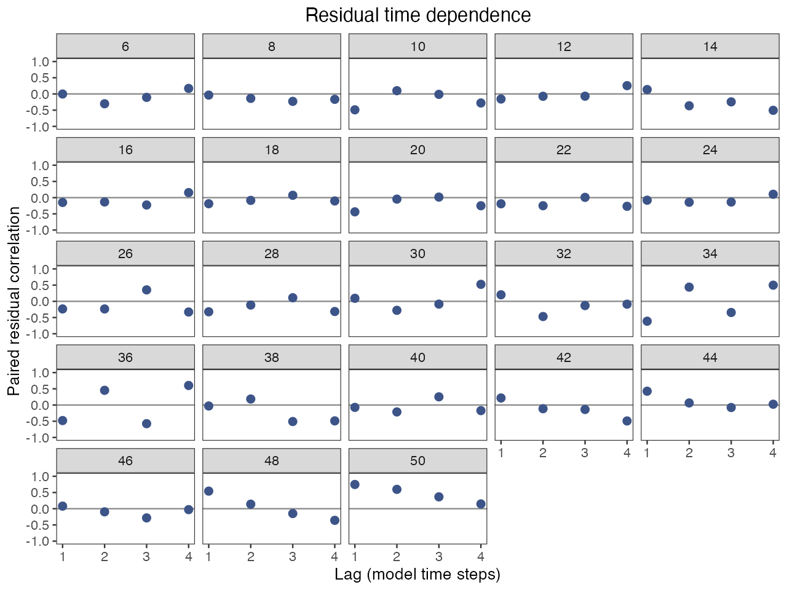
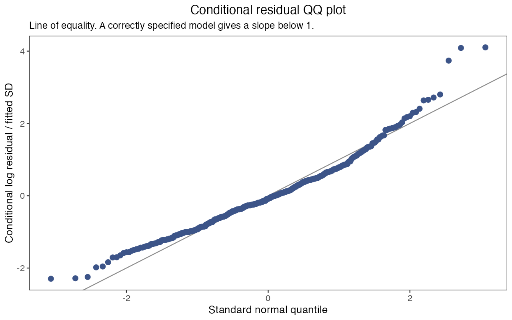

# Assessment workflows: from bundle to saved results

On this page you take one fitted model through the analyses an assessment reports, from saving the estimates to checking residuals, testing sensitivity to fixed inputs, profiling an estimated parameter, projecting future scenarios and fitting simulation replicates, and you end with a saved fit and a folder of result tables. You need the package installed ([Install and run a first fit](getting-started.html)); with your own data, build the input bundle `x` as in [Prepare your survey data](data-preparation.html). Steps 4 to 7 refit the model several times each; run the ones you need, in any order, from the objects of step 1.

<h2 id="fit-teaching-models">1. Fit once and keep the objects</h2>

```r
library(ALSCL)
library(ggplot2)
data("YTF_example")
x <- YTF_example
a <- run_acl(x, silent = TRUE)
b <- run_alscl(x, silent = TRUE)
summary(a)
summary(b)
```

The ACL fit `a` serves the scenarios and profiles, because an ACL refit takes about twenty seconds; the ALSCL fit `b` serves results, residuals and projections. `summary()` prints the model, the time steps, the F structure, the numerical checks in one row (`numerical_ok` should be `TRUE`, `issues` empty) and the scalar parameters on the natural scale. Where they apply, it also prints a line `Fixed inputs` for a natural mortality rate by age or length and a survey catchability supplied as `survey_q` or `survey_q_age`, and lines `Advice` and `Plausibility note` from the numerical checks ([Judge whether a fit can be used](diagnostics.html#limits)). Read the checks first: every later function records them, and `project_model()` refuses a fit that failed them. If `numerical_ok` is `FALSE`, change one setting as described in [Judge whether a fit can be used](diagnostics.html) and refit.

<h2 id="section-4">2. Extract results and keep a saved fit</h2>

```r
parameter_estimates <- extract_parameters(b)
parameter_estimates
estimates <- extract_estimates(b, quantities = c("SSB", "Rec", "F"))
head(estimates)
write.csv(estimates, "ytf_alscl_estimates.csv", row.names = FALSE)
save_assessment(b, "ytf_alscl.rds")
saved <- read_assessment("ytf_alscl.rds")
summary(saved)
saved$recipe$versions
plot_SSB(saved, se = TRUE)
b_again <- refit_model(saved, silent = TRUE)
```

`extract_parameters()` returns one row per scalar parameter: `status` (`estimated`, `fixed` or `inactive`), the estimate on the natural scale, its standard error and a 95% interval (`NA` for fixed parameters); `exp(mean_log_F)` is the baseline of the F process, which the exponentiated yearly deviations scale. `extract_estimates()` returns a long table of population quantities with `year`, `age` or `length` and an interval for each value; `F` comes by length bin for ALSCL (`report_name` is `FL`) and by age for ACL, without averaging. The column `extrapolated` is `TRUE` for the fishing mortality and catch of the last time step, which no observation informs: they are predictions from the F process, and their standard errors reflect that process. When the last time steps have no positive survey observation, the rows from the last time step with an observation onwards are marked as well. Other quantities are requested by name: `extract_estimates(b, c("FA", "N_at_age"))` returns ALSCL F at age, for every age and time step, and numbers at age. The fitted report (`b$report$FA`) holds F at age for the ages before the plus group and the time steps before the last, with standard errors; `extract_estimates()` computes the other cells from the reported numbers at length and age, and their standard errors are `NA`. `N_at_age` is an alias of `NA`; a table labelled "NA" loses that label when it is written to a CSV file and read back with the defaults of `read.csv()`. `fitted(b)`, `logLik(b)`, `AIC(b)`, `BIC(b)` and `nobs(b)` also work on a fit, and `vcov(b)` returns `NULL` when the stored covariance is not finite or not positive definite.

`save_assessment()` writes the saved fit: everything in `b` except the live TMB object `b$obj`, plus the recipe (the three tables, settings, `map`, bounds, starting values, package versions and hashes of the model source). `summary()`, the extraction and plot functions work on what `read_assessment()` returns, so a colleague reads your results without refitting; `refit_model()` reruns the recipe when you need a live model, for example `refit_model(saved, M = 0.25)` to change one assumption, and warns when the package, TMB or the model source differ from the saved ones. `save_assessment()` stops when the file exists (pass `overwrite = TRUE`) or when a fit has no recipe (pass its input bundle as `x`).

Give independent fits distinct filenames when saving in parallel. If two sessions use the same new path with the default `overwrite = FALSE`, only one can save there. If a session was interrupted and a lock error persists, confirm that its writer has stopped before removing the lock directory shown in the error.

<h3 id="outputs">Outputs for comparison with age readings and other assessments</h3>

```r
growth <- length_at_age(b)
subset(growth, year == max(year) & age %in% c(1, 5, 10))
# An assumed maturity ogive by age: half of the fish mature at the fourth age class
ogive <- pmin(1, pmax(0, (seq_along(b$age) - 3) / 2))
ssb <- ssb_at_age(b, maturity = ogive)
head(ssb, 3)
cor(log(ssb$SSB), log(ssb$SSB_model))
catch <- relative_catch(b)
tail(catch, 3)
```

Three functions return quantities that a source outside the model can check: mean length at age against age readings, spawning biomass with the maturity ogive of an age-based assessment, and the trend of catch against reported catch. They work on a fit and on a saved fit.

`length_at_age()` returns the mean and standard deviation of length for each age class and time step on two bases: in the population (`"population"`), and as the survey sees it (`"survey"`), with numbers at length multiplied by the survey catchability at length used in the fit. Compare the survey basis with mean length at age from age readings of fish caught in the same survey. Here the mean length of age 1 in the last year is 10.7 cm in the population and 12.8 cm on the survey basis, because the survey catches few of the smallest fish of that age; at age 5 the two bases agree. An ALSCL fit gives the values from its numbers by length bin, age class and time step. An ACL fit gives them from its age-length probabilities, which are the same in every time step. Each length bin enters with its midpoint. Where a large share of an age class lies in the first or the last length bin, the mean is therefore drawn toward the midpoint of that bin and the standard deviation is too small: the value of 49.5 cm at age 10 is close to 50 cm, the midpoint of the last bin. Compare the growth of an ALSCL fit with age readings through these means and not through `Linf` and `k`, because growth parameters estimated from growth increments and from age-length data have different meanings ([Francis 1988](https://doi.org/10.1139/f88-115); [Model principles](model-theory.html#difference-increment)).

`ssb_at_age()` returns spawning biomass as the sum over age classes of biomass at age multiplied by a proportion mature at age, next to `SSB_model`, the spawning biomass of the model from the maturity at length supplied to the fit. `maturity` is a vector with one value per age class or a matrix by age class and time step, and `weight` can supply mean weight at age. Use it when the assessment you compare with defines spawning biomass by a maturity ogive by age. Both series are on the scale of model biomass, which depends on the supplied survey catchability, so compare trends and not levels. The correlation of the two log series is 0.999 here.

`relative_catch()` returns catch in numbers and in weight, each divided by its mean over the time steps, or over the time steps given in `years`. Give the time steps that have reported catch, and divide the reported catch by its mean over the same time steps. The function returns relative values only, because a fit to a survey index does not determine the level of catch ([Model principles](model-theory.html#survey)). The column `extrapolated` is `TRUE` for the last time step, whose catch is a prediction.

```r
plot_VB(b, basis = "survey")
plot_length_at_age(b, basis = "survey", ages = c(1, 5, 10))
plot_SSB(b, maturity_at_age = ogive)
plot_relative_catch(b)
```

Four plots show these outputs. `plot_VB()` draws mean length at age averaged over the time steps, and `plot_length_at_age()` draws it by time step; both take `basis` and, in `observed`, the mean length at age from age readings, drawn as points. `plot_SSB()` with `maturity_at_age` adds the spawning biomass from the maturity ogive by age to the spawning biomass of the model. `plot_relative_catch()` draws relative catch and, with `observed`, a reported catch series divided by its mean over the same time steps. `plot_natural_mortality()` and `plot_survey_catchability()` show the natural mortality rate and the survey catchability that the fit used, the two inputs on which the level of catch and abundance depends ([Growth, mortality and residuals](growth-mortality.html)).

<h2 id="section-5">3. Check residuals on the model time grid</h2>

```r
checks <- check_fit(b, max_lag = 4)
head(residuals(b, type = "standardized"))
checks$lag_correlations
checks$plots$heatmap
checks$plots$lag
checks$plots$qq
```






`check_fit()` standardizes the log residuals (observed minus fitted log index, divided by the fitted observation SD) and draws three views. In the heatmap by length bin and time step (excluded zeros and blanks in grey), a block of one colour shows where residuals have the same sign over neighbouring lengths or time steps. The lag plot shows, per length bin, the correlation between residuals one to `max_lag` time steps apart; an unobserved time step stays a gap, and `checks$lag_correlations` gives the pairs behind each point. The QQ plot compares the pooled residuals with the standard normal distribution, N(0,1). Standardized conditional residuals have a standard deviation slightly below 1 even when the model is correct (about 0.91 to 0.96 in simulation checks), so points just inside the line at both tails are expected. In the teaching fit the 16 cm bin is positive in nearly every year, the largest bin is positive from 2013 on with a lag-one correlation near 0.8, and the QQ plot has a heavier positive tail: worth a look although the numerical checks pass. The residuals are conditional on the fitted process deviations, so treat the views as pointers, not tests; [Judge whether a fit can be used](diagnostics.html) says which setting a pattern usually points to.

<h2 id="section-6">4. Sensitivity scenarios versus parameter profiles</h2>

`fit_scenarios()` refits the same observations under named changes of the inputs the model takes as given (natural mortality, survey catchability, the F structure, a `map` entry) and shows how much the result moves when an assumption changes. `profile_model()` fixes one estimated scalar parameter at each value of a grid, refits the rest, and shows the constraint on that parameter under the current model and fixed values. The example tests two assumptions of the teaching fit:

| Scenario | Change from the reference | What it tests |
|---|---|---|
| `reference` | None: `M` = 0.20 per time step, `F_structure = "group_year"` | The settings of step 1 |
| `low_M` | `M = 0.15` | Natural mortality is fixed, and the biomass scale depends on it |
| `shared_F` | `F_structure = "year"`: one F per time step shared by all ages | Whether age-specific F is needed |

```r
scenarios <- fit_scenarios(x, list(
  reference = list(),
  low_M = list(M = 0.15),
  shared_F = list(F_structure = "year")
), model = "acl", ncores = 2, F_summary = "mean", silent = TRUE)
scenarios$status
head(scenarios$estimates)
scenario_ssb <- subset(scenarios$estimates, quantity == "SSB")
ggplot(scenario_ssb, aes(year, estimate, color = scenario)) +
  geom_line() + labs(x = "Year", y = "SSB") +
  theme_bw() + theme(panel.grid = element_blank())
```


Each scenario is a named list of arguments that replace the settings of `x`; an empty list is the reference, a list such as `map` replaces the stored list completely, and the three tables stay the same. A scenario can also supply `M` by age class or by length bin, or a survey catchability as `survey_q` with `sel_L50 = NULL` and `sel_L95 = NULL` ([Judge whether a fit can be used](diagnostics.html#sensitivity)). Read `scenarios$status` before the curves: one row per scenario with the time taken, errors, warnings and the numerical checks. A scenario that failed the checks stays in `scenarios$estimates` with `numerical_ok = FALSE`; one that stopped with an error has no estimates. The estimates table holds spawning biomass, recruitment and F by scenario and year, with F averaged over ages (or length bins) within each time step by `F_summary = "mean"` or taken as the maximum by `"apical"`. `ncores` runs scenarios on separate workers, each with the starts stored in `x` or one start. Here the three curves nearly coincide: the lower M and the shared F move spawning biomass by a few percent at most; with your own data, the spread between the curves is the sensitivity to report.

<h3 id="section-7">Profile a parameter that was estimated</h3>

```r
profile_values <- exp(a$opt$par[["mean_log_F"]]) * c(0.9, 1, 1.1)
profile_F <- profile_model(a, "mean_log_F", profile_values,
                           scale = "natural", ncores = 1)
profile_F$grid
ggplot(profile_F$grid, aes(value, delta_nll)) +
  geom_line() + geom_point() +
  labs(x = "F process baseline", y = "Change in negative log likelihood") +
  theme_bw() + theme(panel.grid = element_blank())
```


`profile_model()` takes one name from `names(a$opt$par)`, the scalar parameters the fit estimated; `YTF_example` fixes `log_Linf`, so asking for it stops with "parameter must name one free scalar". With `scale = "natural"` the grid is given on the natural scale and must lie within the optimizer bounds. `profile_F$grid` lists each value with its objective, `delta_nll` (the rise in negative log likelihood relative to the original fit) and the numerical checks of that refit. A steep rise on both sides indicates stronger constraint under the current model and fixed-parameter settings; here a 10% change of the baseline F costs 0.8 to 0.9 units. A `delta_nll` below `-1e-6` triggers a warning that a grid refit reached a lower objective. Check that refit's numerical status and rerun the original with more starts before interpreting the profile; tiny negative differences can reflect roundoff. A profile for a report needs a denser grid and refits that all pass the checks.

<h2 id="section-8">5. Project future scenarios</h2>

```r
h <- 4L
w <- as.matrix(x$data.wgt[-1L])
mat <- as.matrix(x$data.mat[-1L])
future_w <- matrix(w[, ncol(w)], nrow(w), h)
future_mat <- matrix(mat[, ncol(mat)], nrow(mat), h)
future_rec <- rep(tail(b$report$Rec, 1), h)
low_F <- project_model(b, F = rep(0.10, h), recruitment = future_rec,
                       weight = future_w, maturity = future_mat)
higher_F <- project_model(b, F = rep(0.25, h), recruitment = future_rec,
                          weight = future_w, maturity = future_mat)
low_F$summary
low_F$assumptions
projection_ssb <- rbind(
  transform(low_F$summary, scenario = "F = 0.10"),
  transform(higher_F$summary, scenario = "F = 0.25"))
ggplot(projection_ssb, aes(year, SSB, color = scenario)) +
  geom_line() + geom_point() + labs(x = "Year", y = "Start-of-period SSB") +
  theme_bw() + theme(panel.grid = element_blank())
```


`project_model()` advances the last fitted population through future time steps under values you supply: `F` (one value per step shared by all groups, or a group by step matrix), `recruitment` (its length sets the horizon) and complete `weight` and `maturity` matrices with one column per future step. Nothing is carried forward for you; the code repeats the last observed weight and maturity columns and the last fitted recruitment, a choice to state in the report. `M` stays at the fitted value unless you pass another: a single number, one value per future step, or a matrix with one row per age class and one column per future step (or one column that is used for every step). A fitted M by age that is the same in every time step, and a fitted M by length in ALSCL, are used as they are. When the fitted M varies over time, no value is carried forward and `project_model()` stops until you supply `M`. `low_F$summary` lists, per future step, abundance, biomass, spawning biomass, recruitment, catch in numbers and in weight, and the mean and maximum F; `low_F$assumptions` records every choice.

Each row describes the start of a time step: the first future state is the last fitted population survived through the last fitted F and M plus the first supplied recruitment, and a future `F[t]` sets the catch of step `t` and the survival into step `t + 1`. The first supplied F therefore does not change the first future spawning biomass; the curves separate from the second step on. The projection is deterministic and conditional on the fit, without intervals, stock-recruitment relationship or reference points. `project_model()` stops when the source fit failed the numerical checks unless `allow_failed_fit = TRUE`, which records the override in `assumptions`; a message such as "weight must be a finite nonnegative 23-by-4 matrix" means a matrix has the wrong number of rows (length bins) or columns (future steps).

<h2 id="section-9">6. Fit simulation replicates and report failure rates</h2>

```r
pa <- x$parameters
bio <- sim_cal(pa)
iterations <- 1:2
simulation_dir <- tempfile("assessment-sim-")
sm <- sim_data(bio, pa, iter_range = iterations,
               return_iter = iterations[1], output_dir = simulation_dir)
cfg <- x$fit_config$alscl
simulation_fits <- sim_model(iterations, simulation_dir,
  file.path(simulation_dir, "fits_alscl"), model = "alscl", ncores = 1,
  parameters = cfg$parameters, parameters.L = cfg$parameters.L,
  parameters.U = cfg$parameters.U, map = cfg$map, M = pa$M)
simulation_truth <- setNames(lapply(iterations, function(i) {
  e <- new.env(parent = emptyenv())
  load(file.path(simulation_dir, paste0("sim_rep", i)), envir = e)
  s <- e$sim.data
  list(year = s$years, SSB = as.numeric(s$SSB), Rec = as.numeric(s$Rec))
}), paste0("result_rep_", iterations))
stopifnot(identical(names(simulation_fits), names(simulation_truth)))
performance <- summarize_simulations(simulation_fits, simulation_truth,
                                     quantities = c("SSB", "Rec"))
performance$replicates
performance$summary
```

This step asks whether the model recovers a known population. `x$parameters` holds the settings of the simulator that generated `YTF_example`; `sim_cal()` derives the biology, and `sim_data()` writes one file `sim_rep<i>` per replicate holding a list `sim.data` with the survey tables and the true `SSB` and `Rec` by year. `sim_model()` fits every file with the chosen model and that model's starts and `map` (here the ALSCL configuration stored in `x`), saves each result as `result_rep_<i>` and returns them as a named list, keeping a replicate that stopped with an error together with its message. The truth list must use the same names and years as the fits, which is why the code reads each simulation file; otherwise `summarize_simulations()` stops with "identical unique replicate names" or "time coordinates differ".

Read the denominators of `performance$summary` with its statistics: `n_replicates` fits attempted, `n_valid_fits` fits that passed the numerical checks (`failure_rate` is the share that failed), `n_valid_pairs` the estimate and truth pairs behind `bias`, `relative_bias` and `rmse`, and `n_intervals` the intervals with a finite standard error behind `coverage`, the share of them containing the truth. A missing standard error leaves its interval out of coverage, and `relative_bias` skips years with a true value of zero. `performance$replicates` lists every replicate with its checks and time, `performance$estimates` every year of every replicate, failures included. Two replicates only show the mechanics; a study needs enough replicates for the failure rate and the coverage to mean something.

<h2 id="section-11">7. Simulate the fitted model and validate predictions</h2>

```r
simulated <- simulate_fit(b, nsim = 2, seed = 42, process = "conditional")
names(simulated$simulations[[1]])
validation <- hindcast_model(x, model = "acl", horizon = 1, nfolds = 3, ncores = 2)
validation$diagnostics
validation$scores
```

Two further checks start from the fit itself. `simulate_fit()` is the fitted-model simulation: it draws new survey observations from the fitted model, around the fitted population (`"conditional"`) or after drawing new process deviations (`"resample"`), and returns per replicate an input bundle `x` that `run_alscl()` accepts, so you can refit it and compare with the stored `truth`; the bundle keeps the fitting configuration of `b` except `output`, `ncores` and `silent`. `hindcast_model()` is the hindcast validation: it fits on the earlier time steps only, predicts the next `horizon` steps of the survey index from each of the `nfolds` most recent forecast origins, and scores the predictions against the withheld observations next to a naive forecast. A natural mortality rate by age and time step, or a survey catchability by length and time step, is supplied for the complete time grid: each training fit uses the columns up to its forecast origin, and the prediction uses the columns of the withheld time steps. [Can the model reproduce and predict survey observations?](case-model-validation.html) works through both checks.

<h3 id="save-workflow">Save the completed workflow</h3>

```r
record_dir <- "assessment-record"
dir.create(record_dir)
write.csv(scenarios$status, file.path(record_dir, "scenario_status.csv"), row.names = FALSE)
write.csv(profile_F$grid, file.path(record_dir, "profile_F.csv"), row.names = FALSE)
write.csv(performance$summary, file.path(record_dir, "simulation_summary.csv"), row.names = FALSE)
saveRDS(list(input = x, scenarios = scenarios, profile = profile_F,
  projections = list(low_F = low_F, higher_F = higher_F),
  simulation_truth = simulation_truth, performance = performance,
  validation = validation), file.path(record_dir, "workflow_record.rds"))
writeLines(capture.output(sessionInfo()), file.path(record_dir, "session.txt"))
```

Run this after the steps you used, or save the objects you have. The saved fit of step 2 is the assessment; the record adds the scenario and profile fits (lists without a live TMB object), the projections with their assumptions, the simulation truth and performance, the validation scores and the session information, which together with the input bundle make the assessment reproducible.

<h2 id="next">What next</h2>

| What you want to do | Read |
|---|---|
| Find the setting a residual pattern points to | [Judge whether a fit can be used](diagnostics.html) |
| See how estimates change when recent time steps are removed | [Run a retrospective analysis](retrospectives.html) |
| Work through simulation and hindcast validation with figures | [Can the model reproduce and predict survey observations?](case-model-validation.html) |
| Ask a sensitivity or projection question about your own stock | [How sensitive is the assessment, and what happens under future F?](case-sensitivity-projection.html) |
| Reproduce a result or fix a failure | [Reproduce results and fix problems](reproducibility.html) |
