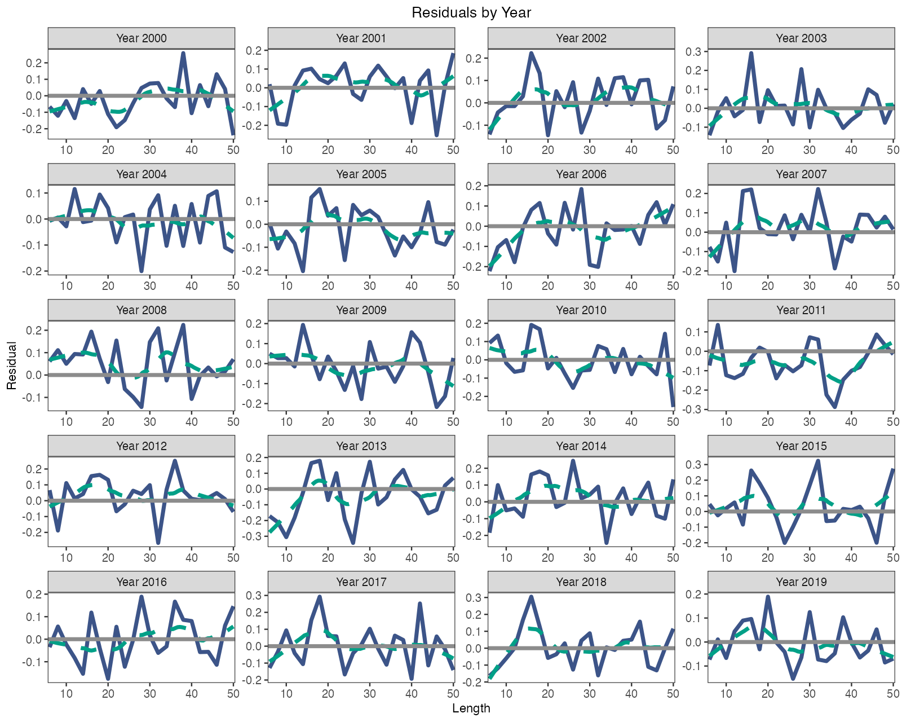
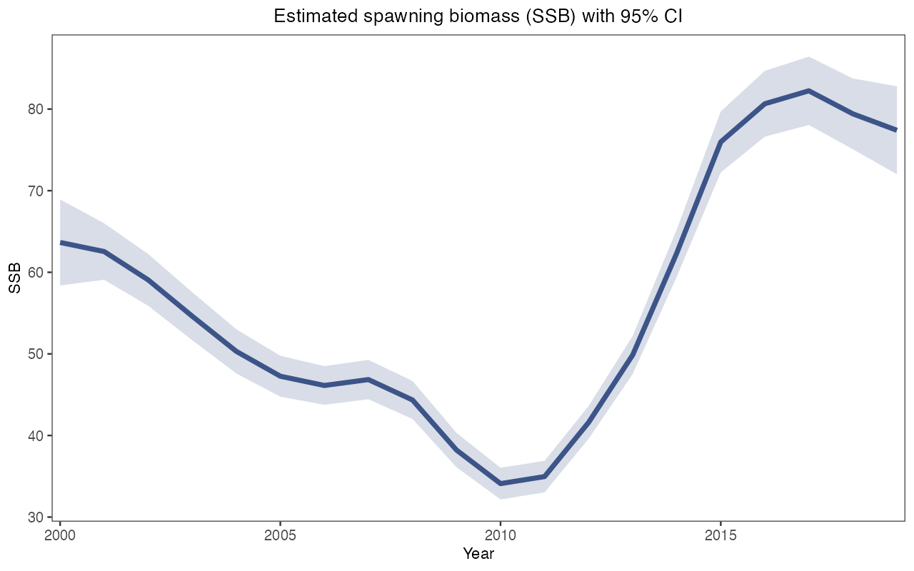

# How do I fit my own survey data?

On this page you go from three survey tables in CSV or Excel files to two fitted models, ACL and ALSCL, with their numerical checks, plots and saved results. The page follows the script [fit_own_data_example.R](https://github.com/FanZhang-LAB-SHOU/ALSCL/blob/main/scripts/fit_own_data_example.R), which runs the whole sequence on the bundled teaching data; you then replace its values with yours. You need the package installed ([Install ALSCL](getting-started.html)), your tables laid out as in [Prepare your survey data](data-preparation.html), and the biological values of your stock (`rec.age`, `nage`, `M`, `sel_L50`, `sel_L95`, `growth_step`, `len_mid`, `len_border`), which [step 4 of that page](data-preparation.html#bundle) explains one by one.

<h2 id="bundle">1. Prepare and check the input bundle</h2>

```r
library(ALSCL)
tables <- read_survey_csv("my_data")
x <- prepare_alscl_data(tables, fit_args = list(
  rec.age = 1, nage = 15, M = 0.2, sel_L50 = 15, sel_L95 = 20,
  growth_step = 1, len_mid = seq(6, 50, 2), len_border = seq(7, 49, 2)))
check <- check_alscl_data(x, "acl")
check$valid
check$summary
```

Both models read the input bundle `x`: the survey index table `data.CatL`, the weight table `data.wgt` and the maturity table `data.mat`, with the length bins as rows and the time steps as columns, plus the settings in `x$fit_args` that describe your stock and survey. `read_survey_csv()` reads the three files from one folder and `read_survey_excel()` the three sheets of one workbook; [Prepare your survey data](data-preparation.html) explains the layout, the time grid and the treatment of blanks and zeros. The settings are inputs that the models use as given; supply each one for your stock and record its source. The numbers in the code are those of the teaching data.

`check_alscl_data()` prepares the data as a fit would, without compiling anything. `check$valid` should be `TRUE` and `check$summary` should show the numbers of bins and time steps you expect, the count of positive observations and `free_fixed`, the number of scalar parameters that will be estimated. When `check$valid` is `FALSE`, `check$errors` names the table, time column or setting to correct; `check$warnings` points to time steps or bins without any observation. Repeat the check with `"alscl"` before fitting that model.

<h2 id="map">2. Decide the starting values and the map</h2>

```r
plan <- inspect_parameters(x, "acl")
plan[, c("parameter", "status", "map_source", "natural_start")]
inspect_parameters(x, "alscl")[, c("parameter", "status", "map_source", "natural_start")]
```

`inspect_parameters()` lists the parameters of a model with their starting value on the natural scale and their status, `free` (estimated), `fixed` or `tied`; `map_source` says whether a fixed status comes from the model default or from your `map`. By default ACL fixes `log_std_log_F`, `logit_log_F_y`, `logit_log_F_a` and `t0` and estimates the other 10 scalar parameters; ALSCL fixes `log_sigma_log_F` and `log_t0` and estimates 13. The process deviations `dev_log_R`, `dev_log_F` and `dev_log_N0` are random effects and are always estimated. [Choose the fitting settings](fitting-controls.html#parameters) names every scalar parameter of both models.

Starting values go in `x$fit_config$acl$parameters` or `x$fit_config$alscl$parameters` on the optimizer scale: `log_Linf = log(60)` for an asymptotic length of 60 cm, `logit_log_R = qlogis(0.1)` for a correlation of 0.1; ALSCL uses `log_t0`, so its `t0` must lie between 0 and `rec.age`. A starting value does not fix a parameter: only `factor(NA)` in the model's `map` does, and a named `NULL` entry releases a parameter that the model fixes by default. Fix a parameter when an external study gives a better value than the fit could, or when the checks of step 5 show that the data leave it undetermined, and record the source of every fixed value. [Choose the fitting settings](fitting-controls.html) gives the rules for `map`, bounds and species presets; [Estimation parameter lists](estimation-parameters.html) gives every transformation.

<h2 id="run">3. Run the complete example</h2>

The script below runs every step on the teaching data: it reads the three CSV files in `docs/data`, collects the biology in `bio`, derives the bin midpoints and boundaries from the row labels, sets the starting values and maps of both models, builds and checks `x`, fits ACL (`a`) and ALSCL (`b`), prints their numerical checks, draws the residual and spawning biomass plots of `b`, and saves the bundle, both fits without their live TMB object, the two figures and the session information to `output/own-data-example`. Run it from the root of a downloaded copy of the repository, because it sources `scripts/plot_helpers.R` and reads `docs/data`: `source("scripts/fit_own_data_example.R", encoding = "UTF-8")`.

```r
# ALSCL: CSV -> x -> ACL / ALSCL -> diagnostics and saved summaries.
# Run from the repository root:
# source("scripts/fit_own_data_example.R", encoding = "UTF-8")
# The supplied numbers describe the synthetic YTF example, not your stock.

library(ALSCL)
source('scripts/plot_helpers.R')
stopifnot(packageVersion("ALSCL") >= "2.3.0")

# Read the three aligned tables -------------------------------
# data.CatL.csv, data.wgt.csv, data.mat.csv.
data_dir <- "docs/data"
inputs <- read_survey_csv(data_dir)
# Excel alternative (requires readxl):
# inputs <- read_survey_excel("my_survey.xlsx")

# Shared biology -----------------------------------------
# M_annual and vbk are annual; lengths are cm; weights in the example are kg.
bio <- list(rec.age = 1, nage = 15, M_annual = 0.2,
            growth_step = 1, sel_L50 = 15, sel_L95 = 20,
            Linf = 60, vbk = 0.2, t0 = 1 / 60,
            cv_len = 0.2, cv_grow = 0.2)
stopifnot(bio$t0 > 0, bio$t0 < bio$rec.age)

# For labels such as "5-7", supply the actual midpoints explicitly instead.
len_mid <- as.numeric(inputs$data.CatL[[1]])
stopifnot(all(is.finite(len_mid)), all(diff(len_mid) > 0))
# This midpoint formula is only used for the equal-width demonstration bins.
stopifnot(max(abs(diff(len_mid) - diff(len_mid)[1])) < 1e-8)
len_border <- (head(len_mid, -1) + tail(len_mid, -1)) / 2

# Model-specific settings ------------------------------
# Growth and most process values below are starts, not automatic fixes.
# Review starts, bounds and the documented default fixed values for your stock.
p_acl <- list(
  log_Linf = log(bio$Linf), log_vbk = log(bio$vbk), t0 = bio$t0,
  log_cv_len = log(bio$cv_len),
  log_std_log_F = log(0.2), log_std_log_N0 = log(0.2),
  logit_log_R = qlogis(0.1))
p_alscl <- list(
  log_Linf = log(bio$Linf), log_vbk = log(bio$vbk), log_t0 = log(bio$t0),
  log_cv_len = log(bio$cv_len), log_cv_grow = log(bio$cv_grow),
  log_sigma_log_F = log(0.2), log_sigma_log_N0 = log(0.2),
  logit_log_R = qlogis(0.1))
# Default maps: ACL fixes 4 and estimates 10 scalars; ALSCL fixes 2 and estimates 13.
# ACL fixes log_std_log_F, logit_log_F_y, logit_log_F_a and t0.
# ALSCL fixes log_sigma_log_F and log_t0. These values still need justification.
map_acl <- list()
map_alscl <- list()
# Optional: fix only t0; diagnose this more flexible configuration separately.
# map_acl <- list(t0 = factor(NA), log_std_log_F = NULL,
#                 logit_log_F_y = NULL, logit_log_F_a = NULL)
# map_alscl <- list(log_t0 = factor(NA), log_sigma_log_F = NULL)
# Preserve a named NULL to release a default fix; $t0 <- NULL deletes the entry.
# map_acl["t0"] <- list(NULL)
# map_alscl["log_t0"] <- list(NULL)

# Assemble and check the input bundle --------------------
x <- prepare_alscl_data(inputs,
  fit_args = list(
    rec.age = bio$rec.age, nage = bio$nage,
    M = bio$M_annual * bio$growth_step,
    sel_L50 = bio$sel_L50, sel_L95 = bio$sel_L95,
    growth_step = bio$growth_step,
    len_mid = len_mid, len_border = len_border,
    zero_action = "error", train_times = 2,
    nstarts = 1, ncores = 1, silent = FALSE),
  fit_config = list(
    acl = list(parameters = p_acl, map = map_acl),
    alscl = list(parameters = p_alscl, map = map_alscl)))
# Check data, time grid and settings without compiling.
for (model in c("acl", "alscl")) {
  check <- check_alscl_data(x, model)
  if (!check$valid) stop(paste(check$errors, collapse = "\n"))
  print(check$summary)
}

# Fit directly ----------------------------------------------
alscl_speed_info()
a <- run_acl(x)
b <- run_alscl(x)
# a <- run_acl(x, nstarts = 4, ncores = 2)
# b <- run_alscl(x, nstarts = 4, ncores = 2)

# Inspect, plot and save ------------------------------
checks <- list(ACL = diagnose_model(x$data.CatL, a),
               ALSCL = diagnose_model(x$data.CatL, b))
print(checks)
print(a$sd_info)
print(b$sd_info)
for (fit in list(a, b)) {
  print(fit$par_low_up) # Actual free scalars and bounds
  print(list(convergence = fit$convergence_code,
             max_gradient = fit$max_abs_gradient,
             pdHess = fit$pdHess, bound_hit = fit$bound_hit))
  print(fit$refinement)
  print(fit$diagnostics)
  if (!isTRUE(fit$convergence_code == 0L) || !isTRUE(fit$pdHess) ||
      !isTRUE(fit$diagnostics$numerical_ok))
    warning("Review fit diagnostics before interpreting this assessment.")
}
residual_plot <- plot_residuals(b, type = "year", facet_ncol = 4,
                                x_breaks = pretty(len_mid, n = 4))
# Omit SE intervals if Hessian is not positive definite.
ssb_plot <- plot_SSB(b, se = isTRUE(b$pdHess))
print(residual_plot)
print(ssb_plot)
portable <- function(fit) fit[setdiff(names(fit), "obj")]
output_dir <- "output/own-data-example"
dir.create(output_dir, recursive = TRUE, showWarnings = FALSE)
save_grid_free_plot(file.path(output_dir, "residuals.png"), residual_plot,
                width = 10, height = 8, dpi = 150)
save_grid_free_plot(file.path(output_dir, "SSB.png"), ssb_plot,
                width = 8, height = 5, dpi = 150)
saveRDS(x, file.path(output_dir, "inputs_x.rds"))
saveRDS(list(ACL = portable(a), ALSCL = portable(b), diagnostics = checks),
        file.path(output_dir, "assessment_summary.rds"))
writeLines(capture.output(sessionInfo()), file.path(output_dir, "sessionInfo.txt"))
# Refit in a new session:
# x <- readRDS("output/own-data-example/inputs_x.rds")
# b <- run_alscl(x)
```

While the script runs, `check$summary` is printed for both models; with the teaching data it shows 23 length bins, 20 time steps, 460 positive observations, no zeros or blanks, and 10 (ACL) or 13 (ALSCL) free scalar parameters. `diagnose_model()` then prints the numerical checks of each fit, which step 5 explains. In the recorded run ([own-data-example-checks.csv](https://github.com/FanZhang-LAB-SHOU/ALSCL/blob/main/docs/results/own-data-example-checks.csv)) both fits ended with convergence code 0, a positive definite Hessian, no parameter on a bound and a maximum gradient near 3e-9. The script saved these two figures:





Residuals scattered around zero in every year, and a spawning biomass series with a narrow interval, are what a usable fit of these synthetic data looks like; the interval is conditional on the fixed values. If the script stops at `stopifnot(packageVersion("ALSCL") >= "2.3.0")`, install the current version ([Install ALSCL](getting-started.html)); if it fails to find `scripts/plot_helpers.R` or `docs/data`, R is running outside the repository root; if `check_alscl_data()` reports an error, step 1 explains the messages; if a fit ends with the warning "Review fit diagnostics", step 5 says what to change.

<h2 id="replace">4. Replace the demonstration with your observations</h2>

```r
data_dir <- "my_data"
bio <- list(rec.age = 2, nage = 12, M_annual = 0.25,
            growth_step = 1, sel_L50 = 22, sel_L95 = 30,
            Linf = 80, vbk = 0.15, t0 = 0.5,
            cv_len = 0.15, cv_grow = 0.15)
len_mid <- c(8, 11, 14, 17, 20, 24, 28, 33, 39, 46)
len_border <- c(9.5, 12.5, 15.5, 18.5, 22, 26, 30.5, 36, 42.5)
map_acl <- list(log_Linf = factor(NA), log_vbk = factor(NA))
map_alscl <- list(log_Linf = factor(NA), log_vbk = factor(NA))
# Then run the prepare_alscl_data() call of the script and confirm:
for (model in c("acl", "alscl")) {
  check <- check_alscl_data(x, model)
  print(check$valid); print(check$warnings); print(check$summary)
  print(inspect_parameters(x, model)[, c("parameter", "status", "map_source")])
}
```

The values above only show the shape of each entry; replace every one with the value for your stock. Keep the names `inputs`, `x`, `a` and `b` so that the rest of the script runs unchanged.

| Lines in the script | Replace with | Keep in mind |
|---|---|---|
| `data_dir <- "docs/data"` | Your CSV folder, or `inputs <- read_survey_excel("my_survey.xlsx")` | Three files or sheets with exactly these names; blank cells for missing survey values |
| `bio <- list(...)` | The values of your stock | `M_annual` is per year and is multiplied by `growth_step`; `vbk` stays per year; ALSCL needs `0 < t0 < rec.age` |
| `len_mid <- ...`, `len_border <- ...` | The midpoints and internal boundaries of your bins | Delete the equal-width `stopifnot()` and the midpoint formula when your bins differ in width |
| `p_acl`, `p_alscl` | Starting values on the optimizer scale | ACL takes `t0`, ALSCL `log(t0)` |
| `map_acl`, `map_alscl` | The parameters you fix or release | An empty list keeps the model defaults; list every fix each time |
| `zero_action = "error"` | `"missing"` to treat zeros as missing values instead of stopping | Zeros then drop out of the likelihood |
| `output_dir` | A folder for this assessment | The script overwrites the files in it |

After editing, run the script down to the check loop. `check$valid` must be `TRUE` for both models, `check$summary` must show your numbers of bins and time steps, and `inspect_parameters()` must show `fixed` with `map_source` equal to `explicit` for exactly the parameters you fixed. A warning such as "No positive observations in periods: 2004" means that a time step has no survey values and is treated as unobserved; the warning about excluded zeros appears when `zero_action = "missing"` and the survey table contains zeros. Decide what each warning means for your survey before you fit.

<h2 id="fit">5. Fit directly and read the results</h2>

```r
a <- run_acl(x)
b <- run_alscl(x)
diagnose_model(x$data.CatL, a)
diagnose_model(x$data.CatL, b)
b$diagnostics$issues
estimates <- extract_estimates(b)
subset(estimates, quantity == "SSB")
extract_parameters(b)
plot_CatL(b, type = "year", facet_ncol = 5)
plot_residuals(b, type = "year", facet_ncol = 5)
plot_SSB(b, se = TRUE)
```

Once `x` holds your tables and settings, each fit is one call; the `train_times = 2` and `nstarts = 1` that the script stores in `x$fit_args` apply, and an argument in the call, such as `run_acl(x, nstarts = 4, ncores = 2)`, overrides the stored value for that call only. Read the numerical checks before any estimate: convergence code 0, maximum gradient below 0.001, a positive definite Hessian, no parameter on a bound and `numerical_ok` equal to `TRUE`; `b$diagnostics$issues` names any check that failed. `extract_estimates()` returns one table with `quantity`, `year`, the `age` or `length` where the quantity has one, `estimate`, `std_error` and the interval `conf_low` to `conf_high`; `extract_parameters()` lists every scalar parameter on the natural scale with its status, `estimated`, `fixed` or `inactive` (a correlation that the shared F structure leaves unused). `plot_CatL()`, `plot_residuals()` and `plot_SSB()` draw the fit to the observations, the log residuals and the spawning biomass with its interval, as in [Understand your first fit](first-model.html).

When a check fails, change one thing at a time and refit: more starts (`nstarts = 4, ncores = 2`) when the code differs from 0 or the gradient is large, a fixed parameter or `F_structure = "year"` when the Hessian check fails; the table in [Understand your first fit](first-model.html#checks) matches each failed check with its usual cause. Residuals with the same sign across neighbouring lengths or years mean that the model misses a feature of the data even when the checks pass; [Judge whether a fit can be used](diagnostics.html) shows how to examine such patterns and the sensitivity to `M` and the other fixed values.

<h2 id="save">6. Save and reuse the results</h2>

```r
dir.create("output/my-assessment", recursive = TRUE, showWarnings = FALSE)
saveRDS(x, "output/my-assessment/inputs_x.rds")
save_assessment(a, "output/my-assessment/acl.rds")
save_assessment(b, "output/my-assessment/alscl.rds")
# In a later session
x <- readRDS("output/my-assessment/inputs_x.rds")
saved <- read_assessment("output/my-assessment/alscl.rds")
summary(saved)
plot_SSB(saved, se = TRUE)
b2 <- refit_model(saved)
```

`x` is a plain list, so `saveRDS()` keeps the tables and settings and `readRDS()` brings them back. `save_assessment()` writes a saved fit: everything in the fit except the live TMB object `b$obj`, a pointer valid only in the current session, together with the recipe (tables, settings, map, bounds and package versions). `read_assessment()` reads it back, and `summary()`, the extraction functions and the plots work on it directly; `refit_model()` rebuilds a live fit from the recipe, accepts overrides such as `refit_model(saved, nstarts = 4)`, and warns when the package or TMB version differs from the recorded one. The folder must exist, and an existing file is replaced only with `overwrite = TRUE`. The script instead stores `assessment_summary.rds`, both fits without `obj`, with the two figures and `sessionInfo.txt`. Keep the data files, the saved bundle and the saved fits together.

<h2 id="continue">7. Continue with comparison and retrospectives</h2>

```r
comparison <- compare_models(a, b, x$data.CatL)
comparison$fit_diagnostics
comparison$comparison
ra <- retro_acl(x, nyear = 3, train_times = 2, silent = TRUE)
rb <- retro_alscl(x, nyear = 3, train_times = 2, silent = TRUE)
rb$fit_diagnostics
rb$rho_by_peel
rb$rho_text
plot_fishing_mortality(b, type = "length", se = TRUE)
```

`compare_models()` first verifies that both fits used the same survey table, then compares AIC, BIC and the fit statistics. `comparison$comparison` records `data_verified`, `eligible` (both fits passed the numerical checks), `preferred` (the model with the lower AIC, given only when both are eligible) and `issues`. A lower AIC supports a model statistically on these data; whether its structure suits the stock is a biological decision. [Do ACL and ALSCL give different answers?](case-compare-assessments.html) continues the comparison with figures.

The retrospective analysis refits a model after removing the last one, two and three time steps (`nyear` counts time steps, so four peels equal one year of quarterly data). It reads the bundle, so the stored settings apply to every peel; set `ncores` on the retrospective call to run peels in parallel. `rb$fit_diagnostics` lists the full fit (`Peel = 0`) and every peel with its numerical checks, `rb$rho_by_peel` gives Mohn's rho per quantity and peel, and `rb$rho_text$Rho` reports the mean only when the full fit and all peels pass the checks, otherwise `NA` with a warning. `plot_retro(rb)` draws the peeled series ([Run a retrospective analysis](retrospectives.html)); `plot_fishing_mortality(b, type = "length")` draws the fishing mortality at length estimated by ALSCL.

<h2 id="next">What next</h2>

| What you want to do | Read |
|---|---|
| Change a setting that a check pointed to, or the F structure | [Choose the fitting settings](fitting-controls.html) |
| Examine residual patterns and the sensitivity to the fixed values | [Judge whether a fit can be used](diagnostics.html) |
| Compare the two fits with figures | [Do ACL and ALSCL give different answers?](case-compare-assessments.html) |
| Run a retrospective analysis and read Mohn's rho | [Run a retrospective analysis](retrospectives.html) |
| Profile a parameter or project the stock forward | [Assessment workflows](assessment-workflows.html) |
| Fit a quarterly survey | [Annual and quarterly time steps](case-studies.html) |
| Make fits faster | [Speed settings](speed.html) |
