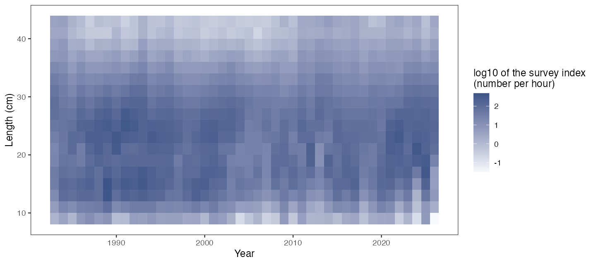
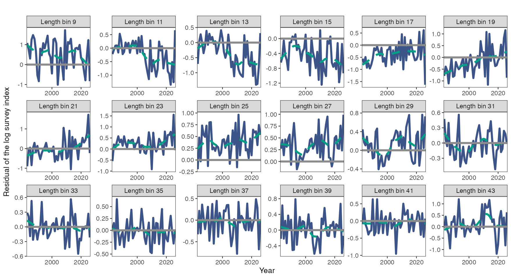
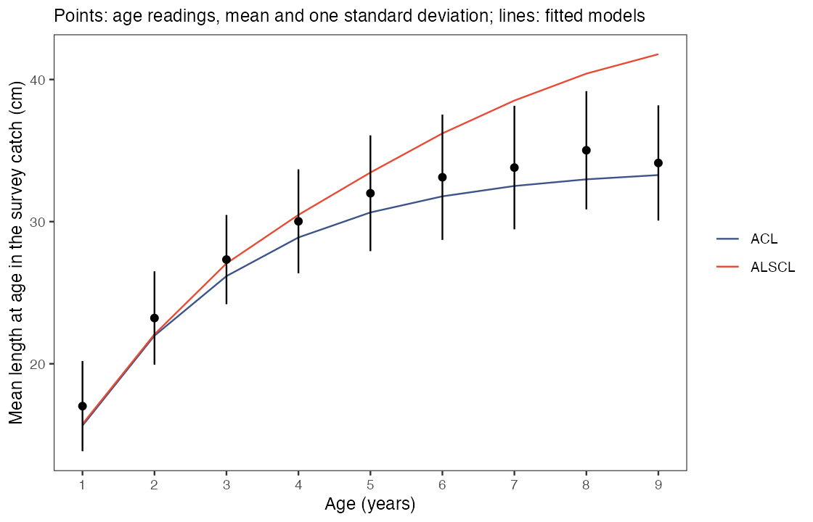
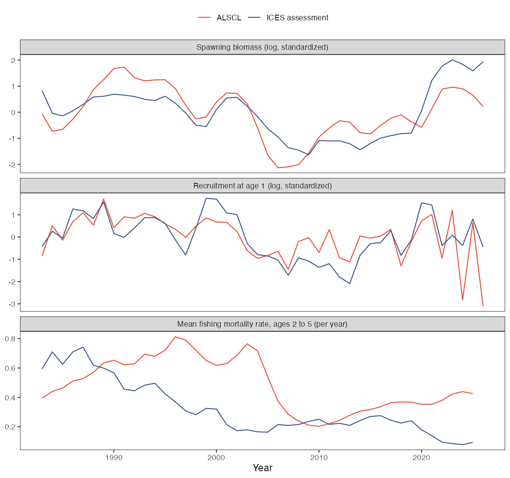
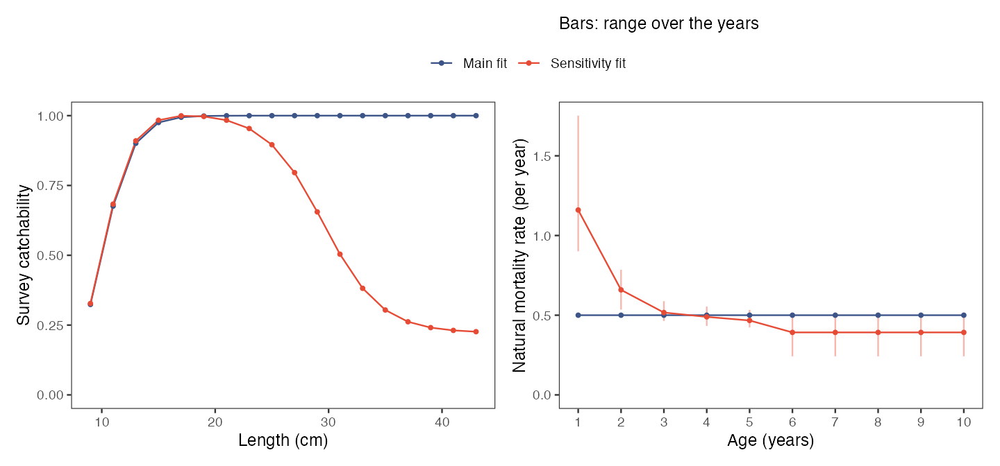
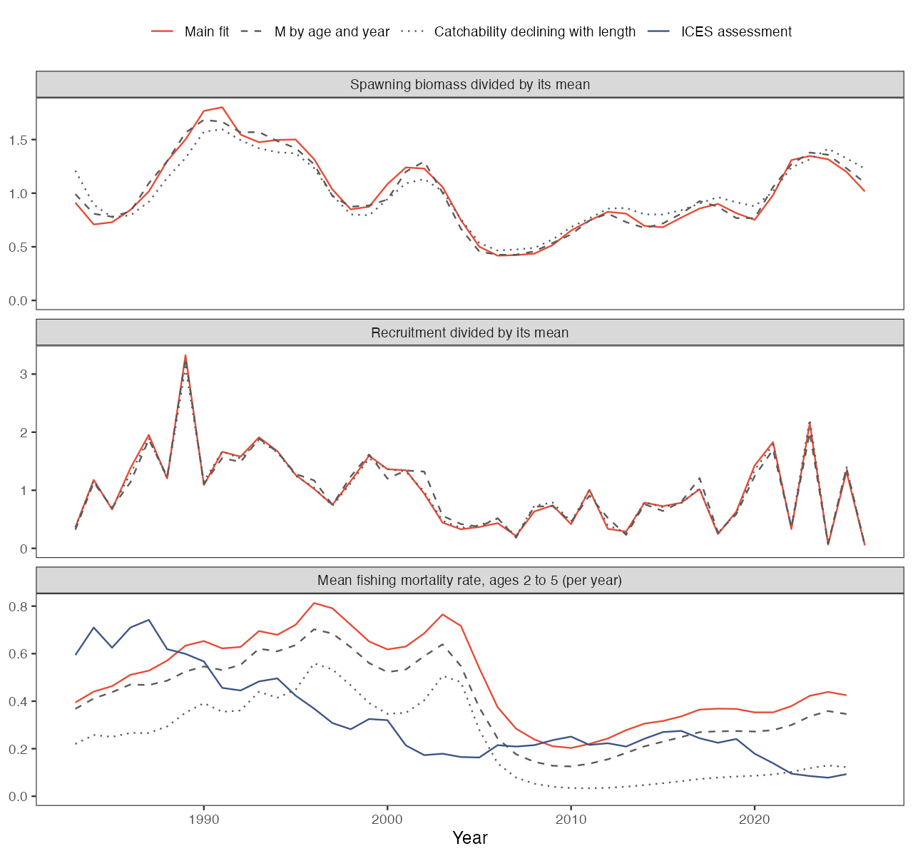

# What can a fit to a real survey be used for?

On this page you fit ALSCL and ACL to a real survey index, that of whiting (*Merlangius merlangus*) in the North Sea from 1983 to 2026, and compare the fits with two sources that they do not use: age readings from the same survey and the assessment of the stock by the International Council for the Exploration of the Sea (ICES). At the end you know which outputs of a fit to survey data alone agree with those sources and which follow from the fixed inputs. You need ALSCL installed ([Install ALSCL](getting-started.html)) and the numerical checks explained in [Understand your first fit](first-model.html). One start on the complete series takes about 10 minutes, so step 1 uses a short series. The page follows the scripts [whiting_case.R](https://github.com/FanZhang-LAB-SHOU/ALSCL/blob/main/scripts/whiting_case.R) and [whiting_case_report.R](https://github.com/FanZhang-LAB-SHOU/ALSCL/blob/main/scripts/whiting_case_report.R), and every number quoted here is listed in [numbers.csv](https://github.com/FanZhang-LAB-SHOU/ALSCL/blob/main/docs/results/whiting-case/numbers.csv).

<h2 id="quick">1. Run a short series first</h2>

```r
library(ALSCL)
x <- whiting_example
short <- x
for (tab in c("data.CatL", "data.wgt", "data.mat")) short[[tab]] <- x[[tab]][, 1:21]
check_alscl_data(short, "alscl")$summary
quick <- run_alscl(short, nstarts = 3, ncores = 3, start_spread = 0.5)
quick$start_diagnostics[, c("start_id", "objective", "convergence")]
quick$diagnostics$numerical_ok
```

`whiting_example` is an input bundle. It holds the survey index table `data.CatL`, the weight table `data.wgt` and the maturity table `data.mat` for 18 length bins and 44 years, the settings in `fit_args` and `fit_config`, and the tables that steps 5 and 6 use for checks. `short` keeps the `LengthBin` column and the first 20 years, 1983-2002, with the same settings. It is a subset for speed. With it you can run the code of this page in a few minutes before you start the complete series.

`check_alscl_data()` should show 18 length bins, 20 time steps, 360 positive observations and 13 free scalar parameters. In the recorded run the three starts ended at the same objective (the negative log-likelihood), 245.56, and `numerical_ok` was `TRUE`. The fit took 2.7 minutes with three starts on three cores, about 2 minutes per start. With fewer cores, lower `ncores`; the starts then run one after another. The results in the following steps are those of the complete series `x` and differ from those of `short`.

<h2 id="data">2. Read where the data and the fixed inputs come from</h2>

```r
x$provenance[c("survey", "areas", "gear", "index", "incomplete_years")]
subset(x$survey_coverage, hauls_missing > 2)
x$fit_args[c("rec.age", "nage", "M", "sel_L50", "sel_L95")]
x$provenance$settings
x$provenance$citation
```

The index comes from the quarter 1 hauls of the North Sea International Bottom Trawl Survey (NS-IBTS) made with the GOV (Grande Ouverture Verticale) bottom trawl in roundfish areas 1 to 7, as held in the ICES Database of Trawl Surveys (DATRAS). Catch per unit effort by length, in number of fish per hour of trawling, was averaged within each ICES statistical rectangle and then across rectangles. `x$provenance` records these rules, the download dates, the citations and the licence (CC BY 4.0); `?whiting_example` gives the same information.

The data have limits that a fit cannot remove. They come from one survey in one quarter, and no catch data enter the fit. The DATRAS product lacks 63 valid hauls of 2009 and 56 of 2012, so the index of these two years rests on fewer hauls (`hauls_missing` in `x$survey_coverage`). The survey started to change to a new trawl in 2025, and the index of 2025 and 2026 does not separate the hauls made with it. Weight and maturity at length are one curve each for all years. The index is a plain mean of the hauls, whereas the ICES assessment uses a model-based index that includes other surveys.

Both models use the inputs in the following table as given. With survey data alone, survey catchability at length and the scale of stock numbers cannot be estimated, and fishing mortality can be separated from natural mortality only by assuming a value of the natural mortality rate M ([Zhang & Cadigan 2022](https://doi.org/10.1111/faf.12673)). Record the source of each input, as `x$provenance$settings` does.

| Input | Value | How it was chosen |
|---|---|---|
| Length bins | 2 cm, labelled 9 to 43 | The smallest of 1, 2 and 5 cm with which the central 98% of the index spans at most 24 bins; the first and the last bin hold all smaller and all larger fish |
| `rec.age`, `nage` | 1, 10 | Age 1 is the youngest age in the quarter 1 index; with 10 age classes the last one, a plus group, holds about 1% of a cohort under M alone |
| `M` | 0.50 per year | 4.899 × tmax^-0.916 ([Then et al. 2015](https://doi.org/10.1093/icesjms/fsu136)), with a maximum age tmax of 12 years in the age readings |
| `sel_L50`, `sel_L95` | 10 cm, 14 cm | An assumption. No study gives the increase of survey catchability with length for whiting in quarter 1 |
| `cv_len`, the coefficient of variation of length at age | fixed at 0.15 | The coefficient of variation of length at ages 1 to 3 in the age readings is 0.148 |
| Growth parameters Linf (asymptotic length), k (growth rate coefficient) and t0 (age at zero length) | estimated | Starting values from the age readings; `t0_lower = -2` lets the t0 of ALSCL be negative |



The heat map shows the log10 survey index by year and length bin. The index summed over length ranges from 339 fish per hour in 2007 to 2,360 in 1989, and the number of hauls per year from 192 to 491.

<h2 id="fit">3. Fit the complete series with several starts</h2>

```r
b <- run_alscl(x, nstarts = 5, ncores = 5, start_spread = 0.5)
b$start_diagnostics[, c("start_id", "objective", "convergence")]
b$start_summary[c("converged", "agree_with_best", "objective_range")]
b$diagnostics[c("numerical_ok", "issues", "advice")]
b$diagnostics$plausibility
plot_residuals(b, facet_by = "length", facet_ncol = 6)
```

`nstarts = 5` runs five starts from different starting values, and `ncores = 5` runs them in parallel. `start_spread = 0.5` is the standard deviation of the normal deviates that are added to the starting values of the second and later starts, on the scale of the optimizer; the default is 0.15. The fit keeps the start with the lowest objective.

Four of the five starts ended at 722.59. One start stopped at 755.72, with the coefficient of variation of the growth increment, cv_grow, at its lower bound of 0.01. A fit with that start alone would have returned this solution, and nothing in a single fit shows that a better one exists. `b$diagnostics$issues` reports "starts converged to different optima", and `numerical_ok` is `TRUE` for the start that was kept. `advice`, which says what to do when a check fails, and `plausibility`, which lists estimates with implausible values that do not fail the checks, are both empty. The fit took 12 minutes on five cores.

When the starts disagree, the fit keeps the lowest objective. Check in `b$start_summary$agree_with_best` that more than one start reached it, and add starts if only one did. When `advice` is not empty, do what it says and refit, as step 4 does for ACL.



Each panel shows the residuals of the log index of one length bin over the years. In several bins they keep the same sign for many years. They are positive in the bin labelled 9 cm (mean 0.53) and from 23 to 29 cm (mean 0.27), and negative from 13 to 17 cm (mean -0.40). Residuals of neighbouring length bins in the same year have a mean correlation of 0.54, whereas the model assumes independent observation errors. The numerical checks test neither pattern. Both mean that the model misses features of the index and that the standard errors of this fit are too small.

<h2 id="acl">4. Fit ACL and follow its advice</h2>

```r
a <- run_acl(x, nstarts = 5, ncores = 5, start_spread = 0.5)
a$diagnostics[c("numerical_ok", "issues", "advice")]
a$diagnostics$plausibility$note
a2 <- run_acl(x,
  parameters = c(x$fit_config$acl$parameters, list(log_std_log_N0 = -3)),
  map = c(x$fit_config$acl$map, list(log_std_log_N0 = factor(NA))),
  nstarts = 5, ncores = 5, start_spread = 0.5)
a2$diagnostics[c("numerical_ok", "issues")]
```

All five starts of ACL ended at the same objective, 736.88, with a positive definite Hessian, and the fit still failed the numerical checks. The standard deviation of the deviations of the initial numbers at age was estimated at 2e-05, which is zero in practice. Such a parameter has not reached a bound of the optimizer, but the data do not determine it. `a$diagnostics$advice` says to fix `log_std_log_N0` with `map` at a chosen value and to refit.

The second call follows the advice with a standard deviation of exp(-3) = 0.05. An explicit `map` or `parameters` argument replaces the one stored in the bundle, so both calls repeat the stored entries. The objective changed by 0.08, the estimates of Linf, k and t0 stayed the same to three digits, and `numerical_ok` was `TRUE`. Three entries remained in `issues` that do not fail the checks: a correlation of 0.96 between the estimates of k and t0, a largest gradient of 1e-05 after the last refinement step, and one start that stopped at an objective of 1308.

One plausibility note stayed in both ACL fits. The initial total mortality rate was estimated at 0.34 per year, below the assumed M of 0.5. Total mortality is the sum of fishing and natural mortality and cannot lie below M, so the numbers at age of 1983 in the ACL fit do not agree with the assumed M and survey catchability. The note does not change the verdict of the checks; report it with the fit. ALSCL estimated 0.88 per year.

ALSCL has the lower objective, 722.59 against 736.96, with 13 against 9 estimated scalar parameters. The objective does not show which model describes the stock better. Steps 5 and 6 compare both fits with data that they did not use.

<h2 id="growth">5. Compare mean length at age with age readings</h2>

```r
by_age <- function(fit) {
  la <- length_at_age(fit, "survey")
  tapply(la$mean_length, la$age, mean)
}
readings <- subset(x$age_readings$length_at_age, period == "1983-2026")
round(cbind(readings = readings$mean_length, ALSCL = by_age(b), ACL = by_age(a2)), 1)
```

`x$age_readings$length_at_age` holds the mean length at age from the age readings of the same survey, which do not enter the fit. Otoliths are collected by length class, so the aged fish are not a random sample of the catch, and a plain mean of their lengths at age is biased towards large fish. The table was therefore computed with an age-length key. For each year, the proportion at age among the fish aged in each 1-cm class was multiplied by the survey index of that class. The result is the mean length at age as the survey sees it, and the matching model output is `length_at_age(fit, "survey")`, in which numbers at length are multiplied by survey catchability. The code averages it over the years and prints ages 1 to 10; age 10 is a plus group in the model and is left out of the table below.

Compare growth through mean length at age and not through the growth parameters. In ACL, Linf, k and t0 describe a von Bertalanffy curve of mean length at age. In ALSCL, Linf and k set the growth increment at length and, with t0, the mean length of recruits. ALSCL estimated Linf at 53.1 cm and k at 0.17 per year, ACL at 33.9 cm and 0.43 per year.

| Age (years) | 1 | 2 | 3 | 4 | 5 | 6 | 7 | 8 | 9 |
|---|---|---|---|---|---|---|---|---|---|
| Age readings (cm) | 17.0 | 23.2 | 27.3 | 30.0 | 32.0 | 33.1 | 33.8 | 35.0 | 34.1 |
| ALSCL (cm) | 15.8 | 22.1 | 27.1 | 30.5 | 33.5 | 36.2 | 38.5 | 40.4 | 41.8 |
| ACL (cm) | 15.7 | 22.0 | 26.2 | 28.9 | 30.6 | 31.8 | 32.5 | 33.0 | 33.3 |



ALSCL lies within 1.3 cm of the age readings at ages 1 to 4. From age 5 it lies above them, by 1.5 cm at age 5 and by 7.7 cm at age 9. ACL lies 0.9 to 2.0 cm below the age readings at every age and follows their shape. Both models lie more than 1 cm below the age readings at ages 1 and 2.

A length index shows separate peaks only for the youngest ages. The lengths of older ages overlap, and few large fish in the index can mean that fish grow slowly or that large fish die fast. Length data alone do not separate the growth of older fish from mortality at length. In these fits ALSCL lets old fish grow to larger lengths and gives them a higher mortality, and ACL gives them a lower asymptotic length; the age readings agree better with ACL from age 6. The age readings also change over time, which neither model allows. Mean length at age 5 ranges from 30.2 to 33.5 cm among the decades. Use the mean lengths of ALSCL at ages 1 to 4, and do not read its Linf or its lengths at older ages as estimates of growth.

<h2 id="assessment">6. Compare trends and mortality with the assessment</h2>

```r
ices <- x$ices$assessment
at <- function(v, lag = 0) v[match(b$year - lag, ices$year)]
cor(log(b$report$SSB), log(at(ices$ssb)))
cor(log(b$report$Rec), log(at(ices$recruitment_age0, lag = 1)))
maturity <- x$ices$maturity[c(1:6, 6, 6, 6, 6), as.character(pmin(pmax(b$year, 1991), 2021))]
cor(log(ssb_at_age(b, maturity)$SSB), log(at(ices$ssb)))
catch <- relative_catch(b, years = 1983:2025)
keep <- !catch$extrapolated
cor(log(catch$catch_weight[keep]), log(at(ices$catch)[keep]))
```

`x$ices$assessment` holds spawning biomass (SSB), recruitment, the mean fishing mortality rate (F) at ages 2 to 5 and catch from the ICES assessment of 2026 ([ICES 2026](https://doi.org/10.17895/ices.pub.32676345)). That assessment uses catch at age, survey indices for quarters 1 and 3 and a natural mortality rate by age and year, so it is an external comparison and not a true value. SSB and recruitment of a fit are in the unit of the survey index, so compare trends, here as the correlation of the logarithms. Recruitment of the fits is at age 1 in quarter 1 and that of the assessment at age 0, so the code shifts the assessment by one year. `ssb_at_age()` recomputes SSB with the maturity at age of the assessment (ages 6 and older in one group, years outside 1991-2021 taken from the nearest year), and `relative_catch()` returns the catch of the model divided by its mean.

| Comparison with the assessment | ALSCL | ACL | ICES |
|---|---|---|---|
| Correlation of log SSB | 0.74 | 0.72 | |
| Correlation of log SSB, maturity at age of the assessment | 0.74 | 0.71 | |
| Correlation of log recruitment | 0.67 | 0.67 | |
| Correlation of log catch in weight | 0.62 | 0.71 | |
| Mean F at ages 2 to 5 (per year), 1983-1999 | 0.62 | 0.57 | 0.51 |
| Mean F at ages 2 to 5 (per year), 2000-2012 | 0.44 | 0.31 | 0.21 |
| Mean F at ages 2 to 5 (per year), 2013-2025 | 0.36 | 0.12 | 0.18 |



The trends of SSB and recruitment agree in part with the assessment, with correlations of 0.67 to 0.74 for ALSCL. SSB is lowest in 2006 in the ALSCL fit and in 2009 in the assessment, and rises afterwards in both. The two differ in the recent level. Mean SSB of 2017-2026 divided by that of 1983-1992 is 0.87 for ALSCL and 1.22 for the assessment. The maturity at age of the assessment in place of maturity at length changes the correlation by less than 0.01.

The level of F cannot be compared. F of ALSCL is above that of the assessment in all three periods and about twice as high after 2000, and the rank correlation between the two series is 0.31. In a fit to survey data alone, total mortality is estimated from the decline of cohorts in the index under the assumed survey catchability, and F is total mortality minus the assumed M. The level of F, and with it the level of catch, therefore follows from the fixed inputs; step 7 shows by how much.

What the survey does inform is the rate at which the index of a cohort declines from one year to the next, the apparent total mortality rate from the survey. The table gives its mean over ages 2 to 5, calculated from the index at age of the age readings (`x$age_readings$index_at_age`) and from the index at age that each fit implies, next to the sum of F and M of the assessment.

| Period | Age readings | ALSCL | ACL | Assessment, F + M |
|---|---|---|---|---|
| 1983-1999 | 1.05 | 1.12 | 1.07 | 1.03 |
| 2000-2012 | 0.78 | 0.94 | 0.81 | 0.76 |
| 2013-2025 | 0.95 | 0.86 | 0.62 | 0.73 |

ALSCL stays within 0.2 per year of the age readings in every period, and ACL falls to 0.62 in the last period, where the age readings give 0.95. The apparent rate equals the total mortality rate of the stock only where survey catchability does not change with age; the assessment estimates a separate catchability of this survey index for each age.

<h2 id="sensitivity">7. Change two fixed inputs</h2>

```r
M_age <- x$ices$M[c(1:6, 6, 6, 6, 6), ]
M_ices <- cbind(M_age, M_age[, rep("2022", 4)])
dimnames(M_ices) <- list(age = 1:10, year = 1983:2026)
b_M <- run_alscl(x, M = M_ices, nstarts = 3, ncores = 3, start_spread = 0.5)
q_dome <- survey_catchability(x$fit_args$len_mid, "dome", L50 = 10, L95 = 14,
                              L50_desc = 29.5, L95_desc = 22, minimum = 0.22)
b_q <- run_alscl(x, survey_q = q_dome, sel_L50 = NULL, sel_L95 = NULL,
                 nstarts = 3, ncores = 3, start_spread = 0.5)
```

The first fit replaces the constant M by the natural mortality rate by age and year that the assessment takes from a multispecies model (`x$ices$M`, the input table of [ICES 2026](https://doi.org/10.17895/ices.pub.32676345)). `M` is then a matrix with one row per age class and one column per time step. Ages 6 to 10 take the value of the oldest group of the table and 2023-2026 take the values of 2022. The mean over the years is 1.18 per year at age 1, 0.66 at age 2 and 0.40 for ages 6 and older.

The second fit replaces the logistic survey catchability by a curve that declines for large fish. [Fraser et al. (2007)](https://doi.org/10.1093/icesjms/fsm145) estimated the catchability of the GOV trawl at length for whiting: constant up to 21 cm, a linear decline from 22 to 37 cm, and about 0.22 of the constant level from 38 cm. Their curve is for the quarter 3 survey and is scaled to the assessment of that time, so it gives the shape only, and it has no information on the increase at small lengths, which stays at 10 and 14 cm here. `survey_catchability()` with `"dome"` builds such a curve, in which the decline starts near `L95_desc`, is halfway at `L50_desc` and ends at `minimum`. `survey_q` takes the place of `sel_L50` and `sel_L95`, which must be `NULL`.



| Result | Main fit | M by age and year | Catchability declining with length |
|---|---|---|---|
| Objective | 722.59 | 857.41 | 752.76 |
| Starts at the lowest objective | 4 of 5 | 3 of 3 | 2 of 3 |
| Mean F at ages 2 to 5 (per year), 1983-1999 | 0.62 | 0.54 | 0.37 |
| Mean F at ages 2 to 5 (per year), 2000-2012 | 0.44 | 0.33 | 0.21 |
| Mean F at ages 2 to 5 (per year), 2013-2025 | 0.36 | 0.28 | 0.08 |
| Correlation of log SSB with the main fit | | 0.99 | 0.97 |
| Correlation of log recruitment with the main fit | | 0.99 | 1.00 |
| Mean SSB divided by that of the main fit | 1 | 0.92 | 1.66 |
| Mean recruitment divided by that of the main fit | 1 | 1.48 | 1.13 |
| Mean length at age 7 (cm); age readings 33.8 | 38.5 | 38.3 | 38.6 |



Both sensitivity fits passed the numerical checks. The trends of SSB and recruitment hardly change. Their correlations with the main fit are 0.97 or higher. The levels change. Recruitment is 1.48 times that of the main fit with M by age, in which more fish of age 1 die, and SSB is 1.66 times that of the main fit with the declining catchability, in which the survey catches a smaller share of the large fish. Mean F at ages 2 to 5 in 2013-2025 is 0.36, 0.28 and 0.08 per year in the three fits, against 0.18 in the assessment. Mean length at age 7 stays 4 to 5 cm above the age readings in all three fits, so neither input removes the difference at older ages.

The objective is higher in both sensitivity fits, by 135 and by 30. Do not choose M or the shape of survey catchability by the objective. With survey data alone, M, fishing mortality and a decline of survey catchability with length are confounded, and a unique solution needs an assumption about them ([Cook 2013](https://doi.org/10.1016/j.fishres.2013.01.003)). [Zhang & Cadigan (2022)](https://doi.org/10.1111/faf.12673) describe the F estimates of the model as absolute, and their paper does not examine a wrong M or a wrong shape of survey catchability. The three fits of this step show that the level of F holds only for the M and the survey catchability that were assumed.

<h2 id="use">8. Decide what to report</h2>

```r
estimates <- extract_estimates(b)
subset(estimates, quantity %in% c("SSB", "Rec") & year >= 2022,
       c(quantity, year, estimate, conf_low, conf_high))
tail(relative_catch(b), 3)
save_assessment(b, "whiting_alscl.rds")
```

`extract_estimates()` returns SSB and recruitment with their intervals, `relative_catch()` the catch of the model divided by its mean, with `extrapolated = TRUE` for the last year, which no observation informs, and `save_assessment()` writes the fit to a file for later sessions. The table lists what the checks of this page support for this index. Repeat the checks for your own data; the same outputs need not pass them.

| Output | Use | Basis on this page |
|---|---|---|
| Recruitment by year | Trend | Correlation of 0.77 with the index at age 1 of the age readings and of 0.67 with the assessment; correlation of 0.99 or higher among the three fits of step 7 |
| Spawning biomass | Trend, as a relative series | Correlation of 0.74 with the assessment and of 0.97 or higher among the three fits |
| Mean length at ages 1 to 4 | As the survey sees it | Within 1.3 cm of the age readings |
| Apparent total mortality rate from the survey, ages 2 to 5 | As a rate of decline of the index, not as the total mortality rate of the stock | Within 0.2 per year of the age readings in each period |
| Level of F and of catch | Do not use | F is total mortality minus the assumed M; 0.08 to 0.36 per year in 2013-2025 among the three fits |
| Level of SSB and of recruitment | Do not use | In the unit of the survey index; they change by factors of 1.66 and 1.48 with the inputs of step 7 |
| Linf and mean length at ages 5 and older | Do not use as growth estimates | 1.5 to 7.7 cm above the age readings |
| Standard errors and intervals | As lower limits of the uncertainty | They leave out the uncertainty of the fixed inputs, and residuals of neighbouring length bins are correlated (0.54) |

<h2 id="next">What next</h2>

| What you want to do | Read |
|---|---|
| Lay out your own tables and settings | [How do I fit my own survey data?](case-fit-survey.html) |
| Read the numerical checks, the advice and the plausibility notes | [Judge whether a fit can be used](diagnostics.html) |
| Choose starts, bounds and the parameters to fix | [Choose the fitting settings](fitting-controls.html) |
| Compare ACL and ALSCL on data with known truth | [Do ACL and ALSCL give different answers?](case-compare-assessments.html) |
| Run fits with other values of M as scenarios | [How sensitive is the assessment, and what happens under future F?](case-sensitivity-projection.html) |
| Refit after removing the last years | [Run a retrospective analysis](retrospectives.html) |
