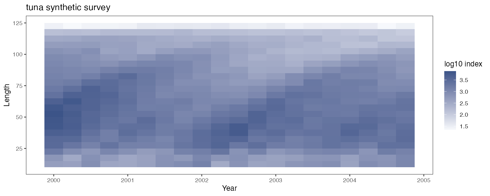
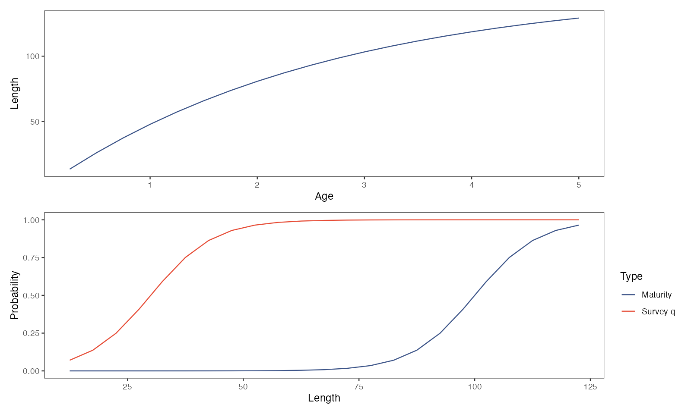
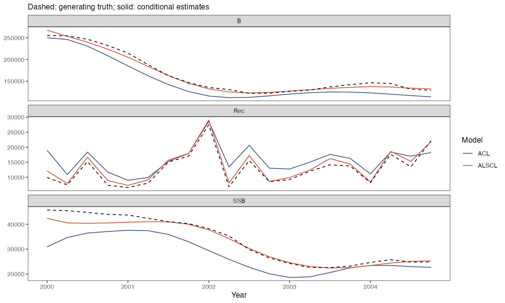

# Annual and quarterly time steps

At the end of this page you have fitted ACL and ALSCL to two supplied cases, an annual flatfish survey and a quarterly tuna survey, and you know which settings change their meaning when the time step is a quarter. Both cases are synthetic (`scripts/simulation_workflow.R`, seed 4, 23 length bins and 20 time steps each); they are not the paper's data. You need the package and a copy of the repository; run the steps in one R session from the repository root. [Understand your first fit](first-model.html) explains the input bundle and the numerical checks.

<h2 id="read">1. Read the two cases</h2>

```r
library(ALSCL)
flatfish_inputs <- read_survey_csv("docs/data/cases/flatfish")
tuna_inputs <- read_survey_csv("docs/data/cases/tuna")
pa <- readRDS("docs/data/cases/tuna/truth.rds")$parameters
pa[c("growth_step", "rec.age", "nage", "M", "Linf", "vbk")]
names(tuna_inputs$data.CatL)[1:5]
```

Each case folder holds the three tables `data.CatL.csv`, `data.wgt.csv` and `data.mat.csv` (a `LengthBin` column, then one column per time step) and `truth.rds` with the generator settings `parameters` and the simulated population `truth`. `read_survey_csv()` checks that the tables share labels and dimensions, that the time labels increase, that weights are finite and nonnegative and that maturity lies between 0 and 1; it adds no biology. You enter the biology in the next two steps:

| Setting | Flatfish | Tuna |
|---|---|---|
| Generator, time step | age-based, 1 year | length-based, 0.25 year |
| Time labels | 2000 to 2019, one per year | 2000 to 2004.75, one per quarter |
| `rec.age`, `nage` | 1, 15 | 0.25, 20 |
| `Linf`, `vbk` per year, `t0` | 60, 0.20, 1/60 | 152, 0.38, 1/152 |
| `M` per time step | 0.20 | 0.20 (0.80 per year) |
| Maturity L50, L95 | 35, 40 | 100, 120 |
| Survey catchability `sel_L50`, `sel_L95` | 15, 20 | 30, 50 |
| Bin midpoints; survey log SD | 6 to 50 in steps of 2; 0.20 | 12.5 to 122.5 in steps of 5; 0.10 |

`pa` prints `growth_step` 0.25, `rec.age` 0.25, `nage` 20, `M` 0.2, `Linf` 152 and `vbk` 0.38; the tuna column names are `LengthBin`, `2000`, `2000.25`, `2000.5`, `2000.75`. If `read_survey_csv()` stops with `folder must name an existing directory`, R is not in the repository root; if the message names a table, correct that file as in [Prepare your survey data](data-preparation.html).

<h2 id="annual">2. Fit the annual flatfish case</h2>

```r
fix <- function(p) lapply(p, function(v) factor(NA))
F_marginal_sd <- 0.2 / sqrt(1 - 0.75^2)
known <- list(log_Linf = log(60), log_vbk = log(0.2), log_cv_len = log(0.2),
  logit_log_R = qlogis(0.1))
acl_known <- c(known, list(t0 = 1/60, log_std_log_F = log(F_marginal_sd), log_std_log_N0 = log(0.2)))
alscl_known <- c(known, list(log_t0 = log(1/60), log_cv_grow = log(0.2),
  log_sigma_log_F = log(F_marginal_sd), log_sigma_log_N0 = log(0.2)))
x <- prepare_alscl_data(flatfish_inputs,
  fit_args = list(rec.age = 1, nage = 15, M = 0.2, sel_L50 = 15, sel_L95 = 20,
    growth_step = 1, train_times = 2, ncores = 1, silent = TRUE),
  fit_config = list(acl = list(parameters = acl_known, map = fix(acl_known)),
    alscl = list(parameters = alscl_known, map = c(fix(alscl_known),
      list(logit_log_F_l = factor(NA), logit_log_F_y = factor(NA))))))
a <- run_acl(x)
b <- run_alscl(x)
c(a$diagnostics$numerical_ok, b$diagnostics$numerical_ok)
plot_compare_ts(a, b, quantities = c("B", "SSB", "Rec"), se = TRUE)
```

`prepare_alscl_data()` builds the input bundle `x` from the three tables and the shared biology in `fit_args`; the length bins come from the row labels (midpoints 6 to 50 in steps of 2, borders halfway between). `fit_config` holds each model's starting values and `map`. The mean growth parameters and CV of length at age are fixed to the preset values with `factor(NA)`. ALSCL's growth-increment CV is also fixed to its preset value; this parameter is used by the length-based generator, but not by the age-based flatfish generator. The F SD is converted from the operating model's innovation SD to the marginal SD used by the fitted models: `0.2 / sqrt(1 - 0.75^2)`, or 0.3023716. The initial-abundance SD, recruitment correlation and F correlations are also fixed as specified fitting assumptions, leaving five free scalar parameters in each model.

The operating model generates F by multiplying a shared time series by selectivity. The assessment models estimate F across groups and time, with both correlations fixed at 0.75 in these fits. At initialization, both the operating and assessment models calculate numbers at age recursively, with an independent log-scale deviation at each age increment. The simulation starts before the burn-in period. The assessment starts at the first retained survey time step. See the [script for these cases](https://github.com/FanZhang-LAB-SHOU/ALSCL/blob/main/scripts/case_studies.R).

The first fit also compiles the model; later fitting times depend on the machine and optimization path. Expect `TRUE TRUE` from the numerical checks, as in the script's [convergence record](https://github.com/FanZhang-LAB-SHOU/ALSCL/blob/main/docs/results/case_convergence.csv). If a check fails, run `diagnose_model(x$data.CatL, a)` as on [Understand your first fit](first-model.html#checks) and add starts with `nstarts`.


The heat map shows the log10 survey index by year and length bin: small below 10 cm, where survey catchability is under 0.1, and largest at 15-30 cm.


Growth runs from 11 cm at age 1 to 57 cm at age 15. Maturity (L50 35 cm), read from `data.mat`, and survey catchability (L50 15 cm), set by `sel_L50` and `sel_L95`, are different curves.


Dashed lines are the generating truth, solid lines the two conditional estimates. For biomass and spawning biomass, both models follow the decline to 2010 and the rise after it; ALSCL sits below the truth for biomass and spawning biomass after 2014. `plot_compare_ts()` shows the same trajectories with intervals.

<h2 id="quarterly">3. Fit the quarterly tuna case</h2>

```r
known <- list(log_Linf = log(152), log_vbk = log(0.38), log_cv_len = log(0.2),
  logit_log_R = qlogis(0.1))
acl_known <- c(known, list(t0 = 1/152, log_std_log_F = log(F_marginal_sd), log_std_log_N0 = log(0.3)))
alscl_known <- c(known, list(log_t0 = log(1/152), log_cv_grow = log(0.3),
  log_sigma_log_F = log(F_marginal_sd), log_sigma_log_N0 = log(0.3)))
xq <- prepare_alscl_data(tuna_inputs,
  fit_args = list(rec.age = 0.25, nage = 20, M = 0.2, sel_L50 = 30, sel_L95 = 50,
    growth_step = 0.25, train_times = 2, ncores = 1, silent = TRUE),
  fit_config = list(acl = list(parameters = acl_known, map = fix(acl_known)),
    alscl = list(parameters = alscl_known, map = c(fix(alscl_known),
      list(logit_log_F_l = factor(NA), logit_log_F_y = factor(NA))))))
check_alscl_data(xq, "alscl")$time
aq <- run_acl(xq)
bq <- run_alscl(xq)
c(aq$diagnostics$numerical_ok, bq$diagnostics$numerical_ok)
plot_compare_ts(aq, bq, quantities = c("B", "SSB", "Rec"), se = TRUE)
```

The code is the same; four settings change their meaning. `growth_step = 0.25` makes each column one quarter, so the time labels must be spaced 0.25 apart. `M` and fishing mortality are per time step: an annual M of 0.8 is entered as `M = 0.2`, while `vbk` stays per year. `rec.age` is in years, so 0.25 means recruitment at one quarter, and `nage = 20` counts quarter-age classes from 0.25 to 5 years, the last one the plus group; `t0` must stay below `rec.age`.

`check_alscl_data()$time` prints the 20 quarters from 2000 to 2004.75: twenty time steps are five years here. Both fits pass the numerical checks in the regenerated case; use each result's `elapsed` field to record fitting time on your machine. If the label spacing differs from `growth_step`, fitting stops with `Time column spacing must equal growth_step`; keep every quarter as a column, with `NA` survey values for quarters without a survey and complete weights and maturity.



The heat map has four columns per year. The index is largest at 30-70 cm and smallest in the 122.5 cm bin, which the growth curve reaches only after age 4.



Growth runs from 13 cm at age 0.25 to 129 cm at age 5 (`vbk` 0.38 per year); maturity (L50 100 cm) lies far above survey catchability (L50 30 cm).



Recruitment is per quarter. ALSCL follows the truth for biomass and spawning biomass, with estimates within about 11% of the truth. ACL lies below the truth for biomass and spawning biomass in every quarter. Its spawning biomass is lowest relative to the truth at the start of 2000 and again in 2002-2003 (about 0.68 to 0.77 of the truth) and comes close to the truth only from late 2003. Both models overestimate recruitment in 19 of the 20 quarters, on average by 9% for ALSCL and by 31% for ACL. The case uses length-based growth transitions; the fitted process assumptions still differ from the operating model, so one replicate cannot rank the two models.

<h2 id="simulation">4. Extend to a simulation study</h2>

```r
source("scripts/simulation_workflow.R", encoding = "UTF-8")
simulations <- run_simulation_examples(out = "my_cases/data/cases", fit_batch = FALSE)
source("scripts/case_studies.R", encoding = "UTF-8")
case_status <- run_case_studies(out = "my_cases")
```

`run_simulation_examples()` regenerates both cases under `out`: the three CSV files, `truth.rds` and the replicate files of each preset; `fit_batch = TRUE` adds batch ACL fits of the flatfish replicates and writes `batch_checks.csv`, which keeps the failed fits. `run_case_studies()` refits both cases with the settings of steps 2 and 3 and writes the seven case figures and `results/case_convergence.csv` under `out`; it reads the truth from `out/data/cases`, so the example generates the cases directly under `my_cases/data/cases` before fitting them under `my_cases`.

Increase `iter_range` for a simulation study and vary one setting at a time, such as survey observation error or natural mortality. Report the failure rate across all attempted fits. Bias and RMSE use finite estimate–truth pairs from fits that passed the numerical checks. Interval coverage uses the subset with usable intervals. Report the number of pairs and intervals alongside the respective statistics. See [Simulate survey data](simulation.html).

<h2 id="next">What next</h2>

| What you want to do | Read |
|---|---|
| Lay out your own tables and choose the time step | [Prepare your survey data](data-preparation.html) |
| Read the numerical checks, estimates and residuals of a fit | [Understand your first fit](first-model.html) |
| Decide which parameters to fix or estimate | [Fitting controls](fitting-controls.html) |
| Generate survey data and fit replicates in batch | [Simulation](simulation.html) |
| Simulate from a fitted model or predict withheld years | [Model validation](case-model-validation.html) |
