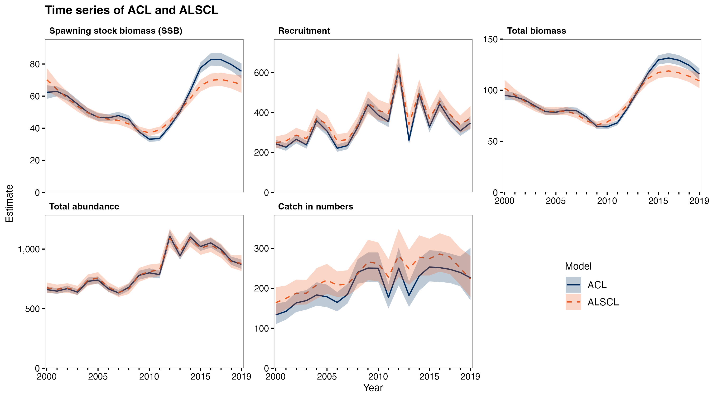

# Understand your first fit

After [installing the package](getting-started.html) you have the input bundle `x`, the list that holds the three tables and the settings of `YTF_example`, and a fitted ACL model `a`. On this page you learn what a fitted object contains, how to judge whether a fit can be used, how to read its estimates, and how the second model, ALSCL, compares with it. Run the steps in one R session; later pages reuse `x`, `a` and `b`.

`YTF_example` is synthetic: 23 length bins and 20 years generated from a known population. Its stored settings fix growth and some process parameters, so the uncertainty intervals you will see are conditional on those fixed values. Learn the workflow on it before choosing assumptions for your own stock.

<h2 id="fit">1. Fit the two models</h2>

```r
library(ALSCL)
data("YTF_example")
x <- YTF_example
a <- run_acl(x, silent = TRUE)
b <- run_alscl(x, silent = TRUE)
```

The package fits two models to the same data. ACL (`run_acl()`) follows the number of fish at each age and converts ages to lengths with an age-length probability matrix. ALSCL (`run_alscl()`) follows the number of fish at each length and age and moves survivors between length bins with a growth transition matrix, which suits stocks that are hard to age. The ACL fit takes about ten seconds for this example and the ALSCL fit about two minutes, after the one-time compilation of each model. Without `silent = TRUE`, each fit prints its progress and a message that one start was used; [Choose the fitting settings](fitting-controls.html#optimizer) explains when to use more starts.

Both calls read the same `x`, which holds the three tables, the shared biology in `x$fit_args` (recruitment age, number of ages, natural mortality `M`, survey catchability `sel_L50` and `sel_L95`, length bins and time step) and the model's own starting values and `map` in `x$fit_config$acl` or `x$fit_config$alscl`. The [bundle section](#bundle) explains `x` in detail.

<h2 id="checks">2. Read the numerical checks</h2>

```r
diagnose_model(x$data.CatL, a)
a$diagnostics$numerical_ok
a$diagnostics$issues
a$diagnostics$advice
a$diagnostics$plausibility$note
```

Read the numerical checks before interpreting estimates. `diagnose_model()` prints the raw optimizer convergence code (0 means normal termination), the maximum absolute gradient, Hessian and covariance status, and parameter-boundary checks. `Numerical checks`, also stored as `a$diagnostics$numerical_ok`, requires a gradient below 0.001, a positive-definite Hessian and covariance matrix, no flagged parameter boundaries and no parameter at its limit in practice. These checks do not include the raw optimizer code or strong parameter correlations; inspect those separately in `a$diagnostics$issues`. Passing the checks supports further examination of the fit but does not establish a unique or global optimum.

A parameter is at its limit in practice when it has run so far on the optimizer scale that its natural value equals a limit, although no optimizer bound was reached, for example a variance estimated at zero, a correlation at the end of its range, or the ALSCL growth parameter `t0` at its lower limit `t0_lower`. `a$diagnostics$advice` then says what to do, and it also names the bounds of ACL that can be widened. `a$diagnostics$plausibility$note` holds notes on estimates that pass the numerical checks but have implausible values, such as an estimated initial total mortality rate below the natural mortality rate. The notes do not change the verdict. `diagnose_model()` prints the number of such parameters and of such notes as `Parameters at their limit in practice` and `Plausibility notes`. For this fit both are 0 and `numerical_ok` is `TRUE`, and the last three lines of the block print `character(0)`, which means that there are no issues, no advice and no notes. [Judge whether a fit can be used](diagnostics.html#numerical) describes every check.

| Failed check | Possible causes | What to try |
|---|---|---|
| Convergence code is not 0, or the gradient is large | The optimizer stopped early or the surface is flat | Run more starts, `run_acl(x, nstarts = 4, ncores = 2)`, and compare their objectives in `a$start_diagnostics` |
| Hessian not positive definite | The fit is away from a minimum, parameter scales cause numerical difficulty, or some parameters are weakly identified | Check gradients, scales and additional starts; use profiles or sensitivity analyses before fixing parameters or simplifying F ([Fitting controls](fitting-controls.html)) |
| Parameter on a bound | The constrained optimum is at a bound, or the fit has not reached a stable solution | Inspect the bound and its biological basis, try other starts, and examine a profile before changing it |
| Natural-scale boundary | A standard deviation near 0, or a correlation near 0 or 1 (near -1 or 1 with `correlation_range = "symmetric"`) | Check gradients, bounds, alternative starts and profiles; for a correlation near 0, refit with correlations between -1 and 1 ([Fitting controls](fitting-controls.html#correlation-range)); assess biological support before fixing a value or simplifying F |
| Parameter at its limit in practice | The data do not determine the parameter, or the model lacks the process that the parameter describes | Follow `a$diagnostics$advice`: fix the parameter with `map` at a value you can justify and refit; for a correlation at zero, allow negative correlations ([Fitting controls](fitting-controls.html#correlation-range)); for `t0`, allow a smaller value with `t0_lower` |
| An ACL parameter on a default upper bound | The default upper bounds of ACL for five parameters are lower than those of ALSCL | Refit with `run_acl(x, bounds = "wide")` ([Fitting controls](fitting-controls.html#starts)) |
| Plausibility note | An input such as `rec.age`, `M` or survey catchability does not suit the data, or growth is poorly determined | Check the inputs that the note names; the fit still passes the numerical checks |
| Checks pass but residuals show patterns | The model misses a feature of the data | Continue with [Diagnostics](diagnostics.html) |

<h2 id="estimates">3. Read the estimates</h2>

```r
estimates <- extract_estimates(a)
head(estimates)
subset(estimates, quantity == "SSB")
extract_parameters(a)
plot_SSB(a, se = TRUE)
```

`extract_estimates()` returns one table for the population quantities: spawning stock biomass `SSB`, recruitment `Rec`, total biomass `B`, abundance `N`, catch in numbers `CN` and fishing mortality `F`, with the year, the age or length where the quantity has one, the estimate, its standard error and a 95% interval (lognormal by default, the interval of the plots; `interval = "wald"` gives the symmetric `estimate +/- 1.96 * SE`). The last column, `extrapolated`, is `TRUE` for the fishing mortality and catch of the last time step; no observation informs them, so they are predictions from the F process. When the last time steps have no positive survey observation, the rows from the last time step with an observation onwards are marked as well.

`extract_parameters()` lists the scalar parameters with their status (`estimated`, `fixed` or `inactive`) and their estimates on the natural scale. The rows keep the names of the optimizer scale, so the row `log_init_Z` gives the initial total mortality rate itself, 0.49 per time step, and not its logarithm. `plot_SSB()` draws spawning stock biomass with its interval; the other plot functions follow the same pattern.

The intervals come from the standard errors of the estimated parameters only; the fixed values in `x$fit_config` contribute no uncertainty. The raw arrays behind the table are in `a$report` (for example `a$report$SSB`), and `a$sd_info` records how the standard errors were computed.

The fit uses a survey index alone, so the level of `F` and `CN` depends on the natural mortality rate and the survey catchability that you supplied: the index informs the total mortality rate, and F is that rate minus `M`. Compare trends and the total mortality rate with other assessments, and report the level of F together with these inputs ([Model principles](model-theory.html#survey)).

<h2 id="fit-to-data">4. Check the fit to the observations</h2>

```r
plot_CatL(a, facet_by = "year", facet_ncol = 5)
plot_residuals(a, facet_by = "year", facet_ncol = 5)
```

`plot_CatL()` shows the observed and fitted survey indices across length bins, one panel per year. `plot_residuals()` shows observed minus fitted values on the log scale for those panels. Look for residuals centered near zero and for persistent signs across lengths or time. Such patterns can motivate checks of growth, cohort dynamics or survey catchability, but do not identify a unique cause; [Diagnostics](diagnostics.html) explains how to investigate them.

<h2 id="compare">5. Compare ACL and ALSCL</h2>

```r
plot_compare_ts(a, b, se = TRUE)
comparison <- compare_models(a, b, x$data.CatL)
comparison$comparison
comparison$length_at_age
```



The figure shows spawning stock biomass, recruitment, total biomass, total abundance and catch in numbers of both models with 95% confidence intervals, ACL as a solid dark-blue line and ALSCL as a dashed orange line. Similar trajectories mean the two population structures agree on the trend; a persistent difference in scale calls for closer comparison of growth, mortality and age-length conversion assumptions.

`compare_models()` first verifies that both fits used the same observations, then prints AIC, BIC and fit statistics. `comparison$comparison` records `data_verified`, `eligible` (both fits passed the numerical checks), `preferred` (the model with the lower AIC, given only when both are eligible and the AIC values differ by at least 2) and any `issues`. In this example both fits are eligible and `preferred` is `"ACL"`, whose AIC is lower by 613. AIC balances likelihood fit against parameter count; among compatible fits to the same observations, a lower value supports that candidate under this criterion. Whether its assumptions suit the stock is a separate, biological decision.

`comparison$length_at_age` gives the mean length at age of both fits, averaged over the time steps. Growth is compared through this table and not through the growth parameters, because in ACL `Linf`, `k` and `t0` are the parameters of a von Bertalanffy curve of mean length at age, whereas in ALSCL they set the growth increment at length and the mean length of recruits ([Model principles](model-theory.html#difference-increment)). Here both fits use the same fixed growth parameters, yet mean length at age differs from age 2 on, by up to 2.3 cm at age 10. [Judge whether a fit can be used](diagnostics.html#compare) explains the other tables of the comparison, among them the growth parameters and the correlation between the series of the two fits.

<h2 id="save">6. Save the fit</h2>

```r
save_assessment(a, "ytf_acl.rds")
saved <- read_assessment("ytf_acl.rds")
plot_SSB(saved, se = TRUE)
```

`save_assessment()` writes everything in the fit except the live TMB object `a$obj`, a pointer valid only in the current session, and stores the recipe (the tables, settings and package version) so that `refit_model(saved)` can rebuild the live object later. Plots and extraction functions work directly on the saved fit. The call stops when the file exists; pass `overwrite = TRUE` to replace it.

<h2 id="bundle">How run_acl(x) reads the input bundle</h2>

The input bundle `x` is a named list. Its three tables `data.CatL`, `data.wgt` and `data.mat` hold the observations. `x$fit_args` holds the settings both models share: `rec.age`, `nage`, `M`, `sel_L50` and `sel_L95` (or `survey_q`), `len_mid`, `len_border` and `growth_step`. `x$fit_config$acl` and `x$fit_config$alscl` hold the starting values (`parameters`) and the `map` of each model. The fitting functions ignore other elements of such a bundle, among them the top-level `parameters` of `YTF_example`, which holds the settings of the simulation that generated the data and not starting values, and its simulation `truth` and `provenance`.

Settings are read in this order: the tables, then `fit_args`, then the `fit_config` entry of the chosen model, then the arguments of the call. An argument in the call therefore overrides the stored value, and a list argument such as `map` replaces the stored list completely. A `parameters` list in the call replaces the stored list, and the fit names the stored values that are no longer used.

```r
# Four starts on two workers; the stored M is replaced by 0.25 for this call only
a4 <- run_acl(x, nstarts = 4, ncores = 2, M = 0.25)
# A supplied survey catchability replaces the stored logistic curve
q_dome <- survey_catchability(x$fit_args$len_mid, "dome", L50 = 15, L95 = 20,
                              L50_desc = 42, L95_desc = 34, minimum = 0.2)
a_dome <- run_acl(x, survey_q = q_dome, sel_L50 = NULL, sel_L95 = NULL, silent = TRUE)
summary(a_dome)
```

Every table and setting can also be passed as a separate argument, as in `do.call(run_acl, args)`; both forms use the same fitting code. A flat named list with the three tables, `rec.age`, `nage`, `M`, `sel_L50` and `sel_L95` is accepted as a bundle too.

`survey_q` replaces the logistic curve, and supplying it together with `sel_L50` or `sel_L95` is an error. The bundle stores these two, so the second call sets both to `NULL`. `summary(a_dome)` shows the line `Fixed inputs: survey catchability at length supplied as survey_q` below the numerical checks. `summary()` shows this line for every fit that uses a natural mortality rate by age or length, `survey_q` or `survey_q_age`, so a reader of the output sees which assumptions the estimates depend on. The dome only shows the argument: the example data were generated with the logistic curve. [Prepare your survey data](data-preparation.html#mortality-catchability) describes these inputs.

<h2 id="data-provenance">About the bundled data</h2>

| Object | Contents |
|---|---|
| `YTF_example` | The three tables (23 bins by 20 years), `fit_args`, `fit_config`, the simulation settings `parameters`, the generating `truth` and `provenance` |
| `YTF` | The original list of 26 biological parameters, without survey tables |
| `example_data` | Three ALSCL tables (9 bins, 2001-2021) of unverified origin, for trying the functions only |

`YTF_example` was generated with ALSCL 2.0.0 (seed 4, 80 burn-in years, 20 retained years, survey log SD 0.1) and is not the empirical dataset of the paper. Its `fit_config` fixes the standard deviation of the log F deviations at 0.302 for both models. This is the marginal SD of the generating AR(1) process, `F_sd / sqrt(1 - F_ar^2)` with `F_sd` = 0.2 and `F_ar` = 0.75. The [generation script](https://github.com/FanZhang-LAB-SHOU/ALSCL/blob/main/data-raw/YTF_example.R) runs the same settings with the installed simulator and records its version. Load the bundled dataset to reproduce the values used in this guide.

<h2 id="next">What next</h2>

| What you want to do | Read |
|---|---|
| Replace the example with your own tables | [Prepare your survey data](data-preparation.html) |
| Decide which parameters to fix or estimate | [Fitting controls](fitting-controls.html) |
| Examine residuals and compare configurations | [Diagnostics](diagnostics.html) |
| Plot a particular quantity | [Survey and population plots](population-plots.html) |
| Test sensitivity, profile a parameter, project forward | [Assessment workflows](assessment-workflows.html) |
| Simulate from the fit or test predictions of future years | [Model validation](case-model-validation.html) |
