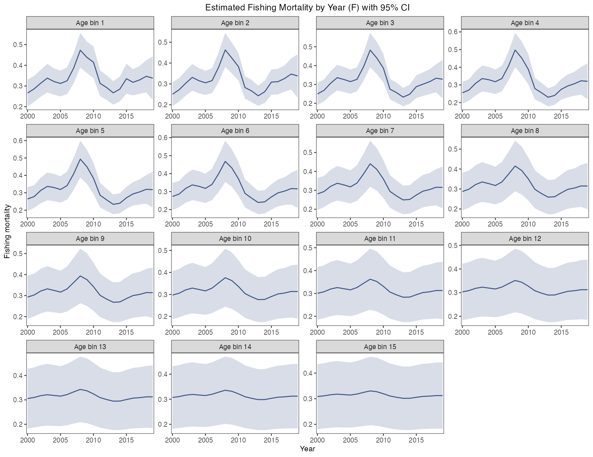
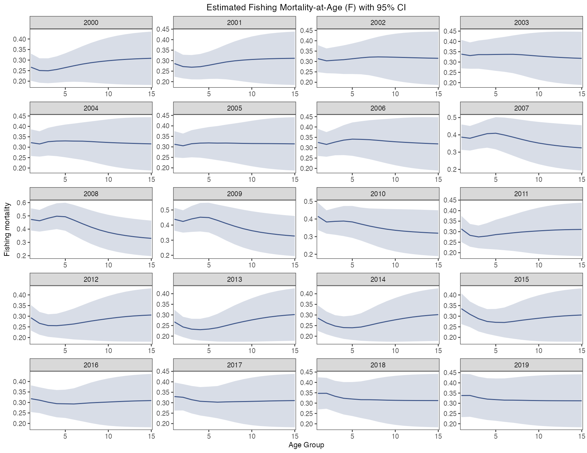
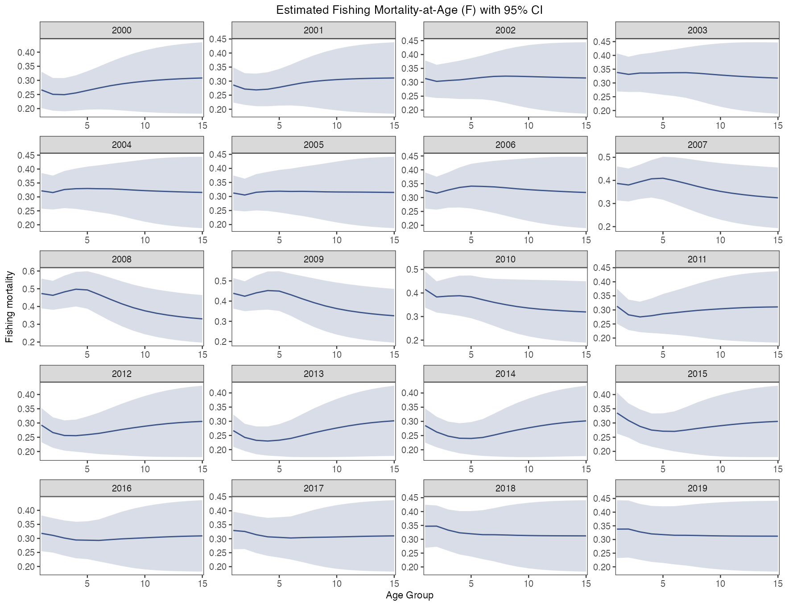
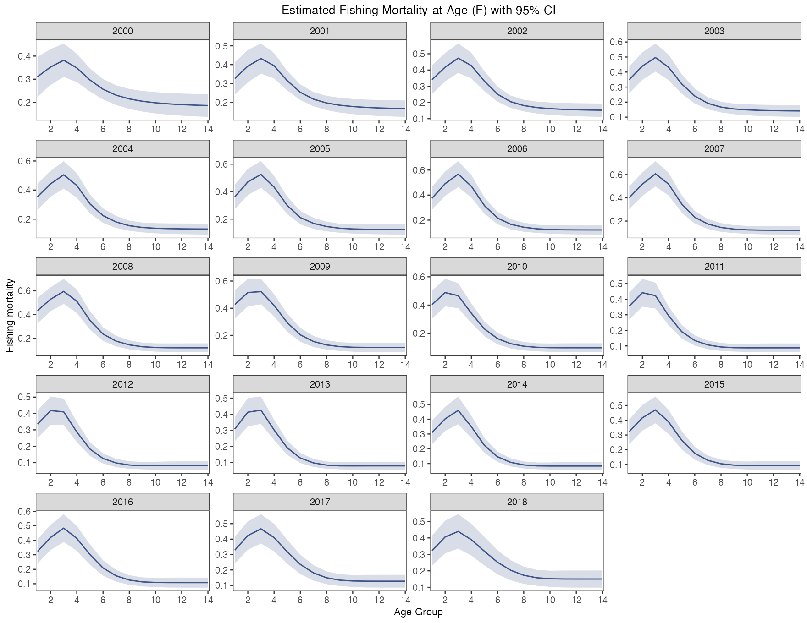
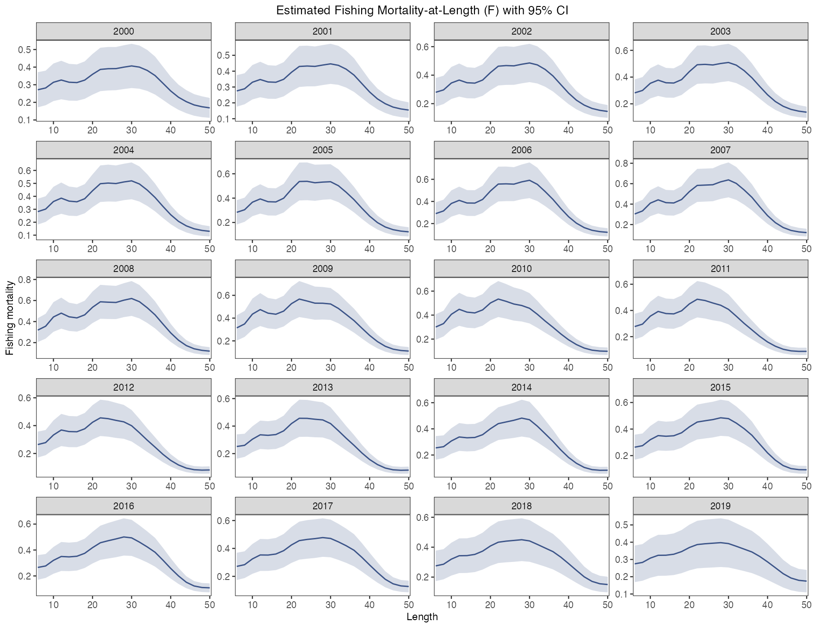
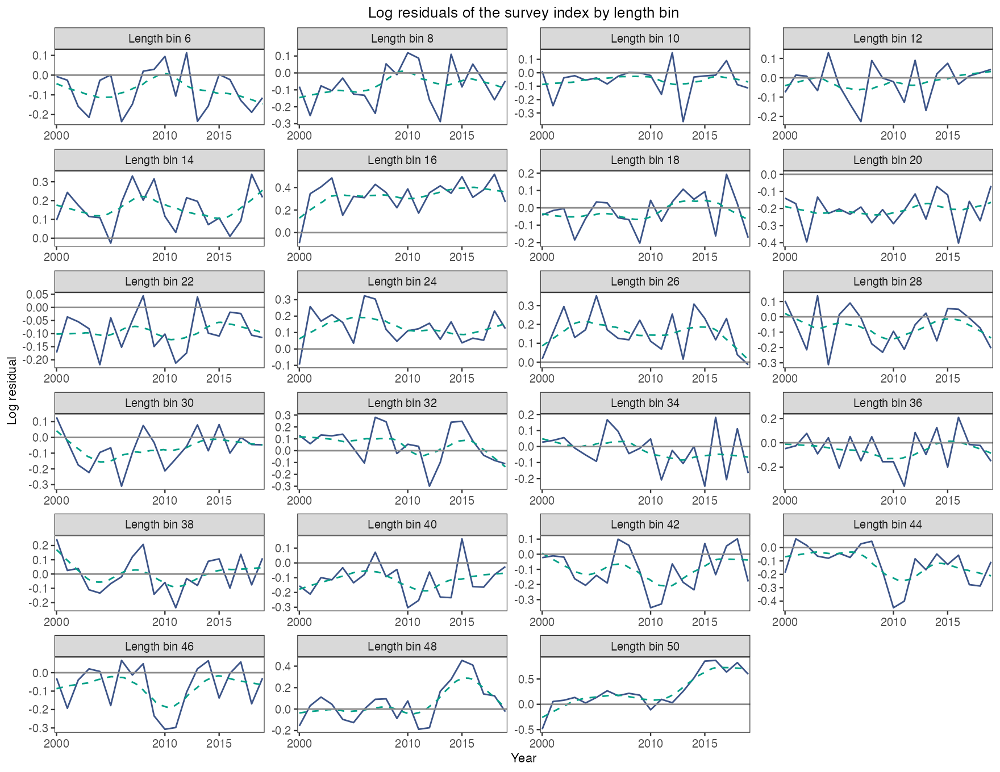
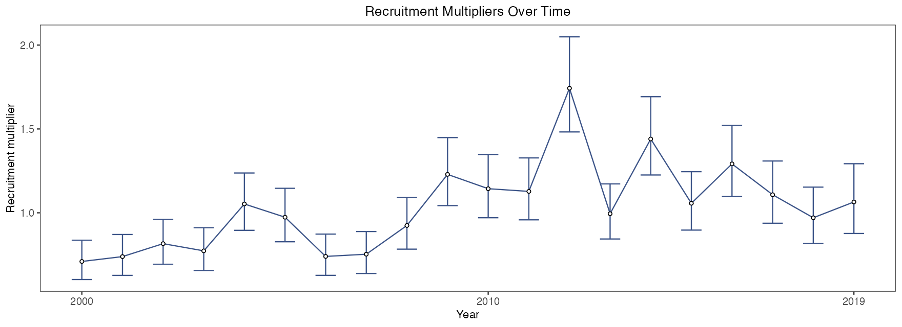
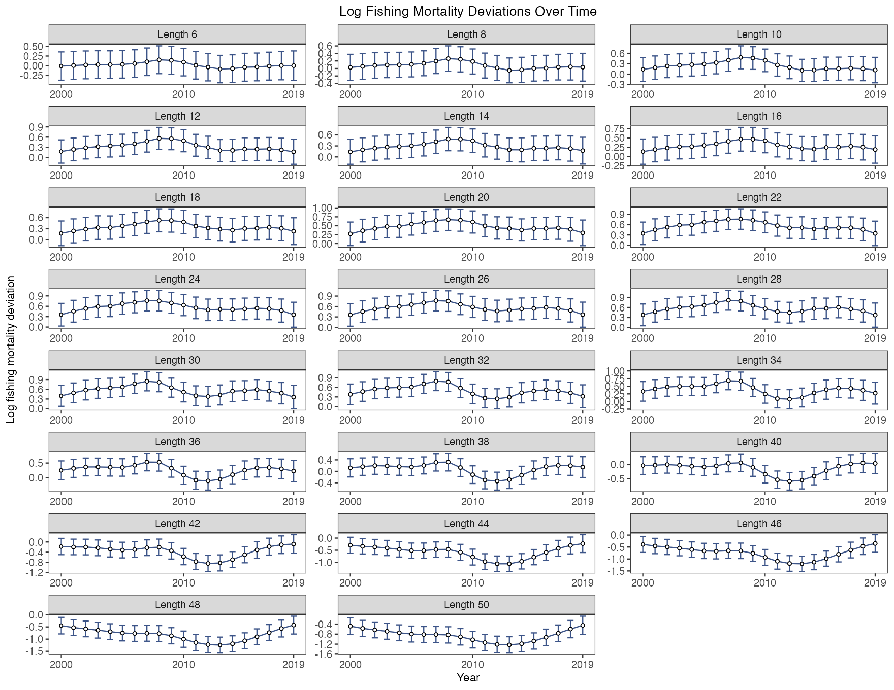
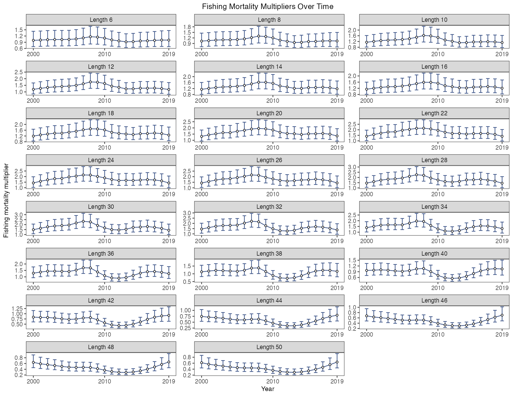

# Growth, mortality and residuals

First complete the [worked YTF example](first-model.html) to create `a`, `b`, `x` and `inputs`. Define `dat <- x$data.CatL` and load ggplot2 and patchwork. The [retrospective guide](retrospectives.html) creates `ra` and `rb`.

```r
library(ggplot2)
library(patchwork)
acl_theme_set(palette="npg", base_theme="theme_bw")
```

## Growth curve and interval

```r
# Draw this figure
plot_VB(b, se = TRUE)
```

[](https://github.com/FanZhang-LAB-SHOU/ALSCL/blob/main/docs/figures/ytf/VB.png?raw=true)


Growth is fixed in this example, so its interval collapses. With estimated growth, intervals reflect parameter uncertainty, not individual length variation.

`plot_VB()` uses the fitted age range when `age_range = NULL`. For older results without age metadata, it starts from 1–25 years. Automatic ranges start no earlier than `t0`; a range with no positive span produces an error. An explicit range must contain two finite increasing ages and start at or after `t0`. This avoids negative predicted lengths and reversed intervals before the biological growth curve begins. Explicit valid ranges, including extrapolation beyond the oldest fitted age, remain supported.

Curves and intervals both inherit `ylab$growth` and the selected font. The Linf/k annotation is shown with and without intervals and honors `text_size` and `text_color`. Explicit `ylab` overrides the global label. If covariance is unavailable and `se = TRUE`, the function warns and draws only the curve while retaining the requested labels, text sizes, axis breaks, base theme and annotation settings.

[Arguments and defaults](https://github.com/FanZhang-LAB-SHOU/ALSCL/blob/main/docs/FUNCTION_REFERENCE.md#plot_VB)


## Age length conversion

```r
# Draw this figure
plot_pla(b) + scale_x_discrete(labels = as.character(1:15))
```

[](https://github.com/FanZhang-LAB-SHOU/ALSCL/blob/main/docs/figures/ytf/pla.png?raw=true)


Cells are length-bin probabilities conditional on age, not the growth transition matrix G. Age labels are class indices.

[Arguments and defaults](https://github.com/FanZhang-LAB-SHOU/ALSCL/blob/main/docs/FUNCTION_REFERENCE.md#plot_pla)


## ACL fishing mortality year

`plot_fishing_mortality()` also inherits global titles, labels, `x_breaks` and `x_expand`. Title keys are `F_year`, `F_age` and `F_length`, with `_se` for interval variants. The horizontal label uses `xlab$year`, `xlab$age` or `xlab$length`; the vertical label uses `ylab$F`. Age-mode coordinates are group indices, so the unchanged default label is “Age Group”; a custom `xlab$age` is honored. The ACL legacy length alias uses the age settings. Explicit per-call labels and breaks take precedence. `base_theme` accepts a name such as `"theme_bw"` or `"bw"`, an existing ggplot2 theme object such as `ggplot2::theme_bw()`, or `NULL` for the global setting. All forms keep major and minor gridlines hidden.

```r
# Draw this figure
plot_fishing_mortality(a, type = "year",
  se = TRUE, facet_ncol = 4, line_size = 0.6)
```

[](https://github.com/FanZhang-LAB-SHOU/ALSCL/blob/main/docs/figures/ytf/F_ACL_year.png?raw=true)


F is an instantaneous rate per model step. Native F dimensions differ between the models.

[Arguments and defaults](https://github.com/FanZhang-LAB-SHOU/ALSCL/blob/main/docs/FUNCTION_REFERENCE.md#plot_fishing_mortality)


## ACL fishing mortality age

```r
# Draw this figure
plot_fishing_mortality(a, type = "age",
  se = TRUE, facet_ncol = 4, line_size = 0.6)
```

[](https://github.com/FanZhang-LAB-SHOU/ALSCL/blob/main/docs/figures/ytf/F_ACL_age.png?raw=true)


F is an instantaneous rate per model step. Native F dimensions differ between the models.

[Arguments and defaults](https://github.com/FanZhang-LAB-SHOU/ALSCL/blob/main/docs/FUNCTION_REFERENCE.md#plot_fishing_mortality)


## ACL fishing mortality length

```r
# Draw this figure
plot_fishing_mortality(a, type = "age",
  se = TRUE, facet_ncol = 4, line_size = 0.6)
```

[](https://github.com/FanZhang-LAB-SHOU/ALSCL/blob/main/docs/figures/ytf/F_ACL_length.png?raw=true)


ACL does not estimate length-specific F. The figure is an age-specific curve, now drawn explicitly with `type = "age"`. Legacy `type = "length"` calls still produce the age curve with a warning; they do not convert age-specific F to length-specific F.

[Arguments and defaults](https://github.com/FanZhang-LAB-SHOU/ALSCL/blob/main/docs/FUNCTION_REFERENCE.md#plot_fishing_mortality)


## ALSCL fishing mortality year

```r
# Draw this figure
plot_fishing_mortality(b, type = "year",
  se = TRUE, facet_ncol = 4, line_size = 0.6)
```

[](https://github.com/FanZhang-LAB-SHOU/ALSCL/blob/main/docs/figures/ytf/F_ALSCL_year.png?raw=true)


F is an instantaneous rate per model step. Native F dimensions differ between the models.

[Arguments and defaults](https://github.com/FanZhang-LAB-SHOU/ALSCL/blob/main/docs/FUNCTION_REFERENCE.md#plot_fishing_mortality)


## ALSCL fishing mortality age

```r
# Draw this figure
plot_fishing_mortality(b, type = "age",
  se = TRUE, facet_ncol = 4, line_size = 0.6)
```

[](https://github.com/FanZhang-LAB-SHOU/ALSCL/blob/main/docs/figures/ytf/F_ALSCL_age.png?raw=true)


F is an instantaneous rate per model step. Native F dimensions differ between the models.

[Arguments and defaults](https://github.com/FanZhang-LAB-SHOU/ALSCL/blob/main/docs/FUNCTION_REFERENCE.md#plot_fishing_mortality)


## ALSCL fishing mortality length

In 2.2.3, `type = "length"` uses the actual numeric `b$len_mid` values on the horizontal axis and one panel per period. Unequal bin widths are reflected in point spacing; ribbons and error bars follow the same length-by-time cells. `type = "year"` retains time on the horizontal axis and one panel per length bin.

```r
# Draw this figure
plot_fishing_mortality(b, type = "length",
  se = TRUE, facet_ncol = 4, line_size = 0.6)
```

[](https://github.com/FanZhang-LAB-SHOU/ALSCL/blob/main/docs/figures/ytf/F_ALSCL_length.png?raw=true)


F is an instantaneous rate per model step. Native F dimensions differ between the models.

[Arguments and defaults](https://github.com/FanZhang-LAB-SHOU/ALSCL/blob/main/docs/FUNCTION_REFERENCE.md#plot_fishing_mortality)


## Log residuals length

```r
# Draw this figure
plot_residuals(b, type = "length", facet_ncol = 4, line_size = 0.6,
  x_breaks = c(2000, 2010, 2015))
```

[](https://github.com/FanZhang-LAB-SHOU/ALSCL/blob/main/docs/figures/ytf/residuals_length.png?raw=true)


Observed minus fitted log index, without standardization. Smooth curves reveal structure, not significance.

[Arguments and defaults](https://github.com/FanZhang-LAB-SHOU/ALSCL/blob/main/docs/FUNCTION_REFERENCE.md#plot_residuals)


## Log residuals year

```r
# Draw this figure
plot_residuals(b, type = "year", facet_ncol = 4, line_size = 0.6,
  x_breaks = c(10, 30, 50))
```

[](https://github.com/FanZhang-LAB-SHOU/ALSCL/blob/main/docs/figures/ytf/residuals_year.png?raw=true)


Observed minus fitted log index, without standardization. Smooth curves reveal structure, not significance.

[Arguments and defaults](https://github.com/FanZhang-LAB-SHOU/ALSCL/blob/main/docs/FUNCTION_REFERENCE.md#plot_residuals)


## Log process deviations R

```r
# Draw this figure
plot_deviance(b, type = "R", log = TRUE, se = TRUE,
  facet_ncol = 3, point_size = 1.2, line_size = 0.5) +
  scale_x_continuous(breaks = c(2000, 2010, 2019), expand = expansion(mult = 0.04))
```

[](https://github.com/FanZhang-LAB-SHOU/ALSCL/blob/main/docs/figures/ytf/deviation_R_TRUE.png?raw=true)


Log process deviations use zero as reference; these are not likelihood deviance statistics.

[Arguments and defaults](https://github.com/FanZhang-LAB-SHOU/ALSCL/blob/main/docs/FUNCTION_REFERENCE.md#plot_deviance)


## Process multipliers R

```r
# Draw this figure
plot_deviance(b, type = "R", log = FALSE, se = TRUE,
  facet_ncol = 3, point_size = 1.2, line_size = 0.5) +
  scale_x_continuous(breaks = c(2000, 2010, 2019), expand = expansion(mult = 0.04))
```

[](https://github.com/FanZhang-LAB-SHOU/ALSCL/blob/main/docs/figures/ytf/deviation_R_FALSE.png?raw=true)


Exponentiated deviations use one as reference and asymmetric intervals; these are not original-scale residuals.

[Arguments and defaults](https://github.com/FanZhang-LAB-SHOU/ALSCL/blob/main/docs/FUNCTION_REFERENCE.md#plot_deviance)


## Log process deviations F

```r
# Draw this figure
plot_deviance(b, type = "F", log = TRUE, se = TRUE,
  facet_ncol = 3, point_size = 1.2, line_size = 0.5) +
  scale_x_continuous(breaks = c(2000, 2010, 2019), expand = expansion(mult = 0.04))
```

[](https://github.com/FanZhang-LAB-SHOU/ALSCL/blob/main/docs/figures/ytf/deviation_F_TRUE.png?raw=true)


Log process deviations use zero as reference; these are not likelihood deviance statistics.

[Arguments and defaults](https://github.com/FanZhang-LAB-SHOU/ALSCL/blob/main/docs/FUNCTION_REFERENCE.md#plot_deviance)


## Process multipliers F

```r
# Draw this figure
plot_deviance(b, type = "F", log = FALSE, se = TRUE,
  facet_ncol = 3, point_size = 1.2, line_size = 0.5) +
  scale_x_continuous(breaks = c(2000, 2010, 2019), expand = expansion(mult = 0.04))
```

[](https://github.com/FanZhang-LAB-SHOU/ALSCL/blob/main/docs/figures/ytf/deviation_F_FALSE.png?raw=true)


Exponentiated deviations use one as reference and asymmetric intervals; these are not original-scale residuals.

[Arguments and defaults](https://github.com/FanZhang-LAB-SHOU/ALSCL/blob/main/docs/FUNCTION_REFERENCE.md#plot_deviance)


## Length composition ridges

```r
# Draw this figure
plot_ridges(b) # Default viridis gradient
```

[](https://github.com/FanZhang-LAB-SHOU/ALSCL/blob/main/docs/figures/ytf/ridges.png?raw=true)


Each period is normalized separately: observations left, fit right. This does not show total abundance trends. Saved results retaining observations do not require a live obj.

[Arguments and defaults](https://github.com/FanZhang-LAB-SHOU/ALSCL/blob/main/docs/FUNCTION_REFERENCE.md#plot_ridges)

## Missing observations and saved results in 2.2.4

`plot_ridges()` and `plot_residuals()` use saved `observations` to preserve the same positive-observation mask as fitting; legacy fits can use their TMB data. NA and excluded zero cells are never converted to artificial observations or zero residuals. A wholly unobserved period has no observed ridge. With partial coverage, the observed ridge is normalized over observed positive cells, whereas predictions cover all bins: do not interpret this as agreement over unobserved bins. These plots work after removing `obj` from a fit that retains `observations`.

```r
portable <- b
portable$obj <- NULL
plot_residuals(portable)
plot_ridges(portable)
```

### Growth-plot settings in 2.2.7

`plot_VB()` honors `ylab` for both curves and intervals. If covariance is unavailable and `se = TRUE`, it warns and draws only the curve while retaining the requested labels, text sizes, axis breaks, base theme and annotation settings.

```r
plot_VB(b, se = FALSE, ylab = "Length (cm)",
        axis_text_size = 12, x_breaks = c(1, 5, 10, 15),
        age_range = c(1, 15), text_size = 4)
```

### Consistency corrections

Fishing-mortality plots use matrix positions and fitted time/group metadata, so matrix dimnames cannot alter the coordinates. Age panels in biomass, SSB, catch and F plots retain numeric group order with or without intervals. F plots and time-series comparisons require complete finite estimates and nonnegative finite standard errors when `se = TRUE`; missing summaries are errors rather than recycled values or silently removed intervals. Use `se = FALSE` explicitly for estimates only.

Each facet chooses its smoother independently using the number of distinct observed x values: fewer than two omit smoothing, two to five use a linear trend, and six or more use loess. The loess span is enlarged within that facet when needed for at least five neighbors. A sparse tail bin does not remove or change trends in other panels.

Survey-fit titles refer to survey indices, and ridge titles refer to survey length compositions; neither is a fishery catch estimate. In process-deviation plots, `log = TRUE` labels log deviations (reference value 0), while `log = FALSE` labels multiplicative factors (reference value 1). Exponentiation changes the scale, not the underlying fitted process; neither quantity is a likelihood deviance statistic.
