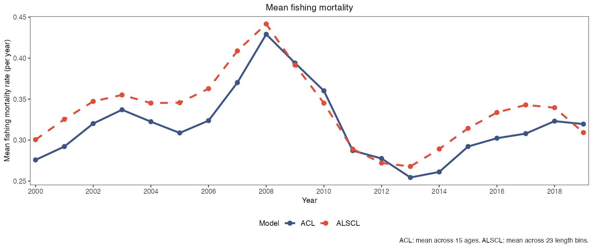
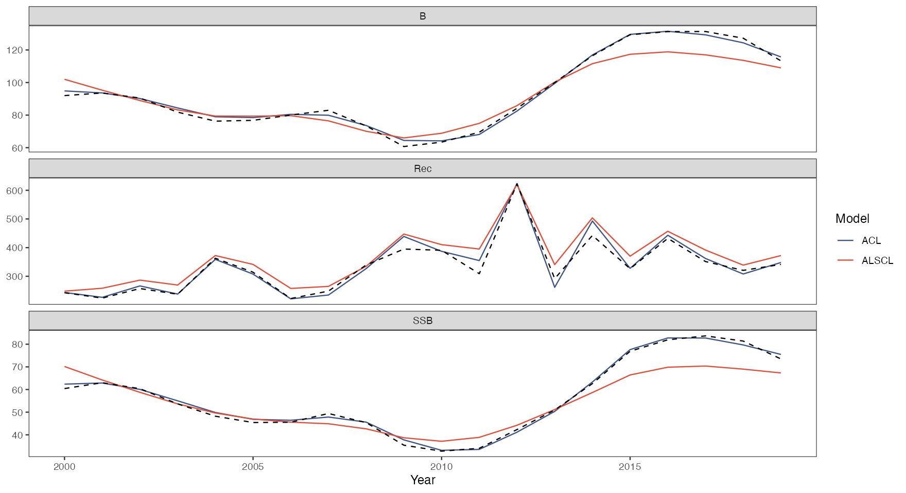

# Model comparisons

First complete the [worked YTF example](first-model.html) to create the input bundle `x` and the fits `a` and `b`. Define `dat <- x$data.CatL` and load ggplot2 and patchwork. The [retrospective guide](retrospectives.html) creates `ra` and `rb`.

```r
library(ggplot2)
library(patchwork)
acl_theme_set(palette="npg", base_theme="theme_bw")
```

A panel or model group containing only one estimate is shown as a point. With `se = TRUE`, an error bar shows the 95% interval (lognormal by default; see the `interval` argument) because a one-point ribbon has no visible width. This applies to population and fishing-mortality plots and to each model separately in `plot_compare_ts()`. Point size follows `point_size`; single-model points retain `line_color` and intervals retain `se_color`. Panels remain free of gridlines.

## Population time series comparison

```r
# Draw this figure
plot_compare_ts(a, b, se = TRUE, facet_ncol = 2)
```

[](https://github.com/FanZhang-LAB-SHOU/ALSCL/blob/main/docs/figures/ytf/compare_ts.png?raw=true)

Time series of spawning biomass, recruitment, total biomass, total abundance and catch in numbers from two fits, one panel per quantity with its own vertical scale: ACL is the navy solid line and ALSCL the vermilion dashed line (`compare_colors`, `compare_linetypes`), and `se = TRUE` adds each fit's 95% band. Use it to see where the two models disagree; the ACL and ALSCL series separate after 2014 in biomass and spawning biomass here, and the free vertical scales make amplitudes comparable within a panel but not across panels.

[Arguments and defaults](https://github.com/FanZhang-LAB-SHOU/ALSCL/blob/main/docs/FUNCTION_REFERENCE.md#plot_compare_ts)

## Fishing mortality matrices

```r
# Draw this figure
plot_compare_F(a, b) + scale_x_continuous(breaks = c(2000, 2010, 2019))
```

[](https://github.com/FanZhang-LAB-SHOU/ALSCL/blob/main/docs/figures/ytf/compare_F.png?raw=true)

Heat maps of fishing mortality, one per fit, time on the horizontal axis and the fit's own groups on the vertical axis (age classes for ACL, length bins for ALSCL) with one colour scale for `F`. Use it to see when and in which groups fishing was heaviest in each model; the rows are different dimensions, so compare the timing of the dark columns (2007 to 2010 here) rather than single cells, and use the summary F figures to compare each model's group maximum or mean, keeping the age and length definitions explicit. The ACL rows show fitted ages, including fractional ages for seasonal data, and the oldest age class, a plus group, is marked with a plus sign ("Age 15+"). For an older fit without age coordinates, the rows are labelled as numbered age groups. For a summary of both fits over the same ages, use `plot_compare_F_ts(basis = "age")`.

[Arguments and defaults](https://github.com/FanZhang-LAB-SHOU/ALSCL/blob/main/docs/FUNCTION_REFERENCE.md#plot_compare_F)

## Combined residual diagnostics

```r
# Draw this figure
plot_compare_residuals(a, b, dat)
```

[](https://github.com/FanZhang-LAB-SHOU/ALSCL/blob/main/docs/figures/ytf/compare_residuals.png?raw=true)

Four panels show the in-sample log residuals of both fits: a histogram, a QQ plot against a normal reference, the mean residual by time step with bars of plus or minus one standard deviation, and box plots of absolute residuals by length bin. ACL is navy and ALSCL vermilion. A wider histogram indicates greater dispersion; in the QQ plot, read curvature and asymmetry of the points as signs of skewness or heavy tails, not the slope: the residuals are conditional on the fitted process deviations, and even a correct model gives standardized conditional residuals with a standard deviation of about 0.91 to 0.96. Higher absolute residuals identify poorly fitted bins, including bins 16 and 50 for ALSCL here. The standard-deviation bars describe residual spread, not confidence intervals for the mean.

A wholly unobserved period breaks the mean-residual line. Isolated observed periods remain visible as points. An SD bar is drawn only when the period contains at least two observed length bins; a single observation still contributes its residual point.

[Arguments and defaults](https://github.com/FanZhang-LAB-SHOU/ALSCL/blob/main/docs/FUNCTION_REFERENCE.md#plot_compare_residuals)

The mean-residual panel retains the full fitted time range, including unobserved first or last periods. These periods occupy space on the axis but do not acquire fabricated residuals or error bars.

## Mean length at age of both models

Reference data and layout helper

```r
# Synthetic reference points, not paper observations
set.seed(42)
ref <- data.frame(Age = rep(1:15, each = 5))
ref$Length <- VB_func(60, .2, 1/60, ref$Age) + rnorm(nrow(ref), 0, 2)
growth_display <- function(p) {
  p[[1]] <- p[[1]] + theme(legend.text=element_text(size=7))
  p[[2]] <- p[[2]] + scale_x_continuous(breaks=c(1,5,10,15))
  p
}
```

```r
# Draw this figure
growth_display(plot_compare_growth(a, b, age_range = c(1, 15), ref_data = ref, ref_name = "Synthetic reference",
    nls_start = list(Linf = 60, k = 0.2, t0 = 1/60)))
```

[](https://github.com/FanZhang-LAB-SHOU/ALSCL/blob/main/docs/figures/ytf/compare_growth.png?raw=true)

Left: mean length at age of both fits on the same basis, averaged over the time steps (ACL navy solid, from its age-length key; ALSCL vermilion dashed, from its fitted numbers by length bin and age class), with the grey reference curve that `nls()` fits to `ref_data` and the grey points of that data. The subtitle states the basis and the time steps, and gives `Linf` and `k` of the reference curve. Right: the probability of length given age of both fits as heat maps on the same basis, with the fitted ages on the horizontal axis and the length-bin midpoints on the vertical axis; for ALSCL it is the proportion of each age class in each length bin from the fitted numbers. The left panel does not draw curves from the growth parameters of the fits. In ACL, `Linf`, `k` and `t0` are the parameters of a curve of mean length at age; in ALSCL they set the growth increment at length and the mean length of recruits, so the parameters of the two models have different meanings. `compare_models(a, b, dat)$length_at_age` holds the same values as a table. The lines of the two fits level off near 50 cm because the last length bin, which holds all fish above 49 cm, is represented by its midpoint. The reference lengths are not assigned to length bins, so the reference curve continues to rise.

`observed` adds mean length at age from age readings as points, with an optional standard deviation or interval, for example `plot_compare_growth(a, b, observed = readings, basis = "survey")` with the `readings` of [Growth, mortality and residuals](growth-mortality.html). Use `basis = "survey"` for readings of fish caught in the survey. Omit `age_range` to draw all age classes of both fits; an explicit range must contain two finite increasing ages and selects the age classes within it. `years` selects the time steps of the mean.

The optional reference curve is drawn only at ages at or above its own fitted `t0`. If its fitted growth parameters are invalid or no positive age span remains, a warning explains why the reference curve is omitted; the lines of the two fits and the observed points remain.

[Arguments and defaults](https://github.com/FanZhang-LAB-SHOU/ALSCL/blob/main/docs/FUNCTION_REFERENCE.md#plot_compare_growth)

## Survey fits from both models

```r
# Draw this figure
plot_compare_CatL(a, b, dat, years = c(2000, 2005, 2010, 2015), facet_ncol = 2)
```

[](https://github.com/FanZhang-LAB-SHOU/ALSCL/blob/main/docs/figures/ytf/compare_CatL.png?raw=true)

Survey index against length for the selected time steps (`years`; omit it for all), one panel per time step: grey points are the observed index, the navy solid curve the ACL fit and the vermilion dashed curve the ALSCL fit, both as `exp(Elog_index)` medians, and zero and missing observations are left out of the points. Use it to see which model follows the observed length composition; both follow the mode near length 20 here, and the ALSCL curve has more local variation. Examine length-specific F and alternative settings to investigate that variation.

The vertical label comes from `ylab$survey` and reads Survey index by default; set `acl_theme_set(ylab = list(survey = "Survey index (relative units)"))` to relabel every survey-fit plot at once, and single-model log-scale plots add the prefix Log. `ylab$catch` labels the catch plots only.

[Arguments and defaults](https://github.com/FanZhang-LAB-SHOU/ALSCL/blob/main/docs/FUNCTION_REFERENCE.md#plot_compare_CatL)

## Fit metric comparison

```r
# Draw this figure
plot_compare_metrics(a, b, dat, facet_ncol = 2) & scale_y_continuous(expand = expansion(mult = c(0,
    0.3)))
```

[](https://github.com/FanZhang-LAB-SHOU/ALSCL/blob/main/docs/figures/ytf/compare_metrics.png?raw=true)

Bars summarize the in-sample fit metrics from `diagnostic_metrics()`: RMSE, MAE, R-squared, MAPE, AIC, BIC, negative log-likelihood and the number of scalar parameters. ACL is navy and ALSCL vermilion. Read each metric according to its definition: lower error metrics and higher R-squared describe closer fits to these observations, whereas AIC and BIC also penalize parameter count. Compare information criteria only for compatible likelihoods fitted to the same observations. ACL has better metric values in this example; one simulated dataset does not establish a general advantage or identify its cause.

The bars use the same calculation as `diagnostic_metrics()`: only finite positive observations enter, a nonfinite prediction at an observed cell or a dimension mismatch is an error, and an undefined measure such as R-squared for constant observations is shown as `NA`. Run `compare_models()` first to check that the two fits are comparable.

[Arguments and defaults](https://github.com/FanZhang-LAB-SHOU/ALSCL/blob/main/docs/FUNCTION_REFERENCE.md#plot_compare_metrics)

## Fixed survey catchability

```r
# Draw this figure
plot_compare_selectivity(a, b)
```

[](https://github.com/FanZhang-LAB-SHOU/ALSCL/blob/main/docs/figures/ytf/compare_selectivity.png?raw=true)

Survey catchability `q` at length from the input of each fit (`sel_L50` and `sel_L95`, or `survey_q`), as lines with points for ACL (navy solid) and ALSCL (vermilion dashed). Use it to confirm which catchability curve each fit used; the curves coincide here because both fits took the same input, and the values are fixed inputs, not an estimated selectivity, so a difference between two fits means different inputs. When `survey_q` was supplied by length and time step, one line is drawn for each distinct curve and a caption says so. A survey catchability multiplier by age (`survey_q_age`) is not shown.

[Arguments and defaults](https://github.com/FanZhang-LAB-SHOU/ALSCL/blob/main/docs/FUNCTION_REFERENCE.md#plot_compare_selectivity)

## Maximum fishing mortality by time step

```r
# Draw this figure
plot_compare_F_ts(a, b, method = "apical") +
  labs(title = "Apical fishing mortality")
```

[](https://github.com/FanZhang-LAB-SHOU/ALSCL/blob/main/docs/figures/ytf/compare_F_apical.png?raw=true)

Apical F is the maximum fishing mortality rate across age classes in ACL or across length bins in ALSCL within each time step. The height of each point therefore refers to the group with the highest estimated F in that model and period. An age-group maximum and a length-bin maximum need not be equal, even for the same population, because age-specific F combines survival across lengths. Read the time pattern of such a pair, not the difference in level. `basis = "age"` summarizes F at age for both fits over the fitted ages and time steps that both have. ALSCL F at age covers every age, including the plus group, and every time step. The values for the plus group and the last time step are not in the fitted report; the function computes them from the reported numbers at length and age (`report$NLA`) and total mortality at length (`report$ZL`) with the same formula. A result without numbers at length and age, for example a hand-made list, has no plus-group row and no value for the last time step, and the comparison then leaves out the ACL plus group and the last time step. The two fits must have the same time step, because F is a rate per time step, and the function stops when the steps differ. Quarterly fits give quarterly rates, and the y-axis label states the time basis of the rate. [Apical F in the BAM model, eq. 14b](https://repository.library.noaa.gov/view/noaa/4847/noaa_4847_DS1.pdf#page=11).

[Arguments and defaults](https://github.com/FanZhang-LAB-SHOU/ALSCL/blob/main/docs/FUNCTION_REFERENCE.md#plot_compare_F_ts)

## Mean fishing mortality by time step

```r
# Draw this figure
plot_compare_F_ts(a, b, method = "mean") +
  labs(title = "Mean fishing mortality")
```

[](https://github.com/FanZhang-LAB-SHOU/ALSCL/blob/main/docs/figures/ytf/compare_F_mean.png?raw=true)

Mean fishing mortality, the unweighted average of `F` over the groups at each time step, for both fits in the same styling. Use it when the whole selection pattern matters more than its peak; the mean depends on how many low-F groups a model has (15 ages against 23 length bins here), so read the time pattern, which both fits share with a 2008 peak, rather than the level.

[Arguments and defaults](https://github.com/FanZhang-LAB-SHOU/ALSCL/blob/main/docs/FUNCTION_REFERENCE.md#plot_compare_F_ts)

## Simulation truth and conditional estimates

```r
# Align truth and fitted reports
years <- a$year
truth <- data.frame(Year=rep(years,3),
  Quantity=rep(c("B","SSB","Rec"),each=length(years)),
  Truth=c(x$truth$TB,x$truth$SSB,x$truth$Rec))
estimates <- rbind(
  data.frame(Year=rep(years,3),Quantity=truth$Quantity,
    Value=c(a$report$B,a$report$SSB,a$report$Rec),Model="ACL"),
  data.frame(Year=rep(years,3),Quantity=truth$Quantity,
    Value=c(b$report$B,b$report$SSB,b$report$Rec),Model="ALSCL"))
```

```r
# Draw this figure
ggplot(estimates, aes(Year, Value, color = Model)) + geom_line() + scale_color_manual(values = setNames(acl_theme("compare_colors"),
    c("ACL", "ALSCL"))) + geom_line(data = truth, aes(Year, Truth), inherit.aes = FALSE, linetype = 2) +
    facet_wrap(~Quantity, scales = "free_y", ncol = 1) + theme_bw() + theme(panel.grid.major = element_blank(), panel.grid.minor = element_blank()) + labs(y = NULL)
```

[](https://github.com/FanZhang-LAB-SHOU/ALSCL/blob/main/docs/figures/ytf/truth.png?raw=true)

Biomass, recruitment and spawning biomass of the generating simulation (black dashed) and the ACL (navy) and ALSCL (vermilion) fits, one panel per quantity. The code above constructs `truth` and `estimates` from `x$truth` and the two reports. ACL follows the simulated truth closely here, while ALSCL biomass and spawning biomass fall below it after 2013. This is one realization from the age-based operating model under the stated fitting settings. Repeated simulations under alternative generating assumptions are needed to assess how performance depends on model structure.

