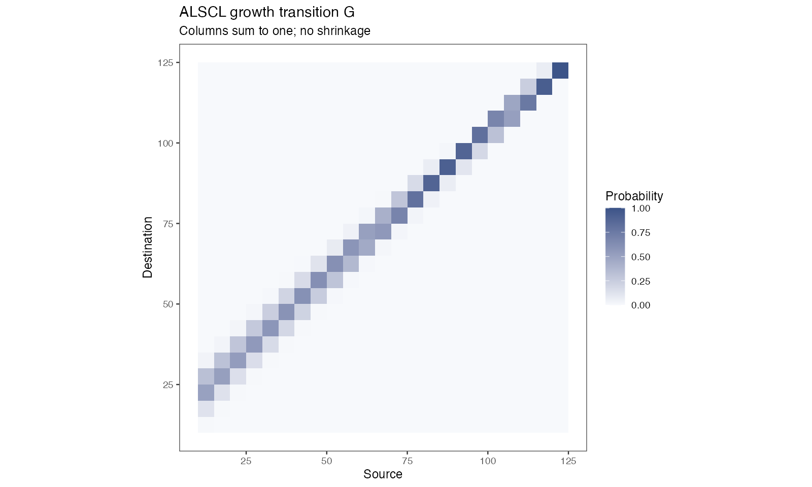

# Model principles

On this page you read the equations behind ACL and ALSCL in the package's time units and parameterization, check the two probability matrices of a fit, and convert annual rates to the model time step. Step 1 needs the ALSCL fit `b` from [Understand your first fit](first-model.html); the equations follow [Zhang & Cadigan (2022)](https://doi.org/10.1111/faf.12673).

<h2 id="equations">The equations</h2>

<h3 id="dynamics">Population dynamics</h3>

Let $`i=1,\ldots,A`$ index age classes, with actual age $`a_i=a_{rec}+(i-1)\Delta t`$, and let $`t`$ index time steps. ACL advances survivors by age, introduces recruitment in the first class, and retains survivors in the oldest plus group:

```math
N_{1,t}=R_t,\qquad Z_{i,t}=M+F_{i,t},
```

```math
N_{i+1,t+1}=N_{i,t}\exp(-Z_{i,t}),\qquad i=1,\ldots,A-2,
```

```math
N_{A,t+1}=N_{A-1,t}\exp(-Z_{A-1,t})+N_{A,t}\exp(-Z_{A,t}).
```

M and F are instantaneous rates per time step. A quarterly model uses `growth_step=0.25` and quarterly mortality rates; the growth parameter $`k`$ is annual.

The natural mortality rate can also be supplied by age class and time step, as a matrix with one row per age class and one column per time step, or one column that is used for every time step. $`M_{i,t}`$ then replaces $`M`$:

```math
Z_{i,t}=M_{i,t}+F_{i,t}.
```

The survival and plus-group equations keep their form, so in the plus group the fish that enter from age class $`A-1`$ and the fish already in it each die at the rate of their own age class. ACL does not accept M by length. It follows numbers at age only and assigns lengths from the length-at-age distribution in every time step, so fish do not keep their length and a rate by length cannot be applied to them.

<h3 id="fishing">Fishing mortality</h3>

ACL estimates F by age, whereas ALSCL estimates F by length. With $`s`$ denoting the age or length class, both use separable AR(1) × AR(1) deviations in log F:

```math
F_{s,t}=\exp(\mu_F+d_{s,t}),\qquad
\mathrm{Cov}(d_{s,t},d_{s-h,t-j})=\sigma_F^2\phi_S^{|h|}\phi_T^{|j|}.
```

Here $`\sigma_F`$ is the marginal SD in TMB's scaled, separable AR(1) density, and the correlation parameters describe dependence across groups and time. The expression already contains the marginal variance, so it needs no further division by $`1-\phi^2`$ factors, which belong to innovation-variance parameterizations. The natural mortality rate M is not estimated. It is supplied as a single number, as a matrix by age class and time step or, for ALSCL, as a vector by length bin ([Prepare your survey data](data-preparation.html#bundle)).

<h3 id="recruitment">Recruitment</h3>

The fitted models use AR(1) log recruitment deviations. The stationary representation with marginal SD $`\sigma_R`$ is:

```math
R_t=\exp(\mu_R+r_t),\qquad
r_1\sim N(0,\sigma_R^2),\qquad
r_{t+1}=\phi_R r_t+\eta_t,\quad
\eta_t\sim N\!\left(0,\sigma_R^2(1-\phi_R^2)\right).
```

$`\exp(\mu_R)`$ is the median recruitment; the arithmetic mean also includes the variance of $`r_t`$. The full `sim_data()` operating model uses Beverton-Holt stock-recruitment with random deviations, a recruitment process of its own.

<h3 id="initial">Initial conditions</h3>

Initial recruitment defines the youngest class; the other classes follow a recursive decline with an initial mortality rate and class-to-class deviations:

```math
\log N_{1,1}=\log R_1,\qquad
\log N_{i,1}=\log N_{i-1,1}-Z_{init}+u_{i-1},\quad
u_{i-1}\sim N(0,\sigma_{N0}^2).
```

The initial log abundance of a class therefore contains the cumulative sum of the deviations of the younger classes, so the total deviations of neighbouring classes are correlated. ALSCL allocates these initial numbers across length using age-length probabilities. In this original structure, that of the package as first released, the plus group of the first time step holds one cohort. The `structure` argument offers an equilibrium plus group and, for ALSCL, initial lengths at age built from the growth transition ([Choose the fitting settings](fitting-controls.html#structure)). With `structure = list(initial_deviations = "independent")` the deviations are independent by age class, as in Equation 11 of the paper: $`\log N_{i,1}=\log R_1-(i-1)Z_{init}+u_i`$ for every age class $`i`$, the first included, with $`u_i\sim N(0,\sigma_{N0}^2)`$ ([Differences between the package and the paper](#difference-initial)).

<h3 id="pla">Age-to-length conversion (ACL)</h3>

Length conditional on age follows a normal distribution whose mean is defined by the von Bertalanffy curve:

```math
\mu_i=L_\infty\left[1-e^{-k(a_i-t_0)}\right],\qquad
\sigma_i=CV_L\mu_i,
```

```math
p_{l|i}=\Phi\!\left(\frac{UB_l-\mu_i}{\sigma_i}\right)
       -\Phi\!\left(\frac{LB_l-\mu_i}{\sigma_i}\right),\qquad
N_{l,t}=\sum_i p_{l|i}N_{i,t}.
```

`pla` is the age-length probability matrix shown by `plot_pla()`. The implementation uses differentiable normal CDF differences with symmetric right-tail calculations and normalization, in place of the fixed-order Taylor approximation of Appendix S1; boundaries must match the survey bins.

<h3 id="growth">Growth transition matrix (ALSCL)</h3>

ALSCL retains length, age and time in $`N_{l,i,t}`$. Entry $`G_{j,l}`$ is the probability of moving from source length bin $`l`$ to destination bin $`j`$. Survival and growth for ordinary age classes follow:

```math
N_{j,i+1,t+1}=\sum_l G_{j,l}N_{l,i,t}\exp[-(M+F_{l,t})].
```

The plus group combines survivors and growth from the preceding and oldest age classes. Recruitment enters the youngest class with its length distribution. Columns of G sum to one, shrinkage is excluded, and the largest bin absorbs the right-tail probability.

With M by age class and time step or by length bin, the rate $`M_{l,i,t}`$ of length bin $`l`$, age class $`i`$ and time step $`t`$ replaces $`M`$. A matrix by age and time step gives one rate to all lengths of an age class, and a vector by length gives one rate to all age classes and time steps of a length bin. The ordinary age classes and the plus group then follow:

```math
N_{j,i+1,t+1}=\sum_l G_{j,l}N_{l,i,t}\exp[-(M_{l,i,t}+F_{l,t})],\qquad i=1,\ldots,A-2,
```

```math
N_{j,A,t+1}=\sum_l G_{j,l}\left\{N_{l,A-1,t}\exp[-(M_{l,A-1,t}+F_{l,t})]+N_{l,A,t}\exp[-(M_{l,A,t}+F_{l,t})]\right\}.
```

Growth increments use the following smooth decreasing mean, with SD $`CV_G\mu_{\Delta L}`$:

```math
\mu_{\Delta L}(L)=\frac{\Delta t(1-e^{-k})L_\infty}
{1+\exp\!\left(-\log(19)\frac{L-0.5L_\infty}{0.05L_\infty-0.5L_\infty}\right)}.
```

Zhang and Cadigan (2022) define this logistic function; the lengths $`0.5L_\infty`$ and $`0.05L_\infty`$ and the factor $`\Delta t`$ are those of the code and are not given in the paper. This curve differs from the exact von Bertalanffy increment $`(L_\infty-L)(1-e^{-k\Delta t})`$, and every fish in a length bin grows from the bin midpoint. With `structure = "von_bertalanffy"`, ALSCL uses the von Bertalanffy increment and starting lengths that are uniform within the bin, together with the two matching settings of the first time step ([Choose the fitting settings](fitting-controls.html#structure)). `pla` describes length given age, while G describes a one-step transition given source length; each model uses its own. `FL` is length-specific F; `FA` is derived from the survival proportion of the same cohort over the model time step. The report holds `FA` and the matching total mortality at age `ZA` for the ages before the plus group and the time steps before the last. `extract_estimates(fit, "FA")` returns F at age for every age, including the plus group, and every time step: it computes the other cells from the reported numbers at length and age (`NLA`) and total mortality at length (`ZL`) with the same formula. These cells are computed after fitting, because computing them in the model template changed fitted values at rounding level.

When M varies with age or length, F at age and total mortality at length need a definition, because fish of one age have different lengths and fish of one length have different ages. Total mortality at age (`ZA`) is the decline of the numbers of an age class over the time step, and F at age (`FA`) is that rate minus the mean of M over lengths, weighted by the numbers at length of that age class:

```math
Z^{A}_{i,t}=\log\sum_l N_{l,i,t}-\log\sum_l N_{l,i,t}\exp[-(M_{l,i,t}+F_{l,t})],\qquad
F^{A}_{i,t}=Z^{A}_{i,t}-\frac{\sum_l N_{l,i,t}M_{l,i,t}}{\sum_l N_{l,i,t}}.
```

Total mortality at length (`ZL`) is F at length plus the mean of M over age classes, weighted by the numbers at age of that length bin:

```math
Z^{L}_{l,t}=F_{l,t}+\frac{\sum_i N_{l,i,t}M_{l,i,t}}{\sum_i N_{l,i,t}}.
```

`ZL` is then a summary, and no single age class dies at this rate. With a single M the two definitions are `FA = ZA - M` and `ZL = FL + M`. The report holds the rates used as `M_LAY`, an array by length bin, age class and time step.

<h3 id="derived">Derived quantities</h3>

Mean individual weight $`w_{l,t}`$ and maturity proportion $`m_{l,t}`$ convert abundance into length-specific biomass, spawning biomass and totals:

```math
b_{l,t}=N_{l,t}w_{l,t},\qquad sb_{l,t}=b_{l,t}m_{l,t},\qquad
B_t=\sum_l b_{l,t},\qquad SSB_t=\sum_l sb_{l,t}.
```

`CN` and `CB` are derived fishery catch numbers and biomass, distinct from the input survey number index. Biomass units depend on the weight units and the abundance scale. The abundance scale is the scale of the survey index divided by the survey catchability used in the fit. With the default logistic curve, catchability has a fixed maximum of 1 (next section), and the scale is that of the index for fully caught lengths. Abundance, biomass, spawning biomass, recruitment, `CN` and `CB` are absolute only when the index is an absolute abundance estimate; with a relative index they are relative values.

Catch follows from the Baranov catch equation with the estimated F, the estimated abundance and the supplied M. No catch data enter the likelihood. Catch is calculated by age class in ACL and by length bin and age class in ALSCL:

```math
C_{i,t}=N_{i,t}\frac{F_{i,t}}{Z_{i,t}}\left(1-e^{-Z_{i,t}}\right),\qquad
C_{l,i,t}=N_{l,i,t}\frac{F_{l,t}}{F_{l,t}+M_{l,i,t}}\left(1-e^{-(F_{l,t}+M_{l,i,t})}\right).
```

`CN` is the sum of catch over the groups of a time step, and `CB` of an ALSCL fit is the sum of catch at length multiplied by weight at length. The level of F and of catch depends on the supplied M and survey catchability ([Survey observations](#survey)). Three functions return quantities for comparison with age readings and with other assessments of the stock. `length_at_age()` returns the mean and standard deviation of length for each age class and time step. `ssb_at_age()` returns spawning biomass from a maturity ogive by age. `relative_catch()` returns catch divided by its mean over the time steps. [Assessment workflows](assessment-workflows.html#outputs) shows how to use them.

<h3 id="survey">Survey observations</h3>

Let $`I_{l,t}`$ denote the survey number index and $`N_{l,t}`$ population abundance. Survey observations follow a lognormal model:

```math
\log I_{l,t}=\log q_l+\log N_{l,t}+\epsilon_{l,t},\qquad
\epsilon_{l,t}\sim N(0,\sigma_I^2),
```

```math
q_l=\left[1+\exp\!\left(-\log(19)\frac{L_l-L_{50}}{L_{95}-L_{50}}\right)\right]^{-1}.
```

`sel_L50` and `sel_L95` fix survey catchability at 0.5 and 0.95 at the specified lengths, and catchability approaches 1 for large fish; they describe the survey, and fishery selectivity is a separate quantity. No catchability scale is estimated: multiplying the index by a constant multiplies the abundance, biomass, recruitment and catch estimates by the same constant and leaves fishing mortality unchanged. `exp(report$Elog_index)` is the original-scale median; the arithmetic mean also includes $`\exp(\sigma_I^2/2)`$.

Survey catchability can also be supplied directly. `survey_q` gives catchability at length as a vector, or by length bin and time step as a matrix, for example after a change of survey gear. `survey_q_age` gives a multiplier by age class. With $`N_{l,i,t}`$ the numbers by length bin, age class and time step ($`p_{l|i}N_{i,t}`$ in ACL), the expected index has the general form:

```math
\log I_{l,t}=\log q_{l,t}+\log\sum_i q^{A}_i N_{l,i,t}+\epsilon_{l,t}.
```

The defaults are $`q_{l,t}=q_l`$ from the logistic curve and $`q^{A}_i=1`$. All of these values are fixed inputs. Zhang and Cadigan (2022) give the reason: with survey data alone, catchability at length and the scale of stock numbers cannot be estimated, so they fix the maximum of catchability at 1 and set its shape from the logistic function or from expert knowledge. Supplied values are used as given and are not rescaled, so supply a curve with a maximum of 1 to keep that convention; `survey_catchability()` returns such curves.

The index informs the total mortality rate and not its parts. For a multiplier by age, the equation above gives a decline of the log index of a cohort between two successive ages equal to the total mortality rate minus the log ratio of the catchabilities at the two ages. A catchability that declines with age or length and is not supplied is therefore fitted as a higher total mortality rate, and F is the total mortality rate minus the supplied M. In a model fitted to survey data alone, fishery selectivity, M and survey catchability can be confounded, and a unique solution needs an assumption about one or more of them ([Cook 2013](https://doi.org/10.1016/j.fishres.2013.01.003)).

Zhang and Cadigan (2022) present F as an estimate of the absolute fishing mortality rate, while stock size and catch are estimated as trends, and their case study compares the level of F with that of the current assessment of the stock. Their Discussion states that survey data alone allow only total mortality to be estimated and that F and M are separated by the assumed M. The paper does not examine how an error in the shape of survey catchability changes F. Fits of the package to the first-quarter index of the North Sea International Bottom Trawl Survey showed this dependence. For Norway pout, the rank correlation between F from ALSCL and F from the assessment of the International Council for the Exploration of the Sea (ICES) was 0.24 with a constant M and 0.64 with the M by age and year of that assessment. This documentation therefore recommends comparing trends (relative spawning biomass, recruitment and catch) and the total mortality rate with other assessments, and reporting the level of F only together with the assumed M and survey catchability and the sensitivity to them ([Judge whether a fit can be used](diagnostics.html#sensitivity)).

<h3 id="estimation">Estimation and uncertainty</h3>

TMB uses automatic differentiation and a Laplace approximation for the random effects; R's `nlminb()` optimizes the fixed effects. `sdreport()` obtains approximate standard errors from local curvature and the delta method. Plotted 95% intervals are pointwise, and only the estimated parameters contribute to them: `YTF_example` fixes growth and some process parameters, so its growth interval collapses to a line and the other intervals are conditional on the fixed values. Growth intervals describe the uncertainty of the mean curve; individual fish scatter around it with $`CV_L`$. Read the Hessian, bound and gradient checks before interpreting any interval.

<h2 id="paper-differences">Differences between the package and the paper</h2>

The package implements the model of [Zhang and Cadigan (2022)](https://doi.org/10.1111/faf.12673). This section describes five points on which the package differs from the text of the paper and which change how estimates are read. They were found by comparing the main text of the paper with the model templates of the package. The supporting information of the paper and the code of its authors were not available, so the form used in the authors' implementation is not known. Where the paper gives no rule, for example for parameter bounds, zero observations and negative growth increments, the package follows the other sections of this page. All five points are kept as the defaults of the package, so that fits made with earlier versions are reproduced; for the last one the form of the paper is available as an option. Each subsection states the difference, why the package form is kept and what to do about it.

<h3 id="difference-sd">Standard deviations of the F and recruitment processes</h3>

In the package, $`\sigma_F`$ and $`\sigma_R`$ are marginal standard deviations: the standard deviation of one log F deviation and of one log recruitment deviation ([Fishing mortality](#fishing), [Recruitment](#recruitment)). Equation 7 of the paper writes the covariance of log F with the innovation variance of the two AR(1) processes, and the text after Equation 8 gives the stationary variance of the recruitment deviations in the same form. With a subscript p for the parameters of the paper, the two forms are related by:

```math
\sigma_F^2=\frac{\sigma_{F,p}^2}{(1-\phi_S^2)(1-\phi_T^2)},\qquad
\sigma_R^2=\frac{\sigma_{R,p}^2}{1-\phi_R^2}.
```

$`\phi_S`$ is the correlation of F across age classes (ACL) or length bins (ALSCL), $`\phi_T`$ the correlation of F over time and $`\phi_R`$ the correlation of recruitment over time. With `F_structure = "year"` the F process has the time dimension only, and the factor with $`\phi_S`$ is absent. When the standard deviation and the correlations are all estimated, the two forms describe the same model and give the same likelihood and the same population estimates. The package keeps the marginal form because it is the scale of the TMB density that the templates use, and the starting values, bounds and fixed values of existing bundles and saved fits are on this scale.

Convert a standard deviation before comparing it with a value in the paper: multiply an estimate of the package by $`\sqrt{(1-\phi_S^2)(1-\phi_T^2)}`$ for F, or by $`\sqrt{1-\phi_R^2}`$ for recruitment, and divide a value from the paper by the same factor before using it as a starting value or a fixed value. The simulator `sim_data()` takes innovation standard deviations (`F_sd`, `std_logR`). Its F process has the time dimension only, so `F_sd = 0.2` with `F_ar = 0.75` is a marginal standard deviation of 0.2 / sqrt(1 - 0.75^2) = 0.302, the value that `YTF_example` fixes.

<h3 id="difference-sd-fixed">The standard deviation of the F process is fixed by default</h3>

The paper lists the mean of log F, the variance of the F process and its two correlations as parameters to estimate. The default `map` of the package fixes the standard deviation of the F process at its starting value: `log_sigma_log_F` in ALSCL and `log_std_log_F` in ACL. The ACL of the paper is described in its supporting information, so this comparison applies to ALSCL. The starting values are set in `create_parameters()`: 1 for ALSCL and 0.8 for ACL without a species preset, 0.8 with the `"flatfish"` preset, 0.5 with `"tuna"` and 1 with `"krill"`. They are marginal standard deviations (previous subsection). `YTF_example` stores 0.302 in its own configuration.

The package keeps the fix for two reasons. Fits made with the default settings stay the same. Process variances are also difficult to estimate in state-space assessment models: the estimates can be imprecise, and attempts to estimate too many random-effects processes often give solutions in which a variance is estimated at zero ([Stock and Miller 2021](https://doi.org/10.1016/j.fishres.2021.105967); [Punt 2023](https://doi.org/10.1016/j.fishres.2023.106642)). In fits of the package to North Sea stocks, the standard deviation could be estimated for most stocks with little change in the derived quantities, and one fit did not converge when it was released.

A fixed value is an assumption, so refit with the standard deviation estimated as a check. Release it with a named `NULL` in `map`, `map = list(log_sigma_log_F = NULL)` for ALSCL or `map = list(log_std_log_F = NULL)` for ACL, and compare the objective, the numerical checks and the population estimates of the two fits ([Choose the fitting settings](fitting-controls.html#f-sd) shows the code). Report both fits when the estimates differ. When the refit fails the numerical checks, keep the fixed value and report that the data did not determine this parameter.

<h3 id="difference-increment">Lengths of the logistic growth increment</h3>

Equation 6 of the paper defines the mean growth increment as a decreasing logistic function of length with two lengths, $`l_{50}`$ and $`l_{95}`$, at which the increment is 50% and 95% of its maximum. The paper gives no values for them. The package places them at $`0.5L_\infty`$ and $`0.05L_\infty`$ ([Growth transition matrix](#growth)). With these values and an annual time step, the logistic increment equals the von Bertalanffy increment $`(L_\infty-L)(1-e^{-k})`$ at lengths of 0.05, 0.5 and 0.95 $`L_\infty`$. It is larger than the von Bertalanffy increment between 0.05 and 0.5 $`L_\infty`$ (84% against 75% of the maximum increment at 0.25 $`L_\infty`$) and smaller between 0.5 and 0.95 $`L_\infty`$ (16% against 25% at 0.75 $`L_\infty`$). Above 0.95 $`L_\infty`$ it is larger again and stays positive: at $`L_\infty`$ it is still 3.7% of its maximum, where the von Bertalanffy increment is zero. Fish therefore grow beyond $`L_\infty`$, and $`L_\infty`$ is not the asymptote of mean length at age.

The paper chose the logistic form because the von Bertalanffy increment is negative for length bins above $`L_\infty`$. The package keeps the two lengths as part of the original structure. In an ALSCL fit with this structure, do not read $`L_\infty`$ and $`k`$ as the parameters of a von Bertalanffy curve of mean length at age, and do not compare them with a curve fitted to age readings or with an ACL fit. Compare mean length at age from `length_at_age()` ([Assessment workflows](assessment-workflows.html#outputs)). `structure = "von_bertalanffy"` uses the von Bertalanffy increment ([Choose the fitting settings](fitting-controls.html#structure)).

<h3 id="difference-step">Multiplication of the increment by the time step</h3>

The paper gives $`k`$ per year and has no equation that converts the increment to a time step shorter than one year. The package multiplies the annual increment by the time step $`\Delta t`$ (`growth_step`). With annual time steps this changes nothing. With shorter time steps, the increment of one step carries the factor $`\Delta t(1-e^{-k})`$, whereas a von Bertalanffy curve with the same $`k`$ closes the fraction $`1-e^{-k\Delta t}`$ of the distance to $`L_\infty`$ in one step. For $`k`$ = 0.38 per year and quarterly time steps the two values are 0.079 and 0.091, so at a length where the two annual increments are equal, the increment of the package in one quarter is 13% smaller. Take a fish of 76 cm with $`L_\infty`$ = 152 cm, a length at which the two annual increments are equal. After one year the von Bertalanffy curve gives 100.0 cm. Four quarterly steps of the package increment give 95.9 cm, in a calculation without variation of the increment and without length bins. The second figure is lower because each quarterly increment is calculated from the length already reached.

With time steps shorter than one year, $`k`$ of the original structure is therefore not the annual von Bertalanffy growth rate, and values of $`k`$ from fits with different time steps are not comparable. The package keeps the multiplication as part of the original structure. `structure = "von_bertalanffy"` uses the exact conversion $`1-e^{-k\Delta t}`$.

<h3 id="difference-initial">Deviations of the initial numbers at age</h3>

Equation 11 of the paper gives the numbers at age $`a`$ in the first time step as recruitment multiplied by $`\exp[-Z_{init}(a-1)]`$ and by a lognormal deviation that is independent among ages, for every age class from the first to the plus group. By default the package uses another form: the log numbers of each age class equal those of the previous age class minus `init_Z` plus a deviation, so the deviations accumulate over ages ([Initial conditions](#initial)). Independent deviations represent cohorts that differ in their recruitment and share one decline with age. Accumulated deviations represent a mortality history that the older age classes share: a deviation between two age classes changes the numbers of all older age classes, and the variance of the log numbers increases with age.

`structure = list(initial_deviations = "independent")` gives the form of Equation 11 in `run_acl()` and `run_alscl()`, and in `sim_data()` through `pa$structure` ([Choose the fitting settings](fitting-controls.html#structure)). As in the equation, the first age class also has a deviation, so its numbers in the first time step differ from the recruitment that the fit reports for that step; the paper does not say how this deviation relates to the recruitment deviation of the same step. With the default `initial_plus_group = "single_cohort"` the plus group follows Equation 11. With `"equilibrium"`, which the paper does not have, the deviation of the plus group multiplies the sum of the older cohorts.

A simulation test compared the two forms. The operating model was the `"flatfish"` preset of `initialize_params()` (annual time steps, 15 age classes, 20 years) without burn-in, so that the first survey year holds the initial numbers, and with a standard deviation of the initial deviations of 0.4 instead of 0.2. With 0.2, the log SSB of the first year differed between the two forms by a median of 0.24, about the standard deviation of the survey observation error (0.2); with 0.4 it differed by 0.48. Twenty data sets were generated with each form, with the same random numbers for recruitment, F and survey error, and ACL and ALSCL were fitted with each form, with growth fixed at its true values and the standard deviation of the initial deviations estimated. The form of the estimation model changed the median absolute relative error of SSB and recruitment, over all years and over the first five years, and of the fishing mortality rate by 0.01 or less. The exception was SSB of the first five years in ALSCL, whose growth model differs from that of the age-based operating model. Its error was 0.12 to 0.15 with either form. The standard deviation of the initial deviations was estimated at zero, which fails the numerical checks, in 40% to 55% of the fits with the cumulative form and in 25% to 30% with the independent form, whichever form generated the data. The fits that passed underestimated it (median relative error -0.03 to -0.61). Both forms have the same fixed-effect parameters, yet the objective (the negative log marginal likelihood) chose the independent form for 75% to 80% of the data sets from either operating model, by a median of 0.2 to 0.7 units, so it did not identify the form that generated the data.

Refits of three North Sea stocks agree with the simulation. In earlier fits of the package to Norway pout (*Trisopterus esmarkii*) and dab (*Limanda limanda*), the standard deviation was fixed at 0.05 because it had been estimated at zero. With this fixed value the independent form changed the objective by 0.01 units for Norway pout (715.035 against 715.049) and by 0.15 units for dab (337.056 against 337.209). With the standard deviation estimated, it went to zero under the cumulative form for both stocks. Under the independent form it went to zero again for dab, whereas for Norway pout it was estimated at 0.40, the fit passed the numerical checks and its objective was 0.27 units lower; SSB of the first five years changed by 1.6% and recruitment by -2.2%. For whiting from 1983 to 2002 the standard deviation was estimated under both forms (1.22 cumulative, 1.05 independent), and the independent form had an objective 5.5 units lower (240.10 against 245.56); SSB and recruitment changed by less than 2% in the first and the last five years.

The package keeps the cumulative form as the default, so that fits made with earlier versions are reproduced. The simulation covers one preset, one value of the standard deviation and 20 data sets per operating model. In that case the form mattered little for SSB, recruitment and F, but it changed how often the standard deviation of the initial deviations was estimated at zero. When this standard deviation is estimated at zero, refit with `initial_deviations = "independent"`, compare the objectives, the numerical checks and the estimates of the first years of both fits, and report both when they differ. `init_Z` and the standard deviation of the cumulative form are not the same quantities as $`Z_{init}`$ and the standard deviation in Equation 11, so do not take values for them from the paper without this in mind.

<h2 id="matrices">1. Check the two probability matrices</h2>

```r
# b is an ALSCL fit
G <- b$report$G
range(colSums(G))
stopifnot(all(G >= 0), max(abs(colSums(G) - 1)) < 1e-8)
```

|Matrix|Meaning|Check|
|---|---|---|
| `pla` |Length given age; simulator orientation varies|Check orientation|
| `G` |Destination row conditional on source column|Nonnegative, normalized, no shrinkage|

`range(colSums(G))` should print two values equal to 1 within rounding, and `stopifnot()` returns silently. A stop means the stored matrix fails these properties; read the numerical checks of `b` before using it. `plot_pla()` shows the age-length probabilities. The tuna ALSCL growth matrix below shows the probabilities of staying in a bin or advancing to larger bins:



Growth can remain within the same bin: the fish grew, and the bins are discrete. The largest bin absorbs the right tail. Changing the bin boundaries changes both matrices and the meaning of the states.

<h2 id="units">2. Convert annual rates to the model time step</h2>

```r
rec.age <- .25; nage <- 20; growth_step <- .25
ages <- rec.age + (seq_len(nage) - 1) * growth_step
range(ages) # years
M_quarter <- .8 * growth_step
# Sum four quarterly instantaneous rates
F_quarter <- c(.1, .15, .2, .15)
F_annual <- sum(F_quarter)
```

Ages use the stated step. Growth k is annual; M and F are instantaneous rates per time step, so an annual M of 0.8 becomes a quarterly M of 0.2, and survival over a step is $`\exp[-(M+F)]`$. `range(ages)` prints 0.25 and 5. `plot_compare_F_ts()` does not annualize quarterly values; `method = "apical"` is the within-step group maximum and `"mean"` the unweighted mean, and the native F dimensions differ between the models.

<h2 id="next">What next</h2>

| What you want to do | Read |
|---|---|
| See which parameters each model estimates and their transformations | [Estimation parameter lists](estimation-parameters.html) |
| Fix or release parameters, choose the F structure | [Choose the fitting settings](fitting-controls.html) |
| Fit a quarterly survey | [Annual and quarterly time steps](case-studies.html) |
