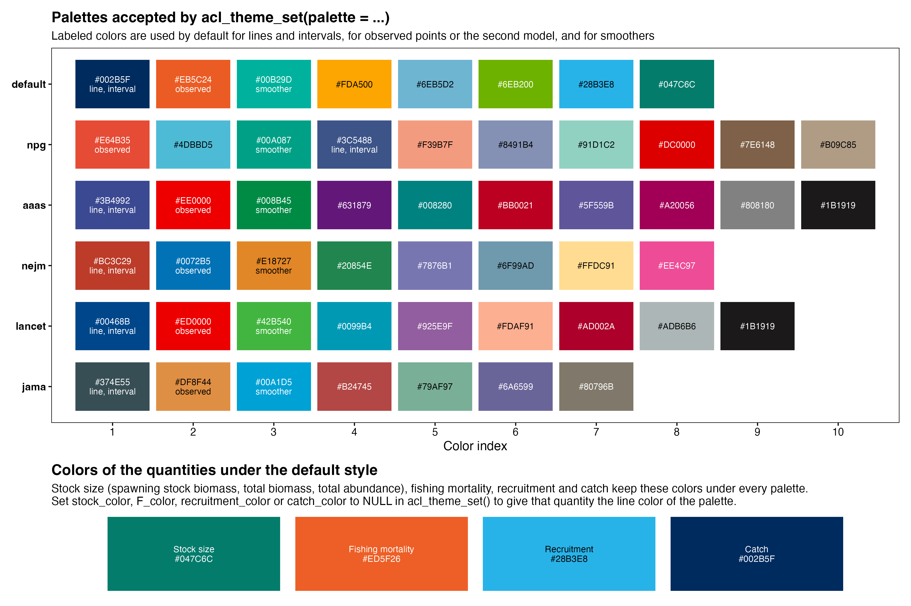
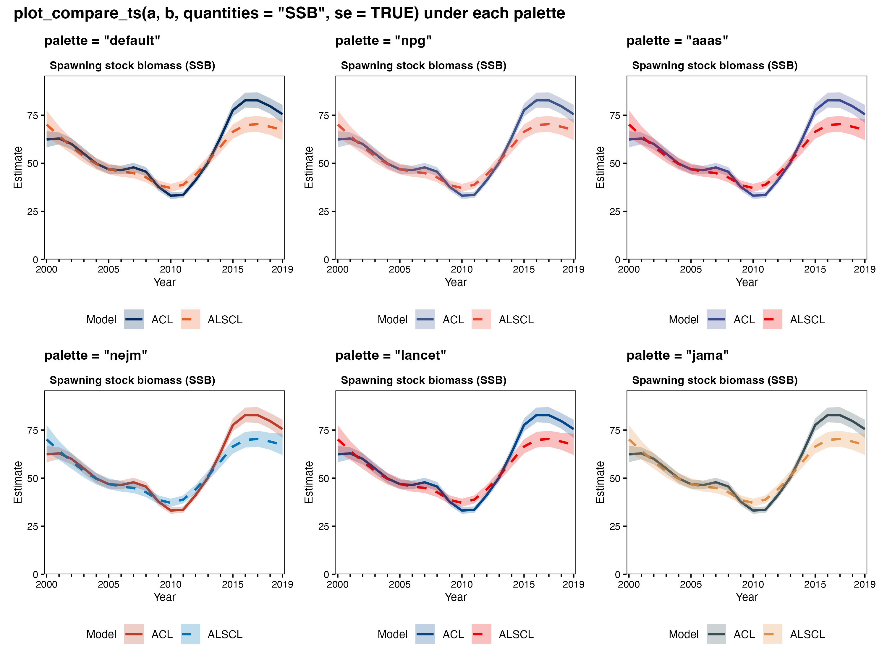

# Colors and export

On this page you choose the style of every ALSCL plot, change one setting or the colors of one plot, give your own ggplots the same look, export a figure, and set the labels and axes of the growth and population plots. You need `a`, `b` and `x` from [Understand your first fit](first-model.html); step 1 also fits a retrospective analysis `rb` ([Run a retrospective analysis](retrospectives.html)).

<h2 id="theme">1. Set the theme once</h2>

```r
# Create the retrospective result before styling it
rb <- retro_alscl(x, nyear = 3, train_times = 2, ncores = 1, silent = TRUE)

# The default style, "default"
plot_retro(rb, facet_ncol = 2, rho_digits = 3)
plot_recruitment(b, se = TRUE)                 # bars with error bars
plot_recruitment(b, se = TRUE, geom = "line")  # a line with a band

# The look of ALSCL 2.4.5 in one call, then back to the default
acl_theme_set(style = "classic")
plot_compare_ts(a, b, se = TRUE)
acl_theme_set(style = "default")

# Change one setting and keep the rest of the style
acl_theme_set(font_family = "sans")
acl_theme_set(palette = "jama") # default, npg, aaas, nejm, lancet, jama
plot_abundance(b, type = "NL", facet_ncol = 3)
```

The default style, `style = "default"`, gives each quantity its own color. Spawning stock biomass, biomass and abundance are teal lines with a shaded 95% band, fishing mortality is an orange line with a band, total recruitment is drawn as light-blue bars and total catch as dark-blue bars, both with thin dark-grey error bars that have a light outline, and panels at age or at length are lines in the color of their quantity. The y axis of these plots starts at zero. Titles are bold, left aligned and black, no grid lines are drawn, facet labels are bold text without a box, and legends are below the plot. The other plots draw estimates in dark blue and observations in orange; in comparisons the first fit is dark blue and the second orange, and in `plot_retro()` the full fit is orange and the earlier fits are grey.

`acl_theme_set(style = "classic")` restores the look of ALSCL 2.4.5 in one call, with the npg colors, lines for every series, plain centered titles, grey boxed facet labels and y axes that follow the data. It does not restore the former figure texts (titles, axis titles and panel names), the former number of facet columns or the former year labels and figure sizes, because these rules apply under both styles. `acl_theme_set(style = "default")` or `acl_theme_reset()` returns to the default style. A style sets the values in the table below and the colors derived from its palette; fonts, labels, `interval`, `show_title`, `x_angle` and the other settings are kept, and arguments of the same call are applied after the style. Setting one key changes that key only, so the two styles can be mixed. `bars = FALSE` draws recruitment and catch as lines, `y_zero = FALSE` lets the y axes follow the data, `grid = "y"` adds horizontal grid lines, `title_color = "quantity"` gives each title the color of its quantity, and `palette = "npg"` uses the npg colors for lines, observations, comparisons and heat maps while the four quantity colors stay. `geom = "bar"` or `geom = "line"` in `plot_recruitment()` and `plot_catch()` chooses for one plot; catch at age and at length are always lines. `acl_theme_set()` changes the plots created afterwards; recreate an existing plot to restyle it.

| Setting | `style = "default"` | `style = "classic"` (ALSCL 2.4.5) |
|---|---|---|
| `palette` | `"default"` | `"npg"` |
| `grid` | `"none"`: no grid lines (`"y"` adds horizontal major grid lines) | `"none"` |
| `title_face`, `title_hjust` | `"bold"`, 0 (left) | `"plain"`, 0.5 (centered) |
| `title_color` | `"black"` (`"quantity"` gives the color of the quantity) | `"black"` |
| `stock_color`, `F_color`, `recruitment_color`, `catch_color` | `"#047c6c"`, `"#ed5f26"`, `"#28b3e8"`, `"#002b5f"` | `NULL`: `line_color` |
| `bars` | `TRUE`: total recruitment and catch as bars | `FALSE`: lines |
| `y_zero` | `TRUE`: y axes of stock size, recruitment, catch and fishing mortality plots start at zero | `FALSE`: they follow the data |
| `line_size`, `compare_line_size` | 1, 0.9 | 1.5, 1.2 |
| `se_alpha`, `compare_se_alpha` | 0.3, 0.25 | 0.2, 0.15 |
| `strip` | `"plain"`: bold facet labels without a box | `"box"`: grey strips of the base theme |
| `legend_position` | `"bottom"` | `NULL`: each plot keeps its own |
| `axis_color` | `"black"`: panel border, axis text and ticks | `NULL`: those of the base theme |

The palettes are `default` (8 colors), `npg` (10), `aaas` (10), `nejm` (8), `lancet` (9) and `jama` (7). The default palette starts with dark blue `#002b5f` for estimates and orange `#eb5c24` for observations and the second model, and its heat maps run from white to the same dark blue.



The figure shows the six palettes `acl_theme_set()` accepts and the four quantity colors of the default style. In each row the color labelled "line, interval" draws lines, intervals and points of single-model plots, the color labelled "observed" draws observations and the second model in comparisons, and the color labelled "smoother" draws smoothers; the remaining colors are used in order when a plot needs more groups, for example the peels of a retrospective under a ggsci palette. The next figure shows the same comparison plot under every palette, so you can pick one by eye; `docs/figures/palettes/ssb_by_palette.png` in the repository shows a single-model plot in the same way.



| Setting | Scope and precedence |
|---|---|
| `style` | Preset of the settings in the table above |
| `palette` | Switching resets the colors derived from it |
| `line_color`, `se_color`, `point_color` | Single-model lines, intervals and scatter |
| `stock_color`, `F_color`, `recruitment_color`, `catch_color` | Lines and bars of each quantity; `NULL` hands them to `line_color` |
| `observed_color`, `smooth_color`, `hline_color` | Observation, residual smoother and reference line |
| `compare_colors` | Model pair, optionally matched by name |
| `low_col`, `high_col` | Sequential heatmap endpoints |
| `font_family`, `title_size`, `axis_text_size`, `strip_text_size` | Typography |
| `line_size`, `point_size` | Single-model line width (thinner in figures with more than 4 panels unless set in the call) and the default point size for all plots (2.5); comparison line widths use `compare_line_size` |
| `compare_point_size` | Optional comparison-only point size; `NULL` clears it and restores global `point_size` inheritance |
| `facet_ncol`, `facet_nrow`, `facet_scales` | Facet layout, with the same argument names in every plot; by default the number of columns follows the number of panels |
| `show_title`, `x_angle`, `x_breaks` | Default titles and the labels of time axes ([section 5](#labels)) |

<h2 id="override">2. Override colors for one plot</h2>

```r
# Per-call overrides take precedence
plot_retro(rb, palette = "nejm", rho_position = "top_left")
plot_retro(rb, colors = c("2019" = "#3C5488", "2018" = "#E64B35",
                         "2017" = "#00A087", "2016" = "#4DBBD5"))
plot_SSB(b, line_color = "#00A087", se = TRUE, se_color = "#00A087")
plot_compare_ts(a, b, colors = c("ACL" = "#3C5488", "ALSCL" = "#E64B35"))

# Sequential gradients encode continuous quantities
plot_pla(b)                         # Global endpoints
plot_compare_F(a, b, palette = "npg")
plot_compare_F(a, b, palette = "inferno") # Another gradient
plot_ridges(b)                      # Default time gradient
plot_ridges(b, palette = "cividis")
acl_theme_set(ylab = list(year = "Survey year")) # Ridge time axis
plot_ridges(b, palette = c("#E8F1FA", "#3C5488"))

# Your own ggplot with the look and colors of the package plots
ssb <- extract_estimates(b, "SSB")
ggplot2::ggplot(ssb, ggplot2::aes(year, estimate)) +
  ggplot2::geom_ribbon(ggplot2::aes(ymin = conf_low, ymax = conf_high),
                       fill = acl_palette(role = "stock"), alpha = 0.3) +
  ggplot2::geom_line(color = acl_palette(role = "stock"), linewidth = 1) +
  ggplot2::labs(title = "Spawning stock biomass", x = "Year",
                y = "Spawning stock biomass (SSB)") +
  theme_acl(quantity = "stock")
acl_palette(role = c("stock", "F", "recruitment", "catch"))

# Restore defaults
acl_theme_reset()
```

Set `acl_theme_set(point_size = 3)` to change points across single-model and comparison plots. A per-call `point_size` has highest priority. In `plot_compare_CatL()`, an explicit legacy `obs_size` comes next, followed by an explicit `compare_point_size` theme setting and then the global `point_size`. The other point-drawing comparison plots follow the same order without `obs_size`. Use `acl_theme_set(compare_point_size = NULL)` to remove a comparison-only override.

Explicit colors in a call override the theme and a palette passed with them; `NULL` inherits the theme. Under the default style the interval of a stock size, F, recruitment or catch plot takes the color of its line, so `line_color` alone recolors both; under `"classic"`, set `se_color` together with `line_color`, because it stays at the theme value otherwise. Error bars on bars are dark grey with a light outline unless the call gives `se_color`. Named retrospective colors must cover every terminal time step; unnamed colors follow the same order. With more peels than palette colors, the colors are interpolated. Ridges use a sequential gradient in input-year order, shared by the observed and fitted panels. The default `palette = NULL` gives a ramp from light to dark blue under the default palette and viridis under any other palette, and `viridis`, `cividis`, `plasma`, `ocean` or a vector of colors replace it.

`theme_acl()` returns the theme layers of the package plots under the current settings (base theme, text sizes, grid lines, title, facet labels and legend position), so that adding it to any ggplot gives the figure the look of the package plots; with `quantity = "stock"`, `"F"`, `"recruitment"` or `"catch"` and `title_color = "quantity"`, the title takes the color of that quantity. `acl_palette()` returns the colors of the active palette, `acl_palette(n)` gives `n` of them, `acl_palette(palette = "npg")` those of another palette, and `acl_palette(role = ...)` the colors that the plots use for `"stock"`, `"F"`, `"recruitment"`, `"catch"`, `"primary"` (lines and points), `"accent"` (observations), `"smooth"` and `"reference"`. Both follow later calls to `acl_theme_set()` when they are called again. Under the default style the package plots also start the y axis at zero; add `ggplot2::expand_limits(y = 0)` to include zero in a figure of your own.

<h2 id="export">3. Set typography and export</h2>

```r
# Typography and layout
acl_theme_set(title_size=16, axis_title_size=12,
              axis_text_size=10, strip_text_size=10, title_hjust=0,
              compare_legend_pos="bottom", compare_linetypes=c("solid","dashed"))
p <- plot_retro(rb, facet_ncol = 2, point_size=1.8, line_size=.8)
acl_figure_size(p)                     # recommended width and height in inches
acl_save_plot(p, "retrospective.png")  # at that size and 300 dpi
acl_save_plot(p, "retrospective.pdf", width = 7)
# Preserve settings explicitly
old <- acl_theme()
acl_theme_set(palette="aaas", x_breaks=c(2000, 2010),
              ylab=list(survey="Survey index"))
do.call(acl_theme_set, old)
acl_theme_reset()
```

`acl_figure_size(p)` returns the recommended `c(width = , height = )` in inches, computed from the layout of the plot, which is about 8 x 4.5 inches for a single time series and about 10 inches wide with 1.5 to 1.9 inches for each row of panels for faceted plots. `acl_save_plot()` saves the plot at that size on a white background at 300 dpi; a given `width` gets the matching height, and other arguments of `ggplot2::ggsave()` can be added. `acl_theme()` returns the current settings for `do.call(acl_theme_set, old)` to restore, including automatic axis breaks and labels previously set to `NULL`; `acl_theme_reset()` returns to the defaults. Set `x_breaks = NULL` to restore automatic breaks or `ylab = list(survey = NULL)` to clear a survey-label override. The chosen font also applies to the Mohn's rho labels of `plot_retro()` and the value labels of `plot_compare_metrics()`. The five palettes other than `default` come from [ggsci](https://nanx.me/ggsci/).

<h2 id="growth">4. Set the growth-plot range and text</h2>

```r
plot_VB(b, parameter_curve = TRUE, ylab = "Mean length (cm)",
        axis_text_size = 12, x_breaks = c(1, 5, 10, 15),
        age_range = c(1, 15), text_size = 4)
```

For an ALSCL fit, `plot_VB()` draws mean length at age from the fitted numbers at the fitted age classes: `age_range` selects the age classes within it, and `parameter_curve = TRUE` adds the curve computed from `Linf`, `k` and `t0` with its annotation, which honors `text_size` and `text_color`. For the von Bertalanffy curve of an ACL fit, `age_range = NULL` uses the fitted age range (1-25 years for a result without age metadata), starting no earlier than `t0`; a range with no positive span produces an error. An explicit range must contain two finite increasing ages and start at or after `t0`, which avoids negative predicted lengths below the theoretical age at zero length. This is the meaning of `t0` in the [von Bertalanffy equation](https://www.fao.org/4/x5685e/x5685e03.htm). Lines, curves and intervals inherit `ylab$growth` and the selected font, and an explicit `ylab` overrides the global label; the package holds no unit for length, so give it in the label. The points of `observed` take `observed_color` and `point_size`. With `se = TRUE` the interval belongs to the curve computed from the parameters; if the covariance is unavailable, the function warns and draws only the estimate.

<h2 id="labels">5. Set global labels and axes</h2>

```r
acl_theme_set(
  titles = list(SSB = "Spawning stock biomass",
                SSB_se = "Spawning stock biomass with 95% intervals"),
  xlab = list(year = "Survey year"),
  ylab = list(ssb = "Spawning stock biomass"),
  x_breaks = c(2000, 2009, 2019), x_expand = c(0, 0)
)
plot_SSB(b, se = TRUE)
acl_theme_reset()
```

```r
plot_SSB(b, se = TRUE, title = FALSE)            # no title in this plot
acl_theme_set(show_title = FALSE, x_angle = 0)   # no default titles; horizontal year labels
plot_abundance(b, type = "NL")
acl_theme_reset()
```

The total, age and length modes of `plot_SSB()`, `plot_biomass()`, `plot_abundance()` and `plot_catch()` inherit the global `titles`, `xlab`, `ylab`, `x_breaks` and `x_expand`, with or without intervals. For SSB, use `ylab$ssb`; titles use the quantity key, with `_se` for interval variants. These settings change labels and display ranges only; the grid lines follow `grid`. `acl_theme_set(interval = "wald")` changes the 95% interval of the abundance, biomass, spawning stock biomass, recruitment, catch and fishing mortality plots from the default lognormal interval to the symmetric interval `estimate +/- 1.96 * SE`; the `interval` argument does the same for one call. Error bars are opaque unless the call gives `se_alpha`. A `title`, `xlab` or `ylab` given in the call replaces the theme label, `title = FALSE` (also `NA` or `""`) draws no title, and `acl_theme_set(show_title = FALSE)` removes the default titles of all plots while keeping titles given in a call. The typography arguments (`font_family`, `title_size`, `axis_title_size`, `axis_text_size`, `strip_text_size`, `legend_text_size`, `base_theme`, `title_hjust`) replace the corresponding settings, as in every other single-model plot; `plot_deviance()` takes the same arguments.

Time axes follow one rule in every plot. A single panel labels every year up to 12 years, every second year up to 30, every fifth up to 60 and every tenth beyond, with unlabelled ticks at the other years, so the 20 years of the example are labelled 2000, 2002, ..., 2018. In figures with several panels the step follows the width of the panels, and labels that would touch are slanted by 45 degrees instead of being dropped. `x_angle = 0` keeps them horizontal and labels fewer years, and another number fixes the angle. `x_breaks`, in a call or in the theme, sets the labelled values; one global value serves time, age and length axes, and a plot uses it only when at least one break lies within its horizontal axis, so calendar-year breaks do not blank an age or length axis.

`plot_fishing_mortality()` inherits the same settings with the title keys `F_year`, `F_age` and `F_length` (plus `_se`), the horizontal label `xlab$year`, `xlab$age` or `xlab$length` and the vertical label `ylab$F`. Age mode plots the fitted ages. A result saved without age metadata is plotted against numbered age bins, and its default label is "Age bin" until you set `xlab$age`; the ACL `type = "length"` alias uses the age settings. Per-call labels and breaks take precedence. `base_theme` accepts a name such as `"theme_bw"` or `"bw"`, a theme object such as `ggplot2::theme_bw()`, or `NULL` for the global setting.

Survey-fit plots, single-model and comparison, use `ylab$survey`; when it is unset, a customized `ylab$abundance` applies, otherwise "Survey index". Log plots add a "Log" prefix, an explicit `ylab` wins, and `ylab$catch` labels the catch plots only.

<h2 id="next">What next</h2>

| What you want to do | Read |
|---|---|
| Choose which population plot to draw | [Survey and population plots](population-plots.html) |
| Compare two fits in one figure | [Model comparisons](model-comparison.html) |
