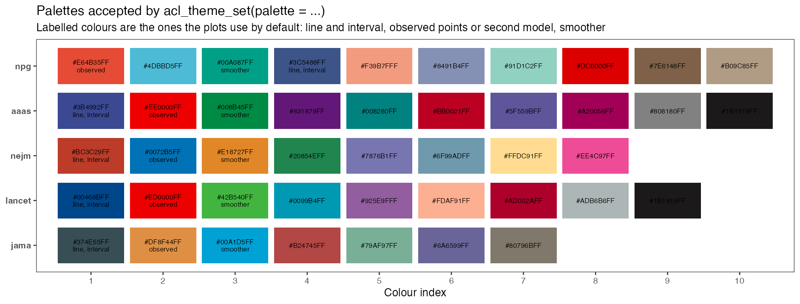
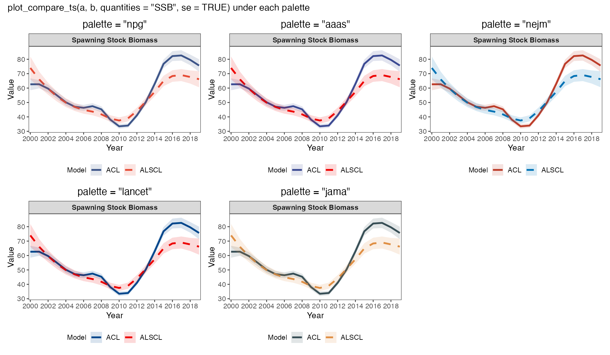

# Colors and export

On this page you set a palette and theme once for every ALSCL plot, override colors for one plot, export a figure, and set the labels and axes of the growth and population plots. You need `a`, `b` and `x` from [Understand your first fit](first-model.html); step 1 also fits a retrospective analysis `rb` ([Run a retrospective analysis](retrospectives.html)).

<h2 id="theme">1. Set the theme once</h2>

```r
# Create the retrospective result before styling it
rb <- retro_alscl(x, nyear = 3, train_times = 2, ncores = 1, silent = TRUE)

# Set once, then recreate plots
acl_theme_set(palette = "npg", base_theme = "theme_bw", font_family = "sans")
plot_retro(rb, facet_ncol = 2, rho_digits = 3)
plot_compare_ts(a, b, se = TRUE)

# Alternative journal palettes
acl_theme_set(palette = "jama") # npg, aaas, nejm, lancet, jama
plot_abundance(b, type = "NL", facet_ncol = 3)
```

The default palette is ggsci NPG: navy estimates, vermilion observations, and navy and vermilion for model comparisons. Retrospective colors follow the terminal time steps, newest first. `acl_theme_set()` changes the plots created afterwards; recreate an existing plot to restyle it. The palettes are `npg` (10 colors), `aaas` (10), `nejm` (8), `lancet` (9) and `jama` (7).



The figure shows the five palettes `acl_theme_set()` accepts. In each row the first labelled colour draws lines, intervals and points of single-model plots, the second draws observations and the second model in comparisons, and the third draws smoothers; the remaining colours are used in order when a plot needs more groups, for example the peels of a retrospective. The next figure shows the same comparison plot under every palette, so you can pick one by eye; `docs/figures/palettes/ssb_by_palette.png` in the repository shows a single-model plot in the same way.



| Setting | Scope and precedence |
|---|---|
| `palette` | Switching resets derived roles |
| `line_color`, `se_color`, `point_color` | Single-model lines, intervals and scatter |
| `observed_color`, `smooth_color`, `hline_color` | Observation, residual smoother and reference line |
| `compare_colors` | Model pair, optionally matched by name |
| `low_col`, `high_col` | Sequential heatmap endpoints |
| `font_family`, `title_size`, `axis_text_size`, `strip_text_size` | Typography |
| `line_size`, `point_size` | Single-model line width and the default point size for all plots (2.5); comparison line widths use `compare_line_size` |
| `compare_point_size` | Optional comparison-only point size; `NULL` clears it and restores global `point_size` inheritance |
| `facet_ncol`, `facet_nrow`, `facet_scales` | Facet layout, with the same argument names in every plot |

<h2 id="override">2. Override colors for one plot</h2>

```r
# Per-call overrides take precedence
plot_retro(rb, palette = "nejm", rho_position = "top_left")
plot_retro(rb, colors = c("2019" = "#3C5488", "2018" = "#E64B35",
                         "2017" = "#00A087", "2016" = "#4DBBD5"))
plot_SSB(b, line_color = "#00A087", se = TRUE, se_color = "#00A087")
plot_compare_ts(a, b, colors = c("ACL" = "#3C5488", "ALSCL" = "#E64B35"))

# Sequential gradients encode continuous quantities
plot_pla(b)                         # Global endpoints
plot_compare_F(a, b, palette = "npg")
plot_compare_F(a, b, palette = "inferno") # Another gradient
plot_ridges(b)                      # Default time gradient
plot_ridges(b, palette = "cividis")
acl_theme_set(ylab = list(year = "Survey year")) # Ridge time axis
plot_ridges(b, palette = c("#E8F1FA", "#3C5488"))

# Restore defaults
acl_theme_reset()
```

Set `acl_theme_set(point_size = 3)` to change points across single-model and comparison plots. A per-call `point_size` has highest priority. In `plot_compare_CatL()`, an explicit legacy `obs_size` comes next, followed by an explicit `compare_point_size` theme setting and then the global `point_size`. The other point-drawing comparison plots follow the same order without `obs_size`. Use `acl_theme_set(compare_point_size = NULL)` to remove a comparison-only override.

Explicit colors in a call override the theme and a palette passed with them; `NULL` inherits the theme. Set `se_color` together with `line_color`; it stays at the theme value otherwise. Named retrospective colors must cover every terminal time step; unnamed colors follow the same order. With more peels than palette colors, the colors are interpolated. Ridges use a viridis gradient in input-year order, shared by the observed and fitted panels and independent of the global palette; `NULL` also selects viridis, and `cividis`, `plasma`, `ocean` or a vector of colors replace it.

<h2 id="export">3. Set typography and export</h2>

```r
# Typography and layout
acl_theme_set(palette="npg", title_size=16, axis_title_size=12,
              axis_text_size=10, strip_text_size=10, title_hjust=0,
              compare_legend_pos="bottom", compare_linetypes=c("solid","dashed"))
p <- plot_retro(rb, facet_ncol = 2, point_size=1.8, line_size=.8)
ggplot2::ggsave("retrospective.png", p, width=11, height=7, dpi=300, bg="white")
ggplot2::ggsave("retrospective.pdf", p, width=11, height=7)
# Preserve settings explicitly
old <- acl_theme()
acl_theme_set(palette="aaas", x_breaks=c(2000, 2010),
              ylab=list(survey="Survey index"))
do.call(acl_theme_set, old)
acl_theme_reset()
```

`ggsave()` writes `p` at the given size and resolution. `acl_theme()` returns the current settings for `do.call(acl_theme_set, old)` to restore, including automatic axis breaks and labels previously set to `NULL`; `acl_theme_reset()` returns to the defaults. Set `x_breaks = NULL` to restore automatic breaks or `ylab = list(survey = NULL)` to clear a survey-label override. The chosen font also applies to retrospective rho and comparison metric labels. Palette source: [ggsci NPG documentation](https://nanx.me/ggsci/reference/pal_npg.html).

<h2 id="growth">4. Set the growth-plot range and text</h2>

```r
plot_VB(b, parameter_curve = TRUE, ylab = "Length (cm)",
        axis_text_size = 12, x_breaks = c(1, 5, 10, 15),
        age_range = c(1, 15), text_size = 4)
```

For an ALSCL fit, `plot_VB()` draws mean length at age from the fitted numbers at the fitted age classes: `age_range` selects the age classes within it, and `parameter_curve = TRUE` adds the curve computed from `Linf`, `k` and `t0` with its annotation, which honors `text_size` and `text_color`. For the von Bertalanffy curve of an ACL fit, `age_range = NULL` uses the fitted age range (1-25 years for a result without age metadata), starting no earlier than `t0`; a range with no positive span produces an error. An explicit range must contain two finite increasing ages and start at or after `t0`, which avoids negative predicted lengths below the theoretical age at zero length. This is the meaning of `t0` in the [von Bertalanffy equation](https://www.fao.org/4/x5685e/x5685e03.htm). Lines, curves and intervals inherit `ylab$growth` and the selected font, and an explicit `ylab` overrides the global label; the package holds no unit for length, so give it in the label. The points of `observed` take `observed_color` and `point_size`. With `se = TRUE` the interval belongs to the curve computed from the parameters; if the covariance is unavailable, the function warns and draws only the estimate.

<h2 id="labels">5. Set global labels and axes</h2>

```r
acl_theme_set(
  titles = list(SSB = "Spawning biomass",
                SSB_se = "Spawning biomass with 95% intervals"),
  xlab = list(year = "Survey year"),
  ylab = list(ssb = "Spawning biomass"),
  x_breaks = c(2000, 2009, 2019), x_expand = c(0, 0)
)
plot_SSB(b, se = TRUE)
acl_theme_reset()
```

The total, age and length modes of `plot_SSB()`, `plot_biomass()`, `plot_abundance()` and `plot_catch()` inherit the global `titles`, `xlab`, `ylab`, `x_breaks` and `x_expand`, with or without intervals. For SSB, use `ylab$ssb`; titles use the quantity key, with `_se` for interval variants. These settings change labels and display ranges only, and the gridlines stay hidden. One global `x_breaks` serves time, age and length axes: a plot uses it only when at least one break lies within the range of its horizontal axis, so calendar-year breaks do not blank an age or length axis. `acl_theme_set(interval = "wald")` changes the 95% interval of the abundance, biomass, spawning biomass, recruitment, catch and fishing mortality plots from the default lognormal interval to the symmetric interval `estimate +/- 1.96 * SE`; the `interval` argument does the same for one call. Error bars are opaque unless the call gives `se_alpha`. A `title`, `xlab` or `ylab` given in the call replaces the theme label, and the typography arguments (`font_family`, `title_size`, `axis_title_size`, `axis_text_size`, `strip_text_size`, `legend_text_size`, `base_theme`, `title_hjust`) replace the corresponding settings, as in every other single-model plot; `plot_deviance()` takes the same arguments.

`plot_fishing_mortality()` inherits the same settings with the title keys `F_year`, `F_age` and `F_length` (plus `_se`), the horizontal label `xlab$year`, `xlab$age` or `xlab$length` and the vertical label `ylab$F`. Age mode plots the fitted ages. A result saved without age metadata is plotted against group positions, and its default label is "Age group" until you set `xlab$age`; the ACL `type = "length"` alias uses the age settings. Per-call labels and breaks take precedence. `base_theme` accepts a name such as `"theme_bw"` or `"bw"`, a theme object such as `ggplot2::theme_bw()`, or `NULL` for the global setting.

Survey-fit plots, single-model and comparison, use `ylab$survey`; when it is unset, a customized `ylab$abundance` applies, otherwise "Survey index". Log plots add a "Log" prefix, an explicit `ylab` wins, and `ylab$catch` labels the catch plots only.

<h2 id="next">What next</h2>

| What you want to do | Read |
|---|---|
| Choose which population plot to draw | [Survey and population plots](population-plots.html) |
| Compare two fits in one figure | [Model comparisons](model-comparison.html) |
