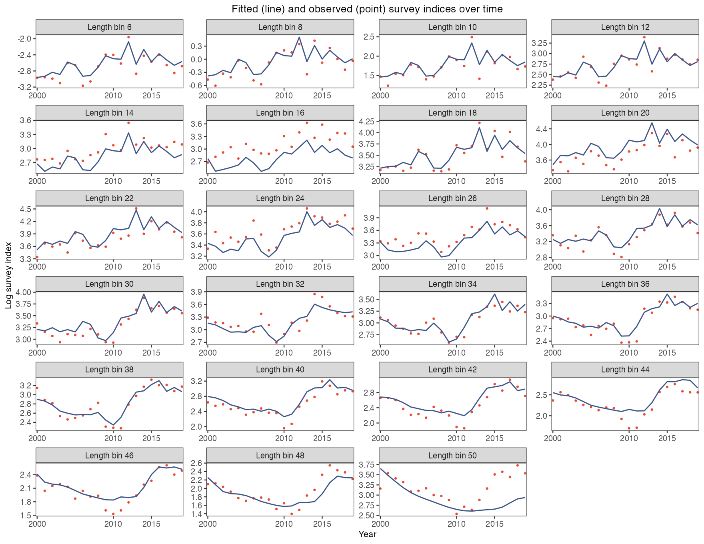
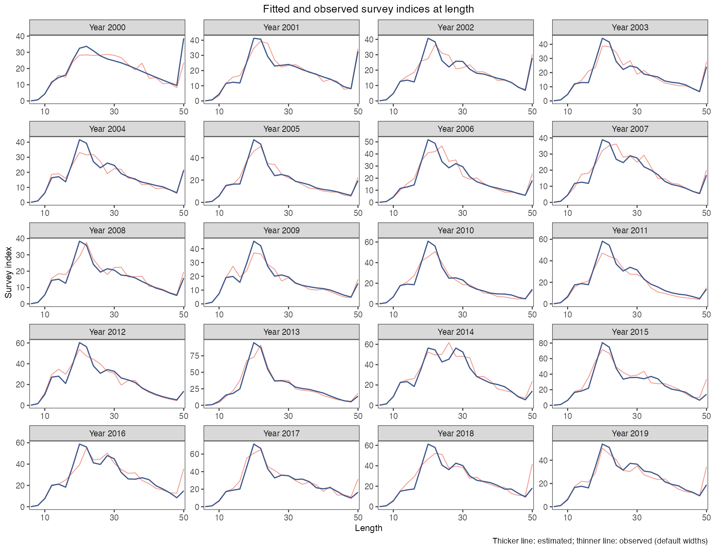
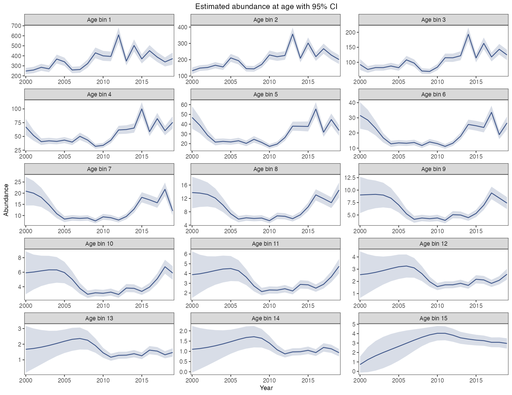
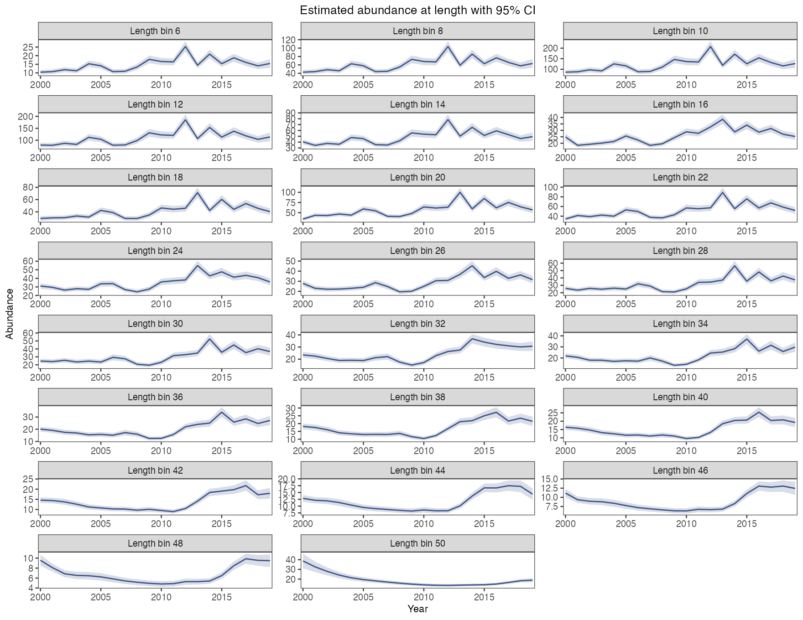
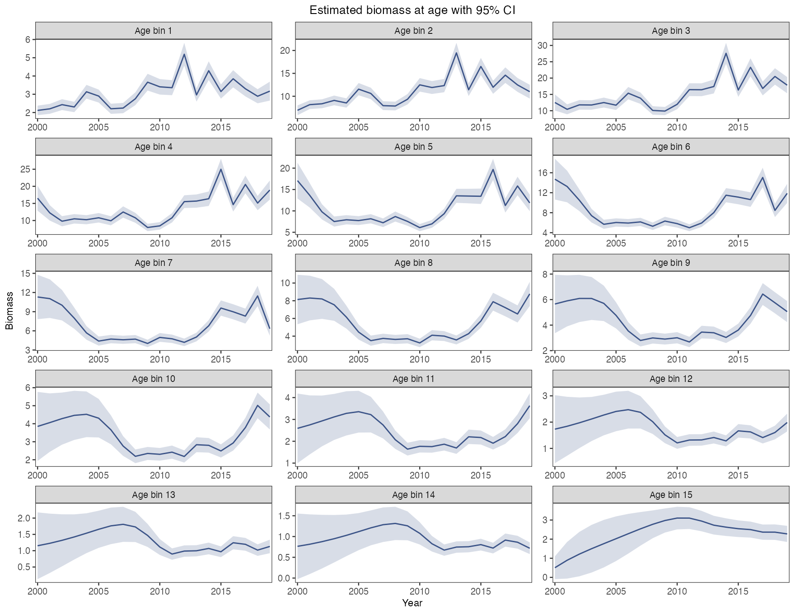
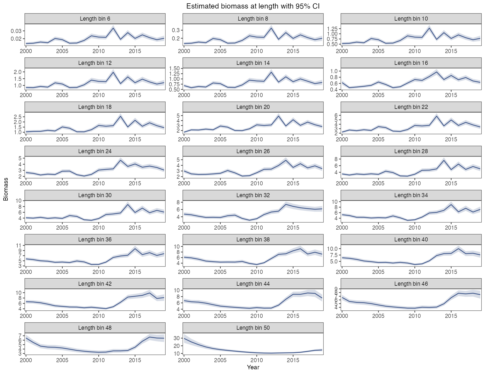
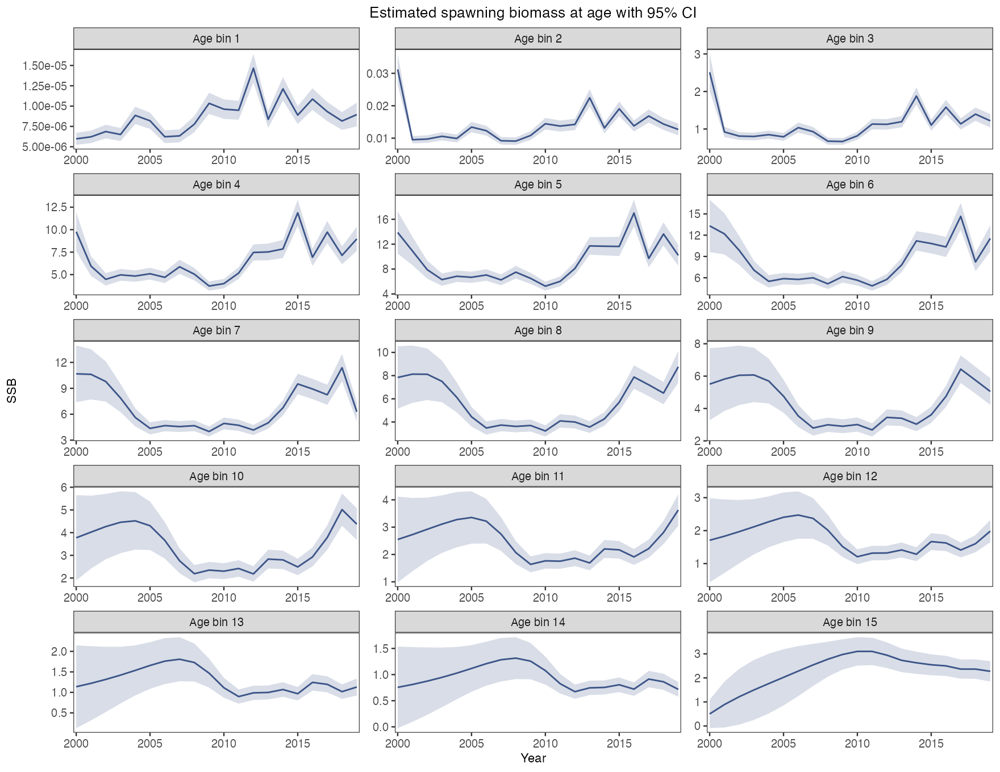
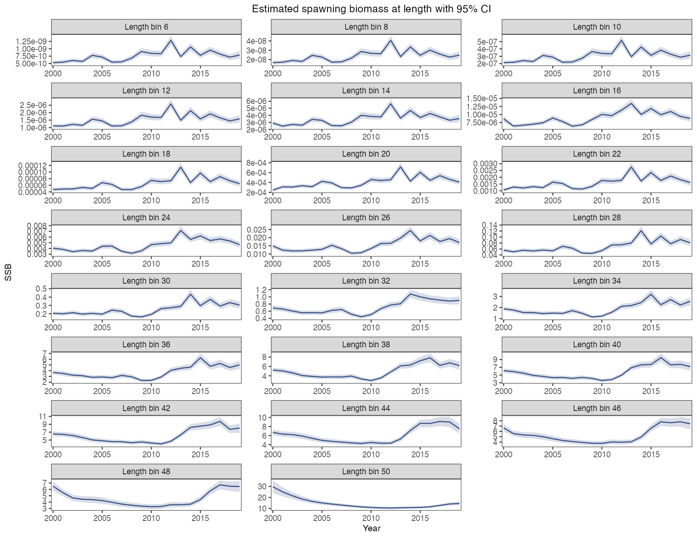
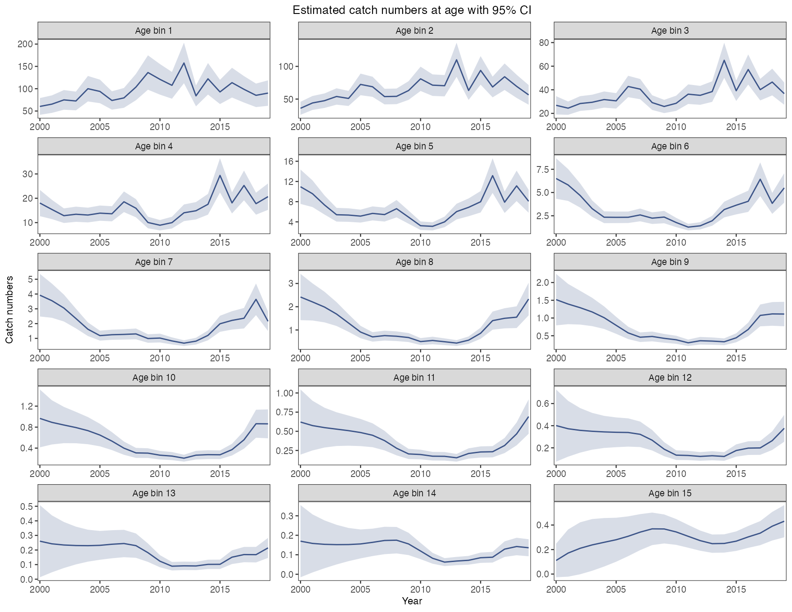
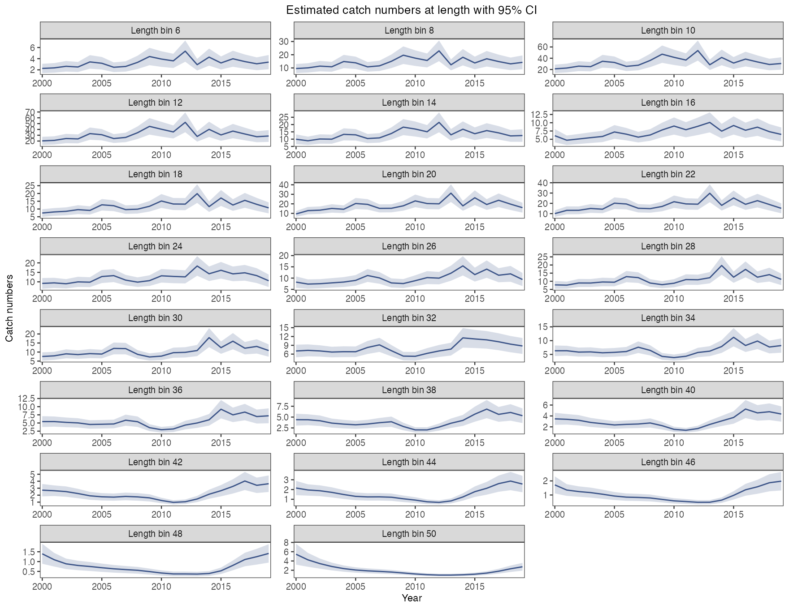

# Survey and population plots

First complete the [worked YTF example](first-model.html) to create `a`, `b`, `x` and `inputs`. Define `dat <- x$data.CatL` and load ggplot2 and patchwork. The [retrospective guide](retrospectives.html) creates `ra` and `rb`.

```r
library(ggplot2)
library(patchwork)
acl_theme_set(palette="npg", base_theme="theme_bw")
```

## Survey fit length log scale

```r
# Draw this figure
plot_CatL(b, facet_by = "length", exp_transform = FALSE, facet_ncol = 4,
  point_size = 1, line_size = 0.6,
  x_breaks = c(2000, 2010, 2015),
  ylab = "Log survey index")
```

[](https://github.com/FanZhang-LAB-SHOU/ALSCL/blob/main/docs/figures/ytf/CatL_length_FALSE.png?raw=true)

One panel per length bin, time on the horizontal axis and the log survey index on the vertical axis: vermilion points are the observed log index and the navy curve is the fitted `Elog_index`. Use it to judge the fit bin by bin; a run of points on one side of the curve, as in bins 16 and 50 here, marks a bin the model under- or over-predicts, and the log scale shows this equally well in small and large bins.

[Arguments and defaults](https://github.com/FanZhang-LAB-SHOU/ALSCL/blob/main/docs/FUNCTION_REFERENCE.md#plot_CatL)

## Survey fit length original scale

```r
# Draw this figure
plot_CatL(b, facet_by = "length", exp_transform = TRUE, facet_ncol = 4,
  point_size = 1, line_size = 0.6,
  x_breaks = c(2000, 2010, 2015),
  ylab = "Survey index")
```

[](https://github.com/FanZhang-LAB-SHOU/ALSCL/blob/main/docs/figures/ytf/CatL_length_TRUE.png?raw=true)

The same panels on the original scale: the navy curve is `exp(Elog_index)`, the median of the fitted lognormal distribution, and the vermilion points are the observed index. Use it to read the misfit in index units; the error is multiplicative, so a gap that looks large at high values can be the same relative misfit as a small gap at low values.

[Arguments and defaults](https://github.com/FanZhang-LAB-SHOU/ALSCL/blob/main/docs/FUNCTION_REFERENCE.md#plot_CatL)

## Survey fit year log scale

```r
# Draw this figure
plot_CatL(b, facet_by = "year", exp_transform = FALSE, facet_ncol = 4,
  line_size1 = 0.6, line_size2 = 0.4,
  x_breaks = c(10, 30, 50),
  ylab = "Log survey index")
```

[](https://github.com/FanZhang-LAB-SHOU/ALSCL/blob/main/docs/figures/ytf/CatL_year_FALSE.png?raw=true)

`line_size1 = 0.6` controls fitted curves; `line_size2 = 0.4` controls observed curves. In `facet_by = "year"`, use these two parameters instead of the length-mode `line_size` and `point_size`.

One panel per time step, length on the horizontal axis and the log survey index on the vertical axis: the thin vermilion curve is the observed log index across lengths and the thick navy curve is the fitted `Elog_index`. Use it to check the shape of the fit within a time step; a bump the navy curve misses, as at the largest bin in the later years here, is length structure the fit leaves unexplained.

[Arguments and defaults](https://github.com/FanZhang-LAB-SHOU/ALSCL/blob/main/docs/FUNCTION_REFERENCE.md#plot_CatL)

## Survey fit year original scale

```r
# Draw this figure
plot_CatL(b, facet_by = "year", exp_transform = TRUE, facet_ncol = 4,
  line_size1 = 0.6, line_size2 = 0.4,
  x_breaks = c(10, 30, 50),
  ylab = "Survey index")
```

[](https://github.com/FanZhang-LAB-SHOU/ALSCL/blob/main/docs/figures/ytf/CatL_year_TRUE.png?raw=true)

`line_size1 = 0.6` controls fitted curves; `line_size2 = 0.4` controls observed curves. In `facet_by = "year"`, use these two parameters instead of the length-mode `line_size` and `point_size`.

The same panels on the original scale, with the curves as `exp(Elog_index)` medians and the observed index. Use it to see which lengths carry the index in each time step; the position and height of the peak show where the survey catches most fish, and a time step whose observed peak sits off the navy curve is worth checking in the residual figures.

[Arguments and defaults](https://github.com/FanZhang-LAB-SHOU/ALSCL/blob/main/docs/FUNCTION_REFERENCE.md#plot_CatL)

## Abundance N

```r
# Draw this figure
plot_abundance(b, type = "N", se = TRUE, facet_ncol = 3,
  line_size = 0.6)
```

[](https://github.com/FanZhang-LAB-SHOU/ALSCL/blob/main/docs/figures/ytf/plot_abundance_N.png?raw=true)

Total abundance, summed over all groups, by time step; the shaded band is the approximate 95% interval, the estimate plus or minus 1.96 standard errors. Use it for the stock-wide trend and its precision; the jump in 2012 here is the strong 2012 recruitment entering the youngest age class.

[Arguments and defaults](https://github.com/FanZhang-LAB-SHOU/ALSCL/blob/main/docs/FUNCTION_REFERENCE.md#plot_abundance)

## Abundance NA

```r
# Draw this figure
plot_abundance(b, type = "NA", se = TRUE, facet_ncol = 3,
  line_size = 0.6)
```

[](https://github.com/FanZhang-LAB-SHOU/ALSCL/blob/main/docs/figures/ytf/plot_abundance_NA.png?raw=true)

Abundance at age, one panel per age class with its own vertical scale, each with the 95% band. Use it to follow cohorts: a strong year class appears as a peak that moves one panel to the right at each time step, and the bands widen with age because the old classes are small and the survey says little about them.

[Arguments and defaults](https://github.com/FanZhang-LAB-SHOU/ALSCL/blob/main/docs/FUNCTION_REFERENCE.md#plot_abundance)

## Abundance NL

```r
# Draw this figure
plot_abundance(b, type = "NL", se = TRUE, facet_ncol = 3,
  line_size = 0.6)
```

[](https://github.com/FanZhang-LAB-SHOU/ALSCL/blob/main/docs/figures/ytf/plot_abundance_NL.png?raw=true)

Abundance at length, one panel per length bin, each with the 95% band. Use it to see which lengths hold the numbers; the 2012 peak here appears first in the small bins and later in the larger ones as the cohort grows, while the largest bin changes slowly because fish accumulate there.

[Arguments and defaults](https://github.com/FanZhang-LAB-SHOU/ALSCL/blob/main/docs/FUNCTION_REFERENCE.md#plot_abundance)

## Biomass B

```r
# Draw this figure
plot_biomass(b, type = "B", se = TRUE, facet_ncol = 3,
  line_size = 0.6)
```

[](https://github.com/FanZhang-LAB-SHOU/ALSCL/blob/main/docs/figures/ytf/plot_biomass_B.png?raw=true)

Total biomass by time step with the 95% band. Read it next to total abundance: small fish weigh little, so biomass is smoother than abundance and a recruitment pulse appears in biomass only once the cohort has grown.

[Arguments and defaults](https://github.com/FanZhang-LAB-SHOU/ALSCL/blob/main/docs/FUNCTION_REFERENCE.md#plot_biomass)

## Biomass BA

```r
# Draw this figure
plot_biomass(b, type = "BA", se = TRUE, facet_ncol = 3,
  line_size = 0.6)
```

[](https://github.com/FanZhang-LAB-SHOU/ALSCL/blob/main/docs/figures/ytf/plot_biomass_BA.png?raw=true)

Biomass at age, one panel per age class with free vertical scales and the 95% band. Use it to see which ages hold the biomass; read the axis of each panel, because the free scales make a small old class look as variable as a large young one.

[Arguments and defaults](https://github.com/FanZhang-LAB-SHOU/ALSCL/blob/main/docs/FUNCTION_REFERENCE.md#plot_biomass)

## Biomass BL

```r
# Draw this figure
plot_biomass(b, type = "BL", se = TRUE, facet_ncol = 3,
  line_size = 0.6)
```

[](https://github.com/FanZhang-LAB-SHOU/ALSCL/blob/main/docs/figures/ytf/plot_biomass_BL.png?raw=true)

Biomass at length, one panel per length bin with the 95% band. Use it to see which lengths hold the biomass; here the bins above 36 carry most of it, and their rise after 2013 is the 2012 cohort growing into the large bins.

[Arguments and defaults](https://github.com/FanZhang-LAB-SHOU/ALSCL/blob/main/docs/FUNCTION_REFERENCE.md#plot_biomass)

## Spawning biomass SSB

```r
# Draw this figure
plot_SSB(b, type = "SSB", se = TRUE, facet_ncol = 3,
  line_size = 0.6)
```

[](https://github.com/FanZhang-LAB-SHOU/ALSCL/blob/main/docs/figures/ytf/plot_SSB_SSB.png?raw=true)

Spawning biomass by time step with the 95% band. Use it as the stock status series: only mature fish count, so it lags total biomass, and its low point around 2010 here comes before the recovery of the later years.

[Arguments and defaults](https://github.com/FanZhang-LAB-SHOU/ALSCL/blob/main/docs/FUNCTION_REFERENCE.md#plot_SSB)

## Spawning biomass SBA

```r
# Draw this figure
plot_SSB(b, type = "SBA", se = TRUE, facet_ncol = 3,
  line_size = 0.6)
```

[](https://github.com/FanZhang-LAB-SHOU/ALSCL/blob/main/docs/figures/ytf/plot_SSB_SBA.png?raw=true)

Spawning biomass at age, one panel per age class with the 95% band. Use it to see which ages spawn; the youngest classes sit near zero because the maturity table gives them almost no mature fish, so compare panels by their axis values rather than by the shape of the curves.

[Arguments and defaults](https://github.com/FanZhang-LAB-SHOU/ALSCL/blob/main/docs/FUNCTION_REFERENCE.md#plot_SSB)

## Spawning biomass SBL

```r
# Draw this figure
plot_SSB(b, type = "SBL", se = TRUE, facet_ncol = 3,
  line_size = 0.6)
```

[](https://github.com/FanZhang-LAB-SHOU/ALSCL/blob/main/docs/figures/ytf/plot_SSB_SBL.png?raw=true)

Spawning biomass at length, one panel per length bin with the 95% band. Use it to see which lengths spawn; the small bins sit near zero for the same reason, and the mature bins above 30 follow the total spawning biomass.

[Arguments and defaults](https://github.com/FanZhang-LAB-SHOU/ALSCL/blob/main/docs/FUNCTION_REFERENCE.md#plot_SSB)

## Catch numbers CN

```r
# Draw this figure
plot_catch(b, type = "CN", se = TRUE, facet_ncol = 3,
  line_size = 0.6)
```

[](https://github.com/FanZhang-LAB-SHOU/ALSCL/blob/main/docs/figures/ytf/plot_catch_CN.png?raw=true)

Catch in numbers by time step with the 95% band. The model derives catch from abundance and fishing mortality, and the YTF data contain no catch observations; use it as a plausibility check against known landings, and read the wide band as the weak constraint the survey alone puts on catch.

[Arguments and defaults](https://github.com/FanZhang-LAB-SHOU/ALSCL/blob/main/docs/FUNCTION_REFERENCE.md#plot_catch)

## Catch numbers CNA

```r
# Draw this figure
plot_catch(b, type = "CNA", se = TRUE, facet_ncol = 3,
  line_size = 0.6)
```

[](https://github.com/FanZhang-LAB-SHOU/ALSCL/blob/main/docs/figures/ytf/plot_catch_CNA.png?raw=true)

Catch in numbers at age, one panel per age class with the 95% band. Use it to see which ages the fishery removes; the catch peaks at ages 1 to 3 here because the small fish are numerous, and the bands widen in the old ages.

[Arguments and defaults](https://github.com/FanZhang-LAB-SHOU/ALSCL/blob/main/docs/FUNCTION_REFERENCE.md#plot_catch)

## Catch numbers CNL

```r
# Draw this figure
plot_catch(b, type = "CNL", se = TRUE, facet_ncol = 3,
  line_size = 0.6)
```

[](https://github.com/FanZhang-LAB-SHOU/ALSCL/blob/main/docs/figures/ytf/plot_catch_CNL.png?raw=true)

Catch in numbers at length, one panel per length bin with the 95% band. Read it with the fishing mortality at length: catch in a bin is the product of abundance and fishing mortality there, so a bin with high F but little catch is one with few fish.

[Arguments and defaults](https://github.com/FanZhang-LAB-SHOU/ALSCL/blob/main/docs/FUNCTION_REFERENCE.md#plot_catch)

## Recruitment

```r
# Draw this figure
plot_recruitment(b, se = TRUE)
```

[](https://github.com/FanZhang-LAB-SHOU/ALSCL/blob/main/docs/figures/ytf/recruitment.png?raw=true)

Recruitment, the number entering the youngest age class at each time step, with the 95% band; the vertical label is `ylab$rec`. Use it to find strong and weak year classes: the 2012 peak here is the cohort behind the later rise in abundance and biomass, and its calendar position depends on `rec.age` and the time step.

[Arguments and defaults](https://github.com/FanZhang-LAB-SHOU/ALSCL/blob/main/docs/FUNCTION_REFERENCE.md#plot_recruitment)

## Spawning biomass and recruitment

```r
# Draw this figure
plot_SSB_Rec(b, age_at_recruitment = 1)
```

[](https://github.com/FanZhang-LAB-SHOU/ALSCL/blob/main/docs/figures/ytf/SSB_Rec.png?raw=true)

A scatter of spawning biomass at one time step (horizontal) against recruitment `age_at_recruitment` years later (vertical), one point per pair and no fitted curve. Use it to see whether recruitment follows spawning biomass; the points here show no relation, which is expected because the model estimates recruitment freely at each time step instead of through a stock recruitment function.

[Arguments and defaults](https://github.com/FanZhang-LAB-SHOU/ALSCL/blob/main/docs/FUNCTION_REFERENCE.md#plot_SSB_Rec)

## Recruitment lag on a quarterly grid

`age_at_recruitment` is in years. `plot_SSB_Rec()` divides it by the fit's `growth_step` and requires an integer lag on a regular time grid. With quarterly data, 0.25 means one step and 1 means four steps. Zero lag is allowed; negative, nonfinite and fractional-step lags are rejected. Results without `growth_step` use their regular time spacing, or an annual step when `year` is missing as well.

```r
q <- list(year = 2000 + (0:7)/4, growth_step = 0.25,
          report = list(SSB = 1:8, Rec = 101:108))
paired <- plot_SSB_Rec(q, age_at_recruitment = 0.25, return_data = TRUE)$data
stopifnot(identical(paired$SSB, 1:7), identical(paired$Rec, 102:108))
```
