# Survey and population plots

On this page you draw the fit to the survey and the estimated population of one fit. Each section shows one figure of the survey index, abundance, biomass, spawning stock biomass, catch or recruitment, in total, by age or by length. The code uses the input bundle `x` and the ALSCL fit `b` of [Understand your first fit](first-model.html); the first block creates them when they are not in your session. Each section says what to look at in the figure and links to all arguments of the function.

```r
library(ALSCL)
x <- YTF_example
b <- run_alscl(x, silent = TRUE)  # about two minutes; skip it when b is in your session
```

Letter case does not matter in `type` and the other choice arguments, so `plot_SSB(b, type = "sbl")` draws the same figure as `type = "SBL"`. Time axes always label the first and the last year.

## Survey index by length bin (log scale)

```r
# Draw this figure
plot_CatL(b, facet_by = "length", exp_transform = FALSE,
  point_size = 1, line_size = 0.6,
  ylab = "Log survey index")
```

[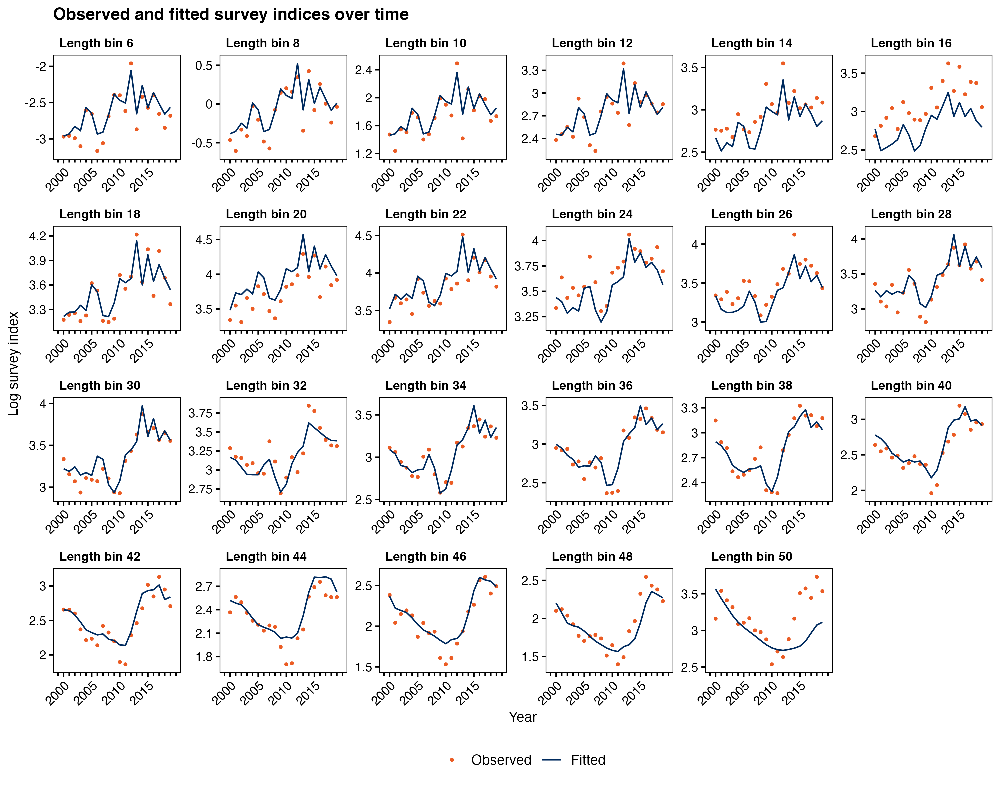](https://github.com/FanZhang-LAB-SHOU/ALSCL/blob/main/docs/figures/ytf/CatL_length_FALSE.png?raw=true)

One panel per length bin, with time on the horizontal axis and the log survey index on the vertical axis. Orange points ("Observed" in the legend) are the observed log index and the dark blue line ("Fitted") is the fitted `Elog_index`. Use it to judge the fit bin by bin; a run of points on one side of the line, as in bins 16 and 50 here, marks a bin the model under- or over-predicts, and the log scale shows this equally well in small and large bins.

[Arguments and defaults](https://github.com/FanZhang-LAB-SHOU/ALSCL/blob/main/docs/FUNCTION_REFERENCE.md#plot_CatL)

## Survey index by length bin (original scale)

```r
# Draw this figure
plot_CatL(b, facet_by = "length", exp_transform = TRUE,
  point_size = 1, line_size = 0.6,
  ylab = "Survey index")
```

[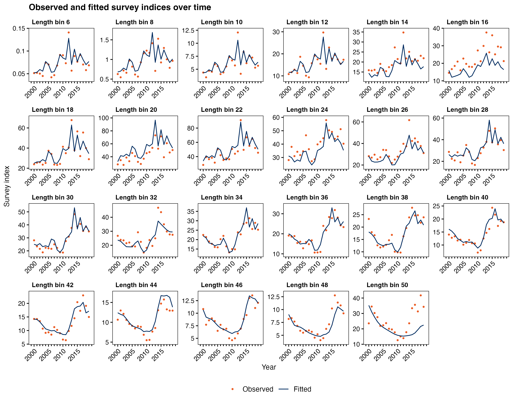](https://github.com/FanZhang-LAB-SHOU/ALSCL/blob/main/docs/figures/ytf/CatL_length_TRUE.png?raw=true)

The same panels on the original scale. The dark blue line is `exp(Elog_index)`, the median of the fitted lognormal distribution, and the orange points are the observed index. Use it to read the misfit in index units; the error is multiplicative, so a gap that looks large at high values can be the same relative misfit as a small gap at low values.

[Arguments and defaults](https://github.com/FanZhang-LAB-SHOU/ALSCL/blob/main/docs/FUNCTION_REFERENCE.md#plot_CatL)

## Survey index by time step (log scale)

```r
# Draw this figure
plot_CatL(b, facet_by = "year", exp_transform = FALSE,
  line_size1 = 0.6, line_size2 = 0.4,
  ylab = "Log survey index")
```

[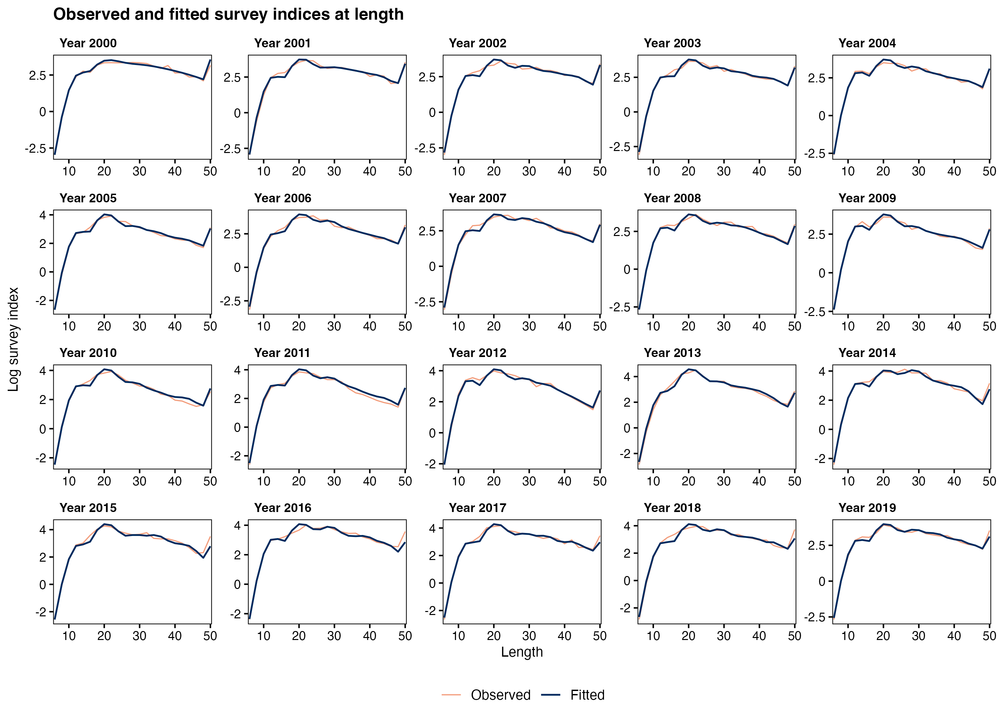](https://github.com/FanZhang-LAB-SHOU/ALSCL/blob/main/docs/figures/ytf/CatL_year_FALSE.png?raw=true)

One panel per time step, with length on the horizontal axis and the log survey index on the vertical axis. The thin orange line ("Observed") is the observed log index across lengths and the thick dark blue line ("Fitted") is the fitted `Elog_index`. Use it to check the shape of the fit within a time step; a bump the dark blue line misses, as at the largest bin in the later years here, is length structure the fit leaves unexplained.

In year facets, `line_size1` sets the fitted line width and `line_size2` the observed line width. Gaps split the observed line. An isolated observation appears as a point sized by `point_size`.

[Arguments and defaults](https://github.com/FanZhang-LAB-SHOU/ALSCL/blob/main/docs/FUNCTION_REFERENCE.md#plot_CatL)

## Survey index by time step (original scale)

```r
# Draw this figure
plot_CatL(b, facet_by = "year", exp_transform = TRUE,
  line_size1 = 0.6, line_size2 = 0.4,
  ylab = "Survey index")
```

[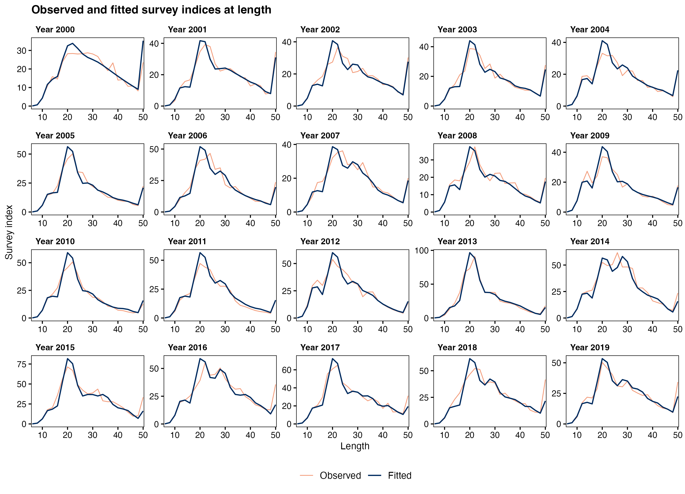](https://github.com/FanZhang-LAB-SHOU/ALSCL/blob/main/docs/figures/ytf/CatL_year_TRUE.png?raw=true)

The curves show fitted survey-index medians on the original scale, `exp(Elog_index)`, with the observed index in each length bin. Compare the lengths at which the observed and fitted indices peak, then examine the residuals for those bins.

[Arguments and defaults](https://github.com/FanZhang-LAB-SHOU/ALSCL/blob/main/docs/FUNCTION_REFERENCE.md#plot_CatL)

## Abundance N

```r
# Draw this figure
plot_abundance(b, type = "N", se = TRUE,
  line_size = 0.6)
```

[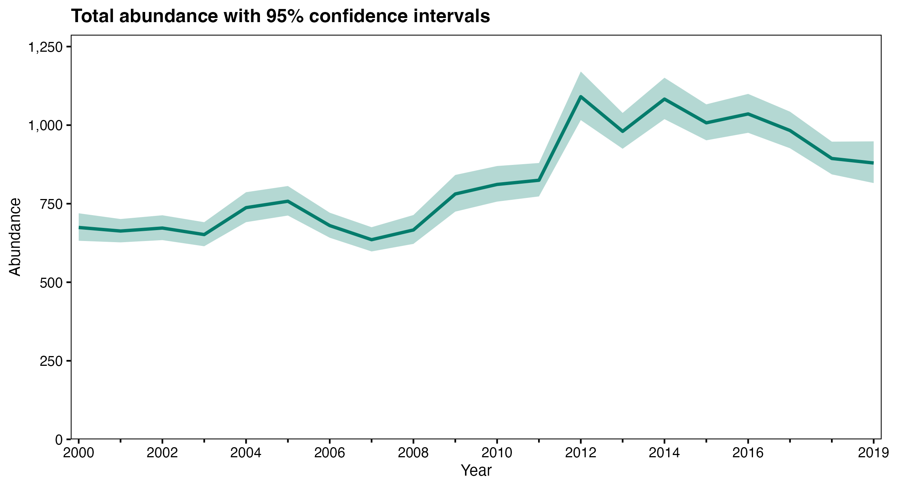](https://github.com/FanZhang-LAB-SHOU/ALSCL/blob/main/docs/figures/ytf/plot_abundance_N.png?raw=true)

Total abundance sums the estimated numbers across all groups in each time step. Shading shows the approximate 95% interval, which is lognormal by default, `exp(log(estimate) +/- 1.96 * SE / estimate)`, where SE is the standard error of the estimate. This interval cannot fall below zero; `interval = "wald"` draws the symmetric interval `estimate +/- 1.96 * SE`. The rise in abundance in 2012 coincides with a peak in estimated recruitment.

[Arguments and defaults](https://github.com/FanZhang-LAB-SHOU/ALSCL/blob/main/docs/FUNCTION_REFERENCE.md#plot_abundance)

## Abundance NA

```r
# Draw this figure
plot_abundance(b, type = "NA", se = TRUE,
  line_size = 0.6)
```

[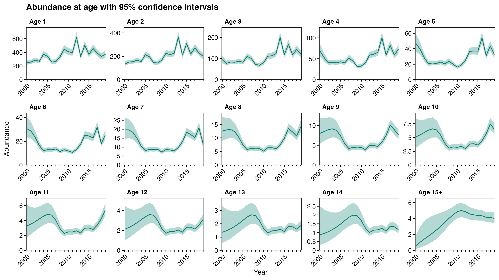](https://github.com/FanZhang-LAB-SHOU/ALSCL/blob/main/docs/figures/ytf/plot_abundance_NA.png?raw=true)

Each panel shows numbers at one age with an approximate 95% interval. Panels are labelled with the fitted ages, and the oldest age class, a plus group, is marked with a plus sign ("Age 15+"). To follow a cohort, compare its abundance in one age class with abundance one time step later in the next age class. Read the vertical scales separately.

[Arguments and defaults](https://github.com/FanZhang-LAB-SHOU/ALSCL/blob/main/docs/FUNCTION_REFERENCE.md#plot_abundance)

## Abundance NL

```r
# Draw this figure
plot_abundance(b, type = "NL", se = TRUE,
  line_size = 0.6)
```

[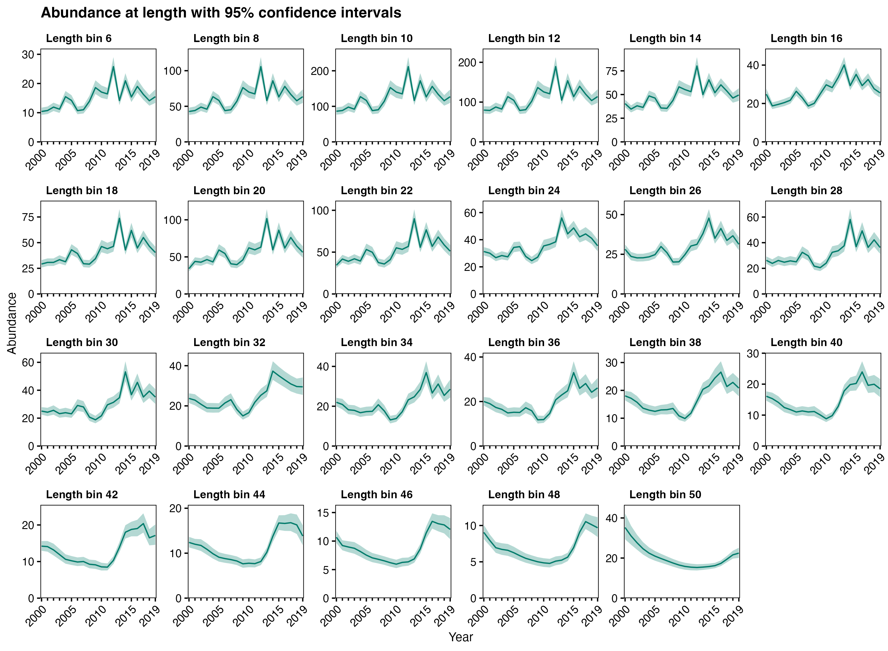](https://github.com/FanZhang-LAB-SHOU/ALSCL/blob/main/docs/figures/ytf/plot_abundance_NL.png?raw=true)

Each panel shows estimated numbers in one length bin with an approximate 95% interval. In this example the peak in smaller bins around 2012 precedes the peaks in larger bins. Several age classes can contribute to a length bin.

[Arguments and defaults](https://github.com/FanZhang-LAB-SHOU/ALSCL/blob/main/docs/FUNCTION_REFERENCE.md#plot_abundance)

## Biomass B

```r
# Draw this figure
plot_biomass(b, type = "B", se = TRUE,
  line_size = 0.6)
```

[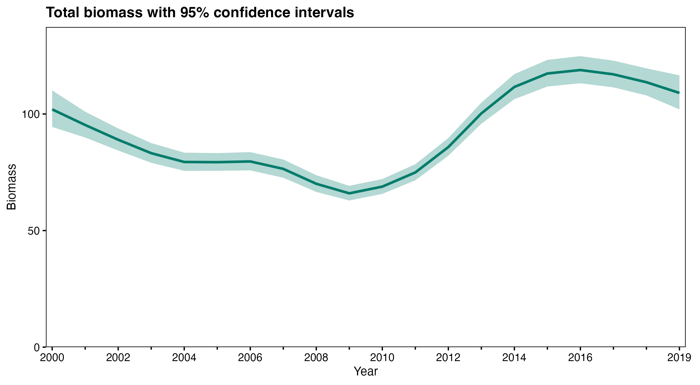](https://github.com/FanZhang-LAB-SHOU/ALSCL/blob/main/docs/figures/ytf/plot_biomass_B.png?raw=true)

Total biomass by time step with an approximate 95% interval. Compare it with total abundance to see how mean individual weight affects the estimated biomass. Recruits contribute biomass from their first modelled time step; their contribution can increase as they grow. Biomass need not be smoother than abundance.

[Arguments and defaults](https://github.com/FanZhang-LAB-SHOU/ALSCL/blob/main/docs/FUNCTION_REFERENCE.md#plot_biomass)

## Biomass BA

```r
# Draw this figure
plot_biomass(b, type = "BA", se = TRUE,
  line_size = 0.6)
```

[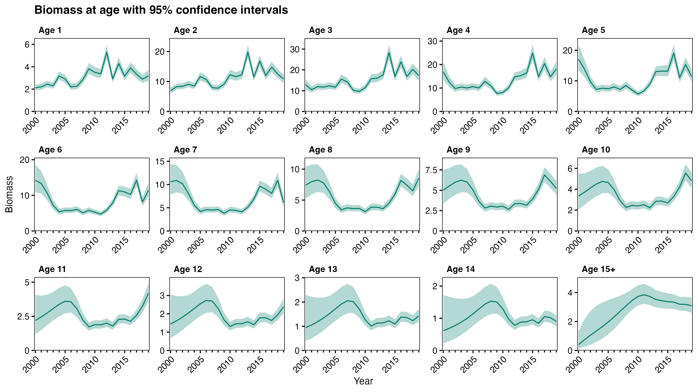](https://github.com/FanZhang-LAB-SHOU/ALSCL/blob/main/docs/figures/ytf/plot_biomass_BA.png?raw=true)

Biomass at age, one panel per age class with free vertical scales and the 95% band. Use it to see which ages hold the biomass; read the axis of each panel, because the free scales make a small old class look as variable as a large young one.

[Arguments and defaults](https://github.com/FanZhang-LAB-SHOU/ALSCL/blob/main/docs/FUNCTION_REFERENCE.md#plot_biomass)

## Biomass BL

```r
# Draw this figure
plot_biomass(b, type = "BL", se = TRUE,
  line_size = 0.6)
```

[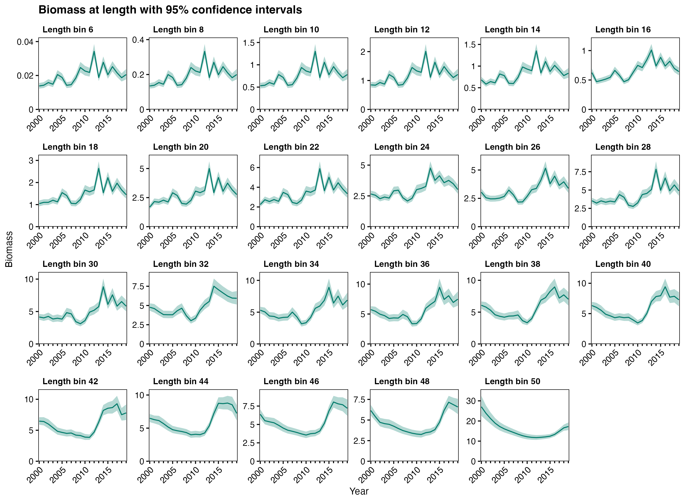](https://github.com/FanZhang-LAB-SHOU/ALSCL/blob/main/docs/figures/ytf/plot_biomass_BL.png?raw=true)

Each panel shows biomass in one length bin and its approximate 95% interval. Compare axis values across panels to identify the bins contributing most biomass. Several of the larger bins show an increase after 2013.

[Arguments and defaults](https://github.com/FanZhang-LAB-SHOU/ALSCL/blob/main/docs/FUNCTION_REFERENCE.md#plot_biomass)

## Spawning stock biomass SSB

```r
# Draw this figure
plot_SSB(b, type = "SSB", se = TRUE,
  line_size = 0.6)
```

[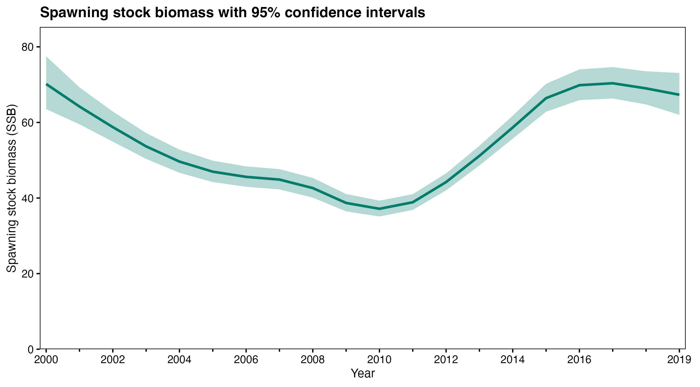](https://github.com/FanZhang-LAB-SHOU/ALSCL/blob/main/docs/figures/ytf/plot_SSB_SSB.png?raw=true)

Spawning stock biomass (SSB) sums numbers multiplied by mean weight and the proportion mature across groups. The shading gives an approximate 95% interval. In this fit, SSB reached a low in 2010 and subsequently increased. Assessing stock status also requires a stated reference point. The level of SSB depends on the survey catchability supplied to the fit. To compare the trend with an assessment that uses maturity at age, compute SSB from a maturity ogive by age with `ssb_at_age()`.

`plot_SSB(b, maturity_at_age = ogive)` adds the SSB calculated from a maturity ogive by age (`ssb_at_age()`) as a dashed line next to the SSB of the model, which uses maturity at length; `ogive` holds one proportion mature per age class ([Assessment workflows](assessment-workflows.html#outputs)). Without this argument the figure is unchanged.

[Arguments and defaults](https://github.com/FanZhang-LAB-SHOU/ALSCL/blob/main/docs/FUNCTION_REFERENCE.md#plot_SSB)

## Spawning stock biomass SBA

```r
# Draw this figure
plot_SSB(b, type = "SBA", se = TRUE,
  line_size = 0.6)
```

[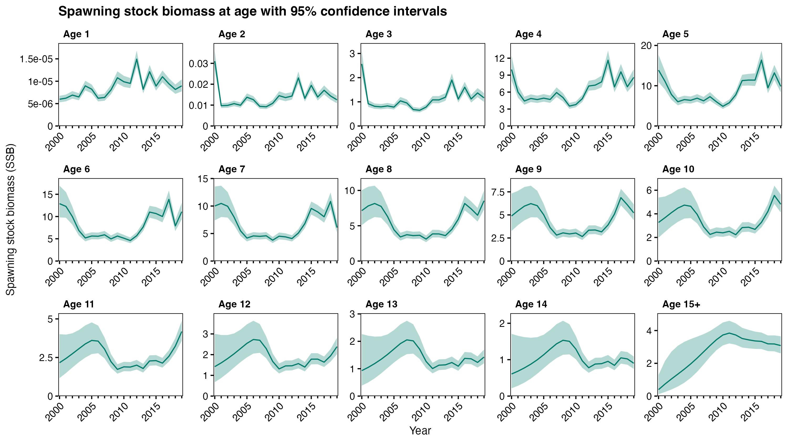](https://github.com/FanZhang-LAB-SHOU/ALSCL/blob/main/docs/figures/ytf/plot_SSB_SBA.png?raw=true)

SSB at age, one panel per age class with the 95% band. Use it to see which ages spawn; the youngest classes sit near zero because the maturity table gives them almost no mature fish, so compare panels by their axis values rather than by the shape of the curves.

[Arguments and defaults](https://github.com/FanZhang-LAB-SHOU/ALSCL/blob/main/docs/FUNCTION_REFERENCE.md#plot_SSB)

## Spawning stock biomass SBL

```r
# Draw this figure
plot_SSB(b, type = "SBL", se = TRUE,
  line_size = 0.6)
```

[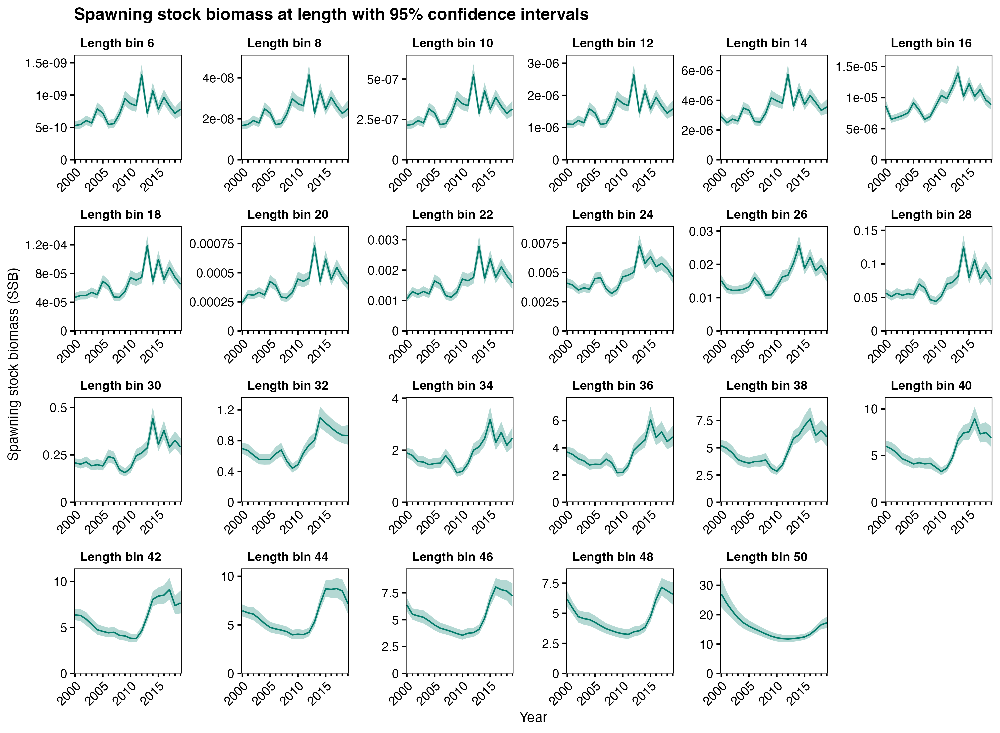](https://github.com/FanZhang-LAB-SHOU/ALSCL/blob/main/docs/figures/ytf/plot_SSB_SBL.png?raw=true)

SSB at length, one panel per length bin with the 95% band. Use it to see which lengths spawn; the small bins sit near zero for the same reason, and the mature bins above 30 follow the total SSB.

[Arguments and defaults](https://github.com/FanZhang-LAB-SHOU/ALSCL/blob/main/docs/FUNCTION_REFERENCE.md#plot_SSB)

## Catch in numbers CN

```r
# Draw this figure
plot_catch(b, type = "CN", se = TRUE,
  line_size = 0.6)
```

[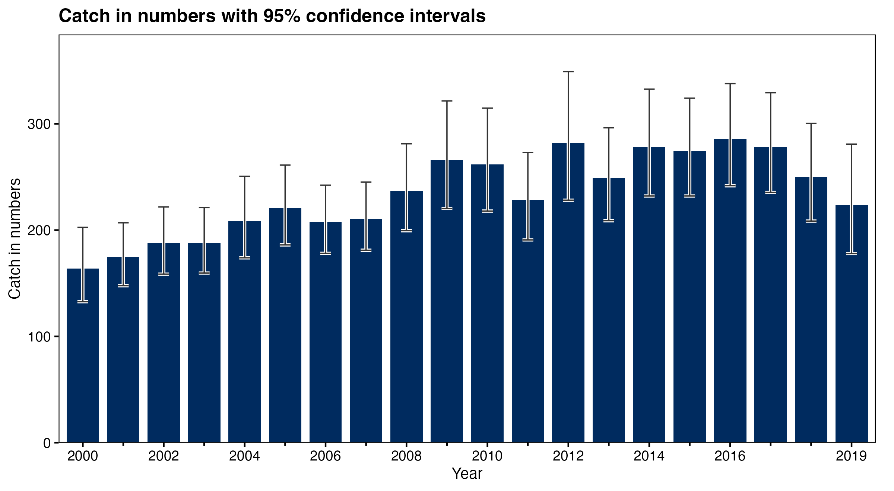](https://github.com/FanZhang-LAB-SHOU/ALSCL/blob/main/docs/figures/ytf/plot_catch_CN.png?raw=true)

Model-derived catch in numbers (`CN`) by time step, drawn as bars with approximate 95% error bars; `geom = "line"` draws a line with a shaded band. It is computed from abundance and fishing mortality; the YTF teaching data include no observed fishery catch. Compare it with independent catch data only after matching the quantity, units, abundance scale, period and area. Landings may omit discarded fish, so their coverage of fishing removals also needs checking ([FAO definitions](https://www.fao.org/4/x8923e/X8923E03.htm)). A wide interval indicates substantial uncertainty under the fitted assumptions; its width alone does not identify the cause. A fit to a survey index alone does not determine the level of catch, which depends on the supplied natural mortality rate and survey catchability. `relative_catch()` returns catch divided by its mean over the time steps, for a comparison of trends with reported catch.

[Arguments and defaults](https://github.com/FanZhang-LAB-SHOU/ALSCL/blob/main/docs/FUNCTION_REFERENCE.md#plot_catch)

## Catch in numbers CNA

```r
# Draw this figure
plot_catch(b, type = "CNA", se = TRUE,
  line_size = 0.6)
```

[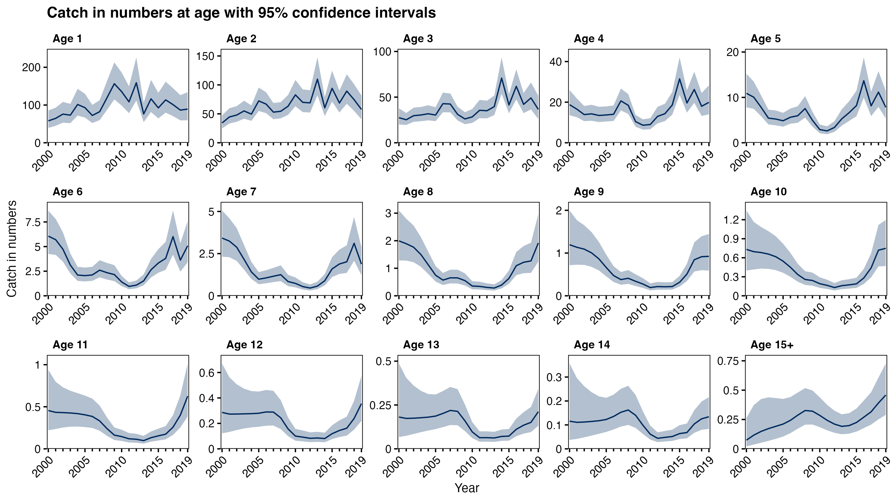](https://github.com/FanZhang-LAB-SHOU/ALSCL/blob/main/docs/figures/ytf/plot_catch_CNA.png?raw=true)

Each panel shows estimated catch in numbers for one age class, with an approximate 95% interval. In this example, catches are largest in the younger age classes. Read the values against the vertical scale of each panel.

[Arguments and defaults](https://github.com/FanZhang-LAB-SHOU/ALSCL/blob/main/docs/FUNCTION_REFERENCE.md#plot_catch)

## Catch in numbers CNL

```r
# Draw this figure
plot_catch(b, type = "CNL", se = TRUE,
  line_size = 0.6)
```

[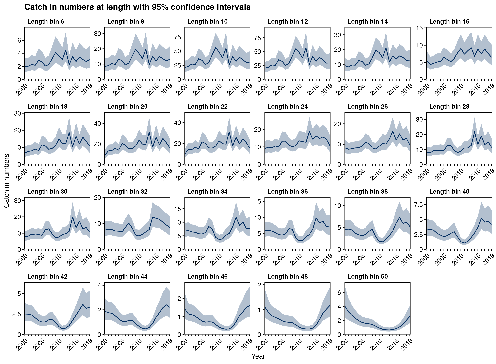](https://github.com/FanZhang-LAB-SHOU/ALSCL/blob/main/docs/figures/ytf/plot_catch_CNL.png?raw=true)

Each panel shows the expected catch in numbers for one length bin, with an approximate 95% interval. For a group with starting abundance N and instantaneous mortality rates F and M per time step, the Baranov catch equation gives `C = N × (F/Z) × (1 − exp(−Z))`, where `Z = F + M`. ALSCL sums these catches across ages within each length bin. [Baranov catch equation, eq. 15](https://repository.library.noaa.gov/view/noaa/4847/noaa_4847_DS1.pdf#page=11).

[Arguments and defaults](https://github.com/FanZhang-LAB-SHOU/ALSCL/blob/main/docs/FUNCTION_REFERENCE.md#plot_catch)

## Catch relative to its mean

```r
# Draw this figure
plot_relative_catch(b,
  observed = data.frame(year = b$year, catch = x$truth$CB),
  type = "weight", observed_name = "Simulated catch")
```

[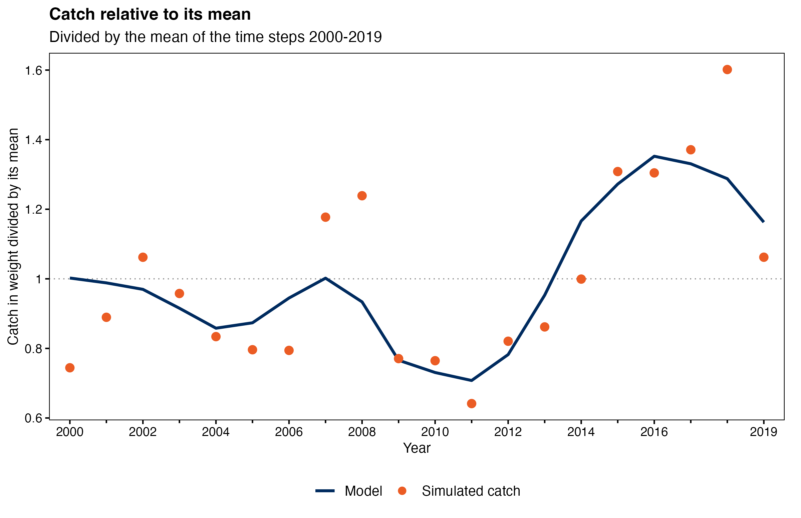](https://github.com/FanZhang-LAB-SHOU/ALSCL/blob/main/docs/figures/ytf/relative_catch.png?raw=true)

The line is the model catch in weight divided by its mean over the time steps, from `relative_catch()`. The points are the catch in weight of the simulation that generated `YTF_example`, divided by its mean over the same time steps. With your own data, pass the reported catch as `observed`, a data frame with the columns `year` and `catch` in any unit. A fit to a survey index alone has no information on the absolute level of catch, which depends on the assumed natural mortality rate and survey catchability, so the figure compares trends only. The y-axis label states that each series is divided by its mean, the subtitle names the time steps of the mean, and the dotted line marks 1. When the reported series covers part of the time steps, the mean is taken over the time steps that both series have, and `years` restricts it further. The catch in the last time step is a prediction, because no observation informs F in that time step.

[Arguments and defaults](https://github.com/FanZhang-LAB-SHOU/ALSCL/blob/main/docs/FUNCTION_REFERENCE.md#plot_relative_catch)

## Recruitment

```r
# Draw this figure
plot_recruitment(b, se = TRUE)
```

[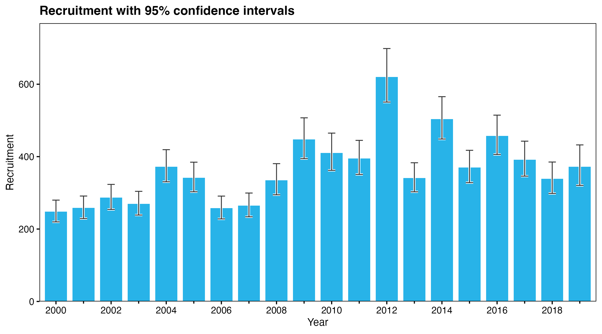](https://github.com/FanZhang-LAB-SHOU/ALSCL/blob/main/docs/figures/ytf/recruitment.png?raw=true)

Recruitment is the estimated number entering the youngest age class per time step. The bars show the estimates and the error bars the approximate 95% intervals; `geom = "line"` draws a line with a shaded band. Estimated recruitment peaks in 2012 in this example. The age at entry is set by `rec.age`.

[Arguments and defaults](https://github.com/FanZhang-LAB-SHOU/ALSCL/blob/main/docs/FUNCTION_REFERENCE.md#plot_recruitment)

## Spawning stock biomass and recruitment

```r
# Draw this figure
plot_SSB_Rec(b, age_at_recruitment = 1)
```

[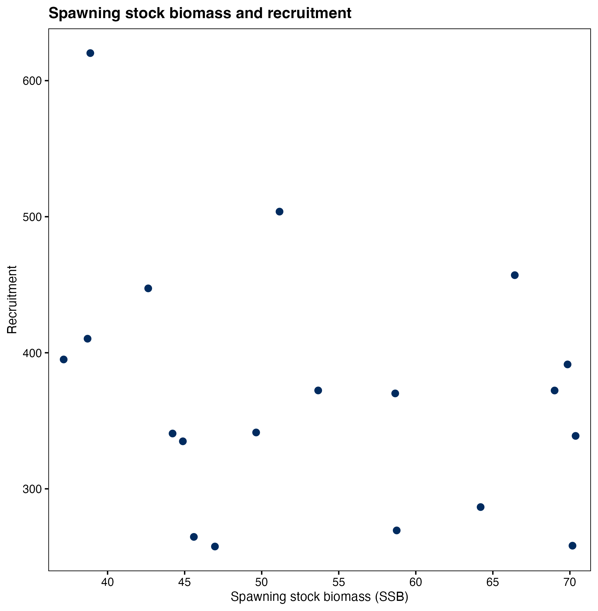](https://github.com/FanZhang-LAB-SHOU/ALSCL/blob/main/docs/figures/ytf/SSB_Rec.png?raw=true)

Each point pairs spawning stock biomass with recruitment `age_at_recruitment` years later. The default, `age_at_recruitment = NULL`, uses the youngest fitted age, which is 1 year for this annual fit and one quarter for a quarterly fit with `rec.age = 0.25`. The scatter shows the association in the fitted series. The assessment models log recruitment deviations as an AR(1) process, and the plotting function draws the pairs without fitting a stock-recruitment curve.

[Arguments and defaults](https://github.com/FanZhang-LAB-SHOU/ALSCL/blob/main/docs/FUNCTION_REFERENCE.md#plot_SSB_Rec)

## Recruitment lag on a quarterly grid

`age_at_recruitment` is in years, and the default NULL uses the youngest fitted age (1 year for a result saved without age metadata). `plot_SSB_Rec()` divides a supplied value by the fit's `growth_step` and requires an integer lag on a regular time grid. With quarterly data, 0.25 means one step and 1 means four steps. Zero lag is allowed; negative, nonfinite and fractional-step lags are rejected. Results without `growth_step` use their regular time spacing, or an annual step when `year` is missing as well.

```r
q <- list(year = 2000 + (0:7)/4, growth_step = 0.25,
          report = list(SSB = 1:8, Rec = 101:108))
paired <- plot_SSB_Rec(q, age_at_recruitment = 0.25, return_data = TRUE)$data
stopifnot(identical(paired$SSB, 1:7), identical(paired$Rec, 102:108))
```

## Displaying a single saved estimate

A panel or model group containing only one estimate is shown as a point. With `se = TRUE`, an error bar shows the 95% interval (lognormal by default; see the `interval` argument) because a one-point ribbon has no visible width. This applies to population and fishing-mortality plots and to each model separately in `plot_compare_ts()`. Point size follows `point_size`; a single-model point takes the color of the line of its plot and its error bar the color of the interval. Grid lines follow the `grid` setting of `acl_theme_set()`.

This display-only list contains the final SSB estimate from `b` and its standard error. It is not a model fitted to one observation and is not an input for simulation or forecasting. The point and approximate 95% interval remain visible without changing the estimate.

```r
# Display one saved estimate without refitting.
ssb_rows <- which(rownames(b$est_std) == "SSB")
one_period <- list(
  model_type = b$model_type,
  year = tail(b$year, 1L),
  report = list(SSB = tail(b$report$SSB, 1L)),
  est_std = b$est_std[tail(ssb_rows, 1L), , drop = FALSE]
)
plot_SSB(one_period, se = TRUE, x_breaks = one_period$year) +
  ggplot2::coord_cartesian(xlim = one_period$year + c(-0.5, 0.5))
```

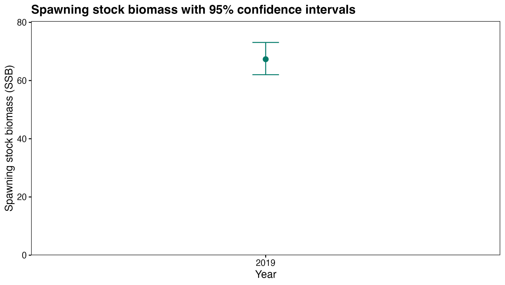
