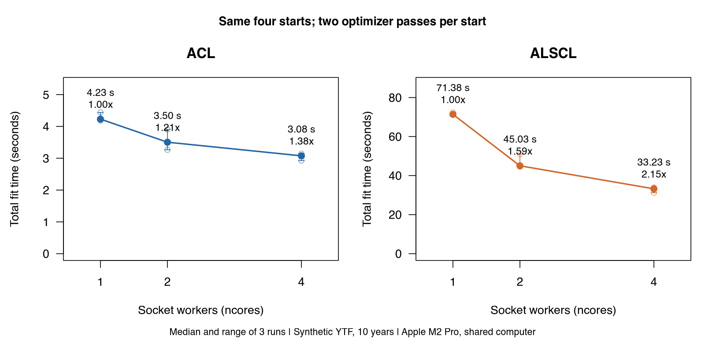

# Reproduce results and fix problems

After [Understand your first fit](first-model.html) you have the input bundle `x` and the fitted ACL model `a`. On this page you record what the fit depends on, rebuild it in a later session, run fits in parallel, keep the compiled models between sessions, and look up the common errors.

<h2 id="record">1. Record what a fit depends on</h2>

```r
save_assessment(a, "ytf_acl.rds", overwrite = TRUE)
packageVersion("ALSCL")
a$recipe$versions
a$recipe$implementation$source$revision
writeLines(capture.output(sessionInfo()), "sessionInfo.txt")
```

`save_assessment()` writes the fit without the live TMB object `a$obj` and with a recipe that records everything the fit depends on:

| Item | Where in the saved fit |
|---|---|
| Tables, settings, starting values, bounds, `map`, `nstarts` and the other arguments of the call | `recipe$args` |
| ALSCL, TMB and R versions | `recipe$versions` |
| MD5 hashes of the model source, Git revision when known, platform, BLAS, LAPACK, Matrix and RcppEigen | `recipe$implementation` |
| Speed settings, `framework` and `sd_cores` | `recipe$settings` |

`sessionInfo()` adds the operating system, the BLAS and LAPACK libraries and the loaded packages; keep its output next to the saved file. A fitted-model simulation also depends on its seed, which `simulate_fit()` records in `metadata$seed`.

`save_assessment()` stops when the file exists (set `overwrite = TRUE`), when its folder is missing, or when a fit has no recipe; then pass the bundle as `x` and the recipe is rebuilt from it.

<h2 id="reproduce">2. Reproduce a fit later</h2>

```r
saved <- read_assessment("ytf_acl.rds")
plot_compare_selectivity(a, saved, model1_name = "Original", model2_name = "Saved")
refit <- refit_model(saved)
max(abs(refit$opt$par - saved$opt$par))
all.equal(refit$report$SSB, saved$report$SSB)
```

`read_assessment()` returns the saved fit, which every plot and extraction function accepts; it has no live TMB object, because `a$obj` holds pointers into the compiled model of the session that made the fit. `plot_compare_selectivity()` recovers fixed survey catchability from the saved inputs, so the original and saved curves coincide without refitting. `refit_model()` fits the recipe again and returns a fit with a live object; named arguments override the recipe, and a list such as `map` replaces the stored list.

Compare refitted estimates explicitly. `all.equal()` checks agreement within a numerical tolerance; TRUE does not establish bitwise identity. `identical()` provides an exact object comparison, including attributes. Matching package versions helps reproducibility, but source revisions, compiler and numerical libraries, fitting settings and numerical sensitivity can also matter. If differences affect a conclusion, compare those records, objectives, gradients and alternative starts before interpreting the change.

`refit_model()` warns when the ALSCL, TMB, Matrix or RcppEigen version or the model source differs from the recipe; use `saved$recipe$versions` together with the implementation and session records to reconstruct the original environment. `A complete fit recipe is required` means the fit has no recipe; save it again with `x` as in step 1.

<h2 id="parallel">3. Run fits in parallel</h2>

```r
a4 <- run_acl(x, nstarts = 4, ncores = 2, silent = TRUE)
a4$start_diagnostics
a4$workers
```

`ncores` sets how many socket workers, new R processes, a function starts. Each worker runs whole starts or whole fits, so the results equal a sequential run.

| Function | What runs on the workers | Starts in each fit |
|---|---|---|
| `run_acl()`, `run_alscl()` | The starts, on at most `min(ncores, nstarts)` workers | `nstarts`, default `ncores` |
| `retro_model()`, `retro_acl()`, `retro_alscl()` | The peels of the retrospective analysis | The explicit `nstarts` of the bundle or call, otherwise one, in sequence |
| `fit_scenarios()`, `hindcast_model()` | The tasks: one scenario or training fold each | The same rule |
| `sim_model()`, `sim_acl()`, `sim_alscl()` | The replicates | `nstarts`, default one |

Because `nstarts` defaults to `ncores`, set both when you compare timings. Later starts add fixed perturbations and the lowest objective is selected, so the result is the same for any `ncores`; `a4$start_diagnostics` records each start. The other functions ignore the `ncores` of a bundle and give each fit one worker and sequential standard errors.

The cores used for the standard errors inside one fit are a separate setting, `alscl_speed(sd_cores = ...)`, with results identical to the sequential calculation; [Speed settings](speed.html) explains it.

In a benchmark on 7 October 2026 (Apple M2 Pro, R 4.6.0, TMB 1.9.21), both models were fitted to the first 10 years of `YTF_example` with the same four starts, three times per number of workers; compilation was excluded and worker start-up included.

| Model | Workers | Median (s) | Range (s) | Speed-up |
|---|---:|---:|---:|---:|
| ACL | 1 | 4.23 | 4.18-4.44 | 1.00x |
| ACL | 2 | 3.50 | 3.27-3.90 | 1.21x |
| ACL | 4 | 3.08 | 2.93-3.14 | 1.38x |
| ALSCL | 1 | 71.4 | 71.3-72.4 | 1.00x |
| ALSCL | 2 | 45.0 | 44.6-51.0 | 1.59x |
| ALSCL | 4 | 33.2 | 31.2-34.0 | 2.15x |



The points are the three measurements, the lines the medians and the bars the ranges. The computer was shared with other analyses, so the results are conditional on that workload and machine. See the [benchmark report](https://github.com/FanZhang-LAB-SHOU/ALSCL/blob/main/docs/PARALLEL_BENCHMARK.md), the [raw timings](https://github.com/FanZhang-LAB-SHOU/ALSCL/blob/main/docs/results/parallel/runs.csv) and the [benchmark script](https://github.com/FanZhang-LAB-SHOU/ALSCL/blob/main/scripts/benchmark_parallel.R).

<h2 id="compile">4. Compilation and the cache</h2>

```r
options(ALSCL.tmb.cache = tools::R_user_dir("ALSCL", "cache"))
a <- run_acl(x, silent = TRUE)
list.files(getOption("ALSCL.tmb.cache"))
```

The first fit of each model compiles its C++ template into a cache folder named by a key computed from the MD5 hashes of the model source and header, the R, TMB and RcppEigen versions, the OpenMP flag and the `framework`; a fit with the same key loads the library without compiling. The default cache lies under `tempdir()`, which R removes at the end of the session. Set `ALSCL.tmb.cache` before the first fit, for example in `.Rprofile`, to keep the compiled models between sessions; socket workers load the library compiled by the session.

Compiling needs a C++ compiler:

| System | Compiler |
|---|---|
| Windows | Rtools for your R version |
| macOS | The Xcode Command Line Tools (`xcode-select --install`) |
| Linux | A C++ compiler and `make`, for example `build-essential` |

[Install ALSCL and run a first fit](getting-started.html#compiler) explains the installation; compilation errors name `TMB::compile`, `make` or the compiler.

<h2 id="troubleshoot">5. Troubleshooting</h2>

Error messages are quoted as the package prints them.

| Symptom | Likely cause | What to do |
|---|---|---|
| `YTF$data.CatL` is `NULL` | `YTF` holds parameters, not tables | Use `YTF_example` |
| Year labels read as `X2000`, or `must match data.CatL length labels and time columns` | `read.csv()` adds `X`; the tables differ | Read all tables with `check.names = FALSE` |
| `Length intervals must have positive widths and be contiguous` | Bin labels overlap or leave gaps | Correct the labels or supply `len_mid` and `len_border` |
| `Time columns must have increasing numeric labels` or `Time column spacing must equal growth_step` | A missing time step or a wrong `growth_step` | Keep the step as an NA column and set `growth_step` |
| Zeros in the survey table | Zeros count as missing (`zero_action = "missing"`) | Decide whether a zero is real before fitting |
| Blank cells in the weight or maturity table | Both tables must be complete | Fill them and record the source |
| Convergence code not 0, large gradient or Hessian not positive definite | The optimizer stopped early or a parameter is not informed | See [Understand your first fit](first-model.html#checks) |
| Quarterly F looks small | Every output gives F per time step | Report F per time step |
| `plot_fishing_mortality(a, type = "length")` warns on an ACL fit | ACL has no F by length; `"length"` means `"age"` | Use `type = "age"` or fit ALSCL |
| `plot_VB()` draws a line without an interval | The growth parameters are fixed | Expected; release them with `map` |
| The first fit names `TMB::compile`, `make`, `g++` or `clang` | No compiler, or Rtools for another R version | Install the compiler (step 4), restart R |
| `Install RcppEigen to compile model templates` or `Model sources are missing` | RcppEigen absent, or a damaged installation | Install RcppEigen or reinstall ALSCL |
| `Socket worker loaded a different ALSCL installation` | A worker found another copy in a different library | Keep one installation, or use `ncores = 1` |
| Socket workers fail on Windows or in RStudio, or `Parallel standard errors failed` | The new R processes could not start | Use `ncores = 1` or `alscl_speed(sd_cores = 1)` |
| `rho_text$Rho` is `NA` after a retrospective analysis | A fit failed the numerical checks | Read `fit_diagnostics` and `rho_by_peel`, fix that fit |
| `The current implementation differs from the saved assessment` | Package, TMB or model source changed since the save | Expect last-digit differences, or install the recorded versions |
| `A complete fit recipe is required` | The fit has no recipe | Refit, or save with `x = x` |

<h2 id="next">What next</h2>

| What you want to do | Read |
|---|---|
| Test the sensitivity of the estimates to the fixed values | [Judge whether a fit can be used](diagnostics.html#sensitivity) |
| Choose the speed settings and check what your session does | [Speed settings](speed.html) |
| Run a retrospective analysis and read Mohn's rho | [Retrospectives](retrospectives.html) |
| Simulate from the fit or test predictions of withheld time steps | [Model validation](case-model-validation.html) |
| Compare scenarios, profile a parameter, project forward | [Assessment workflows](assessment-workflows.html) |
