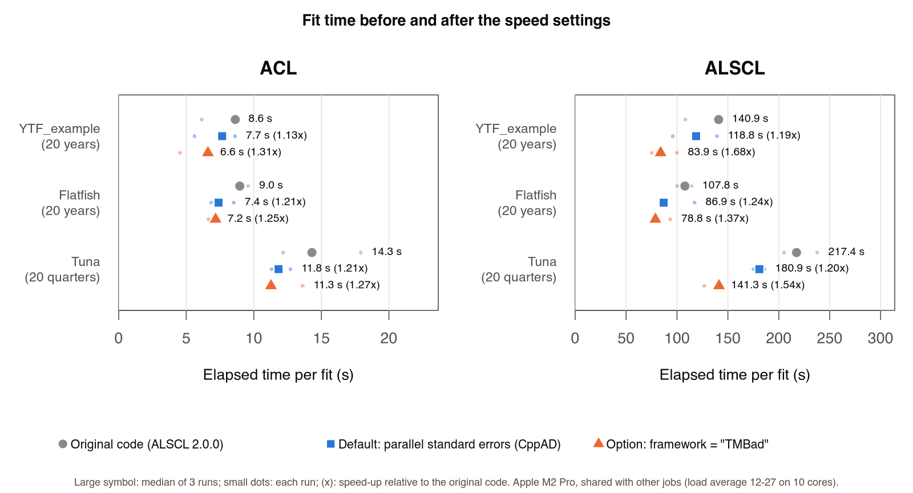
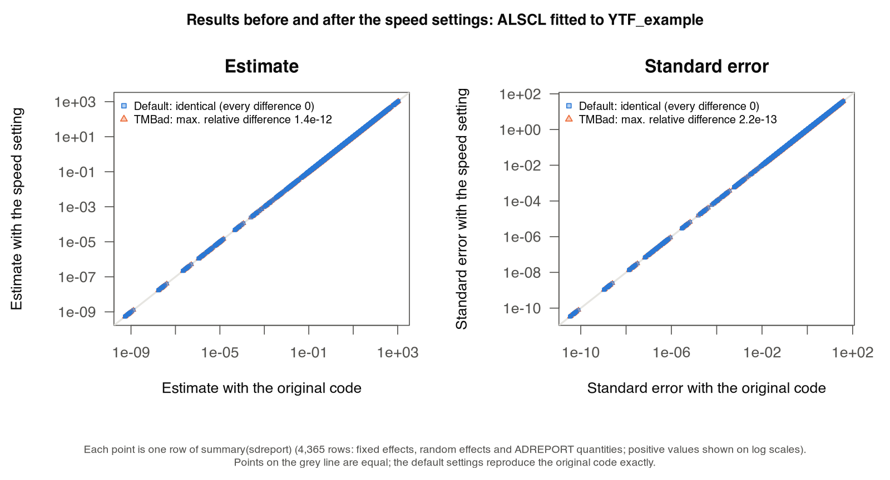

# Speed settings

On this page you check how your session computes standard errors, choose the number of cores, decide whether to compile the models with the TMBad library, and read the measured gains. You need the package installed and the input bundle `x` from [Install ALSCL and run a first fit](getting-started.html); the ALSCL fit in step 1 takes one to two minutes. The [technical record](https://github.com/FanZhang-LAB-SHOU/ALSCL/blob/main/docs/SPEED.md) explains how each change was tested and reviewed.

The defaults suit normal use: fits use several cores for the standard errors where the session supports it, and the parallel standard errors are identical to the sequential calculation at the same fitted parameters. Two settings, both set with `alscl_speed()`, control this:

| Setting | Default | Results | Speed | When to change it |
|---|---|---|---|---|
| `sd_cores` | `"auto"`: up to four cores | Identical to the sequential calculation | Fits 1.13-1.24 times faster in the benchmark (macOS, terminal) | Set `1` inside your own parallel loops; set a number to use a fixed number of cores |
| `framework` | `"CppAD"`, TMB's default library | Baseline | Baseline | `"TMBad"` makes fits 1.25-1.68 times faster, but results differ in the last digits (step 3) |

<h2 id="check">1. Check what your session does</h2>

```r
library(ALSCL)
alscl_speed_info()   # what the current settings mean on this computer
x <- YTF_example
fit <- run_alscl(x, silent = FALSE)
fit$sd_info          # how the standard errors were computed and how long they took
```

`alscl_speed_info()` prints the setting, the cores and method that will be used, the reason, the AD library and the TMB version. With `silent = FALSE` the fit prints one line about the standard errors, and `fit$sd_info` stores the same information: `method` (`"forked processes"`, `"socket workers (delta method)"` or `"sequential"`), `cores`, `seconds` and a `note` that explains a sequential calculation. On macOS in a terminal you should see:

```r
#> Standard errors: forked processes on 4 cores, 9.0 s.
alscl_speed_info()
#> ALSCL speed settings
#>   sd_cores setting:                  auto
#>   cores for standard errors:         4
#>   standard errors computed by:       forked processes on 4 cores: Hessian and delta method
#>   reason:                            forked processes are safe here (macOS or Linux outside a GUI front-end)
#>   framework:                         CppAD
#>   cross-version numerical identity:  not guaranteed across package versions (the optimizer finishing step can change estimates at numerical precision)
#>   TMB version:                       1.9.21 (checked)
```

The main optimization, `nlminb()` searching over the fixed effects with an inner Newton optimization of the random effects (the Laplace approximation) at every evaluation, runs on one core in the current implementation. The speed settings below parallelize the subsequent standard-error calculation and, where forked processes are selected, the Hessian used in optional optimizer refinement. Independent starts can also run in parallel using `ncores`. The standard errors come afterwards from `TMB::sdreport()`: the Hessian of the fixed effects, from two gradient evaluations per fixed effect, and the delta-method standard error of every ADREPORT quantity (recruitment, abundance, biomass, spawning biomass, catch and fishing mortality by year, age and length; 3,866 quantities for the 20-year ALSCL example). Hessian columns and delta-method calculations for separate ADREPORT quantities can be computed as separate tasks. At the same fitted parameters, the tested parallel calculations match the sequential results. In the benchmark, the ALSCL fit to the 20 years of `YTF_example` spent about 88 s in the optimization, 11.4 s on the Hessian and 10.6 s on the delta method before the speed changes.

Where forked processes are safe (R or `Rscript` in a terminal on macOS or Linux, and computing clusters), ALSCL starts copies of the R session with `parallel::mclapply()`. Each copy already holds the fitted model, so the Hessian columns and the delta method are shared out with almost no start-up cost: the standard errors of the 20-year ALSCL example took 9.0 s on four cores instead of 23.4 s. Forking is unavailable on Windows, and R's documentation (`?parallel::mclapply`) discourages it in GUI front-ends (R.app, RGui, RStudio, Positron) and with multithreaded libraries such as Apple's Accelerate BLAS. In these sessions ALSCL uses socket workers, new R processes that receive the data and rebuild the model. A new process must rebuild TMB's derivative tapes before its first gradient, which took 14 s with CppAD (42 s with TMBad) for the 20-year ALSCL example, more than the whole Hessian. So with socket workers the Hessian is computed in the main session; the delta method is shared out among workers that need only the objective's gradient tape (built in about 0.1 s) and receive the random-effect Hessian from the main session; and ALSCL first computes a few ADREPORT quantities itself to measure the time per quantity, and starts workers only if the remaining quantities would take more than about 3 seconds. Small models, such as most ACL fits, therefore compute the standard errors in the main session. For the 20-year ALSCL example the delta method took 6.5 s on four socket workers instead of 13.9 s (0.3 s to start the workers and 0.9 s to rebuild the model in them).

| Situation | What happens |
|---|---|
| `sd_cores = 1`, or one core available | Sequential `TMB::sdreport()` |
| Fits inside `retro_model()` or `sim_acl()` running on parallel workers | One core per fit, which keeps the number of processes bounded |
| The installed TMB version is outside the checked ones (1.9.21 and 1.9.25) | Sequential `TMB::sdreport()`; `fit$sd_info$note` says so |
| Socket workers would save no time (little work) | Computed in the main session |
| The parallel calculation fails (for example, processes fail to start) | A warning, then the sequential `TMB::sdreport()`; results are unaffected |

The parallel implementation reproduces the sequential arithmetic for each task. Hessian columns follow the parameter perturbations used by `stats::optimHess()`, and gradients restart the inner random-effect optimization at the same point. Tests compare results with `TMB::sdreport()` using `identical()` for ACL and ALSCL under CppAD and TMBad. Fork tests run on macOS and Linux; socket tests also run on Windows, where fork tests are skipped. This checks standard-error methods at the same fitted parameters and AD framework. Record `alscl_speed_info()` with `sessionInfo()` when reporting results.

When refinement needs a Hessian, it shares the `sd_cores` limit on checked TMB versions where forked processes are selected. The number of workers is capped by the number of free fixed effects. One-effect fits and socket sessions stay sequential; a fork failure warns and retries sequentially. `fit$refinement$hessian_calculations` records the method, cores and fallback note for each computed Hessian. An empty table means no Hessian was returned; inspect `fit$refinement$status` to distinguish skipped refinement from an evaluation failure.

<h2 id="cores">2. Choose the number of cores</h2>

```r
alscl_speed(sd_cores = 2)        # a fixed number of cores for the standard errors
alscl_speed_info()
alscl_speed(sd_cores = "auto")   # back to the default
```

- `"auto"` (default) uses up to four physical cores and keeps one free for the rest of the computer. More than four cores shortened fits little in tests, because the optimization itself runs on one core.
- A number uses that many cores. On a computing cluster, use the number of cores your job was given; `parallel::detectCores()` may report all cores of the node.
- Memory: forked processes share the memory of the R session until they change it. Each socket worker holds its own copy of the model and its data; with large models, fewer workers use less memory.
- Starts: `ncores` in `run_acl()` and `run_alscl()` sets how many starts run at once; the standard errors are computed afterwards, once, with `sd_cores`.
- Your own parallel loops: if you run many fits in parallel yourself (for example with `parallel::mclapply()`, `foreach` or `future`), set `alscl_speed(sd_cores = 1)` inside the workers, so that each fit uses one core. `retro_model()` and `sim_acl()` do this for their workers automatically.
- RStudio on macOS or Linux: `options(ALSCL.sd_backend = "fork")` uses forked processes for the full speed-up. R's documentation advises against it, so use it only if your session runs fits without problems.

`alscl_speed_info()` confirms the choice. Memory errors with many cores mean fewer cores, for example `alscl_speed(sd_cores = 2)`.

<h2 id="tmbad">3. Choose the AD library</h2>

```r
alscl_speed(framework = "TMBad")   # the next fit compiles the model with TMBad once
args <- x  # YTF_example
alscl_speed(framework = "CppAD"); a <- run_alscl(args)
alscl_speed(framework = "TMBad"); b <- run_alscl(args)
max(abs(b$opt$par - a$opt$par) / abs(a$opt$par))   # largest relative difference in estimates
max(abs(b$est_std[, 2] - a$est_std[, 2]) / a$est_std[, 2], na.rm = TRUE)  # standard errors
```

TMB can compile a model with one of two automatic-differentiation libraries. CppAD is TMB's default and the ALSCL default. TMBad evaluates the Laplace approximation and its gradient several times faster, so it shortens the optimization as well as the standard errors, but it computes the same derivatives in a different order, so results differ in the last digits. In the benchmark, with 5 estimated fixed effects, estimates differed by at most 2.3e-11 (relative). In an ACL fit with 10 estimated fixed effects they differed by up to 2.7e-8 (relative; the objective function by 1.7e-11).

Use TMBad for exploratory fits, many fits (simulation studies, sensitivity runs) and wherever differences of this size are acceptable. Use CppAD when a result must match one computed with CppAD, such as a published assessment, and state which library was used. The code above shows the differences on your own data; `args` is the list of arguments you pass to `run_alscl()`. The first fit after `alscl_speed(framework = "TMBad")` is slow because the model is compiled once for TMBad; later fits in the session reuse it.

<h2 id="measured">Measured speed-up</h2>

In a benchmark of 90 fits (ACL and ALSCL fitted to `YTF_example` and the flatfish and tuna cases, three runs each, Apple M2 Pro shared with other jobs, macOS terminal so forked processes):

| Model, data | Before the speed changes | Default | TMBad |
|---|---:|---:|---:|
| ACL, YTF_example | 8.6 s | 7.7 s (1.13x) | 6.6 s (1.31x) |
| ALSCL, YTF_example | 140.9 s | 118.8 s (1.19x) | 83.9 s (1.68x) |
| ALSCL, flatfish | 107.8 s | 86.9 s (1.24x) | 78.8 s (1.37x) |
| ALSCL, tuna (quarterly) | 217.4 s | 180.9 s (1.20x) | 141.3 s (1.54x) |



The CppAD comparison matched the pre-change estimates and standard errors exactly; the figure below compares all 4,365 rows of `summary(sdreport)` for the ALSCL `YTF_example` fit. The TMBad results have the small differences described in step 3. These timings predate the optimizer finishing step, enabled by `polish = TRUE` in current fits, so they do not measure the current default workflow. That step can change estimates at numerical precision.



In a simulated RStudio session (macOS with `RSTUDIO=1`, so socket workers; load average about 12 on 10 cores), the standard errors of the 20-year ALSCL fit took 25.4 s on four socket workers instead of 28.3 s sequentially, and the whole fit 114.9 s instead of 120.4 s, with identical results. With socket workers the gain comes from the delta method only; the Hessian, computed in the main session, takes about half of the standard-error time. The gain grows with the number of estimated fixed effects (more Hessian columns) and ADREPORT quantities (longer time series, more length classes): for an ACL fit with 10 fixed effects, the standard errors took 1.6 s on four forked processes instead of 3.7 s.

<h2 id="troubleshoot">Troubleshooting</h2>

| Message or symptom | Meaning and what to do |
|---|---|
| `Parallel standard errors failed (...); computing them sequentially.` | Processes could not be started or a worker failed. The standard errors were computed sequentially and are correct. If it happens often, set `alscl_speed(sd_cores = 1)`. |
| `Standard errors: sequential (TMB x.y.z was not checked)` | The parallel code reproduces `TMB::sdreport()` of the checked TMB versions only. Results are correct; to use another TMB version in parallel, run the package tests with it (`tests/testthat/test-speed.R`) and add it to the list in `R/speed.R`. |
| `Standard errors: sequential (too little work to start socket workers)` | In a GUI front-end or on Windows, the model was small enough that starting workers would save no time. |
| No speed-up in RStudio | See `alscl_speed_info()`. With socket workers only the delta method is shared out; on macOS or Linux, `options(ALSCL.sd_backend = "fork")` gives the full speed-up at your own risk. |

<h2 id="options">Advanced options</h2>

These options are for testing and special cases; the defaults suit normal use. Reset an option with, for example, `options(ALSCL.sd_backend = NULL)`.

| Option | Effect |
|---|---|
| `options(ALSCL.sd_backend = "fork")` | Use forked processes even where R advises against it (Windows always uses socket workers) |
| `options(ALSCL.sd_backend = "socket")` | Use socket workers even where forking is safe |
| `options(ALSCL.sd_socket_min_seconds = 3)` | Minimum estimated time of the delta method, in seconds, before socket workers are started; `0` always starts them |
| `options(ALSCL.tmb.cache = path)` | Folder for compiled models |

<h2 id="next">What next</h2>

| What you want to do | Read |
|---|---|
| Run several starts or several fits on worker processes | [Reproduce results and fix problems](reproducibility.html#parallel) |
| Keep the compiled models between sessions | [Reproduce results and fix problems](reproducibility.html#compile) |
| Run retrospective peels on several cores | [Run a retrospective analysis](retrospectives.html) |
| Fit many simulation replicates | [Simulate survey data](simulation.html) |
