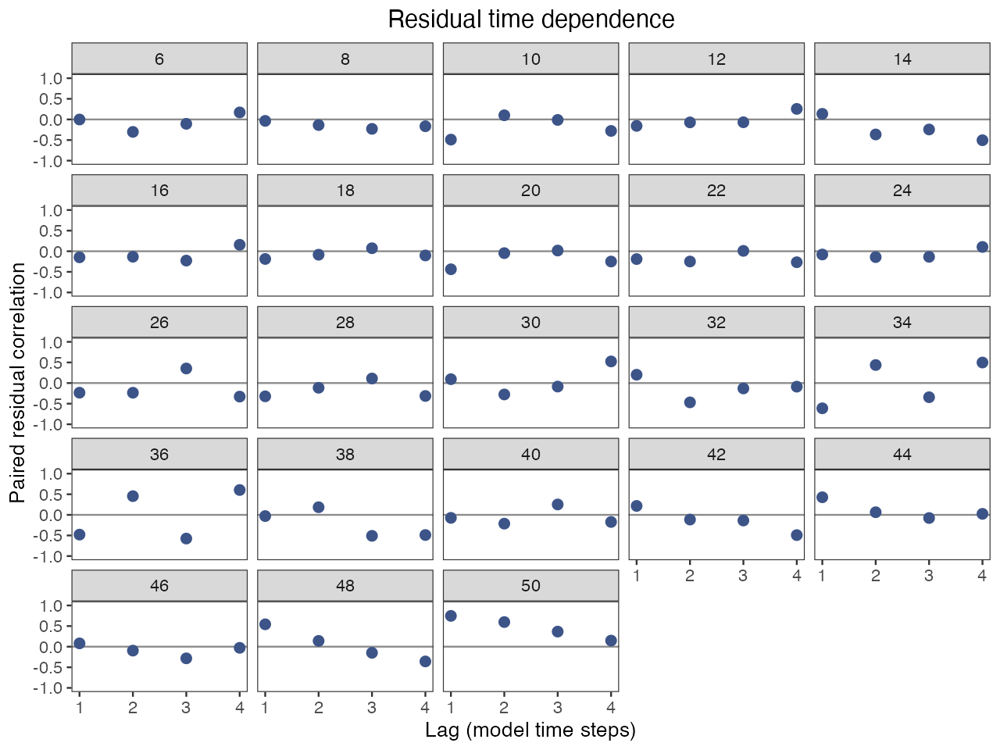
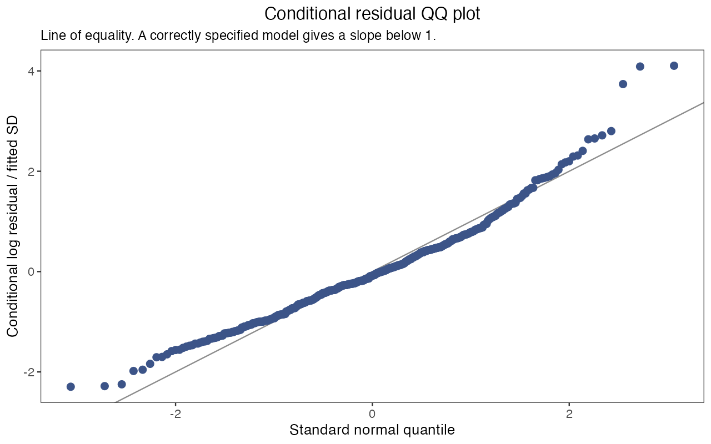

# 评估工作流：从输入列表到保存结果

本页带你把一个拟合好的模型走完评估报告包含的各项分析：保存估计值、检查残差、检验对固定输入的敏感性、对一个被估计的参数做剖面、投影未来情景、拟合模拟重复，最后得到一份保存的拟合结果和一个结果表文件夹。你需要已安装软件包（[安装并完成第一次拟合](getting-started.html)）；使用自己的数据时，按[准备调查数据](data-preparation.html)建立输入列表 `x`。第 4 到 7 步每步都要多次重新拟合模型；按需要选做，顺序不限，都从第 1 步的对象开始。

<h2 id="fit-teaching-models">1. 拟合一次，保留对象</h2>

```r
library(ALSCL)
library(ggplot2)
data("YTF_example")
x <- YTF_example
a <- run_acl(x, silent = TRUE)
b <- run_alscl(x, silent = TRUE)
summary(a)
summary(b)
```

ACL 拟合 `a` 用于情景和剖面，因为一次 ACL 重新拟合约二十秒；ALSCL 拟合 `b` 用于结果提取、残差和投影。`summary()` 打印模型、时间步、F 结构、一行数值检查（`numerical_ok` 应为 `TRUE`，`issues` 应为空）和自然尺度上的标量参数。先读数值检查：后面的每个函数都会记录它，`project_model()` 会拒绝未通过检查的拟合。若 `numerical_ok` 为 `FALSE`，按[判断拟合是否可用](diagnostics.html)改一项设置并重新拟合。

<h2 id="section-4">2. 提取结果，保存拟合结果</h2>

```r
parameter_estimates <- extract_parameters(b)
parameter_estimates
estimates <- extract_estimates(b, quantities = c("SSB", "Rec", "F"))
head(estimates)
write.csv(estimates, "ytf_alscl_estimates.csv", row.names = FALSE)
save_assessment(b, "ytf_alscl.rds")
saved <- read_assessment("ytf_alscl.rds")
summary(saved)
saved$recipe$versions
plot_SSB(saved, se = TRUE)
b_again <- refit_model(saved, silent = TRUE)
```

`extract_parameters()` 每个标量参数返回一行：`status`（`estimated`、`fixed` 或 `inactive`）、自然尺度上的估计值、标准误和 95% 区间（固定参数为 `NA`）；`exp(mean_log_F)` 是 F 过程的基准水平，各年的 F 由它乘以指数化的偏差得到。`extract_estimates()` 返回种群量的长表，带 `year`、`age` 或 `length` 和每个值的区间；ALSCL 的 `F` 按体长组给出（`report_name` 为 `FL`），ACL 按年龄给出，不取平均。

`save_assessment()` 写出保存的拟合结果：`b` 中除 TMB 对象 `b$obj` 以外的全部内容，以及重新拟合所需的信息（三张表、设置、`map`、边界、初值、软件包版本和模型源码的哈希值）。`summary()`、提取函数和绘图函数都能直接用于 `read_assessment()` 读回的对象，同事无需重新拟合就能读你的结果；需要可执行模型时，`refit_model()` 使用保存的输入和设置重新拟合，例如用 `refit_model(saved, M = 0.25)` 改变一项假设，并在软件包、TMB 或模型源码与保存时不同时发出警告。文件已存在时 `save_assessment()` 会停止（传入 `overwrite = TRUE`），拟合结果缺少原始输入和设置时也会停止（把它的输入列表作为 `x` 传入）。

并行保存时，请给每个拟合指定不同文件名。若两个会话用默认的 `overwrite = FALSE` 写入同一新路径，只有一个能成功。如果会话意外中断后仍提示锁错误，请先确认写入进程已停止，再删除报错中列出的锁目录。

<h2 id="section-5">3. 按模型时间轴检查残差</h2>

```r
checks <- check_fit(b, max_lag = 4)
head(residuals(b, type = "standardized"))
checks$lag_correlations
checks$plots$heatmap
checks$plots$lag
checks$plots$qq
```






`check_fit()` 把对数残差标准化（观测减拟合的对数指数，再除以拟合的观测 SD），并画三种图。热图按体长组和时间步排列（被排除的零值和空白为灰色），同色成块表示相邻体长组或时间步的残差方向一致。滞后图对每个体长组画出相隔一到 `max_lag` 个时间步的残差相关系数；没有调查的时间步仍是空缺，`checks$lag_correlations` 给出每个点背后的配对数。QQ 图把合并后的残差与正态分布比较。教学拟合中，16 cm 体长组几乎每年都是正残差，最大体长组从 2013 年起为正且滞后一步的相关系数接近 0.8，QQ 图正尾偏重：虽然数值检查通过，这些规律仍值得查看。残差以拟合的过程偏差为条件，所以把这些图当作提示而不是检验；[判断拟合是否可用](diagnostics.html)说明某种规律通常指向哪项设置。

<h2 id="section-6">4. 敏感性情景与参数剖面</h2>

`fit_scenarios()` 在具名的改动下重新拟合同一观测，改动的是模型视为给定的输入（自然死亡率、调查可捕性、F 结构、某项 `map`），显示假设改变时结果移动多少。`profile_model()` 把一个被估计的标量参数依次固定在网格的每个值上并重新估计其余参数，显示数据对该参数的确定程度。示例检验教学拟合的两项假设：

| 情景 | 相对参考情景的改动 | 检验什么 |
|---|---|---|
| `reference` | 无：每时间步 `M` = 0.20，`F_structure = "group_year"` | 第 1 步的设置 |
| `low_M` | `M = 0.15` | 自然死亡率是固定值，生物量的尺度依赖于它 |
| `shared_F` | `F_structure = "year"`：每个时间步一个 F，各年龄共用 | 是否需要年龄别的 F |

```r
scenarios <- fit_scenarios(x, list(
  reference = list(),
  low_M = list(M = 0.15),
  shared_F = list(F_structure = "year")
), model = "acl", ncores = 2, F_summary = "mean", silent = TRUE)
scenarios$status
head(scenarios$estimates)
scenario_ssb <- subset(scenarios$estimates, quantity == "SSB")
ggplot(scenario_ssb, aes(year, estimate, color = scenario)) +
  geom_line() + labs(x = "Year", y = "SSB") +
  theme_bw() + theme(panel.grid = element_blank())
```


每个情景是一个具名的参数列表，用来替换 `x` 中的设置；空列表就是参考情景，`map` 这类列表会整体替换保存的列表，三张表保持不变。先看 `scenarios$status` 再看曲线：它每个情景一行，记录耗时、错误、警告和数值检查。未通过检查的情景仍留在 `scenarios$estimates` 中且 `numerical_ok = FALSE`；因错误停止的情景没有估计值。估计值表按情景和年份给出产卵生物量、补充量和 F，其中 F 由 `F_summary = "mean"` 在每个时间步内对各年龄（或体长组）取平均，或由 `"apical"` 取最大值。`ncores` 把各情景放在不同的工作进程上运行，每个情景使用 `x` 中保存的初值个数，否则一个初值。这里三条曲线几乎重合：较低的 M 和共用的 F 使产卵生物量至多变动百分之几；换成自己的数据，曲线之间的差距就是要报告的敏感性。

<h3 id="section-7">对被估计的参数做剖面</h3>

```r
profile_values <- exp(a$opt$par[["mean_log_F"]]) * c(0.9, 1, 1.1)
profile_F <- profile_model(a, "mean_log_F", profile_values,
                           scale = "natural", ncores = 1)
profile_F$grid
ggplot(profile_F$grid, aes(value, delta_nll)) +
  geom_line() + geom_point() +
  labs(x = "F process baseline", y = "Change in negative log likelihood") +
  theme_bw() + theme(panel.grid = element_blank())
```


`profile_model()` 接受 `names(a$opt$par)` 中的一个名称，即拟合估计的标量参数；`YTF_example` 固定了 `log_Linf`，对它做剖面会以「parameter must name one free scalar」停止。`scale = "natural"` 时网格按自然尺度给出，且必须落在优化器边界内。`profile_F$grid` 列出每个值的目标函数值、`delta_nll`（相对原拟合的负对数似然增量）和该次重新拟合的数值检查。两侧陡升说明数据能很好地确定该参数；这里基准 F 变动 10% 使负对数似然上升 0.8 到 0.9。`delta_nll` 为负会触发警告：某个网格点找到了更优的解，应先用更多初值重新拟合原模型。用于报告的剖面需要更密的网格，并且每个点的拟合都通过检查。

<h2 id="section-8">5. 投影未来情景</h2>

```r
h <- 4L
w <- as.matrix(x$data.wgt[-1L])
mat <- as.matrix(x$data.mat[-1L])
future_w <- matrix(w[, ncol(w)], nrow(w), h)
future_mat <- matrix(mat[, ncol(mat)], nrow(mat), h)
future_rec <- rep(tail(b$report$Rec, 1), h)
low_F <- project_model(b, F = rep(0.10, h), recruitment = future_rec,
                       weight = future_w, maturity = future_mat)
higher_F <- project_model(b, F = rep(0.25, h), recruitment = future_rec,
                          weight = future_w, maturity = future_mat)
low_F$summary
low_F$assumptions
projection_ssb <- rbind(
  transform(low_F$summary, scenario = "F = 0.10"),
  transform(higher_F$summary, scenario = "F = 0.25"))
ggplot(projection_ssb, aes(year, SSB, color = scenario)) +
  geom_line() + geom_point() + labs(x = "Year", y = "Start-of-period SSB") +
  theme_bw() + theme(panel.grid = element_blank())
```


`project_model()` 用你提供的值把最后一个拟合的种群向未来时间步推进：`F`（每步一个值、各组共用，或组乘时间步的矩阵）、`recruitment`（它的长度决定投影期数），以及完整的 `weight` 和 `maturity` 矩阵，每个未来时间步一列。函数不替你延续任何值；代码重复最后一列观测的体重和成熟比例以及最后一个拟合的补充量，这是需要在报告中说明的选择。`M` 保持拟合时的值，除非另外传入。`low_F$summary` 对每个未来时间步列出丰度、生物量、产卵生物量、补充量、尾数和重量计的渔获以及 F 的平均值和最大值；`low_F$assumptions` 记录每项选择。

每一行描述一个时间步的期初：第一个未来状态是最后一个拟合种群经最后一个拟合的 F 和 M 存活后加上第一个提供的补充量，未来的 `F[t]` 决定第 `t` 步的渔获和进入第 `t + 1` 步的存活。因此第一个提供的 F 不会改变第一个未来产卵生物量；两条曲线从第二步起才分开。投影是确定性的，并以拟合为条件，没有区间、亲体补充关系或参考点。来源拟合未通过数值检查时 `project_model()` 会停止，除非 `allow_failed_fit = TRUE`，这时覆盖会记录在 `assumptions` 中；出现「weight must be a finite nonnegative 23-by-4 matrix」这类信息，说明某个矩阵的行数（体长组）或列数（未来时间步）不对。

<h2 id="section-9">6. 拟合模拟重复，报告失败率</h2>

```r
pa <- x$parameters
bio <- sim_cal(pa)
iterations <- 1:2
simulation_dir <- tempfile("assessment-sim-")
sm <- sim_data(bio, pa, iter_range = iterations,
               return_iter = iterations[1], output_dir = simulation_dir)
cfg <- x$fit_config$alscl
simulation_fits <- sim_model(iterations, simulation_dir,
  file.path(simulation_dir, "fits_alscl"), model = "alscl", ncores = 1,
  parameters = cfg$parameters, parameters.L = cfg$parameters.L,
  parameters.U = cfg$parameters.U, map = cfg$map, M = pa$M)
simulation_truth <- setNames(lapply(iterations, function(i) {
  e <- new.env(parent = emptyenv())
  load(file.path(simulation_dir, paste0("sim_rep", i)), envir = e)
  s <- e$sim.data
  list(year = s$years, SSB = as.numeric(s$SSB), Rec = as.numeric(s$Rec))
}), paste0("result_rep_", iterations))
stopifnot(identical(names(simulation_fits), names(simulation_truth)))
performance <- summarize_simulations(simulation_fits, simulation_truth,
                                     quantities = c("SSB", "Rec"))
performance$replicates
performance$summary
```

这一步问的是模型能否找回一个已知的种群。`x$parameters` 保存生成 `YTF_example` 的模拟器设置；`sim_cal()` 由它推导生物学量，`sim_data()` 为每个重复写一个文件 `sim_rep<i>`，其中的列表 `sim.data` 含调查表以及逐年的真实 `SSB` 和 `Rec`。`sim_model()` 用所选模型及该模型的初值和 `map`（这里是 `x` 中保存的 ALSCL 配置）拟合每个文件，把每个结果保存为 `result_rep_<i>` 并以命名列表返回，因错误停止的重复连同错误信息一起保留。真值列表必须与拟合使用相同的名称和年份，所以代码逐个读取模拟文件；否则 `summarize_simulations()` 会以「identical unique replicate names」或「time coordinates differ」停止。

读 `performance$summary` 的统计量时同时读它的分母：`n_replicates` 是尝试的拟合数，`n_valid_fits` 是通过数值检查的拟合数（`failure_rate` 是未通过的比例），`n_valid_pairs` 是 `bias`、`relative_bias` 和 `rmse` 所用的估计值与真值配对数，`n_intervals` 是 `coverage` 所用的、标准误有限的区间数，`coverage` 是其中包含真值的比例。缺少标准误的区间不计入覆盖率；`relative_bias` 跳过真值为零的年份。`performance$replicates` 列出每个重复的检查和耗时，`performance$estimates` 列出每个重复的每一年，包括失败的重复。两个重复只演示用法；正式研究需要足够多的重复，失败率和覆盖率才有意义。

<h2 id="section-11">7. 模拟拟合模型并验证预测</h2>

```r
simulated <- simulate_fit(b, nsim = 2, seed = 42, process = "conditional")
names(simulated$simulations[[1]])
validation <- hindcast_model(x, model = "acl", horizon = 1, nfolds = 3, ncores = 2)
validation$diagnostics
validation$scores
```

另外两项检查从拟合本身出发。`simulate_fit()` 从拟合模型生成新的调查观测。可以固定拟合的种群状态（`"conditional"`）或先抽取新的过程偏差（`"resample"`），并为每个重复返回一个 `run_alscl()` 可接受的输入列表 `x`，供你重新拟合并与保存的 `truth` 比较；该列表保留 `b` 的拟合配置，但不含 `output`、`ncores` 和 `silent`。`hindcast_model()` 是预测检验：它只用较早的时间步拟合，从最近的 `nfolds` 个训练起点各预测随后 `horizon` 个时间步的调查指数，并把预测与留出的观测对照评分，同时给出朴素预测的分数。[模型能重现并预测调查观测吗？](case-model-validation.html)完整演示这两项检查。

<h3 id="save-workflow">保存完成的工作流</h3>

```r
record_dir <- "assessment-record"
dir.create(record_dir)
write.csv(scenarios$status, file.path(record_dir, "scenario_status.csv"), row.names = FALSE)
write.csv(profile_F$grid, file.path(record_dir, "profile_F.csv"), row.names = FALSE)
write.csv(performance$summary, file.path(record_dir, "simulation_summary.csv"), row.names = FALSE)
saveRDS(list(input = x, scenarios = scenarios, profile = profile_F,
  projections = list(low_F = low_F, higher_F = higher_F),
  simulation_truth = simulation_truth, performance = performance,
  validation = validation), file.path(record_dir, "workflow_record.rds"))
writeLines(capture.output(sessionInfo()), file.path(record_dir, "session.txt"))
```

做完所用的步骤后运行这段代码，或只保存已有的对象。第 2 步保存的拟合结果就是评估本身；记录另外加入情景和剖面的拟合（不含 TMB 对象的列表）、带假设的投影、模拟真值与表现、验证分数和会话信息，连同输入列表，评估就可以复现。

<h2 id="next">下一步</h2>

| 想做什么 | 阅读 |
|---|---|
| 找出残差规律指向的设置 | [判断拟合是否可用](diagnostics.html) |
| 查看去掉近期时间步后估计值的变化 | [运行回溯分析](retrospectives.html) |
| 带图完整演练模拟与预测检验 | [模型能重现并预测调查观测吗？](case-model-validation.html) |
| 针对自己的种群提出敏感性或投影问题 | [评估对假设有多敏感，未来 F 会怎样改变结果？](case-sensitivity-projection.html) |
| 复现结果或排除故障 | [复现结果与排除故障](reproducibility.html) |
