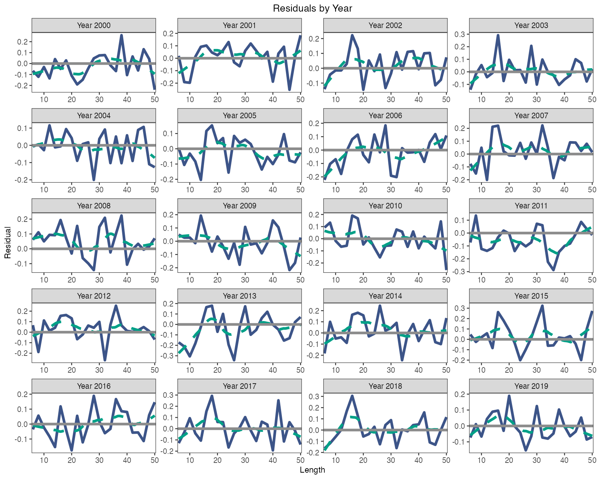
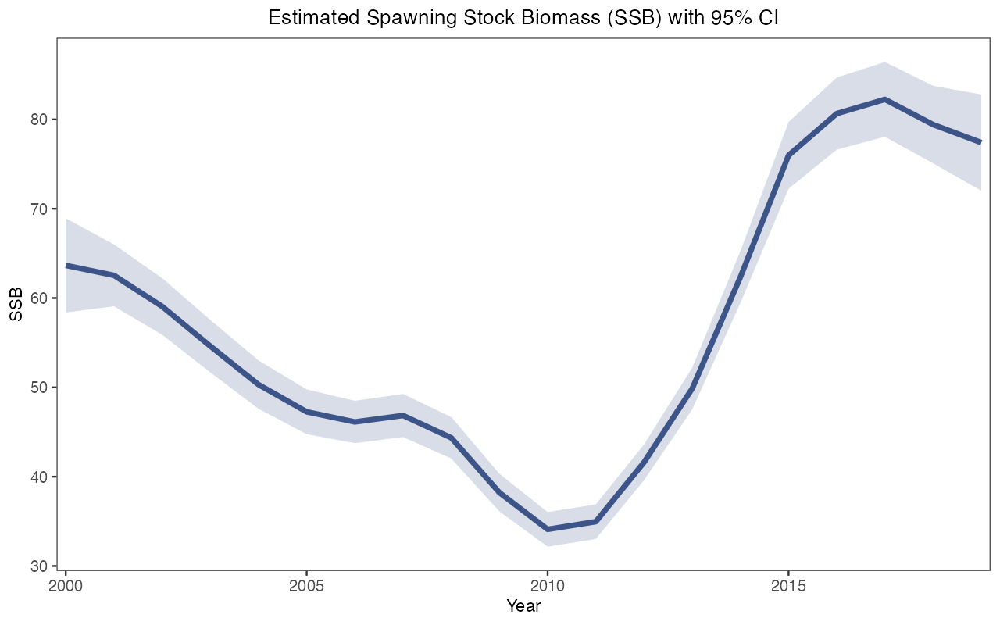

# 如何拟合自己的调查数据？

本页带你从 CSV 或 Excel 文件中的三张调查表出发，得到 ACL 和 ALSCL 两个拟合好的模型，以及它们的数值检查、图和保存的结果。本页按照脚本 [fit_own_data_example.R](https://github.com/FanZhang-LAB-SHOU/ALSCL/blob/main/scripts/fit_own_data_example.R) 展开，该脚本用内附的教学数据完整运行一遍，然后你把其中的数值换成自己的。你需要已安装 ALSCL 2.4.0 或更高版本（[安装 ALSCL](getting-started.html)）、按[准备调查数据](data-preparation.html)排好的三张表，以及你的种群的生物学数值（`rec.age`、`nage`、`M`、`sel_L50`、`sel_L95`、`growth_step`、`len_mid`、`len_border`），[该页第 4 步](data-preparation.html#bundle)逐项解释了它们。

<h2 id="bundle">1. 准备并检查输入列表</h2>

```r
library(ALSCL)
tables <- read_survey_csv("my_data")
x <- prepare_alscl_data(tables, fit_args = list(
  rec.age = 1, nage = 15, M = 0.2, sel_L50 = 15, sel_L95 = 20,
  growth_step = 1, len_mid = seq(6, 50, 2), len_border = seq(7, 49, 2)))
check <- check_alscl_data(x, "acl")
check$valid
check$summary
```

两个模型都读取输入列表 `x`：调查指数表 `data.CatL`、体重表 `data.wgt` 和成熟比例表 `data.mat`，行是体长组，列是时间步；再加上 `x$fit_args` 中描述你的种群和调查的设置。`read_survey_csv()` 从一个文件夹读取三个文件，`read_survey_excel()` 读取一个工作簿中的三张工作表；表格布局、时间网格以及空白和零值的处理见[准备调查数据](data-preparation.html)。这些设置是模型照原样使用的输入；请为你的种群逐项提供，并记下来源。代码中的数值是教学数据的设置。

`check_alscl_data()` 按拟合时的方式准备数据，但不编译任何东西。`check$valid` 应为 `TRUE`，`check$summary` 应显示你预期的体长组数和时间步数、正观测数，以及将被估计的标量参数个数 `free_fixed`。若 `check$valid` 为 `FALSE`，`check$errors` 会指出要修改的表、时间列或设置；`check$warnings` 提示没有任何观测的时间步或体长组。拟合 ALSCL 之前，用 `"alscl"` 再检查一遍。

<h2 id="map">2. 确定初值和 map</h2>

```r
plan <- inspect_parameters(x, "acl")
plan[, c("parameter", "status", "map_source", "natural_start")]
inspect_parameters(x, "alscl")[, c("parameter", "status", "map_source", "natural_start")]
```

`inspect_parameters()` 列出一个模型的各个参数、自然尺度上的初值及其状态，例如 `free`（估计）、`fixed`（固定）或 `tied`（共享）；`map_source` 说明固定状态来自模型默认还是你的 `map`。默认情况下，ACL 固定 `log_std_log_F`、`logit_log_F_y`、`logit_log_F_a` 和 `t0`，估计其余 10 个标量参数；ALSCL 固定 `log_sigma_log_F` 和 `log_t0`，估计 13 个。过程偏差 `dev_log_R`、`dev_log_F` 和 `dev_log_N0` 默认作为随机效应估计；`map` 可以固定某些偏差，或让它们共享一个估计值。修改 map 后，用 `inspect_parameters()` 检查它们的 `n_free`、`n_fixed` 和 `n_tied` 数量。[选择拟合设置](fitting-controls.html#parameters)列出了两个模型的全部标量参数。

初值写在 `x$fit_config$acl$parameters` 或 `x$fit_config$alscl$parameters` 中，采用优化器尺度：渐近体长 60 cm 写 `log_Linf = log(60)`，相关系数 0.1 写 `logit_log_R = qlogis(0.1)`；ALSCL 使用 `log_t0`，因此它的 `t0` 必须在 0 和 `rec.age` 之间。填写初值不会固定参数：只有模型 `map` 中的 `factor(NA)` 才固定参数，具名 `NULL` 项则释放模型默认固定的参数。当外部研究给出的值比拟合更可靠，或第 5 步的检查表明数据无法确定某个参数时，固定该参数，并记录每个固定值的来源。[选择拟合设置](fitting-controls.html)给出 `map`、边界和物种预设的规则；[估计参数列表](estimation-parameters.html)给出全部变换方式。

<h2 id="run">3. 运行完整示例</h2>

下面的脚本用教学数据完整运行每一步：读取 `docs/data` 中的三个 CSV 文件，把生物学设置收在 `bio` 中，由行标签推出体长组中点和边界，设置两个模型的初值和 map，组装并检查 `x`，拟合 ACL（`a`）和 ALSCL（`b`），打印它们的数值检查，绘制 `b` 的残差图和产卵生物量图，并把输入列表、去掉 TMB 对象的两个拟合、两张图和会话信息保存到 `output/own-data-example`。请在下载的仓库根目录运行，因为脚本要加载 `scripts/plot_helpers.R` 并读取 `docs/data`：`source("scripts/fit_own_data_example.R", encoding = "UTF-8")`。

```r
# ALSCL: CSV -> x -> ACL / ALSCL -> diagnostics and saved summaries.
# 从仓库根目录运行 / Run from the repository root:
# source("scripts/fit_own_data_example.R", encoding = "UTF-8")
# 默认读取内附模拟数据。正式分析必须修改第 1、2、3 步。
# The supplied numbers describe the synthetic YTF example, not your stock.

library(ALSCL)
if (packageVersion("ALSCL") < "2.4.0")
  stop("This example requires ALSCL >= 2.4.0. Update ALSCL before running it.", call. = FALSE)
source('scripts/plot_helpers.R')

# 1. 读取三表 / Read the three aligned tables -------------------------------
# 正式数据改成 "my_data"，其中放以下三个 CSV：
# data.CatL.csv, data.wgt.csv, data.mat.csv.
data_dir <- "docs/data"
inputs <- read_survey_csv(data_dir)
# Excel 可替换上一行 / Excel alternative (requires readxl):
# inputs <- read_survey_excel("my_survey.xlsx")

# 2. 共用生物设置 / Shared biology -----------------------------------------
# 以下是年度 YTF 教学值，正式数据必须采用自己的生物学依据。
# M_annual and vbk are annual; lengths are cm; weights in the example are kg.
bio <- list(rec.age = 1, nage = 15, M_annual = 0.2,
            growth_step = 1, sel_L50 = 15, sel_L95 = 20,
            Linf = 60, vbk = 0.2, t0 = 1 / 60,
            cv_len = 0.2, cv_grow = 0.2)
# 当前 ALSCL 使用 log_t0，故要求 0 < t0 < rec.age；不要对负 t0 取绝对值。
stopifnot(bio$t0 > 0, bio$t0 < bio$rec.age)

# 此例 LengthBin 填数值中点：6, 8, ..., 50。
# For labels such as "5-7", supply the actual midpoints explicitly instead.
len_mid <- as.numeric(inputs$data.CatL[[1]])
stopifnot(all(is.finite(len_mid)), all(diff(len_mid) > 0))
# 此例为连续等宽组；非等宽组请直接填写实测的 nlen-1 个内部边界。
# This midpoint formula is only used for the equal-width demonstration bins.
stopifnot(max(abs(diff(len_mid) - diff(len_mid)[1])) < 1e-8)
len_border <- (head(len_mid, -1) + tail(len_mid, -1)) / 2

# 3. 各模型拟合设置 / Model-specific settings ------------------------------
# 生长和多数过程参数作为初值，不再自动固定每个提供的参数。
# Growth and most process values below are starts, not automatic fixes.
# Review starts, bounds and the documented default fixed values for your stock.
p_acl <- list(
  log_Linf = log(bio$Linf), log_vbk = log(bio$vbk), t0 = bio$t0,
  log_cv_len = log(bio$cv_len),
  log_std_log_F = log(0.2), log_std_log_N0 = log(0.2),
  logit_log_R = qlogis(0.1))
p_alscl <- list(
  log_Linf = log(bio$Linf), log_vbk = log(bio$vbk), log_t0 = log(bio$t0),
  log_cv_len = log(bio$cv_len), log_cv_grow = log(bio$cv_grow),
  log_sigma_log_F = log(0.2), log_sigma_log_N0 = log(0.2),
  logit_log_R = qlogis(0.1))
# 使用模型默认 map：ACL 固定 4 项、估计 10 项；ALSCL 固定 2 项、估计 13 项。
# Default maps: ACL fixes 4 and estimates 10 scalars; ALSCL fixes 2 and estimates 13.
# ACL fixes log_std_log_F, logit_log_F_y, logit_log_F_a and t0.
# ALSCL fixes log_sigma_log_F and log_t0. These values still need justification.
map_acl <- list()
map_alscl <- list()
# 可选：只固定 t0；更灵活的设置必须另做诊断，不保证可识别。
# Optional: fix only t0; diagnose this more flexible configuration separately.
# map_acl <- list(t0 = factor(NA), log_std_log_F = NULL,
#                 logit_log_F_y = NULL, logit_log_F_a = NULL)
# map_alscl <- list(log_t0 = factor(NA), log_sigma_log_F = NULL)
# 解除默认固定项需保留具名 NULL；$t0 <- NULL 仅删除条目。
# Preserve a named NULL to release a default fix; $t0 <- NULL deletes the entry.
# map_acl["t0"] <- list(NULL)
# map_alscl["log_t0"] <- list(NULL)

# 4. 组装并检查 x / Assemble and check the input bundle --------------------
x <- prepare_alscl_data(inputs,
  fit_args = list(
    rec.age = bio$rec.age, nage = bio$nage,
    M = bio$M_annual * bio$growth_step,
    sel_L50 = bio$sel_L50, sel_L95 = bio$sel_L95,
    growth_step = bio$growth_step,
    len_mid = len_mid, len_border = len_border,
    zero_action = "error", train_times = 2,
    nstarts = 1, ncores = 1, silent = FALSE),
  fit_config = list(
    acl = list(parameters = p_acl, map = map_acl),
    alscl = list(parameters = p_alscl, map = map_alscl)))
# 不编译即可检查数据、时间网格和参数设置 / Check data, time grid and settings without compiling.
for (model in c("acl", "alscl")) {
  check <- check_alscl_data(x, model)
  if (!check$valid) stop(paste(check$errors, collapse = "\n"))
  print(check$summary)
}

# 5. 直接拟合 / Fit directly ----------------------------------------------
# 内置加速使用当前 alscl_speed() 设置，无需额外包装。
alscl_speed_info()
a <- run_acl(x)
b <- run_alscl(x)
# 可直接覆盖设置；固定 nstarts 才能公平比较并行数：
# a <- run_acl(x, nstarts = 4, ncores = 2)
# b <- run_alscl(x, nstarts = 4, ncores = 2)

# 6. 检查、绘图、保存 / Inspect, plot and save ------------------------------
checks <- list(ACL = diagnose_model(x$data.CatL, a),
               ALSCL = diagnose_model(x$data.CatL, b))
print(checks)
print(a$sd_info)
print(b$sd_info)
for (fit in list(a, b)) {
  print(fit$par_low_up) # 实际自由参数及边界 / Actual free scalars and bounds
  print(list(convergence = fit$convergence_code,
             max_gradient = fit$max_abs_gradient,
             pdHess = fit$pdHess, bound_hit = fit$bound_hit))
  print(fit$refinement)
  print(fit$diagnostics)
  if (!isTRUE(fit$convergence_code == 0L) || !isTRUE(fit$pdHess) ||
      !isTRUE(fit$diagnostics$numerical_ok))
    warning("Review fit diagnostics before interpreting this assessment.")
}
residual_plot <- plot_residuals(b, facet_by = "year", facet_ncol = 4,
                                x_breaks = pretty(len_mid, n = 4))
# 非正定 Hessian 时不展示标准误区间 / Omit SE intervals if Hessian is not positive definite.
ssb_plot <- plot_SSB(b, se = isTRUE(b$pdHess))
print(residual_plot)
print(ssb_plot)
# obj 是当前会话的 TMB 指针，不包含在可移植结果中。
portable <- function(fit) {
  fit$obj <- NULL
  fit
}
output_dir <- "output/own-data-example"
dir.create(output_dir, recursive = TRUE, showWarnings = FALSE)
save_grid_free_plot(file.path(output_dir, "residuals.png"), residual_plot,
                width = 10, height = 8, dpi = 150)
save_grid_free_plot(file.path(output_dir, "SSB.png"), ssb_plot,
                width = 8, height = 5, dpi = 150)
saveRDS(x, file.path(output_dir, "inputs_x.rds"))
saveRDS(list(ACL = portable(a), ALSCL = portable(b), diagnostics = checks),
        file.path(output_dir, "assessment_summary.rds"))
writeLines(capture.output(sessionInfo()), file.path(output_dir, "sessionInfo.txt"))
# 新会话可读取 x 并重新拟合 / Refit in a new session:
# x <- readRDS("output/own-data-example/inputs_x.rds")
# b <- run_alscl(x)
```

脚本运行时会打印两个模型的 `check$summary`；教学数据显示 23 个体长组、20 个时间步、460 个正观测、没有零值和空白，以及 10 个（ACL）或 13 个（ALSCL）自由标量参数。随后 `diagnose_model()` 打印每个拟合的数值检查，第 5 步会解释。在记录运行（[own-data-example-checks.csv](https://github.com/FanZhang-LAB-SHOU/ALSCL/blob/main/docs/results/own-data-example-checks.csv)）中，两个拟合的收敛码都是 0，Hessian 正定，没有参数落在边界上，最大梯度约为 3e-9。脚本保存的两张图如下：





每一年的残差都围绕 0 散布，产卵生物量序列的区间较窄，这就是这组模拟数据上可用拟合的样子；区间以固定值为条件。若脚本提示 "This example requires ALSCL >= 2.4.0"，安装当前版本（[安装 ALSCL](getting-started.html)）；若找不到 `scripts/plot_helpers.R` 或 `docs/data`，说明 R 运行在仓库根目录之外；若 `check_alscl_data()` 报错，第 1 步解释了这些信息；若拟合结束时出现 "Review fit diagnostics" 警告，第 5 步说明要改什么。

<h2 id="replace">4. 换成自己的观测数据</h2>

```r
data_dir <- "my_data"
bio <- list(rec.age = 2, nage = 12, M_annual = 0.25,
            growth_step = 1, sel_L50 = 22, sel_L95 = 30,
            Linf = 80, vbk = 0.15, t0 = 0.5,
            cv_len = 0.15, cv_grow = 0.15)
len_mid <- c(8, 11, 14, 17, 20, 24, 28, 33, 39, 46)
len_border <- c(9.5, 12.5, 15.5, 18.5, 22, 26, 30.5, 36, 42.5)
map_acl <- list(log_Linf = factor(NA), log_vbk = factor(NA))
map_alscl <- list(log_Linf = factor(NA), log_vbk = factor(NA))
# 然后运行脚本中的 prepare_alscl_data() 调用，并确认：
for (model in c("acl", "alscl")) {
  check <- check_alscl_data(x, model)
  print(check$valid); print(check$warnings); print(check$summary)
  print(inspect_parameters(x, model)[, c("parameter", "status", "map_source")])
}
```

上面的数值只是说明每一项的形式；请把每一项都换成你的种群的数值。保留 `inputs`、`x`、`a` 和 `b` 这些名字，脚本的其余部分就不用改。

| 脚本中的行 | 改成 | 注意 |
|---|---|---|
| `data_dir <- "docs/data"` | 你的 CSV 文件夹，或 `inputs <- read_survey_excel("my_survey.xlsx")` | 三个文件或工作表必须使用这些名称；调查缺测留空 |
| `bio <- list(...)` | 你的种群的数值 | `M_annual` 是年值，会乘以 `growth_step`；`vbk` 仍按年计；ALSCL 要求 `0 < t0 < rec.age` |
| `len_mid <- ...`、`len_border <- ...` | 你的体长组中点和内部边界 | 体长组宽度不等时，删除等宽 `stopifnot()` 和中点公式那两行 |
| `p_acl`、`p_alscl` | 优化器尺度上的初值 | ACL 填 `t0`，ALSCL 填 `log(t0)` |
| `map_acl`、`map_alscl` | 你要固定或释放的参数 | 空列表沿用模型默认；每次都列出全部固定项 |
| `zero_action = "error"` | `"missing"`，把零值当作缺失而不是终止 | 零值随后不进入似然 |
| `output_dir` | 本次评估的文件夹 | 脚本会覆盖其中的文件 |

修改后，把脚本运行到检查循环。两个模型的 `check$valid` 都必须为 `TRUE`，`check$summary` 必须显示你的体长组数和时间步数，`inspect_parameters()` 中状态为 `fixed` 且 `map_source` 为 `explicit` 的参数必须恰好是你固定的那些。类似 "No positive observations in periods: 2004" 的警告表示某个时间步没有调查值，按未观测处理；`zero_action = "missing"` 且调查表含零值时，会出现零值被排除的警告。拟合之前，先想清楚每条警告对你的调查意味着什么。

<h2 id="fit">5. 直接拟合并读结果</h2>

```r
a <- run_acl(x)
b <- run_alscl(x)
diagnose_model(x$data.CatL, a)
diagnose_model(x$data.CatL, b)
b$diagnostics$issues
estimates <- extract_estimates(b)
subset(estimates, quantity == "SSB")
extract_parameters(b)
plot_CatL(b, facet_by = "year", facet_ncol = 5)
plot_residuals(b, facet_by = "year", facet_ncol = 5)
plot_SSB(b, se = TRUE)
```

`x` 装好你的表和设置后，每个模型的拟合就是一次调用；脚本存入 `x$fit_args` 的 `train_times = 2` 和 `nstarts = 1` 随之生效，调用中给出的参数，例如 `run_acl(x, nstarts = 4, ncores = 2)`，只在本次调用中覆盖保存的值。看任何估计值之前先读数值检查：收敛码 0、最大梯度小于 0.001、Hessian 正定、没有参数落在边界上，以及 `numerical_ok` 为 `TRUE`；`b$diagnostics$issues` 给出未通过的项目。`extract_estimates()` 返回一张表，包含 `quantity`、`year`、该量所在的 `age` 或 `length`（如有）、`estimate`、`std_error` 和区间 `conf_low` 到 `conf_high`；`extract_parameters()` 列出每个标量参数在自然尺度上的值及其状态 `estimated`、`fixed` 或 `inactive`（共用 F 结构用不到的相关系数）。`plot_CatL()`、`plot_residuals()` 和 `plot_SSB()` 分别画出对观测的拟合、对数残差和带区间的产卵生物量，与[理解第一次拟合](first-model.html)中相同。

检查未通过时，每次只改一处再重新拟合：收敛码不是 0 或梯度很大时，多用几个初值（`nstarts = 4, ncores = 2`）；Hessian 检查未通过时，固定一个参数或改用 `F_structure = "year"`；[理解第一次拟合](first-model.html#checks)中的表把每项未通过的检查对应到常见原因。即使检查通过，相邻体长或相邻年份的残差同号成串也说明模型漏掉了数据中的某种特征；[判断拟合是否可用](diagnostics.html)说明如何检查这类规律，以及对 `M` 和其他固定值的敏感性。

<h2 id="save">6. 保存并复用结果</h2>

```r
dir.create("output/my-assessment", recursive = TRUE, showWarnings = FALSE)
saveRDS(x, "output/my-assessment/inputs_x.rds")
save_assessment(a, "output/my-assessment/acl.rds")
save_assessment(b, "output/my-assessment/alscl.rds")
# 在以后的会话中
x <- readRDS("output/my-assessment/inputs_x.rds")
saved <- read_assessment("output/my-assessment/alscl.rds")
summary(saved)
plot_SSB(saved, se = TRUE)
b2 <- refit_model(saved)
```

`x` 是普通列表，`saveRDS()` 保存表和设置，`readRDS()` 把它们读回。`save_assessment()` 写出保存的拟合结果：拟合中除 `b$obj` 以外的全部内容（`b$obj` 是只在当前会话有效的 TMB 对象指针），加上配方（数据表、设置、map、边界和软件包版本）。`read_assessment()` 把它读回，`summary()`、提取函数和绘图函数都能直接使用；`refit_model()` 按配方重建可执行的拟合，接受 `refit_model(saved, nstarts = 4)` 这样的覆盖参数，并在软件包或 TMB 版本与记录不同时发出警告。文件夹必须已存在，已有文件只有在 `overwrite = TRUE` 时才被替换。脚本则保存 `assessment_summary.rds`，即去掉 `obj` 的两个拟合，以及两张图和 `sessionInfo.txt`。把数据文件、保存的输入列表和保存的拟合结果放在一起。

<h2 id="continue">7. 继续比较和回溯</h2>

```r
comparison <- compare_models(a, b, x$data.CatL)
comparison$fit_diagnostics
comparison$comparison
ra <- retro_acl(x, nyear = 3, train_times = 2, silent = TRUE)
rb <- retro_alscl(x, nyear = 3, train_times = 2, silent = TRUE)
rb$fit_diagnostics
rb$rho_by_peel
rb$rho_text
plot_fishing_mortality(b, type = "length", se = TRUE)
```

`compare_models()` 先核对两次拟合使用了同一张调查表，再比较 AIC、BIC 和拟合统计量。`comparison$comparison` 记录 `data_verified`、`eligible`（两次拟合都通过数值检查）、`preferred`（AIC 较低的模型，仅在两者都合格时给出）和 `issues`。AIC 较低只说明该模型在统计上更贴合这些数据；它的结构是否适合这个种群，要用生物学知识判断。[ACL 与 ALSCL 的评估结果有什么不同？](case-compare-assessments.html)用图继续这一比较。

回溯分析依次去掉最后 1、2、3 个时间步后重新拟合模型（`nyear` 以时间步计，季度数据四轮等于一年）。它读取输入列表，因此保存的设置对每一轮都生效；在回溯调用中设置 `ncores` 可以并行运行各轮。`rb$fit_diagnostics` 列出完整拟合（`Peel = 0`）和每一轮的数值检查，`rb$rho_by_peel` 给出每个量、每一轮的 Mohn's rho，`rb$rho_text$Rho` 只在完整拟合和所有轮次都通过检查时报告均值，否则为 `NA` 并警告。`plot_retro(rb)` 画出各轮的序列（[运行回溯分析](retrospectives.html)）；`plot_fishing_mortality(b, type = "length")` 画出 ALSCL 估计的体长别捕捞死亡率。

这组自由参数较多的正式数据示例在[记录运行](https://github.com/FanZhang-LAB-SHOU/ALSCL/blob/main/docs/results/own-data-retrospective.csv)中，完整拟合与所有截断拟合均通过数值筛查。两次 ALSCL 截断拟合仍保留原始优化器码 1，尽管最大梯度低于 `2e-8`、Hessian 正定且没有触碰边界。因此，`numerical_ok = TRUE` 不表示原始优化器一定返回 0。应结合梯度、Hessian、边界列读取 `fit_diagnostics$issues`；在解释评估结果前，使用不同初值或有依据的参数约束检查非零退出码和强参数相关。原始退出码始终保留。

<h2 id="next">下一步</h2>

| 想做什么 | 阅读 |
|---|---|
| 修改检查指出的设置，或更换 F 结构 | [选择拟合设置](fitting-controls.html) |
| 检查残差规律和对固定值的敏感性 | [判断拟合是否可用](diagnostics.html) |
| 用图比较两个拟合 | [ACL 与 ALSCL 的评估结果有什么不同？](case-compare-assessments.html) |
| 运行回溯分析并读 Mohn's rho | [运行回溯分析](retrospectives.html) |
| 做参数剖面或向前投影 | [评估工作流](assessment-workflows.html) |
| 拟合季度调查 | [年度与季度时间步](case-studies.html) |
| 让拟合更快 | [速度设置](speed.html) |
