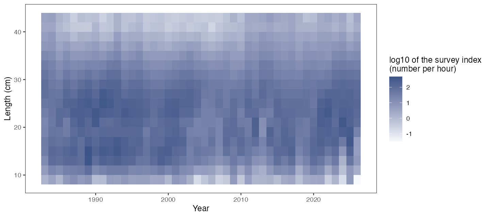
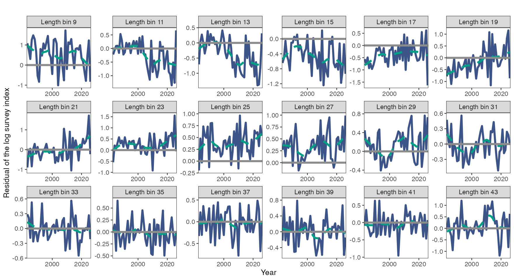
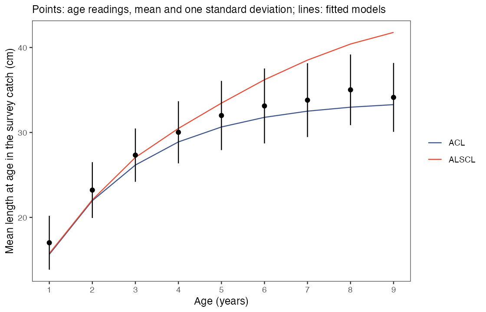
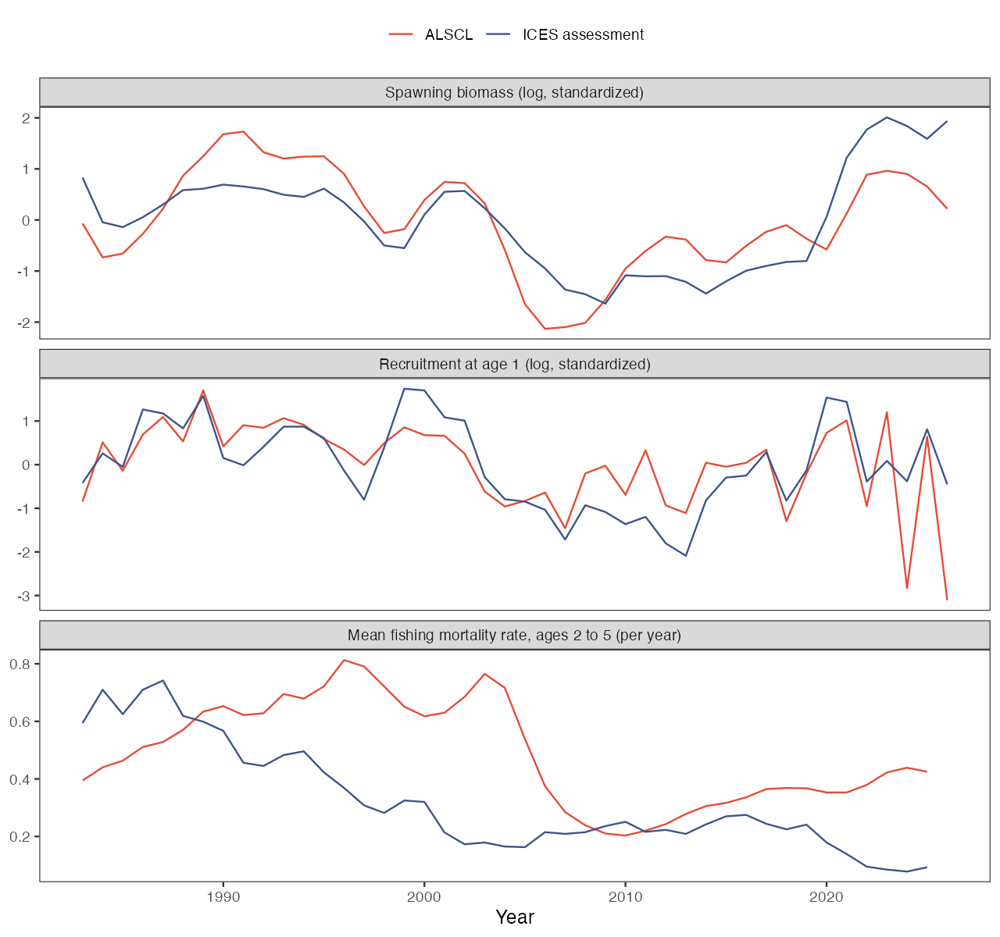
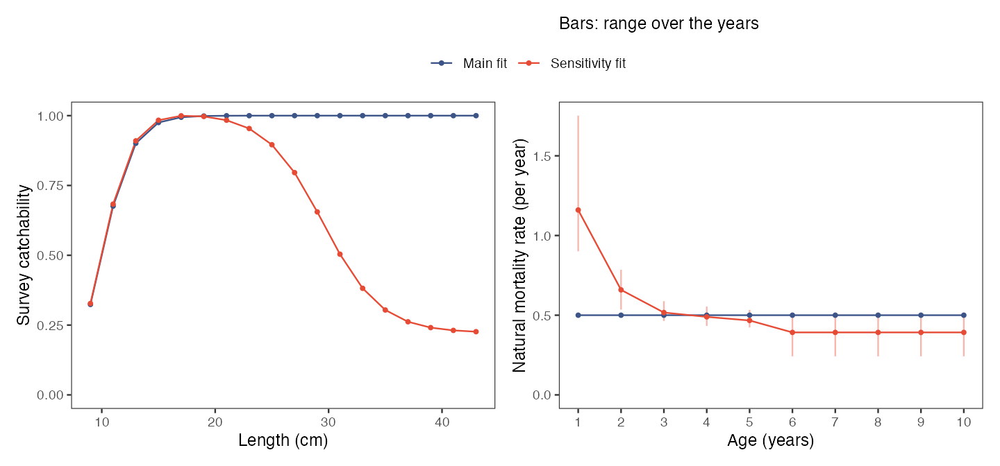
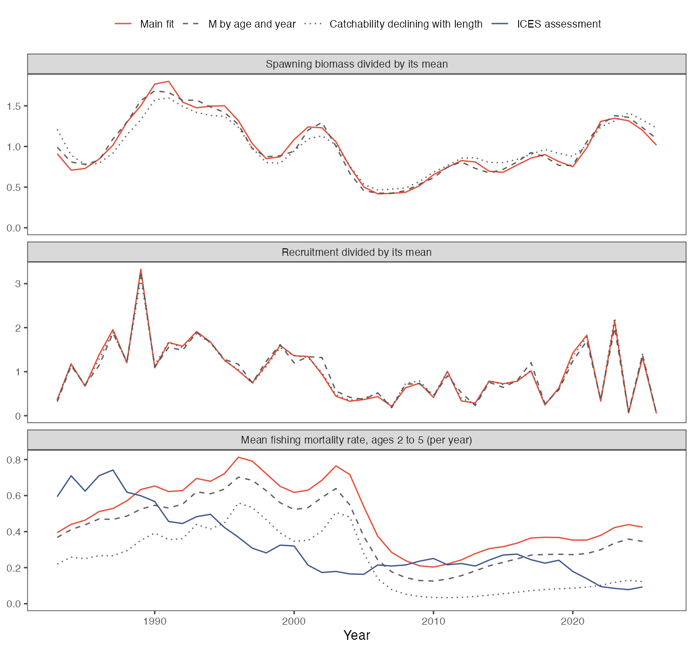

# 真实调查数据的拟合结果，哪些可以用？

本页用一组真实的调查指数拟合 ALSCL 和 ACL，数据是 1983 至 2026 年北海牙鳕（*Merlangius merlangus*）的调查指数，然后把拟合结果与两类没有进入拟合的资料对比：同一调查的年龄判读数据，以及国际海洋考察理事会（ICES）对该种群的评估。读完本页，你会知道只用调查数据的拟合有哪些输出与这两类资料一致，哪些输出取决于固定的输入。你需要已安装 ALSCL（[安装 ALSCL](getting-started.html)），并了解[理解第一次拟合](first-model.html)中的数值检查。完整序列每个初值约需 10 分钟，所以第 1 步先用一段较短的序列。本页按照脚本 [whiting_case.R](https://github.com/FanZhang-LAB-SHOU/ALSCL/blob/main/scripts/whiting_case.R) 和 [whiting_case_report.R](https://github.com/FanZhang-LAB-SHOU/ALSCL/blob/main/scripts/whiting_case_report.R) 展开，文中引用的每个数值都列在 [numbers.csv](https://github.com/FanZhang-LAB-SHOU/ALSCL/blob/main/docs/results/whiting-case/numbers.csv) 中。

<h2 id="quick">1. 先拟合一段较短的序列</h2>

```r
library(ALSCL)
x <- whiting_example
short <- x
for (tab in c("data.CatL", "data.wgt", "data.mat")) short[[tab]] <- x[[tab]][, 1:21]
check_alscl_data(short, "alscl")$summary
quick <- run_alscl(short, nstarts = 3, ncores = 3, start_spread = 0.5)
quick$start_diagnostics[, c("start_id", "objective", "convergence")]
quick$diagnostics$numerical_ok
```

`whiting_example` 是一个输入列表，包含 18 个体长组、44 年的调查指数表 `data.CatL`、体重表 `data.wgt` 和成熟比例表 `data.mat`，`fit_args` 和 `fit_config` 中的设置，以及第 5、6 步核对时用到的表。`short` 保留 `LengthBin` 列和前 20 年（1983-2002），设置不变。它只是为了节省时间而截取的子集：先用几分钟把本页的代码跑通，再开始拟合完整序列。

`check_alscl_data()` 应显示 18 个体长组、20 个时间步、360 个正观测和 13 个自由标量参数。在记录的这次运行中，三个初值得到相同的目标函数值（负对数似然）245.56，`numerical_ok` 为 `TRUE`。三个初值在三个核上并行，共用 2.7 分钟，每个初值约 2 分钟。核数较少时减小 `ncores`，各初值依次运行。后面各步的结果来自完整序列 `x`，与 `short` 的结果不同。

<h2 id="data">2. 了解数据和固定输入的来源</h2>

```r
x$provenance[c("survey", "areas", "gear", "index", "incomplete_years")]
subset(x$survey_coverage, hauls_missing > 2)
x$fit_args[c("rec.age", "nage", "M", "sel_L50", "sel_L95")]
x$provenance$settings
x$provenance$citation
```

指数来自北海国际底拖网调查（NS-IBTS）第一季度在圆鱼区 1 至 7 用 GOV（Grande Ouverture Verticale）底拖网完成的网次，数据取自 ICES 的拖网调查数据库（DATRAS）。按体长的单位努力渔获量（每拖网小时的尾数）先在每个 ICES 统计方格内平均，再在方格间平均。`x$provenance` 记录了这些规则、下载日期、引用格式和许可（CC BY 4.0），`?whiting_example` 给出同样的信息。

这组数据有一些拟合无法消除的局限。数据只来自一个调查的一个季度，没有渔获量数据进入拟合。DATRAS 的数据产品缺少 2009 年的 63 个有效网次和 2012 年的 56 个有效网次，这两年的指数由较少的网次算出（见 `x$survey_coverage` 的 `hauls_missing` 列）。该调查从 2025 年开始更换新网具，2025 和 2026 年的指数没有区分用新网具完成的网次。各体长的体重和成熟比例在所有年份都用同一条曲线。指数是各网次的简单平均，而 ICES 的评估使用基于模型的指数，并且并入了其他调查。

两个模型都按给定值使用下表中的输入。只有调查数据时，按体长的调查可捕性和资源数量的尺度都无法估计，只有假定自然死亡率 M 的取值，才能把捕捞死亡率和自然死亡率分开（[Zhang & Cadigan 2022](https://doi.org/10.1111/faf.12673)）。请像 `x$provenance$settings` 那样记下每项输入的来源。

| 输入 | 取值 | 怎样确定 |
|---|---|---|
| 体长组 | 2 cm，标签 9 至 43 | 在 1、2、5 cm 中取最小的宽度，使指数中间 98% 的范围不超过 24 组；第一组和最后一组分别包含所有更小和更大的鱼 |
| `rec.age`、`nage` | 1、10 | 1 龄是第一季度指数中最小的年龄；取 10 个年龄组时，最后一组（加群）在只有 M 的情况下约含一个世代的 1% |
| `M` | 每年 0.50 | 4.899 × tmax^-0.916（[Then et al. 2015](https://doi.org/10.1093/icesjms/fsu136)），年龄判读数据中的最大年龄 tmax 为 12 龄 |
| `sel_L50`、`sel_L95` | 10 cm、14 cm | 假设值：没有研究给出第一季度牙鳕的调查可捕性随体长上升的部分 |
| `cv_len`（各龄体长的变异系数） | 固定为 0.15 | 年龄判读数据中 1 至 3 龄体长的变异系数为 0.148 |
| 生长参数 Linf（渐近体长）、k（生长率系数）和 t0（体长为零时的年龄） | 估计 | 初值来自年龄判读数据；`t0_lower = -2` 使 ALSCL 的 t0 可以为负 |



热图显示各年、各体长组调查指数的 log10 值。各体长组指数之和最低为 2007 年的每小时 339 尾，最高为 1989 年的 2360 尾；每年的网次数在 192 至 491 之间。

<h2 id="fit">3. 用多个初值拟合完整序列</h2>

```r
b <- run_alscl(x, nstarts = 5, ncores = 5, start_spread = 0.5)
b$start_diagnostics[, c("start_id", "objective", "convergence")]
b$start_summary[c("converged", "agree_with_best", "objective_range")]
b$diagnostics[c("numerical_ok", "issues", "advice")]
b$diagnostics$plausibility
plot_residuals(b, facet_by = "length", facet_ncol = 6)
```

`nstarts = 5` 从五组不同的初值出发各拟合一次，`ncores = 5` 让它们并行运行。`start_spread = 0.5` 是在优化器尺度上加到第二个及以后各初值上的正态随机数的标准差，默认值为 0.15。拟合保留目标函数值最低的那个初值的结果。

五个初值中有四个得到 722.59。另一个停在 755.72，此时生长增量的变异系数 cv_grow 位于下界 0.01。如果只用这一个初值，拟合返回的就是这个解，而单次拟合中没有任何信息提示还有更好的解。`b$diagnostics$issues` 报告 "starts converged to different optima"（各初值收敛到不同的解），被保留的初值 `numerical_ok` 为 `TRUE`。`advice` 给出检查未通过时的处理建议，`plausibility` 列出取值不合理但不会使检查失败的估计值，这里两者都为空。这次拟合在五个核上用了 12 分钟。

各初值的结果不一致时，拟合保留目标函数值最低的解。请查看 `b$start_summary$agree_with_best`，确认不止一个初值到达该解；如果只有一个，就增加初值。`advice` 不为空时，按其中的建议修改并重新拟合，第 4 步对 ACL 就是这样做的。



每个小图是一个体长组各年的对数指数残差。有几个体长组的残差多年保持同一符号：标签为 9 cm 的组为正（均值 0.53），23 至 29 cm 为正（均值 0.27），13 至 17 cm 为负（均值 -0.40）。同一年相邻体长组残差的平均相关系数为 0.54，而模型假定观测误差相互独立。数值检查不检验这两种情形。它们都说明模型没有反映指数的某些特征，这次拟合的标准误偏小。

<h2 id="acl">4. 拟合 ACL 并按建议修改</h2>

```r
a <- run_acl(x, nstarts = 5, ncores = 5, start_spread = 0.5)
a$diagnostics[c("numerical_ok", "issues", "advice")]
a$diagnostics$plausibility$note
a2 <- run_acl(x,
  parameters = c(x$fit_config$acl$parameters, list(log_std_log_N0 = -3)),
  map = c(x$fit_config$acl$map, list(log_std_log_N0 = factor(NA))),
  nstarts = 5, ncores = 5, start_spread = 0.5)
a2$diagnostics[c("numerical_ok", "issues")]
```

ACL 的五个初值都得到相同的目标函数值 736.88，Hessian 矩阵正定，但拟合仍然没有通过数值检查。初始各龄数量偏差的标准差估计为 2e-05，实际上等于零。这样的参数没有碰到优化器的边界，但数据无法确定它。`a$diagnostics$advice` 建议用 `map` 把 `log_std_log_N0` 固定在选定的值上，然后重新拟合。

第二次调用按这一建议把标准差固定为 exp(-3) = 0.05。显式给出的 `map` 或 `parameters` 参数会替换输入列表中存储的内容，所以两处都重复了已存储的条目。目标函数值变化了 0.08，Linf、k 和 t0 的估计值前三位数字不变，`numerical_ok` 为 `TRUE`。`issues` 中还剩三项，它们不会使检查失败：k 与 t0 估计值的相关系数为 0.96，优化器的精修停在最大梯度 1e-05 处，高于其容许值，以及有一个初值停在目标函数值 1308 处。

两次 ACL 拟合都留有一条合理性提示：初始总死亡率估计为每年 0.34，低于假定的 M（0.5）。这意味着 1983 年各龄数量随年龄下降的速度比只有自然死亡时还慢，原因可能在假定的 M、假定的调查可捕性，或者 1983 年以前补充量在上升。这条提示不改变数值检查的结论，报告拟合结果时应一并说明。ALSCL 的估计值为每年 0.88。

ALSCL 的目标函数值较低，为 722.59，ACL 为 736.96；估计的标量参数分别为 13 个和 9 个。目标函数值不能说明哪个模型对种群的描述更好。第 5、6 步用没有进入拟合的数据来对比这两次拟合。

<h2 id="growth">5. 与年龄判读数据对比各龄平均体长</h2>

```r
by_age <- function(fit) {
  la <- length_at_age(fit, "survey")
  tapply(la$mean_length, la$age, mean)
}
readings <- subset(x$age_readings$length_at_age, period == "1983-2026")
round(cbind(readings = readings$mean_length, ALSCL = by_age(b), ACL = by_age(a2)), 1)
```

`x$age_readings$length_at_age` 是由同一调查的年龄判读数据得到的各龄平均体长，这些数据没有进入拟合。耳石是按体长组采集的，所以读过年龄的鱼不是渔获的随机样本，直接对它们的体长按年龄求平均会偏向大鱼。因此这张表是用年龄体长键算出的：对每一年，把每个 1 cm 体长组中读过年龄的鱼的各龄比例乘以该体长组的调查指数。结果是调查所见的各龄平均体长，与之对应的模型输出是 `length_at_age(fit, "survey")`，其中各体长的数量乘以了调查可捕性。代码对各年取平均，并输出 1 至 10 龄的结果；模型的 10 龄是加群，下表没有列出。

比较生长时要用各龄平均体长，不要用生长参数。在 ACL 中，Linf、k 和 t0 描述的是各龄平均体长的 von Bertalanffy 曲线。在 ALSCL 中，Linf 和 k 决定各体长的生长增量，并与 t0 一起决定补充群体的平均体长。ALSCL 估计的 Linf 为 53.1 cm、k 为每年 0.17，ACL 为 33.9 cm 和每年 0.43。

| 年龄（龄） | 1 | 2 | 3 | 4 | 5 | 6 | 7 | 8 | 9 |
|---|---|---|---|---|---|---|---|---|---|
| 年龄判读数据（cm） | 17.0 | 23.2 | 27.3 | 30.0 | 32.0 | 33.1 | 33.8 | 35.0 | 34.1 |
| ALSCL（cm） | 15.8 | 22.1 | 27.1 | 30.5 | 33.5 | 36.2 | 38.5 | 40.4 | 41.8 |
| ACL（cm） | 15.7 | 22.0 | 26.2 | 28.9 | 30.6 | 31.8 | 32.5 | 33.0 | 33.3 |



1 至 4 龄时，ALSCL 与年龄判读数据的差别在 1.3 cm 以内。从 5 龄起 ALSCL 偏大，5 龄偏大 1.5 cm，9 龄偏大 7.7 cm。ACL 在每个年龄都比年龄判读数据小 0.9 至 2.0 cm，曲线形状与之相同。1 龄和 2 龄时，两个模型都比年龄判读数据小 1 cm 以上。

体长指数中只有最小的几个年龄形成分开的峰。较大年龄的体长相互重叠，指数中大鱼少，既可能是因为鱼长得慢，也可能是因为大鱼死得快。只有体长数据时，无法把大龄鱼的生长和按体长的死亡率分开。在这两次拟合中，ALSCL 让大龄鱼长到更大的体长并给它们更高的捕捞死亡率（第 6 步），ACL 则给它们较低的渐近体长；从 6 龄起，年龄判读数据与 ACL 更接近。年龄判读数据本身也随时间变化，而两个模型都不允许这种变化：5 龄的平均体长在各个年代之间为 30.2 至 33.5 cm。ALSCL 的 1 至 4 龄平均体长可以使用，不要把它的 Linf 或更大年龄的体长当作生长的估计值。

<h2 id="assessment">6. 与评估对比趋势和死亡率</h2>

```r
ices <- x$ices$assessment
at <- function(v, lag = 0) v[match(b$year - lag, ices$year)]
cor(log(b$report$SSB), log(at(ices$ssb)))
cor(log(b$report$Rec), log(at(ices$recruitment_age0, lag = 1)))
maturity <- x$ices$maturity[c(1:6, 6, 6, 6, 6), as.character(pmin(pmax(b$year, 1991), 2021))]
cor(log(ssb_at_age(b, maturity)$SSB), log(at(ices$ssb)))
catch <- relative_catch(b, years = 1983:2025)
keep <- !catch$extrapolated
cor(log(catch$catch_weight[keep]), log(at(ices$catch)[keep]))
```

`x$ices$assessment` 是 ICES 2026 年评估（[ICES 2026](https://doi.org/10.17895/ices.pub.32676345)）给出的产卵生物量（SSB）、补充量、2 至 5 龄平均捕捞死亡率（F）和渔获量。该评估使用各龄渔获量、第一和第三季度的调查指数以及按年龄和年份变化的自然死亡率，所以它是外部的对照，不是真值。拟合得到的 SSB 和补充量以调查指数为单位，所以只比较趋势，这里用对数值的相关系数。拟合的补充量是第一季度的 1 龄鱼，评估的补充量是 0 龄鱼，所以代码把评估序列错开一年。`ssb_at_age()` 用评估的各龄成熟比例重新计算 SSB（6 龄及以上合为一组，1991-2021 以外的年份取最近的年份），`relative_catch()` 返回模型渔获量除以其均值后的序列。

| 与评估的对比 | ALSCL | ACL | ICES |
|---|---|---|---|
| SSB 对数值的相关系数 | 0.74 | 0.72 | |
| SSB 对数值的相关系数，用评估的各龄成熟比例 | 0.74 | 0.71 | |
| 补充量对数值的相关系数 | 0.67 | 0.67 | |
| 渔获重量对数值的相关系数 | 0.62 | 0.71 | |
| 2 至 5 龄平均 F（每年），1983-1999 | 0.62 | 0.57 | 0.51 |
| 2 至 5 龄平均 F（每年），2000-2012 | 0.44 | 0.31 | 0.21 |
| 2 至 5 龄平均 F（每年），2013-2025 | 0.36 | 0.12 | 0.18 |



SSB 和补充量的趋势与评估部分一致，ALSCL 的相关系数为 0.67 至 0.74。SSB 的最低值在 ALSCL 拟合中出现在 2006 年，在评估中出现在 2009 年，此后两者都回升。两者在近期水平上不同：2017-2026 年的平均 SSB 与 1983-1992 年的平均 SSB 之比，ALSCL 为 0.87，评估为 1.22。把按体长的成熟比例换成评估的各龄成熟比例，相关系数的变化不到 0.01。

F 的水平不能比较。ALSCL 的 F 在三个时期都高于评估，2000 年以后约为评估的两倍，两个序列的秩相关系数为 0.31。ACL 的 F 在前两个时期更接近评估，在最后一个时期低于评估。只用调查数据拟合时，总死亡率是在假定的调查可捕性下由指数中各世代的下降估计的，F 等于总死亡率减去假定的 M。因此 F 的水平以及渔获量的水平都取决于固定的输入，第 7 步给出变化的幅度。

调查数据能够提供的，是一个世代的指数从一年到下一年的下降率，即调查所见的总死亡率。下表给出它在 2 至 5 龄上的均值：由年龄判读数据的各龄指数（`x$age_readings$index_at_age`）计算的值，由每次拟合对应的各龄指数计算的值，以及评估的 F 与 M 之和。

| 时期 | 年龄判读数据 | ALSCL | ACL | 评估的 F + M |
|---|---|---|---|---|
| 1983-1999 | 1.05 | 1.12 | 1.07 | 1.03 |
| 2000-2012 | 0.78 | 0.94 | 0.81 | 0.76 |
| 2013-2025 | 0.95 | 0.86 | 0.62 | 0.73 |

ALSCL 在每个时期与年龄判读数据的差别都在每年 0.17 以内。ACL 在前两个时期的差别在每年 0.04 以内，在最后一个时期降到 0.62，而年龄判读数据给出 0.95。只有当调查可捕性不随年龄变化时，调查所见的下降率才等于种群的总死亡率；评估对这个调查指数的每个年龄分别估计可捕性。

<h2 id="sensitivity">7. 改变两项固定输入</h2>

```r
M_age <- x$ices$M[c(1:6, 6, 6, 6, 6), ]
M_ices <- cbind(M_age, M_age[, rep("2022", 4)])
dimnames(M_ices) <- list(age = 1:10, year = 1983:2026)
b_M <- run_alscl(x, M = M_ices, nstarts = 3, ncores = 3, start_spread = 0.5)
q_dome <- survey_catchability(x$fit_args$len_mid, "dome", L50 = 10, L95 = 14,
                              L50_desc = 29.5, L95_desc = 22, minimum = 0.22)
b_q <- run_alscl(x, survey_q = q_dome, sel_L50 = NULL, sel_L95 = NULL,
                 nstarts = 3, ncores = 3, start_spread = 0.5)
```

第一次拟合把常数 M 换成评估取自多物种模型的按年龄和年份变化的自然死亡率（`x$ices$M`，[ICES 2026](https://doi.org/10.17895/ices.pub.32676345) 的输入表）。这时 `M` 是一个矩阵，每个年龄组一行，每个时间步一列。6 至 10 龄取表中最大年龄组的值，2023-2026 年取 2022 年的值。各年的均值在 1 龄为每年 1.18，2 龄为 0.66，6 龄及以上为 0.40。

第二次拟合把 logistic 形式的调查可捕性换成对大鱼下降的曲线。[Fraser et al. (2007)](https://doi.org/10.1093/icesjms/fsm145) 估计了 GOV 拖网对牙鳕按体长的可捕性：21 cm 及以下为常数，22 至 37 cm 线性下降，38 cm 起约为该常数水平的 0.22。他们的曲线针对第三季度的调查，并且以当时的评估结果为基准，所以只能提供形状；它也不含小体长处上升段的信息，这里上升段仍取 10 和 14 cm。`survey_catchability()` 取 `"dome"` 时构造这样的曲线：下降从 `L95_desc` 附近开始，在 `L50_desc` 处降到一半，最后停在 `minimum`。`survey_q` 取代 `sel_L50` 和 `sel_L95`，这两个参数必须设为 `NULL`。



| 结果 | 主拟合 | M 按年龄和年份变化 | 可捕性随体长下降 |
|---|---|---|---|
| 目标函数值 | 722.59 | 857.41 | 752.76 |
| 到达最低目标函数值的初值数 | 5 个中 4 个 | 3 个中 3 个 | 3 个中 2 个 |
| 2 至 5 龄平均 F（每年），1983-1999 | 0.62 | 0.54 | 0.37 |
| 2 至 5 龄平均 F（每年），2000-2012 | 0.44 | 0.33 | 0.21 |
| 2 至 5 龄平均 F（每年），2013-2025 | 0.36 | 0.28 | 0.08 |
| 与主拟合的 SSB 对数值相关系数 | | 0.99 | 0.97 |
| 与主拟合的补充量对数值相关系数 | | 0.99 | 1.00 |
| 平均 SSB 与主拟合之比 | 1 | 0.92 | 1.66 |
| 平均补充量与主拟合之比 | 1 | 1.48 | 1.13 |
| 7 龄平均体长（cm）；年龄判读数据为 33.8 | 38.5 | 38.3 | 38.6 |



两次敏感性拟合都通过了数值检查。SSB 和补充量的趋势几乎不变：它们与主拟合的相关系数都不低于 0.97。水平则发生变化。M 按年龄变化时 1 龄鱼死亡更多，补充量是主拟合的 1.48 倍；可捕性随体长下降时调查捕到的大鱼比例更小，SSB 是主拟合的 1.66 倍。2013-2025 年 2 至 5 龄的平均 F 在三次拟合中分别为每年 0.36、0.28 和 0.08，评估为 0.18。7 龄平均体长仍比年龄判读数据大 4 至 5 cm：这两项输入都不能消除大龄鱼体长的差别。

两次敏感性拟合的目标函数值都更高，分别高 135 和 30。不要用目标函数值来选择 M 或调查可捕性的形状。只有调查数据时，自然死亡率、渔业的选择性和调查可捕性可能相互混淆，要得到唯一的解，必须对其中一项或几项作出假设（[Cook 2013](https://doi.org/10.1016/j.fishres.2013.01.003)）。[Zhang & Cadigan (2022)](https://doi.org/10.1111/faf.12673) 把模型的 F 估计称为绝对估计，该文没有考察 M 或调查可捕性形状设错的情形。这一步的三次拟合说明，F 的水平只在所假定的 M 和调查可捕性下成立。

<h2 id="use">8. 决定报告哪些结果</h2>

```r
estimates <- extract_estimates(b)
subset(estimates, quantity %in% c("SSB", "Rec") & year >= 2022,
       c(quantity, year, estimate, conf_low, conf_high))
tail(relative_catch(b), 3)
save_assessment(b, "whiting_alscl.rds")
```

`extract_estimates()` 返回 SSB 和补充量及其区间；`relative_catch()` 返回模型渔获量除以其均值后的序列，最后一年没有观测提供信息，其 `extrapolated` 为 `TRUE`；`save_assessment()` 把拟合结果写入文件，供以后的会话使用。下表列出本页的核对对这组指数支持哪些用法。对你自己的数据要重新做这些核对，同样的输出未必能通过。

| 输出 | 用法 | 本页的依据 |
|---|---|---|
| 各年补充量 | 趋势 | 与年龄判读数据 1 龄指数的相关系数为 0.77，与评估的相关系数为 0.67；第 7 步三次拟合之间的相关系数不低于 0.99 |
| 产卵生物量 | 趋势，作为相对序列 | 与评估的相关系数为 0.74，三次拟合之间不低于 0.97 |
| 1 至 4 龄平均体长 | 调查所见的值 | 与年龄判读数据的差别在 1.3 cm 以内 |
| 2 至 5 龄调查所见的总死亡率 | 作为指数的下降率，不作为种群的总死亡率 | 每个时期与年龄判读数据的差别都在每年 0.17 以内 |
| F 和渔获量的水平 | 不要使用 | F 等于总死亡率减去假定的 M；2013-2025 年三次拟合的 F 为每年 0.08 至 0.36 |
| SSB 和补充量的水平 | 不要使用 | 以调查指数为单位；换用第 7 步的输入后分别变为 1.66 倍和 1.48 倍 |
| Linf 和 5 龄及以上的平均体长 | 不要当作生长的估计值 | 比年龄判读数据大 1.5 至 7.7 cm |
| 标准误和区间 | 作为不确定性的下限 | 不包含固定输入的不确定性，相邻体长组的残差相关（0.54） |

<h2 id="next">下一步</h2>

| 想做什么 | 阅读 |
|---|---|
| 整理自己的表和设置 | [如何拟合自己的调查数据？](case-fit-survey.html) |
| 读数值检查、建议和合理性提示 | [判断拟合是否可用](diagnostics.html) |
| 选择初值、边界和要固定的参数 | [选择拟合设置](fitting-controls.html) |
| 在真值已知的数据上比较 ACL 和 ALSCL | [ACL 与 ALSCL 的评估结果有什么不同？](case-compare-assessments.html) |
| 把其他 M 取值作为情景来拟合 | [评估对假设有多敏感，未来 F 会怎样改变结果？](case-sensitivity-projection.html) |
| 去掉最后几年后重新拟合 | [运行回溯分析](retrospectives.html) |
