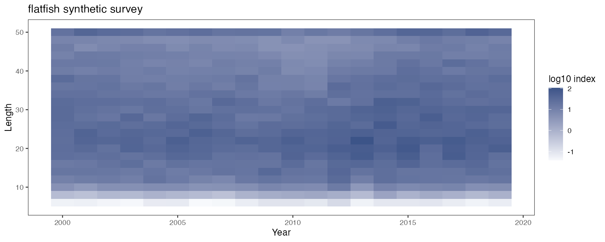
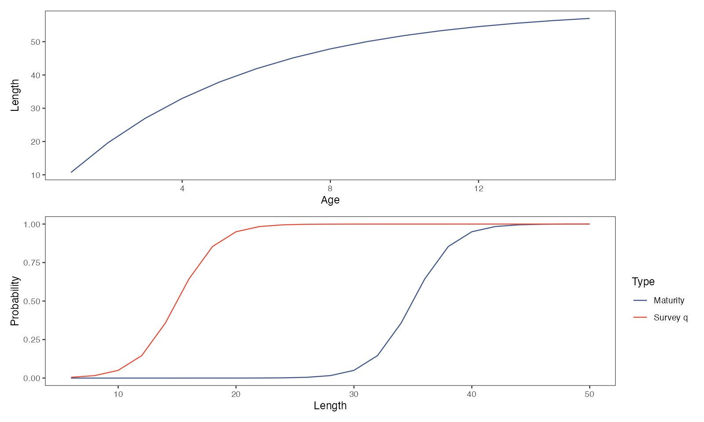
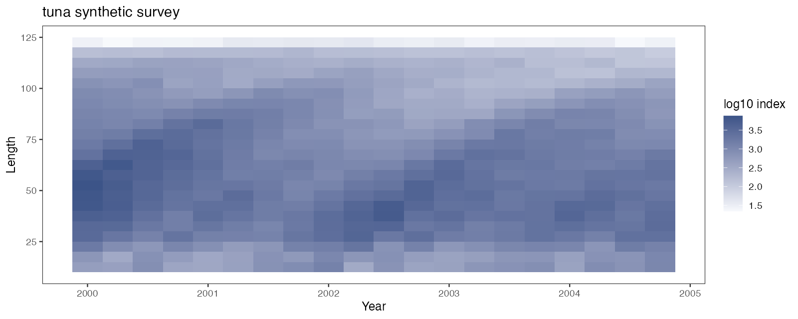
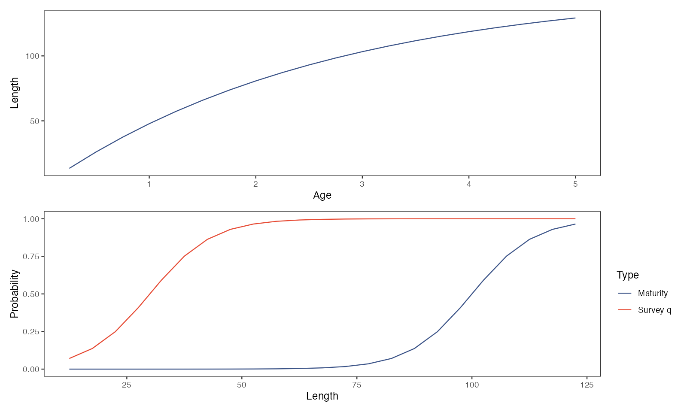
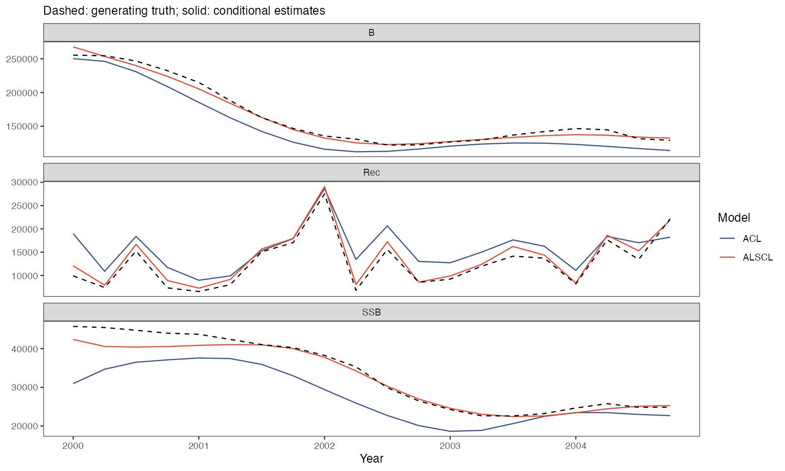

# 年度与季度时间步

学完本页，你已经用 ACL 和 ALSCL 拟合了两个附带案例，一个年度鲽鱼调查和一个季度金枪鱼调查，并知道时间步改为季度时哪些设置的含义会改变。两个案例都是模拟数据（由 `scripts/simulation_workflow.R` 以种子 4 生成，各有 23 个体长组和 20 个时间步）；它们不是论文的数据。你需要安装好的软件包和一份仓库副本；请在同一个 R 会话中从仓库根目录运行各步骤。[理解第一次拟合](first-model.html)说明了输入列表和数值检查。

<h2 id="read">1. 读取两个案例</h2>

```r
library(ALSCL)
flatfish_inputs <- read_survey_csv("docs/data/cases/flatfish")
tuna_inputs <- read_survey_csv("docs/data/cases/tuna")
pa <- readRDS("docs/data/cases/tuna/truth.rds")$parameters
pa[c("growth_step", "rec.age", "nage", "M", "Linf", "vbk")]
names(tuna_inputs$data.CatL)[1:5]
```

每个案例文件夹包含三张表 `data.CatL.csv`、`data.wgt.csv` 和 `data.mat.csv`（一列 `LengthBin` 标签，之后每个时间步一列），以及保存生成设置 `parameters` 和模拟种群 `truth` 的 `truth.rds`。`read_survey_csv()` 检查三张表的标签和维度一致、时间标签递增、体重有限且非负、成熟比例在 0 到 1 之间；它不添加生物学设置。生物学设置在后两步输入：

| 设置 | 鲽鱼 | 金枪鱼 |
|---|---|---|
| 生成器，时间步 | 年龄型，1 年 | 体长型，0.25 年 |
| 时间标签 | 2000 至 2019，每年一列 | 2000 至 2004.75，每季一列 |
| `rec.age`、`nage` | 1、15 | 0.25、20 |
| `Linf`、每年的 `vbk`、`t0` | 60、0.20、1/60 | 152、0.38、1/152 |
| 每个时间步的 `M` | 0.20 | 0.20（每年 0.80） |
| 成熟 L50、L95 | 35、40 | 100、120 |
| 调查可捕性 `sel_L50`、`sel_L95` | 15、20 | 30、50 |
| 体长组中点；调查对数 SD | 6 至 50，间隔 2；0.20 | 12.5 至 122.5，间隔 5；0.10 |

`pa` 打印出 `growth_step` 0.25、`rec.age` 0.25、`nage` 20、`M` 0.2、`Linf` 152 和 `vbk` 0.38；金枪鱼的列名是 `LengthBin`、`2000`、`2000.25`、`2000.5`、`2000.75`。如果 `read_survey_csv()` 停在 `folder must name an existing directory`，说明 R 不在仓库根目录；如果报错信息点名某张表，按[准备调查数据](data-preparation.html)修正该文件。

<h2 id="annual">2. 拟合年度鲽鱼案例</h2>

```r
fix <- function(p) lapply(p, function(v) factor(NA))
known <- list(log_Linf = log(60), log_vbk = log(0.2), log_cv_len = log(0.2),
  logit_log_R = qlogis(0.1))
acl_known <- c(known, list(t0 = 1/60, log_std_log_F = log(0.2), log_std_log_N0 = log(0.2)))
alscl_known <- c(known, list(log_t0 = log(1/60), log_cv_grow = log(0.2),
  log_sigma_log_F = log(0.2), log_sigma_log_N0 = log(0.2)))
x <- prepare_alscl_data(flatfish_inputs,
  fit_args = list(rec.age = 1, nage = 15, M = 0.2, sel_L50 = 15, sel_L95 = 20,
    growth_step = 1, silent = TRUE),
  fit_config = list(acl = list(parameters = acl_known, map = fix(acl_known)),
    alscl = list(parameters = alscl_known, map = c(fix(alscl_known),
      list(logit_log_F_l = factor(NA), logit_log_F_y = factor(NA))))))
a <- run_acl(x)
b <- run_alscl(x)
c(a$diagnostics$numerical_ok, b$diagnostics$numerical_ok)
plot_compare_ts(a, b, quantities = c("B", "SSB", "Rec"), se = TRUE)
```

`prepare_alscl_data()` 用三张表和 `fit_args` 中两个模型共用的生物学设置构建输入列表 `x`；体长组来自行标签（中点为 6 至 50、间隔 2，边界取相邻中点的中间值）。`fit_config` 存放各模型的初值和 `map`。生成调查数据时使用的值用 `factor(NA)` 固定：生长参数、体长变异系数、过程标准差和补充量相关系数，ALSCL 还固定两个 F 相关系数。于是每个模型只估计五个标量参数，估计值以已知生物学为条件。这正是 [scripts/case_studies.R](https://github.com/FanZhang-LAB-SHOU/ALSCL/blob/main/scripts/case_studies.R) 的设置，下面的图由该脚本绘制。

每个模型一次性编译之后，ACL 约需二十秒，ALSCL 约需一分半。数值检查应打印 `TRUE TRUE`，与脚本的[收敛记录](https://github.com/FanZhang-LAB-SHOU/ALSCL/blob/main/docs/results/case_convergence.csv)一致。若某项检查未通过，按[理解第一次拟合](first-model.html#checks)运行 `diagnose_model(x$data.CatL, a)`，并用 `nstarts` 增加初值。



热图按年份和体长组显示 log10 调查指数：10 cm 以下很小，因为那里的调查可捕性低于 0.1；15-30 cm 最大。



生长曲线从 1 龄的 11 cm 到 15 龄的 57 cm。成熟（L50 为 35 cm，来自 `data.mat`）和调查可捕性（L50 为 15 cm，由 `sel_L50` 和 `sel_L95` 设定）是两条不同的曲线。


虚线是生成真值，实线是两个模型的条件估计。两个模型都跟上了 2010 年之前的下降和之后的回升；2014 年以后 ALSCL 的生物量和产卵生物量低于真值。`plot_compare_ts()` 画出的是同样的轨迹，并附有区间。

<h2 id="quarterly">3. 拟合季度金枪鱼案例</h2>

```r
known <- list(log_Linf = log(152), log_vbk = log(0.38), log_cv_len = log(0.2),
  logit_log_R = qlogis(0.1))
acl_known <- c(known, list(t0 = 1/152, log_std_log_F = log(0.2), log_std_log_N0 = log(0.3)))
alscl_known <- c(known, list(log_t0 = log(1/152), log_cv_grow = log(0.3),
  log_sigma_log_F = log(0.2), log_sigma_log_N0 = log(0.3)))
xq <- prepare_alscl_data(tuna_inputs,
  fit_args = list(rec.age = 0.25, nage = 20, M = 0.2, sel_L50 = 30, sel_L95 = 50,
    growth_step = 0.25, silent = TRUE),
  fit_config = list(acl = list(parameters = acl_known, map = fix(acl_known)),
    alscl = list(parameters = alscl_known, map = c(fix(alscl_known),
      list(logit_log_F_l = factor(NA), logit_log_F_y = factor(NA))))))
check_alscl_data(xq, "alscl")$time
aq <- run_acl(xq)
bq <- run_alscl(xq)
c(aq$diagnostics$numerical_ok, bq$diagnostics$numerical_ok)
plot_compare_ts(aq, bq, quantities = c("B", "SSB", "Rec"), se = TRUE)
```

代码相同，但四项设置的含义变了。`growth_step = 0.25` 使每一列代表一个季度，因此时间标签必须相隔 0.25。`M` 和捕捞死亡率都按时间步计：年 M 为 0.8 要输入 `M = 0.2`，而 `vbk` 仍按年计。`rec.age` 以年为单位，0.25 表示一个季度龄补充；`nage = 20` 数的是季度龄组，从 0.25 龄到 5 龄，最后一组为加组；`t0` 必须小于 `rec.age`。

`check_alscl_data()$time` 打印 2000 到 2004.75 的 20 个季度：这里的二十个时间步是五年。两次拟合都通过数值检查；ALSCL 约需两分钟。如果标签的间隔不等于 `growth_step`，拟合会停在 `Time column spacing must equal growth_step`；请保留每个季度一列，没有调查的季度填 `NA`，体重和成熟比例则要完整。



热图现在每年有四列。指数在 30-70 cm 最大，在 122.5 cm 组最小，生长曲线要到 4 龄以后才到达这个体长。



生长曲线从 0.25 龄的 13 cm 到 5 龄的 129 cm（`vbk` 为每年 0.38）；成熟（L50 为 100 cm）远高于调查可捕性（L50 为 30 cm）。



补充量现在按季度计。ALSCL 的生物量和产卵生物量跟随真值；ACL 的生物量低于真值，2000-2001 年的产卵生物量起点过低，并高估了多数季度的补充量。该案例由体长型动态生成，这正是 ALSCL 假设的结构；单个重复不能给两个模型排名。

<h2 id="simulation">4. 扩展为模拟实验</h2>

```r
source("scripts/simulation_workflow.R", encoding = "UTF-8")
simulations <- run_simulation_examples(out = "my_simulations", fit_batch = FALSE)
source("scripts/case_studies.R", encoding = "UTF-8")
case_status <- run_case_studies(out = "docs")
```

`run_simulation_examples()` 在 `out` 下重新生成两个案例：每个预设物种的三个 CSV 文件、`truth.rds` 和重复文件；`fit_batch = TRUE` 会再对鲽鱼的重复批量拟合 ACL，并写出保留失败拟合的 `batch_checks.csv`。`run_case_studies()` 用第 2 步和第 3 步的设置重新拟合两个案例，在 `out` 下写出七张案例图和 `results/case_convergence.csv`；它从 `out/data/cases` 读取真值，所以换用其他 `out` 时先把两个案例文件夹复制过去。

要做模拟实验，就增大 `iter_range` 以生成更多重复，每次只改变一项设置（调查对数 SD、`M`、可捕性、体长组或序列长度），并在偏差、RMSE 和区间覆盖率的汇总中保留失败的拟合；只平均成功的拟合是选择偏差。[模拟与批量实验](simulation.html)介绍模拟器和批量拟合。

<h2 id="next">下一步</h2>

| 想做什么 | 阅读 |
|---|---|
| 整理自己的数据表并选择时间步 | [准备调查数据](data-preparation.html) |
| 读拟合结果的数值检查、估计值和残差 | [理解第一次拟合](first-model.html) |
| 决定哪些参数固定、哪些估计 | [拟合设置](fitting-controls.html) |
| 生成调查数据并批量拟合重复 | [模拟与批量实验](simulation.html) |
| 从拟合模型模拟，或预测留出的年份 | [模型验证](case-model-validation.html) |
