# 生长、死亡与残差图

先完成 [YTF 拟合示例](first-model.html)，得到输入列表 `x` 和拟合结果 `a`、`b`，并设置 `dat <- x$data.CatL`。加载 ggplot2 和 patchwork。[回溯分析指南](retrospectives.html) 建立 `ra`、`rb`。

```r
library(ggplot2)
library(patchwork)
acl_theme_set(palette="npg", base_theme="theme_bw")
```

## 年龄别平均体长

```r
# 模拟的年龄鉴定资料，并非论文实测
set.seed(42)
ref <- data.frame(Age = rep(1:15, each = 5))
ref$Length <- VB_func(60, .2, 1/60, ref$Age) + rnorm(nrow(ref), 0, 2)
# 先把每个体长归入模型的体长组，再求均值
ref$Mid <- b$len_mid[findInterval(ref$Length, b$len_border) + 1]
readings <- data.frame(age = 1:15,
  mean_length = as.numeric(tapply(ref$Mid, ref$Age, mean)),
  sd_length = as.numeric(tapply(ref$Mid, ref$Age, sd)))
# 绘制本图
plot_VB(b, observed = readings, parameter_curve = TRUE)
```

[](https://github.com/FanZhang-LAB-SHOU/ALSCL/blob/main/docs/figures/ytf/VB.png?raw=true)

对 ALSCL 拟合，`plot_VB()` 画由拟合的体长组、年龄组尾数算出的各年龄平均体长，并取各时间步的均值（实线，数值与 `length_at_age()` 相同）。在 ALSCL 中，`Linf` 和 `k` 决定体长别生长增量，`Linf`、`k` 和 `t0` 决定补充个体的平均体长，所以它们不是各年龄平均体长的 von Bertalanffy 曲线的参数（[模型原理与时间尺度](model-theory.html#paper-differences)）。默认图 `plot_VB(b)` 只画实线，不标注 `Linf` 和 `k`。`parameter_curve = TRUE` 把由 `Linf`、`k` 和 `t0` 计算的曲线加画为虚线参考线：原始结构下，它是第一个时间步各年龄的平均体长，也是各时间步补充个体的平均体长。`observed` 把年龄鉴定得到的各年龄平均体长加画为点，本例带一个标准差的线段。对 ACL 拟合，`plot_VB(a)` 画 von Bertalanffy 曲线，它就是该模型的各年龄平均体长，并标注 `Linf` 和 `k`。

每个体长组用其中点代表。本例最后一个体长组包含 49 cm 以上的全部个体，中点为 50 cm，所以高龄组的平均体长在 50 cm 处持平，低于虚线。与年龄鉴定资料比较时，请像上面的代码那样，先把鉴定个体的体长归入模型的体长组，两者才按同样的方法计算。与调查中采集的鉴定资料比较时用 `basis = "survey"`，此时体长别尾数先乘以体长别调查可捕性。`years` 选择求均值的时间步。

`se = TRUE` 画由 `Linf`、`k` 和 `t0` 计算的曲线的 95% 区间：对 ACL 拟合是图中曲线的区间，对 ALSCL 拟合是参考线的区间。本例固定了三个参数，因此区间宽度为零。模型不报告由拟合尾数算出的平均体长的标准误，不画参考线而设 `se = TRUE` 时，函数给出警告并只画估计值。若参数协方差不可用，函数会警告并只画估计值，保留传入的标签、字号、刻度和主题。

[参数及默认值](https://github.com/FanZhang-LAB-SHOU/ALSCL/blob/main/docs/FUNCTION_REFERENCE.md#plot_VB)

## 各时间步的年龄别平均体长

```r
# 绘制本图
plot_length_at_age(b, ages = c(2, 5, 8, 11), facet_ncol = 2,
  line_size = 0.6)
```

[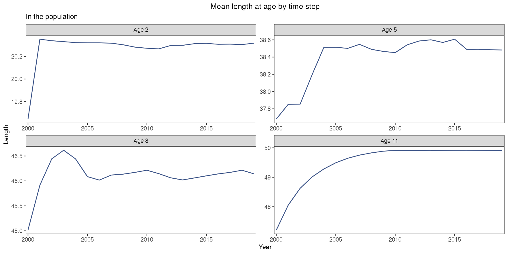](https://github.com/FanZhang-LAB-SHOU/ALSCL/blob/main/docs/figures/ytf/length_at_age.png?raw=true)

每个面板显示一个年龄组在各时间步的平均体长，数值来自 `length_at_age()`。原始结构的 ALSCL 拟合中，第一个时间步各年龄组的体长分布由 `Linf`、`k` 和 `t0` 给出。之后各时间步的体长由生长增量和体长别死亡决定，所以平均体长在最初几年变化较大，随后随补充和捕捞而波动。ACL 拟合只用一个年龄体长概率矩阵，得到水平线。`observed` 接受年龄鉴定得到的各时间步、各年龄平均体长（列 `year`、`age` 和 `mean_length`，可加 `sd_length`），画成所属年龄组面板中的点；与调查中采集的鉴定资料比较时用 `basis = "survey"`。`ages` 和 `years` 选择年龄组和时间步，`facet_by = "none"` 把全部年龄组画在一个面板中。

[参数及默认值](https://github.com/FanZhang-LAB-SHOU/ALSCL/blob/main/docs/FUNCTION_REFERENCE.md#plot_length_at_age)

## 给定年龄的体长分布

```r
# 绘制本图
plot_pla(b)
```

[](https://github.com/FanZhang-LAB-SHOU/ALSCL/blob/main/docs/figures/ytf/pla.png?raw=true)

静态矩阵 `pla` 的每一列给出一个年龄组的体长组概率，列内概率之和为 1。ACL 在每个时间步用它将年龄别尾数转换为体长别尾数。ALSCL 用它初始化种群并分配补充个体的体长，后续体长分布由生长和存活过程决定。要得到 ALSCL 某年龄、某时期的实际体长分布，应将 `NLA` 中对应的体长向量归一化。颜色表示各组概率，最高体长组包含右尾。横轴显示拟合年龄，最大的年龄是末组（plus group），标为“15+”。保存时没有年龄元数据的结果按年龄组的位置绘制，横轴标签为 Age group。

[参数及默认值](https://github.com/FanZhang-LAB-SHOU/ALSCL/blob/main/docs/FUNCTION_REFERENCE.md#plot_pla)

面板或模型组只有一个估计值时显示为点。设置 `se = TRUE` 后，以误差棒显示 95% 区间（默认为对数正态区间，见 `interval` 参数），因为只有一个点的带状区间没有可见宽度。该规则适用于种群与捕捞死亡率图，也分别适用于 `plot_compare_ts()` 中的每个模型。点大小继承 `point_size`；单模型图的点继承 `line_color`，区间继承 `se_color`。所有面板仍不显示网格线。

## ACL 各年龄组捕捞死亡率随时间的变化

`plot_fishing_mortality()` 从 `acl_theme_set()` 取标题、坐标轴标签、`x_breaks` 和 `x_expand`：标题键为 `F_year`、`F_age`、`F_length`，区间图加 `_se`；标签为 `xlab$year`、`xlab$age` 或 `xlab$length` 以及 `ylab$F`。年龄模式的横轴显示拟合年龄，末组标为“15+”这样的形式；带区间（`se = TRUE`）的 ALSCL 图只显示末组之前的年龄。保存时没有年龄元数据的结果按年龄组的位置绘制，未设置 `xlab$age` 时默认标签为 Age group。默认的 `ylab$F` 标签注明捕捞死亡率的时间基准，例如“Fishing mortality rate (per year)”；调用中给出的标签和刻度优先。`base_theme` 接受 `"theme_bw"`、`"bw"` 等主题名、ggplot2 主题对象或 `NULL`（全局设置），各种情况下都不显示网格线。

```r
# 绘制本图
plot_fishing_mortality(a, type = "year",
  se = TRUE, facet_ncol = 4, line_size = 0.6)
```

[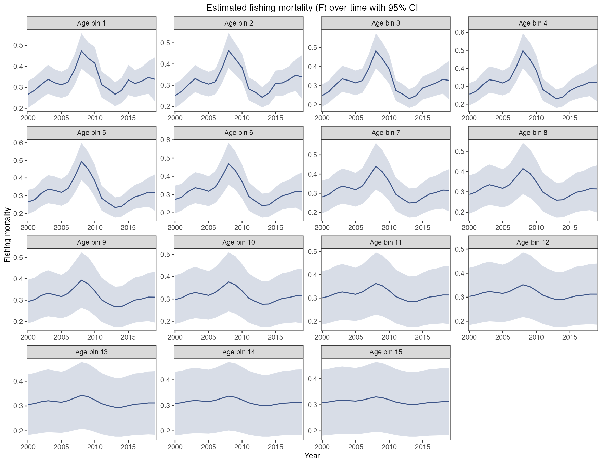](https://github.com/FanZhang-LAB-SHOU/ALSCL/blob/main/docs/figures/ytf/F_ACL_year.png?raw=true)

每个面板显示 ACL 一个年龄组的瞬时捕捞死亡率（`F`）及其近似 95% 区间。F 的时间单位由模型时间步决定，本例为一年，季度拟合则为一个季度。

[参数及默认值](https://github.com/FanZhang-LAB-SHOU/ALSCL/blob/main/docs/FUNCTION_REFERENCE.md#plot_fishing_mortality)

## ACL 各期的年龄别捕捞死亡率

```r
# 绘制本图
plot_fishing_mortality(a, type = "age",
  se = TRUE, facet_ncol = 4, line_size = 0.6)
```

[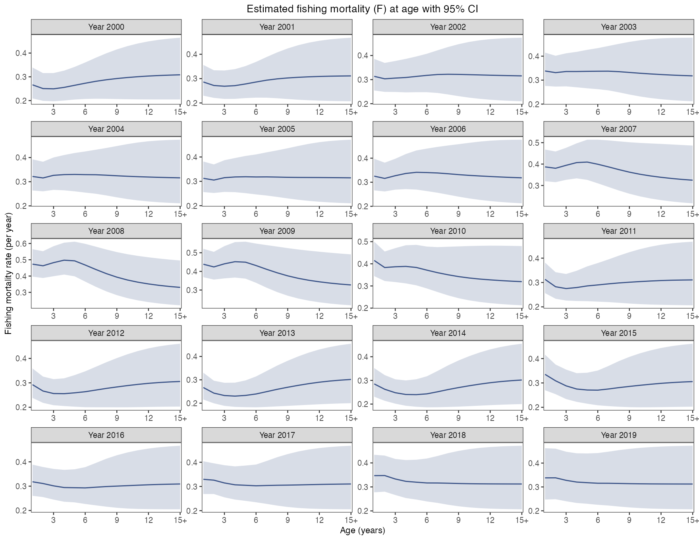](https://github.com/FanZhang-LAB-SHOU/ALSCL/blob/main/docs/figures/ytf/F_ACL_age.png?raw=true)

每个面板显示 ACL 在一个时间步的估计值及其近似 95% 区间，横轴为拟合年龄（末组标为“15+”）。本例中多数年份的曲线较平，表示各年龄组的估计捕捞死亡率相近；2007 至 2010 年低龄组的估计值较高。

[参数及默认值](https://github.com/FanZhang-LAB-SHOU/ALSCL/blob/main/docs/FUNCTION_REFERENCE.md#plot_fishing_mortality)

## ALSCL 各体长组捕捞死亡率随时间的变化

```r
# 绘制本图
plot_fishing_mortality(b, type = "year",
  se = TRUE, facet_ncol = 4, line_size = 0.6)
```

[](https://github.com/FanZhang-LAB-SHOU/ALSCL/blob/main/docs/figures/ytf/F_ALSCL_year.png?raw=true)

每个面板显示一个体长组的捕捞死亡率（`FL`）随时间的变化及其近似 95% 区间。本例在 2008 年前后的高值以中等体长组最为明显。

[参数及默认值](https://github.com/FanZhang-LAB-SHOU/ALSCL/blob/main/docs/FUNCTION_REFERENCE.md#plot_fishing_mortality)

## ALSCL 各期的年龄别捕捞死亡率

```r
# 绘制本图
plot_fishing_mortality(b, type = "age",
  se = TRUE, facet_ncol = 4, line_size = 0.6)
```

[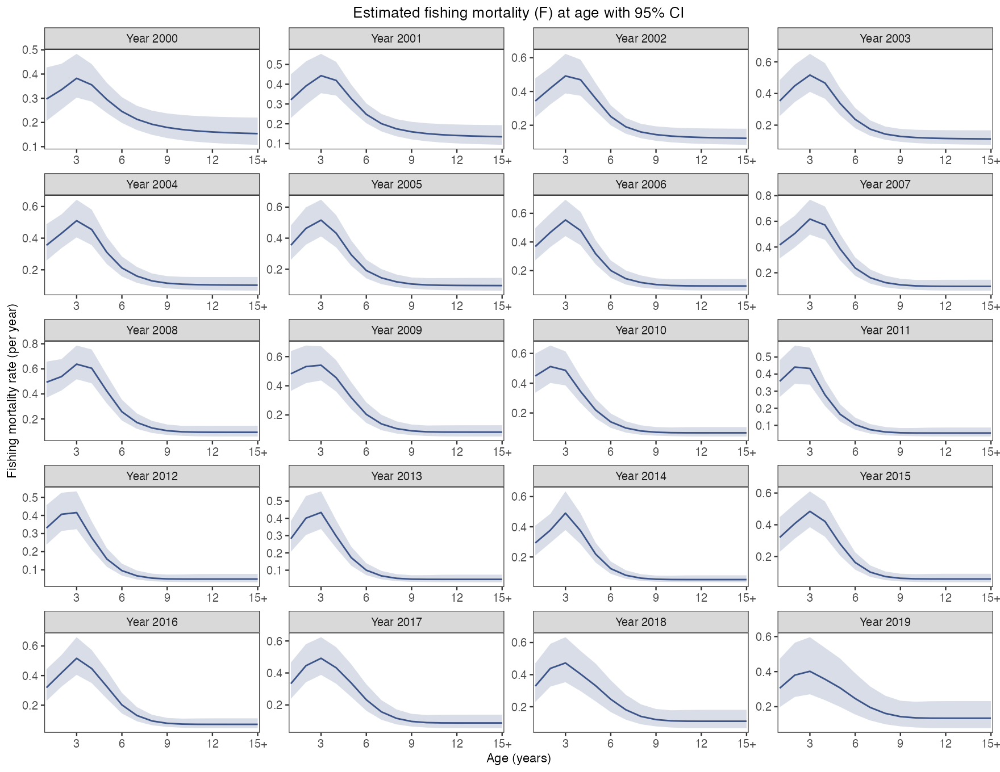](https://github.com/FanZhang-LAB-SHOU/ALSCL/blob/main/docs/figures/ytf/F_ALSCL_age.png?raw=true)

ALSCL 先把同一年龄组各体长组的存活尾数相加，再除以该年龄组的期初尾数，得到存活比例。年龄别捕捞死亡率为 `FA = -log(存活比例) - M`。每个面板显示一个时间步的估计值和近似 95% 区间。本图用 `se = TRUE` 绘制，因此只显示带有标准误的单元格：末组之前的年龄（1 到 14 龄）和最后一个时间步之前的各时间步（2000 到 2018 年）。这些就是 `report$FA` 中的单元格，`report$ZA` 保存对应的年龄别总死亡率。不带区间（`se = FALSE`）时，函数还绘制末组（“15+”）和最后一个时间步，这些值按同一公式由报告的体长—年龄别尾数（`report$NLA`）和体长别总死亡率（`report$ZL`）算出。最后一个时间步的 F 由 F 过程预测，没有观测为它提供信息。`extract_estimates(b, "FA")` 返回每个年龄和每个时间步的年龄别 F，末组和最后一个时间步的标准误为 `NA`。

[参数及默认值](https://github.com/FanZhang-LAB-SHOU/ALSCL/blob/main/docs/FUNCTION_REFERENCE.md#plot_fishing_mortality)

## ALSCL 各期的体长别捕捞死亡率

```r
# 绘制本图
plot_fishing_mortality(b, type = "length",
  se = TRUE, facet_ncol = 4, line_size = 0.6)
```

[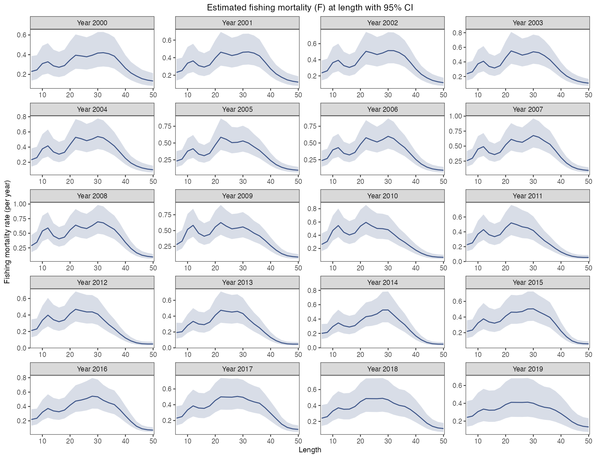](https://github.com/FanZhang-LAB-SHOU/ALSCL/blob/main/docs/figures/ytf/F_ALSCL_length.png?raw=true)

每个面板显示一个时间步各体长组的捕捞死亡率及其近似 95% 区间。横轴按体长组中点（`len_mid`）的实际间距绘制。本例中，体长约 20 至 35 的组估计捕捞死亡率较高。

[参数及默认值](https://github.com/FanZhang-LAB-SHOU/ALSCL/blob/main/docs/FUNCTION_REFERENCE.md#plot_fishing_mortality)

## 拟合所用的自然死亡率和调查可捕性

```r
# 绘制本图
(plot_natural_mortality(b, line_size = 0.8) +
   labs(title = "Natural mortality rate (M)")) |
  (plot_survey_catchability(b, line_size = 0.8, point_size = 1.5) +
     labs(title = "Survey catchability at length"))
```

[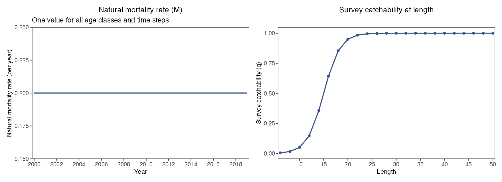](https://github.com/FanZhang-LAB-SHOU/ALSCL/blob/main/docs/figures/ytf/inputs.png?raw=true)

两个面板显示的都是你给定的输入，不是估计值。`plot_natural_mortality()` 的图形随 `M` 的形式而定：单个数值画成水平线（如本例）；按年龄组给定时画 M 随年龄的变化，随时间变化时改为画 M 随时间步的变化，每个年龄组一个面板；按体长给定（ALSCL）时画 M 随体长的变化。`plot_survey_catchability()` 显示由 `sel_L50` 和 `sel_L95` 或由 `survey_q` 给出的体长别可捕性。`survey_q` 各时间步不同时，每条不同的曲线画一条线并标出其适用的时间步；`type = "age"` 显示年龄别乘数（`survey_q_age`）。调查指数不能确定总死亡中捕捞死亡和自然死亡各占多少，也不能确定可捕性的水平，所以 F、渔获量和丰度的水平取决于这两项输入（[选择拟合设置](fitting-controls.html)）。报告中请把它们与估计值一并给出。

[参数及默认值](https://github.com/FanZhang-LAB-SHOU/ALSCL/blob/main/docs/FUNCTION_REFERENCE.md#plot_natural_mortality)

## 按体长组分面的对数残差

```r
# 绘制本图
plot_residuals(b, facet_by = "length", facet_ncol = 4, line_size = 0.6,
  x_breaks = c(2000, 2010, 2015))
```

[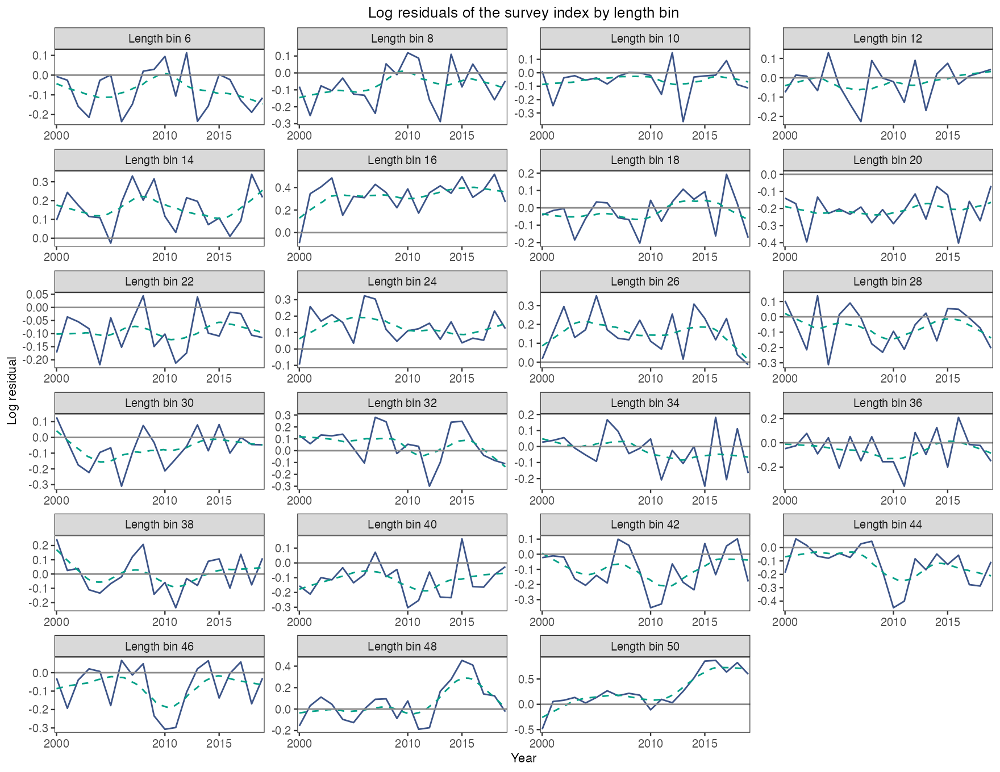](https://github.com/FanZhang-LAB-SHOU/ALSCL/blob/main/docs/figures/ytf/residuals_length.png?raw=true)

对数残差，即观测对数调查指数减拟合值，每个体长组一个面板，横轴为时间：深蓝线连接残差，灰线为零，青绿色虚线为平滑线。用它找模型拟合不好的体长组（零值和缺失观测没有残差）；多年同号的残差（如本例 16 组为正、20 组为负）说明系统性偏差，序列末端的趋势（如 50 组）提示模型没有跟上的变化。

每个分面内，缺失或排除的观测会断开残差线和趋势线。单个有效观测画成点。连续 2–5 个观测用直线拟合趋势，连续至少 6 个观测用 loess。

[参数及默认值](https://github.com/FanZhang-LAB-SHOU/ALSCL/blob/main/docs/FUNCTION_REFERENCE.md#plot_residuals)

## 按时间步分面的对数残差

```r
# 绘制本图
plot_residuals(b, facet_by = "year", facet_ncol = 4, line_size = 0.6,
  x_breaks = c(10, 30, 50))
```

[](https://github.com/FanZhang-LAB-SHOU/ALSCL/blob/main/docs/figures/ytf/residuals_year.png?raw=true)

同一组残差按体长排列：每个时间步一个面板，横轴为体长，带零线和平滑线。观察哪些体长范围的残差持续高于或低于零。本例 2015 年起最大体长组的正尖峰表示那几年的观测指数高于拟合值。重复出现的符号变化可提示偏差随体长变化；平滑线在某个体长穿过零线，本身不表示该体长存在偏差。

[参数及默认值](https://github.com/FanZhang-LAB-SHOU/ALSCL/blob/main/docs/FUNCTION_REFERENCE.md#plot_residuals)

## 补充量的对数偏差

```r
# 绘制本图
plot_deviance(b, type = "R", log = TRUE, se = TRUE,
  facet_ncol = 3, point_size = 1.2, line_size = 0.5) +
  scale_x_continuous(breaks = c(2000, 2010, 2019), expand = expansion(mult = 0.04))
```

[](https://github.com/FanZhang-LAB-SHOU/ALSCL/blob/main/docs/figures/ytf/deviation_R_TRUE.png?raw=true)

点表示估计的补充量对数偏差，误差棒表示近似 95% 区间。对数偏差为零时，补充量等于拟合过程的中位数 `exp(mean_log_R)`。负值表示该期补充量低于这个中位数。

[参数及默认值](https://github.com/FanZhang-LAB-SHOU/ALSCL/blob/main/docs/FUNCTION_REFERENCE.md#plot_deviance)

## 补充量相对于中位数的倍数

```r
# 绘制本图
plot_deviance(b, type = "R", log = FALSE, se = TRUE,
  facet_ncol = 3, point_size = 1.2, line_size = 0.5) +
  scale_x_continuous(breaks = c(2000, 2010, 2019), expand = expansion(mult = 0.04))
```

[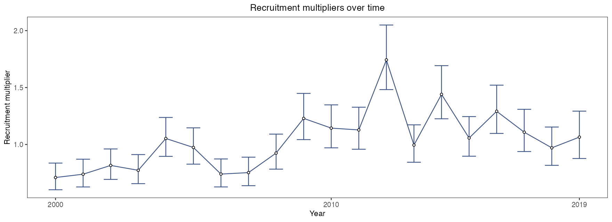](https://github.com/FanZhang-LAB-SHOU/ALSCL/blob/main/docs/figures/ytf/deviation_R_FALSE.png?raw=true)

设置 `log = FALSE` 后，每个点表示该期补充量与过程中位数之比。2012 年的比值为 1.77，表示估计补充量比中位数高 77%。区间端点由对数尺度的端点取指数得到。

[参数及默认值](https://github.com/FanZhang-LAB-SHOU/ALSCL/blob/main/docs/FUNCTION_REFERENCE.md#plot_deviance)

## 捕捞死亡率的对数偏差

```r
# 绘制本图
plot_deviance(b, type = "F", log = TRUE, se = TRUE,
  facet_ncol = 3, point_size = 1.2, line_size = 0.5) +
  scale_x_continuous(breaks = c(2000, 2010, 2019), expand = expansion(mult = 0.04))
```

[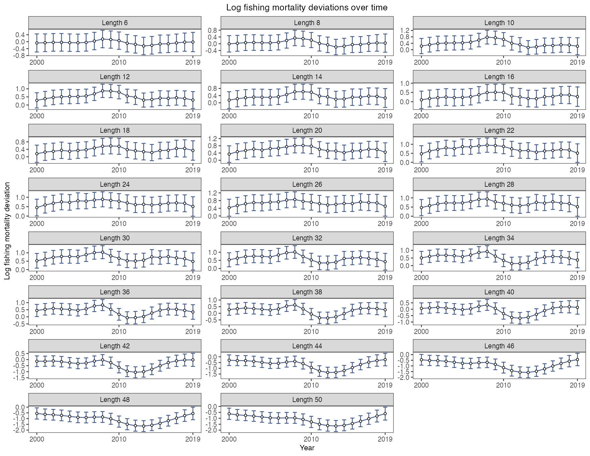](https://github.com/FanZhang-LAB-SHOU/ALSCL/blob/main/docs/figures/ytf/deviation_F_TRUE.png?raw=true)

点和近似 95% 区间表示各期捕捞死亡率的对数偏差。偏差为零对应原尺度上的过程中位数 `exp(mean_log_F)`。ALSCL 按体长组分面，ACL 按年龄组分面。各组共用 F 时只有一个面板。

[参数及默认值](https://github.com/FanZhang-LAB-SHOU/ALSCL/blob/main/docs/FUNCTION_REFERENCE.md#plot_deviance)

## 捕捞死亡率相对于中位数的倍数

```r
# 绘制本图
plot_deviance(b, type = "F", log = FALSE, se = TRUE,
  facet_ncol = 3, point_size = 1.2, line_size = 0.5) +
  scale_x_continuous(breaks = c(2000, 2010, 2019), expand = expansion(mult = 0.04))
```

[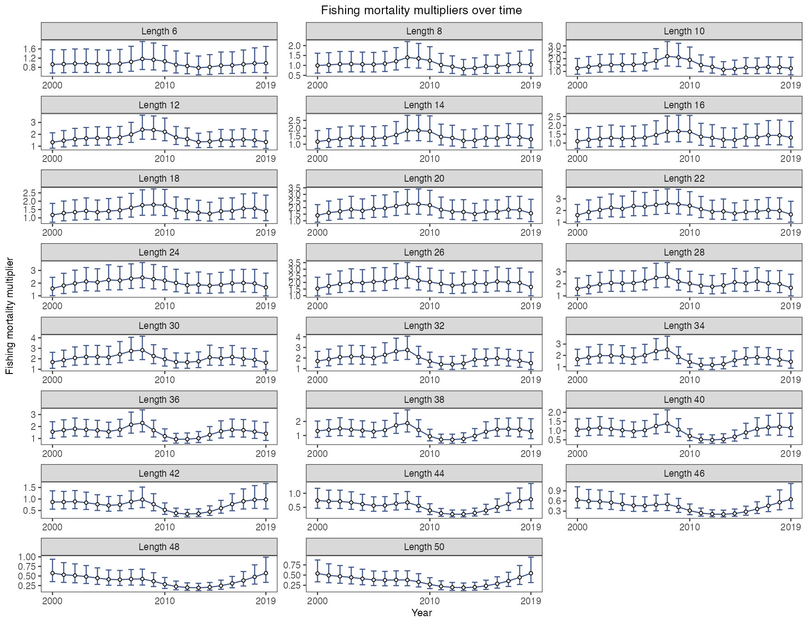](https://github.com/FanZhang-LAB-SHOU/ALSCL/blob/main/docs/figures/ytf/deviation_F_FALSE.png?raw=true)

每个点表示估计捕捞死亡率与过程中位数之比。比值为 0.5 表示该期该组的捕捞死亡率为中位数的一半。误差棒为对数尺度区间端点取指数后得到的近似 95% 区间。

[参数及默认值](https://github.com/FanZhang-LAB-SHOU/ALSCL/blob/main/docs/FUNCTION_REFERENCE.md#plot_deviance)

## 长度组成山脊图

```r
# 绘制本图
plot_ridges(b) # 默认 viridis 渐变
```

[](https://github.com/FanZhang-LAB-SHOU/ALSCL/blob/main/docs/figures/ytf/ridges.png?raw=true)

每条曲线表示一个时间步各体长组调查指数的相对组成，左图为观测值，右图为拟合值。`plot_ridges()` 返回 patchwork 对象，整张图有一个总标题，两个面板各有标题；`p[[1]]` 和 `p[[2]]` 分别取出观测面板和拟合面板。时间轴在年度拟合中显示年份，在季度拟合中显示季度（如“2000 Q2”）。2012 年之后，峰值向较大的体长组移动。可比较两图的峰值位置和分布宽度。某期全部缺测时不绘制该期的观测曲线，部分缺测时仅用有观测的体长组计算观测比例。

缺失或被排除的体长组会断开观测轮廓和填色。孤立的观测体长组在缩放后的组成高度处画为点；归一化仍使用该期全部正观测。左右面板使用相同的时间位置、纵轴范围和时间配色，包括完全缺测的时期。`spectral` 等 Brewer 配色也支持只有两个时期的结果。

[参数及默认值](https://github.com/FanZhang-LAB-SHOU/ALSCL/blob/main/docs/FUNCTION_REFERENCE.md#plot_ridges)

山脊图两栏均保留模型的完整体长范围，包括最小或最大体长组缺测以及全部观测缺失的情况。自定义 `x_breaks` 和全局 `x_expand` 同时作用于两栏。`ridges_scale` 必须为 `NULL`（自动高度）或一个有限正数；零、负数、缺失值、无穷大和向量均会报错。

## 边界体长组缺测

这个合成绘图示例的最小两个和最大两个体长组均缺测，第一期也全部缺测。两栏仍显示 10–90 个长度单位的范围，并保留四个时期的位置。观测组成用剩余体长组归一化，拟合组成用全部体长组归一化，两者的归一化总量不同。空白区域不代表零观测。

```r
# Synthetic display example with missing boundary length bins.
lengths <- seq(10, 90, 10)
years <- 2000:2003
log_index <- outer(lengths, seq(35, 50, 5),
  function(length, center) -((length - center) / 18)^2)
ridge_example <- list(year = years, len_mid = lengths,
  observations = exp(log_index), report = list(Elog_index = log_index))
ridge_example$observations[c(1, 2, 8, 9), ] <- NA_real_
ridge_example$observations[, 1L] <- NA_real_
plot_ridges(ridge_example, ridges_scale = 1,
  x_breaks = seq(10, 90, 20))
```

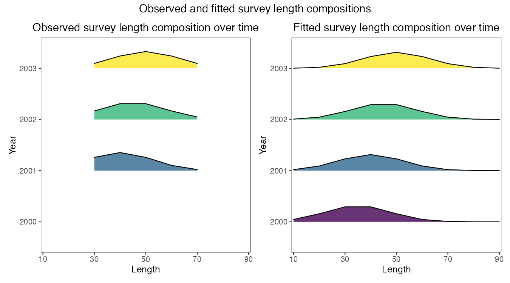
