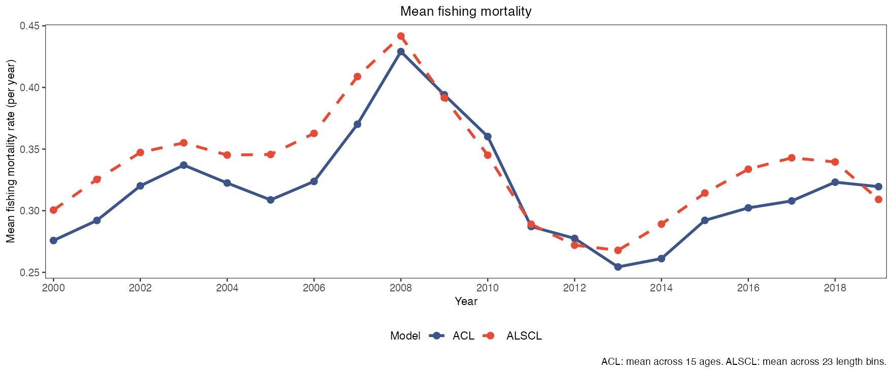
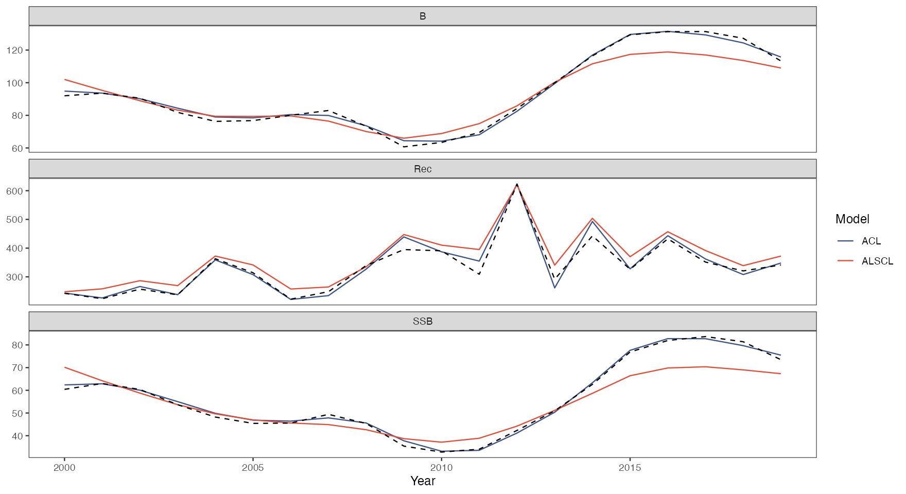

# 模型比较与真值

先完成 [YTF 拟合示例](first-model.html)，得到 `a`、`b`、`x`、`inputs`，并设置 `dat <- x$data.CatL`。加载 ggplot2 和 patchwork。[回溯分析指南](retrospectives.html) 建立 `ra`、`rb`。

```r
library(ggplot2)
library(patchwork)
acl_theme_set(palette="npg", base_theme="theme_bw")
```

## 种群时间序列比较

```r
# 绘制本图
plot_compare_ts(a, b, se = TRUE, facet_ncol = 2)
```

[](https://github.com/FanZhang-LAB-SHOU/ALSCL/blob/main/docs/figures/ytf/compare_ts.png?raw=true)

两组拟合的产卵生物量、补充量、总生物量、总丰度和捕获尾数时间序列，每个量一个面板，纵轴各自取值：ACL 为深蓝实线，ALSCL 为朱红虚线（`compare_colors`、`compare_linetypes`），`se = TRUE` 时加上各自的 95% 区间。用它看两个模型在哪里分歧；本例生物量和产卵生物量在 2014 年后分开，自由纵轴使振幅只能在面板内比较，不能跨面板比较。

[参数及默认值](https://github.com/FanZhang-LAB-SHOU/ALSCL/blob/main/docs/FUNCTION_REFERENCE.md#plot_compare_ts)

## 死亡率矩阵比较

```r
# 绘制本图
plot_compare_F(a, b) + scale_x_continuous(breaks = c(2000, 2010, 2019))
```

[](https://github.com/FanZhang-LAB-SHOU/ALSCL/blob/main/docs/figures/ytf/compare_F.png?raw=true)

两组拟合各一张捕捞死亡率热图，横轴为时间，纵轴为各自的组（ACL 为年龄组，ALSCL 为体长组），共用一个 `F` 色标。用它看每个模型中捕捞在何时、哪些组最重；两图的行是不同维度，所以比较深色列的时间（本例 2007 至 2010 年）而不是逐格比较，F 汇总图可比较各模型的组间最大值或均值，解读时须区分年龄组和体长组的定义。 ACL 热图按拟合使用的年龄标示各行，季度数据可显示小数年龄。旧拟合缺少年龄坐标时，行标签会明确标为年龄组序号。

[参数及默认值](https://github.com/FanZhang-LAB-SHOU/ALSCL/blob/main/docs/FUNCTION_REFERENCE.md#plot_compare_F)

## 残差联合诊断

```r
# 绘制本图
plot_compare_residuals(a, b, dat)
```

[](https://github.com/FanZhang-LAB-SHOU/ALSCL/blob/main/docs/figures/ytf/compare_residuals.png?raw=true)

四个面板显示两组拟合的样本内对数残差：直方图、以正态分布为参照的 QQ 图、各时间步的平均残差及加减一个标准差的误差棒，以及各体长组绝对残差的箱线图。ACL 为深蓝，ALSCL 为朱红。直方图较宽表示离散程度较大；QQ 点偏离参考线表示与参照分布存在差异。绝对残差较大的体长组拟合较差，例如本例 ALSCL 的 16 组和 50 组。标准差误差棒表示残差的离散程度，不是均值的置信区间。

整期缺测会断开平均残差线，孤立的有效时期仍显示为点。只有该期至少有两个观测体长组时才绘制标准差误差棒；仅有一个观测时仍保留残差点。

[参数及默认值](https://github.com/FanZhang-LAB-SHOU/ALSCL/blob/main/docs/FUNCTION_REFERENCE.md#plot_compare_residuals)

## 生长与外部参照接口

参考数据与排版辅助函数

```r
# 模拟参考生长点，并非论文实测
set.seed(42)
ref <- data.frame(Age = rep(1:15, each = 5))
ref$Length <- VB_func(60, .2, 1/60, ref$Age) + rnorm(nrow(ref), 0, 2)
growth_display <- function(p) {
  p[[1]] <- p[[1]] + labs(subtitle = paste(strsplit(
    p[[1]]$labels$subtitle, " | ", fixed=TRUE)[[1]], collapse="\n")) +
    theme(legend.text=element_text(size=7))
  p[[2]] <- p[[2]] + scale_x_continuous(breaks=c(1,5,10,15))
  p
}
```

```r
# 绘制本图
growth_display(plot_compare_growth(a, b, age_range = c(1, 15), ref_data = ref, ref_name = "Synthetic reference",
    nls_start = list(Linf = 60, k = 0.2, t0 = 1/60)))
```

[](https://github.com/FanZhang-LAB-SHOU/ALSCL/blob/main/docs/figures/ytf/compare_growth.png?raw=true)

左图：两组拟合的 von Bertalanffy 曲线（ACL 深蓝实线，ALSCL 朱红虚线），副标题给出各自的 `Linf` 和 `k`，另有 `nls()` 对 `ref_data` 拟合的灰色参照曲线及该数据的灰点；右图：两组拟合的年龄体长矩阵热图，纵轴为体长组序号。用它比较由参数计算的 VB 曲线和静态 `pla` 矩阵。曲线重合表示 VB 参数相同；ALSCL 各期实际的年龄别体长分布还取决于生长转移和存活。本例的生长参数固定为相同值。参照点由上面的代码模拟生成，也可传入独立的年龄体长数据进行比较。

省略 `age_range` 时，采用两份拟合年龄的合并范围，起点不早于两个模型的 `t0`。缺少年龄信息的旧结果使用 1-20 岁范围。显式范围须为两个有限且递增的年龄，起点不早于两个 `t0`；没有正跨度的范围会报错。

可选参考曲线仅在不早于其自身拟合 `t0` 的年龄绘制。若其生长参数无效，或没有剩余的正年龄跨度，会警告说明省略参考曲线的原因；评估模型曲线和观测点仍保留。

[参数及默认值](https://github.com/FanZhang-LAB-SHOU/ALSCL/blob/main/docs/FUNCTION_REFERENCE.md#plot_compare_growth)

## 两模型调查拟合

```r
# 绘制本图
plot_compare_CatL(a, b, dat, years = c(2000, 2005, 2010, 2015), facet_ncol = 2)
```

[](https://github.com/FanZhang-LAB-SHOU/ALSCL/blob/main/docs/figures/ytf/compare_CatL.png?raw=true)

所选时间步（`years`，省略则显示全部）的调查指数随体长变化，每个时间步一个面板：灰点为观测指数，深蓝实线为 ACL 拟合，朱红虚线为 ALSCL 拟合，均为 `exp(Elog_index)` 中位数，零值和缺失观测不画点。用它看哪个模型跟得上观测的体长组成；本例两者都跟上 20 附近的峰，ALSCL 曲线的局部起伏更多。可结合体长别 F 和其他设置检查这些起伏的原因。

纵轴标签来自 `ylab$survey`，默认为 Survey index；用 `acl_theme_set(ylab = list(survey = "Survey index (relative units)"))` 可一次改好所有调查拟合图的标签，单模型对数图会加上前缀 Log。`ylab$catch` 只用于捕获量图。

[参数及默认值](https://github.com/FanZhang-LAB-SHOU/ALSCL/blob/main/docs/FUNCTION_REFERENCE.md#plot_compare_CatL)

## 拟合指标比较

```r
# 绘制本图
plot_compare_metrics(a, b, dat, facet_ncol = 2) & scale_y_continuous(expand = expansion(mult = c(0,
    0.3)))
```

[](https://github.com/FanZhang-LAB-SHOU/ALSCL/blob/main/docs/figures/ytf/compare_metrics.png?raw=true)

柱图汇总 `diagnostic_metrics()` 的样本内拟合指标：RMSE、MAE、R 平方、MAPE、AIC、BIC、负对数似然和标量参数个数。ACL 为深蓝，ALSCL 为朱红。按各指标的定义解读：误差指标较低、R 平方较高表示对这些观测的拟合较近；AIC 和 BIC 还惩罚参数数量。信息准则只应在同一观测、相容似然的拟合之间比较。本例 ACL 的指标值较好；一个模拟数据集不能证明普遍优势，也不能确定差异原因。

柱图与 `diagnostic_metrics()` 使用同一计算：只纳入有限的正观测，观测单元处的非有限预测或维度不一致会报错，常数观测的 R 平方等无定义指标显示为 `NA`。先运行 `compare_models()` 核对两组拟合是否可比。

[参数及默认值](https://github.com/FanZhang-LAB-SHOU/ALSCL/blob/main/docs/FUNCTION_REFERENCE.md#plot_compare_metrics)

## 固定调查可捕性

```r
# 绘制本图
plot_compare_selectivity(a, b)
```

[](https://github.com/FanZhang-LAB-SHOU/ALSCL/blob/main/docs/figures/ytf/compare_selectivity.png?raw=true)

各拟合输入的体长别调查可捕性 `q`（`sel_L50`、`sel_L95`），ACL 为深蓝实线加点，ALSCL 为朱红虚线加点。用它确认每组拟合用的可捕性曲线；本例两条曲线重合，因为输入相同；这些值是固定输入而不是估计的选择性，两组拟合若不同，只说明输入不同。

[参数及默认值](https://github.com/FanZhang-LAB-SHOU/ALSCL/blob/main/docs/FUNCTION_REFERENCE.md#plot_compare_selectivity)

## 每个时间步的最大捕捞死亡率

```r
# 绘制本图
plot_compare_F_ts(a, b, method = "apical") +
  labs(title = "Apical fishing mortality")
```

[](https://github.com/FanZhang-LAB-SHOU/ALSCL/blob/main/docs/figures/ytf/compare_F_apical.png?raw=true)

每个时间步内，ACL 取各年龄组捕捞死亡率的最大值，ALSCL 取各体长组的最大值，即 apical F。图中每个点对应该模型在该期估计 F 最高的组。即使针对同一种群，年龄组最大值与体长组最大值也未必相同，因为年龄别 F 汇总了各体长的存活。季度拟合得到每季度的瞬时率。[BAM 模型中的 apical F，式（14b）](https://repository.library.noaa.gov/view/noaa/4847/noaa_4847_DS1.pdf#page=11)。

[参数及默认值](https://github.com/FanZhang-LAB-SHOU/ALSCL/blob/main/docs/FUNCTION_REFERENCE.md#plot_compare_F_ts)

## 每个时间步的平均捕捞死亡率

```r
# 绘制本图
plot_compare_F_ts(a, b, method = "mean") +
  labs(title = "Mean fishing mortality")
```

[](https://github.com/FanZhang-LAB-SHOU/ALSCL/blob/main/docs/figures/ytf/compare_F_mean.png?raw=true)

两组拟合的平均捕捞死亡率，即每个时间步各组 `F` 的非加权平均，样式同上。当关心整个选择模式而不是其峰值时用它；平均值取决于模型有多少低 F 的组（本例 15 个年龄组对 23 个体长组），所以看时间模式（两者都在 2008 年达峰）而不是水平高低。

[参数及默认值](https://github.com/FanZhang-LAB-SHOU/ALSCL/blob/main/docs/FUNCTION_REFERENCE.md#plot_compare_F_ts)

## 模拟真值与条件估计

```r
# 将生成真值与报告中的估计对齐
years <- a$year
truth <- data.frame(Year=rep(years,3),
  Quantity=rep(c("B","SSB","Rec"),each=length(years)),
  Truth=c(x$truth$TB,x$truth$SSB,x$truth$Rec))
estimates <- rbind(
  data.frame(Year=rep(years,3),Quantity=truth$Quantity,
    Value=c(a$report$B,a$report$SSB,a$report$Rec),Model="ACL"),
  data.frame(Year=rep(years,3),Quantity=truth$Quantity,
    Value=c(b$report$B,b$report$SSB,b$report$Rec),Model="ALSCL"))
```

```r
# 绘制本图
ggplot(estimates, aes(Year, Value, color = Model)) + geom_line() + scale_color_manual(values = setNames(acl_theme("compare_colors"),
    c("ACL", "ALSCL"))) + geom_line(data = truth, aes(Year, Truth), inherit.aes = FALSE, linetype = 2) +
    facet_wrap(~Quantity, scales = "free_y", ncol = 1) + theme_bw() + theme(panel.grid.major = element_blank(), panel.grid.minor = element_blank()) + labs(y = NULL)
```

[](https://github.com/FanZhang-LAB-SHOU/ALSCL/blob/main/docs/figures/ytf/truth.png?raw=true)

生成模拟的生物量、补充量和产卵生物量（黑色虚线）与 ACL（深蓝）、ALSCL（朱红）拟合的对照，每个量一个面板。上面的代码由 `x$truth` 和两份报告构造 `truth` 与 `estimates`。本例 ACL 紧贴模拟真值，ALSCL 的生物量和产卵生物量在 2012 年后低于真值。这是年龄结构操作模型的一次模拟及给定设置下的拟合。要评估表现如何随模型结构变化，需要在不同生成假设下开展重复模拟。

