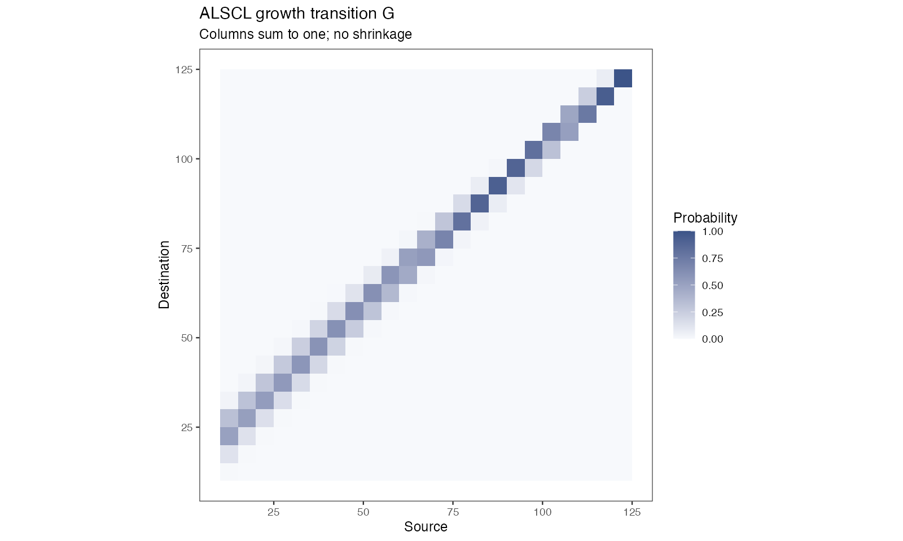

# 模型原理与时间尺度

本页带你阅读 ACL 和 ALSCL 背后的方程（采用本包的时间单位和随机效应参数化）、检查一次拟合中的两种概率矩阵，并把年率换算到模型时间步。第 1 步需要[理解第一次拟合](first-model.html)中的 ALSCL 拟合 `b`；方程采用 [Zhang & Cadigan (2022)](https://doi.org/10.1111/faf.12673) 的模型框架。

<h2 id="equations">方程</h2>

<h3 id="dynamics">种群动态</h3>

令 $`i=1,\ldots,A`$ 为年龄组索引，$`a_i=a_{rec}+(i-1)\Delta t`$ 为实际年龄，$`t`$ 为时间步。ACL 将补充量计入最小年龄组，并将存活个体推进至下一年龄组。最高年龄组（plus group）包括达到或超过该组起始年龄的个体。

```math
N_{1,t}=R_t,\qquad Z_{i,t}=M+F_{i,t},
```

```math
N_{i+1,t+1}=N_{i,t}\exp(-Z_{i,t}),\qquad i=1,\ldots,A-2,
```

```math
N_{A,t+1}=N_{A-1,t}\exp(-Z_{A-1,t})+N_{A,t}\exp(-Z_{A,t}).
```

M 和 F 是每个时间步的瞬时死亡率；季度模型的 `growth_step=0.25`，M 和 F 也须使用季度率。生长参数 $`k`$ 按年定义。

自然死亡率也可以按年龄组和时间步给出：一个矩阵，每个年龄组一行，每个时间步一列，或者只有一列并用于所有时间步。这时用 $`M_{i,t}`$ 代替 $`M`$：

```math
Z_{i,t}=M_{i,t}+F_{i,t}.
```

存活方程和末组方程的形式不变，所以在末组中，从 $`A-1`$ 年龄组进入的个体和原来就在末组的个体各自按本年龄组的死亡率死亡。ACL 不接受按体长给出的 M。它只跟踪各年龄的尾数，每个时间步都按年龄别体长分布重新分配体长，个体并不保留自己的体长，所以无法对它们施加按体长的死亡率。

<h3 id="fishing">捕捞死亡率</h3>

ACL 按年龄估计 F，ALSCL 按体长估计 F。以 $`s`$ 表示相应的年龄或体长组，两个模型均使用可分离的 AR(1) × AR(1) 对数 F 偏差：

```math
F_{s,t}=\exp(\mu_F+d_{s,t}),\qquad
\mathrm{Cov}(d_{s,t},d_{s-h,t-j})=\sigma_F^2\phi_S^{|h|}\phi_T^{|j|}.
```

这里 $`\sigma_F`$ 是 TMB 可分离 AR(1) 密度经缩放后的边际标准差；相关参数描述组间和时间上的相关性。该式已经包含边际方差，无需再除以 $`1-\phi^2`$ 因子，那是创新方差参数化的写法。模型不估计自然死亡率 M。它作为输入给出：一个数，一个按年龄组和时间步的矩阵，或者（仅 ALSCL）一个按体长组的向量（[准备调查数据](data-preparation.html#bundle)）。

<h3 id="recruitment">补充量</h3>

拟合模型用 AR(1) 对数偏差描述补充量。与边际标准差 $`\sigma_R`$ 一致的平稳形式为：

```math
R_t=\exp(\mu_R+r_t),\qquad
r_1\sim N(0,\sigma_R^2),\qquad
r_{t+1}=\phi_R r_t+\eta_t,\quad
\eta_t\sim N\!\left(0,\sigma_R^2(1-\phi_R^2)\right).
```

$`\exp(\mu_R)`$ 是补充量的中位数；算术均值还包含 $`r_t`$ 的方差。完整模拟器 `sim_data()` 使用 Beverton-Holt 亲体补充关系及随机偏差，是另一套补充过程。

<h3 id="initial">初始条件</h3>

第一期最小年龄组由 $`R_1`$ 给定，其余年龄组按初始死亡率与逐组扰动递推：

```math
\log N_{1,1}=\log R_1,\qquad
\log N_{i,1}=\log N_{i-1,1}-Z_{init}+u_{i-1},\quad
u_{i-1}\sim N(0,\sigma_{N0}^2).
```

因此 $`\log N_{i,1}=\log R_1-(i-1)Z_{init}+\sum_{j=1}^{i-1}u_j`$：扰动沿年龄组累积，相邻年龄组的总扰动相互相关。ALSCL 再用初始年龄-体长概率分配这些个体。在这一原始结构（本包最初发布时的结构）中，第一个时间步的末组（plus group）只含一个世代。`structure` 参数提供平衡状态的末组，对 ALSCL 还提供由生长转移推算的初始年龄别体长分布（[选择拟合设置](fitting-controls.html#structure)）。`structure = list(initial_deviations = "independent")` 时，各年龄组的扰动相互独立，与论文的式 11 相同：对每个年龄组 $`i`$（包括第一个），$`\log N_{i,1}=\log R_1-(i-1)Z_{init}+u_i`$，$`u_i\sim N(0,\sigma_{N0}^2)`$（[包与论文的差别](#difference-initial)）。

<h3 id="pla">年龄-体长转换（ACL）</h3>

给定年龄的长度服从均值由 von Bertalanffy 曲线决定的正态分布：

```math
\mu_i=L_\infty\left[1-e^{-k(a_i-t_0)}\right],\qquad
\sigma_i=CV_L\mu_i,
```

```math
p_{l|i}=\Phi\!\left(\frac{UB_l-\mu_i}{\sigma_i}\right)
       -\Phi\!\left(\frac{LB_l-\mu_i}{\sigma_i}\right),\qquad
N_{l,t}=\sum_i p_{l|i}N_{i,t}.
```

`pla` 表示这个年龄-体长概率矩阵，`plot_pla()` 用热图展示。实现使用支持自动微分的正态 CDF 差，并通过右尾对称计算和归一化处理数值稳定性，以此代替论文 Appendix S1 的固定阶 Taylor 近似；长度边界必须与调查分组一致。

<h3 id="growth">生长转移矩阵（ALSCL）</h3>

ALSCL 保留 $`N_{l,i,t}`$ 的体长、年龄、时间三个维度。$`G_{j,l}`$ 表示从源体长组 $`l`$ 转入目的体长组 $`j`$ 的概率。普通年龄组的存活与增长为：

```math
N_{j,i+1,t+1}=\sum_l G_{j,l}N_{l,i,t}\exp[-(M+F_{l,t})].
```

最高年龄组同时接收前一年龄组新进入的存活个体和本组继续存活的个体，两者均按生长矩阵在体长组间转移。补充个体按最小年龄的体长分布进入第一年龄组。G 的各列和为 1，不允许缩短，最大体长组吸收右尾概率。

M 按年龄组和时间步或按体长组给出时，用体长组 $`l`$、年龄组 $`i`$、时间步 $`t`$ 的死亡率 $`M_{l,i,t}`$ 代替 $`M`$。按年龄和时间步的矩阵对同一年龄组的所有体长给同一个值，按体长的向量对同一体长组的所有年龄组和时间步给同一个值。普通年龄组和末组的方程变为：

```math
N_{j,i+1,t+1}=\sum_l G_{j,l}N_{l,i,t}\exp[-(M_{l,i,t}+F_{l,t})],\qquad i=1,\ldots,A-2,
```

```math
N_{j,A,t+1}=\sum_l G_{j,l}\left\{N_{l,A-1,t}\exp[-(M_{l,A-1,t}+F_{l,t})]+N_{l,A,t}\exp[-(M_{l,A,t}+F_{l,t})]\right\}.
```

生长增量使用下面的平滑下降函数，标准差为 $`CV_G\mu_{\Delta L}`$：

```math
\mu_{\Delta L}(L)=\frac{\Delta t(1-e^{-k})L_\infty}
{1+\exp\!\left(-\log(19)\frac{L-0.5L_\infty}{0.05L_\infty-0.5L_\infty}\right)}.
```

Zhang 和 Cadigan (2022) 定义了这个 logistic 函数；体长 $`0.5L_\infty`$ 和 $`0.05L_\infty`$ 以及因子 $`\Delta t`$ 是代码中的取法，论文没有给出。此函数与精确的任意时间步 VB 增量 $`(L_\infty-L)(1-e^{-k\Delta t})`$ 不同，并且体长组内所有个体都从组中点开始生长。使用 `structure = "von_bertalanffy"` 时，ALSCL 采用 VB 增量，起始体长在组内均匀分布，第一个时间步的两项设置也随之配套（[选择拟合设置](fitting-controls.html#structure)）。`pla` 是给定年龄的长度分布，G 是给定源长度的一步转移概率，各模型使用各自的矩阵。`FL` 是长度别 F，`FA` 则由同一世代在相应时间步的存活比例推导。报告中的 `FA` 和对应的年龄别总死亡率 `ZA` 包含末组之前的年龄和最后一个时间步之前的各时间步。`extract_estimates(fit, "FA")` 返回每个年龄（包括末组）和每个时间步的年龄别 F：其余单元格按同一公式由报告的体长—年龄别尾数（`NLA`）和体长别总死亡率（`ZL`）算出。这些单元格在拟合之后计算，因为在模型模板内计算会使拟合值在舍入水平上改变。

M 随年龄或体长变化时，年龄别 F 和体长别总死亡率需要另行定义，因为同一年龄的个体体长不同，同一体长的个体年龄也不同。年龄别总死亡率（`ZA`）是该年龄组的尾数在一个时间步内的下降率，年龄别 F（`FA`）等于它减去 M 在各体长上的平均值，以该年龄组的体长别尾数为权重：

```math
Z^{A}_{i,t}=\log\sum_l N_{l,i,t}-\log\sum_l N_{l,i,t}\exp[-(M_{l,i,t}+F_{l,t})],\qquad
F^{A}_{i,t}=Z^{A}_{i,t}-\frac{\sum_l N_{l,i,t}M_{l,i,t}}{\sum_l N_{l,i,t}}.
```

体长别总死亡率（`ZL`）等于体长别 F 加上 M 在各年龄组上的平均值，以该体长组的年龄别尾数为权重：

```math
Z^{L}_{l,t}=F_{l,t}+\frac{\sum_i N_{l,i,t}M_{l,i,t}}{\sum_i N_{l,i,t}}.
```

这时 `ZL` 是一个汇总量，没有哪个年龄组恰好按这个死亡率死亡。M 为单一数值时，两个定义就是 `FA = ZA - M` 和 `ZL = FL + M`。报告中的 `M_LAY` 保存实际使用的死亡率，是按体长组、年龄组和时间步排列的数组。

<h3 id="derived">派生量</h3>

输入的平均个体重量 $`w_{l,t}`$ 和成熟比例 $`m_{l,t}`$ 用于计算体长别生物量、成熟生物量及总量：

```math
b_{l,t}=N_{l,t}w_{l,t},\qquad sb_{l,t}=b_{l,t}m_{l,t},\qquad
B_t=\sum_l b_{l,t},\qquad SSB_t=\sum_l sb_{l,t}.
```

`CN`、`CB` 是模型推算的渔业捕获尾数与重量，区别于输入的调查数量指数。生物量单位由个体重量单位和丰度尺度共同决定。丰度尺度等于调查指数的尺度除以拟合所用的调查可捕性。使用默认的 logistic 曲线时，可捕性的最大值固定为 1（见下一节），丰度尺度就是完全可捕体长处指数的尺度。只有当指数是绝对丰度估计时，丰度、生物量、产卵生物量、补充量、`CN` 和 `CB` 才是绝对量；使用相对指数时，它们是相对值。

渔获量由 Baranov 渔获方程算出，用到估计的 F、估计的丰度和给定的 M。似然中没有渔获数据。ACL 按年龄组计算渔获量，ALSCL 按体长组和年龄组计算：

```math
C_{i,t}=N_{i,t}\frac{F_{i,t}}{Z_{i,t}}\left(1-e^{-Z_{i,t}}\right),\qquad
C_{l,i,t}=N_{l,i,t}\frac{F_{l,t}}{F_{l,t}+M_{l,i,t}}\left(1-e^{-(F_{l,t}+M_{l,i,t})}\right).
```

`CN` 是一个时间步内各组渔获量之和，ALSCL 拟合的 `CB` 是体长别渔获量乘以体长别体重之和。F 和渔获量的水平取决于给定的 M 和调查可捕性（[调查观测](#survey)）。有三个函数返回可与年龄鉴定资料和该种群的其他评估相比较的量。`length_at_age()` 返回每个年龄组和时间步的平均体长及其标准差。`ssb_at_age()` 按年龄别成熟比例计算产卵生物量。`relative_catch()` 返回渔获量除以其在各时间步上的均值。用法见[评估工作流](assessment-workflows.html#outputs)。

<h3 id="survey">调查观测</h3>

令 $`I_{l,t}`$ 为调查数量指数，$`N_{l,t}`$ 为种群尾数。调查观测使用对数正态模型：

```math
\log I_{l,t}=\log q_l+\log N_{l,t}+\epsilon_{l,t},\qquad
\epsilon_{l,t}\sim N(0,\sigma_I^2),
```

```math
q_l=\left[1+\exp\!\left(-\log(19)\frac{L_l-L_{50}}{L_{95}-L_{50}}\right)\right]^{-1}.
```

`sel_L50`、`sel_L95` 固定调查可捕性 q，在两个指定体长处分别取 0.5 和 0.95，对大个体 q 趋近于 1；它们描述的是调查，渔业选择性是另一个量。模型不估计可捕性的比例系数：把指数乘以一个常数，丰度、生物量、补充量和捕获量的估计也乘以同一常数，捕捞死亡率不变。`exp(report$Elog_index)` 给出原尺度的中位数，算术均值还需乘以 $`\exp(\sigma_I^2/2)`$。

调查可捕性也可以直接给出。`survey_q` 给出体长别可捕性：一个向量，或者一个按体长组和时间步的矩阵，例如用于调查网具更换之后。`survey_q_age` 给出按年龄组的系数。以 $`N_{l,i,t}`$ 表示按体长组、年龄组和时间步的尾数（在 ACL 中为 $`p_{l|i}N_{i,t}`$），指数期望值的一般形式为：

```math
\log I_{l,t}=\log q_{l,t}+\log\sum_i q^{A}_i N_{l,i,t}+\epsilon_{l,t}.
```

默认情况下 $`q_{l,t}=q_l`$（logistic 曲线），$`q^{A}_i=1`$。这些值都是固定输入。Zhang 和 Cadigan (2022) 给出了理由：只用调查数据时，体长别可捕性和种群数量的尺度都估计不出来，所以他们把可捕性的最大值固定为 1，形状用 logistic 函数或专家知识给定。本包按原样使用给定的值，不重新缩放；要沿用这一约定，请给出最大值为 1 的曲线，`survey_catchability()` 返回的就是这样的曲线。

调查指数提供的是总死亡率的信息，不能区分它的组成部分。对按年龄的系数，由上式可得：同一世代的对数指数在相邻两个年龄之间的下降量，等于总死亡率减去这两个年龄可捕性之比的对数。因此，可捕性随年龄或体长下降而输入中没有给出时，拟合会把它当作更高的总死亡率，而 F 等于总死亡率减去给定的 M。在只拟合调查数据的模型中，渔业选择性、M 和调查可捕性可能相互混淆，要得到唯一解，必须对其中一项或几项作出假定（[Cook 2013](https://doi.org/10.1016/j.fishres.2013.01.003)）。

Zhang 和 Cadigan (2022) 把 F 表述为捕捞死亡率绝对水平的估计，而种群数量和渔获量只估计趋势；论文的案例还把 F 的水平与该种群现行评估的结果作了比较。论文的讨论部分又指出，只用调查数据时能估计的只有总死亡率，F 和 M 要靠对 M 的假定才能分开。论文没有考察调查可捕性的形状设错时 F 怎样变化。本包对北海国际底拖网调查第一季度指数的拟合显示了这种依赖关系。对挪威长臀鳕，ALSCL 的 F 与国际海洋考察理事会（ICES）评估的 F 之间的秩相关系数，在 M 取常数时为 0.24，改用该评估按年龄和年份的 M 后为 0.64。因此本文档建议：与其他评估比较时，比较趋势（相对产卵生物量、补充量和渔获量）和总死亡率；报告 F 的水平时，同时说明所假定的 M 和调查可捕性，以及结果对它们的敏感性（[判断拟合是否可用](diagnostics.html#sensitivity)）。

<h3 id="estimation">估计与区间</h3>

TMB 用自动微分计算目标函数及导数，对随机效应采用 Laplace 近似；R 的 `nlminb()` 优化固定效应。`sdreport()` 使用局部曲率及 delta 方法给出近似标准误。绘图中的 95% 区间是逐点区间，只有被估计的参数对它有贡献：`YTF_example` 固定了生长和部分过程参数，因此生长区间退化为一条线，其余区间以这些固定值为条件。生长区间描述平均曲线的不确定性，单尾鱼按 $`CV_L`$ 散布在曲线周围。解读任何区间之前，先读 Hessian、边界和梯度检查。

<h2 id="paper-differences">包与论文的差别</h2>

本包实现的是 [Zhang 和 Cadigan (2022)](https://doi.org/10.1111/faf.12673) 的模型。本节说明包与论文文字不同、并且影响估计值解读的五处。这些差别是把论文正文与包的模型模板逐项对照得到的。论文的补充材料和作者的代码没有读到，所以作者的实现采用哪种形式并不清楚。论文没有给出规定的地方（例如参数的边界、零观测和负的生长增量），包的做法见本页其他各节。这五处都保留为包的默认做法，这样早期版本的拟合结果可以重现；最后一处另有论文的形式可选。下面各小节依次说明差别是什么、包为什么保留现有形式，以及使用时该怎么做。

<h3 id="difference-sd">F 过程和补充量过程的标准差</h3>

在包里，$`\sigma_F`$ 和 $`\sigma_R`$ 是边际标准差，即单个对数 F 偏差和单个对数补充量偏差的标准差（[捕捞死亡率](#fishing)、[补充量](#recruitment)）。论文的式 7 用两个 AR(1) 过程的创新方差写出对数 F 的协方差，式 8 之后的文字以同样的形式给出补充量偏差的平稳方差。以下标 p 表示论文的参数，两种形式的关系为：

```math
\sigma_F^2=\frac{\sigma_{F,p}^2}{(1-\phi_S^2)(1-\phi_T^2)},\qquad
\sigma_R^2=\frac{\sigma_{R,p}^2}{1-\phi_R^2}.
```

$`\phi_S`$ 是 F 在年龄组之间（ACL）或体长组之间（ALSCL）的相关系数，$`\phi_T`$ 是 F 在时间上的相关系数，$`\phi_R`$ 是补充量在时间上的相关系数。`F_structure = "year"` 时 F 过程只有时间一个维度，含 $`\phi_S`$ 的因子不出现。标准差和相关系数全部估计时，两种形式描述的是同一个模型，似然相同，种群估计也相同。包保留边际形式，是因为模板使用的 TMB 密度采用这一尺度，现有输入列表和已保存拟合中的初值、边界和固定值也都在这一尺度上。

把标准差与论文中的数值比较之前要先换算：包的估计值乘以 $`\sqrt{(1-\phi_S^2)(1-\phi_T^2)}`$（F）或 $`\sqrt{1-\phi_R^2}`$（补充量）；论文中的数值要用作初值或固定值时，先除以同一因子。模拟器 `sim_data()` 的输入是创新标准差（`F_sd`、`std_logR`）。它的 F 过程只有时间维度，所以 `F_sd = 0.2`、`F_ar = 0.75` 对应的边际标准差是 0.2 / sqrt(1 - 0.75^2) = 0.302，也就是 `YTF_example` 中固定的值。

<h3 id="difference-sd-fixed">F 过程的标准差默认固定</h3>

论文把对数 F 的均值、F 过程的方差和两个相关系数都列为待估参数。包的默认 `map` 把 F 过程的标准差固定在初值上：ALSCL 中是 `log_sigma_log_F`，ACL 中是 `log_std_log_F`。论文的 ACL 写在补充材料里，所以这项比较只针对 ALSCL。初值在 `create_parameters()` 中设定：不选物种预设时 ALSCL 为 1、ACL 为 0.8，`"flatfish"` 预设为 0.8，`"tuna"` 为 0.5，`"krill"` 为 1。它们都是边际标准差（见上一小节）。`YTF_example` 在自己的配置里存的是 0.302。

包保留默认固定有两个原因。一是用默认设置得到的拟合结果保持不变。二是状态空间评估模型中的过程方差本身难以估计：估计值可能很不精确，而试图估计过多的随机效应过程时，常常得到某个方差被估计为零的解（[Stock 和 Miller 2021](https://doi.org/10.1016/j.fishres.2021.105967)；[Punt 2023](https://doi.org/10.1016/j.fishres.2023.106642)）。本包对北海若干种群的拟合中，多数种群在放开后可以估计出这个标准差，派生量变化很小，有一个种群放开后拟合不收敛。

固定值是一项假定，所以应当把标准差放开重新拟合一次作为检查。在 `map` 中用具名 `NULL` 放开：ALSCL 用 `map = list(log_sigma_log_F = NULL)`，ACL 用 `map = list(log_std_log_F = NULL)`；然后比较两次拟合的目标函数、数值检查和种群估计（代码见[选择拟合设置](fitting-controls.html#f-sd)）。估计结果有差别时，两次拟合都要报告。放开后的拟合通不过数值检查时，保留固定值，并说明数据不足以确定这个参数。

<h3 id="difference-increment">logistic 生长增量的两个体长</h3>

论文的式 6 把平均生长增量定义为体长的递减 logistic 函数，其中有两个体长 $`l_{50}`$ 和 $`l_{95}`$，分别是增量等于最大增量 50% 和 95% 时的体长。论文没有给出它们的取值。包把它们取在 $`0.5L_\infty`$ 和 $`0.05L_\infty`$（[生长转移矩阵](#growth)）。按这两个取值，时间步为一年时，logistic 增量在体长为 0.05、0.5 和 0.95 $`L_\infty`$ 处等于 von Bertalanffy 增量 $`(L_\infty-L)(1-e^{-k})`$。在 0.05 和 0.5 $`L_\infty`$ 之间它大于 von Bertalanffy 增量（在 0.25 $`L_\infty`$ 处为最大增量的 84%，后者为 75%），在 0.5 和 0.95 $`L_\infty`$ 之间小于后者（在 0.75 $`L_\infty`$ 处为 16%，后者为 25%）。超过 0.95 $`L_\infty`$ 后它又大于后者，并且始终为正：在 $`L_\infty`$ 处仍有最大增量的 3.7%，而 von Bertalanffy 增量为零。因此个体会长到 $`L_\infty`$ 以上，$`L_\infty`$ 不是各年龄平均体长的渐近值。

论文选用 logistic 形式，是因为体长组高于 $`L_\infty`$ 时 von Bertalanffy 增量为负。包把这两个体长作为原始结构的一部分保留。对采用原始结构的 ALSCL 拟合，不要把 $`L_\infty`$ 和 $`k`$ 当作各年龄平均体长的 von Bertalanffy 曲线参数，也不要把它们与用年龄鉴定资料拟合的曲线或 ACL 拟合的参数相比较。应比较 `length_at_age()` 给出的各年龄平均体长（[评估工作流](assessment-workflows.html#outputs)）。`structure = "von_bertalanffy"` 采用 von Bertalanffy 增量（[选择拟合设置](fitting-controls.html#structure)）。

<h3 id="difference-step">增量乘以时间步长</h3>

论文中的 $`k`$ 按年给出，没有把增量换算到短于一年的时间步的公式。包把年增量乘以时间步长 $`\Delta t`$（`growth_step`）。时间步为一年时这没有任何影响。时间步短于一年时，一个时间步的增量带有因子 $`\Delta t(1-e^{-k})`$，而 $`k`$ 相同的 von Bertalanffy 曲线在一个时间步内走完到 $`L_\infty`$ 剩余距离的 $`1-e^{-k\Delta t}`$。$`k`$ 为每年 0.38、时间步为季度时，这两个值是 0.079 和 0.091，所以在两种年增量相等的体长上，包在一个季度内的增量小 13%。以 $`L_\infty`$ = 152 cm、体长 76 cm 的个体为例，在这个体长上两种年增量相等。一年之后，von Bertalanffy 曲线给出 100.0 cm。按包的增量走四个季度得到 95.9 cm（计算中不含增量的变异，也不分体长组）。后一个数更小，是因为每个季度的增量都按已经达到的体长计算。

所以时间步短于一年时，原始结构的 $`k`$ 不是按年的 von Bertalanffy 生长率，不同时间步长的拟合得到的 $`k`$ 也不能相互比较。包把这一乘法作为原始结构的一部分保留。`structure = "von_bertalanffy"` 采用精确换算 $`1-e^{-k\Delta t}`$。

<h3 id="difference-initial">初始年龄别尾数的偏差</h3>

论文的式 11 把第一个时间步 $`a`$ 龄的尾数写成补充量乘以 $`\exp[-Z_{init}(a-1)]`$，再乘以各年龄之间相互独立的对数正态偏差，从第一个年龄组直到 plus group 都是如此。包默认采用另一种形式：每个年龄组的对数尾数等于前一年龄组的对数尾数减去 `init_Z` 再加一个偏差，所以偏差沿年龄累积（[初始条件](#initial)）。相互独立的偏差表示各世代的补充量不同，但随年龄的下降相同。累积的偏差表示较老年龄组共有的死亡历史：相邻两个年龄组之间的一个偏差会改变所有更老年龄组的尾数，对数尾数的方差随年龄增大。

`structure = list(initial_deviations = "independent")` 在 `run_acl()` 和 `run_alscl()` 中采用式 11 的形式，在 `sim_data()` 中通过 `pa$structure` 采用（[选择拟合设置](fitting-controls.html#structure)）。与式 11 一样，第一个年龄组也有偏差，因此它在第一个时间步的尾数与拟合报告的该时间步补充量不同；论文没有说明这个偏差与同一时间步的补充量偏差是什么关系。默认的 `initial_plus_group = "single_cohort"` 下，plus group 遵循式 11。取论文中没有的 `"equilibrium"` 时，plus group 的偏差乘在所有更老世代之和上。

一项模拟检验比较了两种形式。操作模型是 `initialize_params()` 的 `"flatfish"` 预设（年时间步、15 个年龄组、20 年），不设预热期（burn-in），使调查的第一年就是初始尾数，初始偏差的标准差取 0.4 而不是 0.2。取 0.2 时，两种形式第一年的对数 SSB 之差的中位数为 0.24，与调查观测误差的标准差（0.2）相当；取 0.4 时为 0.48。每种形式各生成 20 组数据，补充量、F 和调查误差使用相同的随机数，再用两种形式分别拟合 ACL 和 ALSCL，生长固定为真值，初始偏差的标准差参与估计。估计模型的形式对 SSB 和补充量（全部年份和前五年）以及捕捞死亡率的绝对相对误差中位数的影响不超过 0.01。例外是 ALSCL 前五年的 SSB：ALSCL 的生长模型与按年龄的操作模型不同，两种形式下其误差都在 0.12 到 0.15 之间。不论数据由哪种形式生成，初始偏差的标准差被估计为零（这时拟合不能通过数值检查）的比例，累积形式为 40% 到 55%，独立形式为 25% 到 30%。通过检查的拟合低估了这个标准差（相对误差中位数 -0.03 到 -0.61）。两种形式的固定效应参数相同，但对两种操作模型的数据，目标函数（负对数边际似然）都在 75% 到 80% 的数据组中选择独立形式，差值的中位数为 0.2 到 0.7，因此它不能识别生成数据的形式。

对三个北海种群重新拟合的结果与模拟一致。此前用本包拟合挪威长臂鳕（*Trisopterus esmarkii*）和黄盖鲽（*Limanda limanda*）时，这个标准差曾被估计为零，因此固定为 0.05。在这个固定值下，独立形式使目标函数值的变化为：挪威长臂鳕 0.01（715.035 对 715.049），黄盖鲽 0.15（337.056 对 337.209）。估计这个标准差时，两个种群在累积形式下都估计为零。在独立形式下黄盖鲽仍为零；挪威长臂鳕估计为 0.40，拟合通过数值检查，目标函数值低 0.27，前五年的 SSB 变化 1.6%，补充量变化 -2.2%。1983 到 2002 年的牙鳕在两种形式下都估计了这个标准差（累积 1.22，独立 1.05），独立形式的目标函数值低 5.5（240.10 对 245.56）；前五年和最后五年的 SSB 和补充量变化都小于 2%。

包保留累积形式为默认，这样早期版本的拟合结果可以重现。这项模拟只覆盖一个预设、一个标准差取值和每个操作模型 20 组数据。在这种情形下，形式对 SSB、补充量和 F 的影响很小，但改变了初始偏差的标准差被估计为零的频率。这个标准差被估计为零时，用 `initial_deviations = "independent"` 重新拟合，比较两个拟合的目标函数值、数值检查和最初几年的估计值，两者不同时都要报告。包的 `init_Z` 和累积形式下初始偏差的标准差，与式 11 中的 $`Z_{init}`$ 和标准差不是同一个量，取用论文中的数值时要注意这一点。

<h2 id="matrices">1. 检查两种概率矩阵</h2>

```r
# b 为 ALSCL 拟合对象
G <- b$report$G
range(colSums(G))
stopifnot(all(G >= 0), max(abs(colSums(G) - 1)) < 1e-8)
```

|矩阵|含义|检查|
|---|---|---|
| `pla` |给定年龄的长度分布；模拟器中的方向随模型而异|先检查方向|
| `G` |给定源长度列的目的长度行|非负、列和为 1、不缩短|

`range(colSums(G))` 应打印两个在舍入误差内等于 1 的值，`stopifnot()` 静默返回。若它停止，说明保存的矩阵不满足这些性质；使用 `b` 之前先读它的数值检查。`plot_pla()` 画的是年龄-体长概率。下面是 tuna 条件 ALSCL 拟合的生长转移矩阵，显示留在原组和进入较大组的概率：



生长可以留在同一组内：鱼长大了，而分组是离散的。最后一组承接右尾概率。改变体长组边界会改变两个矩阵和状态的含义。

<h2 id="units">2. 把年率换算到模型时间步</h2>

```r
rec.age <- .25; nage <- 20; growth_step <- .25
ages <- rec.age + (seq_len(nage) - 1) * growth_step
range(ages) # 年
M_quarter <- .8 * growth_step
# 四个季度的累计瞬时率
F_quarter <- c(.1, .15, .2, .15)
F_annual <- sum(F_quarter)
```

年龄按设定的步长排列。生长参数 k 按年；M 和 F 是每个时间步的瞬时率，所以年 M = 0.8 对应季度 M = 0.2，一个时间步内的存活概率是 $`\exp[-(M+F)]`$。`range(ages)` 打印 0.25 和 5。`plot_compare_F_ts()` 不会把季度值年化；`method = "apical"` 是每个时间步的组间最大值，`"mean"` 是非加权平均，两个模型的原生 F 维度不同。

<h2 id="next">下一步</h2>

| 想做什么 | 阅读 |
|---|---|
| 查看各模型估计哪些参数及其变换 | [估计参数清单](estimation-parameters.html) |
| 固定或释放参数，选择 F 结构 | [选择拟合设置](fitting-controls.html) |
| 拟合季度调查 | [年度与季度时间步](case-studies.html) |
