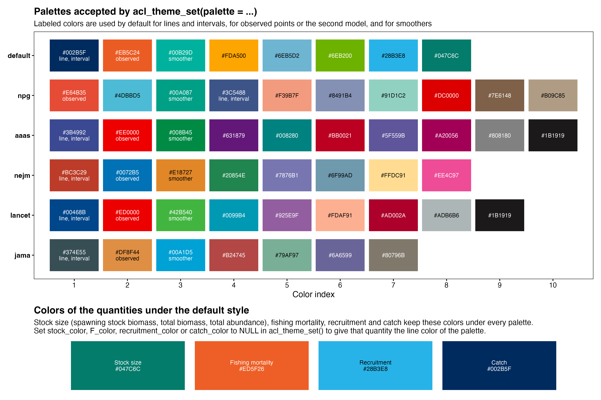
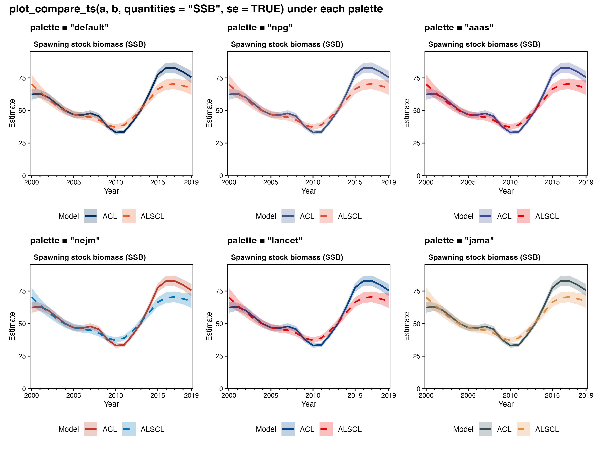

# 配色与导出

本页带你为所有 ALSCL 图选择样式、修改单项设置或单张图的颜色、让你自己画的 ggplot 具有同样的外观、导出图形，以及设置生长图和种群图的标签和坐标轴。你需要[理解第一次拟合](first-model.html)中的 `a`、`b` 和 `x`；第 1 步还会拟合一个回溯分析结果 `rb`（[运行回溯分析](retrospectives.html)）。

<h2 id="theme">1. 一次设置主题</h2>

```r
# 先建立回溯结果，再调整绘图样式
rb <- retro_alscl(x, nyear = 3, train_times = 2, ncores = 1, silent = TRUE)

# 默认样式 "default"
plot_retro(rb, facet_ncol = 2, rho_digits = 3)
plot_recruitment(b, se = TRUE)                 # 柱和误差线
plot_recruitment(b, se = TRUE, geom = "line")  # 线和区间带

# 一次调用恢复 ALSCL 2.4.5 的外观，再回到默认样式
acl_theme_set(style = "classic")
plot_compare_ts(a, b, se = TRUE)
acl_theme_set(style = "default")

# 只改一项设置，保留样式的其余部分
acl_theme_set(font_family = "sans")
acl_theme_set(palette = "jama") # default, npg, aaas, nejm, lancet, jama
plot_abundance(b, type = "NL", facet_ncol = 3)
```

默认样式 `style = "default"` 让每个数量有自己的颜色。产卵生物量、生物量和丰度是带阴影 95% 区间带的青绿色线，捕捞死亡率是带区间带的橙色线，总补充量画成浅蓝色柱，总渔获量画成深蓝色柱，两者都带浅色描边的细深灰色误差线；按年龄或按体长分面板的图是该数量颜色的线。这些图的纵轴从零开始。标题为黑色粗体、左对齐，不画网格线，分面标签是不带框的粗体文字，图例在图的下方。其他图用深蓝色画估计值、橙色画观测值；比较图中第一个拟合为深蓝色、第二个为橙色；`plot_retro()` 中完整拟合为橙色，较早的拟合为灰色。

`acl_theme_set(style = "classic")` 一次调用即恢复 ALSCL 2.4.5 的外观，即 npg 颜色、所有序列画成线、居中的常规字体标题、带框的灰色分面标签以及随数据变化的纵轴。它不恢复以前的图中文字（标题、坐标轴标题和面板名称）、以前的分面列数，也不恢复以前的年份标签和图形尺寸，因为这些规则在两种样式下相同。`acl_theme_set(style = "default")` 或 `acl_theme_reset()` 回到默认样式。样式设定下表中的取值以及由其调色板派生的颜色；字体、标签、`interval`、`show_title`、`x_angle` 和其他设置保持不变，同一调用中的其他参数在样式之后生效。设置单项只改变该项，所以两种样式可以混合。`bars = FALSE` 把补充量和渔获量画成线，`y_zero = FALSE` 让纵轴随数据变化，`grid = "y"` 加上水平网格线，`title_color = "quantity"` 让每个标题取其数量的颜色，`palette = "npg"` 让线、观测值、比较图和热图使用 npg 颜色，而四个数量的颜色保持不变。`plot_recruitment()` 和 `plot_catch()` 中的 `geom = "bar"` 或 `geom = "line"` 只对一张图起作用；按年龄和按体长的渔获量始终画成线。`acl_theme_set()` 只影响之后创建的图；要改已有的图，就重新创建它。

| 设置 | `style = "default"` | `style = "classic"`（ALSCL 2.4.5） |
|---|---|---|
| `palette` | `"default"` | `"npg"` |
| `grid` | `"none"`：无网格线（`"y"` 加上水平主网格线） | `"none"` |
| `title_face`、`title_hjust` | `"bold"`、0（左对齐） | `"plain"`、0.5（居中） |
| `title_color` | `"black"`（`"quantity"` 取数量的颜色） | `"black"` |
| `stock_color`、`F_color`、`recruitment_color`、`catch_color` | `"#047c6c"`、`"#ed5f26"`、`"#28b3e8"`、`"#002b5f"` | `NULL`：使用 `line_color` |
| `bars` | `TRUE`：总补充量和总渔获量画成柱 | `FALSE`：画成线 |
| `y_zero` | `TRUE`：种群大小、补充量、渔获量和捕捞死亡率图的纵轴从零开始 | `FALSE`：随数据变化 |
| `line_size`、`compare_line_size` | 1、0.9 | 1.5、1.2 |
| `se_alpha`、`compare_se_alpha` | 0.3、0.25 | 0.2、0.15 |
| `strip` | `"plain"`：不带框的粗体分面标签 | `"box"`：基础主题的灰色标签条 |
| `legend_position` | `"bottom"` | `NULL`：各图保持自己的位置 |
| `axis_color` | `"black"`：面板边框、坐标轴文字和刻度 | `NULL`：采用基础主题的设置 |

可选调色板为 `default`（8 色）、`npg`（10）、`aaas`（10）、`nejm`（8）、`lancet`（9）和 `jama`（7）。默认调色板的前两种颜色是用于估计值的深蓝色 `#002b5f` 和用于观测值及第二个模型的橙色 `#eb5c24`，它的热图从白色过渡到同一种深蓝色。



图中是 `acl_theme_set()` 接受的六种调色板，以及默认样式下四个数量的颜色。每一行里，标注为“line, interval”的颜色用于单模型图的线、区间和点，标注为“observed”的颜色用于观测和比较图中的第二个模型，标注为“smoother”的颜色用于平滑线；其余颜色按顺序供需要更多分组的图使用，例如 ggsci 调色板下回溯图的各轮。下一张图把同一张比较图在每种调色板下画出来，便于按视觉效果挑选；仓库中的 `docs/figures/palettes/ssb_by_palette.png` 以同样方式展示单模型图。



| 设置 | 范围与优先级 |
|---|---|
| `style` | 上表各项设置的预设 |
| `palette` | 切换时重设由它派生的颜色 |
| `line_color`、`se_color`、`point_color` | 单模型的线、区间和散点 |
| `stock_color`、`F_color`、`recruitment_color`、`catch_color` | 各数量的线和柱；设为 `NULL` 时使用 `line_color` |
| `observed_color`、`smooth_color`、`hline_color` | 观测、残差平滑线和参考线 |
| `compare_colors` | 模型对，可按模型名称匹配 |
| `low_col`、`high_col` | 连续热图的端点 |
| `font_family`、`title_size`、`axis_text_size`、`strip_text_size` | 字体与字号 |
| `line_size`、`point_size` | 单模型图的线宽（面板超过 4 个时变细，除非在调用中给出）和所有图的默认点大小（2.5）；比较图线宽使用 `compare_line_size` |
| `compare_point_size` | 可选的比较图点大小；设为 `NULL` 清除覆盖，恢复继承全局 `point_size` |
| `facet_ncol`、`facet_nrow`、`facet_scales` | 分面布局，所有图使用相同的参数名；默认列数随面板数确定 |
| `show_title`、`x_angle`、`x_breaks` | 默认标题和时间轴标签（[第 5 步](#labels)） |

<h2 id="override">2. 为单张图覆盖颜色</h2>

```r
# 单图覆盖优先于全局设置
plot_retro(rb, palette = "nejm", rho_position = "top_left")
plot_retro(rb, colors = c("2019" = "#3C5488", "2018" = "#E64B35",
                         "2017" = "#00A087", "2016" = "#4DBBD5"))
plot_SSB(b, line_color = "#00A087", se = TRUE, se_color = "#00A087")
plot_compare_ts(a, b, colors = c("ACL" = "#3C5488", "ALSCL" = "#E64B35"))

# 连续量使用渐变色
plot_pla(b)                         # 全局端点
plot_compare_F(a, b, palette = "npg")
plot_compare_F(a, b, palette = "inferno") # 其他渐变
plot_ridges(b)                      # 默认年份渐变
plot_ridges(b, palette = "cividis")
acl_theme_set(ylab = list(year = "Survey year")) # 山脊图时间轴
plot_ridges(b, palette = c("#E8F1FA", "#3C5488"))

# 自己画的 ggplot，采用包内绘图的外观和颜色
ssb <- extract_estimates(b, "SSB")
ggplot2::ggplot(ssb, ggplot2::aes(year, estimate)) +
  ggplot2::geom_ribbon(ggplot2::aes(ymin = conf_low, ymax = conf_high),
                       fill = acl_palette(role = "stock"), alpha = 0.3) +
  ggplot2::geom_line(color = acl_palette(role = "stock"), linewidth = 1) +
  ggplot2::labs(title = "Spawning stock biomass", x = "Year",
                y = "Spawning stock biomass (SSB)") +
  theme_acl(quantity = "stock")
acl_palette(role = c("stock", "F", "recruitment", "catch"))

# 恢复默认
acl_theme_reset()
```

设置 `acl_theme_set(point_size = 3)` 可统一单模型图和比较图的点大小。调用中的 `point_size` 优先级最高。在 `plot_compare_CatL()` 中，其次是显式传入的旧参数 `obs_size`，再是显式设置的主题 `compare_point_size`，最后是全局 `point_size`。其他含点的比较图遵守相同顺序，但不使用 `obs_size`。用 `acl_theme_set(compare_point_size = NULL)` 清除仅针对比较图的覆盖。

调用中显式给出的颜色优先于主题，也优先于同时传入的 `palette`；`NULL` 继承主题。在默认样式下，种群大小、F、补充量或渔获量图的区间取其线的颜色，所以只给 `line_color` 就会同时改变两者；在 `"classic"` 样式下，`se_color` 要与 `line_color` 一起指定，否则它仍取主题值。柱上的误差线为带浅色描边的深灰色，除非调用中给出 `se_color`。回溯图的命名颜色必须覆盖每个末端时间步；无名称的颜色按同样的顺序对应。轮数超过调色板颜色数时，颜色由插值得到。山脊图使用按输入年份顺序取色的渐变，观测与拟合两侧共用。默认 `palette = NULL` 在默认调色板下为由浅蓝到深蓝的渐变，在其他调色板下为 viridis，可改为 `viridis`、`cividis`、`plasma`、`ocean` 或一组颜色。

`theme_acl()` 返回当前设置下包内绘图所用的主题图层（基础主题、文字大小、网格线、标题、分面标签和图例位置），把它加到任何 ggplot 上，该图就具有包内绘图的外观；给出 `quantity = "stock"`、`"F"`、`"recruitment"` 或 `"catch"` 并设置 `title_color = "quantity"` 时，标题取该数量的颜色。`acl_palette()` 返回当前调色板的颜色，`acl_palette(n)` 返回其中 `n` 种，`acl_palette(palette = "npg")` 返回另一种调色板的颜色，`acl_palette(role = ...)` 返回绘图中 `"stock"`、`"F"`、`"recruitment"`、`"catch"`、`"primary"`（线和点）、`"accent"`（观测值）、`"smooth"` 和 `"reference"` 所用的颜色。两个函数再次调用时采用之后 `acl_theme_set()` 的设置。在默认样式下，包内绘图的纵轴还从零开始；要让自己的图包含零，加上 `ggplot2::expand_limits(y = 0)`。

<h2 id="export">3. 设置文字并导出</h2>

```r
# 调整文字与布局
acl_theme_set(title_size=16, axis_title_size=12,
              axis_text_size=10, strip_text_size=10, title_hjust=0,
              compare_legend_pos="bottom", compare_linetypes=c("solid","dashed"))
p <- plot_retro(rb, facet_ncol = 2, point_size=1.8, line_size=.8)
acl_figure_size(p)                     # 推荐的宽和高（英寸）
acl_save_plot(p, "retrospective.png")  # 按该尺寸、300 dpi 保存
acl_save_plot(p, "retrospective.pdf", width = 7)
# 显式保存并恢复设置
old <- acl_theme()
acl_theme_set(palette="aaas", x_breaks=c(2000, 2010),
              ylab=list(survey="Survey index"))
do.call(acl_theme_set, old)
acl_theme_reset()
```

`acl_figure_size(p)` 返回根据图的布局计算的推荐尺寸 `c(width = , height = )`（英寸），单条时间序列约为 8 x 4.5 英寸，分面图约宽 10 英寸、每行面板高 1.5 到 1.9 英寸。`acl_save_plot()` 按该尺寸、白色背景、300 dpi 保存图形；只给 `width` 时取相应的高度，也可以加入 `ggplot2::ggsave()` 的其他参数。`acl_theme()` 返回当前设置，供 `do.call(acl_theme_set, old)` 恢复，包括自动坐标刻度和原来为 `NULL` 的标签；`acl_theme_reset()` 回到默认值。设置 `x_breaks = NULL` 可恢复自动刻度，`ylab = list(survey = NULL)` 可清除调查标签覆盖值。所选字体也应用于 `plot_retro()` 的 Mohn's rho 标注和 `plot_compare_metrics()` 的数值标注。`default` 以外的五种调色板来自 [ggsci](https://nanx.me/ggsci/)。

<h2 id="growth">4. 设置生长图的范围和文字</h2>

```r
plot_VB(b, parameter_curve = TRUE, ylab = "Mean length (cm)",
        axis_text_size = 12, x_breaks = c(1, 5, 10, 15),
        age_range = c(1, 15), text_size = 4)
```

对 ALSCL 拟合，`plot_VB()` 在拟合的年龄组上画由拟合尾数算出的各年龄平均体长：`age_range` 选取其中的年龄组，`parameter_curve = TRUE` 加画由 `Linf`、`k` 和 `t0` 计算的曲线及其标注，标注遵守 `text_size` 和 `text_color`。对 ACL 拟合的 von Bertalanffy 曲线，`age_range = NULL` 使用拟合结果中的年龄范围（没有年龄元数据的结果用 1-25 岁），起点不早于 `t0`；没有正跨度时报错。显式范围必须是两个有限、递增的年龄，且起点不早于 `t0`，以避免在理论零体长年龄之前出现负的预测体长。这是 [von Bertalanffy 方程](https://www.fao.org/4/x5685e/x5685e03.htm)中 `t0` 的含义。线、曲线和区间都继承 `ylab$growth` 和所选字体，显式 `ylab` 覆盖全局标签；包中没有体长单位，请在标签中给出。`observed` 的点使用 `observed_color` 和 `point_size`。`se = TRUE` 的区间属于由参数计算的曲线；协方差不可用时，函数给出警告并只画估计值。

<h2 id="labels">5. 设置全局标签与坐标轴</h2>

```r
acl_theme_set(
  titles = list(SSB = "Spawning stock biomass",
                SSB_se = "Spawning stock biomass with 95% intervals"),
  xlab = list(year = "Survey year"),
  ylab = list(ssb = "Spawning stock biomass"),
  x_breaks = c(2000, 2009, 2019), x_expand = c(0, 0)
)
plot_SSB(b, se = TRUE)
acl_theme_reset()
```

```r
plot_SSB(b, se = TRUE, title = FALSE)            # 这张图不画标题
acl_theme_set(show_title = FALSE, x_angle = 0)   # 不画默认标题；年份标签水平
plot_abundance(b, type = "NL")
acl_theme_reset()
```

`plot_SSB()`、`plot_biomass()`、`plot_abundance()` 和 `plot_catch()` 的总量、年龄和体长模式，无论是否显示区间，都继承全局 `titles`、`xlab`、`ylab`、`x_breaks` 和 `x_expand`。SSB 的纵轴使用 `ylab$ssb`；标题使用数量键，区间版本加 `_se`。这些设置只改变标签和显示范围；网格线由 `grid` 决定。`acl_theme_set(interval = "wald")` 把丰度、生物量、产卵生物量、补充量、渔获量和捕捞死亡率图的 95% 区间从默认的对数正态区间改为对称区间 `estimate +/- 1.96 * SE`；`interval` 参数只对单次调用起同样的作用。误差线不透明，除非调用中给出 `se_alpha`。调用中给出的 `title`、`xlab`、`ylab` 替换主题标签，`title = FALSE`（或 `NA`、`""`）不画标题，`acl_theme_set(show_title = FALSE)` 去掉所有图的默认标题，但保留调用中给出的标题。字体参数（`font_family`、`title_size`、`axis_title_size`、`axis_text_size`、`strip_text_size`、`legend_text_size`、`base_theme`、`title_hjust`）替换对应的主题设置，与其他单模型图一致；`plot_deviance()` 也接受这些参数。

所有图的时间轴遵循同一规则。单个面板在 12 年以内标出每一年，30 年以内每 2 年标一次，60 年以内每 5 年标一次，更长时每 10 年标一次，其余年份只画不带标签的刻度。第一年和最后一年总会标出。多面板图中标签间隔随面板宽度确定，会相互接触的标签倾斜 45 度，而不是被删去。`x_angle = 0` 让标签保持水平并减少标出的年份，其他数值固定倾斜角度。调用或主题中的 `x_breaks` 设定标出的数值；全局设置同时用于时间、年龄和体长坐标轴，只有至少一个刻度落在某张图的横轴范围内时，该图才使用它，所以按年份设置的刻度不会清空年龄轴或体长轴。

`plot_fishing_mortality()` 继承同样的设置，标题键为 `F_year`、`F_age` 和 `F_length`（区间版本加 `_se`），横轴使用 `xlab$year`、`xlab$age` 或 `xlab$length`，纵轴使用 `ylab$F`。年龄模式按拟合年龄绘制。保存时没有年龄元数据的结果按编号的年龄组绘制，在你设置 `xlab$age` 之前默认标签是“Age bin”；ACL 的 `type = "length"` 别名使用年龄模式的设置。单次调用中指定的标签和刻度优先。`base_theme` 接受 `"theme_bw"`、`"bw"` 等名称、`ggplot2::theme_bw()` 等主题对象，或 `NULL` 表示全局设置。

单模型与比较的调查拟合图使用 `ylab$survey`；未设置时，自定义的 `ylab$abundance` 生效，否则为“Survey index”。对数图加“Log”前缀，显式 `ylab` 优先，`ylab$catch` 只用于渔获量图。

<h2 id="next">下一步</h2>

| 想做什么 | 阅读 |
|---|---|
| 选择要画的种群图 | [调查与种群图](population-plots.html) |
| 在一张图中比较两次拟合 | [模型比较](model-comparison.html) |
