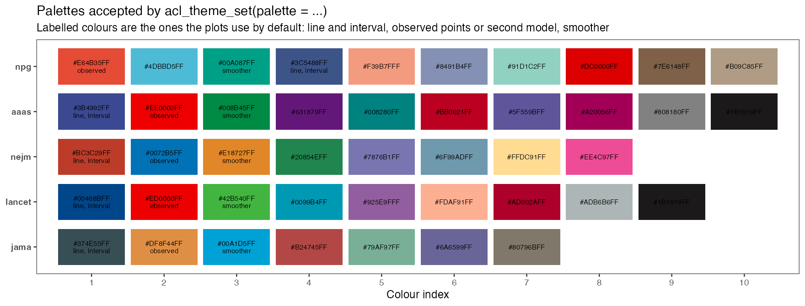
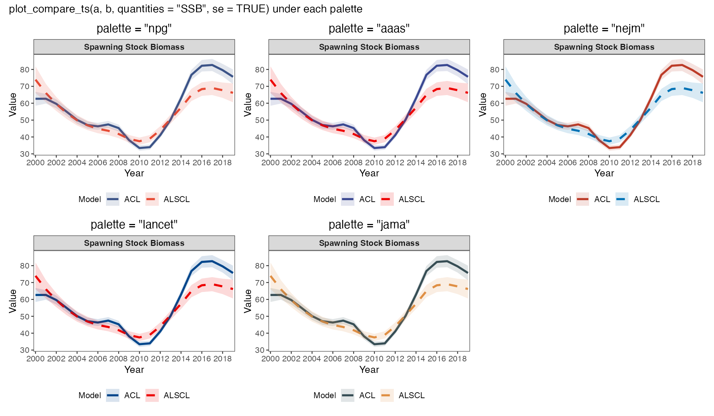

# ggsci 配色与导出

本页带你为所有 ALSCL 图一次设置色板和主题、为单张图覆盖颜色、导出图形，以及设置生长图和种群图的标签和坐标轴。你需要[理解第一次拟合](first-model.html)中的 `a`、`b` 和 `x`；第 1 步还会拟合一个回溯分析结果 `rb`（[运行回溯分析](retrospectives.html)）。

<h2 id="theme">1. 一次设置主题</h2>

```r
# 先建立回溯结果，再调整绘图样式
rb <- retro_alscl(x, nyear = 3, train_times = 2, ncores = 1, silent = TRUE)

# 一次设置，随后重新创建图
acl_theme_set(palette = "npg", base_theme = "theme_bw", font_family = "sans")
plot_retro(rb, facet_ncol = 2, rho_digits = 3)
plot_compare_ts(a, b, se = TRUE)

# 可选期刊色板
acl_theme_set(palette = "jama") # npg, aaas, nejm, lancet, jama
plot_abundance(b, type = "NL", facet_ncol = 3)
```

默认色板是 ggsci NPG：估计值用深蓝，观测用朱红，两模型比较用深蓝和朱红。回溯图的颜色按末端时间步从新到旧分配。`acl_theme_set()` 只影响之后创建的图；要改已有的图，就重新创建它。可选色板为 `npg`（10 色）、`aaas`（10）、`nejm`（8）、`lancet`（9）和 `jama`（7）。



图中是 `acl_theme_set()` 接受的五种色板。每一行里，第一个带标注的颜色用于单模型图的线、区间和点，第二个用于观测和比较图中的第二个模型，第三个用于平滑线；其余颜色按顺序供需要更多分组的图使用，例如回溯图的各轮。下一张图把同一张比较图在每种色板下画出来，便于按视觉效果挑选；仓库中的 `docs/figures/palettes/ssb_by_palette.png` 以同样方式展示单模型图。



| 设置 | 范围与优先级 |
|---|---|
| `palette` | 切换时重设派生的颜色角色 |
| `line_color`、`se_color`、`point_color` | 单模型的线、区间和散点 |
| `observed_color`、`smooth_color`、`hline_color` | 观测、残差平滑线和参考线 |
| `compare_colors` | 模型对，可按模型名称匹配 |
| `low_col`、`high_col` | 连续热图的端点 |
| `font_family`、`title_size`、`axis_text_size`、`strip_text_size` | 字体与字号 |
| `line_size`、`point_size` | 单模型图的线宽和所有图的默认点大小（2.5）；比较图线宽使用 `compare_line_size` |
| `compare_point_size` | 可选的比较图点大小；设为 `NULL` 清除覆盖，恢复继承全局 `point_size` |
| `facet_ncol`、`facet_nrow`、`facet_scales` | 分面布局，所有图使用相同的参数名 |

<h2 id="override">2. 为单张图覆盖颜色</h2>

```r
# 单图覆盖优先于全局设置
plot_retro(rb, palette = "nejm", rho_position = "top_left")
plot_retro(rb, colors = c("2019" = "#3C5488", "2018" = "#E64B35",
                         "2017" = "#00A087", "2016" = "#4DBBD5"))
plot_SSB(b, line_color = "#00A087", se = TRUE, se_color = "#00A087")
plot_compare_ts(a, b, colors = c("ACL" = "#3C5488", "ALSCL" = "#E64B35"))

# 连续量使用渐变色
plot_pla(b)                         # 全局端点
plot_compare_F(a, b, palette = "npg")
plot_compare_F(a, b, palette = "inferno") # 其他渐变
plot_ridges(b)                      # 默认年份渐变
plot_ridges(b, palette = "cividis")
acl_theme_set(ylab = list(year = "Survey year")) # 山脊图时间轴
plot_ridges(b, palette = c("#E8F1FA", "#3C5488"))

# 恢复默认
acl_theme_reset()
```

设置 `acl_theme_set(point_size = 3)` 可统一单模型图和比较图的点大小。调用中的 `point_size` 优先级最高。在 `plot_compare_CatL()` 中，其次是显式传入的旧参数 `obs_size`，再是显式设置的主题 `compare_point_size`，最后是全局 `point_size`。其他含点的比较图遵守相同顺序，但不使用 `obs_size`。用 `acl_theme_set(compare_point_size = NULL)` 清除仅针对比较图的覆盖。

调用中显式给出的颜色优先于主题，也优先于同时传入的 `palette`；`NULL` 继承主题。`se_color` 要与 `line_color` 一起指定，否则它仍取主题值。回溯图的命名颜色必须覆盖每个末端时间步；无名称的颜色按同样的顺序对应。轮数超过色板颜色数时，颜色由插值得到。山脊图使用按输入年份顺序取色的 viridis 渐变，观测与拟合两侧共用，与全局色板无关；`NULL` 也使用 viridis，可改为 `cividis`、`plasma`、`ocean` 或一组颜色。

<h2 id="export">3. 设置文字并导出</h2>

```r
# 调整文字与布局
acl_theme_set(palette="npg", title_size=16, axis_title_size=12,
              axis_text_size=10, strip_text_size=10, title_hjust=0,
              compare_legend_pos="bottom", compare_linetypes=c("solid","dashed"))
p <- plot_retro(rb, facet_ncol = 2, point_size=1.8, line_size=.8)
ggplot2::ggsave("retrospective.png", p, width=11, height=7, dpi=300, bg="white")
ggplot2::ggsave("retrospective.pdf", p, width=11, height=7)
# 显式保存并恢复设置
old <- acl_theme()
acl_theme_set(palette="aaas", x_breaks=c(2000, 2010),
              ylab=list(survey="Survey index"))
do.call(acl_theme_set, old)
acl_theme_reset()
```

`ggsave()` 按给定的尺寸和分辨率写出 `p`。`acl_theme()` 返回当前设置，供 `do.call(acl_theme_set, old)` 恢复，包括自动坐标刻度和原来为 `NULL` 的标签；`acl_theme_reset()` 回到默认值。设置 `x_breaks = NULL` 可恢复自动刻度，`ylab = list(survey = NULL)` 可清除调查标签覆盖值。所选字体也应用于回溯图 rho 和比较图数值标注。色板来源：[ggsci NPG documentation](https://nanx.me/ggsci/reference/pal_npg.html)。

<h2 id="growth">4. 设置生长图的范围和文字</h2>

```r
plot_VB(b, se = FALSE, ylab = "Length (cm)",
        axis_text_size = 12, x_breaks = c(1, 5, 10, 15),
        age_range = c(1, 15), text_size = 4)
```

`age_range = NULL` 时，`plot_VB()` 使用拟合结果中的年龄范围（没有年龄元数据的结果用 1-25 岁），起点不早于 `t0`；没有正跨度时报错。显式范围必须是两个有限、递增的年龄，且起点不早于 `t0`，以避免在理论零体长年龄之前出现负的预测体长。这是 [von Bertalanffy 方程](https://www.fao.org/4/x5685e/x5685e03.htm)中 `t0` 的含义。曲线和区间都继承 `ylab$growth` 和所选字体，显式 `ylab` 覆盖全局标签，Linf/k 标注遵守 `text_size` 和 `text_color`。如果 `se = TRUE` 但协方差不可用，函数会给出警告并只画曲线。

<h2 id="labels">5. 设置全局标签与坐标轴</h2>

```r
acl_theme_set(
  titles = list(SSB = "Spawning biomass",
                SSB_se = "Spawning biomass with 95% intervals"),
  xlab = list(year = "Survey year"),
  ylab = list(ssb = "Spawning biomass"),
  x_breaks = c(2000, 2009, 2019), x_expand = c(0, 0)
)
plot_SSB(b, se = TRUE)
acl_theme_reset()
```

`plot_SSB()`、`plot_biomass()`、`plot_abundance()` 和 `plot_catch()` 的总量、年龄和体长模式，无论是否显示区间，都继承全局 `titles`、`xlab`、`ylab`、`x_breaks` 和 `x_expand`。SSB 的纵轴使用 `ylab$ssb`；标题使用数量键，区间版本加 `_se`。这些设置只改变标签和显示范围，网格线保持隐藏。全局 `x_breaks` 同时用于时间、年龄和体长坐标轴：只有至少一个刻度落在某张图的横轴范围内时，该图才使用它，所以按年份设置的刻度不会清空年龄轴或体长轴。`acl_theme_set(interval = "wald")` 把丰度、生物量、产卵生物量、补充量、渔获量和捕捞死亡率图的 95% 区间从默认的对数正态区间改为对称区间 `estimate +/- 1.96 * SE`；`interval` 参数只对单次调用起同样的作用。误差棒不透明，除非调用中给出 `se_alpha`。调用中给出的 `title`、`xlab`、`ylab` 替换主题标签，字体参数（`font_family`、`title_size`、`axis_title_size`、`axis_text_size`、`strip_text_size`、`legend_text_size`、`base_theme`、`title_hjust`）替换对应的主题设置，与其他单模型图一致；`plot_deviance()` 也接受这些参数。

`plot_fishing_mortality()` 继承同样的设置，标题键为 `F_year`、`F_age` 和 `F_length`（区间版本加 `_se`），横轴使用 `xlab$year`、`xlab$age` 或 `xlab$length`，纵轴使用 `ylab$F`。年龄模式按拟合年龄绘制。保存时没有年龄元数据的结果按组序号绘制，在你设置 `xlab$age` 之前默认标签是“Age group”；ACL 的 `type = "length"` 别名使用年龄模式的设置。单次调用中指定的标签和刻度优先。`base_theme` 接受 `"theme_bw"`、`"bw"` 等名称、`ggplot2::theme_bw()` 等主题对象，或 `NULL` 表示全局设置。

单模型与比较的调查拟合图使用 `ylab$survey`；未设置时，自定义的 `ylab$abundance` 生效，否则为“Survey index”。对数图加“Log”前缀，显式 `ylab` 优先，`ylab$catch` 只用于捕获量图。

<h2 id="next">下一步</h2>

| 想做什么 | 阅读 |
|---|---|
| 选择要画的种群图 | [调查与种群图](population-plots.html) |
| 在一张图中比较两次拟合 | [模型比较与真值](model-comparison.html) |
