# 调查与种群图

先完成 [YTF 拟合示例](first-model.html)，得到输入列表 `x` 和拟合结果 `a`、`b`，并设置 `dat <- x$data.CatL`。加载 ggplot2 和 patchwork。[回溯分析指南](retrospectives.html) 建立 `ra`、`rb`。

```r
library(ggplot2)
library(patchwork)
acl_theme_set(palette="npg", base_theme="theme_bw")
```

面板或模型组只有一个估计值时显示为点。设置 `se = TRUE` 后，以误差棒显示 95% 区间（默认为对数正态区间，见 `interval` 参数），因为只有一个点的带状区间没有可见宽度。该规则适用于种群与捕捞死亡率图，也分别适用于 `plot_compare_ts()` 中的每个模型。点大小继承 `point_size`；单模型图的点继承 `line_color`，区间继承 `se_color`。所有面板仍不显示网格线。

## 各体长组的调查指数（对数尺度）

```r
# 绘制本图
plot_CatL(b, facet_by = "length", exp_transform = FALSE, facet_ncol = 4,
  point_size = 1, line_size = 0.6,
  x_breaks = c(2000, 2010, 2015),
  ylab = "Log survey index")
```

[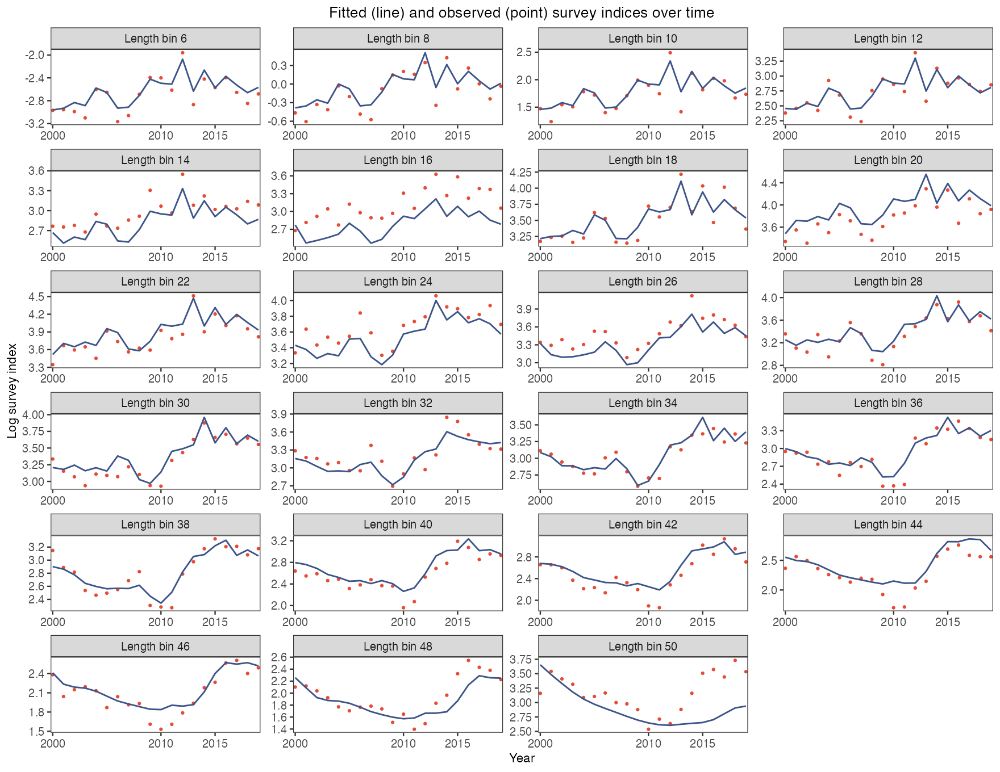](https://github.com/FanZhang-LAB-SHOU/ALSCL/blob/main/docs/figures/ytf/CatL_length_FALSE.png?raw=true)

每个体长组一个面板，横轴为时间，纵轴为对数调查指数：朱红色点为观测的对数指数，深蓝色曲线为拟合的 `Elog_index`。用它逐组检查拟合；点连续偏在曲线一侧（如本例的 16 组和 50 组）说明该组被系统低估或高估，对数尺度让大小体长组的偏离同样可读。

[参数及默认值](https://github.com/FanZhang-LAB-SHOU/ALSCL/blob/main/docs/FUNCTION_REFERENCE.md#plot_CatL)

## 各体长组的调查指数（原尺度）

```r
# 绘制本图
plot_CatL(b, facet_by = "length", exp_transform = TRUE, facet_ncol = 4,
  point_size = 1, line_size = 0.6,
  x_breaks = c(2000, 2010, 2015),
  ylab = "Survey index")
```

[](https://github.com/FanZhang-LAB-SHOU/ALSCL/blob/main/docs/figures/ytf/CatL_length_TRUE.png?raw=true)

同样的面板改为原尺度：深蓝色曲线为 `exp(Elog_index)`，即拟合对数正态分布的中位数，朱红色点为观测指数。用它按指数单位读取偏差；误差是乘性的，高值处看似很大的差距与低值处的小差距可能是相同的相对偏差。

[参数及默认值](https://github.com/FanZhang-LAB-SHOU/ALSCL/blob/main/docs/FUNCTION_REFERENCE.md#plot_CatL)

## 各时间步的调查指数（对数尺度）

```r
# 绘制本图
plot_CatL(b, facet_by = "year", exp_transform = FALSE, facet_ncol = 4,
  line_size1 = 0.6, line_size2 = 0.4,
  x_breaks = c(10, 30, 50),
  ylab = "Log survey index")
```

[](https://github.com/FanZhang-LAB-SHOU/ALSCL/blob/main/docs/figures/ytf/CatL_year_FALSE.png?raw=true)

按年份分面时，`line_size1` 设置拟合线宽，`line_size2` 设置观测线宽。遇到缺测会断开观测线，孤立的观测以点显示，大小由 `point_size` 控制。

每个时间步一个面板，横轴为体长，纵轴为对数调查指数：细朱红线为观测对数指数随体长的变化，粗深蓝线为拟合的 `Elog_index`。用它检查同一时间步内的拟合形状；深蓝线没有跟上的突起（如本例后几年最大体长组处）就是拟合未能解释的体长结构。

[参数及默认值](https://github.com/FanZhang-LAB-SHOU/ALSCL/blob/main/docs/FUNCTION_REFERENCE.md#plot_CatL)

## 各时间步的调查指数（原尺度）

```r
# 绘制本图
plot_CatL(b, facet_by = "year", exp_transform = TRUE, facet_ncol = 4,
  line_size1 = 0.6, line_size2 = 0.4,
  x_breaks = c(10, 30, 50),
  ylab = "Survey index")
```

[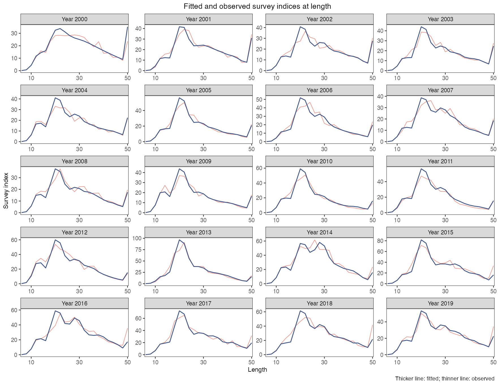](https://github.com/FanZhang-LAB-SHOU/ALSCL/blob/main/docs/figures/ytf/CatL_year_TRUE.png?raw=true)

按年份分面时，`line_size1` 设置拟合线宽，`line_size2` 设置观测线宽。遇到缺测会断开观测线，孤立的观测以点显示，大小由 `point_size` 控制。

曲线表示调查指数在原尺度上的拟合中位数 `exp(Elog_index)`，观测值按体长组显示。比较观测指数和拟合指数峰值所在的体长组，再查看这些体长组的残差。

[参数及默认值](https://github.com/FanZhang-LAB-SHOU/ALSCL/blob/main/docs/FUNCTION_REFERENCE.md#plot_CatL)

## 丰度 N

```r
# 绘制本图
plot_abundance(b, type = "N", se = TRUE, facet_ncol = 3,
  line_size = 0.6)
```

[](https://github.com/FanZhang-LAB-SHOU/ALSCL/blob/main/docs/figures/ytf/plot_abundance_N.png?raw=true)

总丰度是每个时间步各组估计尾数之和。阴影为近似 95% 区间，默认是对数正态区间 `exp(log(estimate) +/- 1.96 * SE / estimate)`，其中 SE 是估计值的标准误。该区间不会低于零；`interval = "wald"` 绘制早期版本使用的对称区间 `estimate +/- 1.96 * SE`。本例总丰度在 2012 年上升，同年估计补充量达到峰值。

[参数及默认值](https://github.com/FanZhang-LAB-SHOU/ALSCL/blob/main/docs/FUNCTION_REFERENCE.md#plot_abundance)

## 丰度 NA

```r
# 绘制本图
plot_abundance(b, type = "NA", se = TRUE, facet_ncol = 3,
  line_size = 0.6)
```

[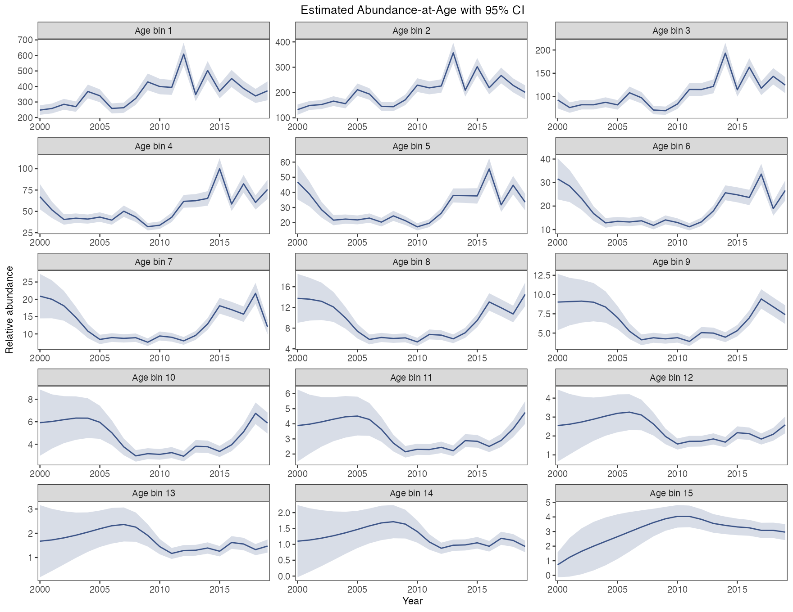](https://github.com/FanZhang-LAB-SHOU/ALSCL/blob/main/docs/figures/ytf/plot_abundance_NA.png?raw=true)

每个面板显示一个年龄组的估计尾数和近似 95% 区间。面板用拟合年龄标注，最大的年龄组是末组（plus group），用加号标出（“Age 15+”）。追踪同一世代时，将某期该年龄组的尾数与下一期相邻较高年龄组的尾数对照。各面板使用各自的纵轴尺度。

[参数及默认值](https://github.com/FanZhang-LAB-SHOU/ALSCL/blob/main/docs/FUNCTION_REFERENCE.md#plot_abundance)

## 丰度 NL

```r
# 绘制本图
plot_abundance(b, type = "NL", se = TRUE, facet_ncol = 3,
  line_size = 0.6)
```

[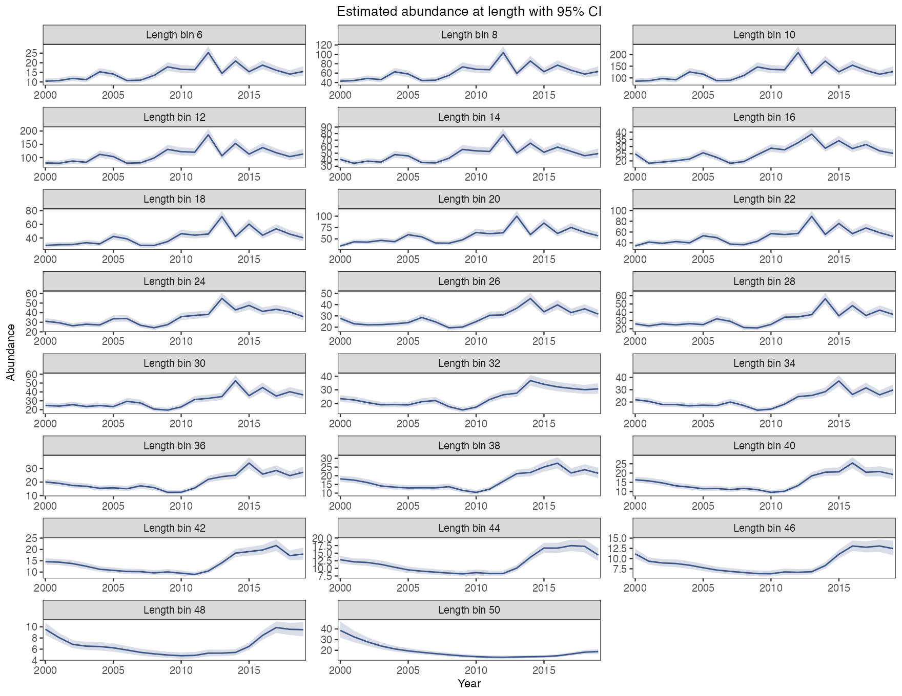](https://github.com/FanZhang-LAB-SHOU/ALSCL/blob/main/docs/figures/ytf/plot_abundance_NL.png?raw=true)

每个面板显示一个体长组的估计尾数和近似 95% 区间。本例中，小体长组在 2012 年前后先出现峰值，大体长组的峰值出现得较晚。一个体长组可包含多个年龄组的个体。

[参数及默认值](https://github.com/FanZhang-LAB-SHOU/ALSCL/blob/main/docs/FUNCTION_REFERENCE.md#plot_abundance)

## 生物量 B

```r
# 绘制本图
plot_biomass(b, type = "B", se = TRUE, facet_ncol = 3,
  line_size = 0.6)
```

[](https://github.com/FanZhang-LAB-SHOU/ALSCL/blob/main/docs/figures/ytf/plot_biomass_B.png?raw=true)

总生物量随时间步变化，带近似 95% 区间。与总丰度对照，可看出平均个体体重如何影响生物量估计。补充个体从进入模型的第一个时间步就贡献生物量，其贡献可随生长增加。生物量不一定比丰度更平滑。

[参数及默认值](https://github.com/FanZhang-LAB-SHOU/ALSCL/blob/main/docs/FUNCTION_REFERENCE.md#plot_biomass)

## 生物量 BA

```r
# 绘制本图
plot_biomass(b, type = "BA", se = TRUE, facet_ncol = 3,
  line_size = 0.6)
```

[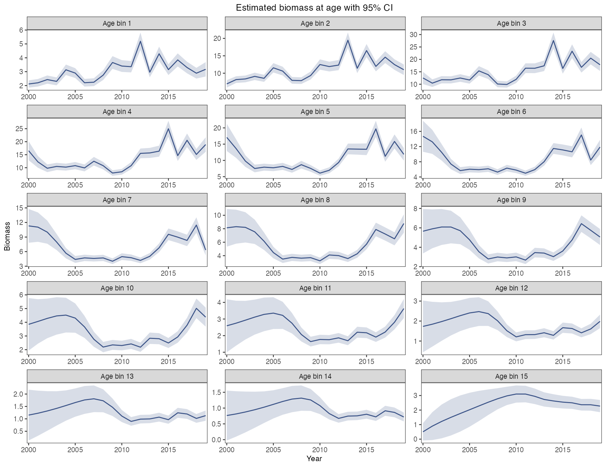](https://github.com/FanZhang-LAB-SHOU/ALSCL/blob/main/docs/figures/ytf/plot_biomass_BA.png?raw=true)

年龄别生物量，每个年龄组一个面板，纵轴各自取值，带 95% 区间。用它看生物量集中在哪些年龄；注意各面板的纵轴刻度，自由刻度会让数量很小的老龄组看起来和大的年轻组一样多变。

[参数及默认值](https://github.com/FanZhang-LAB-SHOU/ALSCL/blob/main/docs/FUNCTION_REFERENCE.md#plot_biomass)

## 生物量 BL

```r
# 绘制本图
plot_biomass(b, type = "BL", se = TRUE, facet_ncol = 3,
  line_size = 0.6)
```

[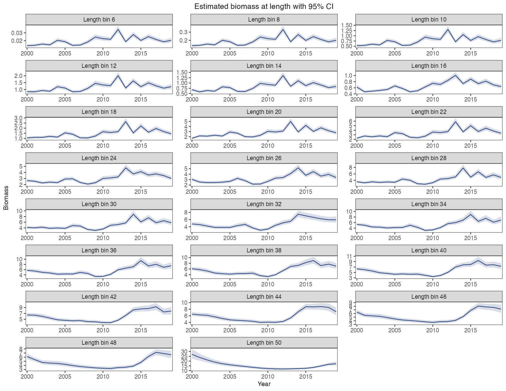](https://github.com/FanZhang-LAB-SHOU/ALSCL/blob/main/docs/figures/ytf/plot_biomass_BL.png?raw=true)

每个面板显示一个体长组的生物量和近似 95% 区间。按各面板纵轴的数值比较体长组对总生物量的贡献。本例中，多个较大体长组的生物量在 2013 年后上升。

[参数及默认值](https://github.com/FanZhang-LAB-SHOU/ALSCL/blob/main/docs/FUNCTION_REFERENCE.md#plot_biomass)

## 产卵生物量 SSB

```r
# 绘制本图
plot_SSB(b, type = "SSB", se = TRUE, facet_ncol = 3,
  line_size = 0.6)
```

[](https://github.com/FanZhang-LAB-SHOU/ALSCL/blob/main/docs/figures/ytf/plot_SSB_SSB.png?raw=true)

产卵群体生物量（SSB）由各组尾数乘以平均体重和成熟比例后求和得到，阴影为近似 95% 区间。本次拟合的 SSB 在 2010 年达到低点，随后回升。用 SSB 判断资源状态时，还需说明所采用的参考点。SSB 的水平取决于拟合时给定的调查可捕性。要与使用年龄别成熟比例的评估比较趋势，请用 `ssb_at_age()` 按年龄别成熟比例计算产卵生物量。

[参数及默认值](https://github.com/FanZhang-LAB-SHOU/ALSCL/blob/main/docs/FUNCTION_REFERENCE.md#plot_SSB)

## 产卵生物量 SBA

```r
# 绘制本图
plot_SSB(b, type = "SBA", se = TRUE, facet_ncol = 3,
  line_size = 0.6)
```

[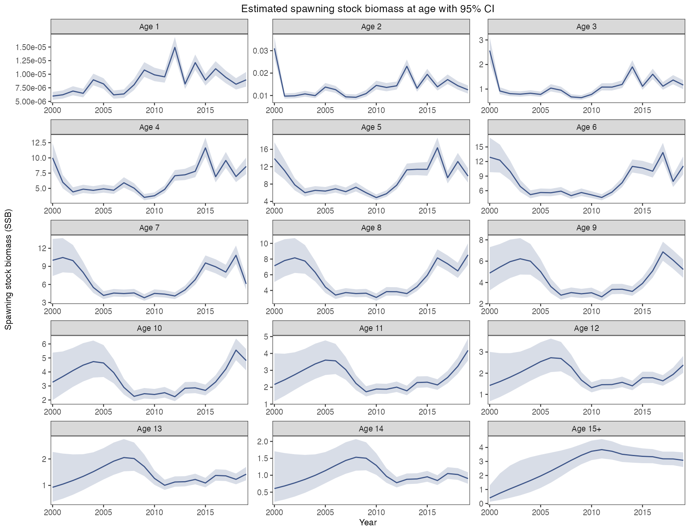](https://github.com/FanZhang-LAB-SHOU/ALSCL/blob/main/docs/figures/ytf/plot_SSB_SBA.png?raw=true)

年龄别产卵生物量，每个年龄组一个面板，带 95% 区间。用它看产卵来自哪些年龄；最小的几个年龄组接近零，因为成熟比例表几乎不给它们成熟个体，比较面板时看纵轴数值而不是曲线形状。

[参数及默认值](https://github.com/FanZhang-LAB-SHOU/ALSCL/blob/main/docs/FUNCTION_REFERENCE.md#plot_SSB)

## 产卵生物量 SBL

```r
# 绘制本图
plot_SSB(b, type = "SBL", se = TRUE, facet_ncol = 3,
  line_size = 0.6)
```

[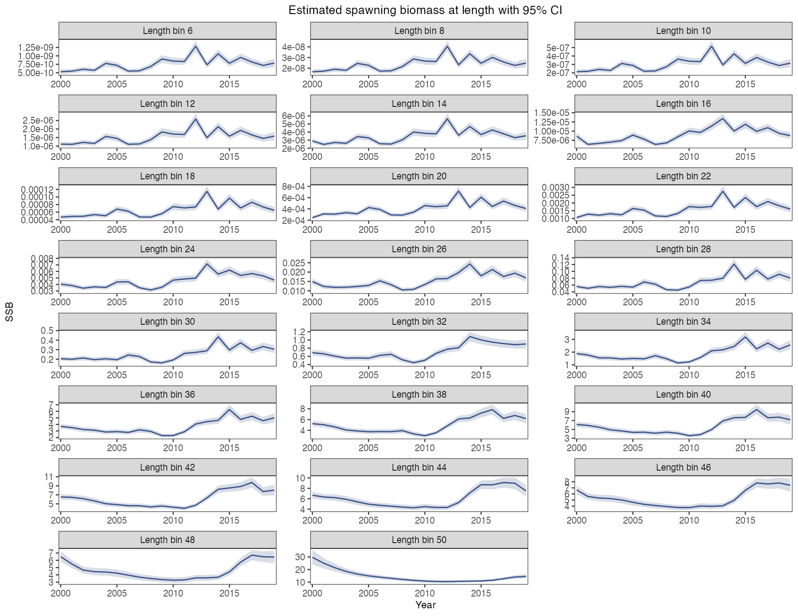](https://github.com/FanZhang-LAB-SHOU/ALSCL/blob/main/docs/figures/ytf/plot_SSB_SBL.png?raw=true)

体长别产卵生物量，每个体长组一个面板，带 95% 区间。用它看产卵来自哪些体长；小体长组同样接近零，30 以上的成熟组走势与总产卵生物量一致。

[参数及默认值](https://github.com/FanZhang-LAB-SHOU/ALSCL/blob/main/docs/FUNCTION_REFERENCE.md#plot_SSB)

## 捕获尾数 CN

```r
# 绘制本图
plot_catch(b, type = "CN", se = TRUE, facet_ncol = 3,
  line_size = 0.6)
```

[](https://github.com/FanZhang-LAB-SHOU/ALSCL/blob/main/docs/figures/ytf/plot_catch_CN.png?raw=true)

模型推导的捕捞尾数（`CN`）随时间步变化，带近似 95% 区间。它根据丰度和捕捞死亡率计算；YTF 教学数据不含实测渔获量。与独立渔获资料比较前，须统一数量定义、单位、丰度尺度、时期和区域。登陆量可能不包括弃捕，还需核对其涵盖的捕捞移除量（[FAO 定义](https://www.fao.org/4/x8923e/X8923E03.htm)）。区间较宽表示给定拟合假设下不确定性较大；仅凭宽度不能确定其原因。只拟合调查指数时渔获量的水平无法确定，它取决于给定的自然死亡率和调查可捕性。`relative_catch()` 返回渔获量除以其在各时间步上的均值，用于与上报渔获量比较趋势。

[参数及默认值](https://github.com/FanZhang-LAB-SHOU/ALSCL/blob/main/docs/FUNCTION_REFERENCE.md#plot_catch)

## 捕获尾数 CNA

```r
# 绘制本图
plot_catch(b, type = "CNA", se = TRUE, facet_ncol = 3,
  line_size = 0.6)
```

[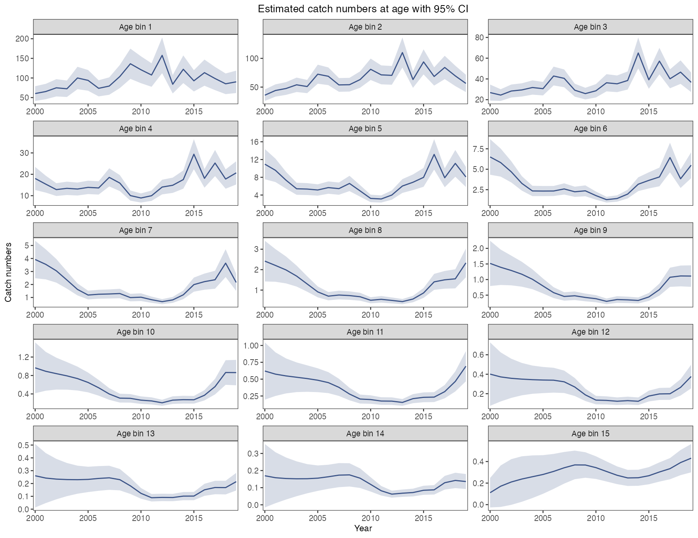](https://github.com/FanZhang-LAB-SHOU/ALSCL/blob/main/docs/figures/ytf/plot_catch_CNA.png?raw=true)

每个面板显示一个年龄组的估计渔获尾数和近似 95% 区间。本例中，较年轻的年龄组渔获尾数较高。比较时请看各面板纵轴的数值。

[参数及默认值](https://github.com/FanZhang-LAB-SHOU/ALSCL/blob/main/docs/FUNCTION_REFERENCE.md#plot_catch)

## 捕获尾数 CNL

```r
# 绘制本图
plot_catch(b, type = "CNL", se = TRUE, facet_ncol = 3,
  line_size = 0.6)
```

[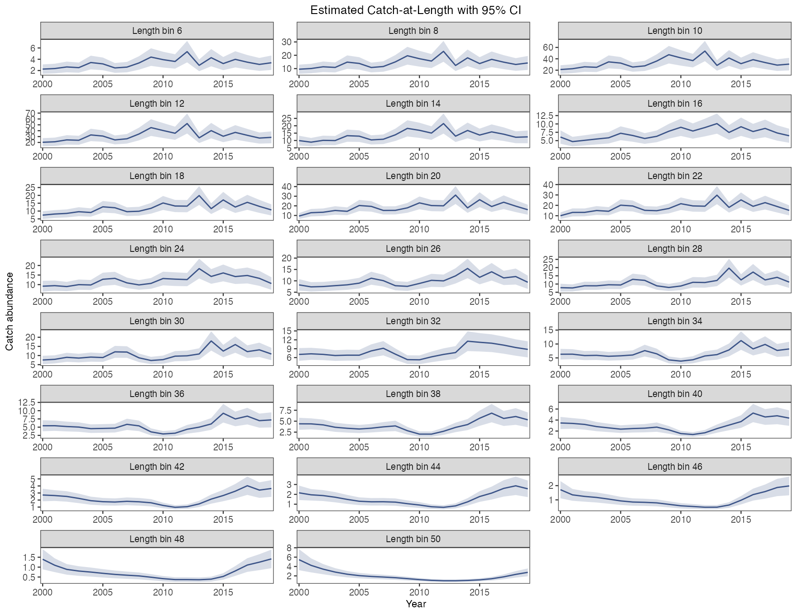](https://github.com/FanZhang-LAB-SHOU/ALSCL/blob/main/docs/figures/ytf/plot_catch_CNL.png?raw=true)

每个面板显示一个体长组的预期渔获尾数和近似 95% 区间。设组内期初尾数为 N，F 和 M 分别为每个时间步的瞬时捕捞死亡率和自然死亡率。按 Baranov 渔获方程，`C = N × (F/Z) × (1 − exp(−Z))`，其中 `Z = F + M`。ALSCL 将同一体长组各年龄的渔获尾数相加。[Baranov 渔获方程，式（15）](https://repository.library.noaa.gov/view/noaa/4847/noaa_4847_DS1.pdf#page=11)。

[参数及默认值](https://github.com/FanZhang-LAB-SHOU/ALSCL/blob/main/docs/FUNCTION_REFERENCE.md#plot_catch)

## 补充量

```r
# 绘制本图
plot_recruitment(b, se = TRUE)
```

[](https://github.com/FanZhang-LAB-SHOU/ALSCL/blob/main/docs/figures/ytf/recruitment.png?raw=true)

补充量表示每个时间步进入最小年龄组的估计尾数，阴影为近似 95% 区间。本例估计补充量在 2012 年达到峰值。`rec.age` 指定个体进入模型的年龄。

[参数及默认值](https://github.com/FanZhang-LAB-SHOU/ALSCL/blob/main/docs/FUNCTION_REFERENCE.md#plot_recruitment)

## 亲体与补充关系

```r
# 绘制本图
plot_SSB_Rec(b, age_at_recruitment = 1)
```

[](https://github.com/FanZhang-LAB-SHOU/ALSCL/blob/main/docs/figures/ytf/SSB_Rec.png?raw=true)

每个点把某期的产卵群体生物量与 `age_at_recruitment` 年后的补充量配对，可用来查看两组估计值的关系。默认 `age_at_recruitment = NULL` 使用最小拟合年龄：本例的年度拟合为 1 年，`rec.age = 0.25` 的季度拟合为一个季度。评估模型用 AR(1) 过程描述补充量的对数偏差。绘图函数只绘制配对值。

[参数及默认值](https://github.com/FanZhang-LAB-SHOU/ALSCL/blob/main/docs/FUNCTION_REFERENCE.md#plot_SSB_Rec)

## 季度网格上的补充滞后

`age_at_recruitment` 的单位是年，默认 NULL 取最小拟合年龄（没有年龄元数据的结果用 1 年）。`plot_SSB_Rec()` 把给定的值除以拟合的 `growth_step`，要求在规则时间网格上对应整数个时间步。季度数据中，0.25 表示滞后一季度，1 表示四季度。允许零滞后；拒绝负值、非有限值及非整数步滞后。没有 `growth_step` 的结果使用规则年份间隔；两类时间元数据都没有时沿用年度步长。

```r
q <- list(year = 2000 + (0:7)/4, growth_step = 0.25,
          report = list(SSB = 1:8, Rec = 101:108))
paired <- plot_SSB_Rec(q, age_at_recruitment = 0.25, return_data = TRUE)$data
stopifnot(identical(paired$SSB, 1:7), identical(paired$Rec, 102:108))
```

## 显示一个已保存的估计值

此列表仅用于显示 `b` 最后一期的产卵群体生物量及其标准误，不表示只用一个观测拟合了模型，也不能作为模拟或预测的输入。点与近似 95% 区间均保持可见，不改变原估计值。

```r
# Display one saved estimate without refitting.
ssb_rows <- which(rownames(b$est_std) == "SSB")
one_period <- list(
  model_type = b$model_type,
  year = tail(b$year, 1L),
  report = list(SSB = tail(b$report$SSB, 1L)),
  est_std = b$est_std[tail(ssb_rows, 1L), , drop = FALSE]
)
plot_SSB(one_period, se = TRUE, x_breaks = one_period$year) +
  ggplot2::coord_cartesian(xlim = one_period$year + c(-0.5, 0.5))
```

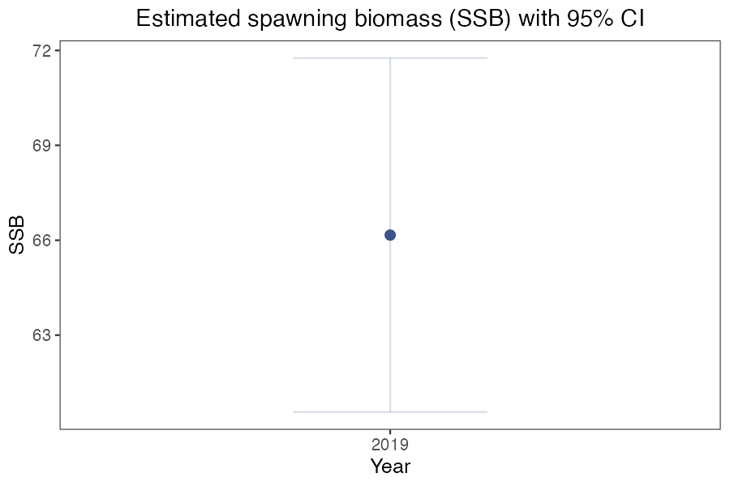
