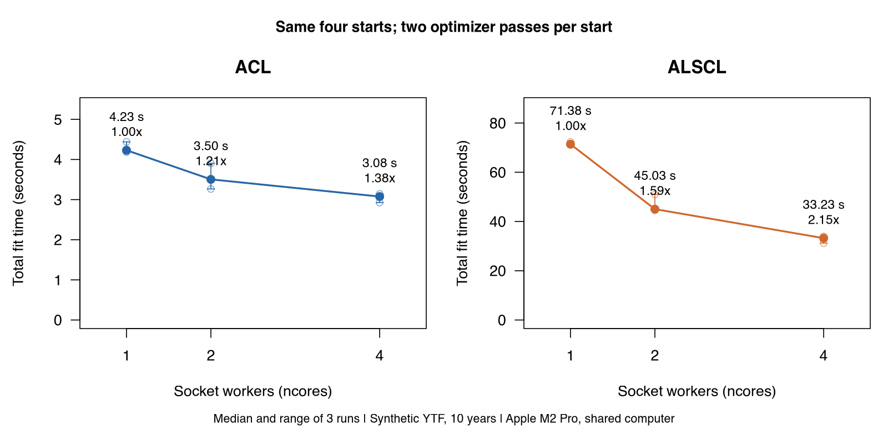

# 复现结果与排除故障

读完[理解第一次拟合](first-model.html)之后，你已经有了输入列表 `x` 和拟合好的 ACL 模型 `a`。本页教你记录拟合依赖的内容、在以后的会话中重建拟合、并行运行拟合、在会话之间保留编译好的模型，以及查找常见错误。

<h2 id="record">1. 记录拟合依赖的内容</h2>

```r
save_assessment(a, "ytf_acl.rds", overwrite = TRUE)
packageVersion("ALSCL")
a$recipe$versions
a$recipe$implementation$source$revision
writeLines(capture.output(sessionInfo()), "sessionInfo.txt")
```

`save_assessment()` 保存拟合结果，不含当前会话的 TMB 对象 `a$obj`，并附上记录拟合全部依赖内容的配方：

| 内容 | 在保存的拟合结果中的位置 |
|---|---|
| 数据表、设置、参数初值、边界、`map`、`nstarts` 和调用的其他参数 | `recipe$args` |
| ALSCL、TMB 和 R 的版本 | `recipe$versions` |
| 模型源文件的 MD5 值、已知时的 Git 修订号、平台、BLAS、LAPACK、Matrix 和 RcppEigen | `recipe$implementation` |
| 速度设置，`framework` 和 `sd_cores` | `recipe$settings` |

`sessionInfo()` 补充操作系统、BLAS 和 LAPACK 库以及已加载的软件包；把它的输出和保存的文件放在一起。拟合模型模拟还依赖随机种子，`simulate_fit()` 会把它记录在 `metadata$seed` 中。

当文件已存在（请设置 `overwrite = TRUE`）、文件夹不存在，或旧拟合没有配方时，`save_assessment()` 会报错停止；此时把输入列表作为 `x` 传入，配方会由它重建。

<h2 id="reproduce">2. 在以后重现拟合</h2>

```r
saved <- read_assessment("ytf_acl.rds")
refit <- refit_model(saved)
max(abs(refit$opt$par - saved$opt$par))
all.equal(refit$report$SSB, saved$report$SSB)
```

`read_assessment()` 返回保存的拟合结果，所有绘图和提取函数都能使用它；它没有可执行的 TMB 对象，因为 `a$obj` 保存的是指向拟合时所在会话中编译模型的指针。`refit_model()` 重新拟合配方，返回带有可执行对象的拟合结果；命名参数会覆盖配方，`map` 这类列表会整体替换保存的列表。

在同一台电脑上使用相同版本的 ALSCL、TMB 和 R 时，标量参数逐位相同，`all.equal()` 返回 `TRUE`。不同机器或不同软件包版本之间末位数字的差异来自浮点运算和优化器的停止规则；大到足以改变结论的差异，说明数据、设置或软件包版本不同。

`refit_model()` 发现 ALSCL、TMB、Matrix 或 RcppEigen 的版本或模型源文件与配方不同时会给出警告；要逐位复现，请安装 `saved$recipe$versions` 中的版本。`A complete fit recipe is required` 表示拟合结果没有配方；按第 1 步用 `x` 重新保存。

<h2 id="parallel">3. 并行运行拟合</h2>

```r
a4 <- run_acl(x, nstarts = 4, ncores = 2, silent = TRUE)
a4$start_diagnostics
a4$workers
```

`ncores` 决定一个函数启动多少个 socket 进程，即新的 R 进程。每个进程运行完整的初值或完整的拟合，因此结果与顺序运行相同。

| 函数 | 分配给进程的工作 | 每次拟合的初值个数 |
|---|---|---|
| `run_acl()`、`run_alscl()` | 各个初值，最多 `min(ncores, nstarts)` 个进程 | `nstarts`，默认等于 `ncores` |
| `retro_model()`、`retro_acl()`、`retro_alscl()` | 回溯分析的各轮 | 输入列表或调用中明确给出的 `nstarts`，否则为一个，依次运行 |
| `fit_scenarios()`、`hindcast_model()` | 各项任务：每个情景或每个训练折 | 同上 |
| `sim_model()`、`sim_acl()`、`sim_alscl()` | 各个重复 | `nstarts`，默认为一个 |

由于 `nstarts` 默认等于 `ncores`，比较耗时时请同时设置两者。后续初值加上固定的扰动，最后选出目标函数最小的初值，因此无论 `ncores` 为多少，结果都相同；`a4$start_diagnostics` 记录每个初值。其他函数不使用输入列表中的 `ncores`，每次拟合只用一个进程并顺序计算标准误。

一次拟合内部计算标准误所用的核数是另一项设置，`alscl_speed(sd_cores = ...)`，结果与顺序计算完全相同；[速度设置](speed.html)有说明。

2026 年 10 月 7 日的基准测试（Apple M2 Pro，R 4.6.0，TMB 1.9.21）用 `YTF_example` 的前 10 年拟合两个模型，每次使用相同的四个初值，每种进程数重复三次；不计编译，计入进程启动。

| 模型 | 进程数 | 中位数（秒） | 范围（秒） | 加速比 |
|---|---:|---:|---:|---:|
| ACL | 1 | 4.23 | 4.18-4.44 | 1.00x |
| ACL | 2 | 3.50 | 3.27-3.90 | 1.21x |
| ACL | 4 | 3.08 | 2.93-3.14 | 1.38x |
| ALSCL | 1 | 71.4 | 71.3-72.4 | 1.00x |
| ALSCL | 2 | 45.0 | 44.6-51.0 | 1.59x |
| ALSCL | 4 | 33.2 | 31.2-34.0 | 2.15x |



圆点是三次测量，折线是中位数，误差线是范围。测试时电脑与其他分析共用，结果只在该负载和该机器的条件下成立。参见[基准测试报告](https://github.com/FanZhang-LAB-SHOU/ALSCL/blob/main/docs/PARALLEL_BENCHMARK.md)、[原始耗时](https://github.com/FanZhang-LAB-SHOU/ALSCL/blob/main/docs/results/parallel/runs.csv)和[基准测试脚本](https://github.com/FanZhang-LAB-SHOU/ALSCL/blob/main/scripts/benchmark_parallel.R)。

<h2 id="compile">4. 编译与缓存</h2>

```r
options(ALSCL.tmb.cache = tools::R_user_dir("ALSCL", "cache"))
a <- run_acl(x, silent = TRUE)
list.files(getOption("ALSCL.tmb.cache"))
```

每个模型的第一次拟合把它的 C++ 模板编译到缓存的一个文件夹中，文件夹名是一个键，由模型源文件和头文件的 MD5 值、R、TMB 和 RcppEigen 版本、OpenMP 标志以及 `framework` 计算得到；键相同的拟合直接加载库，不再编译。默认缓存位于 `tempdir()` 之下，R 在会话结束时删除它。在第一次拟合之前设置 `ALSCL.tmb.cache`，例如写在 `.Rprofile` 中，编译好的模型就能在会话之间保留；socket 进程加载会话编译好的库。

编译需要 C++ 编译器：

| 系统 | 编译器 |
|---|---|
| Windows | 与 R 版本对应的 Rtools |
| macOS | Xcode Command Line Tools（`xcode-select --install`） |
| Linux | C++ 编译器和 `make`，例如 `build-essential` |

[安装 ALSCL 并完成第一次拟合](getting-started.html#compiler)说明安装方法；编译错误中会出现 `TMB::compile`、`make` 或编译器的名字。

<h2 id="troubleshoot">5. 故障排除</h2>

错误信息按软件包打印的原文引用。

| 现象 | 常见原因 | 处理方法 |
|---|---|---|
| `YTF$data.CatL` 是 `NULL` | `YTF` 存放参数，不是数据表 | 使用 `YTF_example` |
| 年份标签读成 `X2000`，或 `must match data.CatL length labels and time columns` | `read.csv()` 给列名加上 `X`，各表不一致 | 用 `check.names = FALSE` 读取全部表 |
| `Length intervals must have positive widths and be contiguous` | 体长组标签重叠或有空隙 | 改正标签，或提供 `len_mid` 和 `len_border` |
| `Time columns must have increasing numeric labels` 或 `Time column spacing must equal growth_step` | 缺少时间步，或 `growth_step` 不对 | 缺失的时间步保留为 NA 列，并设置 `growth_step` |
| 调查表中有零 | 零按缺失处理（`zero_action = "missing"`） | 拟合前判断零是否真实 |
| 体重表或成熟比例表有空白单元格 | 两张表必须完整 | 补全并记录来源 |
| 收敛码不是 0、梯度大或 Hessian 不正定 | 优化器提前停止，或某个参数得不到信息 | 见[理解第一次拟合](first-model.html#checks) |
| 季度 F 看起来偏小 | F 按时间步计，从不年化 | 按时间步报告 F |
| 对 ACL 拟合调用 `plot_fishing_mortality(a, type = "length")` 给出警告 | ACL 没有按体长的 F；`"length"` 等同 `"age"` | 用 `type = "age"`，或拟合 ALSCL |
| `plot_VB()` 只画出一条线，没有区间 | 生长参数被固定 | 属于预期；用 `map` 释放 |
| 第一次拟合报错，信息中出现 `TMB::compile`、`make`、`g++` 或 `clang` | 没有编译器，或 Rtools 对应另一个 R 版本 | 安装编译器（第 4 步），重启 R |
| `Install RcppEigen to compile model templates` 或 `Model sources are missing` | 缺少 RcppEigen，或安装损坏 | 安装 RcppEigen 或重新安装 ALSCL |
| `Socket worker loaded a different ALSCL installation` | 进程先找到了另一个库中较旧的副本 | 只保留一个安装，或用 `ncores = 1` |
| Windows 或 RStudio 中 socket 进程失败，或 `Parallel standard errors failed` | 新的 R 进程无法启动 | 用 `ncores = 1` 或 `alscl_speed(sd_cores = 1)` |
| 回溯分析后 `rho_text$Rho` 是 `NA` | 某次拟合未通过数值检查 | 查看 `fit_diagnostics` 和 `rho_by_peel`，修正该拟合 |
| `The current implementation differs from the saved assessment` | 保存之后软件包、TMB 或模型源文件变了 | 预期末位有差异，或安装记录的版本 |
| `A complete fit recipe is required` | 拟合没有配方 | 重新拟合，或带 `x = x` 保存 |

<h2 id="next">下一步</h2>

| 想做什么 | 阅读 |
|---|---|
| 检验估计值对固定值的敏感性 | [判断拟合是否可用](diagnostics.html#sensitivity) |
| 选择速度设置并检查本会话的实际情况 | [速度设置](speed.html) |
| 运行回溯分析并解读 Mohn's rho | [回溯分析](retrospectives.html) |
| 从拟合模型模拟，或检验对留出时期的预测 | [模型验证](case-model-validation.html) |
| 比较情景、做参数剖面和投影 | [评估工作流](assessment-workflows.html) |
