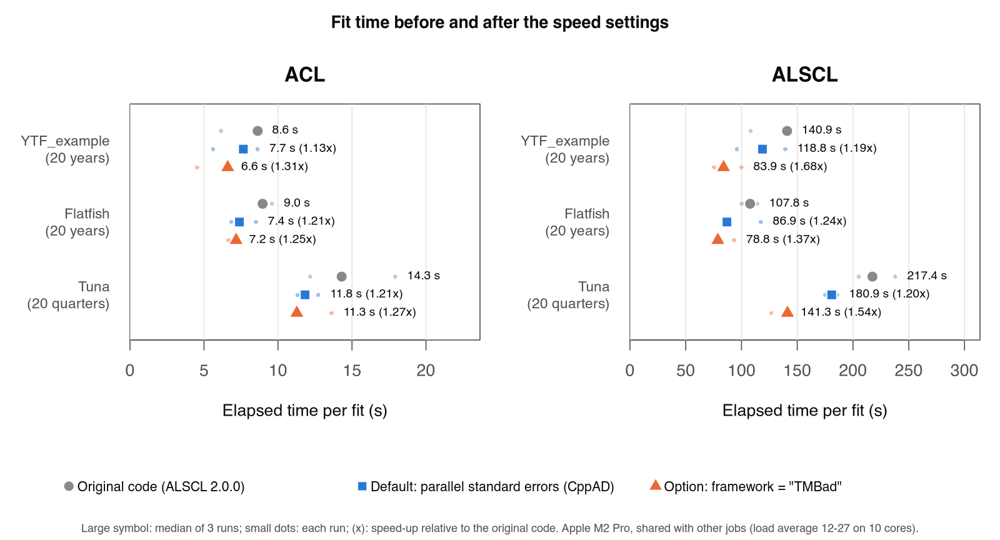
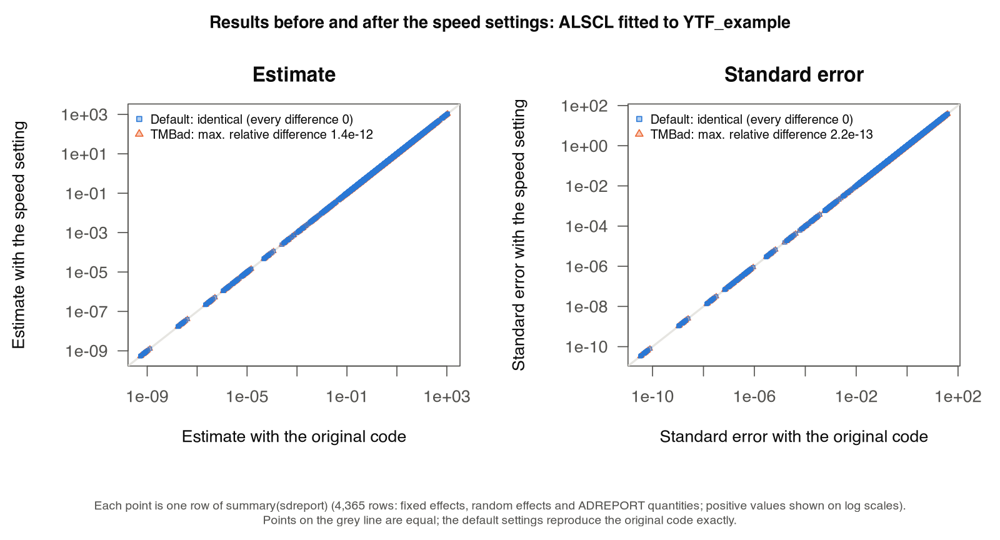

# 速度设置

本页带你确认本会话如何计算标准误、选择核数、决定是否用 TMBad 库编译模型，并了解实测的提速幅度。你需要已安装的软件包和[安装 ALSCL 并完成第一次拟合](getting-started.html)中的输入列表 `x`；第 1 步的 ALSCL 拟合需要一到两分钟。[技术记录](https://github.com/FanZhang-LAB-SHOU/ALSCL/blob/main/docs/SPEED.md)（英文）说明每项改动的测试和审查方法。

默认设置适合日常使用：在支持的会话中，拟合用多个核计算标准误，并行标准误与相同拟合参数处的顺序计算逐位相同。这由两项设置控制，均通过 `alscl_speed()` 设定：

| 设置 | 默认值 | 结果 | 速度 | 何时修改 |
|---|---|---|---|---|
| `sd_cores` | `"auto"`：最多 4 核 | 与顺序计算逐位相同 | 基准测试中拟合快 1.13-1.24 倍（macOS 终端） | 在自己的并行循环中设为 `1`；需要固定核数时设为一个数 |
| `framework` | `"CppAD"`，TMB 的默认库 | 基准 | 基准 | `"TMBad"` 使拟合快 1.25-1.68 倍，但结果末位不同（第 3 步） |

<h2 id="check">1. 确认本会话的实际情况</h2>

```r
library(ALSCL)
alscl_speed_info()   # 当前设置在本机上的实际效果
x <- YTF_example
fit <- run_alscl(x, silent = FALSE)
fit$sd_info          # 标准误的计算方式与耗时
```

`alscl_speed_info()` 打印设置值、将使用的核数与方式、原因、自动微分库和 TMB 版本。`silent = FALSE` 时拟合会打印一行关于标准误的信息，`fit$sd_info` 保存同样的内容：`method`（`"forked processes"`、`"socket workers (delta method)"` 或 `"sequential"`）、`cores`、`seconds`，以及说明为何顺序计算的 `note`。在 macOS 终端中你应看到：

```r
#> Standard errors: forked processes on 4 cores, 9.0 s.
alscl_speed_info()
#> ALSCL speed settings
#>   sd_cores setting:                  auto
#>   cores for standard errors:         4
#>   standard errors computed by:       forked processes on 4 cores: Hessian and delta method
#>   reason:                            forked processes are safe here (macOS or Linux outside a GUI front-end)
#>   framework:                         CppAD
#>   cross-version numerical identity:  not guaranteed across package versions (the optimizer finishing step can change estimates at numerical precision)
#>   TMB version:                       1.9.21 (checked)
```

主要优化过程由 `nlminb()` 在固定效应上搜索，每次计算都对随机效应做一次内层牛顿优化（拉普拉斯近似），在当前实现中使用一个核。下述速度设置用于并行计算后续的标准误；选择 fork 进程时，也用于可选优化收尾的 Hessian 计算。独立初值可通过 `ncores` 并行运行。标准误随后由 `TMB::sdreport()` 计算：固定效应的 Hessian（每个固定效应两次梯度计算）和每个 ADREPORT 量的 delta 方法标准误（各年份、年龄与体长的补充量、丰度、生物量、产卵生物量、渔获量与捕捞死亡率；20 年 ALSCL 示例共 3,866 个量）。Hessian 各列和不同 ADREPORT 量的 delta 方法计算可分为独立任务。在相同拟合参数处，已测试的并行计算与顺序计算结果一致。基准测试中，ALSCL 拟合 `YTF_example` 的 20 年数据时，速度改动之前优化约 88 秒，Hessian 11.4 秒，delta 方法 10.6 秒。

在可以安全分叉的环境（macOS 或 Linux 终端中的 R 或 `Rscript`，以及计算集群），ALSCL 用 `parallel::mclapply()` 启动 R 会话的副本。每个副本已经包含拟合好的模型，因此 Hessian 的各列和 delta 方法几乎零开销地分配出去：20 年 ALSCL 示例的标准误在 4 个核上用 9.0 秒，顺序计算需 23.4 秒。Windows 没有分叉；R 的文档（`?parallel::mclapply`）也不建议在图形界面（R.app、RGui、RStudio、Positron）中或搭配多线程库（如 Apple 的 Accelerate BLAS）时分叉。在这些会话中 ALSCL 改用 socket 进程，即新启动的 R 进程，它们接收数据并重建模型。新进程在第一次计算梯度之前必须重建 TMB 的导数计算带，20 年 ALSCL 示例中这一步在 CppAD 下需 14 秒（TMBad 下 42 秒），比整个 Hessian 还长。因此使用 socket 进程时，Hessian 在主会话中计算；delta 方法分给 socket 进程，它们只需要目标函数的梯度计算带（约 0.1 秒建好），并从主会话接收随机效应 Hessian；ALSCL 先在主会话中计算几个 ADREPORT 量以测出每个量的耗时，只有当剩余的量预计超过约 3 秒时才启动进程。因此小模型（如大多数 ACL 拟合）在主会话中计算标准误。20 年 ALSCL 示例中，delta 方法在 4 个 socket 进程上用 6.5 秒，顺序计算需 13.9 秒（其中启动进程 0.3 秒，在进程中重建模型 0.9 秒）。

| 情况 | 处理方式 |
|---|---|
| `sd_cores = 1`，或只有 1 个核可用 | 顺序计算的 `TMB::sdreport()` |
| `retro_model()` 或 `sim_acl()` 中在并行进程里运行的拟合 | 每个拟合用 1 核，进程数保持有限 |
| 已安装的 TMB 版本不在核对过的版本之列（1.9.21 和 1.9.25） | 顺序计算的 `TMB::sdreport()`；`fit$sd_info$note` 会注明 |
| 启动 socket 进程省不下时间（计算量小） | 在主会话中计算 |
| 并行计算失败（例如进程启动失败） | 给出警告，然后顺序计算 `TMB::sdreport()`；结果不受影响 |

并行实现对每项任务复现顺序计算的算术过程。Hessian 各列采用 `stats::optimHess()` 的参数扰动方式，每次梯度计算从同一点开始随机效应的内层优化。测试用 `identical()` 将结果与 `TMB::sdreport()` 比较，覆盖 CppAD 和 TMBad 下的 ACL 与 ALSCL。分叉测试在 macOS、Linux 上运行；socket 测试也在 Windows 上运行，Windows 跳过分叉测试。这些比较检查相同拟合参数和 AD 库下的标准误计算方法。报告结果时，请同时记录 `alscl_speed_info()` 和 `sessionInfo()`。

收尾需要计算 Hessian 时，在已验证的 TMB 版本且选择 fork 进程的会话中，共用 `sd_cores` 核数上限，并以自由固定效应数量为限。只有一个自由固定效应或使用 socket 的会话仍顺序计算；fork 失败时会警告并退回顺序计算。`fit$refinement$hessian_calculations` 记录每个已计算 Hessian 的方法、核数和回退说明。空表表示没有返回 Hessian；请结合 `fit$refinement$status` 区分跳过收尾与求值失败。

<h2 id="cores">2. 选择核数</h2>

```r
alscl_speed(sd_cores = 2)        # 为标准误指定固定的核数
alscl_speed_info()
alscl_speed(sd_cores = "auto")   # 恢复默认
```

- `"auto"`（默认）最多使用 4 个核，并为电脑的其他工作保留 1 个。在 macOS 和 Windows 上按物理核计数，并且不超过 Slurm（`SLURM_CPUS_PER_TASK`）或 `options(mc.cores = )` 分配给作业的核数。测试中超过 4 个核提升很小，因为优化本身只在一个核上运行。
- 指定一个数即使用这么多核。在计算集群上，请使用作业实际分配到的核数；`parallel::detectCores()` 可能报告整个节点的核数。
- 内存：分叉进程与 R 会话共享内存，直到内容被修改。每个 socket 进程都保存一份模型和数据；模型很大时，减少进程数可以节省内存。
- 初值：`run_acl()` 与 `run_alscl()` 中的 `ncores` 决定同时运行多少个初值；标准误在之后用 `sd_cores` 计算一次。
- 自己的并行循环：如果你自己并行运行许多拟合（例如用 `parallel::mclapply()`、`foreach` 或 `future`），请在工作进程中设置 `alscl_speed(sd_cores = 1)`，让每个拟合只用 1 个核。`ncores` 大于 1 时，`retro_model()`、`sim_acl()` 和 `fit_scenarios()` 会自动为其工作进程这样设置。`ncores = 1` 时它们在主会话中依次拟合，使用会话的 `sd_cores`；结果完全相同。
- macOS 或 Linux 上的 RStudio：`options(ALSCL.sd_backend = "fork")` 改用分叉进程，获得完整的加速。这是 R 文档不建议的做法，只有在你的会话运行拟合没有问题时才使用。

`alscl_speed_info()` 可确认选择。多核时内存不足就减少核数，例如 `alscl_speed(sd_cores = 2)`。

<h2 id="tmbad">3. 选择自动微分库</h2>

```r
alscl_speed(framework = "TMBad")   # 下一次拟合会用 TMBad 编译一次模型
args <- x  # YTF_example
alscl_speed(framework = "CppAD"); a <- run_alscl(args)
alscl_speed(framework = "TMBad"); b <- run_alscl(args)
max(abs(b$opt$par - a$opt$par) / abs(a$opt$par))   # 估计值的最大相对差
max(abs(b$est_std[, 2] - a$est_std[, 2]) / a$est_std[, 2], na.rm = TRUE)  # 标准误
```

TMB 可以用两种自动微分库之一编译模型。CppAD 是 TMB 的默认库，也是 ALSCL 的默认库。TMBad 计算拉普拉斯近似及其梯度要快几倍，因此优化和标准误的时间都会缩短，但它以不同的顺序计算同样的导数，结果的最后几位不同。基准测试中估计 5 个固定效应时，估计值的相对差最大 2.3e-11。在一个估计 10 个固定效应的 ACL 拟合中，相对差最大 2.7e-8（目标函数相差 1.7e-11）。

TMBad 适合探索性拟合、大量拟合（模拟研究、敏感性分析）等可以接受这种量级差异的场合。需要与用 CppAD 得到的结果（例如已发表的评估）完全一致时，请用 CppAD，并注明所用的库。上面的代码在你自己的数据上显示两者的差异；`args` 是你传给 `run_alscl()` 的参数列表。设置 `alscl_speed(framework = "TMBad")` 后第一次拟合较慢，因为模型要用 TMBad 编译一次；同一会话中之后的拟合会重复使用。

<h2 id="measured">实测加速效果</h2>

基准测试共 90 次拟合（ACL 与 ALSCL 分别拟合 `YTF_example`、flatfish 与 tuna 案例，各运行 3 次，Apple M2 Pro，测试期间有其他任务，在 macOS 终端中运行，因此使用分叉进程）：

| 模型、数据 | 速度改动之前 | 默认 | TMBad |
|---|---:|---:|---:|
| ACL，YTF_example | 8.6 秒 | 7.7 秒（1.13 倍） | 6.6 秒（1.31 倍） |
| ALSCL，YTF_example | 140.9 秒 | 118.8 秒（1.19 倍） | 83.9 秒（1.68 倍） |
| ALSCL，flatfish | 107.8 秒 | 86.9 秒（1.24 倍） | 78.8 秒（1.37 倍） |
| ALSCL，tuna（季度） | 217.4 秒 | 180.9 秒（1.20 倍） | 141.3 秒（1.54 倍） |



CppAD 比较中的估计值和标准误与改动前完全一致；下图比较 ALSCL 拟合 `YTF_example` 时 `summary(sdreport)` 的全部 4,365 行。TMBad 结果存在第 3 步所述的微小差异。这些耗时测于引入优化收尾步骤之前；当前拟合通过 `polish = TRUE` 启用该步骤，因此旧耗时不代表当前默认流程。收尾步骤可能在数值精度上改变估计值。



在模拟的 RStudio 会话中（macOS，设置 `RSTUDIO=1`，因此使用 socket 进程；10 核机器的负载约为 12），20 年 ALSCL 拟合的标准误在 4 个 socket 进程上用 25.4 秒，顺序计算需 28.3 秒；整个拟合用 114.9 秒，顺序计算需 120.4 秒；结果逐位相同。使用 socket 进程时，提升只来自 delta 方法；在主会话中计算的 Hessian 约占标准误时间的一半。固定效应越多（Hessian 的列越多）、ADREPORT 量越多（时间序列越长、体长组越多），提升越大：一个估计 10 个固定效应的 ACL 拟合，标准误在 4 个分叉进程上用 1.6 秒，顺序计算需 3.7 秒。

<h2 id="troubleshoot">故障排查</h2>

| 信息或现象 | 含义与处理 |
|---|---|
| `Parallel standard errors failed (...); computing them sequentially.` | 无法启动进程或某个进程出错。标准误已改为顺序计算，结果正确。若经常出现，请设置 `alscl_speed(sd_cores = 1)`。 |
| `Standard errors: sequential (TMB x.y.z was not checked)` | 并行代码只复现核对过的 TMB 版本的 `TMB::sdreport()`。结果正确；要在其他 TMB 版本上并行计算，请用该版本运行包的测试（`tests/testthat/test-speed.R`），再把版本号加入 `R/speed.R` 中的清单。 |
| `Standard errors: sequential (too little work to start socket workers)` | 在图形界面或 Windows 中，模型较小，启动进程省不下时间。 |
| RStudio 中没有加速 | 查看 `alscl_speed_info()`。使用 socket 进程时只有 delta 方法被分配出去；在 macOS 或 Linux 上，`options(ALSCL.sd_backend = "fork")` 可获得完整加速，风险自负。 |

<h2 id="options">高级选项</h2>

这些选项用于测试和特殊情况；默认值适合日常使用。恢复默认用例如 `options(ALSCL.sd_backend = NULL)`。

| 选项 | 作用 |
|---|---|
| `options(ALSCL.sd_backend = "fork")` | 即使 R 不建议，也使用分叉进程（Windows 上总是使用 socket 进程） |
| `options(ALSCL.sd_backend = "socket")` | 即使可以安全分叉，也使用 socket 进程 |
| `options(ALSCL.sd_socket_min_seconds = 3)` | 启动 socket 进程前 delta 方法的最短预计耗时（秒）；设为 `0` 时总是启动 |
| `options(ALSCL.tmb.cache = path)` | 存放已编译模型的文件夹 |
| `options(ALSCL.se_level = "hessian")` | 只计算标量参数的协方差并检查 Hessian，派生量的标准误为 `NA`；`"none"` 跳过标准误计算，默认为 `"full"`。`retro_model()` 和不保存拟合的 `hindcast_model()` 对其拟合使用 `"hessian"`，因为它们用不到这些标准误 |
| `options(ALSCL.delta_method = "blocked")` | 分块计算 delta 方法标准误，速度更快，与默认的 `"exact"` 计算只差舍入误差 |

<h2 id="next">下一步</h2>

| 想做什么 | 阅读 |
|---|---|
| 在工作进程上运行多个初值或多次拟合 | [复现结果与排除故障](reproducibility.html#parallel) |
| 在会话之间保留编译好的模型 | [复现结果与排除故障](reproducibility.html#compile) |
| 用多个核运行回溯分析的各轮 | [运行回溯分析](retrospectives.html) |
| 拟合大量模拟重复 | [模拟调查数据](simulation.html) |
